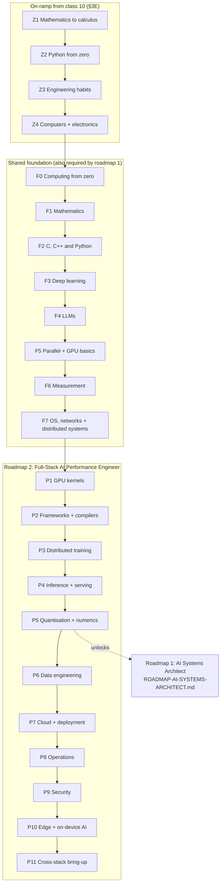
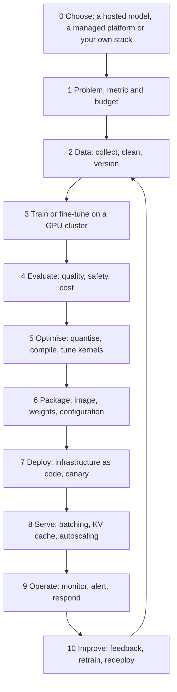
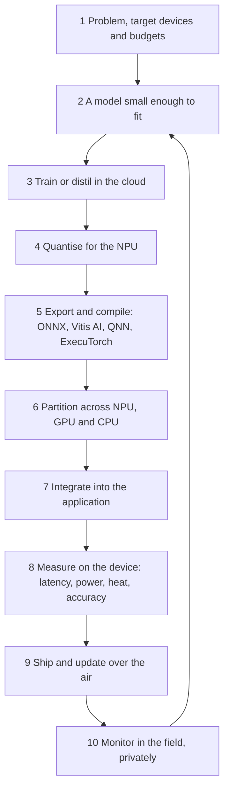
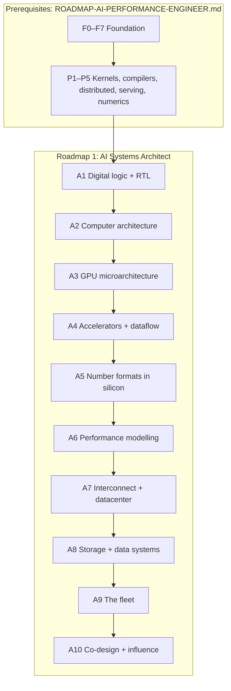

# Unified AI Roadmap

<a id="month-index"></a>
## Choose your month

- **Months 1-15: AI performance engineering** - foundations, AI/ML, GPU performance, cloud and edge deployment.
- **Months 16-22: AI systems architecture** - RTL, hardware architecture, performance modelling and co-design.

Open your month, follow its daily plan and linked lessons, then use Next month. These are the original calendar milestones; extend the pace as needed.

| Month | Track | What you study |
|---|---|---|
| [Month 1](#month-01) | Performance engineering | school mathematics, first programs, first tools |
| [Month 2](#month-02) | Performance engineering | vectors, probability, electronics and the on-ramp gates |
| [Month 3](#month-03) | Performance engineering | computing from zero, then mathematics for machine learning |
| [Month 4](#month-04) | Performance engineering | optimisation and numerics, then C, a shell and an allocator |
| [Month 5](#month-05) | Performance engineering | data structures, Python, modern C++ and concurrency |
| [Month 6](#month-06) | Performance engineering | deep learning, from autograd to your own GPT |
| [Month 7](#month-07) | Performance engineering | LLM arithmetic, then your first GPU kernels |
| [Month 8](#month-08) | Performance engineering | measurement, operating systems and networks |
| [Month 9](#month-09) | Performance engineering | consensus and storage, then the GEMM ladder |
| [Month 10](#month-10) | Performance engineering | kernels and compilers, on the GPU and on the NPU |
| [Month 11](#month-11) | Performance engineering | distributed training and serving at scale |
| [Month 12](#month-12) | Performance engineering | serving on a device, quantisation and data engineering |
| [Month 13](#month-13) | Performance engineering | device telemetry, cloud deployment and operations |
| [Month 14](#month-14) | Performance engineering | security, and the edge application with its cloud side |
| [Month 15](#month-15) | Performance engineering | the capstone, in the cloud and on a device |
| [Month 16](#month-16) | Systems architecture | logic, RTL and silicon, then the quantitative method |
| [Month 17](#month-17) | Systems architecture | caches, memory and the cost of silicon, then the GPU from the inside |
| [Month 18](#month-18) | Systems architecture | a model of your GPU, then accelerators and dataflow |
| [Month 19](#month-19) | Systems architecture | number formats in silicon, then performance modelling |
| [Month 20](#month-20) | Systems architecture | the device model, the cluster and its facility |
| [Month 21](#month-21) | Systems architecture | storage and the fleet, on both sides |
| [Month 22](#month-22) | Systems architecture | the hardware proposal |
<!-- MONTH-INDEX-END -->

**Every original word is preserved.** Only added navigation and explanatory clutter have been simplified.

[Breadth and deployment checklist](#breadth-upgrade) | [Topic index](#master-contents) | [Sources and verification](#source-order-index)

<details>
<summary>About this roadmap</summary>

Four complete original roadmaps, merged on 1 November 2026: 134,108 original whitespace-delimited tokens, 866,465 original bytes and 178 intact source sections. Textbooks, stack guides and diagrams are not merged; their original reference links remain.

The monthly and topic indexes are two views of the same programme, not consecutive courses. Navigation is added; supplemental study material is labelled ADDED. Original wording, numbering, repeated content and schedules remain unchanged.

Original cross-file links are also preserved. Use the adjacent Related links box for corrected same-document destinations. Original section numbers refer to their named source.

Preservation does not validate changing hardware/version claims or guarantee completion dates, seniority or hiring outcomes. Check current technical requirements before using them.

</details>

<a id="master-contents"></a>
<details>
<summary>Browse by topic</summary>

| Phase | Topic |
|---|---|
| 00 | [Orientation, prerequisites and the combined study method](#phase-00) |
| 01 | [Starting from zero: computing, Python and engineering habits](#phase-01) |
| 02 | [Mathematics, calculus, optimisation, information theory and numerics](#phase-02) |
| 03 | [Probability, statistics, SQL, data analysis and experimentation](#phase-03) |
| 04 | [Classical machine learning, model selection and evaluation](#phase-04) |
| 05 | [C, C++, operating systems, networks and distributed foundations](#phase-05) |
| 06 | [Neural networks, PyTorch, training techniques and computer vision](#phase-06) |
| 07 | [Sequence models, transformers, language models and research literacy](#phase-07) |
| 08 | [NLP, GenAI, retrieval, ranking, agents and application specialisations](#phase-08) |
| 09 | [Accelerator fundamentals, systems thinking, profiling and measurement](#phase-09) |
| 10 | [GPU kernels, vendor programming and performance optimisation](#phase-10) |
| 11 | [Framework internals, compilers, custom operators and portability](#phase-11) |
| 12 | [Distributed training, collective communication and scale](#phase-12) |
| 13 | [Inference, model serving, quantisation and compression](#phase-13) |
| 14 | [Data engineering, cloud, deployment, MLOps, operations and security](#phase-14) |
| 15 | [Edge, mobile, NPU and heterogeneous deployment](#phase-15) |
| 16 | [Model enablement, integrated capstones and cross-stack qualification](#phase-16) |
| 17 | [Hardware architecture and co-design: the complete A1-A10 pathway](#phase-17) |
| 18 | [Portfolio, assessment, career development and interview conversion](#phase-18) |
| 19 | [The complete 660-day calendar, subject index and expert tracks](#phase-19) |
| 20 | [Original front matter, contents, resource catalogues and verification notes](#phase-20) |

</details>

---
<a id="phase-00"></a>
## PHASE 00 - Orientation, prerequisites and the combined study method

[All months](#month-index)

<details>
<summary>Phase guide and lesson index</summary>

*Reading guide (added):* Read the combined instructions, then the original scope and prerequisite material. You are following one programme with several preserved source perspectives, not buying or starting another course.

- [OVERVIEW](#block-c-006)
- [A. Programme scoping, depth tiers and target lanes](#block-c-007)
- [WEEKLY MODULES](#block-c-013)
- [1. The role: what "done" looks like](#block-p-003)
- [2. The whole path in one picture](#block-p-004)
- [3. How every stage is structured](#block-p-005)
- [3C. The whole story: one project, end to end](#block-p-007)
- [3D. The complete syllabus: every subject, basic to expert](#block-p-008)
- [3F. AI in the cloud and AI at the edge: the two end-to-end flows](#block-p-046)
- [3H. Both sides of every domain: cloud and edge](#block-p-048)

</details>

<!-- ADDED-MATERIAL-BEGIN phase-00 -->
### ADDED ROADMAP GUIDANCE: how to follow all of this without juggling files

1. Start at Phase 01, after checking the placement and lab guidance in this phase.
2. Read the original blocks in the listed order within each phase. Each has its own
   source label, original line range and a permanent internal link.
3. Keep every original Learn, Build, Check yourself, Done when, exercise, project,
   industry-use-case and reference section. Nothing here silently downgrades them.
4. When two blocks teach the same idea, use the second for reinforcement and extra
   requirements. One piece of evidence can satisfy identical requirements, but
   distinct experiments and acceptance criteria still need their own evidence.
5. Advance when the relevant original gates pass. If a block previews a later
   subject, follow its prerequisites and return; do not pretend recognition is mastery.
6. Phase 18 holds the complete portfolio and assessment material. Consult it
   throughout, not only after finishing the learning.
7. Phase 19 supplies the original day-by-day calendar. The calendar and the learning
   sequence are two views of the same material, not consecutive programmes.

**Do not discard the specialist material.** All source depth labels and expert
extensions remain. You can choose what to work on now, but that does not remove
anything from this master document. A topic marked advanced in an original stays
available in full here.

**One progress record:** phase; source block; original stage/exercise identifier;
evidence location; test result; gaps; next action. A watched lecture is not the
same as a passed build gate.

**Conflicting schedules and claims:** original ten-week, conversion, model-to-hardware
and 22-month estimates are preserved verbatim. Treat them as their authors' planning
contexts, not simultaneously binding deadlines. No new deadline, seniority claim,
salary promise or guaranteed outcome is imposed by this merge.

**Reading versus doing:** you need not read the original resource catalogues and
revision logs before writing your first program. They are retained in Phase 20,
not deleted. The main navigation lets you stay inside this document.
<!-- ADDED-MATERIAL-END phase-00 -->

---
<a id="block-c-006"></a>
*Source: AI / ML / DL curriculum.*

<!-- ROADMAP-SOURCE-BEGIN C-006 bytes=14 sha256=732db1013125cb175693e1bcd69a5359127bf91f9bef290b6d3dd52feb72d258 -->
# OVERVIEW


<!-- ROADMAP-SOURCE-END C-006 -->


[All months](#month-index)

---
<a id="block-c-007"></a>
*Source: AI / ML / DL curriculum.*

<!-- ROADMAP-SOURCE-BEGIN C-007 bytes=16697 sha256=75d8fd7281119be315ae66ddbe130fbb8294158f6840058f9650a914d4d2c591 -->
## A. Programme scoping, depth tiers and target lanes

### 0.1 Time budget and honest scoping

| Commitment | Total hours over 10 weeks |
|---|---|
| 4 hours/day, 7 days/week | 280 hours |
| 6 hours/day, 7 days/week | 420 hours |
| 8 hours/day, 7 days/week (full-time) | 560 hours |
| Original 30-week source plan at 4 hrs/day | 840 hours |

The compression from 840 hours to 280–560 is real and is addressed explicitly rather than concealed.
No topic from the source material has been removed. Instead, every topic is assigned a **depth tier**
that governs how deeply it is treated within the 10-week window. Topics assigned the lowest tier
remain fully documented here, with their resources, and form the post-programme backlog.

> **Note on Week 1 (v2.2).** The programme was consolidated from eleven modules to ten by merging
> the two mathematics modules — linear algebra and calculus/optimisation/information theory — into a
> single **Week 1**. No content was removed in that merge; Week 1 is therefore a **double-weight
> module** and should be expected to take roughly two weeks at 4 hrs/day, or one week at
> full-time intensity. Its two halves are marked in the module itself. Every other module maps
> one-to-one onto its predecessor.

A curriculum claiming complete mastery of this scope in 10 weeks would not survive contact with a
technical interview. This one does not make that claim. Section 0.5 states the realistic outcome.

**The 10-week boundary and what lies beyond it.** Ten weeks is sufficient to build the knowledge
and the portfolio. It is arithmetically insufficient to also complete the interview volume required
by large technology organisations — principally the algorithmic problem count, which cannot be
compressed below roughly 150 problems without accepting a materially lower pass rate. This version
therefore separates two things the source material conflated:

| Phase | Duration | Purpose | Location |
|---|---|---|---|
| **Programme** | 10 weeks | Knowledge and portfolio construction | Overview + Weekly Modules |
| **Conversion** | 4–6 weeks | Interview execution and applications | **Section 10.16** |

The conversion phase is not optional padding. For a candidate whose objective is an offer rather
than a certificate, it is the phase in which the offer is actually won, and it is scheduled here
rather than left as the source material's undefined "intensively thereafter".

### 0.2 Depth tiers

| Tier | Definition | Completion test |
|---|---|---|
| **[BUILD]** | Implemented from first principles in code, and working | Can be reproduced on a blank page |
| **[KNOW]** | Mechanism understood; explainable in interview; library usage fluent | Can be taught to a peer in five minutes |
| **[AWARE]** | Term recognised; the problem it solves and its relevance understood | Will not cause a blind spot in technical discussion |

A **[BUILD]** topic is not complete without working code. A **[KNOW]** topic is not complete because
a video was watched.

### 0.3 Daily structure

| Block | 4 hr/day | 6 hr/day | Purpose |
|---|---|---|---|
| Theory | 0.5 hr | 1.0 hr | Video, book, documentation |
| **Implementation** | 2.0 hr | 3.5 hr | Writing code — the primary learning mechanism |
| **Data structures and algorithms** | 1.0 hr | 1.0 hr | Eight to ten problems per week |
| Review, notes, CS fundamentals | 0.5 hr | 0.5 hr | Restating concepts; operating systems and architecture reading |

Where time is constrained, the theory block is reduced. The implementation block is not.

**Revised in version 2.0.** The algorithms block was previously 0.5 hr/day at three to five problems
per week, which yields 33–55 problems across the programme against a stated target of 150–200 — a
shortfall of roughly three to four times, silently deferred to an unscheduled period. The block is
now 1.0 hr/day at eight to ten problems per week, delivering approximately 110 problems within the
programme, with the balance scheduled explicitly in Section 10.16. The additional half-hour was taken from
the theory block in both columns, consistent with Operating Principle 1. Total daily hours are
unchanged.

### 0.4 Operating principles

1. **Implementation over consumption.** A tutorial watched is not a skill acquired.
2. **Public delivery each week.** Work not committed to a public repository does not constitute
   evidence.
3. **Restatement in plain language.** A concept that cannot be explained simply is not understood.
4. **Measurement over assertion.** Performance claims require numbers and a reproducible method.
5. **Depth over breadth.** One thoroughly understood project outweighs ten tutorials.
6. **Sequential completion.** Partial understanding compounds into confusion downstream.
7. **Time-boxed debugging.** After 45 minutes without progress, change approach — read the source,
   search the error, escalate.

### 0.5 Learning outcomes

On completion, a participant will be able to:

- Derive and implement backpropagation without a framework
- Build, train and evaluate convolutional and transformer architectures from published papers
- Apply classical machine learning to tabular problems with statistically honest evaluation
- Build a two-stage retrieval-and-ranking system and evaluate it with ranking metrics
- Explain the reinforcement learning formulation underlying RLHF and DPO
- Fine-tune and serve large language models, including retrieval-augmented pipelines
- Containerise, deploy, monitor and document a model in production form
- Produce a written ML system design under interview conditions
- Profile a model, identify the bottleneck class, and optimise inference with measured evidence
- Present **eleven portfolio artefacts** with reproducible results, plus a merged open-source
  contribution

**Realistic positioning:** internship-ready and junior-engineer-ready. This programme does not
produce senior engineers and does not represent itself as doing so.

**A necessary distinction.** Completing the 10 weeks produces a *qualified candidate*. Converting
that into an offer at a large technology or semiconductor organisation additionally requires the
algorithmic volume, system design repetitions, mock interviews and application timing set out in
Section 10.16. Candidates who complete the Overview and Weekly Modules and skip Section 10.16 are, in the author's assessment, the
most common failure profile: strong portfolio, failed coding screen.

### 0.6 Gaps identified in source material

Established by reading all 102 pages of the source document.

> **Verification notice (added in v2.0).** The 102-page source document is not distributed with this
> curriculum and was not available for re-inspection during the version 2.0 audit. The four claims
> in the table below are therefore **UNVERIFIED** as of this revision: they are carried over from
> version 1.0 in good faith but cannot be independently confirmed from the materials at hand.
> The resolutions listed in the right-hand column *are* verifiable, because they exist in this
> document.

| Gap | Evidence (unverified) | Resolution (verifiable) |
|---|---|---|
| **Week 23 absent** | The document sequences Week 22 directly to Week 24. "Stage 5 — MLOps" appears in the final checklist without a corresponding module. | Addressed in Week 9 |
| **No GPU or performance content** | No coverage of profiling, roofline analysis, memory bandwidth, kernel authoring, quantisation, ONNX, TensorRT or MLPerf anywhere in the document | Addressed in Week 10 |
| **No DSA preparation** | Coding interviews listed as a requirement in Week 25 without supporting material | Addressed as a continuous track, and scheduled in Section 10.16 |
| **No code or deliverables** | The document enumerates topics but does not specify what is to be built | Every module now terminates in a deliverable |

### 0.7 Version 2.0 audit — defects corrected and gaps closed

The version 1.0 document was audited line by line against its stated target. Findings and
resolutions:

#### Internal defects corrected

| # | Defect in v1.0 | Correction |
|---|---|---|
| 1 | Week 10 was headed "Portfolio artefacts 7 and 8" but listed **three** deliverables; the profiling study appeared in neither artefact register | Week 10 now declares artefacts 9, 10 and 11, and the profiling study appears in both registers |
| 2 | "Eight portfolio artefacts" was asserted in three places while the registers numbered nine rows and the weekly modules produced ten items — the count did not close | Artefact count is now stated once, consistently: **eleven weekly artefacts plus one open-source contribution** |
| 3 | Mixed precision was stated as delivering "approx. 2× throughput" as a flat fact, contradicting the roofline material later in the same document | Claim now qualified by bottleneck class and hardware, and cross-referenced to Week 10 |
| 4 | The Andrew Ng resource was labelled "Machine Learning"; the link resolves to course 1 of 3 of the Machine Learning Specialization (verified by fetch) | Label corrected; course 3, which covers reinforcement learning and recommenders, is now linked separately |
| 5 | Section 0.6 asserted specific facts about a source document not available for inspection | Marked UNVERIFIED above |
| 6 | arXiv Sanity was listed as a working resource; it did not respond when fetched | Flagged as unverified in Overview E |

#### Structural gaps closed

| Gap in v1.0 | Consequence for the stated target | Resolution |
|---|---|---|
| **Algorithms volume under-scheduled 3–4×** | The highest-variance filter for an undergraduate candidate was deferred to an undefined period | Section 0.3 rebalanced; Section 10.13.1 rewritten; Section 10.16 added |
| **Recommender systems and ranking absent** | No two-tower retrieval, learning-to-rank, ranking metrics, calibration or position bias — the largest ML application area at consumer-scale organisations | **Week 8, Track D** added, with a portfolio artefact |
| **Reinforcement learning absent** | RLHF and DPO were named without MDPs, policy gradients or PPO, making the claimed understanding unsupportable | **Week 8, Track C** extended with RL foundations |
| **ML system design had no depth and no artefact** | A dedicated interview round was covered in four lines, and *Designing Machine Learning Systems* was listed but never assigned | **Week 9, Part D** added, with written design deliverables |
| **CS fundamentals assessed but never taught** | Section 10.13 required operating systems and architecture; no resource for either appeared in the document | **Continuous track** added in Section 1.7 |
| **AMD/ROCm and C++ under-specified** | CUDA was taught "at concept level" with no HIP, ROCm libraries or reading-level C++, narrowing the accessible role surface | **Week 10, Parts B, E and H** extended |
| **Inference topics missing from the differentiating module** | No speculative decoding, GQA/MQA, MoE, or online-softmax numerics — the last being required by the Triton kernel the module asks for | **Week 10, Parts B and D** extended |
| **Experimentation, LLM security, GNNs, early SQL** | Assessed or production-relevant topics with no coverage | Added to Weeks 2, 8 and 9 |

### 0.8 Two target lanes — routing decision

*Added in v2.1, after the target was specified as **both** large consumer technology organisations
**and** semiconductor organisations, spanning model through to hardware.*

These two targets share a foundation and then diverge sharply. They are not the same preparation, and
attempting both at equal depth produces a candidate who is competitive for neither. The shared core is
substantial — Weeks 1 through 7 and the continuous tracks are common to both — after which the lanes
separate.

| | **Lane A — Product and applied ML** | **Lane B — Model-to-hardware / framework** |
|---|---|---|
| **Typical employers** | Large consumer technology and platform organisations | Semiconductor vendors, accelerator and cloud-infrastructure providers, framework teams |
| **Representative roles** | ML Engineer, Ranking/Search Engineer, Applied Scientist, MLOps Engineer | Model Enablement Engineer, Framework Integration Engineer, Inference/Performance Engineer, Kernel Engineer, ML Systems Engineer |
| **The question you are hired to answer** | "Does this model improve the product, and can we prove it?" | "Does this model run correctly and fast on this silicon, and can you prove it?" |
| **Shared core** | Weeks 1–7, continuous tracks (Section 1.7), Section 10.13, Section 10.16 | Identical |
| **Lane-specific depth** | Week 8 Track D (ranking) · Week 2 Part B2 (experimentation) · Week 9 Parts A–D (MLOps and system design) | **Week 10 in full** · **Section 10.17 in full** (framework internals, compiler stack, ROCm/HIP, distributed training, model bring-up, edge and NPU) |
| **Differentiating artefacts** | 1, 5, 6, 7, 8 | **9, 10, 11, and 12–19** |
| **Language** | Python throughout | Python primary, **reading-level C++ required**, HIP/CUDA reading required |
| **The rare skill** | Honest evaluation and offline/online reasoning | Diagnosing where in the stack a problem lives, and fixing it at the right layer |

**Lane B has two sub-paths**, and they are worth distinguishing because they need different hardware
and lead to different teams:

| | **B1 — Datacentre** | **B2 — Client, edge and NPU** |
|---|---|---|
| **Silicon** | Datacentre GPUs and accelerators | NPUs and integrated GPUs in laptops, phones, vehicles, embedded devices |
| **Stack** | ROCm, HIP, distributed training, serving at scale | ONNX Runtime execution providers, LiteRT, ExecuTorch, vendor NPU toolchains |
| **Binding constraint** | Throughput and cost per token | Power, thermal envelope, and whether the graph fits the accelerator at all |
| **Section 10.17 stages** | 1, 2, **3, 4**, 5 | 1, 2, **6**, and 5's methodology |
| **Artefacts** | 14, 15, 16, 17 | **18, 19** |
| **Hardware barrier** | High — needs real datacentre parts | **Low — a laptop, a phone, or a hosted device service** |

Both AMD and Qualcomm staff substantial organisations on the B2 side. **If accelerator access is your
constraint, start at B2**: artefact 18 requires only hardware you already own, and every skill in
Stage 6 — execution providers, partitioning, quantisation, disciplined measurement — transfers
directly upward into B1.

#### How to use the two lanes

**Both lanes complete Weeks 1–10.** The difference is the weighting, and what happens after Week 10.

- **Lane A** treats Week 10 at the depth written (profiling, one Triton kernel, one inference study)
  and does not enter Section 10.17. This is sufficient: product ML roles assess performance awareness, not
  performance engineering.
- **Lane B** treats Week 8 Tracks A, B and D at [KNOW] rather than [BUILD] — survey them, build none
  of them — and reinvests that time in Week 10 and then in **Section 10.17**, which is the lane's real
  content and does not fit inside ten weeks.
- **A candidate genuinely pursuing both** should complete the shared core, then Lane B, then add
  artefact 6 (ranking) from Lane A. Lane B's material is harder to acquire independently and is held
  by far fewer applicants, so it is the correct thing to be deep in if you can only be deep in one.
  Ranking can be added on top; the reverse is much harder.

**Honest scoping for Lane B.** Section 10.17 is a further eight to twelve weeks of work beyond the
programme. It is presented as a distinct Part rather than compressed into Week 10 because pretending
otherwise would repeat exactly the defect this document's own audit identified in Section 0.7 — a
requirement stated without a schedule attached to it.

#### Content demoted to create room

The additions above were funded, not appended. The following were compressed or demoted, on the
grounds of low return against the stated target: research-tier advanced mathematics (Section 1.18), set
theory and Boolean algebra (Week 2, Part C), low-tier calculus topics (Week 1, Part A), the tutorial
tier of the project catalogue (Overview C), duplicated ethics reference material (Section 9.9), leadership and
Agile process content (Section 10.15), historical CNN architectures, recurrent network gate-level detail,
classical NLP and image-processing techniques, and second-framework (TensorFlow/Keras) coverage.
Nothing was deleted outright; demoted material retains its tier marking and its resources.

---


<!-- ROADMAP-SOURCE-END C-007 -->


[All months](#month-index)

---
<a id="block-c-013"></a>
*Source: AI / ML / DL curriculum.*

<!-- ROADMAP-SOURCE-BEGIN C-013 bytes=2125 sha256=3523d1e7374f739132ba4ddccedc4ad9cd63484447aaf98bab9388ff63f3d9c1 -->
# WEEKLY MODULES

| Wk | Module | Primary deliverable | Also contains |
|---|---|---|---|
| **1** | Mathematics: Linear Algebra, NumPy, Python Engineering **+** Calculus, Optimisation, Information Theory *(double weight)* | Linear regression in pure NumPy; gradient descent from first principles | Advanced mathematics (research tier) |
| 2 | Probability, Statistics, Discrete Mathematics, Data Handling, Experimentation, SQL | Statistical EDA report with pre-registered experiment design | — |
| 3 | ML Foundations and Supervised Learning | Seven-algorithm comparison study | — |
| 4 | Unsupervised Learning, Model Selection, Tuning | End-to-end tabular ML project *(artefact 1)* | — |
| 5 | Neural Network Fundamentals and PyTorch | NumPy backpropagation with PyTorch port *(artefact 2)* | — |
| 6 | Training Techniques, Optimisers, CNNs | ResNet reproduced from publication *(artefact 3)* | — |
| 7 | Sequence Models and Transformers | Mini-GPT implemented from scratch *(artefact 4)* | Research literacy |
| 8 | Specialisations: NLP, Vision, Generative AI, **Ranking**, **RL** | LoRA fine-tune with RAG; two-stage ranking system *(artefacts 5, 6)* | — |
| 9 | MLOps, Deployment, Data Engineering, **System Design**, Ethics | Containerised monitored API; written design portfolio *(artefacts 7, 8)* | Ethics expanded reference |
| **10** | Systems, GPU Performance, Inference, Career | Profiling study, kernel benchmark, inference study *(artefacts 9, 10, 11)* | Interview preparation · career tracks · professional skills · conversion phase · **model-to-hardware track (artefacts 12–19)** · programme close |

Continuous throughout: data structures and algorithms, computer science fundamentals, research
literacy (Section 1.7).

**Weeks 1 and 10 are the two heavy modules.** Week 1 carries the merged mathematics load; Week 10
carries the systems material plus everything that follows the taught curriculum — interview
preparation, career conversion, and the optional model-to-hardware specialisation track. Both are
signposted internally so the boundaries are clear.

---


<!-- ROADMAP-SOURCE-END C-013 -->


[All months](#month-index)

---
<a id="block-p-003"></a>
*Source: AI performance engineer roadmap.*

<!-- ROADMAP-SOURCE-BEGIN P-003 bytes=2539 sha256=08735e7b0518c2ba73e960d92abd515729ad2097eb80f4dc643a3235d7aa31c8 -->
## 1. The role: what "done" looks like

A **Full-Stack AI Performance Engineer** takes a model and a machine and closes the gap between what
the hardware can do and what the workload actually achieves. The work spans every layer, from Python
down to the ISA and out to the cluster, and the engineer proves the result with numbers that another
engineer can reproduce.

### Postings this roadmap targets

Fetched on 2026-09-23. The base ranges are shown as posted and will drift. They are here to show
where the role sits, not as a promise.

| Posting | Base range (as posted) | What it asks for |
| --- | --- | --- |
| OpenAI: Workload Porting & Performance Engineer | $347K–$445K | Title and range recorded here; read the posting for the full list |
| OpenAI: Systems Generalist, GPT Infrastructure | $293K–$445K | 8+ years; LLVM/MLIR, Triton, CUDA/ROCm; vLLM/SGLang |
| OpenAI: Inference Performance Optimization | $266K–$500K | Title and range only; no URL recorded |
| OpenAI: Training Performance | $295K–$500K | Title and range only; no URL recorded |
| Anthropic: Performance Engineer, GPU | Not recorded | Seen by title only |

### The six capabilities this roadmap builds

| Capability | Stages | The proof |
| --- | --- | --- |
| Write and tune kernels | F5, P1 | A GEMM ladder where a profiler counter explains every step |
| Understand what generates and launches them | P2 | A custom op that compiles with zero graph breaks |
| Scale across devices for training and serving | P3, P4 | Step time and SLO throughput predicted before they are measured |
| Feed it and ship it | F7, P6, P7, P10 | A resumable data pipeline, a GPU deployment rebuilt from code, and an on-device build that updates safely |
| Run it safely | P8, P9 | CI gates that block regressions, alerts that fire, and images that must be signed |
| Prove it | F6, P5, P8, P11 | Reproducible benchmarks, accuracy parity and regression gates |

Every capability is proven twice: once in the cloud and once on a device (§3H).

This role differs from an ML engineer because it owns the **gap**. "The model runs" is not the goal.
The goal is to say "the model runs at X% of what this hardware allows, this counter shows why, and
this is what closes the rest." The role also owns what surrounds the kernel: the data that feeds it,
the platform that serves it and the gates that protect it. A gap closed on a benchmark and reopened
by the next release, a starved input pipeline or a failed node was never closed.

---


<!-- ROADMAP-SOURCE-END P-003 -->


[All months](#month-index)

---
<a id="block-p-004"></a>
*Source: AI performance engineer roadmap.*

<!-- ROADMAP-SOURCE-BEGIN P-004 bytes=4733 sha256=d305ea48f4c231607368f1a74dd7a668b8acda9724d6abf9f938c245009878bc -->
## 2. The whole path in one picture



| Stage | Depth | You build | Gate (Done when) | Deepens in this repo |
| --- | --- | --- | --- | --- |
| Z1 | [BUILD] | Worked problems, checked in Python | Chain rule, matrix product, mean and variance, a minimum found two ways | Textbook Week 1 |
| Z2 | [BUILD] | Ten small programs; a plot of a function and its derivative | An unseen small problem solved alone | Textbook Week 1 |
| Z3 | [BUILD] | A public GitHub repository and a learning log | A pull request opened from the terminal | — |
| Z4 | [KNOW] | Circuits on a breadboard or in a simulator; a one-bit adder | Ohm's law, number bases and XOR, cold | — |
| F0 | [BUILD] | Float classifier; a CPU from NAND gates | Trace `c = a + b` to the ALU | — |
| F1 | [BUILD] | Stable softmax; hand-derived backprop | FLOPs, bytes and intensity of a GEMM, unaided | Roadmap Weeks 1–2; textbook Week 1 |
| F2 | [BUILD] | C shell and allocator; sanitizer-clean C++ library with Python bindings | Allocator survives its stress trace; TSan race found and fixed | — |
| F3 | [BUILD] | A GPT from scratch | Every tensor shape from memory | Roadmap Weeks 3–7 |
| F4 | [BUILD] | LLM calculator | Parameter count exact against a real checkpoint | Roadmap Week 8 |
| F5 | [BUILD] | HIP reduction ladder and tiled matmul | Bound predicted, then confirmed by counters | Roadmap §10.3; AMD-GPU-PATH §4–§6, §9 |
| F6 | [BUILD] | Benchmark harness | Planted regression caught | Roadmap §10.4; AMD-GPU-PATH §9, §13 |
| F7 | [KNOW]→[BUILD] | xv6 kernel labs; streaming server; Raft labs; fio study | xv6 labs graded; Little's law predicts the knee; Raft passes | Roadmap §10.2 |
| P1 | [BUILD] | GEMM ladder; Triton FlashAttention | A counter explains every rung | Roadmap §10.6, §10.17 Stage 3; AMD-GPU-PATH §7–§8, §11–§12 |
| P2 | [BUILD] | Custom op plus an Inductor fix | `opcheck` passes with zero graph breaks | Roadmap §10.17 Stages 1–2; AMD-GPU-PATH §2–§4, §8 |
| P3 | [BUILD] | FSDP, TP and PP training runs | Step time predicted | Roadmap §10.17 Stage 4; AMD-GPU-PATH §10 |
| P4 | [BUILD] | vLLM-on-ROCm sweep; one model behind three model servers | SLO throughput predicted | Roadmap §10.5; AMD-AI-STACK §10, §12 |
| P5 | [BUILD] | One model quantised three ways | An accuracy number beside every speed number | AMD-AI-STACK §5, §14 |
| P6 | [BUILD] | Reproducible corpus pipeline; resumable loader | Every drop counted; a killed run resumes identically | Roadmap Week 2 Part F, Week 9 Part B |
| P7 | [KNOW]→[BUILD] | IaC plus a Kubernetes GPU deployment with a canary | Rebuilt from code; the canary rolls back | Roadmap Week 9 Part A; AMD-AI-STACK §12 |
| P8 | [BUILD] | Registry, evaluation report, CI gates, dashboards | Planted regressions blocked; alerts fire | Roadmap Week 9 Parts A and D, §10.2 |
| P9 | [KNOW]→[BUILD] | Threat model, signed images, red-team exercise | Unsigned image refused; attack rate drops | Roadmap Week 9 Part C, Week 8 Track C |
| P10 | [KNOW]→[BUILD] | NPU + iGPU run; an application with signed model updates and a cloud cascade | Every fallback explained; a tampered update refused | Roadmap §10.17 Stage 6; AMD-AI-STACK §13–§13B; QUALCOMM-AI-STACK §5–§6B |
| P11 | [BUILD] | Capstone bring-up | A stranger reproduces it and rebuilds the deployment | Roadmap §10.17 Stage 5; AMD-GPU-PATH §13 |

From P1 to P10, every stage also has a second side with its own build and gate: an **Edge side**
block, or a **Cloud side** block in P10 (§3H). The table shows each stage's main side, and §23
tracks both.

---


<!-- ROADMAP-SOURCE-END P-004 -->


[All months](#month-index)

---
<a id="block-p-005"></a>
*Source: AI performance engineer roadmap.*

<!-- ROADMAP-SOURCE-BEGIN P-005 bytes=1423 sha256=c22534ba4e625dff619a4aac53cc6c7b646702ed64995c0a9e79a91e03c03c21 -->
## 3. How every stage is structured

- **Why.** One line on what the stage makes possible.
- **Learn.** Topics in order, each tagged **[BUILD]**, **[KNOW]** or **[AWARE]**.
- **Study path.** The order in which to work through the material, in three passes: foundation,
  core and advanced. Each pass names the resources to use, most of them listed under References.
- **Build.** The artefacts, with acceptance criteria. Every **[BUILD]** topic ends as working code.
- **Check yourself.** Questions to answer from memory, in writing, before you attempt the exit
  test. Each answer is in the Learn list or the references, and the numeric ones follow from
  formulas given there. If you cannot answer one, go back to its topic.
- **Done when.** The exit test. It is pass/fail and can be re-run. If it is not met, the stage is not
  done.
- **Traps.** Mistakes that make a result wrong while it still looks right.
- **Edge side** (P1–P9) or **Cloud side** (P10). The same domain on the other side of §3F: what
  changes, what to learn, one build, its own **Done when** and its traps. A stage is finished only
  when both of its sides pass (§3H).
- **References.** Primary sources first, then pointers into this repository.

In the Learn lists and study paths, the short names *roadmap*, *AMD-GPU-PATH*, *AMD-AI-STACK* and
*QUALCOMM-AI-STACK* refer to the documents linked in the introduction.

---


<!-- ROADMAP-SOURCE-END P-005 -->


[All months](#month-index)

---
<a id="block-p-007"></a>
*Source: AI performance engineer roadmap.*

<!-- ROADMAP-SOURCE-BEGIN P-007 bytes=5680 sha256=d60dc45f64c6a4d4fc9422cc9f754616d70da76b327fb751cbef508bda2b63d0 -->
## 3C. The whole story: one project, end to end

Everything you build goes into **one repository**. Each stage adds a directory, and later stages
reuse earlier ones. By P11 the repository is a working system that is measured, deployed to the
cloud and to a device, operated and secured, and its history shows how you got there.

Two models carry the story. **Your own GPT** from F3 is small enough to understand completely, so
every kernel, compiler change and parallel layout is tried on it first (P1–P3). **An open-weight
LLM** is the realistic workload from P4 onwards: you serve it, quantise it, deploy it, operate it
and secure it, and in P10 you fit a smaller version onto a device. In P11 you bring up one that you
have not used before.

### The repository

```text
llm-from-zero/
├── README.md       # headline numbers, and how to reproduce each one
├── notebook/       # one dated entry per run: command, commit, versions, result
├── bench/          # F6 harness, used by every later stage and by P8's CI gate
├── z-onramp/       # Z1 worked problems, Z2 programs, Z3 learning log, Z4 circuits
├── f0-computing/   # floatbits, summation-order study, Nand2Tetris
├── f1-maths/       # stable softmax, hand-derived backprop, FLOP and byte counter
├── f2-native/      # C shell, allocator and hash table; C++ matrix library, bindings, sanitizer CI
├── f3-gpt/         # autograd engine, tokenizer, your GPT
├── f4-calc/        # llm_calc.py: the predictions that P3, P4, P6 and P7 must match
├── f5-hip/         # reduction ladder, tiled matmul, measured roofline
├── f7-systems/     # xv6 labs, streaming server, retry client, fio study, 6.5840 labs
├── p1-kernels/     # GEMM ladder; Triton softmax, RMSNorm and FlashAttention
├── p2-compile/     # custom op, Inductor fix, IR dumps
├── p3-train/       # ring all-reduce; DDP, FSDP and TP runs of your GPT
├── p4-serve/       # vLLM sweep, speculative decoding, three-server comparison
├── p5-quant/       # one model quantised three ways, FP8 emulator
├── p6-data/        # DataTrove pipeline, contamination test, loader benchmark
├── p7-deploy/      # IaC, image, Kubernetes manifests, canary, cost report
├── p8-ops/         # registry, evaluation report, CI gates, dashboards, postmortem
├── p9-security/    # threat model, SBOM and signatures, pickle demo, red-team report
├── p10-edge/       # NPU and iGPU run, fallback report, app, signed updates, cloud cascade
└── p11-capstone/   # the end-to-end bring-up and its one-command reproduction
```

Each stage directory from `p1-kernels/` to `p9-security/` also holds an `edge/` subdirectory for
that stage's edge side, and `p10-edge/` holds a `cloud/` one (§3H).

### How the stages feed each other

| Stage | Adds | Reused by |
| --- | --- | --- |
| Z1–Z4 | Worked mathematics, first programs and a GitHub profile | F0–F2, and every habit after them |
| F0–F2 | Numerics experiments; a C shell and allocator; a C++ library with Python bindings | Debugging and native code in every later stage; the xv6 labs in F7 |
| F3 | Your GPT and tokenizer | P1 (its kernels), P2 (compiled), P3 (trained at scale) |
| F4 | `llm_calc.py` | P3 and P4 (predictions to test), P6 (checkpoint sizes), P7 (cost) |
| F5 | HIP kernels and a measured roofline | P1 (the first rungs); roadmap #1 A3 |
| F6 | `bench/` | Every later stage; P8 turns it into a CI gate |
| F7 | xv6 labs, a streaming server, a retry client and a fio study | P4 (the API layer), P6 (storage), P7 (rollouts and timeouts) |
| P1–P2 | Kernels and a custom op that plug into your GPT | P3, P4 and P11 |
| P3 | Distributed runs with predicted step times | P6 (checkpoints), P7 (gang scheduling); roadmap #1 A6 |
| P4–P5 | A measured serving configuration and a quantised model | P7 (deployed), P8 (gated), P11 |
| P6 | A reproducible corpus and a resumable loader | A second P3 run on data you built; P8 (lineage) |
| P7 | A deployment rebuilt from code | P8 (operated), P9 (secured), P10 (the cloud side of its cascade), P11 |
| P8–P9 | CI gates, alerts, a threat model and signed images | P10 (signed model updates), P11 |
| Edge sides of P1–P9 | Device kernels, fixed-shape builds, a distilled student, a device runtime study, NPU formats, device telemetry, a build farm and update service, device release gates, and a verifying library | P10 (assembled into its application), P11 |
| P10 | An on-device application with signed updates and a cloud cascade, and the cloud capacity behind it | P11 (its edge half) |
| P11 | The capstone | Your portfolio, and the evidence that roadmap #1 starts from |

### What you have at the end

- A repository from which a stranger can reproduce your headline numbers (F6, P11).
- One report per stage in the F6 format, with an accuracy number beside every speed number.
- At least one kernel or compiler fix submitted upstream, with benchmarks (P11).
- A deployment that anyone can tear down and rebuild from code, protected by CI gates, alerts and a
  signed supply chain.
- An on-device build of the same model that accepts only signed updates and hands hard requests to
  the cloud (P10, P11).
- Every domain worked twice, once for the cloud and once for a device, with both gates passed
  (§3H).

The programme's portfolio guidance is in
[`../AI-ML-DL-COMPLETE-ROADMAP.md`](../AI-ML-DL-COMPLETE-ROADMAP.md) §10.7 (Part F). Roadmap #1
continues the same story: its A-stages are validated against the measurements in this repository.

---


<!-- ROADMAP-SOURCE-END P-007 -->

<details>
<summary>Related links</summary>

- [`../AI-ML-DL-COMPLETE-ROADMAP.md`](#source-c)

</details>

[All months](#month-index)

---
<a id="block-p-008"></a>
*Source: AI performance engineer roadmap.*

<!-- ROADMAP-SOURCE-BEGIN P-008 bytes=1681 sha256=203360988ae12fe90ffeb4d06f507df829b2dc4fc9ac6c2f629a53ec89a682b5 -->
## 3D. The complete syllabus: every subject, basic to expert

The stages are the gated path; this section is the map they walk through. It covers every subject
the role touches, in five parts. Each subject gives:

- **Gated in:** the stage whose exit test proves it, or the programme week that teaches it;
- four levels, **Basic → Intermediate → Advanced → Expert**, which are the order to learn in;
- the **Tools** to install and use, the **Projects** to build and the books and courses to
  **Study from**.

The gating stage sets how deep you must go (**[BUILD]**, **[KNOW]** or **[AWARE]**). Expert
material beyond that is for when you specialise. Tools change quickly, so before you build on one,
check its documentation, its release activity and whether it supports your hardware.

| Part | Subjects | Gated in |
| --- | --- | --- |
| I. Computing foundations | Mathematics; C; C++; Python; data structures and algorithms; computer architecture; operating systems and Linux; compilers and runtimes; software engineering | F0, F1, F2, F5, F7, P2 |
| II. Systems | Networking; distributed systems; databases and storage engines | F7, P3, P6 |
| III. Machine learning | Classical ML; deep learning; LLMs; generative models beyond LLMs; LLM applications and agents | Programme Weeks 3–8; F3, F4, P3, P8, P9 |
| IV. Performance | GPU programming; frameworks and compilers; distributed training; inference and model serving; quantisation; performance engineering; edge AI | F5, F6, P1–P5, P10 |
| V. Production | Data engineering; cloud; DevOps and platform engineering; MLOps and LLMOps; observability and SRE; security; responsible AI | P6–P9 |


<!-- ROADMAP-SOURCE-END P-008 -->


[All months](#month-index)

---
<a id="block-p-046"></a>
*Source: AI performance engineer roadmap.*

<!-- ROADMAP-SOURCE-BEGIN P-046 bytes=6876 sha256=a411b074e413a87e804746c737e35a0b95b7ae4a9dd7eef34cbc36022b9d61e5 -->
## 3F. AI in the cloud and AI at the edge: the two end-to-end flows

A model reaches its users in one of two ways, or through a mix of both. **In the cloud**, it runs
on GPUs in a datacenter and users reach it over the network. **At the edge**, it runs on the user's
own device (a laptop, a phone, a car or a camera) within that device's limits on power, memory and
heat. This section walks through both flows, from the first question to the hundredth update, and
names the skills, the tools and the stage that teaches each step. P11's capstone runs both.

### The cloud flow



| Step | What happens | Skills and tools | Stages |
| --- | --- | --- | --- |
| 0. Choose | Call a hosted model (for example through Amazon Bedrock, Google Vertex AI or Microsoft Foundry), use a managed ML platform (SageMaker, Azure Machine Learning or Vertex AI), or run your own stack on rented GPUs. Decide on cost, control, data residency and latency | Cost per token; build vs buy | P7 |
| 1. Problem and metric | What the model must do, how success is measured, and the budgets for latency, quality and cost | ML system design; SLOs | Programme Week 9 Part D; P8 |
| 2. Data | Collect, clean, deduplicate, label and version the data, and store it as Parquet in a table format | SQL, Spark or DuckDB, DataTrove, Iceberg, DVC | P6 |
| 3. Train | Pre-train or fine-tune on a GPU cluster, checkpoint, and survive failures | PyTorch, FSDP and tensor parallelism, RCCL, Slurm or Kueue, DCP | F3, P3, P7 |
| 4. Evaluate | Scores with confidence intervals, contamination checks and safety red-teaming | lm-evaluation-harness, HELM, LLM judges | P8, P9 |
| 5. Optimise | Quantise, compile and tune kernels until the latency and cost budgets are met | Quark, `torch.compile`, Triton, `rocprofv3` | P1, P2, P5 |
| 6. Package | A pinned, signed container, with the weights stored as safetensors outside it | Docker, an SBOM, cosign | P7, P9 |
| 7. Deploy | Infrastructure created from code, and a rollout behind a canary | Terraform, Kubernetes, the AMD GPU Operator, Argo CD | P7 |
| 8. Serve | Batching, KV-cache management, token streaming and autoscaling on queue depth | vLLM, SGLang, BentoML or Triton, KEDA | P4, P7 |
| 9. Operate | Dashboards, SLO alerts, incident response and cost reports | Prometheus, Grafana, OpenTelemetry, `amd-smi` | P8 |
| 10. Improve | Feedback and failures flow back into the data; retrain and redeploy through the same gates | CI/CD gates, a model registry, A/B tests | P6, P8 |

### The edge flow



| Step | What happens | Skills and tools | Stages |
| --- | --- | --- | --- |
| 1. Problem and budgets | Pick the target devices, and set budgets for latency, memory, power, battery and download size | Datasheets; profiling | P10 |
| 2. Model choice | An architecture that fits: a small model, a distilled one or a mobile-friendly design | Model families for devices; distillation | F3, P5, P10 |
| 3. Train or distil | Training happens in the cloud (cloud steps 2–4); a large teacher can be distilled into a small student | PyTorch; knowledge distillation | P3, P5 |
| 4. Quantise | INT8 or INT4 with calibration, checked for accuracy against the float model | Quark; ONNX Runtime quantisation; QDQ graphs | P5, P10 |
| 5. Export and compile | Export to ONNX or ExecuTorch, compile for the NPU, and cache the compiled model | ONNX Runtime with the Vitis AI execution provider; Qualcomm AI Engine Direct; ExecuTorch; LiteRT | P10 |
| 6. Partition | Every operator on the NPU or GPU where possible, and each CPU fallback found and explained | Partition reports | P10 |
| 7. Integrate | The model inside an application, with pre- and post-processing, threading and a fallback path | A C++ or Python application; **[AWARE]** Android and iOS | F2, P10 |
| 8. Measure | Cold and warm latency, sustained throughput, power, temperature and accuracy, on the real device | Power telemetry or a meter; vendor profilers | F6, P10 |
| 9. Ship and update | The model shipped inside the application or as a separately versioned, signed file, rolled out in stages with a way back | Hashes, signatures, staged rollout | P9, P10 |
| 10. Monitor | Crash reports and aggregated, privacy-preserving metrics, and the decision to retrain | Telemetry; **[AWARE]** federated analytics | P8, P10 |

### Cloud and edge compared

| Concern | Cloud | Edge |
| --- | --- | --- |
| Hardware | Racks of GPUs with HBM, scaled out over fast networks | One system-on-chip, shared with everything else on the device |
| The binding limit | Cost per token at the SLO | Power, heat, memory and operator coverage |
| Latency | A network round trip plus queueing | No network, but a smaller chip |
| Privacy | The data leaves the device | The data can stay on the device |
| Connectivity | Required | Can work offline |
| Updates | Redeployed quickly behind a canary | Staged rollouts to many devices, slowly, with a way back |
| Monitoring | Full telemetry | Limited, privacy-preserving telemetry |
| Who pays for compute | The operator, per GPU-hour | The user, once, in the device |
| Skills that dominate | Distributed systems, Kubernetes and serving | Quantisation, compilers, NPU partitioning and app integration |

### Mixing the two

- **Cascades.** A small model answers on the device and passes hard requests to a large model in
  the cloud. The routing rule and its measured quality are the design (P10).
- **Cloud training, edge inference.** Step 3 of the edge flow already trains in the cloud.
- **[AWARE] Split inference.** The early layers run on the device, and the rest in the cloud.
- **[AWARE] Federated learning.** Devices train on their own data and send back only model updates
  (McMahan et al.).

---


<!-- ROADMAP-SOURCE-END P-046 -->


[All months](#month-index)

---
<a id="block-p-048"></a>
*Source: AI performance engineer roadmap.*

<!-- ROADMAP-SOURCE-BEGIN P-048 bytes=6906 sha256=dbfec9a7dbd163e84d5eed3b26a3a104c0d532bccdd7d9e9ff251a2064b0df1d -->
## 3H. Both sides of every domain: cloud and edge

§3F follows one model through the cloud flow and the edge flow. This section cuts the other way,
domain by domain, so that you can work on either side of each one: a kernel for an Instinct GPU
and one for an NPU, a serving stack for a thousand users and one for a single user, a release for
a cluster and one for a fleet of devices.

The rule is simple. Z1–Z4 and F0–F7 are shared by both sides. From P1 to P9, each stage teaches
the cloud side in its main body and the edge side in an **Edge side** block, with its own build
and **Done when**. P10 is the other way round, with a **Cloud side** block. A stage is finished
only when both of its sides pass, so by P11 you have worked every domain twice.

### Every domain, both sides

| Domain | Cloud side | Edge side | The same on both sides | Stages |
| --- | --- | --- | --- | --- |
| Kernels | HIP and Triton on Instinct matrix cores (MFMA), tuned against hipBLASLt | The integrated GPU (RDNA's WMMA, or Adreno through OpenCL) and the NPU's dataflow model (XDNA's tiles; Hexagon's HVX, HMX and VTCM) | Tiling, data reuse, the roofline, and a measurement behind every claim | P1 |
| Compilers | `torch.compile`: just in time, guarded, recompiled when shapes change | Ahead of time, at fixed shapes; partitioners; binaries built for one SoC; graph rewrites to fit the backend | Graph capture, lowering, fusion and operator coverage | P2 |
| Training | Many GPUs: DDP, FSDP, TP and PP over RCCL | Training *for* the device (distillation and quantisation-aware training), adapters, and federated learning over unreliable clients | Loss, optimiser state, memory accounting and the α–β model | P3 |
| Serving | Many users: continuous batching, a paged KV cache, SLOs and goodput | One user: batch size one, prefill and decode on different engines, sustained clocks and energy per token | Prefill vs decode, KV-cache arithmetic and speculative decoding | P4 |
| Numerics | FP8, MX formats and 4-bit weights, chosen for throughput at an accuracy bar | INT8 QDQ, and 4- to 8-bit weights with 16-bit activations, often dictated by what the engine accepts | Calibration, tolerances set in advance, and never evaluating on the calibration set | P5 |
| Data | Corpora, table formats, loaders and checkpoints | Data born on the device: matched calibration sets, private telemetry and consented feedback | Lineage, versioning, deduplication and counting exactly once | P6 |
| Deployment | IaC, containers, Kubernetes, canaries and autoscaling | A build farm per target, artefacts with manifests, and an update service with staged rollouts | Reproducible builds, staged rollouts and rollback from code | P7 |
| Operations | Dashboards, SLO alerts and incident response | Telemetry by device class, release gates per class, and a kill switch | One registry, one evaluation harness, and gates that block regressions | P8 |
| Security | Supply chain, signed images, prompt injection and tenant isolation | An attacker who holds the device; signing keys outside CI; local prompt injection | Threat models, least privilege, and untrusted input treated as data | P9 |
| Integration | The cloud end of the cascade, sized from device behaviour | The application, its fallbacks, signed updates and the cascade | Quality, latency and cost measured end to end | P10, P11 |
| Cost | $/GPU-hour turned into $/million tokens, paid by the operator | Paid once by the user, in the device and its battery; the operator pays for builds, downloads and cascaded requests | Measure first, then decide | P7, P10 |
| Hardware | CDNA GPUs, HBM, scale-up and scale-out fabrics, racks | SoCs whose CPU, GPU and NPU share LPDDR within a power budget of watts | Data movement sets the energy, and a validated model beats a datasheet | roadmap #1 §3E |

### The same vendors, on both sides

- **AMD.** Instinct GPUs run ROCm, and Ryzen AI laptops run a separate client stack on the XDNA NPU
  (AMD-AI-STACK §4, §13). AMD Quark spans both: INT8 for the Vitis AI execution provider on the
  client, and MXFP4 or FP8 for vLLM on Instinct (AMD-AI-STACK §14). ROCm 10.0.0 also supports the
  iGPU of Ryzen AI Max APUs (§3B), so portable HIP code runs on both sides, although the
  matrix-core paths differ (MFMA against WMMA).
- **Qualcomm.** Snapdragon devices reach the Hexagon NPU through QNN. Qualcomm's datacenter parts
  reuse its Hexagon NPU and Oryon CPU technology with their own toolchain, the Cloud AI SDK, whose
  compiler fixes prompt length, generation length, KV-cache size and batch size ahead of time. That
  is edge discipline applied in a datacenter (QUALCOMM-AI-STACK §10).
- **Across vendors.** PyTorch trains the models for both sides, and ONNX Runtime runs them on both:
  through the Vitis AI and QNN execution providers on devices (P10), and as a runtime behind
  datacenter model servers (P4).

### Working across the boundary

The most valuable work sits where the two sides meet, and each of these meeting points is built in
a stage:

- **A cloud teacher for a device student.** Distil in the cloud, to a budget set by the device (P3
  edge side).
- **One quantiser, two targets.** The same tool and the same parity rules for the cloud format and
  the device format (P5 edge side).
- **Telemetry that crosses safely.** Aggregated device events land in cloud tables, and raw input
  never leaves the device (P6 edge side).
- **A cloud build farm for device artefacts.** One compiled artefact per target, rebuilt from code
  (P7 edge side).
- **One registry and one harness.** The device model is scored on the cloud model's golden set, on
  the device (P8 edge side).
- **One signing key, held outside CI**, and trusted by every device (P9 edge side).
- **A cascade sized from both ends.** The device's threshold sets the cloud's capacity (P10 cloud
  side).

### Your lab for the edge side

- **A device with an NPU.** A Ryzen AI 300-series laptop, or a Snapdragon device. AMD's OGA flow
  supports Strix and Krackan Point but not Phoenix or Hawk Point, and its hybrid mode is
  Windows-first; on Linux the NPU appears as `/dev/accel/accel0`, and you assemble more of the
  stack yourself (AMD-AI-STACK §13B).
- **No device yet?** Qualcomm AI Hub runs models on hosted real devices (QUALCOMM-AI-STACK §8), and
  the CPU and integrated GPU of any laptop are enough for most of the P3 and P6–P9 edge sides.
- **Power.** Read the platform's power telemetry or use a meter, on mains and on battery (P10).
- **Order.** The edge sides of P6–P9 build the services, gates and keys that P10's application
  relies on. Build them against a simulated device, a script that loads the model through the
  device runtime, reports events and fetches updates the way the application will. Then connect
  the real application in P10.

---


<!-- ROADMAP-SOURCE-END P-048 -->


[All months](#month-index)


---
<a id="phase-01"></a>
## PHASE 01 - Starting from zero: computing, Python and engineering habits

[All months](#month-index)

<details>
<summary>Phase guide and lesson index</summary>

*Reading guide (added):* Start with the class-10 on-ramp and the computing foundation. Use the Python material here before the mathematical code; return to the full language and systems work in Phase 05.

- [3E. From class 10: the on-ramp to F0](#block-p-045)
- [B. Environment setup and continuous tracks (Week 0)](#block-c-008)
- [3B. Start here: placement, method and your lab](#block-p-006)
- [4. F0: Computing from zero](#block-p-049)
- [Part I: Computing foundations](#block-p-009)
- [Python](#block-p-013)
- [Software engineering](#block-p-018)

</details>

<!-- ADDED-MATERIAL-BEGIN phase-01 -->
### ADDED FOUNDATION CHECK: make the lab usable

- Learn file paths, terminal navigation, Git history, environment isolation,
  package installation, debugging, tests, logs and configuration alongside Python.
- Use one small project first. Separate inputs, code, configuration, outputs and tests.
- Handle missing files, malformed input, empty data and expected exceptions explicitly.
- Keep secrets out of source control and logs. Do not upload private course material,
  datasets or model weights to unapproved services.
- Check your actual OS, interpreter, compiler and accelerator support before following
  a vendor command. A container or WSL installation cannot create unsupported hardware support.
- Keep a reproducible CPU-sized baseline before adding expensive hardware.

**Additional evidence:** another person can use the instructions to run your smallest
project, execute its tests and reproduce its intended output. You can explain the
program without relying on generated code or a tutorial.
<!-- ADDED-MATERIAL-END phase-01 -->

---
<a id="block-p-045"></a>
*Source: AI performance engineer roadmap.*

<!-- ROADMAP-SOURCE-BEGIN P-045 bytes=9729 sha256=6abf9108907ce9ab0be7eeba39ab62e275b12cdca95c7a860ff6d37b35b0a753 -->
## 3E. From class 10: the on-ramp to F0

This section is for someone who has just finished class 10, knows school mathematics to that level
and has never programmed. It brings you to the starting line of F0 in four gated steps, Z1–Z4,
which fit alongside classes 11 and 12. Take the science stream with mathematics if you can, and
computer science too if your school offers it: the mathematics of classes 11 and 12 is the
calculus, matrices, vectors and probability that F1 builds on. In India it is also the mathematics
of engineering entrance exams such as JEE, so the same study serves both.

Work on Z1 and Z2 in parallel, and fit Z3 and Z4 around them. Each step ends in a **Done when**
test, exactly like the stages, and you track it in §23.

### Your path through school, college and work

| Phase | What to do | Stages |
| --- | --- | --- |
| Classes 11–12 | Science with mathematics at school, with the on-ramp alongside; start F0 once Z1–Z4 pass | Z1–Z4, F0 |
| Degree, early years | A degree in computer science, electronics, electrical engineering, mathematics or statistics. Every project goes into the §3C repository, and you start contributing to open source | F0–F4 |
| Degree, later years | Systems, compilers, architecture and GPU courses; a research project or a substantial open-source contribution; internships in ML systems | F5–F7, P1–P4 |
| First role: AI systems or ML engineer | Ship, measure and operate real systems, and finish the stages on the job | P5–P11 |
| Senior and staff engineer | Lead designs across teams; publish or upstream; mentor | P11 and §3G |
| Systems architect | Hardware/software co-design. The co-design posting in roadmap #1 §1 prefers a PhD in architecture or compilers | Roadmap #1 |

A degree is the usual route, not the only one. Every route needs the same evidence: the exit tests
passed, and a repository that proves it.

### Z1: Mathematics, from class 10 to calculus

**Why.** F1 starts from calculus, vectors, matrices and probability, and every later stage counts
with them. Learn them for understanding, not only for exams: every formula should mean something
you could draw.

**Learn:**

- **[BUILD] Algebra and functions.** Linear and quadratic equations; inequalities; functions and
  their graphs; exponents and logarithms. Logarithms matter early, because scaling laws are straight
  lines on log–log plots.
- **[BUILD] Trigonometry and coordinate geometry.** Sine and cosine on the unit circle; radians;
  lines, slopes and distances. The rotary position embeddings used in transformers are rotations.
- **[BUILD] Sequences, series and counting.** Arithmetic and geometric series; sigma notation;
  permutations and combinations; the binomial theorem.
- **[BUILD] Calculus.** Limits; derivatives and what they measure; the chain rule; maxima and
  minima; integrals as areas and sums. Gradient descent is "take a small step downhill along the
  derivative".
- **[BUILD] Vectors and matrices.** Vectors as arrows and as lists of numbers; the dot product;
  matrices and matrix multiplication; determinants; solving linear systems.
- **[BUILD] Probability and statistics.** The probability of events; conditional probability; mean,
  median, variance and standard deviation; the normal distribution; reading a histogram.

**Build:**

- A folder of worked problems for each topic, solved by hand. Once Z2 has started, check a sample of
  your answers with short Python scripts, for example a derivative against a finite difference.

**Done when:**

- You can differentiate a composite function such as e^(−x²) with the chain rule.
- You can multiply two 2×2 matrices, and say what the product does to a vector.
- From a small table of data, you can compute the mean, the variance and a conditional probability.
- You can find the minimum of a quadratic both algebraically and by setting its derivative to zero.

**Study from:**

- Your board's mathematics textbooks for classes 11 and 12. In India, the NCERT books are free.
- Khan Academy's algebra, trigonometry, precalculus, calculus, and statistics and probability
  courses, until each unit's mastery checks pass.
- 3Blue1Brown, *Essence of Calculus* and *Essence of Linear Algebra*.

### Z2: Programming from zero, in Python

**Why.** Every later stage is code. Python is the language of AI experiments and the gentlest first
language, and C follows in F0 and F2.

**Learn:**

- **[BUILD] Getting started.** Install Python and an editor such as VS Code; run a script; use the
  interactive shell.
- **[BUILD] The language.** Variables and types; input and output; `if`, `for` and `while`;
  functions; lists, dictionaries, sets and tuples; strings; reading and writing files; errors and
  exceptions.
- **[BUILD] Problem solving.** Break a problem into steps; write the steps in plain words before the
  code; test with small examples; debug by printing and with a debugger.
- **[BUILD] First libraries.** Installing packages with `pip`; NumPy to compute and Matplotlib to
  plot.
- **[KNOW] How programs run.** Source code and the interpreter; what memory holds; why some code is
  slow.

**Build:**

1. Ten small programs: a calculator, a number-guessing game, a quiz read from a file, a word
   counter, a to-do list saved to disk, a marks calculator with statistics, a unit converter, a
   password checker, tic-tac-toe and a text adventure.
2. A plot of a function and its derivative with NumPy and Matplotlib, which joins Z1 to Z2.
3. Fifty beginner problems on a practice site, solved without looking at the answers.

**Done when:**

- Given a small problem you have not seen, such as "read a CSV file of marks and print each
  student's average and the class topper", you write, test and debug a working program on your own.

**Study from:**

- Harvard's CS50x, *Introduction to Computer Science* (free online). It moves from Scratch to C to
  Python, which suits this roadmap.
- Sweigart, *Automate the Boring Stuff with Python*, and Downey, *Think Python*, both free online.
- The official Python tutorial, and Kaggle Learn's free Python and pandas courses.

### Z3: Working like an engineer

**Why.** Engineers spend their days in a terminal, in documentation and in version control, and
they never stop learning. These habits compound through every later stage.

**Learn:**

- **[BUILD] The computer as a tool.** Touch typing; files, folders and paths; installing software.
- **[BUILD] The terminal and Linux.** Moving around (`cd`, `ls`, `pwd`); working with files (`cp`,
  `mv`, `rm`); reading them (`cat`, `less`); searching (`grep`, `find`); pipes. Run Linux on a spare
  machine, in a virtual machine, or with WSL2 on Windows.
- **[BUILD] Git and GitHub.** Commits, branches and pull requests, and a public profile that shows
  your Z2 programs.
- **[BUILD] Technical English.** Reading documentation and error messages; searching well; asking a
  good question (what you tried, the exact error and a minimal example).
- **[KNOW] How to learn.** Active recall and spaced repetition with flashcards; deliberate practice
  on what you cannot yet do; explaining an idea in simple words to find the gaps; a learning log.
- **[KNOW] Safe computing.** Strong passwords and two-factor authentication; never running code you
  do not trust; respecting software licences.

**Build:**

- Your Z2 programs in a public GitHub repository, each with a README; a learning log with one entry
  per study session; a flashcard deck of Z1's formulas.

**Done when:**

- On a fresh Linux environment, you clone a repository, fix a bug on a branch and open a pull
  request, using only the terminal and the documentation.

**Study from:**

- MIT's *The Missing Semester of Your CS Education* (free online).
- Chacon & Straub, *Pro Git* (free online).
- Oakley & Sejnowski, *Learning How to Learn* (a free online course).

### Z4: How computers and electronics work

**Why.** Roadmap #2 tunes code on hardware, and roadmap #1 designs the hardware. Both start from
electricity, logic and the parts of a computer.

**Learn:**

- **[KNOW] Electricity.** Charge, current, voltage and resistance; Ohm's law (V = IR); power
  (P = VI); series and parallel circuits.
- **[KNOW] Semiconductors.** Diodes, and transistors used as switches; why smaller transistors let a
  chip hold more of them.
- **[BUILD] Binary and logic.** Bits and bytes; binary and hexadecimal; AND, OR, NOT and XOR; truth
  tables.
- **[KNOW] The parts of a computer.** CPU, memory, storage and GPU; the operating system; networks
  and the internet; what "the cloud" is physically: datacenters full of servers.
- **[AWARE] AI hardware.** GPUs in datacenters, and the NPUs in phones and laptops.

**Build:**

1. Simple circuits on a breadboard, or in a free circuit simulator: an LED with a resistor, a
   switch, and the gates of one logic chip.
2. Logic gates and a one-bit adder in a logic simulator such as Logisim-evolution. F0 builds a
   whole CPU this way.

**Done when:**

- You can compute the current through a resistor with Ohm's law, convert numbers between decimal,
  binary and hexadecimal, and write the truth table of XOR.
- You can explain in a paragraph what the CPU, memory, storage and GPU each do while an AI model
  answers a question.

**Study from:**

- Your board's physics textbooks: electricity in class 10, and current electricity and
  semiconductor electronics in class 12.
- Petzold, *Code*, which leads straight into F0.
- *Crash Course Computer Science* (a free video series), and week 0 of CS50x.

---


<!-- ROADMAP-SOURCE-END P-045 -->


[All months](#month-index)

---
<a id="block-c-008"></a>
*Source: AI / ML / DL curriculum.*

<!-- ROADMAP-SOURCE-BEGIN C-008 bytes=5227 sha256=d32f41feeb72ab95f4c39edb2a9a43942cdbdc731531410b3a539493b445494d -->
## B. Environment setup and continuous tracks (Week 0)

Completed before Week 1. Estimated duration: three to four hours. A defective environment surfaces
as lost time in Week 5.

### 1.1 Programme philosophy

The source document opens with an observation worth preserving:

> Most students fail not because AI is hard. They fail because they start the wrong way — following
> courses without clarity or direction, accumulating certificates in place of understanding.

The corrective principle underpinning this curriculum: **advance past a topic only once it is
genuinely understood**, and demonstrate that understanding by building something that works.

### 1.2 Environment configuration

```bash
# Python 3.11+ recommended (3.13 supported; some ML libraries lag the newest release)
python --version

# Virtual environment — one per project, without exception
python -m venv .venv
# Windows
.venv\Scripts\activate
# Linux / macOS
source .venv/bin/activate

# Core stack
pip install numpy pandas matplotlib seaborn scikit-learn jupyter pytest
pip install torch torchvision            # select the CUDA/ROCm build at pytorch.org
pip install xgboost lightgbm
pip install transformers datasets peft accelerate
pip install opencv-python nltk spacy
pip install fastapi uvicorn streamlit
```

### 1.3 Required accounts

GitHub · Kaggle · Hugging Face · Google Colab · Weights & Biases · LeetCode · LinkedIn ·
Medium or Hashnode. All free tier.

### 1.4 Compute provisioning

| Option | Cost | Applicable modules |
|---|---|---|
| Local CPU | Free | Weeks 1–4, all classical machine learning |
| Google Colab | Free tier with GPU | Weeks 5–8, majority of deep learning |
| Kaggle Notebooks | Free, 30 GPU hours/week | Deep learning training, competitions |
| Cloud spot instances | Approx. $0.20–1.00/hour | Week 10 profiling, extended training runs |

Dedicated GPU hardware is not a prerequisite for completing this programme.

### 1.5 Engineering tooling

- **Git** — commit, branch, merge, rebase, pull request workflow
- **Linux CLI** — ssh, shell fundamentals, file operations, `htop`, `nvidia-smi` / `rocm-smi`
- **Docker** — image build and run. All production ML deployment is containerised.
- **IDE** — integrated debugger in place of print-statement debugging, notebook integration

### 1.6 Repository structure

```
ai-engineering-programme/
├── README.md          # public progress log, updated weekly
├── week01/ ... week11/
├── projects/
└── notes/
```

This repository constitutes the participant's portfolio. It begins empty and concludes as the
primary hiring artefact.

### 1.7 Continuous tracks

Three tracks run in parallel with the weekly modules from Week 1 to Week 10. They are not modules
and have no single week; they are habits with weekly quotas, audited in the Overview F progress record.

#### Track 1 — Data structures and algorithms — [BUILD]

Eight to ten problems per week, one hour per day. Full topic sequence and weekly allocation in
Section 10.13.1. This is the single highest-weight interview component for an undergraduate candidate and
the one most commonly under-resourced.

#### Track 2 — Computer science fundamentals — [KNOW]

*Added in v2.0. Section 10.13.5 previously assessed these topics without any module or resource teaching
them.*

Thirty minutes per day, within the review block. Two texts, read in parallel with the modules rather
than ahead of them:

| Area | Topics | Resource |
|---|---|---|
| **Operating systems** | Processes versus threads · scheduling · virtual memory and paging · concurrency, locks and race conditions · file systems · I/O | *Operating Systems: Three Easy Pieces* (Arpaci-Dusseau), free: https://pages.cs.wisc.edu/~remzi/OSTEP/ |
| **Computer architecture and systems** | Memory hierarchy and cache behaviour · locality · instruction-level parallelism · linking and loading · numerical representation · performance measurement | *Computer Systems: A Programmer's Perspective* (Bryant and O'Hallaron): https://csapp.cs.cmu.edu |
| **Networking** — [AWARE] | TCP versus UDP · HTTP and gRPC · latency versus bandwidth · load balancing | Any standard introduction; depth is not required |

**Why this track exists for this target.** Cache behaviour and the memory hierarchy are the
conceptual prerequisites for the roofline model in Week 10 — a candidate who has not internalised
why locality matters on a CPU will not reason correctly about it on a GPU. Concurrency and the
process/thread distinction are assessed directly in interviews at semiconductor and infrastructure
organisations. The recommended reading order is CS:APP chapters on the memory hierarchy **before**
Week 10, and OSTEP concurrency **before** Week 9.

**Completion test.** Explain, without notes, why a strided array traversal can be an order of
magnitude slower than a contiguous one, and what changes if the stride exceeds a cache line.

#### Track 3 — Research literacy — [KNOW]

One publication per week from Week 5 onward, methodology in Section 7.9. Reading list in Section 7.9.

---


<!-- ROADMAP-SOURCE-END C-008 -->


[All months](#month-index)

---
<a id="block-p-006"></a>
*Source: AI performance engineer roadmap.*

<!-- ROADMAP-SOURCE-BEGIN P-006 bytes=6905 sha256=b94c37138201f49aeadfad85b62cd7cad67ab8de0d4aa0d31fe93fdef6292d42 -->
## 3B. Start here: placement, method and your lab

### Where to start

- **If you have just finished class 10, or have never programmed**, start with the on-ramp in §3E
  (Z1–Z4). The programme's Week 1 textbook
  ([`../textbook/WEEK-01-MATHEMATICS-FOUNDATIONS.md`](../textbook/WEEK-01-MATHEMATICS-FOUNDATIONS.md))
  then teaches Python and NumPy alongside the mathematics. Then start at F0.
- **Otherwise**, attempt the exit tests (**Done when**) in order from F0, each one cold. The first
  test you fail is where you start studying. Tick every test you pass in §23 as you go.
- **To see the whole field at once**, read §3D. It lists every subject the role touches, from basic
  to expert, and names the stage whose exit test proves each one.
- **If you want a calendar**, follow [`PLAN-22-MONTHS.md`](PLAN-22-MONTHS.md): this roadmap in
  450 days, each naming its concepts, its task and the evidence it leaves, then roadmap #1 in 210
  more. The gates still decide when a stage is done.

### How to study a stage

1. Read the stage's **Why** and **Done when** first, so you know what you are aiming at.
2. Work through the **Study path** in order. Take notes in your own words, and redo every
   derivation and every worked number by hand.
3. Build as you learn. Each **[BUILD]** topic becomes code in your project repository (§3C) before
   you move to the next topic, not at the end of the stage.
4. Answer the **Check yourself** questions from memory, in writing. Any you cannot answer send you
   back to that topic.
5. Run the **Done when** test. Record the result, the commit, the machine and the software versions
   in your lab notebook. Only a pass moves you on.
6. Write a one-page stage report in the F6 format: the question, the setup, the method, results
   with uncertainty, the analysis and what you did not test. The reports become your portfolio.

Keep the formulas alive. Make a card for each formula in F1, F4, P3 and P4: the FLOPs and bytes of
a GEMM, C ≈ 6PD, bytes per parameter, KV bytes per token, the α–β model, the pipeline bubble and
the speculative-decoding yield. Review the cards until you can derive each one cold.

### When you are stuck

- Shrink the problem to the smallest input that still fails, and write it down.
- Read the source of what you are calling: the framework, the compiler pass or the kernel library.
- Read the generated code. AMD-GPU-PATH §12 calls reading the assembly "the single
  highest-leverage habit".
- Use the tools of the stage you are in: sanitizers (F2), profilers (F6), and `rocgdb` and
  `AMD_SERIALIZE_KERNEL` for GPU code (AMD-GPU-PATH §13).
- Ask for help with the reproduction attached: the command, the versions and the full output.

### Your lab, stage by stage

| Stages | Hardware | Software and accounts |
| --- | --- | --- |
| Z1–Z4 | Any computer, even a basic laptop or a school computer lab | Python, VS Code and git; for Z4, a breadboard kit or a free circuit simulator |
| F0–F2 | Any 64-bit computer | Linux (native, a VM or WSL2), gcc or clang, gdb, Valgrind, CMake, git, Python |
| F3–F4 | A CPU is enough, except F4's check against a serving engine, which can wait for your F5 GPU | PyTorch (the CPU build is fine) |
| F5–F6, P1–P2, P4–P5 | One AMD GPU supported by ROCm, owned or rented | ROCm, PyTorch for ROCm, Triton and the ROCm profilers |
| F7, P6 | Any Linux machine with an NVMe drive | QEMU and a RISC-V cross-compiler for the xv6 labs, Go for the 6.5840 labs, fio, Docker and DuckDB |
| P3 | 2–8 GPUs in one node, and two nodes for multi-node work | PyTorch distributed and RCCL, usually on rented GPUs |
| P7–P9 | A cloud account with GPU quota, plus a local Kubernetes cluster for the parts without GPUs | Terraform or OpenTofu, kubectl, Helm and the AMD GPU Operator |
| Edge sides of P1–P9 | The P10 device from P1 onwards, or hosted devices (§3H) | ONNX Runtime, and the vendor's NPU toolchain and LLM runtime (AMD-AI-STACK §13; QUALCOMM-AI-STACK §8, §9) |
| P10 | A Ryzen AI laptop, or a Qualcomm device; your P7 deployment for the cloud cascade | The vendor's NPU toolchain (AMD-AI-STACK §13; QUALCOMM-AI-STACK §3B) |
| P11 | Rented GPUs, as for P3 and P7 | Everything above |

Before your first rented GPU hour, set a budget alert and learn how to stop the instance (P7).

### Setting up the AMD GPU stack

These steps follow AMD's ROCm 10.0.0 documentation, read on 2026-09-24. Versions change with every
release, so check the current pages, listed under Primary sources, before you install.

1. **Check support.** Find your GPU and operating system in the ROCm compatibility matrix. At ROCm
   10.0.0 it covers Instinct GPUs (the MI300X is `gfx942`; the MI350X and MI355X are `gfx950`),
   Radeon RX 7000 and RX 9000 series cards, and Ryzen AI Max APUs (`gfx1151`). The install guide
   notes that a GPU that is not listed may be community-enabled through TheRock nightly builds.
2. **Install ROCm.** The install guide offers five methods: the distribution's package manager,
   `amdgpu-install` (Radeon and Ryzen only), pip wheels in a Python virtual environment, a tarball
   and a runfile installer. If you are unsure, it recommends the package manager on Linux.
3. **Grant GPU access.** Add your user to the `render` and `video` groups with
   `sudo usermod -a -G render,video $LOGNAME`, then reboot, as the guide advises. If you use
   containers, do this on the host. Without it, tools fail with messages such as "no agents found"
   (AMD-GPU-PATH §13).
4. **Verify.** `rocminfo` must list your GPU as an agent with its `gfx` target, and
   `amd-smi version` prints the ROCm and driver versions.
5. **Install PyTorch for ROCm**, from the `rocm/pytorch` Docker image or from pip wheels on AMD's
   package index. Then check that `torch.cuda.is_available()` prints `True`: PyTorch on ROCm keeps
   the `torch.cuda` names.
6. **Record the versions.** ROCm, driver, PyTorch and Python versions go into every F6 benchmark
   record.

The Docker route, as given on AMD's PyTorch install page:

```bash
docker pull rocm/pytorch:rocm10.0_ubuntu24.04_py3.12_pytorch_release_2.13.0

docker run -it --rm \
  --device /dev/kfd --device /dev/dri \
  --network=host --ipc=host --group-add=video \
  --cap-add=SYS_PTRACE --security-opt seccomp=unconfined \
  rocm/pytorch:rocm10.0_ubuntu24.04_py3.12_pytorch_release_2.13.0 \
  bash

# inside the container
python -c "import torch; print(torch.cuda.is_available())"
```

The `--network=host`, `SYS_PTRACE` and `seccomp=unconfined` flags in AMD's example remove isolation.
They are acceptable on a personal lab machine and wrong in production (P7, P9).

No GPU yet? AMD-GPU-PATH §12 notes that compilation and IR inspection need no GPU, so F5's reading
and P2's IR work can start on any Linux machine.

---


<!-- ROADMAP-SOURCE-END P-006 -->

<details>
<summary>Related links</summary>

- [`../textbook/WEEK-01-MATHEMATICS-FOUNDATIONS.md`](textbook/WEEK-01-MATHEMATICS-FOUNDATIONS.md) (external reference)
- [`PLAN-22-MONTHS.md`](#source-d)

</details>

[All months](#month-index)

---
<a id="block-p-049"></a>
*Source: AI performance engineer roadmap.*

<!-- ROADMAP-SOURCE-BEGIN P-049 bytes=4530 sha256=c65c54c5b722ce8ee2ea5d6e44ff5d5c1eb6ed3b7964ff0429965fd1e7c52465 -->
## 4. F0: Computing from zero

**Why.** Every later performance argument comes down to bits moving between storage and arithmetic
units. If this layer is fuzzy, every later explanation is folklore.

**Learn:**

- **[BUILD] Integers.** Binary and hex, unsigned and two's complement, overflow and wraparound,
  shifts and masks, and endianness.
- **[BUILD] IEEE-754 floating point.**
  - The encoding: sign, biased exponent and a mantissa with an implicit leading one.
  - Special values: normal vs subnormal numbers, ±0, ±∞ and NaN.
  - Precision: round-to-nearest-even, machine epsilon and the ULP (unit in the last place). This is
    why `0.1 + 0.2 != 0.3`.
  - Floating-point addition is **not associative**. This is the root reason that parallel reductions
    are not bit-reproducible.
- **[KNOW] Digital logic.** Gates and truth tables; combinational blocks (mux, adder, ALU) vs
  sequential ones (latch, flip-flop, register); the clock.
- **[KNOW] Computer organisation.** Registers, memory, the fetch–decode–execute cycle, instruction
  encoding, reading assembly, calling conventions, and stack vs heap.
- **[BUILD] C and its memory model.** Pointers and arrays, structs, alignment and padding, and
  undefined behaviour. F2 takes C the rest of the way.
- **[KNOW] Operating systems.**
  - Processes vs threads.
  - Virtual memory: page tables, the TLB and page faults.
  - System calls, context switches and scheduling.
  - `mmap` and file I/O.
- **[BUILD] Tooling.** The Linux shell, git, a build tool and a debugger. Use `gcc -S` and `objdump -d`
  to read what the compiler emitted.

**Study path:**

1. **Foundation.** Petzold's *Code*, for the whole picture from switches to a working computer.
   Then Nand2Tetris Part I: build the gates, the ALU, memory and the CPU, then the assembler.
2. **Core.** *Computer Systems: A Programmer's Perspective*: chapter 2 for integers and floating
   point, then chapter 3 for machine code, with `gcc -S` and `objdump -d` open beside it. Then
   Goldberg's floating-point paper, and the virtualisation part of *OSTEP* (processes, scheduling,
   virtual memory).
3. **Advanced.** CS:APP chapters 5, 6 and 9 (program optimisation, the memory hierarchy and
   virtual memory), and the concurrency and persistence parts of *OSTEP*. F2 and F7 build on
   them.

**Build:**

1. Nand2Tetris Part I: build up from NAND gates to a working CPU and its assembler.
2. `floatbits` in C. It prints the sign, exponent and mantissa of any `float` or `double`, classifies
   the value (normal, subnormal, zero, infinity or NaN) and prints its neighbours using `nextafter`.
   Test it with `0.1`, `1e-40f`, `FLT_MAX` and `NAN`.
3. Sum ten million random `float`s four ways: forwards, backwards, pairwise and with Kahan summation.
   Report each result against a `double` reference.

**Check yourself:**

1. What are the decimal values of the 8-bit two's-complement patterns `0x80` and `0xFF`?
2. What is the ULP of 1.0 in FP32, and why does `0.1 + 0.2 != 0.3`?
3. What is a subnormal number, and what would go wrong if the format had none?
4. Give three FP32 values for which (a + b) + c differs from a + (b + c).
5. What happens, step by step, on a TLB miss that turns into a page fault?
6. Why does a system call cost far more than a function call?

**Done when:**

- You can trace `c = a + b`, for both integers and floats, from the C source to the emitted assembly,
  then to the ALU or FPU operation and its loads and stores.
- Using your own numbers from Build 3, you can explain why summing the same values in a different
  order gives a different answer, and what that means when you compare GPU outputs.

**Traps:**

- Exact float equality is not a correctness test. Tolerances depend on the format and the algorithm
  (F1, P5).
- `volatile` does not synchronise threads (F2).

**References:**

- Petzold, *Code: The Hidden Language of Computer Hardware and Software* (2nd ed.).
- Nisan & Schocken, *The Elements of Computing Systems*, and its course site:
  <https://www.nand2tetris.org/>.
- Bryant & O'Hallaron, *Computer Systems: A Programmer's Perspective* (3rd ed.), chapters 1–3, 5, 6
  and 9. CMU 15-213 is built on it.
- Goldberg, "What Every Computer Scientist Should Know About Floating-Point Arithmetic", *ACM Computing
  Surveys*, 1991.
- Arpaci-Dusseau & Arpaci-Dusseau, *Operating Systems: Three Easy Pieces* (free online):
  <https://pages.cs.wisc.edu/~remzi/OSTEP/>.

---


<!-- ROADMAP-SOURCE-END P-049 -->


[All months](#month-index)

---
<a id="block-p-009"></a>
*Source: AI performance engineer roadmap.*

<!-- ROADMAP-SOURCE-BEGIN P-009 bytes=37 sha256=3398326f6bebb28c7241e716d68c04ef78680f43fd87c92bddd2c1fff1c628ba -->
### Part I: Computing foundations


<!-- ROADMAP-SOURCE-END P-009 -->


[All months](#month-index)

---
<a id="block-p-013"></a>
*Source: AI performance engineer roadmap.*

<!-- ROADMAP-SOURCE-BEGIN P-013 bytes=1026 sha256=f2a9e9ed07992f9d452b55612cf8c4d6529ffc7debb7007eec156b085eb2e678 -->
#### Python

**Gated in:** F2.

- **Basic.** Syntax, built-in types, functions, modules, comprehensions, exceptions, files and
  virtual environments.
- **Intermediate.** The data model (names bind to objects), iterators and generators, decorators,
  context managers, classes and dataclasses, type hints, packaging and pytest.
- **Advanced.** The GIL and what releases it; threads vs `multiprocessing` vs `asyncio`; C
  extensions and pybind11; the buffer protocol; profiling with `cProfile` and `py-spy`.
- **Expert.** CPython internals (bytecode, reference counting and the garbage collector);
  **[AWARE]** the free-threaded build (PEP 703); designing a library with a stable public API.
- **Tools.** uv or pip, venv, pytest, ruff, mypy, py-spy and IPython.
- **Projects.** F6's `bench/` harness, and every experiment script in the repository.
- **Study from.** Ramalho, *Fluent Python* (2nd ed.); Gorelick & Ozsvald, *High Performance
  Python*; the data model chapter of the Python language reference.


<!-- ROADMAP-SOURCE-END P-013 -->


[All months](#month-index)

---
<a id="block-p-018"></a>
*Source: AI performance engineer roadmap.*

<!-- ROADMAP-SOURCE-BEGIN P-018 bytes=1064 sha256=ba0e70bfc75e5c377ebafba3d25325835511edc4e16b501a1218a323ec317e8b -->
#### Software engineering

**Gated in:** F2 and F6, and enforced from P8 onwards by CI gates.

- **Basic.** Git (commits, branches, merges and rebases); reading other people's code; writing a
  README; unit tests.
- **Intermediate.** Code review and pull requests; test design (unit, integration and golden-file);
  continuous integration; semantic versioning; debugging by bisection with `git bisect`.
- **Advanced.** API design and backwards compatibility; design documents; property-based and fuzz
  testing; reproducible builds; performance regression testing (F6).
- **Expert.** Leading design reviews; contributing upstream to large open-source projects (P11);
  owning a subsystem's reliability; writing for decision-makers (roadmap #1 A10).
- **Tools.** git, GitHub or GitLab, pre-commit hooks and a CI runner.
- **Projects.** The §3C repository itself, with CI from F2 onwards.
- **Study from.** Winters, Manshreck & Wright, *Software Engineering at Google*; Ousterhout, *A
  Philosophy of Software Design*; Chacon & Straub, *Pro Git*.


<!-- ROADMAP-SOURCE-END P-018 -->


[All months](#month-index)


---
<a id="phase-02"></a>
## PHASE 02 - Mathematics, calculus, optimisation, information theory and numerics

[All months](#month-index)

<details>
<summary>Phase guide and lesson index</summary>

*Reading guide (added):* Work through both the curriculum mathematics and F1. Keep the problems, proofs, numerical exercises and original depth levels: this merge does not replace them with a checklist.

- [WEEK 1 — Mathematics Foundations: Linear Algebra, Calculus, Optimisation and Information Theory](#block-c-014)
- [Mathematics for AI](#block-p-010)
- [5. F1: Mathematics](#block-p-050)

</details>

---
<a id="block-c-014"></a>
*Source: AI / ML / DL curriculum.*

<!-- ROADMAP-SOURCE-BEGIN C-014 bytes=16234 sha256=a212924ef8623508f9289172876e61290199525b6e39071ec0a95976690edb4b -->
## WEEK 1 — Mathematics Foundations: Linear Algebra, Calculus, Optimisation and Information Theory

### 1.1 Module objective

Establish complete conceptual and visual understanding of linear algebra, expressed throughout in
NumPy. Tensor shape reasoning is developed to fluency at this stage, as shape errors constitute the
majority of downstream deep learning defects.

### 1.2 Topics and subtopics

**1. Scalars, Vectors, Matrices, Tensors** — [BUILD]
Notation · Dimensions · Representation · Broadcasting concept

**2. Vector Operations** — [BUILD]
Addition · Subtraction · Scalar multiplication · Dot product · Cross product [AWARE — *demoted in
v2.0; near-zero relevance to machine learning practice*]

**3. Matrix Operations** — [BUILD]
Matrix addition · Matrix multiplication · Transpose · Identity matrix

**4. Matrix Inverses and Determinants** — [KNOW]
Inverse of matrix · Singular versus non-singular matrices · Determinant properties

**5. Linear Independence** — [KNOW]
Rank · Null space · Column space

**6. Systems of Linear Equations** — [AWARE — *demoted in v2.0*]
Gaussian elimination · Consistency of equations. Solve with `numpy.linalg.solve`; the hand method is
not assessed and consumes disproportionate time.

**7. Span and Basis** — [KNOW]
Basis vectors · Vector spaces

**8. Orthogonality** — [KNOW]
Orthogonal vectors · Vector projection · Gram-Schmidt process [AWARE]

**9. Eigenvalues and Eigenvectors** — [KNOW]
Eigendecomposition · Diagonalisation

**10. Matrix Factorisation** — [AWARE]
LU Decomposition · QR Decomposition. Recognition only.

**11. Singular Value Decomposition (SVD)** — [KNOW]
Concept · Low-rank approximation — *the mathematical basis of LoRA, revisited in Week 8*

**12. Principal Component Analysis (PCA)** — [BUILD]
Covariance matrix · Eigenvectors as principal axes

**Concurrent — Python engineering** — [BUILD]
Data model (`__init__`, `__call__`, `__getitem__`, `__iter__`) · decorators · generators ·
comprehensions · context managers · dataclasses · type hints · virtual environments · `pytest` ·
debugger-based diagnosis · `cProfile` and `timeit`

**Concurrent — NumPy** — [BUILD]
Arrays · dtypes · shape and reshape · broadcasting · indexing and slicing · views versus copies ·
vectorisation · `einsum` · axis semantics · seeded randomness

### 1.3 Learning resources

- 3Blue1Brown — *Essence of Linear Algebra*: https://www.youtube.com/playlist?list=PLZHQObOWTQDMsr9K-rj53DwVRMYO3t5Yr
- Khan Academy — Linear Algebra: https://www.khanacademy.org/math/linear-algebra
- MIT OpenCourseWare 18.06: https://ocw.mit.edu/courses/18-06-linear-algebra-spring-2010/
- MIT practice problems: https://ocw.mit.edu/courses/18-06-linear-algebra-spring-2010/pages/assignments/
- *Mathematics for Machine Learning*: https://mml-book.github.io

### 1.4 Practice tasks

- Identify scalars, vectors and matrices from worked examples
- Perform vector addition and dot product manually, then verify in NumPy
- Multiply matrices by hand step-by-step, then verify programmatically
- Observe matrix transformations visually
- **Shape-reasoning drill** *(added in v2.0)* — for twenty randomly generated shape pairs, state
  whether the operation broadcasts, matrix-multiplies, or raises, and why, before running the code.
  Repeat until the error rate is zero. Shape errors are the highest-frequency defect in Weeks 5–8.
- Produce written notes for each topic

### 1.5 Assessment questions

- What distinguishes a vector from a matrix?
- Why is the dot product significant in AI systems?
- Under what conditions is a matrix invertible?
- What information does rank convey?
- Why are eigenvalues central to PCA?
- How does linear algebra enable AI systems to process data?
- Given `A.shape == (32, 512)` and `B.shape == (512, 128)`, what is the shape of `A @ B`, and what
  fails if B is `(128, 512)`?

### 1.6 Deliverables

1. **Visual PCA explainer** — demonstrating data point transformation, eigenvector interpretation,
   and a written explanation in plain language.
2. **Linear regression via the normal equation** — `θ = (XᵀX)⁻¹Xᵀy` implemented in pure NumPy with
   no scikit-learn dependency, accompanied by `pytest` coverage.

### 1.7 REAL-WORLD APPLICATIONS AND INDUSTRY USE CASES

| Industry | Application | Role of this module's material |
|---|---|---|
| **Search and e-commerce** | Semantic product search, query matching | Vector embeddings with cosine and dot-product similarity form the core retrieval primitive. Every "similar items" feature reduces to a dot product over normalised vectors |
| **Streaming and media** | Recommendation engines | Matrix factorisation decomposes a sparse user–item interaction matrix into latent factors. SVD and low-rank approximation are the foundational technique |
| **Financial services** | Risk modelling, portfolio construction | Covariance matrices, eigendecomposition and PCA reduce hundreds of correlated instruments to a small number of orthogonal risk factors |
| **Computer vision and imaging** | Compression, denoising, feature extraction | Images are tensors. Convolution, colour-space transformation and compression are matrix operations; low-rank approximation underlies lossy compression |
| **Genomics and healthcare analytics** | Dimensionality reduction over high-dimensional assays | PCA reduces tens of thousands of gene-expression features to interpretable components before modelling |
| **Large language models** | Parameter-efficient fine-tuning (LoRA) | LoRA expresses weight updates as a product of two low-rank matrices — a direct application of Topic 11. It reduces trainable parameters by orders of magnitude and is why enterprise fine-tuning is economically viable |
| **Manufacturing and IoT** | Sensor fusion, anomaly detection | Projection and orthogonality separate signal subspaces from noise subspaces in multi-sensor telemetry |

**Commercial significance.** Every matrix multiplication in a production model consumes compute
budget. Understanding rank, sparsity and low-rank structure is what enables engineers to reduce
model size and inference cost without accuracy loss — a directly measurable saving at scale.

**Roles dependent on this module:** Machine Learning Engineer · Data Scientist · Computer Vision
Engineer · Quantitative Analyst · Search and Relevance Engineer · AI Performance Engineer

### 1.8 Completion criteria

Confident manipulation of vectors and matrices · ability to solve foundational linear algebra
problems · conceptual explanation of eigenvalues · understanding of dimensionality reduction via
PCA · established foundation for machine learning.

---

### 1.9 SECOND HALF — Calculus, Optimisation and Information Theory

### 1.10 Module objective

Establish how models learn. Backpropagation is an application of the chain rule; optimisers govern
descent; cross-entropy provides the scoring mechanism. These three constitute the learning loop of
every model in the remainder of the programme.

### 1.11 Topics and subtopics

**PART A — Calculus**

**1. Differentiation** — [BUILD] · Power rule · Product rule · Quotient rule · **Chain rule**
**2. Partial Derivatives** — [BUILD] · Multivariable functions · ∂f/∂x, ∂f/∂y
**3. Gradient Vectors** — [BUILD] · Gradient meaning · Direction of steepest ascent
**4. Jacobian and Hessian Matrices** — [KNOW] · First-order · Second-order · Curvature
**5. Backpropagation Algorithm** — [BUILD] · Chain rule application · Error minimisation logic
**6. Vector-Jacobian products** — [KNOW] *(added in v2.0)* · Why reverse-mode automatic
differentiation computes `vᵀJ` rather than materialising `J` · why this makes backpropagation
tractable for wide layers — *the mechanism behind `torch.autograd`, revisited in Week 5*

**Compressed in v2.0 — [AWARE], recognition only.** Limits and continuity · directional derivatives ·
Taylor series expansions · integration and area under curves. These consumed four numbered topic
slots in v1.0 at the lowest depth tier; they are grouped here to release time to the algorithms
track. Resources below still cover them.

**PART B — Optimisation**

**1. Objective and Loss Functions** — [BUILD]
Mean Squared Error (MSE) · Mean Absolute Error (MAE) · Cross-Entropy Loss · Hinge Loss

**2. Gradient Descent** — [BUILD]
Batch Gradient Descent · Stochastic Gradient Descent (SGD) · Mini-batch Gradient Descent · Momentum

**3. Learning Rate** — [BUILD] · Learning rate concept · Scheduling · Annealing
**4. Convex Functions** — [KNOW] · Global versus local minima · Convex optimisation basics
**5. Constrained Optimisation** — [AWARE] · Lagrange multipliers
**6. Stochastic Optimisation** — [KNOW] · SGD · Adam · RMSprop · Adagrad
**7. Second-order Optimisation** — [AWARE] · Newton's Method · Hessian Matrix · BFGS
**8. Regularisation Techniques** — [KNOW] · L1 (Lasso) · L2 (Ridge) · Dropout

**PART C — Information Theory**

**1. Entropy** — [BUILD] · Information content · Uncertainty measurement
**2. Cross Entropy** — [BUILD] · Classification loss function · Relation to entropy
**3. Kullback-Leibler (KL) Divergence** — [BUILD] · Difference between distributions
**4. Mutual Information** — [KNOW] · Shared information between variables
**5. Bits, Encoding and Compression** — [AWARE] · Shannon entropy · Huffman coding
**6. Perplexity** — [KNOW] · Language model evaluation metric

### 1.12 Learning resources

- 3Blue1Brown — *Essence of Calculus*: https://www.youtube.com/playlist?list=PLZHQObOWTQDNPOjrT6KVlfJuKtYTftqH6
- Khan Academy — Calculus: https://www.khanacademy.org/math/calculus-1
- MIT OpenCourseWare 18.01: https://ocw.mit.edu/courses/18-01-single-variable-calculus-fall-2006/
- Paul's Online Math Notes: https://tutorial.math.lamar.edu
- StatQuest — Gradient Descent and Optimisation: https://www.youtube.com/c/joshstarmer
- Distill.pub — visual optimisation guides: https://distill.pub
- Google ML Crash Course: https://developers.google.com/machine-learning/crash-course

### 1.13 Practice tasks

- Differentiate elementary functions; apply chain rule problems
- Compute partial derivatives; visualise gradient direction
- Compare loss functions; visualise gradient descent trajectories
- Assess the effect of learning rate; distinguish convex from non-convex objectives
- Calculate entropy for simple distributions; compare distributions via KL divergence
- Interpret mutual information examples

### 1.14 Assessment questions

- What does the gradient represent?
- What distinguishes the Jacobian from the Hessian?
- How does backpropagation apply calculus?
- What is the function of a loss function?
- How does learning rate affect convergence?
- What distinguishes SGD from Adam? Why is regularisation necessary?
- What does entropy measure? Why is cross-entropy used for classification?
- What is KL divergence used for? How does perplexity evaluate language models?

### 1.15 Deliverables

1. **Gradient descent implemented from first principles** in NumPy, with loss curves plotted for
   three learning rates (insufficient, appropriate, divergent) and an explanation of each.
2. **Hand-implemented `entropy`, `cross_entropy` and `kl_divergence`**, verified against
   `scipy.stats`.
3. Visual explainer demonstrating stepwise error reduction under gradient descent.

### 1.16 REAL-WORLD APPLICATIONS AND INDUSTRY USE CASES

| Industry | Application | Role of this module's material |
|---|---|---|
| **All AI organisations** | Every production model training run | Gradient descent and its variants are the mechanism by which every deployed model was fitted. Optimiser and schedule selection routinely determine whether a multi-week training run converges or is wasted |
| **Advertising and marketing technology** | Click-through rate prediction, bid optimisation | Cross-entropy loss across billions of daily impressions. Calibration of predicted probabilities translates directly into revenue |
| **Logistics and operations research** | Route planning, warehouse allocation, scheduling | Constrained optimisation and Lagrange multipliers formalise capacity and cost constraints |
| **Energy and utilities** | Load forecasting, grid dispatch optimisation | Objective function design encodes the operational trade-off between cost, reliability and emissions |
| **Language model providers** | Pre-training and evaluation | Next-token prediction is cross-entropy minimisation. Perplexity is the standard reported quality metric in every LLM technical report |
| **Data compression and networking** | Codec design, transmission efficiency | Shannon entropy establishes the theoretical bound on compression; Huffman coding is its practical realisation |
| **Generative modelling** | Variational autoencoders, diffusion models, distillation | KL divergence is the regularisation term in variational objectives and the distillation loss transferring capability from large models to small ones |
| **Recommendation and ranking** | Feature selection, redundancy elimination | Mutual information quantifies the information a candidate feature adds beyond the existing feature set |

**Commercial significance.** Training compute is among the largest line items in an AI budget. An
optimiser and schedule converging in 40% fewer steps yields a proportional reduction in cost and
time-to-market. Loss function design is where business objectives are translated into mathematics —
a mis-specified loss produces a model that optimises the wrong outcome flawlessly.

**Roles dependent on this module:** Deep Learning Engineer · Research Engineer · Applied Scientist ·
Optimisation Engineer · LLM Training Engineer

### 1.17 Completion criteria

Confident handling of derivatives · gradient interpretation · clear articulation of gradient
descent · loss function interpretation · distribution comparison · a coherent account of how models
learn.

---

### 1.18 Advanced mathematics (research tier)

> **Compressed in v2.0.** [AWARE] throughout, and **out of scope for the target of this programme.**
> This Part is a signpost for a doctoral or frontier-research trajectory, not a study list. Version
> 1.0 gave each item a paragraph and a resource block, which over-represented its importance: none of
> it is assessed in industry interviews for the roles in Section 10.14.2, and time spent here is time not
> spent on the algorithms track, ranking, or Week 10 — all of which are assessed. The Section 1.18
> information theory entry also duplicated Week 1, Part C, which is where the applicable material
> lives.

| Area | Core idea | Where it is actually required |
|---|---|---|
| Numerical optimisation | Convexity · Newton's method · convergence guarantees | Optimiser research |
| Functional analysis | Function spaces · convergence of function sequences | Neural network theory |
| Topology and manifold learning | Manifold hypothesis · representation geometry | Representation learning research (the applied surface — t-SNE and UMAP — is in Week 4) |
| Riemannian geometry | Optimisation on curved spaces | Optimisation research |
| Measure theory | Probability in continuous and infinite-dimensional spaces | Probabilistic ML theory |

*Information theory has been removed from this Part as a duplicate; KL divergence, mutual information
and entropy are covered at working depth in Week 1, Part C.*

*Resources, if pursued:* MIT OCW https://ocw.mit.edu · 3Blue1Brown https://www.youtube.com/c/3blue1brown ·
Distill.pub https://distill.pub · arXiv https://arxiv.org

**Honest guidance.** If the objective is an offer at a large technology or semiconductor
organisation, read this table once and return to Section 10.13. If the objective is a doctorate, this Part
becomes a curriculum in its own right and this document is not the right guide to it.

---


<!-- ROADMAP-SOURCE-END C-014 -->


[All months](#month-index)

---
<a id="block-p-010"></a>
*Source: AI performance engineer roadmap.*

<!-- ROADMAP-SOURCE-BEGIN P-010 bytes=1212 sha256=fa44bd81c8666ae061b2114a774a98226fd9b3dc68142b8c8667d3e1a1b72a36 -->
#### Mathematics for AI

**Gated in:** F1, with the accounting in F4.

- **Basic.** Algebra and functions; vectors and matrices; matrix multiplication as dot products and
  as combinations of columns; derivatives; probability, mean and variance.
- **Intermediate.** Linear maps, rank, bases and orthogonality; eigenvalues and the SVD; partial
  derivatives, gradients and the chain rule; common distributions; Bayes' rule and maximum
  likelihood; gradient descent.
- **Advanced.** Jacobians and vector–Jacobian products; matrix calculus for backprop; convexity and
  duality; entropy, cross-entropy and KL divergence; conditioning and numerical stability;
  floating-point error analysis.
- **Expert.** Randomised linear algebra; the theory of adaptive and second-order optimisers; the
  mathematics of scaling laws; the numerical analysis of low-precision training (P5).
- **Tools.** NumPy, SciPy and SymPy.
- **Projects.** Everything in F1's Build list; an autodiff engine from scratch (F3).
- **Study from.** *Mathematics for Machine Learning*; Strang, *Introduction to Linear Algebra*, with
  MIT 18.06; Blitzstein & Hwang; Boyd & Vandenberghe, *Convex Optimization*; Trefethen & Bau.


<!-- ROADMAP-SOURCE-END P-010 -->


[All months](#month-index)

---
<a id="block-p-050"></a>
*Source: AI performance engineer roadmap.*

<!-- ROADMAP-SOURCE-BEGIN P-050 bytes=4706 sha256=029b1ec9a61711083b8af721a480edfe5759af8baee1d71bd5e517dc471d0371 -->
## 5. F1: Mathematics

**Why.** Performance engineering is counting: FLOPs, bytes and messages. Numerics is the other half
of correctness.

**Learn:**

- **[BUILD] Linear algebra.**
  - Matmul three ways: as dot products, as outer products and as linear combinations of columns.
  - Shapes and broadcasting, transpose, rank and orthogonality.
  - Eigendecomposition; SVD and low-rank approximation.
  - Norms: L1, L2, Frobenius and spectral.
  - Why you almost never form an explicit inverse.
- **[BUILD] Calculus.** Partial derivatives, the chain rule, gradients, Jacobians, and the
  **vector–Jacobian product**, which is what reverse-mode autodiff actually computes. **[KNOW]** The
  Hessian, and Taylor expansion for error analysis.
- **[BUILD] Probability and statistics.**
  - Random variables, expectation and variance.
  - Bernoulli, categorical and Gaussian distributions.
  - Maximum likelihood and Bayes' rule.
  - For measurement: median vs mean, percentiles, variance and confidence intervals. **[KNOW]** The
    bootstrap.
- **[BUILD] Optimisation.** Gradient descent, SGD, momentum, Adam/AdamW, and learning-rate warm-up and
  decay. **[KNOW]** Convexity.
- **[KNOW] Information theory.** Entropy, cross-entropy, KL divergence and perplexity.
- **[BUILD] Numerical analysis.**
  - Conditioning vs stability.
  - Catastrophic cancellation, overflow and underflow.
  - Numerically stable softmax (subtract the max) and log-sum-exp.
  - Kahan summation.
  - Why accumulation precision matters more than storage precision.
- **[BUILD] Cost arithmetic.** An M×K by K×N matmul costs 2·M·N·K FLOPs. With b bytes per element it
  must move at least b·(MK + KN + MN) bytes. **Arithmetic intensity** is FLOPs divided by bytes.

**Study path:**

1. **Foundation.** The Week 1 textbook in this repository, then 3Blue1Brown's *Essence of Linear
   Algebra* and *Essence of Calculus* for the geometric picture behind each operation.
2. **Core.** *Mathematics for Machine Learning* (its linear algebra, vector calculus and
   probability chapters); MIT 18.06 for rigour; Blitzstein & Hwang for probability; the
   *Understanding Deep Learning* notebooks on backpropagation and Adam.
3. **Advanced.** Trefethen & Bau on conditioning and stability, Higham on floating-point error
   analysis, and MIT 18.065 on matrix methods for machine learning.

**Build:**

1. Matmul in NumPy three ways: triple loop, dot products and outer products. Check that they agree
   within tolerance, and time each one.
2. Naive vs stable softmax and log-sum-exp. Find the input magnitude at which the naive version
   overflows in FP32 and in FP16.
3. A 2-layer MLP, forward and backward, with gradients you derived by hand. Check them against
   finite differences in FP64.
4. A FLOP-and-byte counter for matmul, softmax and LayerNorm. Tabulate arithmetic intensity across
   sizes.

**Check yourself:**

1. Write a matmul as a sum of outer products. Why does that view matter when you block it?
2. For y = Wx and an upstream gradient g, what are the gradients with respect to W and to x?
3. Why does softmax subtract the maximum, and does that change the mathematical result?
4. For an FP16 GEMM with M = N = K = 4096, what are the FLOPs, the minimum bytes moved and the
   arithmetic intensity?
5. What is the difference between a badly conditioned problem and an unstable algorithm?
6. Why is a gradient check run in FP64?

**Done when:**

- You derive backprop for a 2-layer MLP on paper, and your finite-difference check agrees.
- For a BF16 GEMM of a given shape, you can state the FLOPs, the minimum bytes and the arithmetic
  intensity without notes.

**Traps:**

- Gradient checks in FP32 with a tiny step size fail because round-off swamps the difference. Use FP64.
- FLOPs (a count) and FLOP/s (a rate) are different things. *How to Scale Your Model* writes the rate
  explicitly as FLOPs/s for this reason.

**References:**

- **In this repo:** [`../textbook/WEEK-01-MATHEMATICS-FOUNDATIONS.md`](../textbook/WEEK-01-MATHEMATICS-FOUNDATIONS.md);
  roadmap Weeks 1–2.
- Deisenroth, Faisal & Ong, *Mathematics for Machine Learning*.
- 3Blue1Brown, *Essence of Linear Algebra* and *Essence of Calculus* (video series).
- MIT 18.06 (linear algebra) and 18.065 (matrix methods for data and machine learning).
- Blitzstein & Hwang, *Introduction to Probability*.
- Trefethen & Bau, *Numerical Linear Algebra*; Higham, *Accuracy and Stability of Numerical
  Algorithms*.
- Prince, *Understanding Deep Learning*. Its notebooks cover backpropagation, initialisation and
  Adam: <https://udlbook.github.io/udlbook/>.

---


<!-- ROADMAP-SOURCE-END P-050 -->

<details>
<summary>Related links</summary>

- [`../textbook/WEEK-01-MATHEMATICS-FOUNDATIONS.md`](textbook/WEEK-01-MATHEMATICS-FOUNDATIONS.md) (external reference)

</details>

[All months](#month-index)


---
<a id="phase-03"></a>
## PHASE 03 - Probability, statistics, SQL, data analysis and experimentation

[All months](#month-index)

<details>
<summary>Phase guide and lesson index</summary>

*Reading guide (added):* Build statistical and data judgement before fitting models. The later production data-engineering material extends this phase rather than replacing it.

- [WEEK 2 — Probability, Statistics, Discrete Mathematics and Data Handling](#block-c-015)
- [Databases and storage engines](#block-p-022)

</details>

<!-- ADDED-MATERIAL-BEGIN phase-03 -->
### ADDED DATA PATH: forecasting, causal reasoning and evaluation design

These subjects are mentioned in the existing syllabi. This expansion gives them
an explicit project path rather than replacing their original treatment.

**Time-series pathway**

1. Learn timestamps, ordering, missing intervals, sampling frequency, seasonality,
   trends, lagged features and rolling aggregates.
2. Build a last-value or seasonal-naive forecast before a complex model.
3. Use time-ordered train/validation/test windows and rolling-origin validation.
   Respect forecast horizon and the timestamp at which each feature became available.
4. Compare an appropriate statistical or regression baseline with a more complex
   model using a fixed horizon, metric and evaluation period.
5. Study multi-step forecasts, uncertainty intervals, grouped series, changing
   distributions and evaluation across seasons or operating regimes.
6. Document the effect of late arrivals, revised data, promotions and calendar effects.

**Gate:** deliberately plant a future-information feature and show that the data
checks reject it. Report per-horizon performance and a baseline comparison. Do not
randomly shuffle time-dependent examples and call the result a forecasting estimate.

**Causal and experimentation pathway**

1. Distinguish a prediction, an association and the effect of an intervention.
2. Define treatment, outcome, target population, randomisation unit and estimand.
3. Study confounding, causal diagrams, selection bias, missingness and interference.
4. For an experiment, set primary and guardrail metrics, sample-size assumptions,
   stopping rules and an analysis plan before inspecting the outcome.
5. For observational work, state identification assumptions; examine overlap,
   sensitivity and plausible alternative explanations.
6. Learn the purposes and limitations of matching/weighting, difference-in-differences
   and regression-discontinuity designs before applying them.

**Gate:** produce one small experiment or causal-analysis report that distinguishes
what the data establishes from what the assumptions establish. A predictive feature
importance chart is not evidence that changing a feature will cause the prediction.

**Data quality is a continuous track:** schema checks, row-count reconciliation,
join cardinality, duplicate detection, split overlap, label provenance and leakage
checks belong in automated tests, not only exploratory notebooks.
<!-- ADDED-MATERIAL-END phase-03 -->

---
<a id="block-c-015"></a>
*Source: AI / ML / DL curriculum.*

<!-- ROADMAP-SOURCE-BEGIN C-015 bytes=12018 sha256=10546b7ff7c7e35712153abfcfcb6c9b96c82d0688b14747e1a588178810a30d -->
## WEEK 2 — Probability, Statistics, Discrete Mathematics and Data Handling

### 2.1 Module objective

Develop the capacity to reason under uncertainty, evaluate models without self-deception, and
manipulate real-world data at scale.

### 2.2 Topics and subtopics

**PART A — Probability Theory**

**1. Sample Space and Events** — [KNOW] · Set theory basics · Outcomes · Venn diagrams
**2. Probability Axioms** — [KNOW] · Addition rule · Multiplication rule
**3. Conditional Probability** — [BUILD] · P(A|B) · Applied examples
**4. Bayes' Theorem** — [BUILD] · Prior · Likelihood · Posterior
**5. Independence** — [KNOW] · Independent events · Dependent events
**6. Random Variables** — [KNOW] · Discrete versus continuous · Outcome-to-number mapping
**7. Probability Distributions** — [BUILD]
- *Discrete:* Bernoulli · Binomial · Poisson
- *Continuous:* Uniform · Normal (Gaussian) · Exponential

**8. Expectation and Variance** — [BUILD] · Mean (E[X]) · Variance · Standard deviation
**9. Covariance and Correlation** — [KNOW] · Inter-variable relationships
**10. Law of Large Numbers** — [KNOW] · Empirical versus theoretical probability
**11. Central Limit Theorem** — [KNOW] · Normal distribution behaviour

**PART B — Statistics**

**1. Descriptive Statistics** — [BUILD]
Mean · Median · Mode · Variance · Skewness · Kurtosis

**2. Inferential Statistics** — [KNOW] · Estimation · Confidence intervals
**3. Sampling Techniques** — [KNOW] · Random sampling · Stratified sampling
**4. Hypothesis Testing** — [BUILD — *promoted in v2.0*] · Null versus alternate hypothesis ·
p-value · z-test · t-test · Type I and Type II error
**5. Correlation versus Causation** — [BUILD] · Pearson correlation · Spearman correlation
**6. Maximum Likelihood Estimation (MLE)** — [KNOW] · Parameter estimation
**7. Bayesian Inference** — [AWARE] · Prior · Posterior · Marginalisation
**8. Bias–Variance Tradeoff** — [BUILD] · Underfitting · Overfitting · Generalisation
**9. Confidence Intervals** — [KNOW] · Interpretation of parameter bounds
**10. Outlier Detection** — [BUILD] · IQR method · Z-score method

**PART B2 — Online experimentation and A/B testing** — [BUILD]
*Added in v2.0. Version 1.0 referenced A/B testing only as an industry application, with no
supporting material. Experimentation is assessed directly in machine learning and data science
interviews at consumer-scale technology organisations, and is the mechanism by which model changes
are actually approved for release.*

**1. Experiment design** — [BUILD]
Randomisation unit · treatment and control · the difference between a metric moving and a metric
moving *because of the treatment*

**2. Power and sample size** — [BUILD]
Minimum detectable effect · statistical power · why an underpowered test that "shows no effect"
demonstrates nothing · computing required sample size before launch, not after

**3. Metric design** — [KNOW]
Primary, secondary and guardrail metrics · proxy metrics and their failure modes ·
**offline versus online metric divergence** — why an offline accuracy gain frequently does not
reproduce as an online engagement gain

**4. Multiple comparisons and peeking** — [BUILD]
Family-wise error · why inspecting a running experiment and stopping when it reaches significance
inflates the false-positive rate · sequential testing as the correct remedy

**5. Variance reduction** — [AWARE]
Stratification · CUPED (pre-experiment covariate adjustment)

**6. Interference and violated assumptions** — [KNOW]
Network effects between treatment and control units · cannibalisation · seasonality ·
novelty and primacy effects

*Resources:* *Trustworthy Online Controlled Experiments* (Kohavi, Tang and Xu) ·
Google Rules of Machine Learning https://developers.google.com/machine-learning/guides/rules-of-ml

**PART C — Set Theory and Logic** — [AWARE — *compressed in v2.0*]

Set operations (union, intersection, difference, complement) · functions and relations (one-to-one,
onto) · propositional logic and truth tables · Boolean algebra and logic gates · quantifiers (∀, ∃).

*Rationale for demotion:* these five topics occupied full numbered slots in v1.0. Set operations
recur usefully in SQL and in de-duplication reasoning, and quantifier notation must be readable in
papers; the remainder does not repay dedicated study time against this target. Retained here with
resources for participants who want them.

**PART D — Graph Theory**
*Concurrently establishes the foundation for the algorithms track.*

**1. Graphs** — [BUILD] · Nodes · Edges · Directed and undirected · Adjacency matrix
**2. Trees and DAGs** — [BUILD] · Tree structures · **Directed Acyclic Graphs** · Decision trees
**3. Graph Traversals** — [BUILD] · Breadth-First Search · Depth-First Search
**4. Shortest Path Algorithms** — [KNOW] · Dijkstra · A*
**5. Connectivity** — [KNOW] · Connected components · Spanning trees

**PART E — Data handling and visualisation** — [BUILD]
pandas: Series and DataFrame · `loc`/`iloc` · filtering · `groupby` · joins · pivot · missing data ·
dtypes · vectorised operations · CSV, JSON and Parquet ingestion
Matplotlib and Seaborn: line, scatter, histogram, box plot, heatmap, confusion matrix

**PART F — SQL foundations** — [BUILD]
*Moved forward from Week 9 in v2.0. Version 1.0 placed SQL in Week 9 of 11 while simultaneously
observing that "SQL is assessed in interview considerably more often than is generally anticipated" —
an internal contradiction. SQL screens occur early in application processes, so the material must
land early.*

`SELECT`, `WHERE`, `GROUP BY`, `HAVING`, `ORDER BY` · all four join types and what each does to row
count · aggregate functions · `NULL` semantics and why `NULL != NULL` · subqueries.
Every pandas operation in Part E is to be reproduced in SQL against the same dataset, and the results
compared. Advanced SQL — window functions and common table expressions — remains in Week 9, Part B.

*Resources:* StrataScratch · Mode SQL tutorial · SQLZoo. Practise against a real database file
(SQLite is sufficient), not a browser sandbox.

### 2.3 Learning resources

- StatQuest: https://www.youtube.com/c/joshstarmer
- Khan Academy — Statistics and Probability: https://www.khanacademy.org/math/statistics-probability
- MIT OpenCourseWare 18.05: https://ocw.mit.edu/courses/18-05-introduction-to-probability-and-statistics-spring-2014/
- ProbabilityCourse.com: https://www.probabilitycourse.com
- Statistics How To: https://www.statisticshowto.com
- Neso Academy — Discrete Mathematics: https://www.youtube.com/c/NesoAcademy
- Brilliant.org — Logic and Sets: https://brilliant.org
- William Fiset — Graph Theory: https://www.youtube.com/c/WilliamFiset-videos
- freeCodeCamp — Graph Data Structures: https://www.youtube.com/c/Freecodecamp
- Visualgo: https://visualgo.net
- GeeksforGeeks — Graph Theory: https://www.geeksforgeeks.org/graph-data-structure-and-algorithms

### 2.4 Practice tasks

- Identify sample spaces; solve conditional probability problems; apply Bayes' theorem
- Plot distributions; compute mean and variance; interpret correlation coefficients
- Compute descriptive statistics; interpret confidence intervals; perform hypothesis tests
- Detect outliers via IQR; solve set operations
- Represent graphs as adjacency matrices; execute BFS and DFS manually; solve shortest-path problems
- **Compute the sample size required to detect a two percent relative change at 80% power**, then
  state what conclusion is and is not available if the observed effect is smaller *(added in v2.0)*
- **Reproduce five pandas `groupby` results as SQL queries** and reconcile any differences

### 2.5 Assessment questions

- What is conditional probability? How does Bayes' theorem update belief?
- Why is the normal distribution significant in AI?
- What distinguishes descriptive from inferential statistics? What does a p-value indicate?
- What is the bias–variance tradeoff? How do outliers affect models?
- When is BFS preferred to DFS? What is a DAG and why is it useful?
- An experiment shows a 1.5% lift with p = 0.04. The team wants to ship. What do you ask first?
- A model improves offline AUC by three points but produces no online metric movement. Give three
  distinct explanations, and state how you would distinguish between them.
- Why does stopping an experiment as soon as it reaches significance inflate false positives?
- What does a `LEFT JOIN` do to row count when the right table has duplicate keys?

### 2.6 Deliverable

**Complete statistical exploratory data analysis report** on a public dataset: descriptive
statistics, distribution analysis, outlier detection by two methods, correlation matrix, one
hypothesis test, and written findings. *Added in v2.0:* include a **pre-registered experiment
design** for a hypothetical intervention on the same data — randomisation unit, primary and guardrail
metrics, minimum detectable effect, and required sample size computed before any analysis.

### 2.7 REAL-WORLD APPLICATIONS AND INDUSTRY USE CASES

| Industry | Application | Role of this module's material |
|---|---|---|
| **Technology platforms** | A/B testing and experimentation | Hypothesis testing, p-values and confidence intervals govern product decisions. Organisations run thousands of concurrent experiments; flawed statistical reasoning ships harmful features |
| **Healthcare and pharmaceuticals** | Clinical trial analysis, diagnostic screening | Bayes' theorem explains why a highly accurate test for a rare condition still produces mostly false positives — a foundational result for diagnostic AI deployment and regulatory approval |
| **Insurance and actuarial** | Premium pricing, claims reserving, catastrophe modelling | Distribution fitting, expectation and variance are the discipline's core mathematics; the Poisson distribution models claim frequency directly |
| **Banking and fraud prevention** | Transaction anomaly detection | Outlier detection via z-score and IQR provides the first-line filter before ML models are invoked; extreme-value reasoning governs threshold placement |
| **Manufacturing** | Statistical process control, yield analysis | Control charts, sampling strategy and CLT-based confidence bounds determine when a production line is halted |
| **Logistics and navigation** | Route optimisation, delivery planning | Dijkstra and A* are the operative algorithms in mapping and fleet-routing products |
| **Social platforms and trust & safety** | Network analysis, community detection, fraud ring identification | Graph connectivity and traversal identify coordinated inauthentic behaviour and collusion networks |
| **Deep learning frameworks** | Automatic differentiation | The computation graph in PyTorch and TensorFlow is a DAG; the backward pass is a reverse topological traversal — Topic D2 applied directly |
| **Knowledge systems and search** | Knowledge graphs, entity resolution | Graph representation underpins entity linking and relationship inference in search and enterprise data products |

**Commercial significance.** Statistical illiteracy is expensive in a specific, recurring pattern:
teams ship models that appear to improve a metric, and the improvement is noise. Correct
experimental design and honest confidence reporting are the controls preventing this. Separately,
correlation-versus-causation discipline prevents deployment against a spurious relationship that
fails as soon as conditions shift.

**Roles dependent on this module:** Data Scientist · Machine Learning Engineer · Experimentation
Engineer · Risk Analyst · Quantitative Researcher · Fraud Analyst · Data Engineer

---


<!-- ROADMAP-SOURCE-END C-015 -->


[All months](#month-index)

---
<a id="block-p-022"></a>
*Source: AI performance engineer roadmap.*

<!-- ROADMAP-SOURCE-BEGIN P-022 bytes=1089 sha256=fb061696fff9cd2de73367cbf1b58456fc7c82d1ee09ef64d6d30e5057d23896 -->
#### Databases and storage engines

**Gated in:** F7 (the storage stack) and P6 (SQL and data systems).

- **Basic.** Tables, keys and SQL (`SELECT`, `JOIN`, `GROUP BY`); transactions as "all or
  nothing".
- **Intermediate.** Indexes and query plans; normalisation; ACID and isolation levels; window
  functions and CTEs; OLTP vs OLAP.
- **Advanced.** B-trees vs LSM-trees; write-ahead logging and recovery; MVCC; query optimisation;
  columnar storage and vectorised execution; replication and sharding.
- **Expert.** Building a storage engine; distributed SQL; vector databases and approximate
  nearest-neighbour indexes at scale (P6); lakehouse table formats (Iceberg and Delta).
- **Tools.** PostgreSQL, SQLite, DuckDB and Redis; for vectors, pgvector, Faiss, Milvus or Qdrant.
- **Projects.** A key/value store with a write-ahead log and a B-tree or LSM-tree index; DuckDB over
  your pipeline metadata (P6).
- **Study from.** CMU 15-445/645, *Database Systems*; Petrov, *Database Internals*; Kleppmann,
  *DDIA*; *Readings in Database Systems* (the "Red Book").


<!-- ROADMAP-SOURCE-END P-022 -->


[All months](#month-index)


---
<a id="phase-04"></a>
## PHASE 04 - Classical machine learning, model selection and evaluation

[All months](#month-index)

<details>
<summary>Phase guide and lesson index</summary>

*Reading guide (added):* Complete supervised and unsupervised learning, feature preparation, selection and honest evaluation. Keep a simple working baseline for later production and performance comparisons.

- [WEEK 3 — Machine Learning Foundations and Supervised Learning](#block-c-016)
- [WEEK 4 — Unsupervised Learning, Model Selection and Tuning](#block-c-017)
- [Part III: Machine learning](#block-p-023)
- [Classical machine learning](#block-p-024)

</details>

---
<a id="block-c-016"></a>
*Source: AI / ML / DL curriculum.*

<!-- ROADMAP-SOURCE-BEGIN C-016 bytes=6606 sha256=925cd2754b31fa628f390945de3a9f3bae581a20be6a939841588c2eb0ef7bf4 -->
## WEEK 3 — Machine Learning Foundations and Supervised Learning

### 3.1 Module objective

Establish how data is prepared for modelling and how supervised algorithms learn from labelled
examples.

### 3.2 Topics and subtopics

**PART A — Machine Learning Foundations**

**1. What is Machine Learning** — [KNOW]
Definition of ML · Types of ML: Supervised · Unsupervised · Semi-Supervised · Reinforcement Learning

**2. Data Preprocessing** — [BUILD]
Handling missing data · Data scaling · Encoding (Label, One-Hot) · Data normalisation

**3. Feature Engineering** — [BUILD]
Feature selection · Feature extraction · Polynomial features
*Added:* **data leakage** — the predominant silent failure mode in applied ML. Transformations are
fitted on training data exclusively.

**4. Evaluation Metrics** — [BUILD]
Accuracy · Precision · Recall · F1 Score · ROC Curve · AUC Score · Confusion Matrix
*Added:* PR-AUC for imbalanced problems · MSE, MAE and R² for regression

**PART B — Supervised Learning Algorithms**

**1. Linear Regression** — [BUILD] · Cost function (MSE) · Gradient descent · Overfitting
**2. Logistic Regression** — [BUILD] · Sigmoid function · Probability output · Cross-entropy loss
**3. K-Nearest Neighbours (KNN)** — [BUILD] · Euclidean distance · Optimal K · Distance-based prediction
**4. Decision Trees** — [BUILD] · Gini impurity · Entropy · Information gain · Overfitting in trees
**5. Random Forest** — [BUILD] · Ensemble learning · Bagging · Multiple-tree voting
**6. Support Vector Machines (SVM)** — [KNOW] · Hyperplanes · Margin maximisation · Kernel trick
**7. Gradient Boosting** — [BUILD] *(added — absent from source material despite dominating tabular
problems and appearing consistently in technical interviews)*
Boosting versus bagging · XGBoost · LightGBM · early stopping

### 3.3 Learning resources

- StatQuest — ML algorithms: https://www.youtube.com/c/joshstarmer
- Andrew Ng — **Machine Learning Specialization**, course 1 of 3: *Supervised Machine Learning:
  Regression and Classification*: https://www.coursera.org/learn/machine-learning
  *(Corrected in v2.0: this link was labelled "Machine Learning" in v1.0, implying the original
  standalone course. It was fetched and verified to resolve to course 1 of 3 of the Specialization,
  which covers linear and logistic regression only. Course 3 —* Unsupervised Learning, Recommenders,
  Reinforcement Learning *— covers two topics v1.0 omitted entirely and is assigned in Week 8.)*
- Krish Naik — practical ML: https://www.youtube.com/c/KrishNaik
- Google ML Crash Course: https://developers.google.com/machine-learning/crash-course
- scikit-learn documentation: https://scikit-learn.org
- Kaggle Learn: https://www.kaggle.com/learn
- *Hands-On Machine Learning* (Géron), chapters 1–7

### 3.4 Practice tasks

- Classify real-world problems by ML type; practise data cleaning
- Distinguish scaling from normalisation; compare evaluation metrics; interpret confusion matrices
- Distinguish regression from classification problems; trace the prediction logic of each algorithm
- Compare algorithmic use cases; work through bias–variance examples

### 3.5 Assessment questions

- What distinguishes supervised from unsupervised learning? Why does preprocessing matter?
- When is precision preferred to recall? What does the ROC curve show?
- What distinguishes linear from logistic regression? Why does K matter in KNN?
- Why do decision trees overfit? How does Random Forest mitigate this?
- Why do SVMs employ kernels?
- A fraud detection model reports 99% accuracy. Explain why this may be worthless.

### 3.6 Deliverable

Using a single dataset: implement **linear and logistic regression from first principles in NumPy**,
then train all seven algorithms via scikit-learn and XGBoost. Produce a comparison table covering
accuracy, precision, recall, F1, AUC and training time, with a written recommendation and
justification.

### 3.7 REAL-WORLD APPLICATIONS AND INDUSTRY USE CASES

| Industry | Application | Role of this module's material |
|---|---|---|
| **Banking and lending** | Credit scoring, default prediction | Logistic regression remains dominant because regulators require explainable, auditable decisions. Coefficient interpretability is a legal requirement rather than a preference |
| **Insurance** | Claim likelihood, premium setting, churn prediction | Gradient boosting over tabular policyholder data is the industry standard; XGBoost and LightGBM outperform deep learning on this data shape |
| **Retail and e-commerce** | Demand forecasting, price elasticity, churn | Regression and tree ensembles drive inventory and pricing decisions with direct margin impact |
| **Healthcare** | Readmission risk, triage prioritisation, diagnostic support | Precision and recall trade-offs are life-critical. A false negative in cancer screening carries a fundamentally different cost to a false positive, making threshold selection a clinical decision |
| **Telecommunications** | Subscriber churn, network fault classification | Feature engineering over usage telemetry; retention campaigns are targeted using model output |
| **Cybersecurity** | Intrusion detection, malware classification | Extreme class imbalance makes PR-AUC the meaningful metric; accuracy is actively misleading |
| **Human resources technology** | CV screening, attrition modelling | A domain where bias auditing is legally mandated and where naive feature selection reproduces historical discrimination |
| **Agriculture** | Yield prediction, disease classification | Sensor and satellite features combined through tree ensembles for field-level recommendations |
| **Energy** | Consumption forecasting, predictive maintenance | Regression over sensor histories; failure classification triggers maintenance scheduling |

**Commercial significance.** Classical machine learning, not deep learning, remains the production
technology for the majority of tabular business problems — faster to train, cheaper to serve, easier
to explain to regulators, and frequently more accurate on structured data. Data leakage is the most
common cause of a model performing excellently in validation and failing in production; recognising
it is a core professional competency.

**Roles dependent on this module:** Machine Learning Engineer · Data Scientist · Risk Modeller ·
Credit Analyst · Business Intelligence Engineer · Applied Scientist

---


<!-- ROADMAP-SOURCE-END C-016 -->


[All months](#month-index)

---
<a id="block-c-017"></a>
*Source: AI / ML / DL curriculum.*

<!-- ROADMAP-SOURCE-BEGIN C-017 bytes=5319 sha256=60e319d6787ce98b0da4f6698c700d7f50d74b39661c7b05f6cba329de6b0892 -->
## WEEK 4 — Unsupervised Learning, Model Selection and Tuning

### 4.1 Module objective

Discover latent structure in unlabelled data, and select and tune models under statistically sound
validation.

### 4.2 Topics and subtopics

**PART A — Unsupervised Learning**

**1. K-Means Clustering** — [BUILD] · Centroids · Cluster formation · Inertia · Elbow method
**2. Hierarchical Clustering** — [KNOW] · Agglomerative clustering · Dendrograms · Linkage criteria
**3. DBSCAN** — [KNOW] · Density-based clustering · Epsilon (ε) · MinPts · Noise and outlier detection
**4. PCA (Dimensionality Reduction)** — [BUILD] · Covariance matrix · Eigen decomposition · Explained variance
**5. t-SNE and UMAP** — [AWARE] · Nonlinear dimensionality reduction

**PART B — Model Selection and Tuning**

**1. Cross Validation** — [BUILD] · K-Fold · Stratified K-Fold
**2. Hyperparameter Tuning** — [BUILD] · Grid Search · Random Search · Bayesian optimisation [AWARE]
**3. Bias–Variance Tradeoff** — [BUILD] · Underfitting · Overfitting · Generalisation
**4. Learning Curves** — [BUILD] · Training versus validation performance · Diagnosing over- and underfitting
**5. Pipelines** — [BUILD] *(added)* · `Pipeline` · `ColumnTransformer` — structural defence against leakage
**6. Class Imbalance** — [KNOW] *(added)* · Class weights · Resampling · SMOTE · Threshold tuning

### 4.3 Learning resources

- StatQuest — Clustering, PCA, Bias/Variance, Cross Validation: https://www.youtube.com/c/joshstarmer
- Krish Naik — Unsupervised Learning, Hyperparameter Tuning: https://www.youtube.com/c/KrishNaik
- 3Blue1Brown — PCA intuition: https://www.youtube.com/c/3blue1brown
- scikit-learn model selection guide: https://scikit-learn.org
- Kaggle Learn — Model Validation: https://www.kaggle.com/learn

### 4.4 Practice tasks

- Identify clustering problems in operational contexts; distinguish K-Means from DBSCAN
- Interpret dendrogram structure; assess how PCA reduces dimensionality
- Compare Grid Search with Random Search; interpret learning curves
- Diagnose overfitting versus underfitting from curve shape

### 4.5 Assessment questions

- Why is clustering used? When does DBSCAN outperform K-Means?
- Why apply PCA before modelling? What is explained variance?
- Why is cross-validation necessary? When is Stratified K-Fold required?
- What causes overfitting? How do learning curves inform tuning decisions?

### 4.6 Deliverable — Portfolio artefact 1

**End-to-end tabular machine learning project.** Public dataset. Exploratory analysis, cleaning,
feature engineering, `Pipeline` construction, five or more models, cross-validated evaluation,
hyperparameter tuning, metric selection justified against the problem, error analysis, and a README
containing a results table and stated next steps.

### 4.7 REAL-WORLD APPLICATIONS AND INDUSTRY USE CASES

| Industry | Application | Role of this module's material |
|---|---|---|
| **Retail and consumer goods** | Customer segmentation, market basket analysis | K-Means over purchase behaviour produces the segments driving campaign targeting, store layout and assortment decisions |
| **Banking** | Anti-money-laundering, transaction clustering | DBSCAN identifies dense clusters of coordinated activity and flags points belonging to no cluster — precisely the AML signal of interest |
| **Telecommunications** | Network traffic profiling, cell-site optimisation | Clustering usage patterns informs capacity planning and infrastructure investment |
| **Bioinformatics** | Gene expression clustering, single-cell analysis | Hierarchical clustering and dendrograms are the standard presentation format in published genomics research |
| **Cybersecurity** | Novel and zero-day threat detection | Unsupervised methods detect deviation from established baselines without requiring labelled examples of attacks that have not yet occurred |
| **Manufacturing** | Failure mode discovery | Clustering sensor signatures reveals previously uncharacterised failure modes before any labelled dataset exists |
| **Recommendation systems** | Cold-start handling, content grouping | Clustering provides recommendations for users with no interaction history |
| **All ML organisations** | Pre-release model validation | Cross-validation and learning-curve analysis are the gate controls determining production approval |
| **Search and NLP** | Embedding space inspection | t-SNE and UMAP projections are the standard method for visually auditing whether an embedding space has learned meaningful structure |

**Commercial significance.** Unsupervised methods apply wherever labels are unavailable,
prohibitively expensive, or where the objective is discovery rather than prediction — which
describes a large proportion of real commercial data. This module also contains the professional
discipline distinguishing reliable engineers: rigorous validation. A model tuned against the test
set yields a number that is not real, and the failure surfaces only after deployment.

**Roles dependent on this module:** Data Scientist · Machine Learning Engineer · Customer Analytics
Lead · Security Analyst · Bioinformatician · Marketing Analyst

---


<!-- ROADMAP-SOURCE-END C-017 -->


[All months](#month-index)

---
<a id="block-p-023"></a>
*Source: AI performance engineer roadmap.*

<!-- ROADMAP-SOURCE-BEGIN P-023 bytes=34 sha256=f12ec2290dbf3b12ebc542bd9f3f7049cce78936e241a65302eb216bf3af1f12 -->
### Part III: Machine learning


<!-- ROADMAP-SOURCE-END P-023 -->


[All months](#month-index)

---
<a id="block-p-024"></a>
*Source: AI performance engineer roadmap.*

<!-- ROADMAP-SOURCE-BEGIN P-024 bytes=1332 sha256=ff7b82dc4fa4e3f9baabe04d4c62f4ecec2d2937632f64f651d63b1f1e241a7b -->
#### Classical machine learning

**Gated in:** the programme's Weeks 3–4, which F3 assumes. No stage in this roadmap gates it.

- **Basic.** Supervised vs unsupervised learning; train, validation and test splits; linear and
  logistic regression; k-nearest neighbours; accuracy, precision, recall and ROC curves.
- **Intermediate.** Regularisation; the bias–variance trade-off; cross-validation; decision trees,
  random forests and gradient boosting; SVMs and kernels; k-means and PCA; feature engineering.
- **Advanced.** Probabilistic models and the EM algorithm; Gaussian processes; calibration;
  imbalanced data; the basics of causal inference; time-series forecasting.
- **Expert.** Learning theory; Bayesian methods at scale; ranking and recommendation systems;
  online learning and bandits.
- **Tools.** scikit-learn, XGBoost, LightGBM, pandas, Polars and statsmodels.
- **Projects.** The programme's Week 3–4 artefacts; one tabular problem on which gradient boosting
  beats your neural network, with the reason.
- **Study from.** James, Witten, Hastie & Tibshirani, *An Introduction to Statistical Learning*;
  Hastie, Tibshirani & Friedman, *The Elements of Statistical Learning*; Bishop, *Pattern
  Recognition and Machine Learning*; Murphy, *Probabilistic Machine Learning*; Stanford CS229.


<!-- ROADMAP-SOURCE-END P-024 -->


[All months](#month-index)


---
<a id="phase-05"></a>
## PHASE 05 - C, C++, operating systems, networks and distributed foundations

[All months](#month-index)

<details>
<summary>Phase guide and lesson index</summary>

*Reading guide (added):* Develop the systems-language and operating-system foundation required by later GPU and distributed work. Python already begins in Phase 01; the full F2 section is retained here.

- [C programming](#block-p-011)
- [C++](#block-p-012)
- [Data structures and algorithms](#block-p-014)
- [Computer architecture, as software sees it](#block-p-015)
- [Operating systems and Linux](#block-p-016)
- [Compilers, linkers and runtimes](#block-p-017)
- [Part II: Systems](#block-p-019)
- [Networking](#block-p-020)
- [Distributed systems](#block-p-021)
- [6. F2: C, C++ and Python](#block-p-051)
- [11. F7: Operating systems, networks and distributed systems](#block-p-056)

</details>

---
<a id="block-p-011"></a>
*Source: AI performance engineer roadmap.*

<!-- ROADMAP-SOURCE-BEGIN P-011 bytes=1646 sha256=f35acc700ac636846ec023e7f2623a477a23c52f534663d91ffdee26b7ca3a7a -->
#### C programming

**Gated in:** F2, after the introduction in F0. The Linux kernel and its GPU drivers, CPython and
NumPy's core are written in C, and C++ inherits its memory model.

- **Basic.** Types and their sizes, integer promotions, operators, control flow and functions;
  arrays, strings as `char` arrays, and pointers; `struct` and `enum`; header files; compiling with
  gcc or clang and reading every warning (`-Wall -Wextra`).
- **Intermediate.** The process memory layout (text, data, BSS, heap and stack); `malloc`, `free`
  and `realloc`; function pointers; `const`, `static` and linkage; multi-file programs, object files
  and the linker; static and shared libraries; `make`; file I/O and `errno`; bit manipulation,
  `union`, alignment, padding and endianness.
- **Advanced.** Undefined behaviour (signed overflow, out-of-bounds access, strict aliasing,
  uninitialised reads); `volatile` and `restrict`; POSIX processes, pipes, signals and threads; the
  C11 memory model and `<stdatomic.h>`; variadic functions; the calling convention and the ABI.
- **Expert.** Your own allocator; lock-free data structures in C11 atomics; SIMD intrinsics;
  reading compiler output; debugging a core dump from an optimised build.
- **Tools.** gcc, clang, gdb, Valgrind, the sanitizers, `make`, `objdump`, `readelf`, `nm`, `strace`
  and Compiler Explorer.
- **Projects.** F2's shell, allocator and hash table; F0's `floatbits`; the xv6 labs (F7).
- **Study from.** Kernighan & Ritchie, *The C Programming Language* (2nd ed.); Gustedt, *Modern C*;
  CS:APP chapters 7–9; Kerrisk, *The Linux Programming Interface*.


<!-- ROADMAP-SOURCE-END P-011 -->


[All months](#month-index)

---
<a id="block-p-012"></a>
*Source: AI performance engineer roadmap.*

<!-- ROADMAP-SOURCE-BEGIN P-012 bytes=1051 sha256=6f82d51633905700d3d51ef057207f9a6a89ae48ae751552ee103ccd4439df67 -->
#### C++

**Gated in:** F2, and used under pressure in P1 and P2.

- **Basic.** Classes, references, `std::vector` and `std::string`, `std::unique_ptr`, range-for,
  `auto`, and header vs source files.
- **Intermediate.** RAII; the rule of zero, three and five; move semantics; templates and lambdas;
  the STL containers and algorithms, with their costs; `constexpr`; CMake targets.
- **Advanced.** Template metaprogramming and concepts; the memory model and `std::atomic`; threads
  and condition variables; exception safety; the ABI and name mangling; pybind11.
- **Expert.** Lock-free structures; custom allocators; the compile-time template kernels that
  CUTLASS and Composable Kernel are built from (P1); coroutines.
- **Tools.** CMake, clang-tidy, clang-format, the sanitizers, GoogleTest, Compiler Explorer and
  `perf`.
- **Projects.** F2's strided matrix library with Python bindings; the P1 kernels.
- **Study from.** Stroustrup, *A Tour of C++*; Meyers, *Effective Modern C++*; Williams, *C++
  Concurrency in Action*.


<!-- ROADMAP-SOURCE-END P-012 -->


[All months](#month-index)

---
<a id="block-p-014"></a>
*Source: AI performance engineer roadmap.*

<!-- ROADMAP-SOURCE-BEGIN P-014 bytes=1150 sha256=4ea7b4095f31df6819d064c702bb38a46c687581284cdf9550344313c24995b2 -->
#### Data structures and algorithms

**Gated in:** F2, and used in every Build after it.

- **Basic.** Big-O; arrays and dynamic arrays; linked lists, stacks and queues; linear and binary
  search; simple sorts.
- **Intermediate.** Hash tables; binary search trees and heaps; merge sort and quicksort, with their
  worst cases; recursion; graphs, BFS and DFS.
- **Advanced.** Balanced trees and B-trees; tries; union–find; shortest paths and spanning trees;
  dynamic programming; amortised analysis.
- **Expert.** Cache-aware and cache-oblivious algorithms; concurrent and lock-free structures;
  probabilistic structures (Bloom filters, HyperLogLog, count-min sketches); approximate nearest
  neighbour search (P6).
- **Tools.** The language you are learning, plus the F6 harness, because Big-O hides the constants
  and the caches.
- **Projects.** F2's hash table in C; a key/value store with a B-tree or LSM-tree index (see the
  databases subject below).
- **Study from.** Cormen, Leiserson, Rivest & Stein, *Introduction to Algorithms* (4th ed.); Skiena,
  *The Algorithm Design Manual*; Sedgewick & Wayne, *Algorithms*.


<!-- ROADMAP-SOURCE-END P-014 -->


[All months](#month-index)

---
<a id="block-p-015"></a>
*Source: AI performance engineer roadmap.*

<!-- ROADMAP-SOURCE-BEGIN P-015 bytes=1035 sha256=17796c4cfa9c7a3cff2cd77a561c3fc6e0adbf449cb2afbc1dc60d2677185e0d -->
#### Computer architecture, as software sees it

**Gated in:** F0 and F5. Roadmap #1 goes much deeper (A2–A5).

- **Basic.** Binary, logic gates, the ALU, registers, memory and the fetch–decode–execute cycle.
- **Intermediate.** Instruction sets and assembly; pipelining and hazards; caches, lines and
  associativity; virtual memory and the TLB; the latency of each level of the memory hierarchy.
- **Advanced.** Out-of-order execution and branch prediction; SIMD; multicore coherence and memory
  ordering; NUMA; PCIe; the GPU execution model and the roofline.
- **Expert.** Tuning at the microarchitecture level with hardware counters; reading vendor ISA
  manuals; the design of AMD's CDNA and RDNA GPUs (AMD-GPU-PATH, AMD-AI-STACK §5 and §5B).
- **Tools.** `perf`, `lscpu`, `lstopo`, `rocminfo`, Compiler Explorer and the ROCm profilers.
- **Projects.** Nand2Tetris (F0); the F5 roofline; the P1 GEMM ladder.
- **Study from.** CS:APP; Patterson & Hennessy, *Computer Organization and Design*; Nand2Tetris.


<!-- ROADMAP-SOURCE-END P-015 -->


[All months](#month-index)

---
<a id="block-p-016"></a>
*Source: AI performance engineer roadmap.*

<!-- ROADMAP-SOURCE-BEGIN P-016 bytes=1401 sha256=16eb632aaeffef32da14d7996de3e52a21b04595178c7bd152a003098fc017c6 -->
#### Operating systems and Linux

**Gated in:** F0 for the concepts, and F7 for the internals.

- **Basic.** Using Linux: the shell, files and permissions, processes, package managers, `ssh`,
  environment variables and pipes.
- **Intermediate.** Processes vs threads; system calls; scheduling; virtual memory, paging and page
  faults; files, inodes and the page cache; signals; mutexes, semaphores, condition variables and
  deadlock.
- **Advanced.** Copy-on-write `fork`, `mmap` and huge pages; futexes; interrupts, device drivers,
  DMA and the IOMMU; journaling and crash consistency; `epoll` and `io_uring`; namespaces and
  cgroups, which is what a container is; virtualisation, KVM and SR-IOV.
- **Expert.** Kernel development and debugging; the Linux scheduler and memory manager; eBPF
  tracing; the `amdgpu` kernel driver and its KFD interface (AMD-GPU-PATH §4); tuning for low
  latency.
- **Tools.** bash, tmux, `top` or `htop`, `vmstat`, `iostat`, `strace`, `ltrace`, `lsof`, `perf`,
  `bpftrace`, `numactl`, `taskset`, and QEMU for kernel work.
- **Projects.** The xv6 labs (F7); a shell and an allocator (F2); a container built by hand from
  namespaces and cgroups.
- **Study from.** *OSTEP*; MIT 6.1810 and the xv6 book; Kerrisk, *The Linux Programming Interface*;
  Gregg, *Systems Performance* and *BPF Performance Tools*; Love, *Linux Kernel Development*.


<!-- ROADMAP-SOURCE-END P-016 -->


[All months](#month-index)

---
<a id="block-p-017"></a>
*Source: AI performance engineer roadmap.*

<!-- ROADMAP-SOURCE-BEGIN P-017 bytes=1303 sha256=fc1d351523c7572edc88bfd230b1502eb88add58fb983ea16815634e68aed8eb -->
#### Compilers, linkers and runtimes

**Gated in:** F2 (linking) and P2 (compilers).

- **Basic.** What a compiler, assembler, linker and loader each do; interpreters vs compilers;
  optimisation levels.
- **Intermediate.** Lexing, parsing and ASTs; intermediate representations and SSA form; the classic
  optimisations (inlining, constant propagation, dead-code elimination, loop-invariant code motion);
  static and dynamic linking, and relocation.
- **Advanced.** LLVM IR and its pass pipeline; instruction selection and register allocation;
  vectorisation; JIT compilation; graph capture from Python bytecode (`torch.compile`'s Dynamo, P2);
  MLIR dialects.
- **Expert.** Writing an LLVM pass or an MLIR dialect; polyhedral loop transformation; autotuning
  and cost models; the AMDGPU back end and its code objects (AMD-GPU-PATH §3).
- **Tools.** clang, `opt` and `llc`; Compiler Explorer; `TORCH_LOGS`; `mlir-opt`; the Triton
  compiler's IR dumps.
- **Projects.** An interpreter from *Crafting Interpreters*; LLVM's Kaleidoscope tutorial; the MLIR
  Toy tutorial; the P2 custom op and Inductor fix.
- **Study from.** Nystrom, *Crafting Interpreters*; Cooper & Torczon, *Engineering a Compiler*; Aho,
  Lam, Sethi & Ullman, *Compilers: Principles, Techniques, and Tools*.


<!-- ROADMAP-SOURCE-END P-017 -->


[All months](#month-index)

---
<a id="block-p-019"></a>
*Source: AI performance engineer roadmap.*

<!-- ROADMAP-SOURCE-BEGIN P-019 bytes=24 sha256=7061cf6ffa15ef6417ea82d8f041f8e88f8f677f2c6fe33d075baa05d02cd262 -->
### Part II: Systems


<!-- ROADMAP-SOURCE-END P-019 -->


[All months](#month-index)

---
<a id="block-p-020"></a>
*Source: AI performance engineer roadmap.*

<!-- ROADMAP-SOURCE-BEGIN P-020 bytes=908 sha256=33af2e023e3048c5822b081e8d6b8c3aee2b15a09f61bf1dde359f35240d2e9d -->
#### Networking

**Gated in:** F7.

- **Basic.** IP addresses and ports; DNS; TCP vs UDP; HTTP requests and responses; `curl`.
- **Intermediate.** The socket API; the TCP handshake, flow control and congestion control; TLS;
  HTTP/1.1 vs HTTP/2; REST and gRPC; load balancers; NAT and firewalls.
- **Advanced.** Head-of-line blocking and QUIC; server-sent events and WebSockets for streaming;
  kernel bypass and zero-copy; RDMA, InfiniBand and RoCE for GPU clusters (P3; roadmap #1 A7).
- **Expert.** Congestion control for AI collectives; datacenter topologies; tuning with `tcpdump`
  and eBPF; programmable networks.
- **Tools.** `curl`, `dig`, `ss`, `tcpdump`, Wireshark, `iperf3`, `mtr`, `grpcurl` and Envoy.
- **Projects.** F7's streaming server and retry client; a chat server in C built on `epoll`.
- **Study from.** Kurose & Ross; Beej's guide; Stevens, *UNIX Network Programming*.


<!-- ROADMAP-SOURCE-END P-020 -->


[All months](#month-index)

---
<a id="block-p-021"></a>
*Source: AI performance engineer roadmap.*

<!-- ROADMAP-SOURCE-BEGIN P-021 bytes=1345 sha256=e0b6967e6753829c6da4bb09e26d19f7b3f4487fe1af812201773ce97fa07784 -->
#### Distributed systems

**Gated in:** F7, and at GPU scale in P3.

- **Basic.** Why systems are distributed (scale, fault tolerance and latency); clients, servers and
  RPC; partial failure; timeouts and retries.
- **Intermediate.** Replication and partitioning (sharding); leader election; consistency models
  from linearisable to eventual; logical clocks; idempotency; MapReduce; consistent hashing.
- **Advanced.** Consensus with Raft and Paxos; distributed transactions (two-phase commit and
  sagas); CAP and PACELC; quorums; gossip and failure detection; CRDTs; stream processing; the
  collective operations of distributed training (P3).
- **Expert.** Formal specification with TLA+; fault-injection testing in the style of Jepsen;
  Byzantine fault tolerance; geo-distributed databases (Spanner and TrueTime); elastic,
  fault-tolerant training on thousands of GPUs (P3, P8).
- **Tools.** Go (for the 6.5840 labs), etcd, ZooKeeper, Kafka, Redis, TLA+ and Jepsen.
- **Projects.** The 6.5840 labs, up to the sharded key/value service (F7); your ring all-reduce
  (P3).
- **Study from.** Kleppmann, *Designing Data-Intensive Applications*; MIT 6.5840 and the papers it
  assigns (MapReduce, GFS, Raft, ZooKeeper and Spanner among them); van Steen & Tanenbaum,
  *Distributed Systems*; Petrov, *Database Internals*.


<!-- ROADMAP-SOURCE-END P-021 -->


[All months](#month-index)

---
<a id="block-p-051"></a>
*Source: AI performance engineer roadmap.*

<!-- ROADMAP-SOURCE-BEGIN P-051 bytes=7811 sha256=d402bc6817284d05fc4e95ace5e166bdb3fac59b69e4b45d562e6541894a3fd7 -->
## 6. F2: C, C++ and Python

**Why.** The Linux kernel, GPU drivers, CPython and NumPy's core are written in C; kernels and
runtimes are written in C++; harnesses, experiments and frameworks are written in Python. You need
all three at production quality, the data structures underneath them, and the ability to cross
between them.

**Learn:**

- **[BUILD] C, the language.** Types, sizes and integer promotions; pointers, pointer arithmetic and
  arrays; strings; `struct`, `union` and `enum`; function pointers; `const`, `static` and linkage;
  the preprocessor and header files.
- **[BUILD] C and memory.** The process layout (text, data, BSS, heap and stack); `malloc`, `free`
  and `realloc`, and what an allocator does underneath with `brk` and `mmap`; leaks, double frees
  and use-after-free; Valgrind.
- **[BUILD] Linking.** Object files and symbols; static vs shared libraries; the dynamic loader and
  `LD_PRELOAD`; `nm`, `objdump` and `readelf` to see what the linker saw.
- **[BUILD] POSIX system programming.** `fork`, `exec` and `wait`; file descriptors, pipes and
  `dup2`; signals and async-signal safety; `errno`; POSIX threads. **[KNOW]** The C11 memory model
  and `<stdatomic.h>`, and the System V AMD64 calling convention.
- **[BUILD] Data structures and algorithms.** Big-O and what it hides (constants and caches);
  dynamic arrays, linked lists, hash tables, heaps, trees and graphs; sorting, binary search, BFS,
  DFS, shortest paths and dynamic programming. Write the core ones in C, where the memory cost is
  visible.
- **[BUILD] Python.** The data model (names bind to objects; mutability), iterators and generators,
  decorators, context managers, type hints, packaging and virtual environments. **[KNOW]** The GIL
  and what releases it; profiling with `cProfile` and `py-spy`.
- **[BUILD] NumPy's memory model.** dtype, shape, **strides**, views vs copies, broadcasting and
  contiguity. PyTorch tensors use the same model (P2).
- **[BUILD] Modern C++.** Value semantics, RAII, references vs pointers, move semantics, smart
  pointers, templates, `constexpr`, lambdas, and the STL with the cost of each container.
- **[BUILD] Undefined behaviour.** Know each class and why "it works on my machine" means nothing:
  - out-of-bounds access
  - signed overflow
  - data races
  - strict aliasing
  - uninitialised reads
- **[BUILD] Build systems.** CMake targets and `PUBLIC`/`PRIVATE` propagation, optimisation and debug
  flags, and static vs shared libraries.
- **[BUILD] Debugging.** gdb or lldb, core dumps, AddressSanitizer, UndefinedBehaviorSanitizer and
  ThreadSanitizer.
- **[BUILD] Testing.** pytest, GoogleTest and golden-file tests. **[KNOW]** Property-based testing.
- **[BUILD] Concurrency.**
  - Threads, mutexes and condition variables.
  - Atomics and memory ordering: relaxed, acquire, release and sequentially consistent.
  - False sharing.
  - **[KNOW]** Lock-free queues.
  - **[KNOW]** `asyncio`: the event loop, and why one blocking call inside it stalls every request
    that the loop is serving (F7, P4).
- **[KNOW] SIMD.** Auto-vectorisation, reading the compiler's vectorisation reports, and intrinsics.
- **[BUILD] Crossing the boundary.** pybind11 bindings, the buffer protocol, and releasing the GIL in
  native code.

**Study path:**

1. **Foundation.** Kernighan & Ritchie, doing the exercises; *Fluent Python* on the data model,
   iterators, generators and context managers; Stroustrup's *A Tour of C++* for modern C++ as a
   whole.
2. **Core.** CS:APP chapters 7 (linking), 8 (processes and signals) and 9 (virtual memory and
   dynamic allocation), whose shell and malloc labs are the models for Builds 1 and 2; *Effective
   Modern C++* on move semantics, smart pointers and lambdas. Then CMake targets, gdb, Valgrind and
   the three sanitizers, each used on a bug you planted yourself. Then pybind11 bindings. Work
   through an algorithms text alongside, implementing each structure as you meet it.
3. **Advanced.** Gustedt's *Modern C* and Kerrisk's *The Linux Programming Interface*; *C++
   Concurrency in Action* on atomics and memory ordering; the *Performance Ninja* labs on
   vectorisation, dependency chains and false sharing.

**Build:**

1. A Unix shell in C. It runs programs with `fork` and `exec`, supports pipelines, `<` and `>`
   redirection and background jobs, and survives Ctrl-C without dying itself.
2. A `malloc`, `free` and `realloc` replacement in C, with free lists and coalescing. Check the
   heap's consistency after every call under a random stress trace, compare its throughput and
   memory utilisation with the system allocator, then run a real program on it through
   `LD_PRELOAD`.
3. A hash table in C, with open addressing and resizing, tested against a reference and benchmarked
   against `std::unordered_map`.
4. A small C++ matrix library with strided views and matmul. It needs:
   - a GoogleTest suite;
   - CI jobs under ASan+UBSan and under TSan;
   - pybind11 bindings with zero-copy NumPy interop, tested from pytest against NumPy.
5. A deliberately racy counter. Show TSan reporting it, fix it once with an atomic and once with a
   mutex, and measure both under contention.

**Check yourself:**

1. Why can threaded NumPy code scale across cores while a pure-Python loop does not?
2. A float64 array has shape (4, 6) and strides (48, 8). What are the shape and strides of its
   transpose, and is the transpose C-contiguous?
3. Name the five classes of undefined behaviour in the Learn list, with an example of each.
4. What does `std::move` actually do?
5. Write the message-passing example for acquire/release, and the outcome that the relaxed version
   allows.
6. Why can two threads incrementing adjacent counters be slower than one thread?
7. After `fork`, what do the parent and the child share, and why does a shell call `dup2` before
   `exec`?
8. What is the difference between a static and a shared library, at link time and at run time?
9. Why can a signal handler safely call `write` but not `printf`?
10. What is the expected cost of a hash-table lookup, and what makes it degrade?

**Done when:**

- Your shell runs a three-stage pipeline with redirection, and Ctrl-C stops the pipeline but not the
  shell.
- Your allocator passes its stress trace with the consistency checks on, and a real program runs on
  it.
- The library is clean under all three sanitizers, and the bindings match NumPy within tolerance.
- You can explain acquire/release with a message-passing example, and show how the relaxed version
  can fail.

**Traps:**

- Returning a pointer to a local variable, or using memory after `free`. Both often "work" until
  the optimiser or the next allocation changes the layout.
- Calling a function that is not async-signal-safe, such as `printf` or `malloc`, from a signal
  handler.
- Benchmarking a debug build.
- A Python benchmark that measures interpreter overhead instead of the work.
- Returning a view whose owning buffer has been freed.

**References:**

- Kernighan & Ritchie, *The C Programming Language* (2nd ed.); Gustedt, *Modern C*; Kerrisk, *The
  Linux Programming Interface*.
- Bryant & O'Hallaron, *CS:APP* (3rd ed.), chapters 7–9, and the CMU 15-213 shell and malloc labs.
- Cormen, Leiserson, Rivest & Stein, *Introduction to Algorithms* (4th ed.); Skiena, *The Algorithm
  Design Manual*.
- Stroustrup, *A Tour of C++* (3rd ed.); Meyers, *Effective Modern C++*; Williams, *C++ Concurrency in
  Action* (2nd ed.); Ramalho, *Fluent Python* (2nd ed.).
- Bakhvalov, *Performance Ninja*. Its labs cover vectorisation, dependency chains and false sharing:
  <https://github.com/dendibakh/perf-ninja>.

---


<!-- ROADMAP-SOURCE-END P-051 -->


[All months](#month-index)

---
<a id="block-p-056"></a>
*Source: AI performance engineer roadmap.*

<!-- ROADMAP-SOURCE-BEGIN P-056 bytes=9778 sha256=245b07e1c038459c015fd7afc47cad669101c5027275f8e81b70be993e8ea3ea -->
## 11. F7: Operating systems, networks and distributed systems

**Why.** Every GPU job runs on an operating system, every request crosses a network, every training
step reads data and writes checkpoints, and every large cluster is always partly broken. Without
kernel internals, queueing, retries, consensus and the storage stack, you build systems that are
fast on one node and fragile on a thousand. P3, P4 and P6–P8 all assume this stage.

**Learn:**

- **[BUILD] Operating-system internals.**
  - The kernel boundary: user and kernel mode; traps, interrupts and exceptions; the path of a
    system call.
  - Processes and threads inside the kernel: the process structure, context switches, and
    scheduling (round-robin, priorities and multi-level feedback queues; Linux's fair schedulers,
    CFS and its successor EEVDF).
  - Virtual memory in depth: multi-level page tables, the TLB, demand paging, copy-on-write `fork`,
    huge pages, and file-backed vs anonymous `mmap`.
  - Synchronisation: spinlocks vs sleeping locks, and futexes, which let an uncontended mutex stay
    out of the kernel.
  - Devices: drivers, DMA and the IOMMU, and why pinned host memory speeds up GPU transfers (P6's
    `pin_memory`).
  - File systems: inodes, directories, the buffer cache, journaling and crash consistency.
  - I/O models: blocking, non-blocking with `epoll`, and `io_uring`.
  - **[KNOW]** Virtualisation: hypervisors, KVM, and SR-IOV and PCIe passthrough for GPUs.
    **[AWARE]** eBPF, for tracing a production kernel safely.
- **[KNOW] Networking from the socket up.**
  - Layers, addresses and ports; the socket API.
  - TCP: the handshake, flow control vs congestion control, head-of-line blocking, and Nagle's
    algorithm vs `TCP_NODELAY`. UDP, and when it is the better choice.
  - DNS and TLS; HTTP/1.1 vs HTTP/2 multiplexing. **[AWARE]** HTTP/3 and QUIC.
  - gRPC and Protocol Buffers; server-sent events (SSE), which is how most LLM APIs stream tokens.
- **[BUILD] Latency literacy.** Measure round-trip time, bandwidth (`iperf3`) and serialisation cost
  yourself, and keep the orders of magnitude in your head: an L1 hit, a DRAM access, an NVMe read,
  a round trip inside a datacenter, and one across a continent.
- **[KNOW] Load balancing.** L4 vs L7; round-robin, least-connections and consistent hashing; why
  affinity matters when a server holds a KV cache that the next request could reuse (P4, P7).
- **[BUILD] Queueing.**
  - Little's law: the mean number of requests in a system equals the arrival rate times the mean
    time each one spends there.
  - Utilisation and the M/M/1 intuition: waiting time grows as 1/(1 − ρ), so it explodes as ρ → 1.
  - Open-loop vs closed-loop load generation.
  - Fan-out amplifies the tail. If each of 100 back ends is slow 1% of the time, a request that
    waits for all of them is slow 1 − 0.99¹⁰⁰ ≈ 63% of the time (derived).
- **[KNOW] The storage stack.**
  - Block, file and object storage, and why an object store is not a POSIX file system.
  - Throughput vs IOPS vs latency, and the queue depth that connects them.
  - The page cache, `O_DIRECT` and `fsync`: what "written" means, and when data is actually durable.
  - NVMe. **[AWARE]** Parallel file systems such as Lustre and GPFS.
  - fio as the instrument: `direct=1`, `ioengine=io_uring` or `libaio`, `iodepth`, `fsync` and
    `--output-format=json+`. Its documentation names the coordinated-omission problem and offers
    `io_submit_mode=offload` to reduce it.
- **[KNOW] Linux isolation.** Namespaces (cgroup, IPC, network, mount, PID, time, user and UTS) and
  cgroups v2. namespaces(7) says it plainly: "One use of namespaces is to implement containers."
- **[BUILD] Distributed-systems fundamentals.**
  - Failure models and partial failure: a slow node is indistinguishable from a dead one until a
    timeout decides.
  - Timeouts on every remote call. The AWS Builders' Library chooses one by picking an acceptable
    false-timeout rate and reading off the matching downstream latency percentile (for example,
    0.1% and p99.9).
  - Retries with capped exponential backoff, jitter and a retry budget, plus idempotency so that a
    retry is safe. Retries multiply: the same article's example of retrying at every layer of a
    five-deep call stack puts 3⁵ = 243 times the load on the bottom layer, which is why it retries
    at a single point in the stack.
  - Load shedding, backpressure and circuit breakers.
  - Logical clocks; replication and partitioning; the consistency spectrum from linearisable to
    eventual. **[KNOW]** CAP and PACELC.
  - Consensus with Raft. It makes progress while a majority of servers is up, so five servers
    tolerate two failures.
  - **[KNOW]** etcd and ZooKeeper, the coordination services that Kubernetes (etcd) and many older
    data systems (ZooKeeper) are built on.

**Study path:**

1. **Foundation.** All three parts of *OSTEP* (virtualisation, concurrency and persistence); Beej's
   guide for sockets; Kurose & Ross for the layers, TCP and congestion control.
2. **Core.** MIT 6.1810, *Operating System Engineering*: the xv6 book and at least the system-call,
   page-table and copy-on-write labs. Then the 6.5840 lectures, with Lab 1 (MapReduce) and Lab 3
   (Raft). The 6.5840 labs are written in Go, so learn its basics first. Read the Raft paper and
   site, the AWS article on timeouts and retries, and *Designing Data-Intensive Applications* on
   replication, partitioning and consistency.
3. **Advanced.** The remaining 6.1810 labs (traps, locking, the file system and `mmap`); the
   remaining 6.5840 labs (a key/value server, a fault-tolerant key/value service on your Raft, and a
   sharded key/value service); Harchol-Balter on queueing theory; "The Tail at Scale"; Gregg's *BPF
   Performance Tools*.

**Build:**

1. The MIT 6.1810 xv6 labs, in C on a RISC-V emulator: at least the system calls, page tables and
   copy-on-write `fork` labs.
2. A socket server that streams tokens over SSE, and a load generator you wrote. Drive it open-loop
   at rising rates, and plot p50 and p99 latency against offered load until you find the knee.
3. The MIT 6.5840 labs: MapReduce, a key/value server, Raft, a fault-tolerant key/value service
   built on your Raft, and a sharded key/value service. MapReduce and Raft are required.
4. A client with timeouts, capped and jittered backoff, and a retry budget. First show a retry storm
   from naive retries against an overloaded server, then show that your client does not cause one.
5. A fio study on one NVMe drive: sequential vs random, small vs large blocks, buffered vs
   `direct=1`, with and without `fsync`. Explain every number.

**Check yourself:**

1. A server completes 200 requests/s, and each spends 50 ms inside it on average. How many requests
   are inside it at any moment?
2. By the 1/(1 − ρ) rule, how much longer is the wait at 90% utilisation than at 50%?
3. HTTP/2 multiplexes many streams over one TCP connection. Where does head-of-line blocking
   remain, and what does QUIC change?
4. How many failed servers can a 7-server Raft cluster tolerate, and why?
5. What makes a retry safe, and why should only one layer of a call stack retry?
6. What does `fsync` guarantee that `write` does not?
7. What does copy-on-write `fork` save, and when is a page actually copied?
8. Why does an uncontended futex-based mutex never enter the kernel?

**Done when:**

- Your xv6 kernel passes the grading tests of every lab you did.
- Little's law, fed with your measured service time, predicts where the knee appears.
- Your Raft passes the lab tests repeatedly, including the unreliable-network tests.
- From your own fio numbers, you can explain why many small files load more slowly than a few large
  shards, and what `fsync` costs.

**Traps:**

- A closed-loop generator that waits for each response before sending the next hides queueing
  delay (coordinated omission). The tail looks better than the one users will see.
- Retrying a call that is not idempotent, such as one that appends a record or charges a card.
- Benchmarking storage through the page cache, then reporting memory speed as disk speed.
- Reading "eventually consistent" as "consistent within a second".

**References:**

- **In this repo:** roadmap §10.2 (latency vs throughput, P50 and P99 characterisation).
- MIT 6.1810, *Operating System Engineering*, and Cox, Kaashoek & Morris, *xv6: a simple, Unix-like
  teaching operating system*.
- Arpaci-Dusseau & Arpaci-Dusseau, *OSTEP*: <https://pages.cs.wisc.edu/~remzi/OSTEP/>.
- Gregg, *BPF Performance Tools*; Love, *Linux Kernel Development*.
- Beej's Guide to Network Programming: <https://beej.us/guide/bgnet/>.
- MIT 6.5840, *Distributed Systems*, and its labs: <https://pdos.csail.mit.edu/6.824/>.
- Ongaro & Ousterhout, "In Search of an Understandable Consensus Algorithm" (USENIX ATC 2014), and
  the Raft site: <https://raft.github.io/>.
- AWS Builders' Library, "Timeouts, retries, and backoff with jitter":
  <https://builder.aws.com/content/3EumjoZascWd1oZiEgL8ORlv3qE/timeouts-retries-and-backoff-with-jitter>.
- namespaces(7): <https://man7.org/linux/man-pages/man7/namespaces.7.html>.
- The fio documentation: <https://fio.readthedocs.io/en/latest/fio_doc.html>.
- Kleppmann, *Designing Data-Intensive Applications*; Kurose & Ross, *Computer Networking: A
  Top-Down Approach*; Harchol-Balter, *Performance Modeling and Design of Computer Systems*.
- Dean & Barroso, "The Tail at Scale" (*CACM*, 2013); Lamport, "Time, Clocks, and the Ordering of
  Events in a Distributed System" (*CACM*, 1978).

---


<!-- ROADMAP-SOURCE-END P-056 -->


[All months](#month-index)


---
<a id="phase-06"></a>
## PHASE 06 - Neural networks, PyTorch, training techniques and computer vision

[All months](#month-index)

<details>
<summary>Phase guide and lesson index</summary>

*Reading guide (added):* Build and debug neural networks, then learn training techniques and convolutional models. The original F3 deep-learning-to-GPT stage follows in Phase 07 after these foundations.

- [WEEK 5 — Neural Network Fundamentals and PyTorch](#block-c-018)
- [WEEK 6 — Training Techniques, Optimisers and Convolutional Networks](#block-c-019)
- [Deep learning](#block-p-025)

</details>

---
<a id="block-c-018"></a>
*Source: AI / ML / DL curriculum.*

<!-- ROADMAP-SOURCE-BEGIN C-018 bytes=4953 sha256=b8c4fe59e88490cd21e26977ef2ab7758864a43db060cbf67e91216dbfcce772 -->
## WEEK 5 — Neural Network Fundamentals and PyTorch

### 5.1 Module objective

Establish how neural networks learn by constructing one without a framework, then translate that
understanding into idiomatic PyTorch.

### 5.2 Topics and subtopics

**PART A — Neural network fundamentals**

**1. Perceptron** — [BUILD] · Neuron concept · Input → Weight → Output
**2. Activation Functions** — [BUILD]
ReLU · Sigmoid · Tanh · Rationale for non-linearity (absent it, N layers collapse to one)
*Added:* GELU · Softmax · Leaky ReLU

**3. Neural Network Architecture** — [BUILD] · Input layer · Hidden layer · Output layer · Connectivity
**4. Forward Propagation** — [BUILD] · Weighted sum · Activation output · Signal flow
**5. Backpropagation** — [BUILD] · Chain rule application · Gradient computation · Error reduction
**6. Loss Functions** — [BUILD] · MSE · Cross-Entropy · Hinge Loss

**PART B — PyTorch** — [BUILD]

Tensors, dtypes, device placement, broadcasting · **Autograd**: computation graph, `backward()`,
`.grad`, `no_grad()`, `detach()` · `nn.Module`, `nn.Parameter`, `nn.Sequential`, `state_dict`,
checkpointing · `Dataset`, `DataLoader`, `collate_fn`, worker processes, pinned memory ·
the canonical training loop (`zero_grad → forward → loss → backward → step`) ·
train, validation and test discipline · `model.train()` versus `model.eval()` · reproducibility and
seeding · diagnosis of shape errors, NaN loss and device mismatches

### 5.3 Learning resources

- **Andrej Karpathy — *Neural Networks: Zero to Hero*: https://www.youtube.com/c/AndrejKarpathy**
  The `micrograd` construction is the single highest-value exercise in this module.
- 3Blue1Brown — Neural Networks: https://www.youtube.com/c/3blue1brown
- StatQuest — Neural Network basics: https://www.youtube.com/c/joshstarmer
- Andrew Ng — Deep Learning Specialisation: https://www.coursera.org/specializations/deep-learning
- PyTorch tutorials: https://pytorch.org/tutorials
- Dive into Deep Learning: https://d2l.ai
- DeepLearning.ai: https://www.deeplearning.ai

### 5.4 Practice tasks

- Draw a neural network diagram; identify input, hidden and output layers
- Interpret activation function curves; distinguish forward from backward flow
- Compare loss functions; trace a gradient by hand through two layers

### 5.5 Assessment questions

- What is a perceptron? Why do neural networks require activation functions?
- What occurs during forward propagation? Why is backpropagation necessary?
- How do loss functions influence learning?
- What does `optimizer.zero_grad()` do, and what fails if it is omitted?
- Why is `no_grad()` used at inference time?

### 5.6 Deliverable — Portfolio artefact 2

1. **Two-layer neural network with hand-derived backpropagation in pure NumPy**, trained on MNIST,
   with no framework dependency.
2. **Equivalent implementation in PyTorch**, with matching loss curves and a written account of the
   abstractions PyTorch provides.

### 5.7 REAL-WORLD APPLICATIONS AND INDUSTRY USE CASES

| Industry | Application | Role of this module's material |
|---|---|---|
| **Financial services** | Real-time transaction fraud scoring | Feed-forward networks score transactions within millisecond budgets at payment-network scale; architecture depth is bounded by latency SLA |
| **Postal, logistics and banking** | Handwriting and document digitisation | MNIST is the canonical teaching problem precisely because cheque, form and address digitisation was among the first commercially deployed neural network applications |
| **Advertising technology** | Click-through and conversion prediction | Deep networks over sparse categorical features; embedding layers are the production mechanism for high-cardinality identifiers |
| **Energy and utilities** | Demand forecasting, grid telemetry anomaly detection | Regression networks over multivariate sensor streams |
| **Gaming and simulation** | Behaviour models, procedural systems | Lightweight networks operating under strict per-frame compute budgets |
| **All deep learning organisations** | Framework-level defect diagnosis | The most frequent production defect class — silent device mismatch, omitted `eval()` mode, un-zeroed gradients, NaN propagation — is diagnosed using precisely this module's material |

**Commercial significance.** Understanding backpropagation from first principles distinguishes an
engineer who can diagnose a failing training run from one who can only restart it with different
hyperparameters. When a model produces NaN loss at hour nine of a twelve-hour run, the cost of that
distinction is measured directly in compute spend and delivery schedule.

**Roles dependent on this module:** Deep Learning Engineer · Machine Learning Engineer ·
Applied Scientist · Research Engineer · AI Platform Engineer

---


<!-- ROADMAP-SOURCE-END C-018 -->


[All months](#month-index)

---
<a id="block-c-019"></a>
*Source: AI / ML / DL curriculum.*

<!-- ROADMAP-SOURCE-BEGIN C-019 bytes=7090 sha256=1b045bb365432ce70e138a444b2b4a70f6bfd711a6ea5e7ea077adff0dcf38e7 -->
## WEEK 6 — Training Techniques, Optimisers and Convolutional Networks

### 6.1 Module objective

Train deep networks that converge reliably, and develop working command of convolutional
architectures for visual data.

### 6.2 Topics and subtopics

**PART A — Training techniques**

**1. Gradient Descent Variants** — [BUILD] · Batch · Stochastic (SGD) · Mini-Batch
**2. Weight Initialisation** — [KNOW] · Significance of initialisation · Xavier · He
**3. Training Stabilisation** — [BUILD] · Dropout · Batch Normalisation · Layer Normalisation [KNOW]
**4. Training Process Terms** — [BUILD] · Epochs · Iterations · Batch size
**5. Overfitting and Regularisation** — [BUILD] · L1 · L2 · Early stopping · Data augmentation

**PART B — Optimisers**

**1. SGD** — [BUILD] · Update noise · Speed versus stability characteristics
**2. Adam** — [BUILD] · Adaptive learning rates · Momentum combined with RMSprop
*Added:* **AdamW** — decoupled weight decay; the operative default for transformer training
**3. RMSprop** — [KNOW] · Per-parameter adaptive learning rate
**4. Learning Rate Schedulers** — [BUILD] · Step decay · Exponential decay · Reduce-on-plateau ·
Warm-up · Cosine annealing [KNOW]
**5. Gradient Clipping** — [BUILD] · Exploding gradient mitigation
**6. Mixed Precision (`torch.amp`)** — [BUILD] *(added)* · FP16 and BF16 · GradScaler · reduced
memory footprint, permitting larger batches
*Corrected in v2.0:* v1.0 stated "approx. 2× throughput" as a flat fact. The realised speedup depends
on the hardware and on the bottleneck class: it approaches the arithmetic ratio only for
compute-bound layers on accelerators with tensor or matrix cores, and can be negligible for a
workload that is dataloader-bound or memory-bandwidth-bound. **Measure it; do not assume it.** The
diagnostic framework is Week 10, Part B (roofline analysis) — this is the first point in the
programme where a performance claim must be earned with a number.
**7. Gradient Accumulation** — [KNOW] *(added)* · Emulating large batches under memory constraint

**PART C — Convolutional Neural Networks**

**1. Convolution Operation** — [BUILD] · Filters and kernels · Strides · Padding
**2. Pooling** — [BUILD] · Max pooling · Average pooling
**3. Receptive Field** — [KNOW] *(added)*
**4. CNN Architectures** — [BUILD] (**ResNet**) / [AWARE] (historical lineage)
LeNet → AlexNet → VGG → **ResNet** (residual connections) → EfficientNet
*Demoted in v2.0:* LeNet, AlexNet and VGG are historical context, not working knowledge. Know what
each contributed in one sentence. ResNet is built; the residual connection is the transferable idea
and it reappears in every transformer block in Week 7.
**5. Transfer Learning and Fine-Tuning** — [BUILD] *(added)*

### 6.3 Learning resources

- StatQuest — GD variants, regularisation, optimisers: https://www.youtube.com/c/joshstarmer
- DeepLearning.ai — Training Deep Networks: https://www.coursera.org/specializations/deep-learning
- Krish Naik — deep learning training: https://www.youtube.com/c/KrishNaik
- PyTorch tutorials: https://pytorch.org/tutorials
- TensorFlow training guide: https://www.tensorflow.org
- Stanford CS231n: https://cs231n.stanford.edu
- Dive into Deep Learning — CNN chapters: https://d2l.ai

### 6.4 Practice tasks

- Compare batch, stochastic and mini-batch descent; assess batch size effects
- Examine dropout behaviour; explain why normalisation stabilises training
- Compare L1 and L2; distinguish SGD, Adam and RMSprop
- Assess learning rate scheduling effects; characterise the exploding gradient problem
- Distinguish convolutional from fully-connected architectures

### 6.5 Assessment questions

- Why mini-batch rather than full-batch descent? Why does initialisation matter?
- How does dropout reduce overfitting? What problem does batch normalisation address?
- Why is Adam the common default? When is SGD preferable?
- Why is learning rate scheduling required? What does gradient clipping solve?
- Why are CNNs suited to images? How did ResNet enable deeper networks?
- How does BatchNorm behave differently in training and evaluation modes, and what fails if the mode
  is not switched?

### 6.6 Deliverable — Portfolio artefact 3

**ResNet reproduced from the original publication** (not from a tutorial) and trained on CIFAR-10,
incorporating a learning rate schedule, augmentation and mixed precision. Repeat using transfer
learning from pretrained weights and present a comparative analysis with training curves and final
metrics.

### 6.7 REAL-WORLD APPLICATIONS AND INDUSTRY USE CASES

| Industry | Application | Role of this module's material |
|---|---|---|
| **Medical imaging** | Radiology triage, pathology slide analysis, retinal screening | CNN architectures classify and localise findings in X-ray, CT, MRI and histopathology. Transfer learning from natural-image pretraining is standard practice because annotated medical data is scarce and expensive |
| **Automotive** | Advanced driver assistance, autonomous perception | Convolutional backbones process camera feeds under hard real-time constraints; architecture selection is governed by latency and power envelope |
| **Manufacturing** | Automated visual inspection, defect detection | CNNs replace manual inspection on production lines, operating continuously at line speed with measurable scrap-rate reduction |
| **Agriculture** | Crop disease identification, yield estimation | Drone and satellite imagery classified at field scale to direct intervention |
| **Retail** | Checkout-free stores, shelf monitoring, visual search | Detection and classification pipelines executing on in-store edge hardware |
| **Security and critical infrastructure** | Surveillance analytics, perimeter monitoring, industrial safety | Real-time video analysis where false-positive rate directly determines operational viability |
| **Insurance** | Automated damage assessment from photographs | Vehicle and property damage classified for claims triage, compressing settlement cycle time |
| **Satellite and geospatial** | Land use classification, disaster response mapping | Segmentation models over multispectral imagery |
| **Consumer electronics** | On-device photography enhancement, biometric unlock | Efficient architectures selected against power and thermal constraints on mobile silicon |

**Commercial significance.** Transfer learning is the economic foundation of applied computer
vision: it reduces the labelled data requirement from millions of examples to hundreds, converting
projects that would be commercially unviable into ones delivering within a quarter. Mixed precision
training approximately halves training cost, which at production scale is a material budget line.

**Roles dependent on this module:** Computer Vision Engineer · Deep Learning Engineer ·
Medical Imaging AI Engineer · Autonomous Systems Engineer · Edge AI Engineer

---


<!-- ROADMAP-SOURCE-END C-019 -->


[All months](#month-index)

---
<a id="block-p-025"></a>
*Source: AI performance engineer roadmap.*

<!-- ROADMAP-SOURCE-BEGIN P-025 bytes=1033 sha256=5683b8594b51aa99846c7911cdace5b6d52b7517b59b75d9948d839a71a4d36a -->
#### Deep learning

**Gated in:** F3.

- **Basic.** Neurons, layers and activations; loss functions; backpropagation; SGD; overfitting and
  regularisation.
- **Intermediate.** CNNs; RNNs and LSTMs; embeddings; batch and layer normalisation; dropout;
  initialisation; Adam; learning-rate schedules; transfer learning.
- **Advanced.** Attention and the transformer; residual connections and pre-norm; mixed precision;
  scaling laws; mixture-of-experts; efficient attention variants.
- **Expert.** Training stability at scale; optimiser design; interpretability; architectures beyond
  the transformer, such as state-space models.
- **Tools.** PyTorch, JAX, Hugging Face Transformers and `timm`, with MLflow or Weights & Biases for
  tracking.
- **Projects.** Karpathy's micrograd and makemore, then your own GPT (F3).
- **Study from.** Karpathy, *Neural Networks: Zero to Hero*; Prince, *Understanding Deep Learning*;
  *Dive into Deep Learning*; Goodfellow, Bengio & Courville, *Deep Learning*; Stanford CS231n.


<!-- ROADMAP-SOURCE-END P-025 -->


[All months](#month-index)


---
<a id="phase-07"></a>
## PHASE 07 - Sequence models, transformers, language models and research literacy

[All months](#month-index)

<details>
<summary>Phase guide and lesson index</summary>

*Reading guide (added):* Complete sequence and transformer learning before the full F3/F4 implementations and accounting exercises. Read research critically and reproduce the stated evidence.

- [WEEK 7 — Sequence Models and Transformer Architectures](#block-c-020)
- [Large language models](#block-p-026)
- [7. F3: Deep learning](#block-p-052)
- [8. F4: Large language models](#block-p-053)

</details>

---
<a id="block-c-020"></a>
*Source: AI / ML / DL curriculum.*

<!-- ROADMAP-SOURCE-BEGIN C-020 bytes=10602 sha256=520409b26a37432420b099a26dd359e2a6bc515e9484712df6cc358d3e015902 -->
## WEEK 7 — Sequence Models and Transformer Architectures

### 7.1 Module objective

Develop working command of the architecture underpinning contemporary artificial intelligence.

### 7.2 Topics and subtopics

**PART A — Sequence models**

**1. Recurrent Neural Networks (RNN)** — [KNOW]
Sequence modelling · Time-step processing · Vanishing gradient problem · why the sequential
dependency prevents parallel training — *the specific limitation transformers remove*

**2. LSTM and GRU** — [AWARE — *demoted in v2.0*]
Long-term dependency handling · gating as a learned mechanism for retaining or discarding state.
*Gate-by-gate derivation is no longer required.* Know what problem gating solves and that GRU is a
cheaper variant. The interview question is why gating helps, not what the forget gate's equation is.

**3. BiRNN** — [AWARE] · Bidirectional processing

**PART B — Transformers**

**1. Attention Mechanism** — [BUILD] · Query · Key · Value · Dot-product attention · Scaling · Softmax
**2. Self-Attention** — [BUILD] · Multi-head attention · Rationale for multiple heads
**3. Positional Encoding** — [BUILD] · Sinusoidal · Learned [KNOW] · RoPE [AWARE]
**4. Encoder–Decoder Architecture** — [KNOW]
Encoder-only (BERT) · Decoder-only (GPT) · Encoder-decoder (T5)
**5. Causal Masking** — [BUILD] *(added)* · Enforcing the autoregressive constraint
**6. KV Cache** — [KNOW] *(added)* · Why generation is memory-bandwidth-bound — foundation for Week 10
**7. Parallel Processing Advantage** — [KNOW] · Absence of sequential dependency during training
**8. Residual Connections and LayerNorm** — [BUILD] *(added)* · Pre-norm versus post-norm

**9. Attention variants that reduce KV-cache cost** — [KNOW] *(added in v2.0)*
Multi-head attention (MHA) → **multi-query attention (MQA)** → **grouped-query attention (GQA)**.
Key and value heads are shared across query heads, which cuts the per-token KV-cache footprint
proportionally. Because decode is bandwidth-bound (Topic 6), this translates directly into
achievable batch size and serving cost. GQA is standard in current open-weight model families, so
this is not an exotic topic — it is what the checkpoint you download is actually using.
*Reference:* *GQA: Training Generalized Multi-Query Transformer Models from Multi-Head Checkpoints*
(Ainslie et al., 2023).

**10. Numerical stability of softmax** — [BUILD] *(added in v2.0)*
The max-subtraction trick · the log-sum-exp identity · why a naive `exp` over unbounded logits
overflows in FP16 · **online (streaming) softmax**, which computes the normaliser in a single pass
without materialising all scores.
*This is a prerequisite, not an aside:* the fused-softmax Triton kernel required in Week 10, Part E
cannot be written correctly without it, and it is the core idea FlashAttention generalises. Version
1.0 asked for that kernel without ever teaching this.

**11. Mixture of Experts (MoE)** — [AWARE] *(added in v2.0)*
Sparse routing: a router selects a small subset of expert feed-forward blocks per token, so total
parameter count and per-token compute decouple. The consequence worth carrying forward is that an
MoE model has high memory capacity requirements with comparatively low arithmetic per token, which
shifts it further into the bandwidth-bound regime and complicates serving.

**12. Long-context mechanisms** — [AWARE] *(added in v2.0)*
Sliding-window and local attention · why full attention cost is quadratic in sequence length and
linear in the KV cache · context-length extension by positional-encoding modification.

**PART C — Generative foundations** — [KNOW]
Autoencoders · Variational autoencoders · GANs (generator and discriminator, mode collapse) ·
Diffusion models (developed in Week 8)

### 7.3 Learning resources

- **Andrej Karpathy — *Let's build GPT* and nanoGPT: https://www.youtube.com/c/AndrejKarpathy**
- **The Illustrated Transformer: https://jalammar.github.io/illustrated-transformer/**
- Yannic Kilcher — Transformers explained: https://www.youtube.com/c/YannicKilcher
- StatQuest — CNN and RNN basics: https://www.youtube.com/c/joshstarmer
- Stanford CS224n: https://web.stanford.edu/class/cs224n
- Publication: *Attention Is All You Need*
- PyTorch tutorials: https://pytorch.org/tutorials

### 7.4 Practice tasks

- Trace RNN sequence processing; establish why LSTM addresses vanishing gradients
- Trace the attention mechanism step-by-step; compare CNN and transformer applicability
- Hand-compute attention for a three-token sequence with two-dimensional embeddings

### 7.5 Assessment questions

- Why do RNNs degrade on long sequences? How does LSTM address the memory problem?
- Why did transformers displace RNNs in natural language processing?
- How does attention enable selective focus on relevant information?
- Reproduce scaled dot-product attention from memory. Why is the scaling factor √d_k applied?
- What effect does the causal mask have on the attention matrix?
- Why does subtracting the row maximum before exponentiating leave the softmax output unchanged?
- A model is switched from MHA to GQA with eight query heads per key-value head. What happens to the
  KV-cache size, and what does that permit at serving time?
- An MoE model has 8× the parameters of a dense model at similar per-token compute. Which resource
  becomes the binding constraint when serving it, and why?

### 7.6 Deliverable — Portfolio artefact 4

**Mini-GPT implemented from scratch in PyTorch**: tokeniser, embeddings, positional encoding,
multi-head causal self-attention, feed-forward blocks, residual connections and normalisation,
training loop, and text generation. Trained on a small corpus, with generated samples and
architectural documentation.

*Extended in v2.0 — two additions, both small and both load-bearing later:*
- Implement the softmax with explicit max-subtraction, and demonstrate the overflow that occurs
  without it by forcing large logits in FP16.
- Implement a KV cache for generation, and measure tokens per second with and without it. This
  measurement is the input to the Week 10 profiling study, so record it.

### 7.7 REAL-WORLD APPLICATIONS AND INDUSTRY USE CASES

| Industry | Application | Role of this module's material |
|---|---|---|
| **Software engineering** | Code completion and generation assistants | Decoder-only transformers trained on source corpora, now embedded in the daily workflow of a substantial proportion of professional developers |
| **Customer operations** | Support automation, intent classification, response drafting | Transformer models handle first-line contact at volumes that materially change support cost structures |
| **Legal and professional services** | Contract review, clause extraction, discovery | Long-context transformer models process document sets at a scale infeasible for manual review |
| **Healthcare** | Clinical note summarisation, coding assistance | Sequence-to-sequence summarisation over unstructured clinical text, reducing documentation burden |
| **Financial services** | Sentiment analysis over filings and news, report generation | Transformer encoders extract structured signal from unstructured market text |
| **Search engines** | Query understanding, semantic ranking, direct answers | Transformer-based relevance ranking displaced keyword matching as the dominant retrieval paradigm |
| **Media and localisation** | Machine translation, subtitling, transcription | Encoder-decoder architectures are the production standard for translation systems |
| **Bioinformatics** | Protein structure and sequence modelling | Attention over amino acid sequences underpins the current generation of structure prediction systems |
| **Industrial and time series** | Forecasting, predictive maintenance | Transformer variants increasingly displace LSTM for long-horizon multivariate forecasting |
| **Speech and audio** | Transcription, voice interfaces, audio generation | Transformer-based speech models are the current production standard |

**Commercial significance.** The transformer is the highest-leverage architecture in contemporary
AI, and the KV cache introduced here is the direct link to inference economics: during generation
the binding constraint is memory bandwidth rather than arithmetic throughput. This single fact
determines serving cost, achievable batch size and hardware selection for every deployed language
model, and is the point at which this module connects to Week 10.

**Roles dependent on this module:** NLP Engineer · LLM Engineer · Applied Scientist ·
Research Engineer · Conversational AI Engineer · Speech Engineer

---

### 7.9 Research literacy

**Reading methodology** — Problem → Method → Results → Limitations. Abstract first, then figures,
then results, then method. Related work is deferred to a second pass.

**Reproduction** — Concept-level implementation · study of official repositories · simplified
reimplementation in PyTorch

**Tools** — Papers With Code https://paperswithcode.com · arXiv https://arxiv.org ·
arXiv Sanity http://www.arxiv-sanity.com

##### Foundational reading list

| Area | Publication |
|---|---|
| Transformers | *Attention Is All You Need* |
| Vision | *ResNet — Deep Residual Learning* |
| Language models | *BERT — Pre-training of Deep Bidirectional Transformers* |
| Generative AI | DALL·E · Stable Diffusion |
| Scientific AI | AlphaFold · AlphaGo |
| Vision foundation models | Segment Anything |
| *Added — systems* | FlashAttention · LoRA · GPT-3 (*Language Models are Few-Shot Learners*) |

*Resources:* Yannic Kilcher https://www.youtube.com/c/YannicKilcher ·
AI Coffee Break https://www.youtube.com/c/AICoffeeBreak · Two Minute Papers

**Cadence** — one publication per week, sustained indefinitely.

**Assessment:** Can the publication be explained in plain language? Why does the method work? What
advantages does it hold over prior approaches? What are its stated limitations?

**Real-world relevance.** Applied research roles, frontier product teams and any organisation
adopting techniques ahead of their appearance in library documentation depend on this capability.
The practical commercial value is time-to-adoption: an organisation able to read and implement a
publication within weeks of release holds a durable advantage over one waiting for a library release.

---


<!-- ROADMAP-SOURCE-END C-020 -->


[All months](#month-index)

---
<a id="block-p-026"></a>
*Source: AI performance engineer roadmap.*

<!-- ROADMAP-SOURCE-BEGIN P-026 bytes=1134 sha256=0e27a2cbfcc6a223c6fadfcff79aa14f5c8ae2beb512ecd577c51999646b606a -->
#### Large language models

**Gated in:** F4 (accounting), P3 (training and post-training) and P8 (evaluation).

- **Basic.** Tokens and tokenisers; next-token prediction; prompting; temperature and sampling.
- **Intermediate.** The decoder-only transformer in detail; pre-training data; perplexity; the KV
  cache; fine-tuning and instruction tuning; parameter, FLOP and memory accounting.
- **Advanced.** Scaling laws and compute-optimal training; RLHF and DPO; LoRA and QLoRA; long
  context and RoPE scaling; mixture-of-experts; evaluation and contamination.
- **Expert.** Pre-training at scale; reasoning models trained with reinforcement learning;
  distillation; data mixtures and synthetic data; serving at frontier scale (P4, P7).
- **Tools.** Hugging Face Transformers, PEFT, TRL and Datasets; `lm-evaluation-harness`; vLLM and
  SGLang.
- **Projects.** `llm_calc.py` (F4); a LoRA fine-tune (P3, optional); an evaluation report (P8).
- **Study from.** Stanford CS336; *How to Scale Your Model*; Raschka, *Build a Large Language Model
  (From Scratch)*; Jurafsky & Martin, *Speech and Language Processing*.


<!-- ROADMAP-SOURCE-END P-026 -->


[All months](#month-index)

---
<a id="block-p-052"></a>
*Source: AI performance engineer roadmap.*

<!-- ROADMAP-SOURCE-BEGIN P-052 bytes=4745 sha256=1c50d5c715c2eebb6687daf8c96fb379ba7740f16ceca35d4b9b03917591e43e -->
## 7. F3: Deep learning

**Why.** You cannot optimise what you cannot build. Every kernel in P1 is part of a model that you
should be able to write from scratch.

**Learn:**

- **[KNOW] ML foundations.** Train/validation/test splits, bias–variance, over- and under-fitting,
  regularisation (weight decay and dropout), and data leakage.
- **[BUILD] Autograd.** The computational graph, reverse mode, topological ordering and gradient
  accumulation. Why reverse mode suits a single loss with many parameters.
- **[BUILD] Layers.** Linear layers; ReLU, GELU and SiLU; softmax fused with cross-entropy;
  embeddings. **[KNOW]** Convolution; recurrent networks and LSTMs.
- **[BUILD] Normalisation.** BatchNorm vs LayerNorm vs RMSNorm, and why transformers use the last two.
- **[KNOW] Initialisation.** Xavier and Kaiming initialisation, and signal propagation.
- **[BUILD] The transformer block.**
  - BPE tokenisation.
  - Positional information: sinusoidal, learned and RoPE.
  - Scaled dot-product attention, the causal mask and multi-head attention. **[KNOW]** MQA and GQA.
  - The MLP (GELU, SwiGLU) and the residual stream.
  - Pre-norm vs post-norm, and weight tying.
- **[BUILD] The training loop.** Batching, the loss, the optimiser step, the learning-rate schedule,
  gradient clipping, checkpointing and evaluation. **[KNOW]** Mixed precision; you build it properly in
  P5.
- **[KNOW] Beyond language models.** Convolutional networks and vision transformers; diffusion
  models, which run a denoising network many times for every sample; recommendation models, which
  are dominated by embedding-table lookups (roadmap #1 A8); and encoder–decoder speech models. Each
  has a different bottleneck from an LLM, and the methods of P1–P5 apply to all of them.

**Study path:**

1. **Foundation.** *Neural Networks: Zero to Hero* in order: micrograd, then the makemore lectures,
   including the manual backpropagation lecture. Use *Dive into Deep Learning* as a second
   explanation of any topic that does not click.
2. **Core.** "Let's build GPT" and "Let's build the GPT Tokenizer"; *The Annotated Transformer*
   read beside "Attention Is All You Need"; *Understanding Deep Learning* on initialisation,
   normalisation and optimisation.
3. **Advanced.** Stanford CS231n (convolutional networks) and CS224n (NLP) for the wider field, and
   Goodfellow, Bengio & Courville for depth on regularisation and optimisation.

**Build:**

1. A scalar autograd engine in the style of micrograd. Train a small MLP with it.
2. Tensor-level backprop through an MLP with a normalisation layer, written by hand without
   `loss.backward()`.
3. A GPT from scratch, with a tokenizer you wrote. Train it on a small corpus and sample from it.
4. A finite-difference gradient check of your attention block in FP64.

**Check yourself:**

1. Why is reverse mode cheaper than forward mode for one scalar loss and many parameters?
2. What is the gradient of cross-entropy with respect to the logits when softmax is fused into it?
3. What does the causal mask do, and what symptom appears when it is missing?
4. How does RMSNorm differ from LayerNorm, and what does it save?
5. With 32 query heads, 8 KV heads and a head dimension of 128, what shapes do K and V have for
   one layer, at batch size B and sequence length T?
6. Why are losses measured with two different tokenizers not comparable?

**Done when:**

- Given batch size, sequence length, d_model, number of heads, number of KV heads, d_ff and vocabulary
  size, you can write every tensor shape through a decoder block from memory, including K and V
  under GQA.
- Your GPT's validation loss falls well below a unigram baseline, and the gradient check passes.

**Traps:**

- Silent broadcasting can train but learn the wrong thing, so assert shapes.
- With a missing causal mask the training loss looks superb, but generation is garbage.
- Losses are not comparable across different tokenizers.

**References:**

- **In this repo:** roadmap Weeks 3–7.
- Karpathy, *Neural Networks: Zero to Hero*. It covers micrograd, makemore (including the manual
  backprop lecture), "Let's build GPT" and "Let's build the GPT Tokenizer":
  <https://karpathy.ai/zero-to-hero.html>.
- Prince, *Understanding Deep Learning* (MIT Press, 2023), and its notebooks:
  <https://udlbook.github.io/udlbook/>.
- Goodfellow, Bengio & Courville, *Deep Learning*.
- Zhang, Lipton, Li & Smola, *Dive into Deep Learning*: <https://d2l.ai/>.
- Stanford CS231n and CS224n.
- Vaswani et al., "Attention Is All You Need" (NeurIPS 2017), and *The Annotated Transformer*:
  <https://nlp.seas.harvard.edu/annotated-transformer/>.

---


<!-- ROADMAP-SOURCE-END P-052 -->


[All months](#month-index)

---
<a id="block-p-053"></a>
*Source: AI performance engineer roadmap.*

<!-- ROADMAP-SOURCE-BEGIN P-053 bytes=5435 sha256=cca1343ebbbbdff18a75153fa12e586254e1ff4dd63f1a59c71d740f13110df7 -->
## 8. F4: Large language models

**Why.** This is the workload. Its arithmetic (parameters, FLOPs, activations and KV-cache bytes) is
the input to every performance model you will build.

**Learn:**

- **[KNOW] Architecture variants.**
  - Dense decoder-only models.
  - Mixture-of-experts: router, top-k selection, capacity factor and load-balancing loss.
  - **[AWARE]** Multi-head latent attention (DeepSeek).
  - Long-context techniques: **[KNOW]** RoPE scaling; **[AWARE]** sliding-window attention.
- **[KNOW] Scaling laws.** Kaplan et al. (2020), and Chinchilla (Hoffmann et al., 2022) with its
  D ≈ 20P rule. That rule is compute-optimal only for *training* cost. Production models are usually
  trained on far more tokens to lower inference cost.
- **[BUILD] Training compute.** Training takes about C ≈ 6PD FLOPs for P parameters and D tokens
  (forward ≈ 2PD, backward ≈ 4PD).
- **[BUILD] Training memory.** Mixed-precision AdamW needs about 16 bytes per parameter before
  activations:
  - 2 bytes for BF16 weights;
  - 2 bytes for gradients;
  - 12 bytes for the FP32 master copy plus the two optimiser moments.

  Activations come on top. They depend on sequence length, batch size and the recomputation policy.
- **[BUILD] The KV cache.** Bytes per token = 2 (K and V) × layers × KV heads × head dimension × bytes
  per element. It grows with every token of every live sequence.
- **[BUILD] Inference arithmetic.** Decode costs about 2P FLOPs per token. At small batch sizes it
  must read every weight on every step, so it is bandwidth-bound.

  Ignoring KV-cache reads, decode becomes compute-bound only when the batch size exceeds
  (bytes per weight ÷ 2) × (peak FLOP/s ÷ memory bandwidth). For 16-bit weights on an A100, kipply
  calculates this threshold as 208. KV-cache reads raise the real threshold at long context.
- **[KNOW] Tokenisation.** BPE, and how vocabulary size changes the cost of the embedding and
  unembedding matrices.
- **[KNOW] Sampling.** Greedy, temperature, top-k, top-p and beam search.
- **[AWARE]→[KNOW] Post-training.** SFT, RLHF and DPO. RL post-training puts inference throughput
  inside the training loop. P3 covers these workloads as systems problems.

**Study path:**

1. **Foundation.** "Transformer Math 101" for compute and memory, then kipply's "Transformer
   Inference Arithmetic" for the KV cache and the decode bound. Redo every worked number yourself.
2. **Core.** *How to Scale Your Model* chapter 4; the Stanford CS336 lectures on architectures and
   scaling; the Kaplan and Chinchilla papers.
3. **Advanced.** The Switch Transformer paper and the DeepSeek-V3 technical report, for
   mixture-of-experts and multi-head latent attention.

**Build:**

- `llm_calc.py`. Its input is a Llama-style config (layers, d_model, heads, KV heads, d_ff,
  vocabulary, tied embeddings) and a dtype. It computes:
  - parameters by component;
  - training FLOPs for D tokens;
  - training memory per GPU (parallel layouts are added in P3);
  - KV bytes per token and per sequence;
  - a lower bound on decode latency for a given peak FLOP/s and memory bandwidth.
- Validate it two ways. The parameter count must equal the sum of tensor sizes in a real checkpoint
  **exactly**. The KV bytes must match what your serving engine allocates, up to its block rounding.

**Check yourself:**

1. Ignoring biases and norms, how many parameters does one dense block have, with full multi-head
   attention and a two-matrix MLP, in terms of d_model and d_ff?
2. How many FLOPs does it take to train a 7B-parameter model on 2T tokens?
3. How much memory does mixed-precision AdamW need for a 7B model, before activations?
4. How many KV-cache bytes per token does a model with 32 layers, 8 KV heads and a head dimension of
   128 need in BF16?
5. Why is decode bandwidth-bound at small batch sizes, and at what batch size does it become
   compute-bound?
6. Why are production models trained on far more tokens than the Chinchilla-optimal count?

**Done when:**

- You can estimate training compute and serving memory for a config you have not seen, without help.
- The calculator's parameter count matches a real checkpoint to the integer.

**Traps:**

- Forgetting the embedding and unembedding matrices, or whether they are tied.
- Using query heads instead of KV heads to size the KV cache of a GQA model.
- Quoting tokens/s without the batch size, sequence lengths and precision.

**References:**

- **In this repo:** roadmap Week 8.
- Stanford CS336, *Language Modeling from Scratch*: <https://stanford-cs336.github.io/>.
- Austin et al., *How to Scale Your Model*, chapter 4, "All the Transformer Math You Need to Know":
  <https://jax-ml.github.io/scaling-book/>.
- Anthony, Biderman & Schoelkopf, "Transformer Math 101" (EleutherAI, 2023):
  <https://blog.eleuther.ai/transformer-math/>.
- kipply, "Transformer Inference Arithmetic" (2022): <https://kipp.ly/transformer-inference-arithmetic/>.
- Kaplan et al., "Scaling Laws for Neural Language Models" (2020): <https://arxiv.org/abs/2001.08361>.
- Hoffmann et al., "Training Compute-Optimal Large Language Models" (2022):
  <https://arxiv.org/abs/2203.15556>.
- Fedus, Zoph & Shazeer, "Switch Transformers"; DeepSeek-AI, *DeepSeek-V3 Technical Report*.
- Huyen, *AI Engineering*, for the application-side view.

---


<!-- ROADMAP-SOURCE-END P-053 -->


[All months](#month-index)


---
<a id="phase-08"></a>
## PHASE 08 - NLP, GenAI, retrieval, ranking, agents and application specialisations

[All months](#month-index)

<details>
<summary>Phase guide and lesson index</summary>

*Reading guide (added):* Follow every original application track you want in the complete programme. General NLP, vision, generative AI, ranking and RL material is retained rather than reduced to optional labels.

- [WEEK 8 — Specialisation Tracks: NLP, Computer Vision, Generative AI](#block-c-021)
- [Generative models beyond LLMs](#block-p-027)
- [LLM applications and agents](#block-p-028)

</details>

<!-- ADDED-MATERIAL-BEGIN phase-08 -->
### ADDED APPLICATION PATH: an evaluated product, not just a model call

The original roadmaps already include RAG, fine-tuning, agents, security and
evaluation. The following connects those pieces into one explicit progression.

**Step 1 - establish the application contract**

Define intended users, task, non-ML baseline, allowed data, expected answers,
unanswerable cases, human escalation, latency budget and spending limit.
Select a small lawful evaluation corpus before tuning prompts or adapters.

**Step 2 - retrieval before generation**

Start with lexical search; add embeddings and compare retrieval quality.
Study chunking, metadata, document identity/version, access filtering, hybrid
retrieval, reranking and index refresh. Permission checks must apply before
retrieved content is exposed to the model or user.

Measure retrieval recall separately from answer correctness and citation support.
Include stale, contradictory, missing, access-restricted and malicious documents.
Require an honest insufficient-evidence response rather than fabricated citations.

**Step 3 - structured outputs and adaptation**

Validate output schemas in code, including enums, ranges and business constraints.
Compare prompting, retrieval and LoRA/other adaptation against the same task.
Keep calibration/training, tuning and final evaluation data separate.
Do not fine-tune merely to inject facts that a maintained retrieval system should supply.

**Step 4 - bounded workflows before autonomous agents**

Build an explicit state machine: input validation, selection, tool invocation,
result validation, response, error and cancellation states. Add:

- narrow permissions and separate read/write tools;
- timeouts, bounded attempts and a total execution/token/spend budget;
- idempotency keys for retryable operations with side effects;
- an approval boundary before consequential actions;
- checkpointed state where long-running work must resume;
- explicit failure propagation instead of success-shaped fallback responses;
- traceable tool arguments/results with sensitive fields redacted;
- tests for duplicate, delayed, malformed and out-of-order results.

Learn MCP's host/client/server and tool-schema model where it is relevant.
A tool protocol does not itself provide trustworthy authorisation, isolation,
correct business logic or safe agent behaviour.

**Step 5 - evaluation and release**

Create an initial reviewed set of at least 50 cases spanning normal, boundary,
unsupported, adversarial and access-controlled tasks. This is a learning starting
point, not a statistically sufficient production certification.
Record case-level results, task success, tool correctness, grounding, cost and latency.
Calibrate model-based judging against human review, and keep a final held-out set.

**Additional gate:** the application handles tool failure, missing evidence, exhausted
budget, cancelled work and rejected approval honestly. Demonstrate a planted quality
regression being blocked from release. Only add multi-agent orchestration when its
measured benefit justifies the extra failure modes and cost.

**Additional application fields to retain in your longer-term pathway**

| Field | Foundation | Build | Evidence |
|---|---|---|---|
| Speech/audio | Sampling, spectrograms, speech recognition, synthesis and streaming | A small transcription or spoken interface | Task error, latency, noise/accent slices, permission and retention policy |
| Multimodal AI | Vision/text/audio representations, contrastive learning and modality alignment | A bounded multimodal retrieval or question-answering system | Modality-specific and end-to-end errors, missing-modality behaviour and grounding |
| Graph ML | Graph structure, message passing, sampling and graph-aware splits | A graph classification or recommendation experiment | Leakage-safe splits, a non-graph baseline and scaling limits |
| Federated learning | Distributed training, client sampling, aggregation and non-IID data | A small simulated multi-client training experiment | Communication cost, uneven participation, convergence and a stated privacy threat model |
| Privacy-preserving learning | Differential-privacy concepts, secure aggregation and attack assumptions | One narrowly scoped experiment | Explicit privacy accounting and limitations; federated training alone is not a privacy guarantee |
| Generative vision/video | VAEs, GANs, diffusion, conditioning and flow-based ideas | A small lawful generative experiment | Quality/diversity limitations and measured inference cost |

Use the original specialisation, RL, generative-model and expert-track material
for depth. These additions do not turn every research discipline into a quick checkbox.
<!-- ADDED-MATERIAL-END phase-08 -->

---
<a id="block-c-021"></a>
*Source: AI / ML / DL curriculum.*

<!-- ROADMAP-SOURCE-BEGIN C-021 bytes=24747 sha256=e8362bf1921784421af8035343f3fea602097317526f8925bcaefdd4f86e4821 -->
## WEEK 8 — Specialisation Tracks: NLP, Computer Vision, Generative AI

### 8.1 Module objective

Establish working knowledge across the specialisation tracks, with implementation-level depth in the
track selected by the participant.

**Revised in v2.0.** Version 1.0 offered three tracks (NLP, computer vision, generative AI). Two
have been added — **Track D, recommender systems and ranking**, and **reinforcement learning
foundations** within Track C — because both were absent from v1.0 and both are directly relevant to
the stated target. Room was created by demoting the pre-transformer material in Tracks A and B,
which retains historical and interview-vocabulary value but no longer repays implementation time.

**Track selection.** Tracks A, B and D are surveyed at [KNOW]; **one** is taken to [BUILD]. Track C
is [BUILD] for all participants. Candidates targeting consumer-scale technology organisations should
weight **Track D**; candidates targeting semiconductor and infrastructure organisations should weight
Week 10 over any Week 8 track.

### 8.2 TRACK A — Natural Language Processing

**1. Text Preprocessing** — [BUILD] (subword) / [AWARE] (classical)
**Subword tokenisation and Byte-Pair Encoding** — the mechanism used by modern LLMs — is built.
Stemming, lemmatisation and stop-word removal are [AWARE]: *demoted in v2.0*, as they are largely
obsolete in transformer pipelines and are worth recognising rather than implementing.

**2. Feature Extraction** — [KNOW — *demoted*] · Bag of Words (BoW) · TF-IDF
Still a legitimate strong baseline on small text corpora, and TF-IDF appears in interviews as a
contrast to learned embeddings. Implement once; do not dwell.

**3. Word Embeddings** — [BUILD] (Word2Vec) / [AWARE] (GloVe, FastText)
Word2Vec is built because the skip-gram objective and negative sampling recur in Track D's
two-tower retrieval. Contextual embeddings [KNOW].

**4. Sequence Models** — [AWARE — *demoted*] · RNN · BiRNN · LSTM (see Week 7)
**5. Transformers** — [BUILD] · BERT · GPT · Attention mechanism
**6. NLP Tasks** — [BUILD] (select two) / [KNOW] (remainder)
Text classification · Named Entity Recognition · Text summarisation · Machine translation ·
Question Answering

*Resources:* Hugging Face NLP Course https://huggingface.co/learn · NLTK https://www.nltk.org ·
spaCy https://spacy.io · Krish Naik NLP playlist https://www.youtube.com/c/KrishNaik ·
Hugging Face https://www.youtube.com/c/HuggingFace · Stanford CS224n

### 8.3 TRACK B — Computer Vision

**1. Image Basics** — [BUILD] · Pixels · Colour channels (RGB, greyscale) · Formats (JPEG, PNG)
**2. Image Processing Techniques** — [AWARE — *demoted in v2.0*] · Thresholding · Edge detection ·
Morphological operations. Classical techniques, largely superseded for recognition tasks; retained
for vocabulary and for preprocessing work where they remain the right tool.
**3. CNN Architectures** — [AWARE] (historical) / see Week 6 for ResNet · EfficientNet
**4. Object Detection** — [KNOW] · YOLO · SSD · Faster-RCNN · Anchor boxes, IoU, NMS, mAP
**5. Image Segmentation** — [KNOW] · Semantic · Instance · U-Net · Mask-RCNN
**6. Modern Vision** — [KNOW] *(added)* · **Vision Transformers** · **CLIP** and contrastive
image-text training · vision-language models · Segment Anything
*Weighted upward in v2.0:* CLIP-style contrastive training is the shared mechanism behind
multimodal retrieval and Track D's two-tower architecture, making it the highest-value item in this
track.

*Resources:* OpenCV https://opencv.org · PyTorch Vision https://pytorch.org/tutorials ·
Papers With Code https://paperswithcode.com · freeCodeCamp Computer Vision course ·
Krish Naik CV playlist · Stanford CS231n

### 8.4 TRACK C — Generative AI and Large Language Models

**1. LLM Basics** — [BUILD] · Tokenisation · Embeddings · Transformer blocks
**2. GPT Architecture** — [BUILD] · Decoder-only · Causal attention · Autoregressive generation
**3. Training LLMs** — [KNOW] · Masked Language Modelling · Next token prediction
*Added:* the pretraining → supervised fine-tuning → RLHF/DPO pipeline

**3a. Reinforcement learning foundations** — [KNOW] *(added in v2.0)*

*Version 1.0 named RLHF and DPO while listing reinforcement learning only as a word in a taxonomy.
That is not a supportable position: a candidate asked "what is the reward model optimising against,
and why is a KL penalty applied?" cannot answer it from the RLHF acronym alone. This subsection
supplies the minimum foundation. It is [KNOW], not [BUILD] — the objective is to be able to reason
about post-training, not to become a reinforcement learning specialist.*

**Formulation** — Agent, environment, state, action, reward · policy · the Markov Decision Process ·
discounting and the return · why the delayed-reward credit assignment problem is what makes this
different from supervised learning

**Value and policy** — State-value and action-value functions · the Bellman equation as a
consistency condition · Q-learning [AWARE] · exploration versus exploitation

**Policy gradient methods** — The policy gradient theorem at concept level · REINFORCE · why
variance is the central practical problem · baselines and advantage estimation · actor-critic
structure

**PPO** — Why unconstrained policy updates collapse · the clipped surrogate objective as a
trust-region approximation · this is the algorithm in the original RLHF pipeline

**Applied to language models** — [BUILD-adjacent]
Reward modelling from pairwise human preference · the KL penalty against the reference policy and
what it prevents · **reward hacking** as the characteristic failure mode ·
**DPO** — why a closed-form preference objective removes the need for an explicit reward model and a
sampling loop, and what is given up in exchange · GRPO-style group-relative variants and their use in
reasoning-model post-training [AWARE]

**Multi-armed bandits** — [KNOW]
ε-greedy · upper confidence bound · Thompson sampling [AWARE] · **why this matters here:** bandits
are the production mechanism for the explore/exploit problem in ranking and recommendation
(Track D) and are the bridge between the experimentation material in Week 2 and online learning.

*Resources:* *Reinforcement Learning: An Introduction* (Sutton and Barto), free:
http://incompleteideas.net/book/the-book.html — chapters 1–3, 6 and 13 only ·
OpenAI Spinning Up in Deep RL: https://spinningup.openai.com ·
Andrew Ng Machine Learning Specialization, **course 3**: *Unsupervised Learning, Recommenders,
Reinforcement Learning* — https://www.coursera.org/learn/unsupervised-learning-recommenders-reinforcement-learning
*(this course covers both v1.0 omissions — reinforcement learning and recommenders — and is the
single most efficient way to close them)*

**Completion test.** Explain the RLHF pipeline end to end at a whiteboard, name the objective at each
of the three stages, and state what the KL term is protecting against.

**4. Fine-Tuning Techniques** — [BUILD] · **LoRA** · **QLoRA** · **PEFT** · Adapter layers
*Direct application of Week 1, Topic 11 — low-rank approximation.*

**5. Prompt Engineering** — [BUILD]
Zero-shot · Few-shot · Chain-of-Thought (CoT) · ReAct (Reason and Act) · Instruction tuning

**6. Diffusion Models** — [KNOW] · Denoising process · Latent diffusion · Stable Diffusion
**7. Retrieval-Augmented Generation (RAG)** — [BUILD]
Vector databases · FAISS · ChromaDB · LangChain RAG pipelines
*Added:* chunking strategy, embedding model selection, retrieval quality, reranking

**8. LLM Agents** — [KNOW] · LangGraph · CrewAI · AutoGen · Multi-agent workflows
**9. LLM APIs and Ecosystem** — [KNOW] · OpenAI · Claude · Cohere · Gemini · Mistral
**10. Serving LLMs** — [KNOW] *(developed further in Week 10)* · vLLM · Triton Inference Server ·
High-throughput inference
**11. LLM Evaluation** — [BUILD] · Perplexity · BLEU · BERTScore · Human evaluation
*Added:* LLM-as-judge methodology, benchmark contamination, the intrinsic difficulty of LLM evaluation

**12. LLM application security** — [KNOW] *(added in v2.0)*
*Version 1.0 covered ethics, privacy and compliance but contained no security material. These are
different disciplines: a compliant system can still be trivially exploitable.*

**Prompt injection** — direct and indirect · why a retrieval-augmented system is an injection
surface, since retrieved documents are untrusted input reaching the model as instructions ·
**why input filtering is not a solution**
**Jailbreaking** — instruction-hierarchy violation · the practical limits of alignment training
**Data exfiltration** — leakage of retrieved context, system prompts, and other tenants' data in
shared-index designs
**Insecure tool use** — an agent with tool access is an agent with an attack surface; the blast
radius of a compromised agent equals the permissions granted to it
**Mitigations** — least-privilege tool scoping · output validation over input filtering ·
human confirmation gates on irreversible actions · treating model output as untrusted

*Resource:* OWASP Top 10 for Large Language Model Applications:
https://owasp.org/www-project-top-10-for-large-language-model-applications/

**Why this is in scope for the target.** Any candidate presenting a RAG or agent artefact should
expect to be asked how it fails adversarially. "I did not consider that" is a poor answer for a
system in a portfolio.

*Resources:* Hugging Face LLM Course https://huggingface.co/learn ·
LangChain https://docs.langchain.com · FAISS https://faiss.ai ·
OpenAI https://platform.openai.com/docs · Stability AI https://stability.ai ·
LangChain channel https://www.youtube.com/c/LangChain

### 8.5 TRACK D — Recommender Systems, Retrieval and Ranking

> **Added in its entirety in v2.0.** Version 1.0 contained no ranking material: no two-stage
> architecture, no learning-to-rank, no ranking metrics, no calibration, no position bias, and no
> sparse-embedding models. Its only related content was a single tutorial-tier project row
> ("Movie Recommendation | Collaborative filtering").
>
> This is the most consequential omission in the original document relative to its stated target.
> Feed ranking, ads ranking, search ranking and recommendation are the largest machine learning
> application area at consumer-scale technology organisations, employ a large share of their machine
> learning engineers, and are the default subject of their ML system design interviews. A candidate
> who can fine-tune a language model but cannot describe a candidate-generation-and-ranking pipeline
> is prepared for the wrong interview.

**1. The recommendation problem** — [KNOW]
Explicit versus implicit feedback · why implicit feedback dominates in practice and what biases it
carries · the absence of negatives — every unobserved item is not a negative · cold start for users,
items and both · popularity bias and feedback loops

**2. Classical approaches** — [BUILD]
User-based and item-based collaborative filtering · matrix factorisation via alternating least
squares · **implicit-feedback weighting** · *direct application of Week 1, Topic 11 — this is
low-rank approximation of a sparse interaction matrix*

**3. The two-stage architecture** — [BUILD]
The central design pattern in production ranking, and the thing to reach for in an interview:

| Stage | Corpus size | Latency budget | Model class | Objective |
|---|---|---|---|---|
| **Retrieval / candidate generation** | Millions to billions | Single-digit milliseconds | Two-tower, approximate nearest neighbour, heuristics | High recall, cheap |
| **Ranking** | Hundreds | Tens of milliseconds | Heavy feature-rich model | High precision at the top |
| **Re-ranking** | Tens | Low | Rules and business logic | Diversity, freshness, policy |

Why one model cannot do both: the retrieval stage cannot afford per-item scoring against the full
corpus, and the ranking stage can afford features the retrieval stage cannot compute.

**4. Two-tower retrieval** — [BUILD]
Separate query and item encoders producing a shared embedding space · the requirement that scoring
factorise into a dot product so item embeddings can be precomputed and indexed · in-batch negatives
and sampled softmax · **negative sampling strategy as the dominant quality lever** · hard negative
mining · embedding index refresh and staleness.
*Contrast with cross-encoders,* which score query and item jointly for higher accuracy at
prohibitive cost — hence their use in re-ranking only.

**5. Approximate nearest neighbour search** — [KNOW]
Exact versus approximate search · inverted file indexes · HNSW graphs · product quantisation ·
the recall-versus-latency-versus-memory trade-off · *connects to the vector database material in
Week 10, Part A*

**6. Ranking models over sparse features** — [BUILD]
High-cardinality categorical features · **embedding tables** as the production mechanism for
identifiers · hashing tricks and collision behaviour · why embedding tables dominate model memory
while the dense layers dominate arithmetic — *and why this makes recommendation models a distinct
systems problem from language models* · feature crosses · **DLRM-style architecture**
*Reference:* *Deep Learning Recommendation Model for Personalization and Recommendation Systems*
(Naumov et al., 2019) · *Deep Neural Networks for YouTube Recommendations* (Covington et al., 2016)

**7. Learning-to-rank** — [KNOW]
Pointwise, pairwise and listwise formulations · why pointwise regression on clicks optimises the
wrong objective when the goal is ordering · BPR and pairwise logistic loss · LambdaRank [AWARE]

**8. Ranking metrics** — [BUILD]
Precision@k and recall@k · mean average precision · **NDCG** and the role of the position discount ·
mean reciprocal rank · coverage and diversity · *why accuracy and AUC are inadequate: both are
insensitive to where in the ordering an error occurs, and only the top positions are seen*

**9. Calibration** — [BUILD]
The distinction between ranking correctly and predicting probability correctly · reliability
diagrams · Platt scaling and isotonic regression · **why calibration is mandatory when the score
enters an economic calculation** — an advertising auction multiplies predicted click probability by a
bid, so a systematically inflated probability produces systematically mispriced inventory.
*Version 1.0 mentioned calibration once, in passing, inside an industry table.*

**10. Position and selection bias** — [KNOW]
Users click higher-ranked items because they are higher-ranked · the model trains on logs produced by
the previous model, so the feedback loop is closed and self-confirming · inverse propensity weighting
· randomised exploration traffic as the source of unbiased data · **why offline evaluation on logged
data systematically overestimates a new ranker**

**11. Serving considerations** — [KNOW]
Feature stores and **training/serving skew** as the characteristic production defect · online versus
offline feature computation · embedding refresh cadence · retraining frequency ·
real-time versus batch candidate generation

**12. Graph neural networks** — [AWARE] *(added in v2.0)*
Message passing and neighbourhood aggregation · GraphSAGE-style sampling for large graphs ·
applications to recommendation over user-item graphs and to fraud and abuse detection.
Recognition level: know what problem they solve and why sampling is necessary at scale.

*Resources:* Andrew Ng Machine Learning Specialization course 3 (recommenders section) ·
Google Recommendation Systems course
https://developers.google.com/machine-learning/recommendation ·
*Designing Machine Learning Systems* (Chip Huyen) · Google Rules of Machine Learning
https://developers.google.com/machine-learning/guides/rules-of-ml ·
RecSys conference proceedings · Papers With Code recommendation section

### 8.6 Assessment questions

- Why does text preprocessing matter? What distinguishes TF-IDF from learned embeddings?
- Why are transformers the current standard in NLP? When is LSTM still appropriate?
- What distinguishes object detection from segmentation? Why is YOLO selected for real-time systems?
- How does GPT generate text stepwise? Why is fine-tuning required?
- Why is RAG preferred to pure prompting? Why does parameter-efficient fine-tuning matter?
- Why is LLM evaluation harder than conventional ML evaluation?

*Added in v2.0 — reinforcement learning:*
- What is the reward model in RLHF trained on, and why is a KL penalty applied against the reference
  policy? What happens without it?
- What does DPO remove from the RLHF pipeline, and what is traded away?
- Describe reward hacking with a concrete example.

*Added in v2.0 — ranking and retrieval:*
- Why does production ranking use two stages rather than one model over the full corpus?
- Why must a two-tower model's scoring function factorise into a dot product? What breaks if it does
  not?
- A ranking model achieves 0.85 AUC and ranks badly. How is that possible, and which metric would
  have revealed it?
- A model ranks well but its predicted probabilities are inflated by 30%. For which applications does
  this matter, and for which does it not?
- Your new ranker beats the incumbent on logged data and loses in an online experiment. Give the most
  likely cause.
- Where does the memory footprint of a large recommendation model actually sit, and how does that
  differ from a language model of similar parameter count?

### 8.7 Deliverables — Portfolio artefacts 5 and 6

**Artefact 5 — Fine-tune an open-weight language model using LoRA or QLoRA on a domain dataset,
integrated into a retrieval-augmented generation pipeline.** Includes dataset preparation, training
configuration, before-and-after evaluation, retrieval design, and a working demonstration published
to Hugging Face. *Added in v2.0:* include an adversarial section — attempt indirect prompt injection
through a retrieved document and document the outcome and mitigation.

**Artefact 6 — Two-stage retrieval and ranking system** *(added in v2.0)*.
On a public interaction dataset (MovieLens, an e-commerce or news click log, or comparable):

1. **Retrieval** — a two-tower model with an approximate nearest neighbour index over item
   embeddings. Report recall@k against a held-out set. Compare at least two negative-sampling
   strategies and explain the difference in results.
2. **Ranking** — a feature-rich second-stage model (gradient boosting is acceptable and often
   correct) over retrieval candidates. Report NDCG@k and MAP against a popularity baseline and a
   random baseline.
3. **Calibration** — a reliability diagram for the ranker's scores, before and after calibration.
4. **Honest evaluation** — a temporal split, not a random one, with a written explanation of why a
   random split leaks; and a written statement of which biases the offline evaluation cannot remove.
5. **Serving sketch** — latency budget per stage, what is precomputed versus computed at request
   time, and the retraining and index-refresh cadence.

*This artefact is deliberately weighted toward evaluation honesty rather than model complexity. A
simple ranker evaluated correctly is a stronger signal than a complex one evaluated with a leaking
split, and the second is a common and immediately visible failure in candidate portfolios.*

### 8.8 REAL-WORLD APPLICATIONS AND INDUSTRY USE CASES

| Industry | Application | Role of this module's material |
|---|---|---|
| **Enterprise knowledge management** | Internal documentation assistants, policy question answering | RAG is the dominant enterprise LLM pattern: it grounds responses in proprietary documents without retraining and provides source citation for auditability |
| **Financial services** | Research summarisation, regulatory monitoring, KYC document processing | Domain fine-tuning adapts general models to specialised terminology; retrieval anchors outputs to current regulation |
| **Healthcare** | Clinical documentation, literature review, patient communication drafting | Fine-tuned models over clinical corpora with retrieval across current guidelines to control factual drift |
| **Legal** | Contract analysis, precedent retrieval, due diligence | Retrieval over case and contract repositories; hallucination control is a professional liability requirement |
| **E-commerce** | Product description generation, visual search, review summarisation | Combined vision-language pipelines; CLIP-class models enable natural-language image search |
| **Media and creative industries** | Image and video generation, localisation, asset production | Diffusion models in commercial content pipelines; latent diffusion made this economically viable |
| **Customer experience** | Multilingual support agents, intent routing, quality analysis | Agent frameworks orchestrate retrieval, tool invocation and escalation |
| **Manufacturing and field service** | Maintenance manual assistants, diagnostic support | RAG over technical documentation delivered to field technicians on mobile devices |
| **Insurance** | Claims document extraction, damage assessment from imagery | Combined NLP and vision pipelines processing mixed-modality claim submissions |
| **Public sector** | Citizen service automation, document digitisation, accessibility | Translation, summarisation and OCR pipelines at population scale |
| **Social platforms** *(v2.0)* | Feed ranking, connection recommendation, notification targeting | Two-stage retrieval and ranking over sparse identifier embeddings. This is the largest single deployment of machine learning by engineer headcount at consumer-scale organisations |
| **Advertising** *(v2.0)* | Ads retrieval, click and conversion prediction, auction pricing | Ranking plus **calibration**: the auction multiplies predicted probability by bid, so an uncalibrated model misprices inventory directly. Position bias correction determines whether the model learns preference or learns rank order |
| **Search and marketplaces** *(v2.0)* | Query-to-item retrieval, relevance ranking, sponsored placement | Two-tower retrieval with approximate nearest neighbour indexes, then cross-encoder re-ranking of the shortlist |
| **Streaming and short-form video** *(v2.0)* | Candidate generation and watch-time ranking | Real-time candidate generation with explore/exploit via bandits; feedback loops and popularity bias are the central engineering problem |
| **Trust and safety** *(v2.0)* | Abuse, spam and fraud ranking | Graph neural networks over user-interaction graphs; extreme class imbalance makes ranking metrics the only meaningful evaluation |

**Commercial significance.** LoRA and QLoRA are the reason enterprise LLM customisation is
affordable: full fine-tuning of a large model requires substantial multi-accelerator
infrastructure, whereas low-rank adaptation trains a small fraction of the parameters and often runs
on a single device. RAG addresses the two principal enterprise objections to LLM adoption — factual
reliability and the inability to incorporate proprietary or current data — which is why it appears
in the majority of production enterprise deployments.

**Commercial significance of Track D** *(added in v2.0)*. Ranking quality converts to revenue more
directly than almost any other machine learning output: a single-digit percentage improvement in a
ranking metric on a large platform is a material revenue figure, which is why these teams are large,
well-resourced and continuously hiring. The corresponding professional risk is equally direct — an
uncalibrated or bias-confirming ranker degrades the product while reporting improved offline
numbers, and the offline/online divergence problem is the reason experimentation discipline (Week 2,
Part B2) and ranking engineering are inseparable skills.

**Roles dependent on this module:** LLM and Generative AI Engineer · NLP Engineer · Computer Vision
Engineer · **Recommendation and Ranking Engineer** · **Search and Relevance Engineer** ·
**Ads Machine Learning Engineer** · AI Solutions Architect · Applied Scientist ·
Conversational AI Engineer

---


<!-- ROADMAP-SOURCE-END C-021 -->


[All months](#month-index)

---
<a id="block-p-027"></a>
*Source: AI performance engineer roadmap.*

<!-- ROADMAP-SOURCE-BEGIN P-027 bytes=861 sha256=df99684644d5a4070a22e4e3a7c73f5d54cc9cc2d7a1a64424a35e104d2df240 -->
#### Generative models beyond LLMs

**Gated in:** the programme's Week 8. This roadmap meets them as serving and kernel workloads.

- **Basic.** What a generative model does; autoencoders; sampling.
- **Intermediate.** VAEs; GANs; diffusion models and denoising; conditioning on text.
- **Advanced.** Latent diffusion; classifier-free guidance; flow matching; vision–language models;
  speech models.
- **Expert.** Video generation; multimodal pre-training; the serving cost of diffusion (many steps
  per request) compared with LLMs (many tokens per request).
- **Tools.** PyTorch and Hugging Face Diffusers.
- **Projects.** A small diffusion model trained on a toy dataset; one diffusion pipeline profiled on
  your GPU (F6).
- **Study from.** Prince, *Understanding Deep Learning* (the generative chapters); the Diffusers
  documentation.


<!-- ROADMAP-SOURCE-END P-027 -->


[All months](#month-index)

---
<a id="block-p-028"></a>
*Source: AI performance engineer roadmap.*

<!-- ROADMAP-SOURCE-BEGIN P-028 bytes=999 sha256=602dedf4f9824f3865a1868a8bfa3f2055ade96484458db6e1e97e4c5f64c12e -->
#### LLM applications and agents

**Gated in:** P8 (the patterns and their serving cost) and P9 (their security).

- **Basic.** Calling a model API; prompt design; structured output as JSON.
- **Intermediate.** Retrieval-augmented generation (chunking, embeddings, vector search and
  re-ranking); tool and function calling; conversation state.
- **Advanced.** Agents that plan and call tools; evaluating RAG and agents; guardrails; caching;
  cost and latency budgets; the Model Context Protocol for connecting tools.
- **Expert.** Multi-agent systems; agent reliability and safety; production tracing of LLM
  applications; prompt-injection defence in depth (P9).
- **Tools.** OpenAI-compatible APIs (vLLM serves one); LangChain, LlamaIndex or DSPy; a vector store
  (P6); Langfuse or Arize Phoenix for tracing.
- **Projects.** The P8 RAG service with a latency budget, and the P9 red-team exercise against it.
- **Study from.** Huyen, *AI Engineering*; Lewis et al. on RAG (P8).


<!-- ROADMAP-SOURCE-END P-028 -->


[All months](#month-index)


---
<a id="phase-09"></a>
## PHASE 09 - Accelerator fundamentals, systems thinking, profiling and measurement

[All months](#month-index)

<details>
<summary>Phase guide and lesson index</summary>

*Reading guide (added):* Learn execution and memory behaviour, then establish correct measurement. Some introductory source material previews later phases; it has not been rewritten or removed.

- [WEEK 10 — Systems, GPU Performance, Inference Optimisation and Career Conversion](#block-c-023)
- [10.1 Module objective](#block-c-024)
- [10.2 PART A — Systems thinking and AI infrastructure](#block-c-025)
- [10.3 PART B — GPU execution model — \[KNOW\] → \[BUILD\]](#block-c-026)
- [10.3a PART B, continued — Vendor software stacks and reading-level C++ — \[KNOW\]](#block-c-027)
- [10.4 PART C — Profiling and measurement — \[BUILD\]](#block-c-028)
- [10.17 Model-to-hardware specialisation track](#block-c-041)
- [14.0 Why this Part exists](#block-c-042)
- [Part IV: Performance](#block-p-029)
- [GPU and accelerator programming](#block-p-030)
- [Performance engineering](#block-p-035)
- [9. F5: Parallel computing and GPU fundamentals](#block-p-054)
- [10. F6: Measurement discipline](#block-p-055)

</details>

<!-- ADDED-MATERIAL-BEGIN phase-09 -->
### ADDED MEASUREMENT CONTRACT

Before changing a model, kernel or runtime, record the input shapes, data types,
layout, workload distribution, batch/concurrency, model version and quality target.
Record hardware, OS, driver/firmware, compiler, runtime, dependencies and power mode.

Separate compilation, model loading, warmup, transfer, execution and end-to-end time.
Synchronize asynchronous work appropriately. Report repeatability and uncertainty,
not just the fastest sample. Use traces and counters to test a bottleneck hypothesis.

Correctness includes relevant empty/boundary inputs, odd dimensions, non-contiguous
layouts where supported, exceptional values and expected errors. Choose numerical
tolerances based on the operation and precision before seeing the preferred result.
Bitwise identity is not a universal floating-point requirement.

Every speed or memory claim needs a task-quality result beside it. Every comparison
must perform equivalent work. Keep negative results and slower cases.
<!-- ADDED-MATERIAL-END phase-09 -->

---
<a id="block-c-023"></a>
*Source: AI / ML / DL curriculum.*

<!-- ROADMAP-SOURCE-BEGIN C-023 bytes=374 sha256=03d3c7e82acf7444789b5bab68f0feff0fed6de6c3598092910f00e6846c338d -->
## WEEK 10 — Systems, GPU Performance, Inference Optimisation and Career Conversion

> **This module is entirely absent from the source material.** It distinguishes engineers who can
> apply models from engineers who can make them efficient, and constitutes the principal technical
> hiring criterion at semiconductor, hardware and AI-infrastructure organisations.


<!-- ROADMAP-SOURCE-END C-023 -->


[All months](#month-index)

---
<a id="block-c-024"></a>
*Source: AI / ML / DL curriculum.*

<!-- ROADMAP-SOURCE-BEGIN C-024 bytes=177 sha256=ac8e6514374dc6ec4f274249bbf03933743e13461ce99e3a13d56479cddf3abb -->
### 10.1 Module objective

Develop the capability to measure, optimise and evidence system performance, then convert the
programme's output into professional opportunity.


<!-- ROADMAP-SOURCE-END C-024 -->


[All months](#month-index)

---
<a id="block-c-025"></a>
*Source: AI / ML / DL curriculum.*

<!-- ROADMAP-SOURCE-BEGIN C-025 bytes=2622 sha256=cfbe11065b1fbdd1774b8d2f51843ec1e7d2d1669e7d2b43ee412b63483cb72c -->
### 10.2 PART A — Systems thinking and AI infrastructure

**1. ML System Design (Production Architecture)** — [BUILD]
Model serving architecture · Model versioning · Canary deployment · Feature stores ·
Data pipelines · Monitoring systems

**2. Vector Databases** — [KNOW] · Vector search · FAISS · Pinecone · Weaviate · ChromaDB

**3. Distributed Training** — [KNOW]
Data parallelism · Model parallelism · Pipeline parallelism · Tensor parallelism ·
DistributedDataParallel (DDP) · FSDP · ZeRO and DeepSpeed · Horovod [AWARE] · Collective
communication libraries [AWARE]

**4. Hardware Awareness** — [KNOW]
Datacentre GPUs · TPUs · NPUs · Inference latency optimisation · Batch size tuning ·
Latency versus throughput · P50 and P99 characterisation

**5. The descent from model to hardware** — [KNOW] *(added in v2.1)*

*Version 2.0 taught profiling and kernel authoring but treated everything between the Python call and
the hardware as opaque. For a semiconductor or framework target that middle region is the job. This
topic establishes the map at [KNOW]; **Section 10.17** takes it to [BUILD].*

Trace one operation — `y = x @ w` — all the way down, and name each layer it passes through:

| Layer | What happens | Who owns it in industry |
|---|---|---|
| **Model code** | `torch.matmul`, an `nn.Module` call | Applied ML engineer |
| **Framework API** | Python binding into the framework's C++ core | Framework engineer |
| **Dispatcher** | Selects an implementation by device, dtype and autograd state | Framework engineer |
| **Operator library** | The registered kernel for that backend | Framework / vendor enablement |
| **Compiler (if compiled)** | Graph capture → fusion → code generation | Compiler engineer |
| **Math library** | A tuned GEMM in a vendor library | Vendor library engineer |
| **Kernel** | The launched GPU program | Kernel engineer |
| **ISA and hardware** | Matrix instructions, memory system, interconnect | Hardware / architecture |

**Why this matters as a diagnostic skill, not trivia.** Almost every real performance or correctness
problem lives at exactly one of these layers, and the fix at the wrong layer does nothing. A slow
model may be slow because of a Python-level data dependency, a dispatcher falling back to a generic
implementation, a missing fusion, an untuned library path for that shape, a poorly written kernel, or
a memory-system limit. The professional competency being hired for is **locating the layer first**.
Version 2.0 taught how to measure; this teaches where to look.


<!-- ROADMAP-SOURCE-END C-025 -->


[All months](#month-index)

---
<a id="block-c-026"></a>
*Source: AI / ML / DL curriculum.*

<!-- ROADMAP-SOURCE-BEGIN C-026 bytes=760 sha256=701d684bcce30185d64c64ac6f2ac011d69e934d14e5aca195489a9681def70b -->
### 10.3 PART B — GPU execution model — [KNOW] → [BUILD]

- CPU versus GPU execution models · SIMT · warps and wavefronts · threads, blocks, grids
- **Memory hierarchy** — registers → shared memory and LDS → L2 → HBM
- **Why memory bandwidth, rather than arithmetic throughput, is typically the binding constraint**
- **Roofline model** · arithmetic intensity · compute-bound versus memory-bound classification
- Occupancy · memory coalescing · kernel launch overhead
- **Numerical precision** — FP32 · TF32 · FP16 · BF16 · FP8 · INT8; dynamic range versus precision
  and the failure mode of each
- Tensor Cores and Matrix Cores — operand shapes and alignment requirements
- CUDA · cuDNN · cuBLAS at concept level


<!-- ROADMAP-SOURCE-END C-026 -->


[All months](#month-index)

---
<a id="block-c-027"></a>
*Source: AI / ML / DL curriculum.*

<!-- ROADMAP-SOURCE-BEGIN C-027 bytes=2195 sha256=bbadfd1c0614a929ba7a8fb6c993fdec83fe50aea8c44e3d9d57ade579d764ed -->
### 10.3a PART B, continued — Vendor software stacks and reading-level C++ — [KNOW]

*Added in v2.0. Version 1.0 taught CUDA "at concept level (no C++ requirement)" and named no AMD
software component other than the two profilers. For a target that includes semiconductor
organisations, that is under-specified: the work in these teams is conducted against these stacks by
name.*

**The two stacks, in correspondence.** Learning one and mapping across is far more efficient than
learning either in isolation, and the mapping itself is a legitimate interview topic:

| Function | NVIDIA | AMD |
|---|---|---|
| Language and runtime | CUDA | **HIP** (source-portable; CUDA code ports mechanically in most cases) |
| Dense linear algebra | cuBLAS | rocBLAS / hipBLAS |
| Deep learning primitives | cuDNN | **MIOpen** |
| Collective communication | NCCL | **RCCL** |
| Tunable kernel templates | CUTLASS | **Composable Kernel** |
| System profiler | Nsight Systems | **rocprof** |
| Kernel profiler | Nsight Compute | **Omniperf** |
| Device query | `nvidia-smi` | `rocm-smi` |
| Datacentre architecture | Hopper / Blackwell class | **CDNA** class, with Matrix Cores |
| Python-level kernel authoring | Triton | **Triton** (same tool, both backends) |

*Resource:* ROCm documentation https://rocm.docs.amd.com

**Reading-level C++** — [KNOW], not [BUILD]
The objective is to read a kernel, a framework operator or a library header and understand what it
does; it is *not* to become a C++ engineer. Sufficient scope: types and references · headers and
compilation units · templates enough to read them · RAII · pointers and memory layout ·
`__global__` and `__device__` qualifiers · reading a launch configuration.

**Why this is worth the time.** Version 1.0 correctly noted (Section 10.14.3) that the deepest roles at
semiconductor organisations are C and C++ disciplines and that a Python-only path is a deliberate
narrowing. It then provided no means of narrowing it less. Reading-level competence is a few days of
work and materially widens the accessible role surface; write-level competence is a separate
undertaking and is out of scope here.


<!-- ROADMAP-SOURCE-END C-027 -->


[All months](#month-index)

---
<a id="block-c-028"></a>
*Source: AI / ML / DL curriculum.*

<!-- ROADMAP-SOURCE-BEGIN C-028 bytes=452 sha256=7f18ac7cd6956e97bae4b3ca4007b141257bbb4999939cddf6738d6eb395d30d -->
### 10.4 PART C — Profiling and measurement — [BUILD]

- `torch.profiler` · **`torch.cuda.synchronize()`** — asynchronous execution invalidates naive
  wall-clock timing
- NVIDIA Nsight Systems and Nsight Compute
- AMD rocprof and Omniperf
- Trace interpretation — synchronisation points, host-to-device transfers, dataloader stalls, idle gaps
- Bottleneck taxonomy — dataloader-bound · CPU-bound · memory-bound · compute-bound


<!-- ROADMAP-SOURCE-END C-028 -->


[All months](#month-index)

---
<a id="block-c-041"></a>
*Source: AI / ML / DL curriculum.*

<!-- ROADMAP-SOURCE-BEGIN C-041 bytes=989 sha256=ce9bd8b08a84d20bfaa186fefc1b3897ccd5d34a8ec2bc73980d16fed14bac7a -->
### 10.17 Model-to-hardware specialisation track

> **Added in v2.1.** This Part is **Lane B** (Section 0.8): the specialisation track for semiconductor
> vendors, accelerator and infrastructure providers, and framework teams. It is the answer to a
> specific question the earlier versions of this document could not answer — *what does a model
> enablement, framework integration or performance engineer at a silicon company actually do all
> day, and how do I become able to do it?*
>
> **Prerequisites:** Weeks 1–10 complete, including artefacts 9, 10 and 11. Reading-level C++ per
> Section 10.3a. The descent map in Week 10, Part A, Topic 5.
>
> **Duration:** eight to twelve weeks beyond the programme. It is not compressible into Week 10 and
> is not represented as being so.
>
> **Depth policy:** everything here is [BUILD] or [KNOW]. There is no [AWARE] tier in this Part —
> awareness of a stack you are being hired to work inside is not a qualification.


<!-- ROADMAP-SOURCE-END C-041 -->


[All months](#month-index)

---
<a id="block-c-042"></a>
*Source: AI / ML / DL curriculum.*

<!-- ROADMAP-SOURCE-BEGIN C-042 bytes=2617 sha256=4ff060ca6b78e2f489614d1efd86a991130d0d9e1bbdfd45cf7a5e2d3685599c -->
#### 14.0 Why this Part exists

Week 10 produces an engineer who can measure a model and optimise it from the outside. That is
genuinely rare and genuinely hireable. But the roles this Part targets require working *inside* the
stack: registering an operator, explaining why the compiler broke a graph, porting a kernel between
vendor languages, establishing that a numerical difference is tolerance and not a bug, and getting a
model to run correctly on hardware it has never run on before.

That work has a shape, and the shape is the same everywhere: **descend the stack until you find the
layer that owns the problem, fix it at that layer, and prove the fix with a number.** The five stages
below follow the descent.

| Stage | Layer | Weeks | Artefact |
|---|---|---|---|
| **1** | Framework internals — dispatcher, autograd, memory, streams | 2–3 | 12 |
| **2** | Compiler and graph — Dynamo, Inductor, XLA, ONNX, MLIR | 2 | 13 |
| **3** | Vendor stack — HIP, ROCm libraries, CDNA execution model | 2–3 | 14, 15 |
| **4** | Scale — distributed training and collective communication | 1–2 | 16 |
| **5** | The job itself — model bring-up, parity, coverage, benchmarking | 2 | 17 |
| **6** | Edge, NPU and client AI — runtimes, execution providers, vendor stacks | 2–3 | 18, 19 |

**Stages 1–5 descend the datacentre stack; Stage 6 applies the same descent to client and edge
silicon**, which is a large and separately-staffed part of what semiconductor vendors do. Both AMD
and Qualcomm ship substantial client AI software organisations, and the deployment path there —
ONNX Runtime execution providers, LiteRT, ExecuTorch, and vendor NPU toolchains — shares almost no
tooling with the ROCm datacentre path in Stage 3. Take Stage 6 if client, mobile, automotive or
embedded AI is in scope for your target; it is independent of Stages 3 and 4 and can be taken
without datacentre hardware.

**A standing accuracy warning for this Part.** Framework internals and vendor stacks change faster
than any other material in this document — APIs are renamed, tools are superseded, and file paths
move between releases. Everything here is written at the level of *mechanism and concept*, which is
stable, rather than exact signatures, which are not. **Verify every API, flag, environment variable
and tool name against the current official documentation before relying on it**, and treat any
specific name in this Part as a search term rather than a citation. This applies with particular
force to ROCm, where tool naming has changed across releases.

---


<!-- ROADMAP-SOURCE-END C-042 -->


[All months](#month-index)

---
<a id="block-p-029"></a>
*Source: AI performance engineer roadmap.*

<!-- ROADMAP-SOURCE-BEGIN P-029 bytes=28 sha256=b34b35c98b1bf3c4da755807318cf5718fb38f81e65da497a7c8d0d14f5f2f1b -->
### Part IV: Performance


<!-- ROADMAP-SOURCE-END P-029 -->


[All months](#month-index)

---
<a id="block-p-030"></a>
*Source: AI performance engineer roadmap.*

<!-- ROADMAP-SOURCE-BEGIN P-030 bytes=1149 sha256=5e2687e83467fa4e94562e301ef51ac210774abd9c637940bc76abee983a2eab -->
#### GPU and accelerator programming

**Gated in:** F5 and P1.

- **Basic.** Why GPUs are fast (throughput over latency); threads, blocks and grids; host and device
  memory; a vector-add kernel in HIP.
- **Intermediate.** Wavefronts (warps); coalescing; the LDS (shared memory); occupancy; reductions
  and scans; streams and events; the roofline.
- **Advanced.** Tiled GEMM; matrix cores (MFMA, WMMA and Tensor Cores); register blocking; bank
  conflicts; software pipelining; Triton; fused kernels; FlashAttention.
- **Expert.** Kernels written at the ISA level; CUTLASS and CuTe, and Composable Kernel; multi-GPU
  kernels that communicate from inside the kernel; autotuning; new number formats (P5).
- **Tools.** HIP and ROCm, CUDA **[KNOW]**, Triton, `rocprofv3`, ROCm Compute Profiler, `rocgdb`,
  Compiler Explorer and the AMD Matrix Instruction Calculator.
- **Projects.** The F5 reduction ladder and roofline; the P1 GEMM ladder and FlashAttention.
- **Study from.** Hwu, Kirk & El Hajj, *Programming Massively Parallel Processors*; the GPU MODE
  lectures; AMD-GPU-PATH; siboehm's matmul article; the Triton tutorials.


<!-- ROADMAP-SOURCE-END P-030 -->


[All months](#month-index)

---
<a id="block-p-035"></a>
*Source: AI performance engineer roadmap.*

<!-- ROADMAP-SOURCE-BEGIN P-035 bytes=1016 sha256=2f2a726043cb6ca1b4deedd86da4908b9816cd650ada4ec23ec9f4d91d45300d -->
#### Performance engineering

**Gated in:** F6, and applied in every later stage.

- **Basic.** Timing code correctly; warm-up; median vs mean; why profiling beats guessing.
- **Intermediate.** Sampling profilers and flame graphs; hardware counters; noise and variance;
  microbenchmarks vs end-to-end benchmarks.
- **Advanced.** Roofline analysis; top-down microarchitecture analysis; regression detection in CI;
  comparing distributions rather than means.
- **Expert.** Models that predict before you measure (P3, P4; roadmap #1 A6); fleet-wide profiling;
  benchmark design that survives review (the MLPerf rules).
- **Tools.** `perf`, flame graphs, `py-spy`, the PyTorch profiler and Perfetto, `rocprofv3`, the
  ROCm Compute and Systems Profilers, and `hyperfine`.
- **Projects.** F6's `bench/` harness and its planted-regression test.
- **Study from.** Gregg, *Systems Performance*; Bakhvalov, *Performance Analysis and Tuning on
  Modern CPUs*; *Algorithms for Modern Hardware*; MIT 6.172.


<!-- ROADMAP-SOURCE-END P-035 -->


[All months](#month-index)

---
<a id="block-p-054"></a>
*Source: AI performance engineer roadmap.*

<!-- ROADMAP-SOURCE-BEGIN P-054 bytes=5128 sha256=ab906439a82a3aba00bd6d95fbabd7058e330192a8eaa74ca074fa93275998cd -->
## 9. F5: Parallel computing and GPU fundamentals

**Why.** The execution model and the memory hierarchy decide what is fast. Almost every optimisation
in P1 is one of a handful of moves against the model you learn here.

**Learn:**

- **[BUILD] Scaling laws of parallelism.** Amdahl's and Gustafson's laws; strong vs weak scaling.
  **[KNOW]** Work and span.
- **[KNOW] CPU parallelism.** SIMD lanes, multicore, caches and coherence (deepened in roadmap #1,
  A2), and NUMA.
- **[BUILD] The GPU execution model.**
  - The hierarchy: grid → workgroup (a block in CUDA) → wavefront (a warp in CUDA) → lane.
  - SIMT execution.
  - Wavefront width depends on the architecture. On CDNA, MFMA instructions operate on all 64 lanes
    of a wavefront; RDNA typically runs wave32 (AMD-GPU-PATH §5, §7).
- **[BUILD] The memory hierarchy.**
  - The levels: registers (VGPRs and SGPRs on AMD), LDS (shared memory in CUDA), L1, L2 and HBM.
  - Latency and bandwidth per level. Read them from documentation and measure them; never memorise
    them.
  - On multi-die parts, each XCD has its own L2 (AMD-GPU-PATH §6).
- **[BUILD] Access patterns.** Coalescing, LDS bank conflicts and padding, vectorised loads, and
  alignment.
- **[BUILD] Divergence.** What happens when lanes in one wavefront take different branches, and what
  it costs.
- **[BUILD] Occupancy and latency hiding.**
  - What limits occupancy: VGPRs, SGPRs, LDS and workgroup size.
  - Little's law: bytes in flight = latency × bandwidth.
  - Why maximum occupancy is not the goal (P1, Volkov).
- **[BUILD] Synchronisation.**
  - Workgroup barriers and atomics.
  - Why there is no global barrier inside an ordinary kernel launch.
  - Streams, queues and events.
  - Host–device transfers and pinned memory.
- **[BUILD] The roofline.** Attainable FLOP/s = min(peak FLOP/s, arithmetic intensity × bandwidth).
  Learn the ridge point and the three regimes: compute-bound, memory-bound and overhead-bound.

**Study path:**

1. **Foundation.** *Programming Massively Parallel Processors* on the execution model and the
   memory hierarchy; GPU MODE lectures 1–9; Horace He's "Making Deep Learning Go Brrrr".
2. **Core.** AMD-GPU-PATH §4–§6 and §9, doing every "See it yourself" block (its §12 Stage 2);
   the Aalto *Programming Parallel Computers* course; the Roofline paper.
3. **Advanced.** CMU 15-418/618 or Stanford CS149 for the theory of parallel computing, and
   AMD-GPU-PATH §12 Stages 0–2 as the milestone path for this stage.

**Build** (HIP on an AMD GPU; the CUDA equivalents are acceptable)

1. Vector add: measure achieved GB/s against peak HBM bandwidth.
2. A reduction ladder, with GB/s at each step:
   1. global atomics;
   2. an LDS tree;
   3. a wavefront-level reduction;
   4. several elements per thread.
3. A tiled matmul in LDS. Measure GFLOP/s at several tile sizes, and place each on the roofline by
   its arithmetic intensity.
4. A measured roofline for your GPU, from a bandwidth microbenchmark and an FMA-throughput
   microbenchmark. Compare it with the roofline that `rocprof-compute` produces (AMD-GPU-PATH §9).

**Check yourself:**

1. A kernel moves 2 × 10⁹ bytes in 1 ms. What bandwidth did it achieve?
2. Where is the ridge point of a GPU with peak P FLOP/s and bandwidth B bytes/s, and what does it
   tell you about a kernel?
3. How many bytes must be in flight to sustain 5 TB/s against a latency of 1 µs?
4. What limits occupancy, and why is maximum occupancy not the goal?
5. What makes a global memory access coalesced?
6. Why is there no global barrier inside an ordinary kernel launch?

**Done when:**

- For every kernel in this stage, you predict compute-bound or memory-bound **before** profiling, and
  the counters confirm the prediction.
- Your measured roofline is within a margin of the vendor's peak that you state in advance, or you
  can explain the gap.

**Traps:**

- Timing without synchronising the device measures the launch, not the kernel.
- Including the first launch in the timing adds code-object load, allocation and cold caches.
- Treating occupancy as the objective. The objective is throughput.

**References:**

- **In this repo:** roadmap §10.3 (GPU execution model); [`AMD-GPU-PATH.md`](AMD-GPU-PATH.md) §4–§6,
  §9, and §12 Stages 0–2; [`AMD-AI-STACK.md`](AMD-AI-STACK.md) §5, §5B, §7 and §8.
- Hwu, Kirk & El Hajj, *Programming Massively Parallel Processors* (4th ed.).
- CMU 15-418/618 or Stanford CS149 (parallel computing).
- Aalto CS-E4580, *Programming Parallel Computers*: <https://ppc.cs.aalto.fi/>.
- The HIP documentation (linked in the Primary sources of [`AMD-GPU-PATH.md`](AMD-GPU-PATH.md)) and
  NVIDIA's *CUDA C++ Programming Guide*.
- Williams, Waterman & Patterson, "Roofline: An Insightful Visual Performance Model for Multicore
  Architectures", *CACM*, 2009.
- Horace He, "Making Deep Learning Go Brrrr From First Principles":
  <https://horace.io/brrr_intro.html>.
- GPU MODE lectures 1–9: <https://github.com/gpu-mode/lectures>.

---


<!-- ROADMAP-SOURCE-END P-054 -->

<details>
<summary>Related links</summary>

- [`AMD-GPU-PATH.md`](reference/AMD-GPU-PATH.md) (external reference)
- [`AMD-AI-STACK.md`](reference/AMD-AI-STACK.md) (external reference)

</details>

[All months](#month-index)

---
<a id="block-p-055"></a>
*Source: AI performance engineer roadmap.*

<!-- ROADMAP-SOURCE-BEGIN P-055 bytes=4162 sha256=f6da3db12bc66b857b38df5983d331447567b9b2ecb72367b586235a70da6b01 -->
## 10. F6: Measurement discipline

**Why.** A number that nobody can reproduce is not a result. This stage lets every later claim
survive review.

**Learn:**

- **[BUILD] Benchmark design.**
  - Warm up first, then run enough repetitions to estimate the spread.
  - Report the median and p95/p99 with the spread, not a single mean.
  - Fix inputs and seeds, and record every configuration variable.
- **[KNOW] Noise.**
  - Everywhere: clock boost, power and thermal limits, cold vs warm caches, co-tenants, NUMA placement
    and CPU frequency governors.
  - On GPUs, also: first-launch compilation, allocator caching and clock state.
- **[BUILD] Timing correctly.** Device events vs host timers, where synchronisation must go, and
  kernel time vs end-to-end time.
- **[BUILD] Profiling.** Sampling vs instrumentation, then the tools:
  - **CPU:** `perf`, flame graphs, and counters for caches, the TLB, branch prediction and false
    sharing.
  - **GPU:** `rocprofv3` for kernel traces and counters; ROCm Compute Profiler (formerly Omniperf)
    for per-kernel analysis and the roofline; ROCm Systems Profiler (formerly Omnitrace) for system
    traces (AMD-AI-STACK §15).
  - **Frameworks and traces:** the PyTorch profiler, with Perfetto to read its traces.
- **[KNOW] Comparing runs.** Compare distributions, not single numbers, and know the smallest change
  your noise lets you detect. **[AWARE]** Change-point detection for performance history.
- **[BUILD] The performance report.** Write it in this order:
  1. the question;
  2. the setup: hardware, driver, ROCm, framework and library versions, and flags;
  3. the method;
  4. results with uncertainty;
  5. the bottleneck analysis;
  6. what was not tested.

**Study path:**

1. **Foundation.** Gregg's *Systems Performance* on methodology, and the report format above.
2. **Core.** `perf` and flame graphs on your F2 code (Gregg; Bakhvalov's book and the *Performance
   Ninja* labs), then `rocprofv3` and ROCm Compute Profiler on your F5 kernels (AMD-GPU-PATH §9;
   AMD-AI-STACK §15).
3. **Advanced.** Drepper's memory paper, change-point detection for performance history, and MIT
   6.172.

**Build:**

- A `bench/` harness that:
  - runs a warm-up plus N timed repetitions, synchronising correctly;
  - records the raw samples **and** the environment to JSON (GPU, driver and ROCm versions, framework
    version, git SHA and relevant environment variables);
  - includes a comparator that flags a regression only when the change exceeds the measured noise
    band.
- Plant a small regression, such as an extra pass over memory. Show that the harness flags it, and
  that it does not flag an unchanged re-run.

**Check yourself:**

1. Why report the median and p99 rather than the mean?
2. Where must device synchronisation go when you time a GPU kernel from the host?
3. Name five sources of run-to-run noise on a GPU machine.
4. How do you decide whether a 2% change is real?
5. Why must timings from a profiled run never be reported as benchmark results?

**Done when:**

- Repeat runs on an idle machine fall inside your stated noise band.
- The planted regression is flagged and the unchanged build is not.
- Someone else can reproduce your headline number from the JSON record alone.

**Traps:**

- Averages can hide a bimodal distribution, so plot it.
- Comparing two builds measured on different days, machines or driver versions.
- Using timings from a profiled run as benchmark results. Profiling perturbs the run.

**References:**

- **In this repo:** roadmap §10.4 (profiling and measurement); [`AMD-GPU-PATH.md`](AMD-GPU-PATH.md) §9
  and §13; [`AMD-AI-STACK.md`](AMD-AI-STACK.md) §15.
- Gregg, *Systems Performance* (2nd ed.).
- Bakhvalov, *Performance Analysis and Tuning on Modern CPUs*, and the *Performance Ninja* labs:
  <https://github.com/dendibakh/perf-ninja>.
- Drepper, "What Every Programmer Should Know About Memory" (2007).
- Slotin, *Algorithms for Modern Hardware*: <https://en.algorithmica.org/hpc/>.
- MIT 6.172, *Performance Engineering of Software Systems*.

---


<!-- ROADMAP-SOURCE-END P-055 -->

<details>
<summary>Related links</summary>

- [`AMD-GPU-PATH.md`](reference/AMD-GPU-PATH.md) (external reference)
- [`AMD-AI-STACK.md`](reference/AMD-AI-STACK.md) (external reference)

</details>

[All months](#month-index)


---
<a id="phase-10"></a>
## PHASE 10 - GPU kernels, vendor programming and performance optimisation

[All months](#month-index)

<details>
<summary>Phase guide and lesson index</summary>

*Reading guide (added):* Implement, validate and profile kernels. Retain the original vendor-stack and cross-vendor porting requirements; an untested hardware claim is not a completed measurement.

- [10.6 PART E — Kernel authoring in Python](#block-c-030)
- [14.3 STAGE 3 — The vendor stack: HIP, ROCm and the AMD execution model — \[BUILD\]](#block-c-045)
- [12. P1: GPU kernels](#block-p-057)

</details>

---
<a id="block-c-030"></a>
*Source: AI / ML / DL curriculum.*

<!-- ROADMAP-SOURCE-BEGIN C-030 bytes=1335 sha256=5d82ae4c53082b325d1cdce02d3bb28a599eb7837d29f9899b1b149cc972cb0d -->
### 10.6 PART E — Kernel authoring in Python

**OpenAI Triton** (https://triton-lang.org) enables GPU kernel authoring in Python, executing on both
NVIDIA and AMD hardware without C++.

Official tutorial sequence: vector addition → fused softmax → matrix multiplication → layer
normalisation → attention. Each kernel is benchmarked against the framework equivalent, with the
performance difference explained through roofline analysis.

**Prerequisite made explicit in v2.0.** The fused-softmax kernel requires the max-subtraction and
online-normaliser technique from Week 7, Topic 10. Version 1.0 asked for this kernel without
teaching that anywhere, which would have produced either a numerically unstable kernel or a copied
one. Confirm that material before starting.

**Cross-vendor exercise** *(added in v2.0)*. Triton compiles for both backends from identical Python.
Where two devices are accessible, run the same kernel on both and compare achieved bandwidth against
each device's specification. Where only one is accessible, state which device produced the numbers —
an unattributed benchmark is not evidence. Optional extension for candidates targeting semiconductor
organisations: express one kernel in HIP as well, to demonstrate the source-level correspondence
described in Section 10.3a.


<!-- ROADMAP-SOURCE-END C-030 -->


[All months](#month-index)

---
<a id="block-c-045"></a>
*Source: AI / ML / DL curriculum.*

<!-- ROADMAP-SOURCE-BEGIN C-045 bytes=11139 sha256=a04ff60a4a24985b4b7df1320356fcc36f50868df6dabdf28f45844962c91aec -->
#### 14.3 STAGE 3 — The vendor stack: HIP, ROCm and the AMD execution model — [BUILD]

*The objective: work fluently in AMD's stack, and be able to move between vendor stacks rather than
being resident in one.*

> **Naming and versioning warning, restated because it matters most here.** ROCm component and tool
> names have changed across releases — profilers in particular have been renamed and superseded.
> Treat every name below as a **search term for the current documentation at
> https://rocm.docs.amd.com**, not as a verified current API. The concepts are stable; the names are
> not. Stating a tool invocation from memory in an interview and being wrong is worse than saying
> "there's a profiler for that, and I'd check the current name."

##### 14.3.1 Getting real hardware access

This is the practical obstacle, and it should be solved before the stage begins rather than
discovered mid-stage.

| Route | Notes |
|---|---|
| **Cloud instances with AMD accelerators** | Several providers offer them; availability and pricing change, so check current offerings. Usually the most direct route to genuine CDNA-class hardware |
| **Consumer AMD GPU with ROCm support** | Lower cost, but support is limited to specific architectures — verify your exact part against the current ROCm compatibility list before buying anything |
| **Containers** | AMD publishes ROCm and framework container images; this removes most environment setup pain and is the recommended starting point |
| **Concept-only fallback** | Stages 14.3.2 and 14.3.5 (porting and architecture) can be studied without hardware; the benchmarking work cannot. **Do not report numbers you did not measure** — an unattributed or fabricated benchmark is the fastest way to lose credibility with this audience |

**Environment fundamentals:** ROCm installation and version checking · `rocm-smi` for device, clock,
power and memory state · device visibility environment variables · the ROCm container images ·
confirming a framework build is genuinely using the accelerator rather than silently running on CPU.

##### 14.3.2 HIP and portability — [BUILD]

**HIP is the pivot skill for this lane.** It is a C++ dialect closely paralleling CUDA, which means one
kernel-programming model gets you both vendors, and the *translation between them* is itself a large
part of what enablement teams do.

- The HIP programming model — kernels, launch configuration, memory management, streams and events —
  and its correspondence to CUDA construct by construct
- **The `hipify` tooling** — source-to-source translation of CUDA to HIP. Run it on real CUDA code and
  study the output.
- **What does *not* translate mechanically**, which is the interesting part and the part interviews
  probe: warp/wavefront size assumptions, warp-level primitives, inline assembly and intrinsics,
  vendor-library calls with no direct counterpart, hardware-specific instruction usage, and
  occupancy or shared-memory sizing tuned for a different architecture
- Conditional compilation for portable source that targets both vendors
- Reading a kernel and identifying its portability hazards *before* porting it

**The exercise:** take a real CUDA kernel from an open-source project, port it with `hipify`, fix what
the tool could not, verify numerical equivalence against the original, and benchmark both if you have
access to both. Write up every manual intervention and why it was needed. **This is very close to
actual day-one work at a GPU vendor.**

##### 14.3.3 The ROCm library stack — [KNOW]

Know what each library is for, when the framework calls it, and what to do when it is the bottleneck.
The NVIDIA correspondence table in Section 10.3a is the map; this is the detail.

- **rocBLAS / hipBLAS / hipBLASLt** — dense linear algebra and GEMM. Understand that GEMM performance
  is **shape-dependent**: a library may have a well-tuned path for one matrix shape and a poor one for
  another, which is why an unusual shape can be unexpectedly slow. This is a real and frequent
  enablement finding.
- **MIOpen** — deep learning primitives (convolution and related). Algorithm selection and
  autotuning; the tuning cache and why the first run differs from later runs.
- **RCCL** — collective communication, the counterpart to NCCL. Stage 4 uses it.
- **Composable Kernel** — templated, tunable kernel building blocks; the counterpart in role to
  CUTLASS. Concept level: understand *why* a template library exists rather than hand-written kernels,
  namely that the tuning space is too large to explore by hand.
- **hipSPARSE, hipFFT, rocRAND** and the rest of the maths libraries — [KNOW] by name and purpose
- **Where the framework meets the library** — how PyTorch's backend chooses a library path, and how to
  determine which path a given operation actually took

##### 14.3.4 PyTorch on ROCm — [BUILD]

Practical specifics that surprise people coming from CUDA:

- **The `torch.cuda` namespace is used on ROCm builds.** This is deliberate for portability, and
  regularly confuses newcomers: `torch.cuda.is_available()` returning `True` on an AMD system is
  correct behaviour, not a bug.
- Identifying whether a build is a ROCm build, and which ROCm version it was built against
- Which features have full, partial or no support on the ROCm path — and, more importantly, **how to
  find out** for a given release rather than assuming parity
- Triton on the ROCm backend, including for `torch.compile`-generated kernels
- `torch.profiler` on ROCm and what appears in a trace
- Building PyTorch from source against ROCm — [KNOW]; do it once if hardware permits, because
  enablement work frequently requires a source build
- **TensorFlow on ROCm** — a ROCm-targeted build exists; verify current support status and version
  matrix in the documentation rather than assuming

##### 14.3.5 CDNA execution model and the hardware layer — [BUILD]

This is where the "hardware" half of the target is actually earned. Everything here is a *difference
that changes how you write and tune code*, not trivia.

- **Wavefront of 64 on CDNA versus a warp of 32 on NVIDIA.** The single most consequential difference
  for a ported kernel: block-size choices, occupancy arithmetic and any code with a hard-coded 32
  must all be revisited. Verify wavefront width for the specific target architecture rather than
  assuming.
- **Compute units** and their relationship to the thread-block scheduling model
- **Matrix Cores and MFMA instructions** — the matrix-multiply-accumulate hardware; supported operand
  shapes, data types and alignment requirements, and why a shape that does not map onto them falls
  back to a much slower path
- **LDS (Local Data Share)** as the counterpart to shared memory · bank conflicts · why tiling
  strategy is architecture-specific
- **Memory system** — HBM bandwidth as the usual binding constraint (Week 10's central claim, now at
  the hardware level) · cache hierarchy · Infinity Cache · coalescing requirements
- **Chiplet and multi-die organisation** on recent datacentre parts, and its consequence: a single
  logical device can have **non-uniform internal memory behaviour**, so placement and partitioning
  affect performance. Check the specific architecture's documentation for how a given part is
  organised.
- **Infinity Fabric** and inter-device interconnect — the bandwidth that determines whether a
  collective operation is cheap or expensive, which Stage 4 depends on directly
- **Precision support** — which formats the matrix hardware accelerates on the target architecture,
  including low-precision formats; and the accumulate precision, which is what actually determines
  numerical behaviour
- Reading the architecture's ISA documentation well enough to recognise instructions in a disassembly
  — [KNOW], not fluency

##### 14.3.6 AMD profiling workflow — [BUILD]

Week 10 named `rocprof` and Omniperf. Here they become a workflow rather than two names:

1. **System-level trace first** — establish where time goes at the whole-application level, and
   whether the problem is even on the accelerator. A great many "GPU performance problems" are
   dataloader or host-side problems.
2. **Kernel-level counters second** — for the specific kernel that the trace identified, collect
   hardware counters
3. **Derive, don't guess** — compute achieved bandwidth and arithmetic intensity from counters, place
   the kernel on the roofline, and *then* decide what class of optimisation can possibly help
4. **Compare against the specification** — achieved bandwidth as a percentage of the device's
   theoretical peak is the number that means something; a raw millisecond figure alone is not evidence
5. **Cross-vendor discipline** — when comparing two vendors' hardware, state both configurations
   fully: hardware, driver and ROCm/CUDA version, framework version and build, precision, batch size,
   sequence length, and warm-up policy. An underspecified cross-vendor benchmark is not a result, and
   this audience will identify that immediately.

##### 14.3.7 Stage 3 assessment questions

- What is HIP, and what does `hipify` do well and badly?
- A CUDA kernel ports cleanly and produces wrong results on AMD hardware. Name the first thing you
  would check.
- Why does a wavefront of 64 versus a warp of 32 change a kernel's block-size and occupancy tuning?
- A GEMM is fast at one matrix shape and slow at another on the same device. Explain.
- Name the AMD counterparts to cuBLAS, cuDNN, NCCL and CUTLASS, and state what each does.
- `torch.cuda.is_available()` returns `True` on an AMD system. Is that a bug?
- What are Matrix Cores, and what happens to a matrix operation whose shape does not map onto them?
- A single logical accelerator shows non-uniform memory performance internally. What would explain it?
- You measured 400 GB/s on a device. Is that good? What do you need to know to answer?

##### 14.3.8 Artefacts 14 and 15

**Artefact 14 — Cross-vendor kernel port.** Deliver Section 14.3.2: an open-source CUDA kernel ported
to HIP, with a written record of every manual intervention `hipify` could not perform and why,
numerical equivalence evidence against the original, and benchmarks on whatever hardware you actually
have — clearly attributed. If you have access to only one vendor's hardware, say so explicitly and
present the port as a correctness and portability exercise rather than a performance comparison.
Honesty here is itself the signal.

**Artefact 15 — AMD profiling and optimisation study.** Take one model, profile it on AMD hardware
using the system-then-kernel workflow in 14.3.6, identify the top three kernels by time, place each on
the roofline with achieved bandwidth as a percentage of the device peak, optimise at least one, and
report before-and-after with full configuration disclosure. State which layer of the descent map each
bottleneck lived at.

---


<!-- ROADMAP-SOURCE-END C-045 -->


[All months](#month-index)

---
<a id="block-p-057"></a>
*Source: AI performance engineer roadmap.*

<!-- ROADMAP-SOURCE-BEGIN P-057 bytes=9158 sha256=47428119e7f451ce564a8d6f1fb7d459dc25c899541eef21a64600e4ee553e0f -->
## 12. P1: GPU kernels

**Why.** This is the core craft. Every framework operator ends up as a kernel, and this stage teaches
you to write one, read one and fix one.

**Learn:**

- **[BUILD] The GEMM ladder.** Climb it one rung at a time and measure every rung:
  1. naive;
  2. coalesced global loads;
  3. LDS tiling;
  4. 1-D, then 2-D, register blocking;
  5. vectorised loads;
  6. wavefront-level tiling;
  7. double-buffering (software pipelining);
  8. matrix cores;
  9. autotuning.
- **[BUILD] Matrix cores.** MFMA on CDNA (AMD-GPU-PATH §7), WMMA on RDNA (AMD-AI-STACK §5B), and
  **[KNOW]** Tensor Cores on NVIDIA. Learn the operand and accumulator register layouts, and use the
  AMD Matrix Instruction Calculator.
- **[BUILD] Reading the ISA.** Keep the intermediate files with `-save-temps` (AMD-GPU-PATH §3). In
  the inner loop, find:
  - global and LDS loads;
  - `s_waitcnt` waits;
  - MFMA issue;
  - the VGPR count;
  - spills to scratch.
- **[KNOW] Occupancy vs ILP.** More work per thread at lower occupancy often wins (Volkov).
- **[BUILD] Memory-bound kernels.** Fused elementwise ops, reductions, **online softmax**, LayerNorm
  and RMSNorm, fused residual-add plus norm, and rotary embeddings.
- **[BUILD] Attention.** FlashAttention's tiling, its online softmax and its recomputation in the
  backward pass. **[KNOW]** FlashAttention-2's work partitioning; FlashAttention-3's asynchrony and
  low precision; decode and paged attention (P4).
- **[KNOW] GEMM variants.** Split-K, stream-K, persistent kernels, grouped GEMM (for MoE), and
  epilogue fusion (bias, activation and quantisation).
- **[BUILD] Triton.**
  - Programs and blocks.
  - Masked `tl.load` and `tl.store`, and `tl.dot`.
  - Autotuning configs, `num_warps` and `num_stages`. AMD-GPU-PATH §8 explains why it does not quote a
    `num_stages` value.
- **[KNOW] Libraries.** hipBLASLt and rocBLAS, Composable Kernel, rocWMMA and AITER
  (AMD-AI-STACK §9–§10); CUTLASS and CuTe on NVIDIA.
- **[BUILD] Debugging GPU code.** Wrong answers first, speed second:
  - compare every kernel against a reference implementation, with a tolerance set per dtype;
  - test tail and odd shapes, where missing masks and off-by-one indexing hide;
  - serialise launches with `AMD_SERIALIZE_KERNEL` to find which kernel misbehaves, raise
    `AMD_LOG_LEVEL` to see what the runtime is doing, and step through a kernel with `rocgdb`
    after compiling with `-ggdb` (AMD-GPU-PATH §13).

**Study path:**

1. **Foundation.** Boehm's CUDA matmul worklog, translating each step to AMD with AMD-GPU-PATH §7
   and §11. Its §12 Stage 3 is the milestone: a table of measured rungs, each with a reason.
2. **Core.** The Triton tutorials in order (vector add, fused softmax, matmul, layer norm and fused
   attention); the online-softmax and FlashAttention papers; GPU MODE lectures 12 and 14;
   AMD-GPU-PATH §8 and its §12 Stage 4.
3. **Advanced.** FlashAttention-2 and FlashAttention-3; GPU MODE lectures 25, 29 and 37; Volkov's
   thesis; the source of Composable Kernel and AITER (AMD-AI-STACK §9–§10).

**Build:**

1. A HIP GEMM ladder with one commit per rung. For each rung, record:
   - GFLOP/s and % of peak;
   - the **counter** that explains the change, such as LDS bank conflicts, VGPRs, occupancy or cache
     hit rates.

   The final rung uses MFMA. Compare it against hipBLASLt at the same shapes, including skinny
   decode-style shapes.
2. Triton kernels for fused softmax, fused RMSNorm (+ residual) and a FlashAttention forward pass.
   Validate each against PyTorch with a tolerance stated per dtype, and benchmark each across
   sequence lengths.
3. The AMDGCN of your best HIP GEMM, with the inner loop annotated line by line.

**Check yourself:**

1. Which rung of the GEMM ladder usually gives the biggest single jump, and why?
2. With square tiles of side T held in LDS, how many times is each element loaded from global memory
   reused?
3. What do `s_waitcnt` instructions wait for, and why does their placement matter?
4. How does online softmax compute a softmax in a single pass over its input?
5. Why does FlashAttention recompute attention in the backward pass instead of storing it?
6. When does split-K help a GEMM, and what does it cost?
7. Why can a kernel pass every square-shape test and still be wrong?

**Done when:**

- Every rung has a measured delta and a counter that explains it.
- Your best GEMM reaches a fraction of hipBLASLt that you state, at shapes that you state, and you
  can say what closing the rest of the gap would take.
- Your FlashAttention forward matches the reference within tolerance and scales with sequence length
  as its I/O analysis predicts.

**Traps:**

- Benchmarking only square, power-of-two shapes. In decode GEMMs, M equals the batch size.
- Declaring victory against your naive kernel instead of the vendor library.
- A faster kernel that gives wrong results on tail sizes because a mask is missing.

**Edge side:**

- **What changes.** On a device, the GPU is integrated and shares one memory pool with the CPU and
  the NPU. The NPU is not a SIMT machine at all: a spatial array hides latency by scheduling data
  movement explicitly, where a GPU oversubscribes threads (AMD-AI-STACK §6, §13B).
- **Learn.** The two engines, and the cliffs between them:
  - **[BUILD] The integrated GPU.** Run your kernels through HIP where ROCm supports the iGPU. At
    ROCm 10.0.0 that includes the Ryzen AI Max APUs (`gfx1151`), and TheRock nightly builds may
    enable others (§3B). RDNA has WMMA rather than MFMA, and wave32 is typical
    (AMD-AI-STACK §5B). On a Snapdragon device, the Adreno GPU runs AI work through OpenCL
    (QUALCOMM-AI-STACK §3B).
  - **[KNOW] The NPU's programming model.** On XDNA, IRON exposes compute tiles, memory tiles, shim
    tiles, ObjectFifos and DMA tasks, over the MLIR-AIE and MLIR-AIR compilers (AMD-AI-STACK §6).
    On Hexagon, HMX does the matrix multiplies and HVX the element-wise work, while DMA streams
    tiles through about 8 MB of VTCM; the goal is that HMX never waits (QUALCOMM-AI-STACK §6).
  - **[KNOW] The cliffs.** A matrix multiply in a data type that HMX does not support falls back to
    HVX, which community reports put at roughly 300× slower. Small operators can cost more to
    dispatch than to run: one study measured call-time to op-time ratios of 8–22×, and fusion is
    among its remedies (QUALCOMM-AI-STACK §6, §6B).
  - **[BUILD] Shared bandwidth.** A device's roofline uses the measured bandwidth of the shared
    pool, and traffic from the other engines lowers it (AMD-AI-STACK §13B).
- **Build.** Two measurements:
  1. Your fused RMSNorm or softmax on the device's iGPU, placed on a roofline built from the
     device's measured memory bandwidth. Run it again while another engine streams memory.
  2. The dispatch cost of small operators on the NPU. Export one normalisation layer twice, as a
     single fused operator and as a chain of primitive operators, and run both through the NPU's
     execution provider. On Ryzen AI, an FP32 model is converted to BF16 for you, so no
     quantisation is needed yet (AMD-AI-STACK §14). Compare the partitions and the latency. If you
     have the toolchain, also write one kernel with IRON.
- **Done when.** The iGPU kernel's bandwidth is stated as a fraction of the measured shared
  bandwidth, alone and under interference, and you can show how much of the unfused chain's time on
  the NPU is dispatch rather than work.
- **Traps.** Using the datasheet peak of a shared memory pool. Timing an NPU run that silently fell
  back to the CPU: with the QNN provider, set `session.disable_cpu_ep_fallback` during bring-up
  (QUALCOMM-AI-STACK §8).

**References:**

- **In this repo:** roadmap §10.6 (kernel authoring in Python) and §10.17 Stage 3;
  [`AMD-GPU-PATH.md`](AMD-GPU-PATH.md) §7, §8, §11, and §12 Stages 3–4;
  [`AMD-AI-STACK.md`](AMD-AI-STACK.md) §9–§10.
- Boehm, "How to Optimize a CUDA Matmul Kernel for cuBLAS-like Performance: a Worklog":
  <https://siboehm.com/articles/22/CUDA-MMM>.
- Dao et al., "FlashAttention" (NeurIPS 2022); Dao, "FlashAttention-2" (ICLR 2024); Shah et al.,
  "FlashAttention-3" (NeurIPS 2024).
- Milakov & Gimelshein, "Online normalizer calculation for softmax" (2018):
  <https://arxiv.org/abs/1805.02867>.
- The Triton tutorials: vector add, fused softmax, matmul, dropout, layer norm, fused attention,
  persistent matmul and block-scaled matmul.
  <https://triton-lang.org/main/getting-started/tutorials/index.html>.
- AMD's CDNA 3 ISA reference guide, and the AMD Matrix Instruction Calculator (linked in the Primary
  sources of [`AMD-GPU-PATH.md`](AMD-GPU-PATH.md)).
- NVIDIA's CUTLASS documentation (efficient GEMM).
- Volkov, *Understanding Latency Hiding on GPUs* (PhD thesis, UC Berkeley, 2016).
- GPU MODE lectures 12 (Flash Attention), 14 (Triton), 25 (Composable Kernel), 29 (Triton internals)
  and 37 (SASS and GPU microarchitecture).

---


<!-- ROADMAP-SOURCE-END P-057 -->

<details>
<summary>Related links</summary>

- [`AMD-GPU-PATH.md`](reference/AMD-GPU-PATH.md) (external reference)
- [`AMD-AI-STACK.md`](reference/AMD-AI-STACK.md) (external reference)

</details>

[All months](#month-index)


---
<a id="phase-11"></a>
## PHASE 11 - Framework internals, compilers, custom operators and portability

[All months](#month-index)

<details>
<summary>Phase guide and lesson index</summary>

*Reading guide (added):* Extend frameworks and inspect compilation, graph capture, lowering and portability. Use numerical and workload-level checks, not successful compilation alone.

- [14.1 STAGE 1 — Framework internals — \[BUILD\]](#block-c-043)
- [14.2 STAGE 2 — The compiler and graph layer — \[BUILD\]](#block-c-044)
- [ML frameworks and compilers](#block-p-031)
- [13. P2: Frameworks and compilers](#block-p-058)

</details>

---
<a id="block-c-043"></a>
*Source: AI / ML / DL curriculum.*

<!-- ROADMAP-SOURCE-BEGIN C-043 bytes=7863 sha256=d724dc3e6887ee876f61889dd720e082ba17e1ddd14688bf68d9c9186dd67866 -->
#### 14.1 STAGE 1 — Framework internals — [BUILD]

*The objective: stop treating PyTorch as an API and start treating it as a system you can open.*

##### 14.1.1 How a call becomes a kernel

Follow one operator from Python to the backend and be able to draw the path from memory:

- **The Python-to-C++ boundary** — what the Python `torch` module is actually calling into
- **ATen** — PyTorch's tensor and operator library; the operator schema and what a schema declares
- **The dispatcher** — the central mechanism. Dispatch is keyed on device (CPU, CUDA/HIP, others),
  dtype, layout and whether autograd is active. Understand that **autograd is itself a dispatch
  layer**, not a special case bolted on: the autograd key intercepts, records, and redispatches to
  the backend key.
- **Backend registration** — how a kernel is registered against a key, and therefore how a *new
  backend* is added to PyTorch. This is the single most relevant internal mechanism for a vendor
  enablement role, because it is the mechanism by which a vendor's hardware becomes usable from
  framework code.
- **Fallback behaviour** — what happens when a backend has no kernel registered for an operator, why
  a silent fallback to a generic or CPU path is a common cause of a mysteriously slow model, and how
  to detect it.
- **Composite versus explicit kernels** — why some operators need no per-backend implementation
  because they decompose into others, and the performance consequence of relying on decomposition.

##### 14.1.2 Autograd internals

- The autograd graph as a DAG built during the forward pass — *this is Week 2, Part D, Topic 2 made
  concrete, and Week 1's vector-Jacobian product made mechanical*
- `torch.autograd.Function` — writing a custom forward and backward, and the contract between them
- **`gradcheck`** — numerical verification of an analytic backward against finite differences. This
  is the standard correctness gate for a new operator and you should be fluent with it.
- Backward formula registration — where the derivative of an operator is declared
- Non-differentiable and in-place operations · why in-place operations can corrupt the graph
- `retain_graph`, `create_graph`, and double backward
- Hooks — inspecting and modifying gradients in flight, as a debugging instrument

##### 14.1.3 Memory and the allocator

- **The caching allocator** — why a framework does not call the driver allocator on every tensor, and
  what "reserved" versus "allocated" memory means in the framework's own reporting
- **Fragmentation** — how a long training run exhausts memory without a leak, and why the failure is
  intermittent and load-dependent
- Allocator configuration via environment variable (name and options: verify in current PyTorch
  documentation — this is exactly the kind of detail that changes between releases)
- Memory snapshots and the allocator's own profiling output
- Activation memory versus parameter memory versus optimiser state — and which of the three
  gradient checkpointing actually trades away
- **Pinned host memory** and why it changes host-to-device transfer behaviour
- Reading a memory profile well enough to say *which* of those four categories is the problem

##### 14.1.4 Asynchronous execution, streams and events

- **The single most common measurement error in the field:** GPU launches are asynchronous, so naive
  wall-clock timing measures launch time, not execution time. Week 10 introduced
  `torch.cuda.synchronize()`; here, understand exactly *why* it is required and what it costs.
- Streams as ordered queues · concurrency between independent streams · events for cross-stream
  dependency and for correct timing
- **Accidental synchronisation** — the operations that silently force a sync (moving a value to the
  host, printing a tensor, control flow that branches on a tensor value, `.item()`), why each
  destroys pipelining, and how to find them in a trace
- Host-side launch overhead as a bottleneck class in its own right, and why very small kernels can be
  launch-bound rather than compute- or memory-bound
- CUDA/HIP graphs as the mitigation for launch-bound workloads

##### 14.1.5 Custom operators, end to end — [BUILD]

The stage's central exercise. Implement one non-trivial operator (a fused activation, a small
normalisation variant, or a simple attention component) and take it all the way:

1. A reference implementation in Python, treated as ground truth
2. A Triton or native kernel implementation
3. Registration through the framework's custom-operator mechanism so it dispatches correctly
4. A custom backward, verified with `gradcheck`
5. `torch.compile` compatibility — confirm it does not force a graph break, and fix it if it does
6. A test suite covering dtypes, shapes including edge cases, non-contiguous inputs, and empty tensors
7. A benchmark against the composed-operator baseline, with the speedup explained by roofline

**Why this is the highest-value exercise in Section 10.17.** It is a compressed version of the actual job:
the artefact demonstrates that you can add capability to a framework rather than only consume it, and
almost no applicant at entry level has done it.

##### 14.1.6 TensorFlow, JAX and the multi-framework reality — [KNOW]

*Included because the target explicitly names TensorFlow, and because vendor enablement teams support
more than one framework whether they would prefer to or not.*

- **`tf.function` and graph mode** — the tracing model, and how it differs from PyTorch's eager
  default; what retracing is and why it silently destroys performance
- **XLA** — the compiler shared by TensorFlow and JAX; **HLO** as its intermediate representation ·
  `jit_compile` · why XLA's static-shape preference conflicts with dynamic-shape workloads
- **JAX** — functional transformation model (`jit`, `grad`, `vmap`, `pmap`) and why a
  transformation-based design is easier for a compiler to target than an imperative one
- **Keras 3 as a multi-backend layer** across TensorFlow, JAX and PyTorch
- **SavedModel and the deployment surface** · LiteRT for on-device
- The comparison that gets asked in interviews: eager-with-tracing-compiler (PyTorch) versus
  graph-first (TensorFlow) versus functional-with-compiler (JAX), and the engineering trade-off each
  represents for a hardware vendor trying to support all three

##### 14.1.7 Stage 1 assessment questions

- Trace `torch.matmul(a, b)` from the Python call to a vendor GEMM. Name every layer.
- Where does autograd sit relative to the backend dispatch, and why does that ordering matter?
- A model runs on a new backend but at one-tenth of the expected speed with no obvious hot kernel.
  Give the two mechanisms you would suspect first and how you would confirm each.
- A twelve-hour training run fails with an out-of-memory error at hour nine, having used the same
  batch size throughout. What is the most likely cause?
- Why does `print(loss)` inside a training loop degrade throughput?
- You timed a kernel at 0.1 ms and the model did not get faster. What did you measure?
- What is `gradcheck` for, and what class of bug does it not catch?
- Why is a static-shape compiler a poor fit for variable-length sequence workloads?

##### 14.1.8 Artefact 12 — Custom operator with full framework integration

Deliver Section 14.1.5 as a repository: kernel, registration, custom backward, `gradcheck` evidence,
test suite, `torch.compile` compatibility statement, benchmark table, and a written walkthrough of
the dispatch path the operator takes. The walkthrough is a substantial part of the value — it is the
document that proves you understand the mechanism rather than having followed a template.

---


<!-- ROADMAP-SOURCE-END C-043 -->


[All months](#month-index)

---
<a id="block-c-044"></a>
*Source: AI / ML / DL curriculum.*

<!-- ROADMAP-SOURCE-BEGIN C-044 bytes=4530 sha256=526aac566c5e7a9866b1e2acb4ce24686eec1368dee980ddb66666b47c8a9fcb -->
#### 14.2 STAGE 2 — The compiler and graph layer — [BUILD]

*The objective: be able to explain, and influence, what the compiler did to your model.*

##### 14.2.1 Graph capture

- **Why capture at all** — an eager framework cannot fuse across operations it cannot see; capturing a
  graph is what makes fusion, layout choice and scheduling possible
- **TorchDynamo** — bytecode-level capture producing an FX graph
- **Graph breaks** — the central practical concept. Data-dependent control flow, unsupported calls and
  host-side interaction force the compiler to give up and fall back to eager for a region. Learn to
  *find* breaks with the framework's own reporting tools, understand *why* each occurred, and remove
  the ones that are removable.
- **Guards and recompilation** — what conditions the compiled artefact assumed, why violating one
  triggers recompilation, and why a model that recompiles constantly is slower than one never compiled
- **Dynamic shapes** — the tension between specialising on a shape (fast, brittle) and generalising
  over shapes (portable, slower); why variable sequence length is the hard case
- **AOTAutograd** — capturing forward *and* backward together, which is what allows the backward pass
  to be optimised rather than merely executed

##### 14.2.2 Lowering and code generation

- **TorchInductor** — the default backend compiler: lowering the captured graph, then generating
  **Triton** kernels for GPU targets and C++ for CPU. *Note the significance for Lane B: the
  compiler's GPU output is Triton, which means the kernel language from Week 10, Part E is also the
  compiler's own target language.*
- **Fusion** — vertical (elementwise chains) and its limits; why fusion is the single highest-value
  graph optimisation for memory-bound workloads, and why it barely helps compute-bound ones
- **Layout and memory format** — channels-last versus contiguous; why layout choice can matter more
  than kernel quality, and where layout conversions get inserted
- Constant folding · dead code elimination · common subexpression elimination
- **Autotuning** — how a compiler selects among candidate kernel configurations, what it costs at
  compile time, and caching of the results
- Reading generated code: open the emitted Triton kernel and confirm the fusion you expected happened

##### 14.2.3 Graph-level intermediate representations

- **FX** — PyTorch's graph representation; graph transformation as an exercise in reading and rewriting
  a DAG
- **ONNX** — the interchange format in practice: opset versioning, why export fails on dynamic control
  flow, what a "custom op" means at the ONNX boundary, and graph optimisation in ONNX Runtime.
  *Week 10 used ONNX as a backend; here you look inside the graph and modify it.*
- **HLO** (XLA) and **MLIR** at concept level — MLIR's contribution is the idea of *multiple levels*
  of IR with progressive lowering between them, which is the organising principle of most current ML
  compilers. Know why that matters: a vendor adds hardware support by implementing a lowering, not by
  rewriting a compiler.
- **Where a vendor plugs in** — the three realistic integration points are a backend for the existing
  compiler, a custom operator library, or a whole-graph replacement runtime; know the trade-off of
  each

##### 14.2.4 Stage 2 assessment questions

- What is a graph break, what causes them, and why does one in a hot loop matter more than one at
  model construction?
- Why does the same model recompile repeatedly, and what would you change?
- Fusion doubled the throughput of one model and did nothing for another. Explain both outcomes with
  the roofline model.
- Why does ONNX export fail on data-dependent control flow, and what are your options?
- What does MLIR's multi-level design buy a hardware vendor?
- `torch.compile` made a model *slower*. Give three plausible explanations.

##### 14.2.5 Artefact 13 — Compiler investigation report

Take the Week 7 mini-GPT and one third-party model. For each: enumerate every graph break with its
cause, remove those that are removable, record compilation and recompilation counts, extract and read
at least one generated kernel to confirm an expected fusion, and tabulate eager versus compiled
throughput and memory. Then explain each measured difference by mechanism — not "compilation helped",
but *which* transformation produced *which* part of the gain.

---


<!-- ROADMAP-SOURCE-END C-044 -->


[All months](#month-index)

---
<a id="block-p-031"></a>
*Source: AI performance engineer roadmap.*

<!-- ROADMAP-SOURCE-BEGIN P-031 bytes=863 sha256=ff905f3adb4d4992b0faa97299c3322e9586e1f9e6849ac8513cd6316d7c0e17 -->
#### ML frameworks and compilers

**Gated in:** P2.

- **Basic.** Tensors, autograd and modules in PyTorch; eager execution.
- **Intermediate.** The dispatcher and operator registration; strides and views; custom operators;
  `torch.compile` as a user; ONNX export.
- **Advanced.** Dynamo's graph capture and graph breaks; Inductor's code generation; JAX, XLA and
  `jit`; MLIR; the Triton compiler's pipeline.
- **Expert.** Writing compiler passes; bringing a framework up on a new accelerator (a PyTorch back
  end); kernel and compiler co-design (roadmap #1 A10).
- **Tools.** PyTorch, JAX, ONNX and ONNX Runtime, `TORCH_LOGS`, and **[AWARE]** Apache TVM and
  IREE.
- **Projects.** The P2 custom op and Inductor fix; a toy autograd engine (F3).
- **Study from.** Yang, "PyTorch internals"; CMU *Deep Learning Systems*; the MLIR Toy tutorial.


<!-- ROADMAP-SOURCE-END P-031 -->


[All months](#month-index)

---
<a id="block-p-058"></a>
*Source: AI performance engineer roadmap.*

<!-- ROADMAP-SOURCE-BEGIN P-058 bytes=7066 sha256=14983efa5fe20fc2b683f200e3d8e70d0fb09d81f9ddb6b4a432930623f5d617 -->
## 13. P2: Frameworks and compilers

**Why.** Most kernels that ship were generated or selected by a framework or a compiler. You must be
able to see what it did and change it.

**Learn:**

- **[BUILD] PyTorch internals.**
  - A tensor is a storage plus sizes, strides and an offset, and views share storage.
  - Each call dispatches on device and layout, then on dtype, with autograd in front (Yang, 2019).
  - ATen native functions, operator schemas and `derivatives.yaml`.
  - `TensorIterator` for elementwise kernels.
  - **[KNOW]** The caching allocator; streams and events.
- **[BUILD] Custom operators.** Registration with `torch.library`, fake (meta) kernels for tracing,
  autograd formulas, C++/HIP extensions, and `torch.library.opcheck`.
- **[BUILD] `torch.compile`.**
  - TorchDynamo: bytecode capture, guards, graph breaks and recompilation.
  - AOTAutograd: the joint forward–backward graph.
  - Inductor: fusion and Triton code generation.
  - Reading the output with `TORCH_COMPILE_DEBUG` (AMD-GPU-PATH §8).
  - **[KNOW]** CUDA/HIP graphs to remove launch overhead.
- **[KNOW] JAX and XLA.** Tracing, jaxprs and sharding annotations.
- **[KNOW] Compiler foundations.**
  - SSA and dataflow analysis.
  - Loop transformations: tiling, fusion, unrolling and vectorisation.
  - Instruction scheduling and register allocation.
  - LLVM IR and the AMDGPU backend (AMD-GPU-PATH §3).
- **[KNOW] MLIR.** Dialects, progressive lowering and pattern rewriting. Triton has its own pipeline:
  TTIR → TTGIR → LLVM IR → AMDGCN → `hsaco` (AMD-GPU-PATH §8).
- **[AWARE]→[KNOW] Scheduling languages.** Halide's separation of algorithm and schedule; TVM;
  search-based autotuning.

**Study path:**

1. **Foundation.** Yang's "PyTorch internals" and his follow-up post on the dispatcher. Then write
   a custom operator with `torch.library`, following the PyTorch documentation.
2. **Core.** The PyTorch 2 paper (Ansel et al.); read Inductor's output with `TORCH_COMPILE_DEBUG`
   (AMD-GPU-PATH §8); CMU *Deep Learning Systems*, in which you build the Needle framework.
3. **Advanced.** The MLIR paper and the Toy tutorial; the Triton paper; Cooper & Torczon for
   compiler foundations; the TVM and Halide papers.

**Build:**

1. A fused RMSNorm as a Triton kernel, registered through `torch.library` with a fake kernel and
   autograd. It passes `torch.library.opcheck` and compiles under `torch.compile` with no graph break.
2. `torch.compile` a small transformer and read the Triton code that Inductor generated. Find a missed
   fusion or a graph break, fix it, and measure the result.
3. MLIR's Toy tutorial through chapter 6 (lowering to LLVM).
4. Dump Triton's IR stages for your P1 softmax, and find where the layout decisions appear in TTGIR.

**Check yourself:**

1. What is a graph break? Name two things that cause one.
2. What does a Dynamo guard check, and what happens when it fails?
3. What is a fake (meta) kernel for, and what breaks without one?
4. What does AOTAutograd produce, and why does Inductor want it?
5. Name the stages of Triton's pipeline from TTIR to `hsaco`.
6. Why is the first call to a compiled function so slow, and what must you exclude from timing?

**Done when:**

- Your custom op passes `opcheck`, compiles with zero graph breaks and matches eager mode within
  tolerance.
- From the dumped IR, you can explain one decision the compiler made and one decision you changed.

**Traps:**

- The first `torch.compile` call includes compilation. Do not time it as runtime.
- Dynamic shapes can cause silent storms of recompilation.
- A custom op without a fake kernel breaks tracing.

**Edge side:**

- **What changes.** `torch.compile` compiles just in time, guards on shapes and recompiles when
  they change. A device compiles ahead of time, at fixed shapes, often for one chip, and runs with
  no Python at all.
- **Learn.** The ahead-of-time path:
  - **[BUILD] Export at fixed shapes.** Capture the whole graph ahead of time, with no graph breaks
    allowed (**[KNOW]** `torch.export`). The ONNX Runtime QNN execution provider does not support
    dynamic shapes, or Loops and Ifs (QUALCOMM-AI-STACK §8).
  - **[BUILD] Partitioners.** An execution provider claims the subgraphs that it supports and leaves
    the rest to the iGPU or the CPU (AMD-AI-STACK §13, §17). ExecuTorch's `QnnPartitioner` tags
    each supported node and lets you exclude nodes or operator types (QUALCOMM-AI-STACK §8).
  - **[KNOW] Built for one chip.** A QNN context binary removes run-time compilation but loads only
    on the SoC it was built for, while a DLC stays portable (QUALCOMM-AI-STACK §4).
  - **[KNOW] Graph surgery.** Qualcomm's Gen AI Builder splits an LLM into several graphs and
    rewrites multi-head attention as single-head attention to fit the NPU (QUALCOMM-AI-STACK §9),
    and a four-step rewrite brought previously unsupported vision encoders onto the NPU
    (QUALCOMM-AI-STACK §6B). Rewriting the graph to fit the backend often beats tuning the backend.
  - **[AWARE]** Other ahead-of-time compilers: TVM (above), IREE, Core ML's tools and TensorRT.
- **Build.** Export the small transformer from Build 2 to ONNX at a fixed sequence length, and run
  it through an NPU execution provider. Then handle variable-length input the device way: compile a
  few fixed lengths (buckets), pad each input to the next bucket, and measure the padding waste and
  the latency of each bucket. Compare with `torch.compile` on the GPU for compile time, first-call
  time, steady-state time and what happens on an unseen shape.
- **Done when.** You can state from measurements what the ahead-of-time path costs and saves against
  `torch.compile` for this model, and your buckets are justified by their measured padding waste.
- **Traps.** Shipping a context binary built for another SoC, which will not load; choosing buckets
  without looking at the real distribution of input lengths.

**References:**

- **In this repo:** roadmap §10.17 Stages 1–2; [`AMD-GPU-PATH.md`](AMD-GPU-PATH.md) §2–§4 and §8;
  [`AMD-AI-STACK.md`](AMD-AI-STACK.md) §11.
- Yang, "PyTorch internals" (2019): <https://blog.ezyang.com/2019/05/pytorch-internals/>. His 2020
  post on the PyTorch dispatcher is a useful follow-up.
- Ansel et al., "PyTorch 2: Faster Machine Learning Through Dynamic Python Bytecode Transformation
  and Graph Compilation" (ASPLOS 2024).
- CMU 10-414/714, *Deep Learning Systems*, in which you build the Needle framework:
  <https://dlsyscourse.org/>.
- Lattner et al., "MLIR: Scaling Compiler Infrastructure for Domain Specific Computation"
  (CGO 2021), and the MLIR Toy tutorial: <https://mlir.llvm.org/docs/Tutorials/Toy/>.
- Tillet, Kung & Cox, "Triton: An Intermediate Language and Compiler for Tiled Neural Network
  Computations" (MAPL 2019).
- Chen et al., "TVM" (OSDI 2018); Ragan-Kelley et al., "Halide" (PLDI 2013).
- Cooper & Torczon, *Engineering a Compiler*.

---


<!-- ROADMAP-SOURCE-END P-058 -->

<details>
<summary>Related links</summary>

- [`AMD-GPU-PATH.md`](reference/AMD-GPU-PATH.md) (external reference)
- [`AMD-AI-STACK.md`](reference/AMD-AI-STACK.md) (external reference)

</details>

[All months](#month-index)


---
<a id="phase-12"></a>
## PHASE 12 - Distributed training, collective communication and scale

[All months](#month-index)

<details>
<summary>Phase guide and lesson index</summary>

*Reading guide (added):* Scale a working model and measure communication, memory, data loading, failure recovery and useful throughput. The original device-side training work is included too.

- [14.4 STAGE 4 — Scale: distributed training and collective communication — \[BUILD\]](#block-c-046)
- [Distributed training](#block-p-032)
- [14. P3: Distributed training](#block-p-059)

</details>

---
<a id="block-c-046"></a>
*Source: AI / ML / DL curriculum.*

<!-- ROADMAP-SOURCE-BEGIN C-046 bytes=5383 sha256=7fc03d0d8ddcbea393ca35bf68459c89ca7add26fa6de5226e57ece63f748ab5 -->
#### 14.4 STAGE 4 — Scale: distributed training and collective communication — [BUILD]

*Promoted from [KNOW] to [BUILD] in v2.1. Version 2.0 listed the parallelism strategies as vocabulary
in Week 10, Part A, Topic 3, with no exercise attached. For both lanes this is insufficient: at
consumer-scale organisations every serious training job is distributed, and at semiconductor
organisations the interconnect and the collective library are a primary performance surface.*

##### 14.4.1 Collective communication — the actual primitives

Parallelism strategies are usually taught as diagrams. Understand them instead as **patterns of
collective communication**, because that is what determines their cost:

| Collective | What it does | Where it appears |
|---|---|---|
| **All-reduce** | Combines values across all devices, result to all | Gradient synchronisation in data parallelism |
| **Reduce-scatter** | Combines, then distributes shards | Sharded optimiser and gradient states |
| **All-gather** | Every device receives every shard | Reconstructing sharded parameters before use |
| **Broadcast** | One device to all | Initial weight distribution |
| **All-to-all** | Full pairwise exchange | Expert routing in MoE, embedding exchange in recommendation models |

- **Ring versus tree algorithms** and why topology determines which is faster
- **Cost model** — for a given collective, how much data actually crosses the interconnect, and
  therefore how the time scales with device count and message size
- **The library** — NCCL on NVIDIA, **RCCL** on AMD. In PyTorch the `nccl` process-group backend maps
  to RCCL on ROCm builds, which again reflects the deliberate API-compatibility choice.
- **Interconnect matters more than device count.** Devices connected by a high-bandwidth fabric behave
  fundamentally differently from devices connected only over PCIe or across nodes, and a scaling curve
  is uninterpretable without knowing which case you are in.
- Bandwidth and latency microbenchmarks for collectives, run before blaming the model

##### 14.4.2 Parallelism strategies — [BUILD] for DDP and FSDP

- **Data parallelism / DDP** — replicate the model, shard the batch, all-reduce the gradients ·
  gradient bucketing and overlap of communication with backward computation, which is the mechanism
  that makes DDP efficient at all · why it fails when the model does not fit in one device's memory
- **Sharded data parallelism / FSDP and ZeRO** — shard optimiser state, then gradients, then
  parameters; understand what each successive stage buys in memory and costs in communication ·
  the all-gather-before-use, free-after-use pattern
- **Tensor parallelism** — split individual weight matrices across devices · communication *inside*
  the forward pass, which is why it demands a fast interconnect and is normally confined within a node
- **Pipeline parallelism** — split by layer · the **bubble** (idle time from pipeline fill and drain) ·
  micro-batching as the mitigation
- **Expert parallelism** — distributing MoE experts, with all-to-all as the characteristic cost
- **Composition** — real large-scale training combines several of these; be able to say which axis
  each strategy consumes and why the combination is chosen
- **Activation checkpointing** — trading recomputation for activation memory, and its interaction with
  each strategy above

##### 14.4.3 Measuring scaling honestly

- **Scaling efficiency** — achieved speedup divided by ideal speedup, reported per device count. A
  scaling claim without this number is not a claim.
- Strong versus weak scaling, and which one your measurement actually shows
- **Where scaling is lost** — communication that failed to overlap with computation, stragglers, load
  imbalance, dataloader saturation, an interconnect ceiling
- Distinguishing a communication bottleneck from a compute bottleneck in a trace
- The honesty requirement: **report the device count, interconnect type, and per-device batch size**
  with any scaling number. "It scales well" is not a result.

##### 14.4.4 Stage 4 assessment questions

- Which collective does DDP rely on, and how much data crosses the interconnect per step?
- What does each successive stage of sharding shard, and what does each cost?
- Why is tensor parallelism normally confined within a node while data parallelism is not?
- What is the pipeline bubble, and how is it reduced?
- Scaling efficiency falls from 92% at 2 devices to 55% at 8. Give three candidate causes and the
  measurement that would distinguish them.
- Why does MoE training stress the interconnect differently from dense training?
- Which AMD library provides collectives, and how does PyTorch reach it?

##### 14.4.5 Artefact 16 — Distributed training study

Train one model at one, two and (if available) four or more devices using **both** DDP and FSDP.
Report per-configuration throughput, memory per device, and **scaling efficiency**, with the hardware
and interconnect fully stated. Identify from a trace where scaling is lost and explain the mechanism.
If only one device is available, substitute a collective-communication microbenchmark study and state
the substitution plainly — a documented limitation is acceptable, an implied capability is not.

---


<!-- ROADMAP-SOURCE-END C-046 -->


[All months](#month-index)

---
<a id="block-p-032"></a>
*Source: AI performance engineer roadmap.*

<!-- ROADMAP-SOURCE-BEGIN P-032 bytes=935 sha256=9e739a8fb43f0e4c406026b121636dd0c950c4d815b7b485e6030eeccb1269f8 -->
#### Distributed training

**Gated in:** P3.

- **Basic.** Why one GPU is not enough; data parallelism; the gradient all-reduce.
- **Intermediate.** DDP; collectives and their costs; FSDP and ZeRO; gradient accumulation; mixed
  precision; checkpointing.
- **Advanced.** Tensor, pipeline, context and expert parallelism; 3-D parallel layouts; activation
  recomputation; MFU; overlapping communication with compute; post-training systems such as RLHF.
- **Expert.** Training on thousands of GPUs: fault tolerance, stragglers and elastic restarts (P8);
  collectives tuned to a topology; a parallelism plan for a new model.
- **Tools.** PyTorch distributed, RCCL and NCCL, DeepSpeed, Megatron-LM, torchtitan and
  `rccl-tests`.
- **Projects.** P3's ring all-reduce, and its DDP, FSDP and tensor-parallel runs.
- **Study from.** *The Ultra-Scale Playbook*; *How to Scale Your Model*; the Megatron-LM and ZeRO
  papers.


<!-- ROADMAP-SOURCE-END P-032 -->


[All months](#month-index)

---
<a id="block-p-059"></a>
*Source: AI performance engineer roadmap.*

<!-- ROADMAP-SOURCE-BEGIN P-059 bytes=9281 sha256=b02d34e8b1f20a2c6e8e9c26f591f6245d0408bacc52d198abde6c2cf6842033 -->
## 14. P3: Distributed training

**Why.** Frontier models do not fit on one device. The performance problem becomes compute plus
memory plus communication across thousands of devices.

**Learn:**

- **[BUILD] Collectives.**
  - The operations: broadcast, reduce, all-reduce, reduce-scatter, all-gather and all-to-all.
  - Ring vs tree algorithms.
  - The α–β model: T(n) ≈ α + n/B.
  - A bandwidth-optimal ring all-reduce is a reduce-scatter followed by an all-gather, and each rank
    sends 2(p−1)/p of the data.
  - The libraries: RCCL on AMD and NCCL on NVIDIA.
- **[BUILD] Data parallelism.** DDP gradient bucketing and compute/communication overlap; global
  batch size and gradient accumulation.
- **[BUILD] Sharded data parallelism.** ZeRO stages 1–3 and FSDP, trading memory per GPU against
  communication volume.
- **[BUILD] Tensor parallelism.** Megatron's column- and row-parallel splits of attention and the
  MLP, and the collectives they add per layer. **[KNOW]** Sequence parallelism.
- **[KNOW]→[BUILD] Pipeline parallelism.** GPipe, 1F1B and interleaved schedules. With p stages and
  m micro-batches, the pipeline bubble costs about (p−1)/m of the ideal compute time.
- **[KNOW] Context and expert parallelism.** Ring attention for long sequences; all-to-all dispatch
  and combine for MoE, and load imbalance.
- **[BUILD] Memory techniques.** Full and selective activation recomputation; BF16 compute with FP32
  master weights. **[AWARE]** Offload.
- **[BUILD] Metrics.**
  - Model FLOPs utilisation (MFU) vs hardware FLOPs utilisation (HFU).
  - Tokens/s per GPU.
  - A step-time breakdown into compute, exposed communication, bubbles and the input pipeline.
- **[KNOW] Reliability at scale.** Checkpoint strategy, failure rates, stragglers and restarts. P6
  covers checkpoint storage and resumable data loading, and P8 covers operating a long run.
- **[KNOW] Fine-tuning and post-training workloads.**
  - LoRA freezes the pretrained weights and trains small low-rank matrices in each layer. Against
    GPT-3 175B fine-tuned with Adam, its authors report 10,000 times fewer trainable parameters and
    a third of the GPU memory, with no added inference latency.
  - QLoRA backpropagates through a frozen, 4-bit quantised base model into LoRA adapters. With the
    NF4 data type, double quantisation and paged optimisers, it fine-tunes a 65B-parameter model on
    a single 48 GB GPU.
  - DPO tunes a model on preference data with a simple classification loss, without fitting a
    separate reward model or sampling from the model during fine-tuning. PPO-based RLHF does both.
  - RL post-training is a systems problem. Each iteration generates with the current policy, then
    trains on the results, so the same weights must move between a training layout and an
    inference layout. HybridFlow reshards them between the two phases and reports 1.53–20.57× the
    throughput of earlier systems.

**Study path:**

1. **Foundation.** *The Ultra-Scale Playbook* from start to finish; "Transformer Math 101" on
   memory under ZeRO; implement your own ring all-reduce (Build 1) before using the library.
2. **Core.** *How to Scale Your Model* chapters 3, 5 and 6; the ZeRO, Megatron-LM (SC21) and GPipe
   papers; GPU MODE lecture 17 (NCCL).
3. **Advanced.** Activation recomputation (Korthikanti et al.); ring attention (GPU MODE lecture
   13); the Llama 3 infrastructure sections; the LoRA, QLoRA, DPO and HybridFlow papers for
   post-training.

**Build:**

1. Your own ring all-reduce built on `torch.distributed` point-to-point operations. Validate it
   against the library collective, and fit its bandwidth-vs-message-size curve to α and B.
2. Train a GPT of 100M–1B parameters on 2–8 GPUs, moving through DDP, then FSDP, then tensor
   parallelism (plus pipeline parallelism if you have 4 or more GPUs). For each, record memory per
   GPU, tokens/s, MFU and a trace that shows the overlap.
3. Before each run, predict the step time from your F4 calculator plus the α–β model.
4. Optional: fine-tune an open model with LoRA on one GPU. Measure trainable parameters, memory and
   step time against full fine-tuning of a model small enough for both to fit.

**Check yourself:**

1. In a ring all-reduce of N bytes over p ranks, how many bytes does each rank send?
2. What does each ZeRO stage shard, and what does it add in communication?
3. Which collectives does Megatron-style tensor parallelism add in each layer, and where?
4. With 8 pipeline stages and 32 micro-batches, what fraction of the ideal time does the bubble
   cost?
5. How does MFU differ from HFU?
6. Why does LoRA cut memory so sharply, and what must it still hold in memory?
7. Why does RL post-training need an inference engine inside the training loop?

**Done when:**

- Measured step time matches your prediction within an error that you stated in advance.
- You can attribute the residual to exposed communication, bubbles or kernel efficiency.

**Traps:**

- Computing MFU with the wrong FLOP count: leaving out attention FLOPs at long context, or counting
  recomputation (that makes it HFU).
- Comparing throughput at different global batch sizes.
- Communication that appears to overlap on the trace but is actually serialised on the same stream
  or engine.

**Edge side:**

- **What changes.** Models for devices are almost always trained in the cloud, so the edge side of
  training is training *for* a device, to memory and latency budgets set before the run. Training
  on the devices themselves is distributed training at its least reliable.
- **Learn.** Training for devices, and on them:
  - **[BUILD] Distillation.** A large teacher trains a small student on the teacher's output
    distribution (Hinton, Vinyals & Dean). Size the student from the device's memory budget with
    your F4 calculator before you train it.
  - **[KNOW] Quantisation-aware training.** Fine-tuning with quantisation simulated in the forward
    pass. Qualcomm's AIMET puts it last, for when post-training methods are not enough
    (QUALCOMM-AI-STACK §4).
  - **[KNOW] Adapters on the device.** A LoRA adapter is small enough to ship per task or per user,
    and Qualcomm's Gen AI Builder builds LoRA graphs into the device model (QUALCOMM-AI-STACK §9).
  - **[KNOW] Federated learning.** In each round, a sample of clients trains on local data and the
    server averages their updates, weighted by how much data each holds (McMahan et al.).
    Communication, not compute, is the bottleneck; data differs from client to client (it is not
    IID); and clients drop out. In α–β terms, α is huge, bandwidth is small and stragglers are
    normal. **[AWARE]** Secure aggregation, differential privacy (P9), and frameworks such as
    Flower.
- **Build.** Distil your GPT, or an open model, into a student that fits a device budget stated
  before training, and report its quality against the teacher and its memory against the budget.
  Then simulate federated averaging on one machine: split the data across 20 or more simulated
  clients, some with skewed shares, drop some clients each round, and plot quality against rounds
  and bytes communicated beside centralised training on the same data.
- **Done when.** The student fits the stated budget, with its quality gap to the teacher measured,
  and the simulation shows what skewed data and client drop-out cost in rounds to reach a target
  quality.
- **Traps.** Budgeting the student's memory without the KV cache; a federated simulation in which
  every client holds the same data, which hides the hard part.

**References:**

- **In this repo:** roadmap §10.17 Stage 4; [`AMD-GPU-PATH.md`](AMD-GPU-PATH.md) §10.
- *How to Scale Your Model*, chapters 3 (sharded matrices), 5 (parallelising training) and 6
  (training LLaMA 3).
- Hugging Face, *The Ultra-Scale Playbook*: <https://huggingface.co/spaces/nanotron/ultrascale-playbook>.
- Shoeybi et al., "Megatron-LM" (2019); Narayanan et al., "Efficient Large-Scale Language Model
  Training on GPU Clusters Using Megatron-LM" (SC21).
- Rajbhandari et al., "ZeRO" (SC20): <https://arxiv.org/abs/1910.02054>.
- Huang et al., "GPipe" (NeurIPS 2019); Narayanan et al., "PipeDream" (SOSP 2019).
- Korthikanti et al., "Reducing Activation Recomputation in Large Transformer Models" (2022):
  <https://arxiv.org/abs/2205.05198>.
- Hu et al., "LoRA: Low-Rank Adaptation of Large Language Models" (2021):
  <https://arxiv.org/abs/2106.09685>; Dettmers et al., "QLoRA" (2023):
  <https://arxiv.org/abs/2305.14314>.
- Rafailov et al., "Direct Preference Optimization" (2023): <https://arxiv.org/abs/2305.18290>.
- Sheng et al., "HybridFlow: A Flexible and Efficient RLHF Framework" (2024):
  <https://arxiv.org/abs/2409.19256>. Its open-source implementation is verl.
- Patarasuk & Yuan, "Bandwidth optimal all-reduce algorithms for clusters of workstations" (*JPDC*,
  2009).
- Llama Team, "The Llama 3 Herd of Models" (2024), especially the infrastructure sections.
- "Transformer Math 101", for memory under ZeRO and 3-D parallelism.
- GPU MODE lectures 13 (Ring Attention) and 17 (NCCL).

---


<!-- ROADMAP-SOURCE-END P-059 -->

<details>
<summary>Related links</summary>

- [`AMD-GPU-PATH.md`](reference/AMD-GPU-PATH.md) (external reference)

</details>

[All months](#month-index)


---
<a id="phase-13"></a>
## PHASE 13 - Inference, model serving, quantisation and compression

[All months](#month-index)

<details>
<summary>Phase guide and lesson index</summary>

*Reading guide (added):* Measure service-level behaviour and compare numerics, compression and runtime options under the same task-quality and workload contract.

- [10.5 PART D — Optimisation and inference — \[BUILD\]](#block-c-029)
- [Inference and model serving](#block-p-033)
- [Quantisation and compression](#block-p-034)
- [15. P4: Inference and serving](#block-p-060)
- [16. P5: Quantisation and numerics](#block-p-061)

</details>

---
<a id="block-c-029"></a>
*Source: AI / ML / DL curriculum.*

<!-- ROADMAP-SOURCE-BEGIN C-029 bytes=4812 sha256=0c26f7aa155c8f7379f846864b8d109ec0a59b85b76860a7723cc18e40e3462c -->
### 10.5 PART D — Optimisation and inference — [BUILD]

- `torch.compile` and TorchInductor · graph breaks · operator fusion · CUDA graphs
- **FlashAttention** — the canonical memory-bound-to-tiled optimisation study
- **Quantisation** — post-training versus quantisation-aware training · per-tensor versus
  per-channel · calibration · INT8 and INT4 · GPTQ · AWQ
- Pruning · structured sparsity · knowledge distillation
- **KV cache optimisation** · paged attention · continuous batching
- **ONNX** export and ONNX Runtime · opset compatibility · graph optimisation
- **TensorRT** and TensorRT-LLM · **vLLM** · Triton Inference Server
- **MLPerf** benchmark methodology: https://mlcommons.org

**Edge, client and NPU inference** — [KNOW] *(expanded in v2.1; this was a single bullet in v2.0)*

*The datacentre is not the only deployment target, and for several major silicon vendors it is not
the primary one. Client and edge inference is a distinct engineering discipline with its own
runtimes, its own constraints and its own hiring demand. This is the in-programme survey;
**Section 10.17, Stage 6** takes it to [BUILD].*

- **Why the client is different** — no discrete accelerator memory, power and thermal envelopes as
  hard constraints rather than cost considerations, unpredictable shared hardware, and a single
  concurrent user instead of a batch. Almost every datacentre assumption inverts.
- **NPUs** — dedicated low-power inference silicon, distinct from CPU and GPU. Characteristically:
  integer-first arithmetic, restricted operator support, a preference for static shapes, and
  excellent performance per watt inside those constraints and poor performance outside them.
- **ONNX Runtime and the Execution Provider model** — the dominant cross-vendor deployment path on
  the client. An EP is a hardware backend plugged into a common runtime; the runtime partitions the
  graph and assigns subgraphs to the EP that supports them, falling back to CPU otherwise.
- **The runtime landscape** — ONNX Runtime · **LiteRT** (the renamed TensorFlow Lite) ·
  **ExecuTorch** (PyTorch's on-device runtime) · vendor SDKs beneath all of them
- **Quantisation is mandatory here, not optional** — most NPUs are integer-first, so an unquantised
  model may not execute on the accelerator at all
- **Graph partitioning as the dominant performance factor** — an unsupported operator in the middle
  of a model splits the graph and forces data movement between processors; the number of partitions
  frequently matters more than the quality of any individual kernel
- Power, thermal throttling, and sustained versus peak performance
- **MLPerf Client, Mobile and Tiny** as the benchmark suites for these targets

**Added in v2.0 — decode-side optimisations.** Version 1.0 established that decode is
memory-bandwidth-bound but omitted the principal techniques that exploit that fact. Since this module
is the differentiating one for the stated target, the omission mattered more than its size:

- **Speculative decoding** — [KNOW]. A small draft model proposes several tokens; the target model
  verifies them in a single forward pass. The insight is that verification of *k* tokens costs
  approximately one forward pass, so a bandwidth-bound decode can be converted into a
  better-utilised one at no accuracy cost, since rejected tokens are discarded. Acceptance rate is
  the governing parameter. *Reference:* *Fast Inference from Transformers via Speculative Decoding*
  (Leviathan et al.).
- **Self-speculative and multi-token prediction variants** — [AWARE].
- **GQA and MQA at serving time** — [KNOW]. The architectural side is Week 7, Topic 9; here the
  concern is the resulting KV-cache budget and the batch size it permits.
- **MoE serving** — [AWARE]. Expert placement, routing imbalance, and why a sparse model with high
  parameter count is a memory-capacity problem rather than an arithmetic one.
- **Online-softmax and tiling as a general pattern** — [BUILD]. FlashAttention is the canonical
  instance, but the pattern — restructure the computation so intermediates stay in fast memory and
  the normaliser is accumulated in a single pass — is the reusable idea, and it is what Part E asks
  you to implement. Numerical foundation: Week 7, Topic 10.
- **FlashAttention lineage** — [AWARE]. FlashAttention-2 and FlashAttention-3 improve work
  partitioning and exploit newer hardware features; know that the line exists and that kernel
  performance tracks hardware generations rather than being solved once.
- **Continuous batching in practice** — [KNOW]. Why static batching wastes capacity when sequence
  lengths differ, and how request-level scheduling recovers it.


<!-- ROADMAP-SOURCE-END C-029 -->


[All months](#month-index)

---
<a id="block-p-033"></a>
*Source: AI performance engineer roadmap.*

<!-- ROADMAP-SOURCE-BEGIN P-033 bytes=1296 sha256=e8bf068f2088d9f91b9d6cf8a42b54ac812b0a222a9a94afa490fdd65f30e85f -->
#### Inference and model serving

**Gated in:** P4, and in production P7.

- **Basic.** A model behind an HTTP endpoint with FastAPI; latency vs throughput; batching.
- **Intermediate.** Model servers for any model: BentoML, Ray Serve, NVIDIA Triton Inference
  Server, TorchServe and TensorFlow Serving; dynamic batching; model formats (ONNX, TorchScript and
  safetensors); health checks.
- **Advanced.** LLM engines (vLLM, SGLang and llama.cpp); prefill vs decode; PagedAttention and
  continuous batching; prefix caching; speculative decoding; TTFT, ITL and goodput; quantised
  serving (P5).
- **Expert.** Disaggregated prefill and decode; KV-cache offload and cache-aware routing (llm-d,
  NVIDIA Dynamo and the vLLM production stack); multi-LoRA serving; serving platforms on Kubernetes
  (KServe and Seldon Core); cost per million tokens at an SLO.
- **Tools.** FastAPI, BentoML, Ray Serve, Triton Inference Server, vLLM, SGLang, llama.cpp, Ollama,
  ONNX Runtime, and a load generator you trust (F7).
- **Projects.** The P4 sweep, the speculative-decoding study and the three-server comparison; the
  P7 deployment.
- **Study from.** kipply's inference arithmetic; the PagedAttention paper; the vLLM, BentoML, Ray
  Serve and Triton Inference Server documentation.


<!-- ROADMAP-SOURCE-END P-033 -->


[All months](#month-index)

---
<a id="block-p-034"></a>
*Source: AI performance engineer roadmap.*

<!-- ROADMAP-SOURCE-BEGIN P-034 bytes=914 sha256=5e27fa2fbaf1bf1e7ebf4051138783cf1883ed8e69301d84c5905ac873cd7449 -->
#### Quantisation and compression

**Gated in:** P5.

- **Basic.** What quantisation is; FP32, FP16, BF16 and INT8; why smaller numbers are faster.
- **Intermediate.** Scales and zero points; per-tensor vs per-channel; post-training quantisation
  with calibration; weight-only quantisation.
- **Advanced.** GPTQ and AWQ; SmoothQuant; FP8 (OCP vs FNUZ); KV-cache quantisation; accuracy
  parity testing; pruning and distillation.
- **Expert.** Block-scaled microscaling formats (MXFP8, MXFP6 and MXFP4); quantisation-aware
  training; the numerics of low-precision training; which formats get hardware (roadmap #1 A5).
- **Tools.** AMD Quark, vLLM's quantisation support, bitsandbytes, and `lm-evaluation-harness` for
  parity.
- **Projects.** P5's one model quantised three ways, and its FP8 emulator.
- **Study from.** The OCP MX specification; the GPTQ, AWQ and SmoothQuant papers; MIT 6.5940.


<!-- ROADMAP-SOURCE-END P-034 -->


[All months](#month-index)

---
<a id="block-p-060"></a>
*Source: AI performance engineer roadmap.*

<!-- ROADMAP-SOURCE-BEGIN P-060 bytes=9678 sha256=53f90d3fdd7a12db5a7c8bfa45af976919b0e168f4ecb6bdadc030d9a40d41ad -->
## 15. P4: Inference and serving

**Why.** Serving is where a model meets its users. The objective changes from raw throughput to
throughput under a latency SLO, at a given cost per token.

**Learn:**

- **[BUILD] The two phases.** Prefill has a large M and is compute-bound. Decode has M equal to the
  batch size and is bandwidth-bound at small batch sizes. Use the crossover batch size from F4.
- **[BUILD] KV-cache management.**
  - Fragmentation, and PagedAttention's block tables.
  - Prefix caching, and SGLang's RadixAttention.
  - **[KNOW]** KV-cache quantisation. **[AWARE]** KV offload.
- **[BUILD] Scheduling.** Static vs continuous (iteration-level) batching, and chunked prefill.
  **[KNOW]** Preemption and swapping.
- **[KNOW] Parallelism for serving.** Tensor parallelism for latency, data and pipeline parallelism
  for throughput, and expert parallelism for MoE.
- **[KNOW] Disaggregated serving.** Separate prefill and decode pools, and the cost of moving the KV
  cache between them.
- **[KNOW]→[BUILD] Speculative decoding.**
  - A cheap draft proposes tokens, and the target model verifies them.
  - With acceptance rate α and draft length γ, the expected number of tokens per target step is
    (1 − α^(γ+1)) / (1 − α).
  - Variants: a draft model, n-gram drafts and EAGLE-style drafts.
- **[KNOW] Launch overhead.** CUDA/HIP graphs for the decode loop.
- **[KNOW] The API layer.** OpenAI-compatible HTTP endpoints and token streaming over server-sent
  events (F7); cancelling work when a client disconnects; structured outputs and tool-call parsing;
  many LoRA adapters served on one base model. vLLM documents its OpenAI-compatible server,
  streaming, structured outputs, tool calling and multi-LoRA serving, and also serves gRPC.
  **[AWARE]** Prefix- and KV-cache-aware routing across replicas (P7).
- **[BUILD] Metrics.**
  - Latency: time to first token (TTFT), inter-token latency (ITL) and end-to-end latency, each at
    p50 and p99.
  - Throughput, and goodput under an SLO.
  - Cost per million tokens.
- **[KNOW] Engines.** vLLM and SGLang (on AMD with AITER; AMD-AI-STACK §10, §12); llama.cpp for local
  use. **[AWARE]** TensorRT-LLM, Hugging Face TGI, and NVIDIA Dynamo for distributed serving.
- **[KNOW] General-purpose model servers.** Most production systems serve more than LLMs:
  embedders, re-rankers, classifiers and vision models.
  - Write one service by hand first, with FastAPI, so you know what a framework automates: request
    validation, batching, concurrency, health checks and metrics.
  - BentoML packages a model and its code into a versioned service with adaptive batching.
  - Ray Serve composes several models into one application and scales each of them on Ray.
  - NVIDIA Triton Inference Server serves models from many frameworks behind one HTTP and gRPC API,
    with dynamic batching and model ensembles.
  - **[AWARE]** TorchServe and TensorFlow Serving, the framework-native servers; Seldon Core and
    KServe (P7) on Kubernetes; ONNX Runtime and OpenVINO as runtimes behind any of them.

**Study path:**

1. **Foundation.** kipply's post and *How to Scale Your Model* chapter 7; the PagedAttention paper.
2. **Core.** The vLLM documentation on scheduling, prefix caching and speculative decoding;
   chapter 8; the Orca and SGLang papers; AMD-AI-STACK §12 for vLLM on ROCm. Then the BentoML, Ray
   Serve and Triton Inference Server documentation, read for how each one batches and scales.
3. **Advanced.** DistServe and Splitwise on disaggregated serving; Leviathan et al. on speculative
   decoding; GPU MODE lectures 22, 35 and 40.

**Build:**

1. Serve an open model with vLLM on ROCm (AMD-AI-STACK §12). Sweep the request rate, then plot TTFT
   and ITL at p50 and p99 against throughput. Find the highest throughput that meets an SLO you set.
2. Place decode on your F5 roofline: compare bytes per token against achieved bandwidth, and explain
   the gap.
3. Enable speculative decoding. Measure the acceptance rate and the speed-up, and compare them with
   the formula above.
4. Toggle one attention-backend or AITER option (AMD-AI-STACK §10, §12), and attribute the change
   with a profile.
5. Serve one non-LLM model, such as an embedding model, three ways: a hand-written FastAPI service,
   BentoML, and Triton Inference Server or Ray Serve. Use the same batch policy in each, compare
   throughput and p99 latency under the same open-loop load (F7), and list what each framework did
   for you. Run on the CPU if a server does not support your GPU.

**Check yourself:**

1. Why is prefill compute-bound and decode bandwidth-bound?
2. What problem does PagedAttention solve, and what does a block table record?
3. What does continuous batching change compared with static batching?
4. With an acceptance rate of 0.8 and a draft length of 4, how many tokens does each target step
   yield on average?
5. What is goodput, and why is it a better objective than raw throughput?
6. What does disaggregated serving gain, and what does it pay for?
7. What does a model server's dynamic batching trade, and which setting bounds the latency it adds?
8. When would you choose a general-purpose model server over an LLM engine such as vLLM?

**Done when:**

- Your predicted maximum throughput at the SLO matches the measured value within a stated error. The
  prediction comes from F4 arithmetic plus measured kernel efficiency.
- Your three-server comparison reports throughput and p99 latency at one batch policy, and explains
  the differences.

**Traps:**

- Fixed-length synthetic prompts can make batching or prefix caching look better (or worse) than
  real traffic.
- Reporting throughput without the latency it cost.
- Comparing tokens/s across different tokenizers or output lengths.
- Choosing a serving framework by popularity. Check its maintenance status, release activity and
  hardware support first.

**Edge side:**

- **What changes.** A device usually serves one user, so the batch size is one. Decode is bound by
  memory bandwidth and prefill by compute, and one engine is rarely best at both
  (AMD-AI-STACK §13B). Energy and heat join the metrics: a path that is faster for thirty seconds
  and then throttles loses to one that holds its rate (QUALCOMM-AI-STACK §6B).
- **Learn.** Serving one user well:
  - **[BUILD] Batch-size-one arithmetic.** Decode tokens/s ≈ achieved bandwidth ÷ bytes read per
    token, which is the weights plus the KV cache so far (F4).
  - **[KNOW] Runtimes.** OGA and Lemonade (including Lemonade Server), or llama.cpp on the iGPU,
    on Ryzen AI (AMD-AI-STACK §13); Genie on Snapdragon (QUALCOMM-AI-STACK §9). Context has hard
    limits: AMD's Token Fusion builds allow up to 16K tokens of input plus output, and a hybrid
    model's limit is the `context_length` in its `genai_config.json` (AMD-AI-STACK §13B).
  - **[KNOW] Phases on different engines.** AMD's hybrid mode divides the work between the NPU and
    the iGPU dynamically, for the best TTFT and tokens/s across prefill and decode, while NPU-only
    mode leaves the iGPU free (AMD-AI-STACK §13B). The NPU is also a separate lane: in one
    community measurement, a second model on the NPU added 3.3% to a main iGPU workload's latency,
    against 69% when it ran on the iGPU.
  - **[KNOW] Speculative decoding on a device.** Qualcomm supports look-ahead decoding,
    self-speculative decoding and an adaptation of EAGLE; self-speculation needs no second model in
    an already tight memory budget (QUALCOMM-AI-STACK §9).
  - **[BUILD] Sustained against burst.** Performance modes (QNN's `burst` against
    `sustained_high_performance`; QUALCOMM-AI-STACK §8), thermal throttling, and battery against
    mains power (P10).
- **Build.** Serve a small open model on your device through one runtime. Predict its decode rate
  from bytes per token and the measured memory bandwidth, then measure TTFT and tokens/s at two
  prompt lengths, over a sustained ten-minute run, on mains power and on battery. If the runtime
  offers two modes, such as NPU-only and hybrid or the HTP and GPU backends, compare them phase by
  phase.
- **Done when.** The measured decode rate matches your prediction within a stated error, sustained
  and burst figures are both reported, and your numbers show which engine should run prefill and
  which should run decode on this device.
- **Traps.** Reporting the first minute of a run that throttles later; comparing runtimes at
  different context lengths or weight formats.

**References:**

- **In this repo:** roadmap §10.5 (optimisation and inference); [`AMD-AI-STACK.md`](AMD-AI-STACK.md)
  §10, §12 and §16; [`QUALCOMM-AI-STACK.md`](QUALCOMM-AI-STACK.md) §9 (on-device speculative decoding).
- *How to Scale Your Model*, chapters 7 (inference) and 8 (serving LLaMA 3).
- Kwon et al., "Efficient Memory Management for Large Language Model Serving with PagedAttention"
  (SOSP 2023): <https://arxiv.org/abs/2309.06180>.
- The vLLM documentation: <https://docs.vllm.ai/en/latest/>.
- The FastAPI, BentoML, Ray Serve and NVIDIA Triton Inference Server documentation.
- Yu et al., "Orca" (OSDI 2022); Zheng et al., "SGLang" (NeurIPS 2024).
- Leviathan, Kalman & Matias, "Fast Inference from Transformers via Speculative Decoding"
  (ICML 2023).
- Zhong et al., "DistServe" (OSDI 2024); Patel et al., "Splitwise" (ISCA 2024).
- kipply, "Transformer Inference Arithmetic".
- GPU MODE lectures 22 (speculative decoding in vLLM), 35 (SGLang) and 40 (FlashInfer).

---


<!-- ROADMAP-SOURCE-END P-060 -->

<details>
<summary>Related links</summary>

- [`AMD-AI-STACK.md`](reference/AMD-AI-STACK.md) (external reference)
- [`QUALCOMM-AI-STACK.md`](reference/QUALCOMM-AI-STACK.md) (external reference)

</details>

[All months](#month-index)

---
<a id="block-p-061"></a>
*Source: AI performance engineer roadmap.*

<!-- ROADMAP-SOURCE-BEGIN P-061 bytes=6650 sha256=5f3ad251baed482da18a2f98f614b1eca4a01f62796ea86b9d20e7b20b104632 -->
## 16. P5: Quantisation and numerics

**Why.** Lower precision is the largest single lever on compute, memory and bandwidth at once. It is
also the easiest way to ship a wrong answer quickly.

**Learn:**

- **[BUILD] Formats.**
  - FP32, and **[KNOW]** TF32.
  - FP16 vs BF16: precision vs range.
  - FP8 E4M3 vs E5M2.
  - INT8 and INT4.
  - Block-scaled MX formats (MXFP8, MXFP6, MXFP4 and MXINT8), in which a block of elements shares one
    scale. On CDNA 4, AMD implements these in hardware with an E8M0 scale over 32-element blocks
    (AMD-AI-STACK §5). The OCP MX v1.0 specification defines the formats.
- **[BUILD] FP8 is not one format.** MI300 uses the FNUZ variants and MI350 uses the OCP variants, so
  FP8 code and checkpoints are not automatically portable between them (AMD-AI-STACK §5, §19).
- **[KNOW] Low-precision training.** Loss scaling for FP16; FP32 master weights; FP8 training with
  per-tensor scaling vs fine-grained (tile or block) scaling, as in DeepSeek-V3.
- **[BUILD] Accumulation.** Accumulator width vs K, why low-precision GEMMs accumulate in higher
  precision, and how error grows with K.
- **[BUILD] Post-training quantisation.**
  - Weight-only INT8 or INT4 with group-wise scales.
  - GPTQ: second-order error compensation.
  - AWQ: activation-aware scaling.
  - SmoothQuant: moving activation outliers into the weights.
  - LLM.int8(): outlier decomposition.
  - Scale granularity (per-tensor, per-channel or per-group), symmetric vs asymmetric, and
    calibration data.
- **[KNOW] Tooling on AMD.** AMD Quark (AMD-AI-STACK §14), and vLLM's support for quantised models.
- **[BUILD] Validation.** Check parity at three levels, against tolerance budgets set per format
  **before** you look at the results:
  1. per op: maximum absolute and relative error, and ULPs;
  2. per layer: activation statistics;
  3. end task: perplexity plus at least one downstream evaluation.

**Study path:**

1. **Foundation.** "Mixed Precision Training" and "FP8 Formats for Deep Learning"; AMD-AI-STACK §5
   on the FP8 variants and MX formats.
2. **Core.** The GPTQ, AWQ, SmoothQuant and LLM.int8() papers; the OCP MX specification; AMD Quark
   (AMD-AI-STACK §14).
3. **Advanced.** Rouhani et al. on microscaling formats; DeepSeek-V3's FP8 training; GPU MODE
   lectures 7, 30 and 84.

**Build:**

- One model quantised three ways, for example FP8, INT4 weight-only with AWQ or GPTQ, and MXFP4
  where the hardware supports it. Put the results in one table:
  - perplexity and one task score;
  - weight memory and KV memory;
  - throughput and latency at your P4 SLO.
- An FP8 GEMM emulator in PyTorch. It quantises, multiplies in higher precision and compares the
  result with an FP32 reference. Plot the error against K and against scaling granularity.

**Check yourself:**

1. How many exponent and mantissa bits do FP16 and BF16 have, and what does each trade away?
2. Why do low-precision GEMMs accumulate in higher precision?
3. What does SmoothQuant move, and why does that help INT8 activations?
4. What does an MX block share, and how large is the block on CDNA 4?
5. Why are OCP and FNUZ FP8 checkpoints not interchangeable?
6. Why must you never evaluate on the calibration set?

**Done when:**

- Every speed number in your table has an accuracy number beside it, measured the same way on the
  same data.

**Traps:**

- Evaluating on the calibration set.
- Reporting only perplexity. Some quantisation damage shows up only on tasks.
- Mixing OCP and FNUZ FP8 kernels or checkpoints across GPU generations.

**Edge side:**

- **What changes.** In the cloud you choose a format for throughput at an accuracy bar. On a device
  the engine often chooses for you: Qualcomm's HTP backend requires a quantised model, and its CPU
  and GPU backends refuse one (QUALCOMM-AI-STACK §3B).
- **Learn.** The integer side of numerics:
  - **[BUILD] What each engine accepts.** XDNA supports int8, int16, bf16 and block-FP16
    (AMD-AI-STACK §6). Quark produces INT8 for the Vitis AI execution provider, or you give the
    compiler an FP32 model and it converts it to BF16 internally (AMD-AI-STACK §14). Qualcomm's GPU
    backend accepts `uint8` weights with float activations, but not a fully quantised graph
    (QUALCOMM-AI-STACK §3B).
  - **[BUILD] INT8 QDQ, done carefully.** Per-channel weights; calibration on data that matches the
    device's real inputs; and AIMET's recommended order of AutoQuant, cross-layer equalisation,
    AdaRound and BatchNorm re-estimation, with quantisation-aware training only if those are not
    enough (QUALCOMM-AI-STACK §4).
  - **[KNOW] LLM weights on a device.** Weight formats of 4, 5 and 8 bits, with block sizes from 32
    to 256. Smaller blocks mean more scales, higher accuracy and lower throughput. Qualcomm's
    builder keeps activations at 16 bits and biases at 32 (QUALCOMM-AI-STACK §9).
  - **[KNOW] One tool, both sides.** AMD Quark quantises for the Ryzen AI NPU and, through vLLM, for
    Instinct GPUs (AMD-AI-STACK §14).
- **Build.** Quantise a vision model to INT8 QDQ for your NPU twice: once with a calibration set
  drawn from the device's real inputs, and once with a mismatched one. Quantise a small LLM in two
  weight formats that differ in block size. Add every result to your cloud table, with accuracy,
  size, latency and energy per inference against a stated float baseline.
- **Done when.** Every edge speed and energy number has an accuracy number beside it, against a
  stated baseline, and the cost of the mismatched calibration set is measured.
- **Traps.** Comparing an NPU INT8 score with a GPU FP16 baseline without saying so; calibrating on
  clean cloud images when the device sees a real camera.

**References:**

- **In this repo:** [`AMD-AI-STACK.md`](AMD-AI-STACK.md) §5, §14 and §19;
  [`QUALCOMM-AI-STACK.md`](QUALCOMM-AI-STACK.md) §9 (LLM quantisation types).
- Micikevicius et al., "Mixed Precision Training" (ICLR 2018), and "FP8 Formats for Deep Learning"
  (2022).
- Frantar et al., "GPTQ" (ICLR 2023); Lin et al., "AWQ" (MLSys 2024); Xiao et al., "SmoothQuant"
  (ICML 2023); Dettmers et al., "LLM.int8()" (NeurIPS 2022).
- OCP Microscaling Formats (MX) Specification v1.0:
  <https://www.opencompute.org/documents/ocp-microscaling-formats-mx-v1-0-spec-final-pdf>.
- Rouhani et al., "Microscaling Data Formats for Deep Learning": <https://arxiv.org/abs/2310.10537>.
- DeepSeek-AI, *DeepSeek-V3 Technical Report* (FP8 training).
- GPU MODE lectures 7, 30 and 84 ("Numerics and AI").

---


<!-- ROADMAP-SOURCE-END P-061 -->

<details>
<summary>Related links</summary>

- [`AMD-AI-STACK.md`](reference/AMD-AI-STACK.md) (external reference)
- [`QUALCOMM-AI-STACK.md`](reference/QUALCOMM-AI-STACK.md) (external reference)

</details>

[All months](#month-index)


---
<a id="phase-14"></a>
## PHASE 14 - Data engineering, cloud, deployment, MLOps, operations and security

[All months](#month-index)

<details>
<summary>Phase guide and lesson index</summary>

*Reading guide (added):* This is the complete production section, not a short deployment summary: original curriculum module 9, all P6-P9 stages and their production syllabi are included.

- [WEEK 9 — MLOps, Deployment, Data Engineering and Responsible AI](#block-c-022)
- [Part V: Production](#block-p-037)
- [Data engineering](#block-p-038)
- [Cloud computing](#block-p-039)
- [DevOps and platform engineering](#block-p-040)
- [MLOps and LLMOps](#block-p-041)
- [Observability and SRE](#block-p-042)
- [Security for AI systems](#block-p-043)
- [Responsible AI and governance](#block-p-044)
- [17. P6: Data engineering for AI](#block-p-062)
- [18. P7: Cloud infrastructure and deployment](#block-p-063)
- [19. P8: Operating AI in production](#block-p-064)
- [20. P9: Security, privacy and governance](#block-p-065)

</details>

<!-- ADDED-MATERIAL-BEGIN phase-14 -->
<a id="deployment-roadmap"></a>
### ADDED END-TO-END DEPLOYMENT ROADMAP

Deployment is already present in the original module 9 and P7-P9. This additional
roadmap connects the application, data, infrastructure, operations and device
boundaries into one continuous practical build. Do not substitute it for those
original sections: both are retained.

#### DEP-01. Choose the delivery mode and its contract

Learn online APIs, scheduled batch inference, streaming/event-driven inference,
embedded inference and local/offline applications. Define users, requests/events,
input/output schemas, model ownership, latency/availability objectives, throughput,
quality floors, data boundaries, budget and failure semantics.

**Build:** a requirements sheet and one deployment architecture for your actual
project, including a non-ML or simpler-model alternative.
**Gate:** you can explain why the chosen serving mode fits the workload and what
must happen when the model, dependency, network or input is unavailable.

#### DEP-02. Package one reproducible release

Learn dependency locking, runtime compatibility, build versus runtime dependencies,
model/tokenizer/preprocessing assets, environment configuration and artifact manifests.
Keep data/model licences and third-party notices with the release process.
Record source revision, model checksum, preprocessing version and evaluation results.

**Build:** a versioned package or container that starts from a clean environment.
**Gate:** the release contains all required assets, fails usefully when an asset is
missing, and does not depend on an undocumented notebook or developer home directory.
Secrets must be injected through an appropriate secret-management mechanism.

#### DEP-03. Make the service boundary reliable

Learn HTTP/RPC contracts, request validation, structured errors, health/readiness,
model warmup, graceful shutdown, connection reuse, timeouts and cancellation.
Study the distinction between the web/API layer and the model execution engine.

**Build:** an authenticated service around a small model, with a fixed reference
request set and integration tests.
**Gate:** malformed inputs, unauthorized access, unavailable models, cancellations
and internal errors have defined observable outcomes. Health checks must not claim
readiness while the model is still loading or cannot serve requests.

#### DEP-04. Handle asynchronous and batch work

Learn task queues, scheduled jobs, chunking, retries, idempotency, backpressure,
dead-letter handling, replay and partial completion. For streaming, cover event
time, late data, ordering, deduplication and evolving schemas.

**Build:** a resumable batch job or queued inference workflow.
**Gate:** interruption and replay do not silently lose work or produce unintended
duplicate effects. Every input is accounted for as completed, rejected or pending.

#### DEP-05. Build the data-production boundary

Learn data contracts, feature definitions, versioned transformations, point-in-time
correctness, training/serving skew, index refresh and retention/deletion.
Keep model, prompt, tokenizer, feature and retrieval-index versions compatible.

**Build:** a scheduled or event-driven data pipeline with lineage and validation.
**Gate:** a schema change, stale feature, missing partition or duplicate event is
detected before it produces an apparently healthy but incorrect service.

#### DEP-06. Learn one cloud and its network/identity model

Cover projects/accounts, IAM roles, service identities, network boundaries,
DNS/TLS, ingress/egress, load balancing, compute, object storage and quotas.
Use least privilege and separate development/test/production environments.
Understand where logs, backups and cached model inputs are stored.

**Build:** a small approved deployment with explicit budget alerts.
**Gate:** the service is reachable only through intended routes; secrets are not
embedded in images or logs; access can be revoked; unused resources can be identified.

#### DEP-07. Make infrastructure reproducible

Learn infrastructure as code, plan/review/apply, remote state, environment
parameters, drift detection and safe teardown. Separate application release state,
infrastructure state and persistent user/data state.

**Build:** recreate the learning environment from reviewed configuration.
**Gate:** a second clean environment is functionally equivalent, and destroying the
test environment does not erase unrelated data or production resources.

#### DEP-08. Orchestrate only when needed

Learn container scheduling, resource requests/limits, CPU/RAM/GPU access, storage,
secrets, service discovery, readiness probes, rolling updates and autoscaling.
Study Kubernetes and Slurm for their appropriate service and training use cases.
Do not add a cluster solely to make a small project look sophisticated.

**Build:** one justified orchestration exercise after the simpler service works.
**Gate:** scheduling, startup, restart and shutdown behaviour is tested. GPU
visibility alone does not prove the host-driver/runtime/model combination works.

#### DEP-09. Qualify model-serving performance

Measure cold start, warm latency, p50/p95/p99, throughput, queue depth, error rate,
memory and utilization at realistic concurrency. For language models distinguish
time-to-first-token, decode/inter-token latency and end-to-end completion.

**Build:** a load test with several traffic levels and realistic request-size distributions.
**Gate:** identify the capacity knee, define admission control and demonstrate
controlled overload rather than unbounded queues and cascading timeouts.
Report goodput at a quality/latency target, not only unconstrained peak throughput.

#### DEP-10. Gate the entire release, not only the weights

Learn unit/integration/contract tests, data-quality tests, offline model evaluation,
golden request sets, schema validation, license/security checks and compatibility tests.
Treat prompts, retrieval settings, tool permissions and tokenizer changes as releases too.

**Build:** CI that packages, validates and evaluates an immutable candidate.
**Gate:** a planted data, model, prompt or preprocessing regression is caught.
Keep held-out final evaluation separate from routine tuning.

#### DEP-11. Roll out with a working escape path

Learn shadow traffic, canaries, blue/green deployments, progressive delivery,
feature flags, rollback criteria and model/configuration compatibility.
Separate reversible application changes from irreversible data migrations.

**Build:** a staged release and a rollback exercise.
**Gate:** you can identify the active release, stop a bad rollout, restore a known
good version and explain what happens to in-flight work and stored data.

#### DEP-12. Observe data, model and service behaviour

Learn correlated logs/metrics/traces, service SLOs, alerts, request sampling,
cost metrics, model quality, drift, retrieval freshness and device-class differences.
Use redaction and retention controls; observability is not permission to collect
all prompts, personal data or confidential documents.

**Build:** a dashboard and actionable alerts tied to user-visible outcomes.
**Gate:** a staged latency, data-freshness or error-rate incident is detected.
Drift triggers investigation and a controlled decision, not automatic unsafe retraining.

#### DEP-13. Practise incident response and recovery

Learn runbooks, on-call ownership, triage, dependency failures, retry storms,
backup/restore, recovery objectives and postmortems.

**Build:** controlled drills for a failed model load, unavailable dependency,
exhausted memory, bad release and interrupted pipeline.
**Gate:** demonstrate recovery from a backup or checkpoint and record the actual
time/data-loss outcome. A configured backup is not a tested restore.

#### DEP-14. Protect the application and its supply chain

Cover authentication/authorization, tenant isolation, least-privilege tool access,
model-file loading risks, dependency provenance, artifact signing and verification,
prompt injection, untrusted outputs and rate/spend abuse.
Threat-model cloud and physically accessible devices separately.

**Build:** a focused threat model, access-boundary tests and signed artifact checks.
**Gate:** unauthorized cross-tenant retrieval, tampered releases and unauthorized
tool actions are rejected. Input filtering alone is not a prompt-injection solution.

#### DEP-15. Measure economics and govern the lifecycle

Learn cost per successful request/job, idle capacity, storage/egress, token use,
retries, evaluation expense, reserved/on-demand trade-offs and support lifecycle.
Record intended use, limitations, human oversight, consent, retention/deletion,
model/data licences and accessibility of error/escalation paths.

**Build:** a cost report plus a model/system card and decommission plan.
**Gate:** the project has a responsible owner, spending limits, review points and
a way to retire the service and remove retained data appropriately.

#### DEP-16. Deliver the same capability at the edge

Connect the cloud release pipeline to target-specific device builds and signed
manifests. Qualify driver/runtime/model compatibility, local storage, offline
startup, memory pressure, thermal behaviour, battery use and interrupted updates.
Make any cloud escalation explicit and consent-aware.

**Build:** one small server/device application sharing an evaluation contract.
**Gate:** both targets return appropriate outputs, report real failures, reject
tampered updates and recover from an interrupted rollout. CPU fallback is
observable; do not label it NPU acceleration.

**Final deployment evidence bundle:** architecture, source/configuration revision,
data/model manifest, reproducible release, evaluation report, load test, deployment
automation, dashboards, threat model, rollback/restore drills, cost report and
limitations. Store it alongside the original P7-P11 evidence.
<!-- ADDED-MATERIAL-END phase-14 -->

---
<a id="block-c-022"></a>
*Source: AI / ML / DL curriculum.*

<!-- ROADMAP-SOURCE-BEGIN C-022 bytes=14009 sha256=f1b41662db885c471c53575c19beb81111f6d62aadeeacb0c222e2f585a0a75d -->
## WEEK 9 — MLOps, Deployment, Data Engineering and Responsible AI

> **This module addresses the structural gap in the source material, which sequences Week 22
> directly to Week 24, leaving "Stage 5 — MLOps" referenced in the final checklist without a
> corresponding module.**

### 9.1 Module objective

Transition a model from notebook to production system, operating reliably and responsibly.

### 9.2 PART A — MLOps and deployment — [BUILD]

- **Serialisation** — `state_dict`, TorchScript, ONNX export
- **Service layer** — Flask · FastAPI · request and response schemas · asynchronous handling · batching
- **Demonstration interfaces** — Streamlit · Gradio
- **Containerisation** — Dockerfile authoring, layer caching, image size, non-root execution,
  Docker Compose
- **Experiment tracking** — MLflow · Weights & Biases · run comparison · artefact management
- **Model versioning and registry** · model cards
- **CI/CD** — GitHub Actions: test, lint and build on push
- **Monitoring** — latency, error rate, **data drift**, **model drift**, alerting
- **Release strategy** — canary deployment · A/B testing · rollback procedures
- **Cloud platforms** — AWS and GCP fundamentals · Kubernetes [AWARE]
- **Cost management** — accelerator-hour accounting, inference cost per thousand requests

### 9.3 PART B — Data Engineering Foundations

**1. Data Pipelines** — [BUILD]
ETL (Extract, Transform, Load) · ELT workflows · Data ingestion systems · Batch versus scheduled

**2. Data Warehousing** — [KNOW]
Snowflake · Google BigQuery · AWS Redshift · Analytical storage concepts

**3. Batch versus Stream Processing** — [KNOW]
Batch (offline) · Stream (real-time) · Kafka · Apache Beam · Spark Streaming

**4. Querying and Data Access — advanced** — [BUILD]
Window functions · Common Table Expressions (CTEs) · query plans and why an index changes one
*SQL is assessed in interview considerably more often than is generally anticipated — which is why
v2.0 moved the foundations forward to Week 2, Part F rather than introducing SQL for the first time
in Week 9 of 11. Joins and aggregation are assumed here.*

**5. Data Versioning** — [KNOW] · DVC (Data Version Control) · Delta Lake
**6. Data Validation and Quality** — [KNOW] · Great Expectations · Deequ · Quality check design

*Resources:* Data Engineering Zoomcamp (DataTalksClub) https://www.youtube.com/c/DataTalksClub ·
TechWorld with Nana https://www.youtube.com/c/TechWorldwithNana ·
Snowflake https://www.snowflake.com · BigQuery https://cloud.google.com/bigquery ·
Kafka https://kafka.apache.org · Delta Lake https://delta.io

### 9.4 PART C — AI Ethics, Fairness and Privacy

**Bias in AI** — [BUILD] · Dataset imbalance · Label bias and skew · Fairness metrics
**Interpretability** — [BUILD] · SHAP (feature attribution) · LIME (local explanation) ·
Attention visualisation
**Privacy** — [KNOW] · Differential privacy · PII masking · Secure data handling
**Explainable AI** — [KNOW] · Model transparency · Stakeholder trust · Decision explanation
**Legal and Compliance** — [AWARE] · GDPR · HIPAA · EU AI Act · DPDP (India)
**Security** — [KNOW] *(added in v2.0)* · Threat modelling for ML systems · training-data poisoning ·
model and prompt extraction · adversarial examples · **the distinction between compliance and
security**: a system can satisfy every documentation obligation and remain trivially exploitable.
LLM-specific attack surface is covered in Week 8, Track C, Topic 12.

*Resources:* Google Responsible AI https://ai.google/responsibilities ·
IBM AI Ethics https://www.ibm.com/ai/ethics · EU AI Act https://artificialintelligenceact.eu ·
NIST AI Risk Management Framework https://www.nist.gov/itl/ai-risk-management-framework ·
IBM Technology https://www.youtube.com/c/IBMTechnology · DeepLearning.ai https://www.deeplearning.ai

### 9.5 PART D — ML system design — [BUILD]

> **Added in v2.0.** Version 1.0 marked ML system design `[BUILD]` in Week 10 but produced no design
> artefact, and covered the topic in four lines in Section 10.13. It also listed *Designing Machine Learning
> Systems* in the resource index without ever assigning it to a week. ML system design is a distinct
> interview round with its own failure modes, and it is the round in which an otherwise strong
> candidate most often loses points for lack of structure rather than lack of knowledge.

**Assigned reading:** *Designing Machine Learning Systems* (Chip Huyen) — read during Weeks 9 and 10,
one chapter per day. Supplement: Google Rules of Machine Learning
https://developers.google.com/machine-learning/guides/rules-of-ml ·
*Machine Learning System Design Interview* (Aminian and Xu).

**The framework.** Every design answer follows the same skeleton. Memorise the skeleton; the content
varies by problem, the structure does not.

| Step | What is established | Characteristic failure |
|---|---|---|
| **1. Clarify** | Business objective, scale, latency budget, existing system | Designing before asking; solving the wrong problem elegantly |
| **2. Frame as ML** | Is ML warranted? What is the prediction target? Is it ranking, classification, regression, generation? | Accepting an ML framing that a heuristic would serve better |
| **3. Define metrics** | Offline metric, online metric, guardrails, and the expected gap between them | Naming accuracy for a ranking problem |
| **4. Data** | Sources, labels, volume, freshness, label delay, biases in collection | Assuming clean labels exist |
| **5. Features** | Feature families, computation location, **training/serving skew** | Proposing features that cannot be computed at request time |
| **6. Model** | Baseline first, then complexity, with the trade-off stated | Opening with a transformer when a baseline is undefined |
| **7. Training** | Split strategy (temporal, not random), retraining cadence, compute | Random splits on temporal data — an instant credibility loss |
| **8. Evaluation** | Offline protocol, online experiment design, ramp plan | No plan for validating the change in production |
| **9. Serving** | Architecture, latency budget per component, batching, caching, precomputation | Ignoring the latency budget declared in step 1 |
| **10. Monitoring** | Drift, degradation, alerting, rollback, feedback loops | Treating deployment as the end of the problem |
| **11. Trade-offs and scale** | Bottlenecks, cost, failure modes, what breaks at 10× | Presenting a design with no acknowledged weakness |

**The eight canonical problems.** Written up in full, one per sitting, timed at 45 minutes to
simulate interview conditions. These cover the great majority of what is actually asked:

1. **Feed ranking** for a social platform
2. **Video or content recommendation** with watch-time as the objective
3. **Ad click-through prediction** with auction pricing and calibration requirements
4. **Search ranking** for a marketplace or document corpus
5. **Abuse, spam or fraud detection** under extreme class imbalance and adversarial adaptation
6. **ETA or demand prediction** for a logistics or ride-hailing product
7. **A retrieval-augmented enterprise assistant**, including grounding, evaluation and injection risk
8. **An inference serving platform** for a large language model, with cost per token as the objective
   *(this is the design problem most relevant to semiconductor and infrastructure organisations, and
   it depends on Week 10)*

**Method.** Write the design as a document, then present it aloud against a timer without reading
from it. The written form builds the reasoning; the spoken form is what is assessed. Problems 1–4
depend on Week 8, Track D; problem 8 depends on Week 10.

**Completion test.** Given an unfamiliar prompt, produce a structured whiteboard design in 45 minutes
that reaches serving and monitoring — not one that runs out of time at feature engineering, which is
the most common way this round is failed.

### 9.6 Assessment questions

- Why are data pipelines critical to AI systems? What distinguishes ETL from ELT?
- When is batch processing appropriate versus streaming? Why does data versioning matter?
- Why is bias consequential in AI systems? Why is explainability required in enterprise contexts?
- How do privacy regulations constrain model design?
- A deployed model's accuracy declines eight percent over three months with no redeployment.
  Identify the cause and the monitoring that would have detected it earlier.
- What is training/serving skew, how does it arise, and what structurally prevents it?
- Why is a temporal split required for a model that will predict future events?
- A system meets every documentation and compliance obligation. Give three ways it could still be
  exploited.

### 9.7 Deliverables — Portfolio artefacts 7 and 8

**Artefact 7 — Deploy a previously built model.** FastAPI endpoint, Dockerfile, running container,
experiment tracking integration, logging and monitoring, SHAP-based prediction explanations, and a
model card documenting intended use, limitations and identified bias risks. Optional extension: a
GitHub Actions CI pipeline.

**Artefact 8 — ML system design portfolio** *(added in v2.0)*.
Three of the eight canonical problems in Part D, written up in full and committed to the repository.
Each document follows the eleven-step framework, states its latency and cost budget explicitly, and
includes an architecture diagram and a section titled "what breaks at ten times the scale".

*This artefact costs writing time rather than compute time, which is why it fits inside the existing
ten weeks. It is also the artefact most directly predictive of performance in the design round,
and reviewers read it — a candidate who has written three designs answers the fourth visibly better
than one who has written none.*

### 9.8 REAL-WORLD APPLICATIONS AND INDUSTRY USE CASES

| Industry | Application | Role of this module's material |
|---|---|---|
| **All AI-deploying organisations** | Transition from prototype to production | A large proportion of models developed never reach production. The competencies in this module are the difference between a demonstration and a system |
| **Banking and lending** | Regulated model deployment | Model cards, audit trails, explainability and versioning are supervisory requirements. SHAP and LIME outputs are used to satisfy adverse-action notification obligations |
| **Healthcare** | Clinical decision support deployment | Regulatory approval requires documented intended use, validated performance boundaries and monitoring for population drift |
| **E-commerce and streaming** | Continuously retrained recommendation systems | Feature stores, scheduled pipelines and automated retraining; drift detection triggers retraining as consumer behaviour shifts |
| **Ride-hailing and delivery** | Real-time pricing and dispatch | Streaming pipelines feed models under sub-second latency requirements; canary deployment limits the blast radius of a defective release |
| **Telecommunications** | Network operations automation | Streaming telemetry at extreme volume; batch and stream processing coexist within a single architecture |
| **Insurance and HR technology** | Fairness auditing under legal obligation | Bias measurement and mitigation are legally mandated in several jurisdictions for hiring and underwriting decisions |
| **Public sector** | Citizen-facing automated decisions | The EU AI Act imposes graduated obligations by risk classification; high-risk systems require documented risk management |
| **Any organisation handling personal data** | Privacy-preserving machine learning | GDPR, HIPAA and DPDP determine what data may be retained, for how long, and what a data subject may require to be deleted — constraints shaping architecture from the outset |

**Commercial significance.** Model drift is the defining operational risk of production machine
learning: a model degrades silently while continuing to return confident predictions. Monitoring
infrastructure converts that from an incident discovered by customers into an alert addressed by
engineers. Regulatory exposure is also increasing globally; documentation, explainability and bias
auditing have moved from optional good practice to compliance obligation across finance, healthcare,
employment and public services.

**Roles dependent on this module:** MLOps Engineer · ML Platform Engineer · Data Engineer ·
Site Reliability Engineer · AI Governance Specialist · Solutions Architect

---

### 9.9 AI ethics, fairness, privacy and explainability - expanded reference

> **Compressed in v2.0.** The topic list in v1.0 duplicated Week 9, Part C line for line. The
> substantive material — bias, interpretability via SHAP and LIME, privacy, explainability,
> compliance, and (new in v2.0) security — now lives in **Week 9, Part C**, where it is taught
> alongside the deployment work it constrains. Only the exercise, which is not duplicated, is
> retained here.

**Deployment contexts:** Enterprise AI · Healthcare AI · Financial services AI · Government systems ·
Large-scale consumer products

**Exercise.** Select one AI system — automated loan approval or CV screening. Identify bias risks,
specify an explainability approach, and define a privacy protection strategy. *Added in v2.0:* add a
fourth section identifying one way the system could be attacked rather than merely be unfair; these
are separate analyses and interviewers ask about both.

**Professional relevance.** Ethics questions appear routinely in senior technical interviews, and a
model card present in a candidate's repository signals a level of professional maturity that
distinguishes a small minority of applicants.

---


<!-- ROADMAP-SOURCE-END C-022 -->


[All months](#month-index)

---
<a id="block-p-037"></a>
*Source: AI performance engineer roadmap.*

<!-- ROADMAP-SOURCE-BEGIN P-037 bytes=26 sha256=65fa0d6fa6611c333be4e13c36015c2e66de727ac0b37fde65d0325944f37b3d -->
### Part V: Production


<!-- ROADMAP-SOURCE-END P-037 -->


[All months](#month-index)

---
<a id="block-p-038"></a>
*Source: AI performance engineer roadmap.*

<!-- ROADMAP-SOURCE-BEGIN P-038 bytes=1064 sha256=237e3110e87e30a896677b57b21f1e6b02dab510585718653045abce8d6c8356 -->
#### Data engineering

**Gated in:** P6.

- **Basic.** CSV, JSON and Parquet; pandas; SQL queries; what a pipeline is.
- **Intermediate.** ETL vs ELT; data modelling; batch processing with Spark; orchestration with
  Airflow or Dagster; data-quality checks; Parquet internals.
- **Advanced.** Streaming with Kafka and Flink; table formats (Iceberg, Delta and Hudi); lineage and
  data contracts; feature stores; building LLM training corpora (deduplication, filtering and
  decontamination).
- **Expert.** Corpus pipelines at petabyte scale; exactly-once streaming; data platforms for a whole
  organisation; data for post-training (synthetic and preference data).
- **Tools.** pandas, Polars, DuckDB, Spark, Ray Data, Kafka, Airflow, Dagster, dbt, Great
  Expectations, DVC, DataTrove, Iceberg and Delta Lake.
- **Projects.** P6's corpus pipeline, contamination test and resumable loader.
- **Study from.** Reis & Housley, *Fundamentals of Data Engineering*; Kleppmann, *DDIA*; Akidau,
  Chernyak & Lax, *Streaming Systems*; the FineWeb paper.


<!-- ROADMAP-SOURCE-END P-038 -->


[All months](#month-index)

---
<a id="block-p-039"></a>
*Source: AI performance engineer roadmap.*

<!-- ROADMAP-SOURCE-BEGIN P-039 bytes=1080 sha256=18f2bf3b4178a58fef0c95ba31c7d3543d4da390f772fd5669e8baff4c39b0a2 -->
#### Cloud computing

**Gated in:** P7.

- **Basic.** Regions and zones; virtual machines; object storage; networks and security groups; IAM
  users and roles; billing.
- **Intermediate.** Managed Kubernetes (EKS, AKS and GKE); GPU instances and quotas; block vs file
  vs object storage; network design; spot and reserved capacity.
- **Advanced.** Multi-account landing zones; workload identity; private networking; high-speed
  back-end networks for GPUs; managed ML platforms (Amazon SageMaker, Azure Machine Learning and
  Google Vertex AI).
- **Expert.** Multi-region design and disaster recovery; FinOps at scale; capacity planning for GPU
  fleets (roadmap #1 A9).
- **Tools.** The AWS, Azure and Google Cloud command-line tools; Terraform or OpenTofu.
- **Projects.** P7's environment built from code, and its cost report.
- **Study from.** Each provider's architecture centre and well-architected framework. An
  associate-level certification (for example AWS Solutions Architect or Azure AI Engineer) is a
  useful structured syllabus, not the goal.


<!-- ROADMAP-SOURCE-END P-039 -->


[All months](#month-index)

---
<a id="block-p-040"></a>
*Source: AI performance engineer roadmap.*

<!-- ROADMAP-SOURCE-BEGIN P-040 bytes=1088 sha256=d946d561e6ce9c32ad8849e11e371dc5bd9f0639591ec86de5adb66d5014d8c2 -->
#### DevOps and platform engineering

**Gated in:** P7.

- **Basic.** Linux administration; shell scripting; git workflows; Docker images and containers.
- **Intermediate.** Dockerfiles and multi-stage builds; Docker Compose; CI/CD pipelines (GitHub
  Actions or GitLab CI); Kubernetes pods, deployments and services; Helm.
- **Advanced.** Infrastructure as code (Terraform, OpenTofu or Pulumi); GitOps (Argo CD or Flux);
  Kubernetes operators and custom resources; GPU scheduling (device plugins, the AMD GPU Operator
  and Kueue); secrets management.
- **Expert.** An internal developer platform; multi-cluster fleets; policy as code (Kyverno or OPA
  Gatekeeper); Kubernetes at thousands of GPU nodes.
- **Tools.** Docker or Podman; kind or k3d for local clusters; kubectl, Helm and Kustomize;
  Terraform; Argo CD; GitHub Actions.
- **Projects.** P7's deployment, with its canary and autoscaling.
- **Study from.** Burns, Beda, Hightower & Evenson, *Kubernetes: Up and Running*; the Kubernetes
  documentation; Kim, Humble, Debois & Willis, *The DevOps Handbook*.


<!-- ROADMAP-SOURCE-END P-040 -->


[All months](#month-index)

---
<a id="block-p-041"></a>
*Source: AI performance engineer roadmap.*

<!-- ROADMAP-SOURCE-BEGIN P-041 bytes=1006 sha256=fa4b191e37074993b23aab17f0934df2cc145278c2a723c91314f1bccf0b6447 -->
#### MLOps and LLMOps

**Gated in:** P8.

- **Basic.** Experiment tracking; saving and versioning models; reproducible environments.
- **Intermediate.** Model registries; ML pipelines; CI/CD for models; data and model drift; batch vs
  online inference.
- **Advanced.** Feature stores; continuous training; offline and online evaluation; A/B tests; LLM
  evaluation (harnesses, judges and contamination); versioning prompts and models; tracing LLM
  applications.
- **Expert.** An ML platform for many teams; evaluation infrastructure for frontier models; the
  policy that decides when a model may ship.
- **Tools.** MLflow, Weights & Biases, DVC, Kubeflow Pipelines, Metaflow or ZenML, Feast,
  Evidently, `lm-evaluation-harness` and Langfuse.
- **Projects.** P8's registry, evaluation report and CI gates.
- **Study from.** Huyen, *Designing Machine Learning Systems*; *Made With ML*; *Full Stack Deep
  Learning*; Sculley et al., "Hidden Technical Debt in Machine Learning Systems".


<!-- ROADMAP-SOURCE-END P-041 -->


[All months](#month-index)

---
<a id="block-p-042"></a>
*Source: AI performance engineer roadmap.*

<!-- ROADMAP-SOURCE-BEGIN P-042 bytes=864 sha256=1b20e5500d889c67b092695beeae026bd548445c06fa5a9cce850510e28d0ca3 -->
#### Observability and SRE

**Gated in:** P8.

- **Basic.** Logs, metrics and traces; dashboards; alerts.
- **Intermediate.** Prometheus and PromQL; Grafana; structured logging; OpenTelemetry; SLIs and
  SLOs.
- **Advanced.** Error budgets and burn-rate alerts; incident response and postmortems; capacity
  planning; GPU telemetry (`amd-smi` and the Device Metrics Exporter); fault injection.
- **Expert.** Reliability of training jobs on thousands of GPUs; tail-latency engineering; SRE
  practice across an organisation.
- **Tools.** Prometheus, Grafana, Loki, Jaeger, OpenTelemetry, `amd-smi` and the AMD Device Metrics
  Exporter.
- **Projects.** P8's dashboards, fault injection and postmortem.
- **Study from.** Google's *Site Reliability Engineering* and *The Site Reliability Workbook*, both
  free online; Gregg, *Systems Performance*.


<!-- ROADMAP-SOURCE-END P-042 -->


[All months](#month-index)

---
<a id="block-p-043"></a>
*Source: AI performance engineer roadmap.*

<!-- ROADMAP-SOURCE-BEGIN P-043 bytes=1046 sha256=15776ae1da78500005f48c72f3952816cc484ee19904d56086f74674c9e17de7 -->
#### Security for AI systems

**Gated in:** P9.

- **Basic.** Passwords, keys and secrets; least privilege; patching; HTTPS.
- **Intermediate.** Threat modelling; authentication and authorisation (OAuth 2.0 and OpenID
  Connect); container security; dependency and secret scanning.
- **Advanced.** Supply-chain security (SBOMs, signing and SLSA provenance); unsafe model formats
  (pickle); prompt injection and jailbreaks; data poisoning; model extraction and membership
  inference; isolation between tenants.
- **Expert.** Red-teaming AI systems; confidential computing and attestation (roadmap #1 A9); the
  security architecture of an AI platform.
- **Tools.** Trivy, Syft, Grype, cosign, gitleaks and ModelScan; garak and PyRIT for red-teaming
  LLMs.
- **Projects.** P9's threat model, signed supply chain, pickle demonstration and red-team report.
- **Study from.** The OWASP Top 10 for LLM applications; MITRE ATLAS; Anderson, *Security
  Engineering* (3rd ed.); Adkins et al., *Building Secure and Reliable Systems*.


<!-- ROADMAP-SOURCE-END P-043 -->


[All months](#month-index)

---
<a id="block-p-044"></a>
*Source: AI performance engineer roadmap.*

<!-- ROADMAP-SOURCE-BEGIN P-044 bytes=864 sha256=9a861e0e970478ee863d484b64e49507cbdae2cf547bea3a19cc6307546e50aa -->
#### Responsible AI and governance

**Gated in:** P9, with the programme's Week 9 Part C.

- **Basic.** Bias in data; fairness; privacy; why documentation matters.
- **Intermediate.** Fairness metrics; model cards and datasheets; handling PII; explainability with
  SHAP and LIME.
- **Advanced.** Differential privacy; red-teaming for harms; safety evaluation; regulation (the EU
  AI Act) and risk frameworks (the NIST AI RMF).
- **Expert.** Governance programmes for an organisation; safety cases for frontier models.
- **Tools.** Fairlearn and SHAP; the model card and datasheet templates.
- **Projects.** A model card and a datasheet for the model you bring up in P11.
- **Study from.** Mitchell et al., "Model Cards for Model Reporting"; Gebru et al., "Datasheets for
  Datasets"; the resources listed in the programme's Week 9 Part C.

---


<!-- ROADMAP-SOURCE-END P-044 -->


[All months](#month-index)

---
<a id="block-p-062"></a>
*Source: AI performance engineer roadmap.*

<!-- ROADMAP-SOURCE-BEGIN P-062 bytes=12551 sha256=6d80f79c3164c8078e3b8635b5eadff1ad6ae7d6c42010154021b5e0dec3071c -->
## 17. P6: Data engineering for AI

**Why.** A model is a function of its data. The corpus decides what the model can do, the input
pipeline decides whether the GPUs you tuned in P1–P4 compute or wait, and the checkpoint path
decides how much work a failure destroys. Data bugs are silent: no kernel profile will ever show
them.

**Learn:**

- **[BUILD] SQL and data modelling.** Joins, aggregation, window functions, CTEs, `EXPLAIN` and
  indexes; fact and dimension tables. Practise on DuckDB or Postgres with real data (roadmap Week 2
  Part F).
- **[BUILD] Columnar formats.** Apache Arrow in memory and Parquet on disk: row groups, column
  chunks, pages, encodings and statistics. Parquet writes its metadata after the data so that a
  writer can stream in one pass, which is also why a reader fetches the footer first. Predicate
  pushdown and column pruning.
- **[KNOW] Table formats.** Apache Iceberg (and Delta Lake): snapshots, time travel and rollback,
  schema evolution and hidden partitioning. A training set is identified by a snapshot, not by a
  directory name.
- **[KNOW] Batch processing.** MapReduce, then Spark: partitions, shuffles, skew and spilling.
  **[AWARE]** Ray Data.
- **[KNOW] Stream processing.** Kafka as a partitioned, replicated log: consumer groups, offsets,
  and at-most-once vs at-least-once vs effectively-once delivery. **[AWARE]** Flink, event time and
  watermarks.
- **[KNOW] Orchestration.** Airflow or Dagster; idempotent tasks, backfills and retries (F7).
- **[BUILD] Quality, lineage and versioning.** Schema and value checks written as code, data
  contracts between producers and consumers, and lineage from every training example back to its
  source.
- **[BUILD] Building a pretraining corpus.** FineWeb documents a complete web pipeline and ablates
  each step:
  1. extract text from the raw WARC files with trafilatura, which beat Common Crawl's
     pre-extracted WET text;
  2. filter URLs against a blocklist;
  3. keep English documents whose fastText language score is at least 0.65;
  4. apply the MassiveText (Gopher) quality and repetition filters;
  5. deduplicate with MinHash *within each crawl snapshot*: 5-grams, 112 hash functions in 14
     buckets of 8, targeting documents that are at least 75% similar. Deduplicating across all
     snapshots made results worse: in older crawls, the 10% of data it kept performed worse than
     the 90% it removed;
  6. apply C4's filters except its terminal-punctuation rule, which alone would have removed about
     30% of tokens;
  7. add custom filters, which removed about 22% of tokens for about a 1% gain;
  8. anonymise email addresses and public IP addresses.

  After that come decontamination against your evaluation sets, tokenisation, sharding, packing,
  shuffling and the data mixture. **[KNOW]** Model-based quality filtering (FineWeb-Edu, DCLM),
  and open corpora with open tooling (Dolma).
- **[KNOW] A frontier-scale pipeline.** Llama 3 (§3.1) adds:
  - PII and safety filters, and a custom HTML parser;
  - deduplication at three levels: URL, document (global MinHash) and line (lines that appear more
    than six times in each bucket of 30M documents);
  - heuristics such as duplicated n-gram coverage, "dirty word" counts, and a KL divergence against
    the corpus's token distribution;
  - model-based quality classifiers (fastText, and DistilRoBERTa trained on Llama 2's quality
    judgements), code and reasoning classifiers, and language identification over 176 languages;
  - a mix of roughly 50% general knowledge, 25% mathematics and reasoning, 17% code and 8%
    multilingual: about 15T tokens against Llama 2's 1.8T, followed by annealing on high-quality
    data.
- **[KNOW] Post-training data.** Instruction (SFT) and preference data; synthetic data and how it
  fails; the chat template, which must match between training and serving (P8).
- **[BUILD] The input pipeline.**
  - DataLoader workers, `pin_memory` and prefetching; decoding and augmentation on the CPU.
  - Shards instead of small files. WebDataset stores samples in sequential tar shards, and reports
    3–10× faster I/O than random access on local drives.
  - Deterministic, resumable order. MosaicML Streaming keeps the same sample order whatever the
    number of GPUs, nodes or workers, and resumes mid-epoch. torchdata's `StatefulDataLoader` saves
    and restores iteration state, including its workers; in distributed training, each rank saves
    its own.
  - The arithmetic: tokens per second per GPU × bytes per token × GPUs is the read bandwidth you
    need. Text is cheap: a million tokens per second at 4 bytes per token ID is 4 MB/s (derived).
    Images, video and recommendation features are not.
- **[BUILD] Checkpoints as data.** PyTorch Distributed Checkpoint (DCP) writes at least one file per
  rank and reshards at load time, so a job can restart on a different number of GPUs. Its
  `async_save` stages the state in CPU memory so that training continues while the files are
  written. Size it: weights plus optimiser state is about 12–14 bytes per parameter for
  mixed-precision AdamW, because gradients are not saved (derived from the F4 accounting).
- **[KNOW] Retrieval data.** Chunking and embeddings; vector indexes (Faiss's flat, IVF and IVF-PQ,
  and HNSW); recall@k against latency and memory; keeping an index consistent with its documents.
- **[KNOW] Features for classical ML.** Feature stores such as Feast, point-in-time-correct joins
  and training/serving skew (roadmap Week 9 Part D).
- **[KNOW] Data governance.** Licences and terms of use, PII handling and retention, and datasheets
  that record how a dataset was made and what it is for.

**Study path:**

1. **Foundation.** Roadmap Week 2 Part F (SQL) and Week 9 Part B; DuckDB on a real dataset; the
   Parquet file-format page.
2. **Core.** The FineWeb paper, with DataTrove open beside it; the deduplication paper; Reis &
   Housley for batch, streaming and orchestration; the WebDataset, MosaicML Streaming and DCP
   documentation.
3. **Advanced.** Llama 3 §3.1, DCLM and Dolma; tf.data; the Faiss and HNSW papers; the MapReduce,
   RDD and Dataflow Model papers.

**Build:**

1. A DataTrove pipeline over a Common Crawl sample. DataTrove runs the same pipeline on local,
   Slurm or Ray executors, and re-runs only the tasks that did not finish. Record the documents and
   tokens that every stage removes.
2. Plant contamination: insert verbatim and paraphrased copies of evaluation items into the corpus,
   and show that your decontamination finds them. Measure its false-positive rate on clean data.
3. A loader benchmark: many small files vs shards, on local NVMe and on network or object storage.
   Then kill a training run mid-epoch, resume it, and prove that the sample order is identical.
4. Store the pipeline's own metadata as Parquet, query it with DuckDB, and show predicate pushdown
   in the query plan.
5. Optional: a Faiss study of recall@10, latency and memory for flat, IVF-PQ and HNSW indexes on
   the same embeddings.

**Check yourself:**

1. Why does Parquet write its metadata after the data, and what does predicate pushdown skip?
2. Why did FineWeb deduplicate within each snapshot instead of across all of them?
3. How does MinHash find near-duplicates that exact matching misses?
4. Why do sequential shards load faster than many small files?
5. Why must each rank save its own `StatefulDataLoader` state?
6. How large is a resumable checkpoint of a 13B-parameter model trained with mixed-precision AdamW?
7. What is a point-in-time-correct join, and what goes wrong without one?

**Done when:**

- The pipeline is reproducible from its configuration and a snapshot ID, byte for byte, or every
  source of nondeterminism is named.
- Every filter's drop count is recorded, and the planted contamination is caught.
- A profile shows that the training step is not waiting on input.
- A killed run resumes with an identical sample order.

**Traps:**

- Deduplicating or decontaminating at the wrong granularity (document, line or n-gram), or on exact
  matches only.
- Shuffling only the order of shards, so that each batch still comes from a handful of sources.
- Evaluation leakage through near-duplicates and templated pages that exact matching misses.
- Point-in-time errors: a feature computed with information from after the label's timestamp.
- Naming a dataset by its directory, so that two runs "on the same data" were not.

**Edge side:**

- **What changes.** In the cloud you bring the data to the model. On a device the data is born there
  (camera frames, audio, text typed into the application), and most of it should never leave. The
  edge side of data engineering is the data you are allowed to see: calibration and evaluation sets
  that match the device, and telemetry that is aggregated before it travels.
- **Learn.** Data at the edge:
  - **[BUILD] Device-matched datasets.** Calibration and evaluation sets that pass through the
    device's own pre-processing (its camera pipeline, microphone and tokenizer), versioned like any
    other dataset (P5 edge side).
  - **[BUILD] Telemetry pipelines.** Events are written on the device, uploaded in batches when it
    is online, and landed in cloud tables. Devices upload late, twice or never, and old application
    versions send old schemas, so every event carries an ID, a schema version and the time it
    happened, and the pipeline deduplicates (the delivery guarantees above).
  - **[KNOW] Privacy by construction.** Collect aggregates, not raw inputs; set a minimum count
    below which a metric is not reported; keep consent and retention rules in code. **[AWARE]**
    Differential privacy and federated analytics.
  - **[KNOW] The feedback loop.** Consented hard examples from the field, and the requests that the
    cloud answered through the cascade, become the next training and evaluation data (§3F).
- **Build.** A telemetry pipeline for a simulated fleet (§3H), which P10's application will join.
  Each simulated device records versioned, aggregated events (latency, fallback taken, cascade
  taken, crash) and uploads them in batches, some late and some twice. A cloud job lands them in
  your Parquet tables and reports latency by device class.
- **Done when.** Late and duplicated uploads are counted exactly once, the report breaks latency
  down by device class, and a CI check refuses any event schema that has a free-text field.
- **Traps.** Deduplicating on upload time instead of an event ID; a temporary debugging field that
  ships raw prompts to the cloud.

**References:**

- **In this repo:** roadmap Week 2 Part F (SQL) and Week 9 Part B (data engineering foundations).
- Penedo et al., "The FineWeb Datasets" (2024): <https://arxiv.org/abs/2406.17557>; DataTrove:
  <https://github.com/huggingface/datatrove>.
- Soldaini et al., "Dolma" (ACL 2024): <https://arxiv.org/abs/2402.00159>.
- Lee et al., "Deduplicating Training Data Makes Language Models Better" (ACL 2022):
  <https://arxiv.org/abs/2107.06499>.
- Li et al., "DataComp-LM" (2024): <https://arxiv.org/abs/2406.11794>.
- Llama Team, "The Llama 3 Herd of Models" (2024), §3.1: <https://arxiv.org/abs/2407.21783>.
- The Parquet file format: <https://parquet.apache.org/docs/file-format/>; Apache Iceberg:
  <https://iceberg.apache.org/>.
- WebDataset: <https://github.com/webdataset/webdataset>; MosaicML Streaming:
  <https://github.com/mosaicml/streaming>.
- PyTorch Distributed Checkpoint: <https://docs.pytorch.org/docs/2.14/distributed.checkpoint.html>;
  `StatefulDataLoader`: <https://meta-pytorch.org/data/beta/torchdata.stateful_dataloader.html>.
- Murray et al., "tf.data: A Machine Learning Data Processing Framework" (VLDB 2021):
  <https://arxiv.org/abs/2101.12127>.
- Douze et al., "The Faiss library" (2024): <https://arxiv.org/abs/2401.08281>; Malkov & Yashunin,
  "Efficient and robust approximate nearest neighbor search using Hierarchical Navigable Small World
  graphs": <https://arxiv.org/abs/1603.09320>.
- Gebru et al., "Datasheets for Datasets" (*CACM*, 2021): <https://arxiv.org/abs/1803.09010>.
- Reis & Housley, *Fundamentals of Data Engineering*; Dean & Ghemawat, "MapReduce" (OSDI 2004);
  Zaharia et al., "Resilient Distributed Datasets" (NSDI 2012); Akidau et al., "The Dataflow Model"
  (VLDB 2015).

---


<!-- ROADMAP-SOURCE-END P-062 -->


[All months](#month-index)

---
<a id="block-p-063"></a>
*Source: AI performance engineer roadmap.*

<!-- ROADMAP-SOURCE-BEGIN P-063 bytes=12178 sha256=6c615d273ea9a894eaab4ffd21f147bf3f68541312533af0788213ebcb5361bb -->
## 18. P7: Cloud infrastructure and deployment

**Why.** A model that runs on your workstation is a demo. This stage puts it on rented GPUs in a
form that anyone on the team can rebuild from code, roll forward safely, scale with demand and pay
for knowingly.

**Learn:**

- **[KNOW] Cloud fundamentals.**
  - Regions and availability zones; the shared-responsibility model.
  - VMs vs bare metal; local NVMe vs network block storage vs object storage.
  - Virtual networks, security groups and private endpoints, plus the separate back-end RDMA
    network that GPU clusters use for collectives.
  - Identity: least-privilege roles, and workload identity instead of long-lived keys.
  - Capacity: quotas, reservations and spot (preemptible) instances.
- **[KNOW] Read a GPU instance like a datasheet.** Microsoft documents Azure's
  `Standard_ND96isr_MI300X_v5` as:
  - 8 × MI300X with 192 GB each, 96 vCPUs (two Xeon Sapphire Rapids processors) and 1,850 GiB of
    memory;
  - 8 local NVMe disks totalling 28,000 GiB, while remote disks are capped at 80,000 IOPS and
    1,200 MBps;
  - Infinity Fabric between the GPUs at 128 GB/s per GPU and 896 GB/s aggregate;
  - a dedicated 400 Gb/s InfiniBand link per GPU, 3.2 Tb/s per VM, with GPUDirect RDMA and RCCL,
    against 80,000 Mbps of virtual-network bandwidth;
  - no live migration, so host maintenance has to be planned for.

  The ratios are the lesson. The remote-disk cap is why weights and checkpoints belong on local
  NVMe or a parallel file system (P6), and the gap between back-end and front-end bandwidth is why
  collectives and placement matter (P3). Check the provider's current page before relying on any
  figure.
- **[BUILD] Infrastructure as code.** Terraform or OpenTofu (Bicep on Azure): providers, modules,
  state and drift. **[KNOW]** GitOps with Argo CD or Flux, where the cluster pulls its desired state
  from git.
- **[BUILD] Containers.**
  - OCI images and layers, multi-stage builds, and pinning by digest rather than by tag.
  - Image size and cold start. ROCm plus PyTorch images are large, so layer order and caching
    matter.
  - GPU access. A ROCm container needs the `/dev/kfd` and `/dev/dri` devices, passed with
    `--device` as in §3B, and AMD's install guide grants GPU permissions on the host, not inside the
    container. AMD-GPU-PATH §13 explains why a missing permission looks like "no agents found".
  - Non-root users and read-only root file systems.
  - The Twelve-Factor rules that matter most here: store configuration in the environment, design
    for disposability ("fast startup and graceful shutdown") and treat logs as event streams.
- **[BUILD] Kubernetes for GPUs.**
  - Pods, Deployments, Services and Jobs; requests and limits; labels, taints and tolerations.
  - GPUs are an extended resource advertised by a device plugin. AMD's plugin exposes
    `amd.com/gpu`, and Kubernetes expects GPUs to be specified in `limits`.
  - The AMD GPU Operator (Kubernetes 1.29 or later) manages the whole stack: its controller, the
    device plugin, a node labeller, a DRA driver as an alternative to the device plugin, the Device
    Config Manager for GPU partitioning, the Device Metrics Exporter, a Device Test Runner, and the
    Node Feature Discovery and Kernel Module Management operators.
  - Batch and gang scheduling. Kueue adds quotas, fair sharing, preemption and all-or-nothing
    admission. LeaderWorkerSet (LWS) deploys a leader and its workers as one unit for multi-node
    inference, with group-level rolling updates and gang scheduling (alpha); its DisaggregatedSet
    API manages prefill and decode roles as one unit.
  - **[KNOW]** Serving platforms. KServe's `InferenceService`, with vLLM and llm-d back ends, an
    OpenAI-compatible API, canary rollouts and autoscaling. **[AWARE]** The vLLM production stack
    (a router, LMCache KV offload, Prometheus and Grafana), the Gateway API Inference Extension
    (model-aware routing through an endpoint picker) and llm-d (disaggregated prefill and decode,
    prefix-cache-aware routing).
- **[KNOW] Slurm for training.** Partitions, `sbatch` and `srun`, and requeue on failure. GPUs are
  generic resources, requested with `--gres=gpu:<type>:<count>` or `--gpus-per-node`. On AMD,
  `AutoDetect=rsmi` finds the GPUs and enables GPU memory and utilisation accounting. A node that
  reports fewer resources than configured is drained, and GPU sharding shares a device without
  fencing the processes on it. **[AWARE]** Ray, and KubeRay on Kubernetes.
- **[BUILD] Model artefacts in deployment.** Store weights as safetensors outside the image (P9),
  cache them close to the GPU, and budget the cold start: pull the image, load the weights and warm
  up (compile and capture graphs; P2, P4). **[KNOW]** Serving many LoRA adapters on one base model.
- **[BUILD] Safe rollouts.** Startup vs readiness vs liveness probes; blue/green and canary releases
  that roll back automatically on SLO metrics; shadow traffic for a new model.
- **[BUILD] Autoscaling.** Scale on what users feel, such as queue depth, waiting requests and
  KV-cache usage (P4), rather than on GPU utilisation. Use the Horizontal Pod Autoscaler or KEDA,
  which works alongside it, offers more than 70 scalers including Prometheus, and can scale to zero.
- **[KNOW] Surviving failures.** Multiple zones and regions, recovery point and recovery time
  objectives (RPO and RTO), and what a GPU capacity shortage does to a disaster-recovery plan.
- **[BUILD] FinOps.** Turn $/GPU-hour into $/million tokens using measured throughput and
  utilisation; compare on-demand, reserved and spot; count idle time, egress and storage.

**Study path:**

1. **Foundation.** The Twelve-Factor App; building and running OCI images with Docker; Kubernetes
   basics (Pods, Deployments and Services) on a local cluster; the Kubernetes "Schedule GPUs" page.
2. **Core.** Terraform or OpenTofu against a real cloud account; the AMD GPU Operator and device
   plugin; KEDA; Slurm's GRES documentation; the Azure ND MI300X v5 page, read as a datasheet.
3. **Advanced.** Kueue and LeaderWorkerSet; KServe, llm-d and the Gateway API Inference Extension;
   "Borg, Omega, and Kubernetes".

**Build:**

1. An environment in IaC: network, GPU nodes, storage and identity. Destroy it, recreate it from
   code, and set a budget alert.
2. A pinned, non-root ROCm serving image, with the weights stored outside it. Measure the cold
   start, then cut it by a factor you state in advance.
3. Your P4 server on Kubernetes with the AMD GPU Operator, readiness gating and autoscaling on a
   serving metric. Add a canary that rolls back a planted regression automatically.
4. Your P3 training job, gang-scheduled under Kueue or Slurm. Preempt it, and show that it resumes
   from its checkpoint (P6).
5. A cost report for your deployment: on-demand vs reserved vs spot, including idle time, with the
   prices and the date you read them.

**Check yourself:**

1. How does a pod request an AMD GPU, and why do GPUs go in `limits`?
2. Which probe should a server loading 100 GB of weights rely on, and which must not kill it?
3. Why autoscale on queue depth or KV-cache usage rather than on GPU utilisation?
4. What does gang scheduling guarantee, and why does distributed training need it?
5. On an ND MI300X v5, why do checkpoints belong on local NVMe rather than on remote disks?
6. How do you turn $/GPU-hour into $/million tokens? Write the formula.
7. What is drift in infrastructure as code, and how do you detect it?

**Done when:**

- The environment is recreated from code with no manual steps.
- The canary rolls back the planted regression and promotes a clean change.
- Cold start and scale-up time are measured, and the SLO holds through a step increase in load.
- The cost per million tokens is derived from measured numbers.

**Traps:**

- Unpinned `latest` tags that change the benchmark underneath you.
- Autoscaling on GPU utilisation. A GPU can report itself fully busy while it could still take a
  larger batch, and the metric says nothing about queueing.
- A liveness probe that kills the server while it is still loading weights.
- Pulling a 20 GB image on every scale-up.
- Long-lived cloud keys in CI, or baked into an image.
- Spot capacity without frequent checkpoints.
- Leaving egress and storage out of a cost comparison.

**Edge side:**

- **What changes.** You do not deploy to a fleet of devices the way you deploy to a cluster. You
  build an artefact for each target, publish it, and let each device fetch the one that suits it,
  in stages, with a way back. Most of that machinery still runs in the cloud.
- **Learn.** The cloud half of edge deployment:
  - **[BUILD] A build farm with one job per target.** A QNN context binary works only on the SoC it
    was built for (QUALCOMM-AI-STACK §4), so CI builds a matrix of targets. Some builds are heavy:
    Qualcomm recommends at least 64 GB of RAM for its LLM builder, which can take around 40 minutes
    with less (QUALCOMM-AI-STACK §9). Run them on cloud machines, from code.
  - **[BUILD] Artefacts and manifests.** Each artefact goes to object storage with a manifest that
    records its version, target, hash, signature and the oldest application version that can load
    it.
  - **[BUILD] An update service.** It answers each device with the manifest for its class, and rolls
    a new version out to a growing percentage of devices, with a pause and a rollback.
  - **[KNOW] Testing on real devices.** Qualcomm AI Hub runs models on hosted real devices
    (QUALCOMM-AI-STACK §8). **[AWARE]** Commercial device farms.
  - **[AWARE] Edge servers and gateways.** Small Kubernetes distributions such as K3s and KubeEdge,
    and IoT platforms such as AWS IoT Greengrass and Azure IoT Edge, for shops, factories and
    vehicles.
  - **[KNOW] Who pays.** The user pays for the device's compute; the operator pays for the build
    farm, the downloads and every request that cascades to the cloud (P10).
- **Build.** A CI pipeline that builds your model for two targets (for example, QNN context binaries
  for two SoCs, or a quantised model for the NPU and a float one for the CPU fallback) and
  publishes each artefact with its manifest. Add a small update service that gives each device
  class the right manifest, with a staged-rollout percentage.
- **Done when.** Every artefact rebuilds from code, the service never offers an artefact built for
  another target, and a rollout can be paused and rolled back from code.
- **Traps.** One artefact name for several targets; a manifest with no minimum application version,
  so that an old application downloads a model it cannot load.

**References:**

- **In this repo:** roadmap Week 9 Part A (containers, CI/CD, release strategy, cloud and cost);
  [`AMD-AI-STACK.md`](AMD-AI-STACK.md) §12 (vLLM and SGLang on ROCm);
  [`AMD-GPU-PATH.md`](AMD-GPU-PATH.md) §13 (the `/dev/kfd` permission note).
- Kubernetes, "Schedule GPUs": <https://kubernetes.io/docs/tasks/manage-gpus/scheduling-gpus/>.
- The AMD GPU Operator: <https://github.com/ROCm/gpu-operator>; the AMD device plugin:
  <https://github.com/ROCm/k8s-device-plugin>; the Device Metrics Exporter:
  <https://github.com/ROCm/device-metrics-exporter>.
- Kueue: <https://kueue.sigs.k8s.io/docs/overview/>; LeaderWorkerSet:
  <https://github.com/kubernetes-sigs/lws>.
- KServe: <https://kserve.github.io/website/>; KEDA: <https://keda.sh/>.
- The Gateway API Inference Extension: <https://gateway-api-inference-extension.sigs.k8s.io/>;
  llm-d: <https://llm-d.ai/>; the vLLM production stack:
  <https://github.com/vllm-project/production-stack>.
- Slurm generic resources (GRES): <https://slurm.schedmd.com/gres.html>.
- Azure ND MI300X v5 series:
  <https://learn.microsoft.com/en-us/azure/virtual-machines/sizes/gpu-accelerated/ndmi300xv5-series>.
- The Twelve-Factor App: <https://12factor.net/>.
- Burns et al., "Borg, Omega, and Kubernetes" (*ACM Queue*, 2016).

---


<!-- ROADMAP-SOURCE-END P-063 -->

<details>
<summary>Related links</summary>

- [`AMD-AI-STACK.md`](reference/AMD-AI-STACK.md) (external reference)
- [`AMD-GPU-PATH.md`](reference/AMD-GPU-PATH.md) (external reference)

</details>

[All months](#month-index)

---
<a id="block-p-064"></a>
*Source: AI performance engineer roadmap.*

<!-- ROADMAP-SOURCE-BEGIN P-064 bytes=9846 sha256=7e4a14463d3d1866db338823c0ec5a4923dcc2d7c7a0ddebc4eb1e152d309104 -->
## 19. P8: Operating AI in production

**Why.** Shipping is the start, not the end. A model in production drifts, regresses, fails
partially and costs money every hour, and a performance win that nothing guards is lost at the next
release. This stage makes the system traceable, evaluated, observable and protected by gates.

**Learn:**

- **[KNOW] Why ML systems rot.** Hidden technical debt: entanglement, undeclared consumers, data
  dependencies and feedback loops (Sculley et al.). The ML Test Score is a production-readiness
  rubric (Breck et al.).
- **[BUILD] Lineage and the model registry.** Every deployed model must trace to its code commit,
  data snapshot (P6), container digest (P7), training configuration, tokenizer and chat template,
  and serving flags. Track runs with MLflow or Weights & Biases, and promote models through a
  registry with approvals.
- **[BUILD] CI/CD for models.** Three kinds of gate: quality (evaluation), performance (the F6
  harness, blocking any change that moves p99 ITL outside its noise band) and cost. **[KNOW]**
  Continuous training, and when retraining on a schedule is the wrong answer.
- **[BUILD] Evaluating LLMs.**
  - Harnesses. EleutherAI's lm-evaluation-harness covers 60+ benchmarks and can call any
    OpenAI-compatible server, so you can evaluate the deployment you actually serve. Stanford's
    HELM is a reproducible, transparent framework for evaluating foundation models.
  - Uncertainty. Report a confidence interval, not a bare score. Llama 3 uses
    1.96 × √(S(1 − S)/N) for a benchmark of N examples with score S.
  - Contamination. Llama 3 flags examples by 8-gram overlap with the pre-training corpus, and shows
    that contamination is not always harmful: an estimated 52% contamination of Natural Questions
    had virtually no effect on its score.
  - Prompt sensitivity. The number of shots, the formatting and the answer extraction all move the
    result.
  - LLM-as-a-judge. GPT-4 judges agree with humans more than 80% of the time, as often as humans
    agree with each other, but they show position, verbosity and self-enhancement biases (Zheng et
    al.).
  - What benchmarks miss. For FP8 inference, Llama 3 found that standard benchmarks did not
    adequately reflect the effect of quantisation, so it compared reward-model score distributions
    over 100,000 responses instead (P5).
  - A golden set drawn from real traffic and versioned like code.
- **[KNOW] Online experiments.** A/B tests, guardrail metrics, and why an offline win can be an
  online loss (Kohavi et al.).
- **[BUILD] Observability.**
  - Metrics with Prometheus, dashboards with Grafana and traces with OpenTelemetry.
  - GPU telemetry from `amd-smi` and AMD's Device Metrics Exporter, which integrates with Kubernetes
    and Slurm.
  - Engine metrics: TTFT, ITL, queue time, KV-cache usage and preemptions (P4).
  - Structured logs keyed by request ID.
  - Data drift and prediction drift.
- **[KNOW] Reliability engineering.** SLIs, SLOs and error budgets; multi-window burn-rate alerts;
  incident command and blameless postmortems; capacity planning; hedged requests against the tail
  (F7).
- **[BUILD] Training reliability at scale.** Burn-in and health checks before a job starts (for
  example, `rccl-tests` across every node); straggler detection; automatic restart from the latest
  checkpoint (P6). Llama 3 kept effective training time above 90%, and needed manual intervention
  only three times in a 54-day period. It notes that "a single straggler can slow down thousands of
  other GPUs", and describes the NCCL flight recorder that it used to diagnose hangs.
- **[KNOW] LLM application patterns and their serving cost.** Retrieval-augmented generation (RAG),
  tool calls and agents, structured output and guardrail models. Each one changes the prompt
  length, the number of model calls per user request and the latency budget.

**Study path:**

1. **Foundation.** *Made With ML*; roadmap Week 9 Part A; Google's SRE books on SLOs and
   monitoring.
2. **Core.** *Full Stack Deep Learning*; lm-evaluation-harness and HELM; Zheng et al. on LLM
   judges; Prometheus, Grafana and OpenTelemetry set up on your P7 deployment.
3. **Advanced.** Sculley et al. and Breck et al.; Kohavi, Tang & Xu on online experiments; the
   Llama 3 sections on reliability, evaluation and FP8 inference.

**Build:**

1. A registry entry that captures the full lineage above, and a CI pipeline that blocks planted
   quality, performance and cost regressions while passing an unchanged build.
2. An evaluation report for your served model: scores with confidence intervals, a contamination
   check, and an LLM judge calibrated against a set that you labelled yourself.
3. Dashboards and burn-rate alerts for your P7 deployment. Inject three faults (kill a replica,
   saturate the queue, fill the KV cache), and write a postmortem for one of them.
4. Optional: a RAG service with a latency budget broken down into retrieval, re-ranking, prefill
   and decode.

**Check yourself:**

1. What must a model's lineage record for the model to be rebuilt exactly?
2. A benchmark has 1,000 examples and a score of 0.70. What is its 95% confidence interval?
3. Name three biases of LLM judges, and one check for each.
4. What is an error budget, and what does a burn-rate alert measure?
5. Why alert on symptoms rather than on causes?
6. What did Llama 3 do when standard benchmarks did not show FP8 damage?

**Done when:**

- Any deployed model traces to its data, code, image and configuration in one step.
- A planted regression of each kind is blocked, and an unchanged build passes.
- Every injected fault raises an alert within its stated time, and the postmortem names a root
  cause and a fix.

**Traps:**

- Shipping on a single benchmark score with no variance.
- Trusting an LLM judge without checking its biases against human labels.
- Dashboards of averages, and alerts on causes (GPU utilisation) instead of symptoms (latency and
  errors).
- A registry that omits the tokenizer, chat template or serving flags, so that the "same model"
  behaves differently in production.
- Evaluating through a different inference backend from the one you deploy.

**Edge side:**

- **What changes.** In the cloud you see every request and can redeploy in minutes. A device fleet
  runs many versions on many chips at once, reports only aggregated telemetry and updates slowly.
  Operating it means gating each release per device class, and keeping a switch that you can flip
  from the cloud.
- **Learn.** Operating a device fleet:
  - **[BUILD] One registry for both sides.** A device artefact's lineage adds the target SoC, the
    runtime and SDK versions, the quantisation recipe and calibration set (P5), and the hash of the
    compiled artefact.
  - **[BUILD] One evaluation harness.** The device model is scored on the same golden set, with the
    same confidence intervals, as the cloud model, and it runs on the device runtime rather than on
    a desktop build. lm-evaluation-harness can call any OpenAI-compatible server, so a local server
    with that API is evaluated exactly like the cloud deployment.
  - **[KNOW] Fleet signals.** Crash-free sessions, latency percentiles by device class, fallback and
    cascade rates, and thermal and battery events, all from the P6 edge-side pipeline.
  - **[KNOW] Regressions on one chip.** A driver, SDK or runtime update can break one device class
    and no other, so release gates run per class.
  - **[KNOW] Incidents you cannot redeploy.** A server-side kill switch that disables a model or
    forces the cloud path, and a rollback through the update service (P7 edge side).
- **Build.** Add the device model to your registry with its edge lineage, and evaluate it on the
  device with the cloud model's golden set and harness. Add a release gate for device builds that
  blocks a planted accuracy regression and a planted on-device latency regression. Then add a kill
  switch that forces the cloud path, and flip it on a simulated device (§3H).
- **Done when.** Cloud and device models are scored by the same harness on the same set, with
  confidence intervals; both planted device regressions are blocked; and the kill switch takes
  effect within a time you stated in advance.
- **Traps.** Evaluating the device model on a desktop build of the runtime; alerting on fleet
  averages, which hide the one device class that broke.

**References:**

- **In this repo:** roadmap Week 9 Parts A and D (monitoring, release strategy and ML system design)
  and §10.2.
- *Made With ML*: <https://madewithml.com/>; *Full Stack Deep Learning*:
  <https://fullstackdeeplearning.com/>.
- EleutherAI's lm-evaluation-harness: <https://github.com/EleutherAI/lm-evaluation-harness>; HELM:
  <https://crfm.stanford.edu/helm/>.
- Zheng et al., "Judging LLM-as-a-Judge with MT-Bench and Chatbot Arena" (NeurIPS 2023 Datasets and
  Benchmarks): <https://arxiv.org/abs/2306.05685>.
- Google's SRE books, free online: <https://sre.google/books/>.
- Llama Team, "The Llama 3 Herd of Models" (2024), §3.3 (reliability), §5 (evaluation) and §6
  (FP8 inference): <https://arxiv.org/abs/2407.21783>.
- Lewis et al., "Retrieval-Augmented Generation for Knowledge-Intensive NLP Tasks" (NeurIPS 2020):
  <https://arxiv.org/abs/2005.11401>.
- The vLLM documentation: <https://docs.vllm.ai/en/latest/>.
- Sculley et al., "Hidden Technical Debt in Machine Learning Systems" (NeurIPS 2015); Breck et al.,
  "The ML Test Score" (IEEE Big Data 2017); Kohavi, Tang & Xu, *Trustworthy Online Controlled
  Experiments* (2020); Huyen, *Designing Machine Learning Systems* and *AI Engineering*.

---


<!-- ROADMAP-SOURCE-END P-064 -->


[All months](#month-index)

---
<a id="block-p-065"></a>
*Source: AI performance engineer roadmap.*

<!-- ROADMAP-SOURCE-BEGIN P-065 bytes=9771 sha256=c3c51a522a5cef6723bdf8acf2e74a42f9d1d4ae96766df85a4a039491bc8521 -->
## 20. P9: Security, privacy and governance

**Why.** An AI system is software with unusual inputs: model files that can execute code, prompts
that can carry instructions, and training data that can leak. It belongs in this roadmap for two
reasons. A fast system that is compromised is worthless, and every defence (sandboxing, scanning,
guard models) costs latency that you must budget.

**Learn:**

- **[KNOW] Threat modelling for ML systems.** Assets, trust boundaries, attackers and their goals.
  MITRE ATLAS is a "living knowledge base of adversary tactics and techniques" against AI systems,
  built from real-world attacks and red-team demonstrations. Map your threats to it.
- **[BUILD] The software supply chain.**
  - Pinned dependencies with hashes, lock files, and an SBOM for every image.
  - Signing with Sigstore. cosign signs with short-lived certificates bound to an identity instead
    of long-lived keys, and records signatures in Rekor, a public transparency log.
  - SLSA defines levels of increasing supply-chain assurance, and "the first on-ramp to SLSA is
    generating provenance".
  - Typosquatted packages, and poisoned repositories that are popular.
- **[BUILD] Model artefacts.** Pickle executes code while it loads. `torch.load` now defaults to
  `weights_only=True` (PyTorch 2.14 documentation), and the documentation still warns against
  loading files from untrusted sources. safetensors stores only tensors, cannot execute code, and
  loads lazily with zero copies. Treat `trust_remote_code=True` as running a stranger's program.
- **[BUILD] Secrets and identity.** No secrets in code, images, logs or prompts; a secret manager
  and workload identity (P7); secret scanning in CI; rotation.
- **[KNOW] Isolation and multi-tenancy.** What containers do and do not isolate (F7), and why GPU
  sharing is not isolation: Slurm states that its GPU sharding does not fence processes from each
  other. **[AWARE]** Confidential computing and GPU trusted execution environments.
- **[BUILD] LLM application security.**
  - The OWASP Top 10 for LLM applications (2025): prompt injection, sensitive information
    disclosure, supply chain, data and model poisoning, improper output handling, excessive
    agency, system prompt leakage, vector and embedding weaknesses, misinformation, and unbounded
    consumption.
  - Indirect prompt injection. Greshake et al. show that LLM-integrated applications "blur the line
    between data and instructions": an attacker only has to place instructions in content that is
    likely to be retrieved. They demonstrated it against Bing's GPT-4-powered chat.
  - Defences, measured. In Llama 3's own evaluation, Prompt Guard detected 71.4% of indirect
    injections, and Llama Guard 3 cut violations by about 65% on average, at the cost of more false
    refusals. Classifiers reduce risk; they do not remove it.
  - Least privilege for tools and agents; model output handled as untrusted input; rate and cost
    limits.
- **[KNOW] Memorisation and extraction.** Carlini et al. extracted hundreds of verbatim training
  sequences from GPT-2, including personal information, some of which appeared in only one training
  document, and found larger models more vulnerable. Deduplication (P6) reduces memorisation.
  **[AWARE]** Data poisoning, backdoors and membership inference.
- **[KNOW] Privacy.** PII detection and redaction in data (P6) and in logs; retention limits.
  **[AWARE]** Differential privacy (DP-SGD).
- **[KNOW] Governance.** Model cards and datasheets as the record of what a model and a dataset are
  for, and what they are not for. **[AWARE]** The NIST AI Risk Management Framework and the EU AI
  Act, both linked from roadmap Week 9 Part C.

**Study path:**

1. **Foundation.** The OWASP Top 10 for LLM applications; MITRE ATLAS; roadmap Week 9 Part C and
   Week 8 Track C Topic 12.
2. **Core.** SLSA and Sigstore, signing and verifying your own images; the `torch.load` and
   safetensors pages, followed by the pickle demonstration in Build 3; Greshake et al. on indirect
   prompt injection.
3. **Advanced.** Carlini et al. on extracting training data; *Building Secure and Reliable
   Systems*; the Llama 3 safety section; the model-card and datasheet papers.

**Build:**

1. A threat model for your P7 deployment, with each threat mapped to a MITRE ATLAS technique and at
   least three techniques covered.
2. A supply chain that holds: an SBOM and a signature for every image, an admission policy that
   refuses unsigned images, pinned dependency hashes, and secret scanning in CI.
3. A harmless pickle payload (it only writes a marker file) that runs under `weights_only=False`
   and is refused under `weights_only=True`. Then convert your models to safetensors.
4. A red-team exercise against a RAG application you built. Plant indirect injections in documents
   that it will retrieve, measure the attack success rate, add mitigations, and measure again.

**Check yourself:**

1. Why is loading a pickle from the internet equivalent to running a program from it?
2. What does a signature on an image prove, and what does SLSA provenance add?
3. What is indirect prompt injection, and why does a system prompt not stop it?
4. What did Carlini et al. find about model size and extraction?
5. Why is sharing a GPU not the same as isolating tenants?
6. What must never appear in logs, and how do you stop it?

**Done when:**

- An unsigned image is refused, and no secret appears in code, images or logs.
- The pickle payload is refused by the safe loading path.
- The attack success rate falls after mitigation, and the classes of attack that remain open are
  stated.

**Traps:**

- Treating the system prompt as a security boundary.
- Trusting a download because its repository is popular.
- Logging full prompts that contain personal data.
- Assuming that GPU sharing isolates tenants the way VMs do.

**Edge side:**

- **What changes.** In the cloud, the attacker is outside your trust boundary. On a device, the
  attacker may own the hardware: they can read the model file, change the application and watch
  every input. Design as if the weights were public, and keep nothing secret in the model.
- **Learn.** Security when the attacker holds the device:
  - **[BUILD] Verified models and a guarded key.** Every model file is signed and verified before it
    loads. The signing key lives in a key-management service or a hardware token, never in CI
    variables, with a rotation plan and a way to revoke it.
  - **[KNOW] Roots of trust on the device.** Secure and verified boot, a TPM or a secure enclave,
    and a trusted execution environment such as Arm TrustZone. **[AWARE]** Device attestation,
    which lets the cloud check what it is talking to. The hardware side is in roadmap #1 §3D.
  - **[KNOW] Extraction and tampering.** Weights on a device can be copied. Encrypting them only
    slows an attacker down, because the key must be on the device for the model to run. Keep
    anything valuable on the cloud side of the cascade.
  - **[KNOW] Local prompt injection.** An on-device assistant that reads files, mail or web pages
    has the same indirect-injection risk as a cloud RAG service (Greshake et al.), plus access to
    local tools and data, so least privilege applies to its tools too.
  - **[KNOW] Privacy on the device.** Local logs must not store prompts, and permissions and consent
    decide what the model may read (P6 edge side).
- **Build.** Extend your threat model to the device build, including an attacker who owns the
  device. Write the device-side check as a small library that P10's application will call: it
  verifies a model's hash and signature against the trusted keys and refuses anything else. Move
  signing to a key held outside CI, rotate it once, and show that the library accepts the new key
  and refuses the old one once it is revoked. If your application will read local content, run your
  injection red team against it.
- **Done when.** The threat model states what an attacker holding the device can and cannot obtain,
  the key rotation completes without any unverified model loading, and, where it applies, the
  on-device attack success rate is measured before and after mitigation.
- **Traps.** Encrypting weights with a key shipped in the same application; trusting a model because
  it came from your own update server, without checking its signature.

**References:**

- **In this repo:** roadmap Week 9 Part C (ethics, privacy and security) and Week 8 Track C Topic 12
  (LLM application security).
- MITRE ATLAS: <https://atlas.mitre.org/>; the OWASP Top 10 for LLM applications:
  <https://genai.owasp.org/llm-top-10/>.
- SLSA: <https://slsa.dev/>; Sigstore: <https://www.sigstore.dev/>.
- safetensors: <https://github.com/huggingface/safetensors>; `torch.load`:
  <https://docs.pytorch.org/docs/2.14/generated/torch.load.html>.
- Greshake et al., "Not what you've signed up for: Compromising Real-World LLM-Integrated
  Applications with Indirect Prompt Injection" (2023): <https://arxiv.org/abs/2302.12173>.
- Carlini et al., "Extracting Training Data from Large Language Models" (USENIX Security 2021):
  <https://arxiv.org/abs/2012.07805>.
- Mitchell et al., "Model Cards for Model Reporting" (FAT* 2019):
  <https://arxiv.org/abs/1810.03993>.
- Gebru et al., "Datasheets for Datasets" (*CACM*, 2021): <https://arxiv.org/abs/1803.09010>.
- Llama Team, "The Llama 3 Herd of Models" (2024), §5.4 (safety):
  <https://arxiv.org/abs/2407.21783>.
- Adkins et al., *Building Secure and Reliable Systems* (free on the SRE books page above).

---


<!-- ROADMAP-SOURCE-END P-065 -->


[All months](#month-index)


---
<a id="phase-15"></a>
## PHASE 15 - Edge, mobile, NPU and heterogeneous deployment

[All months](#month-index)

<details>
<summary>Phase guide and lesson index</summary>

*Reading guide (added):* Integrate a real application with the device runtime, model package, update service and cloud boundary. Preserve both cloud and edge gates from the original material.

- [14.6 STAGE 6 — Edge, NPU and client AI inference — \[BUILD\]](#block-c-048)
- [Edge and on-device AI](#block-p-036)
- [21. P10: Edge and on-device AI](#block-p-066)

</details>

<!-- ADDED-MATERIAL-BEGIN phase-15 -->
### ADDED DEVICE-INTEGRATION CHECKLIST

Retain the full original runtime and NPU material below. Add application-level
qualification across installation, initialization, execution, update and recovery:

- device + OS + firmware/driver + runtime/provider + framework + model + precision;
- actual operator placement, unsupported operations, partition copies and fallback;
- initialization, first response, steady state and sustained thermal operation;
- RAM/VRAM/shared-memory pressure, storage footprint and model-cache invalidation;
- UI responsiveness, cancellation, suspend/resume and application lifecycle;
- offline startup, intermittent network and an explicit local/cloud routing policy;
- signed model manifests, compatibility checks, interrupted-download recovery and rollback;
- telemetry consent, sensitive-data redaction, retention and a safe disable path.

**Additional gate:** demonstrate installation and normal use on the claimed target,
not only a converter or hosted compilation service. Hosted-device results can be
reported as hosted-device results, but not as measurements of a different local
machine's battery, thermal behaviour or driver support.
<!-- ADDED-MATERIAL-END phase-15 -->

---
<a id="block-c-048"></a>
*Source: AI / ML / DL curriculum.*

<!-- ROADMAP-SOURCE-BEGIN C-048 bytes=21005 sha256=5335b6b7e044e0e88793ef6fbe9b1b2b7236b1e06309aa813641dd3ca6404887 -->
#### 14.6 STAGE 6 — Edge, NPU and client AI inference — [BUILD]

> **Added in v2.1.** Versions up to 2.0 gave the entire client and edge stack one bullet
> ("Edge and mobile — LiteRT · ExecuTorch · NPU offload"). That is a serious under-weighting for the
> stated target: client AI is a major and separately-staffed engineering area at both AMD and
> Qualcomm, and the software stack involved shares almost nothing with the datacentre path.
>
> **Verification status.** The vendor product names, execution provider names and workflow steps in
> this Stage were checked against vendor and project documentation on 2026-08-30; the sources are
> listed at the end of Section 14.6.10 and in Section 14.8. **This is the fastest-moving material in
> the entire document** — two tools that widely-cited secondary sources still present as current
> turned out to have been superseded by their own vendors. Re-verify before relying on any specific
> name, and treat version numbers as illustrative rather than current.

##### 14.6.1 Why the client is a different engineering problem

Nearly every assumption from Stages 1–5 inverts. Internalise the inversion before the tooling:

| Dimension | Datacentre | Client and edge |
|---|---|---|
| **Memory** | Dedicated high-bandwidth accelerator memory | Unified memory shared with the whole system; bandwidth contended |
| **Power** | A cost line | A **hard constraint**; often a fixed thermal envelope with no fan |
| **Batch** | Large batches, throughput-optimised | **Batch of one**, latency-optimised — so the arithmetic intensity is low and the workload is memory-bound by default |
| **Hardware** | Known, homogeneous, controlled | Unknown, heterogeneous, whatever the customer bought |
| **Precision** | FP16/BF16 typical, INT8 optional | **Integer-first**; unquantised models may not run on the accelerator at all |
| **Shapes** | Dynamic tolerated | Static strongly preferred, sometimes required |
| **Operator support** | Near-complete | **Partial** — and this is the central engineering problem |
| **Failure mode** | Too slow, too expensive | Falls back to CPU and drains the battery |
| **Who else is running** | You own the device | You share it with the OS and every other application |

**The consequence worth carrying into every exercise in this Stage:** on the client, the binding
constraint is usually *whether the accelerator can run your graph at all*, not how fast its kernels
are. Stage 3's question was "how fast is this kernel?" Stage 6's question is "how much of my model
actually landed on the NPU, and what happened to the rest of it?"

##### 14.6.2 ONNX Runtime and the Execution Provider architecture — [BUILD]

**This is the single most important abstraction in Stage 6**, and it is what makes ONNX Runtime the
common deployment substrate across vendors. Understand it thoroughly.

**The model.** ONNX Runtime accepts a hardware backend as a pluggable **Execution Provider (EP)**.
At session creation, the runtime asks each registered EP which nodes of the graph it can execute,
**partitions the graph accordingly**, assigns each subgraph to an EP, and runs unclaimed nodes on the
CPU EP. One runtime and one model format therefore target many vendors' silicon — which is precisely
why vendors invest in writing EPs rather than in bespoke runtimes.

**The provider landscape.** Verified against the ONNX Runtime API documentation:

| Execution Provider | Vendor | Target |
|---|---|---|
| `CPUExecutionProvider` | Microsoft | Default fallback, always present |
| `CUDAExecutionProvider` / `TensorRTExecutionProvider` | NVIDIA | NVIDIA GPUs |
| `ROCMExecutionProvider` | **AMD** | AMD GPUs (Linux) — Stage 3's hardware |
| `MIGraphXExecutionProvider` | **AMD** | AMD graph inference engine |
| `VitisAIExecutionProvider` | **AMD** | **AMD/Xilinx NPUs — the Ryzen AI path** |
| `QNNExecutionProvider` | **Qualcomm** | Qualcomm NPU, GPU and CPU |
| `OpenVINOExecutionProvider` | Intel | Intel CPU, iGPU, dGPU, NPU |
| `DmlExecutionProvider` (DirectML) | Microsoft | Any DirectX 12 GPU |
| `CoreMLExecutionProvider` | Apple | Apple CPU, GPU, Neural Engine |
| `XNNPACKExecutionProvider` | — | Optimised CPU inference |
| `ACLExecutionProvider` | Arm | Arm Compute Library |
| `WebGpuExecutionProvider` | Microsoft | Browser and cross-platform GPU |
| `NNAPIExecutionProvider` | Google | Android — **marked for deprecation** following Google's deprecation of NNAPI |
| `RknpuExecutionProvider` | Rockchip | Rockchip NPUs |

**Two structural points that are recent and worth knowing:**

- **Plugin EPs.** EPs are moving from being compiled into a custom ONNX Runtime build to being
  separately distributed shared libraries that plug into a standard installation at runtime. This
  materially changes deployment: no custom runtime build per vendor.
- **Windows ML as an EP broker.** On current Windows, the platform maintains a shared ONNX Runtime
  and **downloads vendor EPs on demand** rather than shipping them all. The catalogue of dynamically
  provisioned EPs includes AMD's MIGraphX and VitisAI, Qualcomm's QNN, Intel's OpenVINO and NVIDIA's
  TensorRT-RTX. DirectML, formerly the Windows abstraction of choice, is now positioned as legacy in
  this architecture. **This is the single most important recent shift in Windows client AI**, and a
  candidate targeting client roles at AMD or Qualcomm should be able to describe it.

**What to actually do:** run the same ONNX model under several EPs on whatever hardware you have,
inspect the partitioning, and compare. The partitioning report is the artefact, not the latency.

##### 14.6.3 Graph partitioning and operator coverage — [BUILD]

**The dominant performance factor on NPU targets, and the least-taught topic in this document's
subject area.**

- **How partitioning works** — the EP declares supported nodes; the runtime cuts the graph into
  subgraphs; each boundary is a **handoff between processors** with an associated data-movement and
  synchronisation cost
- **Why partition count dominates** — one unsupported operator in the middle of an otherwise
  supported model can split it into three partitions and force two round trips off the accelerator.
  A model with a slightly slower kernel and one partition routinely beats a model with faster kernels
  and eleven partitions.
- **Reading a partitioning report** — how to determine which nodes went to which EP, and how many
  subgraphs resulted. Learn this first; it is the primary diagnostic in this Stage.
- **Why an operator is rejected** — genuinely unimplemented · unsupported dtype · unsupported shape
  or rank · dynamic shape where static is required · an attribute combination outside the supported
  set · a quantisation format mismatch
- **Remedies, in the order to try them** — change the model to avoid the operator · adjust the export
  so it lowers differently · fuse or rewrite the subgraph · use a vendor-supported equivalent ·
  implement a custom operator · accept the fallback and place it at the graph boundary rather than
  the middle
- **Placing fallbacks well** — an unsupported operator at the input or output costs one transfer;
  the same operator in the middle of the network costs two and breaks the pipeline
- **The connection to Stage 5** — this is operator coverage analysis (Section 14.5.3) applied to a
  fixed-function accelerator, where the consequence of a gap is far more severe

##### 14.6.4 Quantisation for NPUs — [BUILD]

Week 10 introduced quantisation as an optimisation. **Here it is an admission requirement.**

- **QDQ (Quantize-DeQuantize) format** — the representation in which quantisation is expressed as
  explicit operator pairs in the ONNX graph, which the EP then recognises and fuses into integer
  execution. Several NPU EPs **require** a QDQ model; providing a float model results in CPU
  execution. This is a common and confusing first failure.
- **Post-training quantisation with calibration** — the practical default. Calibration dataset
  selection, size and representativeness; why an unrepresentative calibration set silently degrades
  accuracy on real inputs.
- **Quantisation-aware training** — when PTQ accuracy loss is unacceptable, and its cost
- **Granularity and symmetry** — per-tensor versus per-channel; symmetric versus asymmetric; which
  the target hardware supports, which is a hardware question and not a preference
- **Mixed precision in practice** — for example 16-bit activations with 8-bit weights, a common
  balance point on NPU targets. Also: some toolchains accept FP32 input and internally compile to
  **BF16**, which is a distinct path from integer quantisation with different accuracy behaviour.
- **Which layers to keep in higher precision** — first and last layers, normalisation, attention
  softmax; and how to find the sensitive ones empirically rather than by folklore
- **Accuracy validation** — the non-negotiable step. Quantised accuracy must be measured on a real
  evaluation set, not assumed. Report the delta.
- **The debugging loop** — quantise, measure accuracy, identify the layer responsible for the loss,
  exempt or adjust it, repeat. This loop *is* the job in a model optimisation role.

##### 14.6.5 The on-device runtime landscape — [KNOW] → [BUILD] for one

- **ONNX Runtime** — the cross-vendor default; the EP architecture in 14.6.2; broadest vendor support
- **LiteRT** — the renamed TensorFlow Lite. FlatBuffer model format, the converter and its
  quantisation modes, and the **delegate** mechanism, which is LiteRT's equivalent of an EP. Note
  that the delegate landscape has consolidated toward vendor-provided delegates as
  Google-maintained generic backends have been deprecated — verify current status before choosing.
- **ExecuTorch** — PyTorch's on-device runtime. The flow is `torch.export` → an edge dialect →
  a **backend partitioner** → a deployable artefact. Backends include an optimised CPU path and
  vendor delegates. *Note the structural symmetry: export, partition, delegate, fall back — the same
  four ideas as ONNX Runtime under different names. Learning one transfers.*
- **OpenVINO** (Intel), **Core ML** (Apple), **Windows ML** (Microsoft, per 14.6.2) — know what each
  is and which silicon it fronts
- **The unifying mental model:** every one of these is *capture a graph → convert to a portable
  format → quantise → partition across available processors → execute with CPU fallback*. Vendors
  differ in the names, not the pipeline. Learn the pipeline once.

##### 14.6.6 The AMD client stack — [BUILD]

*Verified against AMD documentation on 2026-08-30. Re-verify; this stack is under active development.*

- **Ryzen AI** — AMD's client AI platform: an NPU built on the **XDNA** architecture, alongside the
  integrated GPU, in Ryzen AI-branded processors. XDNA derives from AI Engine technology acquired
  with Xilinx, which is why the toolchain carries Xilinx-lineage naming.
- **The deployment path** — train in PyTorch or TensorFlow → **export to ONNX** → quantise →
  deploy with **ONNX Runtime using the `VitisAIExecutionProvider`**. The Vitis AI EP performs the
  partitioning decision described in 14.6.3, determining which portions of the model run on the NPU.
- **AMD Quark** — the current quantisation toolkit, covering both PyTorch and ONNX models.
  **Important and easy to get wrong: the older Vitis AI Quantizer is deprecated and Quark
  supersedes it.** A candidate citing the deprecated tool signals stale knowledge; this is exactly
  the kind of detail that distinguishes someone who has read current documentation from someone
  working from an old tutorial.
- **Two precision paths** — an **INT8** path requiring explicit quantisation through Quark, and a
  path where an FP32 model is supplied directly and the compiler converts internally to **BF16**.
  Know that both exist and that they have different accuracy and effort profiles.
- **EP configuration** — the Vitis AI EP takes provider options controlling the compilation target,
  configuration file, and **compiled-model caching**. Caching matters: first-run compilation cost
  versus warm-start latency is a real product decision, not a detail.
- **LLMs on client** — **ONNX Runtime GenAI (OGA)** as the underlying API for generative workloads
  on Ryzen AI, with **Lemonade** for serving and benchmarking LLMs across CPU, iGPU and NPU, and
  **TurnkeyML** for ONNX export and optimisation workflows.
- **The rest of AMD's ONNX Runtime surface** — `MIGraphXExecutionProvider` and
  `ROCMExecutionProvider` for AMD GPUs. Note that **AMD ships EPs across three quite different
  targets** (datacentre GPU, client GPU, client NPU), which is itself a useful thing to understand
  about how the company is organised.
- *Documentation:* https://ryzenai.docs.amd.com · https://quark.docs.amd.com ·
  https://vitisai.docs.amd.com

##### 14.6.7 The Qualcomm client stack — [BUILD]

*Verified against Qualcomm and ONNX Runtime documentation on 2026-08-30.*

- **The processors** — Qualcomm's AI capability spans the CPU, the **Adreno GPU**, and the
  **Hexagon Tensor Processor (HTP)**, which is the NPU in current Snapdragon SoCs. Deployment
  decisions are choices among these three.
- **QAIRT and QNN** — **Qualcomm AI Engine Direct**, commonly called **QNN**, distributed as part of
  the **Qualcomm AI Runtime (QAIRT) SDK**. It provides a unified API with backend-specific libraries
  per processor. **QNN is the modern successor to SNPE** (Snapdragon Neural Processing Engine) —
  another live deprecation worth knowing, directly parallel to the Vitis AI Quantizer/Quark change on
  the AMD side.
- **The QNN Execution Provider** — the ONNX Runtime route onto Qualcomm silicon, selectable by
  backend: a CPU reference backend useful for integration testing, a GPU backend, and the **HTP
  backend which targets the NPU and is the default**. Being able to name the CPU backend's purpose —
  a reference implementation for validation, not for production — is a good signal.
- **QDQ is required** — running through the QNN EP's NPU path requires a quantize-dequantize model.
  This is the concrete instance of the general rule in 14.6.4.
- **Context binaries** — the quantised graph is compiled ahead of time into a context binary
  **specialised to a specific SoC**, which can be cached and shipped. Understand the trade-off:
  large first-run compile cost avoided at runtime, in exchange for an artefact that is no longer
  portable across chips. This is a genuine product architecture decision.
- **Qualcomm AI Hub** — a hosted service for compiling, profiling and benchmarking models on real
  Snapdragon devices. **For a candidate without Snapdragon hardware this is the practical route to
  real measurements**, and using it is a legitimate and honest basis for an artefact.
- **Genie** — Qualcomm's generative AI framework within QAIRT, with a corresponding LLM inference
  pathway. The client-LLM counterpart to AMD's OGA.
- **LiteRT on Qualcomm** — a QNN delegate provides the LiteRT route to the same hardware, which is
  the common path for Android applications.
- **Breadth of target** — the same stack spans mobile, Windows-on-Arm laptops, automotive and XR.
  The breadth is the point: one runtime abstraction, many product categories.

##### 14.6.8 Power, thermal and on-device measurement — [BUILD]

The measurement discipline from Stage 5, adapted to a target where **energy is a first-class metric**:

- **Performance per watt** rather than raw latency; why an NPU can be slower per inference than the
  GPU and still be the correct choice by a wide margin
- **Sustained versus peak** — a device that hits a target latency for two seconds and then throttles
  has not met the requirement. Measure steady state after thermal saturation, not the first run.
- **First-inference versus warm latency** — model load, compilation and cache population; for an
  interactive application the cold path is frequently what the user actually experiences
- **Memory footprint** — on a shared unified-memory device this is a system-level constraint, not a
  private budget
- **Concurrency** — you share the device with the operating system and other applications; a
  benchmark run on an idle device overstates real performance
- **Benchmark suites** — **MLPerf Client**, **MLPerf Mobile** and **MLPerf Tiny** exist precisely
  because datacentre benchmarking methodology does not transfer to these targets
  (https://mlcommons.org)
- **Disclosure requirements, extended for client** — everything from Section 14.5.4, plus device
  model, thermal state, power mode, driver version, and whether the figure is cold or warm

##### 14.6.9 Stage 6 assessment questions

- What is an ONNX Runtime Execution Provider, and what does the runtime do when an EP supports only
  part of a graph?
- A model runs on the NPU at one-third of the expected speed. What do you inspect first?
- Why can one unsupported operator in the middle of a network cost more than a slow kernel?
- What is a QDQ model, and why does an NPU execution provider require one?
- Name AMD's ONNX Runtime execution provider for its client NPU, and the current quantisation
  toolkit. Which tool did that toolkit replace?
- Name Qualcomm's NPU, its runtime SDK, and the SDK it superseded.
- What is a context binary, and what do you trade away by shipping one?
- Your model loses four percent accuracy after INT8 quantisation. Walk me through the next steps.
- Why is performance per watt the right metric on a client device when it is rarely used in a
  datacentre?
- A benchmark shows 20 ms latency; the product team reports the feature feels slow. Give two
  explanations.
- How has the Windows client AI deployment architecture changed, and what does it mean for a vendor
  shipping an execution provider?

##### 14.6.10 Artefacts 18 and 19

**Artefact 18 — Cross-runtime edge deployment study.**
Take one model (a vision model is the easiest starting point) and deploy it through **at least three**
of: ONNX Runtime with two or more execution providers, LiteRT, and ExecuTorch. For each: record the
conversion path and what broke, the **graph partitioning outcome** (how many partitions, which nodes
fell back and why), latency both cold and warm, memory footprint, and accuracy against the FP32
reference. Conclude with a recommendation and the reasoning behind it.
*This artefact is achievable on ordinary hardware* — a laptop and a phone are sufficient — which
makes it the most accessible artefact in Section 10.17.

**Artefact 19 — NPU quantisation and partitioning study.**
Target a real NPU: an AMD Ryzen AI device via the Vitis AI EP, a Snapdragon device via the QNN EP or
Qualcomm AI Hub, or another vendor's NPU. Deliver:

1. **Baseline** — FP32 accuracy and latency on CPU
2. **Quantisation** — INT8 or a mixed-precision configuration produced with the vendor's current
   toolkit, with the calibration set described and justified
3. **Accuracy analysis** — per-layer sensitivity, which layers were exempted and why, final accuracy
   delta measured on a real evaluation set
4. **Partitioning analysis** — the partitioning report before and after any model changes, with each
   fallback attributed to a specific cause from the list in 14.6.3
5. **Optimisation** — at least one change that reduced partition count or improved NPU residency,
   with the before-and-after measurement
6. **Power and sustained performance** — warm and cold latency, and behaviour under sustained load
7. **Full disclosure** — device, driver, SDK version, toolkit version, thermal and power state

**Why these two artefacts are disproportionately valuable.** Client AI teams at silicon vendors spend
much of their time on exactly this: getting a model quantised without losing accuracy, and getting it
to stay resident on the accelerator. An applicant who has done it once, and who can discuss
partitioning and calibration from experience rather than from a blog post, is immediately
distinguishable. **Artefact 19 is to a client AI role what artefact 17 is to a datacentre enablement
role.**

*Documentation sources for this Stage, checked 2026-08-30:*
ONNX Runtime execution providers https://onnxruntime.ai/docs/execution-providers/ ·
AMD Ryzen AI https://ryzenai.docs.amd.com · AMD Quark https://quark.docs.amd.com ·
Qualcomm QNN EP https://onnxruntime.ai/docs/execution-providers/QNN-ExecutionProvider.html ·
Qualcomm AI Hub https://aihub.qualcomm.com · Windows ML execution providers (Microsoft Learn) ·
MLCommons https://mlcommons.org

---


<!-- ROADMAP-SOURCE-END C-048 -->


[All months](#month-index)

---
<a id="block-p-036"></a>
*Source: AI performance engineer roadmap.*

<!-- ROADMAP-SOURCE-BEGIN P-036 bytes=1078 sha256=9b8991d0a342f44af9d1743d46d311617776561ea2defc9f8e9de1d2be2b66c0 -->
#### Edge and on-device AI

**Gated in:** P10 and the edge sides of P1–P9 (§3H), and walked end to end in §3F.

- **Basic.** Why run on the device (latency, privacy and cost); model size limits.
- **Intermediate.** ONNX and ONNX Runtime execution providers; INT8 quantisation for NPUs; graph
  partitioning between the NPU, GPU and CPU.
- **Advanced.** NPU architectures (AMD XDNA and Qualcomm Hexagon); operator fallbacks; shared memory
  bandwidth on SoCs; on-device LLMs; signed over-the-air model updates; cascades to the cloud.
- **Expert.** Compiler back ends for NPUs; power- and thermal-aware scheduling.
- **Tools.** ONNX Runtime with the Vitis AI execution provider (Ryzen AI), Qualcomm AI Engine
  Direct (QNN), ExecuTorch, LiteRT and llama.cpp; **[AWARE]** Core ML and OpenVINO.
- **Projects.** The edge sides of P1–P9; then P10's NPU and iGPU run and fallback report, its
  application with signed model updates and a cloud cascade, and the cloud capacity behind it.
- **Study from.** AMD-AI-STACK §13–§14; QUALCOMM-AI-STACK; MIT 6.5940.


<!-- ROADMAP-SOURCE-END P-036 -->


[All months](#month-index)

---
<a id="block-p-066"></a>
*Source: AI performance engineer roadmap.*

<!-- ROADMAP-SOURCE-BEGIN P-066 bytes=7606 sha256=5da3e70d1be53466c1b0f80eae47a1765857fbff5935af970ada474efcb85aa4 -->
## 21. P10: Edge and on-device AI

**Why.** This is the same model-to-hardware problem under limits on power, memory, heat and
operator coverage, and it is the second half of the end-to-end story in §3F. Products run models
on the device, in the cloud, or split between the two. This stage takes one model from a cloud
checkpoint to an application on a device that updates itself safely and knows when to ask the
cloud.

**Learn:**

- **[BUILD] Fitting the model.** Choosing or distilling a small model; the memory arithmetic of
  weights, activations and the KV cache on a device (F4); the INT8 and INT4 trade-offs (P5).
- **[KNOW] Formats and runtimes.**
  - ONNX, and ONNX Runtime execution providers.
  - The Vitis AI execution provider on Ryzen AI (AMD-AI-STACK §13).
  - Qualcomm's backends (QUALCOMM-AI-STACK §3B).
  - **[AWARE]** ExecuTorch and LiteRT.
- **[BUILD] Partitioning.** Which operators land on the NPU, GPU or CPU, and the transfer cost that
  fallbacks add (QUALCOMM-AI-STACK §5, §6B; AMD-AI-STACK §13B).
- **[BUILD] NPU quantisation.** INT8 QDQ graphs, per-channel weights and calibration
  (AMD-AI-STACK §14).
- **[KNOW] NPU architectures.** AMD XDNA (AMD-AI-STACK §6) and Qualcomm Hexagon
  (QUALCOMM-AI-STACK §6).
- **[KNOW] Constraints.** Thermal throttling, shared memory bandwidth on SoCs, and the compilation and
  caching behind the first inference.
- **[KNOW] On-device LLMs.** OGA and Lemonade on Ryzen AI (AMD-AI-STACK §13); Genie on Qualcomm
  (QUALCOMM-AI-STACK §9); llama.cpp.
- **[BUILD] Application integration.** Load the compiled model once and reuse it; pre- and
  post-processing; inference off the user-interface thread; a fallback path for when the NPU is busy
  or an operator is unsupported. **[AWARE]** Android and iOS integration, for example through
  ExecuTorch and Core ML.
- **[BUILD] Shipping and updating models.** Versioned model files; verifying every download by hash
  and signature before loading it (P9); staged rollouts and rollback; keeping application and model
  versions compatible.
- **[BUILD] Cloud cascades.** Send a request to the cloud (your P7 deployment) when the device
  model's confidence is low or the input is too large, then measure the quality, latency and cost of
  device-only, cloud-only and cascaded serving.
- **[KNOW] Field monitoring.** Crash reports and aggregated, privacy-preserving metrics; no raw user
  data leaves the device without consent. **[AWARE]** Federated learning, and TinyML on
  microcontrollers.

**Study path:**

1. **Foundation.** AMD-AI-STACK §13 (the Ryzen AI client stack) and QUALCOMM-AI-STACK §5 (graph
   partitioning).
2. **Core.** ONNX Runtime execution providers, the Vitis AI execution provider flow, and INT8 QDQ
   quantisation (AMD-AI-STACK §13B and §14). Then model signing and verification, reusing P9.
3. **Advanced.** The XDNA and Hexagon internals (AMD-AI-STACK §6; QUALCOMM-AI-STACK §6), MIT
   6.5940, and McMahan et al. on federated learning.

**Build:**

1. Run a vision model and a small LLM on a Ryzen AI laptop (or a Qualcomm device) using the NPU and
   the iGPU. List every operator that falls back to the CPU and why; remove at least one fallback by
   rewriting, re-quantising or re-exporting; measure latency and power before and after.
2. A small application that loads the compiled model once, runs inference off its main thread, and
   falls back to the CPU when it must.
3. A model update delivered as a separate, versioned file. The application verifies its hash and
   signature before loading it, refuses a tampered file, and can roll back to the previous version.
4. A cloud cascade: the application sends low-confidence or oversized requests to your P7
   deployment. Report quality, p50 and p99 latency, and cost for device-only, cloud-only and
   cascaded serving.

**Check yourself:**

1. What is a partition boundary, and why can one fallback cost more than a slow kernel?
2. Why must the first inference be excluded from timing?
3. What does a QDQ graph represent?
4. Why must an NPU INT8 accuracy figure say what baseline it is compared with?
5. What must an application check before it loads a model file that it downloaded?
6. When should a cascade send a request to the cloud, and how do you tell whether the rule is
   good?
7. Why can an NPU run a model more slowly than the iGPU when it supports only part of the model?

**Done when:**

- Every CPU fallback is listed with its reason, at least one has been removed, and the before/after
  latency is measured.
- A tampered model update is refused, a good one is applied, and a rollback restores the previous
  version.
- The cascade's quality, latency and cost are reported against device-only and cloud-only serving.

**Traps:**

- Timing the first run, which includes compilation.
- Comparing NPU INT8 accuracy against a GPU FP16 baseline without saying so.
- Loading a downloaded model without verifying it.
- Measuring only a cool device on mains power. Users run warm devices on battery, where clocks and
  power limits differ.
- Tuning a cascade's threshold on the same data you use to evaluate it.

**Cloud side:**

- **What changes.** An edge product is half cloud. Its training, build farm, update service,
  telemetry and cascade target all run in a datacenter, and the devices' behaviour decides how much
  of each one you need.
- **Learn.** The cloud work behind this stage, most of it built in the edge sides of earlier stages:
  - **[BUILD] Training for the device** in the cloud (P3 edge side).
  - **[BUILD] Device telemetry** landed in cloud tables (P6 edge side).
  - **[BUILD] The build farm and the update service** (P7 edge side).
  - **[BUILD] One registry, one harness and a kill switch** (P8 edge side).
  - **[BUILD] The signing key, its rotation and the verifying library** (P9 edge side).
  - **[BUILD] Capacity for the cascade.** The request rate that reaches the cloud is the number of
    devices × requests per device × the cascade rate, and the cascade rate comes from Build 4, not
    from a guess.
- **Build.** Connect your application to the telemetry pipeline, update service, registry and kill
  switch that you built against a simulated device in P6–P8, and to the verifying library from P9.
  Then size the cloud end of the cascade: for a fleet size that you state, derive the request rate
  that reaches your P7 deployment, set its replicas and autoscaling from your P4 measurements, and
  load-test it. Finally, double the cascade rate, as a lower threshold in a new release would, and
  show whether the SLO holds.
- **Done when.** The application runs against all of those services, the cascade's cloud capacity
  is derived from measured device behaviour, and the SLO holds when the cascade rate doubles, or
  the load at which it breaks is found.
- **Traps.** A kill switch that sends every device to the cloud at once, into a deployment sized
  for the normal cascade rate; sizing from the average rate and missing the daily peak.

**References:**

- **In this repo:** roadmap §10.17 Stage 6; [`AMD-AI-STACK.md`](AMD-AI-STACK.md) §6, §13, §13B, §14
  and §17; [`QUALCOMM-AI-STACK.md`](QUALCOMM-AI-STACK.md) §3B–§6B and §9.
- MIT 6.5940, *TinyML and Efficient Deep Learning Computing*: <https://hanlab.mit.edu/course>.
- McMahan et al., "Communication-Efficient Learning of Deep Networks from Decentralized Data"
  (AISTATS 2017).
- The ONNX Runtime, ExecuTorch and LiteRT documentation.

---


<!-- ROADMAP-SOURCE-END P-066 -->

<details>
<summary>Related links</summary>

- [`AMD-AI-STACK.md`](reference/AMD-AI-STACK.md) (external reference)
- [`QUALCOMM-AI-STACK.md`](reference/QUALCOMM-AI-STACK.md) (external reference)

</details>

[All months](#month-index)


---
<a id="phase-16"></a>
## PHASE 16 - Model enablement, integrated capstones and cross-stack qualification

[All months](#month-index)

<details>
<summary>Phase guide and lesson index</summary>

*Reading guide (added):* Bring all earlier evidence together. Complete the model-enablement study and the original P11 capstone, including the required device and server sides.

- [10.10 Assessment questions](#block-c-034)
- [10.11 Deliverables — Portfolio artefacts 9, 10 and 11](#block-c-035)
- [10.12 REAL-WORLD APPLICATIONS AND INDUSTRY USE CASES](#block-c-036)
- [14.5 STAGE 5 — The job itself: model bring-up and enablement — \[BUILD\]](#block-c-047)
- [14.7 Section 10.17 completion criteria](#block-c-049)
- [14.9 An honest assessment of this Part](#block-c-051)
- [22. P11: Cross-stack bring-up (capstone)](#block-p-067)

</details>

<!-- ADDED-MATERIAL-BEGIN phase-16 -->
### ADDED INTEGRATION RULE: one system can connect the experiments

Keep the original capstone requirements and all 19 curriculum portfolio artifacts.
Connect them where practical through one model/application family:

1. validated data and baseline;
2. a correct framework implementation;
3. measured training and serving;
4. justified compiler/kernel/precision changes;
5. cloud and device enablement;
6. versioned deployment, evaluation, monitoring and rollback;
7. a report that attributes each benefit and limitation to actual evidence.

Use exact device and software versions, real workloads and fixed quality criteria.
Provide reproduction instructions and failure cases. Explain which parts remain
unmeasured because hardware or data was unavailable. Pending evidence remains
pending: simulated multi-GPU or NPU work does not establish physical-device performance.
<!-- ADDED-MATERIAL-END phase-16 -->

---
<a id="block-c-034"></a>
*Source: AI / ML / DL curriculum.*

<!-- ROADMAP-SOURCE-BEGIN C-034 bytes=1052 sha256=63ac344068c558f226549ae726b162b387748e4f16b8c6d9c5111277dc8cbac3 -->
### 10.10 Assessment questions

- Why is system design critical to production AI? When does distributed training become necessary?
- Why is GPU optimisation critical for large models? How does hardware influence model performance?
- Inference is measured at three times the expected latency. Describe the diagnostic procedure.
- Is single-batch transformer decoding compute-bound or memory-bound? Justify the answer.
- INT8 quantisation has reduced accuracy by four percent. Identify the next three remediation steps.
- Explain a machine learning project end to end, including model selection rationale.
- Why can speculative decoding produce a speedup at no cost in output quality? *(added in v2.0)*
- Mixed precision was enabled and throughput did not improve. Give three possible explanations and
  the measurement that would distinguish between them.
- Name the AMD counterpart to NCCL, cuDNN and Nsight Compute, and state what HIP is for.
- A benchmark reports a mean latency of 40 ms and a P99 of 900 ms. What is likely occurring?


<!-- ROADMAP-SOURCE-END C-034 -->


[All months](#month-index)

---
<a id="block-c-035"></a>
*Source: AI / ML / DL curriculum.*

<!-- ROADMAP-SOURCE-BEGIN C-035 bytes=1744 sha256=281d900a8ee3f10c5660ab0d60d9108f0cdd3bce3a6f84fb65b9909c8aa1c5be -->
### 10.11 Deliverables — Portfolio artefacts 9, 10 and 11

> **Corrected in v2.0.** Version 1.0 headed this section "Portfolio artefacts 7 and 8" while listing
> three deliverables, and the profiling study appeared in neither the Overview C.4 catalogue nor the
> Overview F.2 register. It was, in effect, an unnumbered orphan. All three items are now numbered and
> registered.

**Artefact 9 — Profiling study.** Profile the Week 7 mini-GPT, identify the three principal
bottlenecks, remediate them, and publish before-and-after measurements with supporting trace
evidence. Classify each bottleneck by type (dataloader-bound, CPU-bound, memory-bound,
compute-bound) and state how the classification was established, not merely asserted. Include the
KV-cache measurement recorded in Week 7.

**Artefact 10 — Kernel implementation and benchmark.** One Triton kernel (fused softmax or layer
normalisation) benchmarked against the framework baseline, with roofline-supported analysis. Report
achieved memory bandwidth as a percentage of the device specification, and name the device.

**Artefact 11 — Multi-backend inference study.** One model across three backends (eager PyTorch →
ONNX Runtime → TensorRT or vLLM) at two or three quantisation levels. Tabulated latency, throughput,
memory footprint and accuracy, with written explanation of each measured difference. *Added in v2.0:*
report P50 and P99 latency separately, not a mean — the mean conceals precisely the tail behaviour
that determines whether a service meets its budget.

**Artefact 11 is the highest-value item in the portfolio.** Fine-tuning capability is common among
applicants; the ability to diagnose and remediate performance is not.


<!-- ROADMAP-SOURCE-END C-035 -->


[All months](#month-index)

---
<a id="block-c-036"></a>
*Source: AI / ML / DL curriculum.*

<!-- ROADMAP-SOURCE-BEGIN C-036 bytes=3034 sha256=bcaa7e956071e6198e309c7f1d8dc579455b7c670ad4dfd9c3f64cf386e8c754 -->
### 10.12 REAL-WORLD APPLICATIONS AND INDUSTRY USE CASES

| Industry | Application | Role of this module's material |
|---|---|---|
| **Semiconductor and hardware vendors** | Model enablement, framework integration, kernel libraries, MLPerf submission | Entire engineering organisations exist to make models execute efficiently on specific silicon. Profiling, kernel authoring and quantisation constitute the daily work of these teams |
| **Cloud and AI infrastructure providers** | Inference serving platforms, capacity planning | Serving cost per token is the defining unit economic of an inference business; a 20% throughput improvement is a 20% margin improvement at constant price |
| **Language model providers** | Production serving at scale | Continuous batching, paged attention and KV-cache management determine how many concurrent users a given hardware allocation can serve |
| **Mobile and consumer electronics** | On-device inference | Aggressive quantisation to INT8 or INT4 is mandatory rather than optional; power draw and thermal envelope are hard constraints, and NPU offload is the enabling mechanism |
| **Automotive** | In-vehicle perception under real-time constraint | Inference must complete within a fixed frame budget on fixed hardware. Optimisation is a functional safety requirement, not a performance preference |
| **Healthcare imaging** | High-throughput scan processing | Batch inference over large volumes, where throughput determines whether a department can process its daily caseload |
| **Financial trading** | Low-latency inference | Tail latency (P99) is the operative metric; microsecond-level optimisation carries direct revenue consequence |
| **Robotics and industrial automation** | Embedded perception and control | Constrained compute, power and memory budgets on embedded accelerators |
| **Video platforms** | Content moderation, recommendation, transcoding at scale | Inference cost across billions of daily items makes per-item optimisation a major infrastructure line |
| **Scientific computing** | Large-scale training campaigns | Distributed training efficiency determines whether a training run completes within its allocated cluster window |

**Commercial significance.** This module addresses the point at which machine learning becomes an
economics problem. A model twice as fast costs approximately half as much to serve, supports twice
the user load on identical hardware, or enables deployment on cheaper hardware entirely. At
production scale these are the largest available cost levers. The distinguishing professional
capability is diagnostic: determining whether a workload is memory-bound or compute-bound
establishes which optimisations can possibly help, and prevents extended effort on approaches that
cannot succeed.

**Roles dependent on this module:** AI Performance Engineer · Inference Engineer · ML Systems
Engineer · GPU and Kernel Engineer · ML Infrastructure Engineer · Edge AI Engineer ·
Model Enablement Engineer

---


<!-- ROADMAP-SOURCE-END C-036 -->


[All months](#month-index)

---
<a id="block-c-047"></a>
*Source: AI / ML / DL curriculum.*

<!-- ROADMAP-SOURCE-BEGIN C-047 bytes=8005 sha256=351a66a00e06a1fc50ef92bede996cb64b6b9b388a3171c17080d9424ab61f39 -->
#### 14.5 STAGE 5 — The job itself: model bring-up and enablement — [BUILD]

*The objective: perform the actual work of a model enablement engineer, end to end, and produce the
artefact that most closely resembles it.*

This stage is deliberately last because it composes all four preceding stages. It is also the stage
that most directly answers "what would you be doing here?" in an interview.

##### 14.5.1 The bring-up workflow

The repeatable procedure for getting a model running correctly and quickly on a target it has not run
on before:

1. **Environment and baseline** — establish the toolchain, and get *something* running end to end
   before optimising anything
2. **Functional correctness** — does it run, and does it produce plausible output?
3. **Numerical parity** — does it produce output matching a trusted reference within a defensible
   tolerance? (Section 14.5.2)
4. **Operator coverage** — which operators are unimplemented, falling back, or taking a slow path?
   (Section 14.5.3)
5. **Performance baseline** — measure before optimising, and record the configuration
6. **Bottleneck attribution** — locate the owning layer using the descent map
7. **Fix at the right layer** — model code, framework registration, compiler, library call, or kernel
8. **Regression protection** — a test and a benchmark so the fix cannot silently disappear
9. **Report** — what changed, by how much, measured how, and what remains

##### 14.5.2 Numerical parity and correctness — [BUILD]

The most underestimated skill in this lane, and the one that separates a credible engineer from a
plausible one. Most reported "accuracy bugs" on new hardware are tolerance questions, and most real
bugs are found by someone who knew the difference.

- **Why bit-exactness is the wrong expectation.** Floating-point addition is not associative, so any
  change to reduction order — a different kernel, a different block size, a different device count —
  changes the result legitimately. A different number is not automatically a wrong number.
- **Choosing a tolerance** — absolute versus relative; why the appropriate tolerance depends on
  dtype, magnitude and reduction depth; why a single global epsilon is naive
- **Accumulation precision** — low-precision inputs with higher-precision accumulation is the standard
  design, and confusing storage precision with accumulation precision is a common analytical error
- **Localising a divergence** — compare layer by layer, not end to end. The end of a deep network
  amplifies any upstream difference, so the final output tells you almost nothing about the cause.
- **Distinguishing tolerance from a genuine bug** — the practical tests: does the divergence grow with
  depth or appear at one layer? Is it dtype-dependent? Shape-dependent? Reproducible across runs?
  Present in the backward but not the forward?
- **Determinism** — the framework controls for deterministic algorithms, what they cost, why some
  operations have no deterministic implementation, and why non-determinism makes debugging materially
  harder
- **The failure modes to recognise on sight** — NaN and Inf propagation, overflow in low-precision
  formats, loss-scaling failure, catastrophic cancellation, silent underflow to zero

##### 14.5.3 Operator coverage and validation — [BUILD]

- Enumerating the operators a model requires, and determining which are natively supported on the
  target versus falling back
- **Why a silent fallback is worse than a hard failure**: a hard failure is a bug report, whereas a
  fallback is a mysterious performance deficit that nobody attributes correctly for weeks
- Framework operator test suites — how a backend is validated, and how to run that validation
- Writing the test for a newly supported operator: dtypes, shapes, edge cases, non-contiguous inputs,
  empty tensors, backward correctness
- **Continuous integration for a hardware backend** — why the test matrix (framework version × ROCm
  version × architecture × dtype) is the real engineering problem in this work, and why nightly
  regression detection is a large fraction of these teams' output

##### 14.5.4 Benchmarking as a discipline — [KNOW] → [BUILD]

- **MLPerf** methodology — closed versus open divisions and why the distinction exists; what a
  submission requires; why the rules are strict about configuration disclosure
  (https://mlcommons.org)
- Warm-up, steady state, and repeated measurement; reporting distribution rather than a single number
- **P50 and P99, never a bare mean** — Week 10 established this; here it is a reporting standard
- Full configuration disclosure as a habit: hardware, driver, runtime and library versions, framework
  build, precision, batch and sequence dimensions, and warm-up policy
- Reproducibility: a benchmark that someone else cannot rerun is an anecdote

##### 14.5.5 Upstreaming and open source — [BUILD]

The strongest external signal available in this lane, and the reason Section 10.7's open-source item
is worth more here than in Lane A: **the reviewers of these projects are frequently employed by the
organisations being targeted.**

- Navigating a large framework repository: locating an operator's registration, its kernel, and its
  tests
- The contribution process — issue, discussion, pull request, review, CI, iteration
- Realistic entry points: documentation corrections, a missing test, a small operator fix, an
  architecture-specific correctness fix, a benchmark addition
- Candidate projects: **PyTorch, Triton, vLLM, ONNX Runtime, the ROCm component repositories**,
  Hugging Face libraries
- Why an accepted contribution outweighs a portfolio project: it was reviewed by someone with no
  incentive to be kind

##### 14.5.6 Stage 5 assessment questions

- A model produces different output on new hardware than on the reference. Walk me through
  establishing whether that is a bug.
- Why is bit-exact agreement the wrong requirement, and what is the right one?
- Why is a silent operator fallback more damaging than an unimplemented-operator error?
- You are given a model that has never run on this accelerator. What are your first three steps?
- What would your continuous integration matrix look like for a hardware backend, and why?
- Why does MLPerf separate closed and open divisions?
- Loss becomes NaN at step 4,000 in low precision but not in FP32. What are the candidates?
- A number differs in the fourth decimal place. Bug or tolerance? How do you decide?

##### 14.5.7 Artefact 17 — Model enablement report

**The flagship artefact of this Part, and the closest available proxy for the job.**

Select a model that is not trivially supported on your target backend. Produce a full enablement
report:

1. **Bring-up log** — what failed, what you changed, in order
2. **Operator coverage table** — supported natively, falling back, or unsupported; with the method you
   used to determine it
3. **Numerical parity analysis** — layer-wise comparison against a reference, tolerances chosen and
   justified, and a defended conclusion for each divergence: tolerance or bug
4. **Performance baseline and optimisation** — before and after, with each bottleneck attributed to a
   specific layer of the descent map
5. **Regression tests and benchmark harness** — committed and runnable
6. **A written report addressed to a hardware vendor's enablement team** — findings, remaining gaps,
   and recommended next actions

**Why this artefact is disproportionately valuable.** Applicants for these roles typically present
model training projects, which demonstrate that they can use the stack. This demonstrates that you can
*fix* the stack. Version 2.0 correctly identified artefact 11 as the rarest item in the Lane A
portfolio; artefact 17 is the equivalent for Lane B, and it is rarer still.

---


<!-- ROADMAP-SOURCE-END C-047 -->


[All months](#month-index)

---
<a id="block-c-049"></a>
*Source: AI / ML / DL curriculum.*

<!-- ROADMAP-SOURCE-BEGIN C-049 bytes=2142 sha256=f4bb327b394a6398e82aadf9aa465a590ca63a9ae996a77e52541a958cc8514e -->
#### 14.7 Section 10.17 completion criteria

| Criterion | Test |
|---|---|
| **Descent fluency** | Trace any operator from Python to hardware, naming every layer, without notes |
| **Layer attribution** | Given a symptom, name the candidate layers and the measurement that discriminates between them |
| **Framework extension** | A registered custom operator with a verified backward exists and works |
| **Compiler literacy** | Explain what the compiler did to a specific model, evidenced by generated code |
| **Cross-vendor portability** | Port a kernel between vendor languages and enumerate what did not translate |
| **AMD stack fluency** | Name every ROCm component's function and its NVIDIA counterpart; describe the profiling workflow |
| **Architecture awareness** | Explain how wavefront width, matrix-core operand shapes and the memory system change tuning decisions |
| **Scale** | Report scaling efficiency for DDP and FSDP with the configuration stated |
| **Correctness discipline** | Defend a tolerance choice and distinguish tolerance from a bug with evidence |
| **Measurement discipline** | No performance claim without configuration disclosure and a reproducible method |
| **External validation** | One merged contribution to a framework or vendor repository |

**Stage 6 additions** — required if client, mobile, automotive or embedded AI is in scope:

| Criterion | Test |
|---|---|
| **Execution Provider model** | Explain EP registration, graph partitioning and CPU fallback without notes |
| **Partitioning diagnosis** | Read a partitioning report and attribute every fallback to a cause |
| **Quantisation for NPUs** | Produce a QDQ model, defend the calibration set, and report a measured accuracy delta |
| **Vendor fluency** | Name AMD's and Qualcomm's NPUs, runtimes, execution providers and quantisation toolkits — **and the tools each superseded** |
| **Runtime breadth** | Deploy one model through three runtimes and explain what differed |
| **Client measurement** | Report cold and warm latency, sustained behaviour, and performance per watt with full device disclosure |


<!-- ROADMAP-SOURCE-END C-049 -->


[All months](#month-index)

---
<a id="block-c-051"></a>
*Source: AI / ML / DL curriculum.*

<!-- ROADMAP-SOURCE-BEGIN C-051 bytes=2789 sha256=91c00613c1d4e16f9259edde6a89a22339c8fb4e1e664f795050b706cf83c201 -->
#### 14.9 An honest assessment of this Part

**What Section 10.17 delivers:** a candidate who can hold a technical conversation with a model enablement,
framework, performance or client AI team as a peer rather than as an applicant, with up to eight
artefacts evidencing it. That is an unusual position for a recent graduate and it is the intended
outcome.

**What it does not deliver:** a kernel engineer or a compiler engineer. Those are C++ disciplines built
over years, and this Part deliberately stops at reading-level C++ (Section 10.3a). It positions you
for the Python-primary and Python-plus-reading-C++ roles that genuinely exist in volume at these
organisations — enablement, integration, inference, performance, benchmarking, validation — and it
positions you to *grow into* the deeper roles from inside, which is the normal path.

**The one thing that will limit you most:** hardware access. Everything in Stages 1 and 2 can be done
on a free-tier accelerator. Stages 3 and 4 cannot be done properly without real AMD hardware and more
than one device. Solve that before starting Stage 3, and where you cannot, **state the limitation in
the artefact rather than obscuring it.** This audience reads benchmarks for a living and will detect a
number that was not measured. A candidate who says "I could not measure this and here is what I did
instead" is credible; one who presents an unattributed figure is finished.

**Stage 6 is the way around the hardware problem, and it is worth saying so plainly.** Artefact 18
needs only a laptop and a phone. Artefact 19 needs an NPU, but the routes to one are far cheaper than
datacentre access: a Ryzen AI laptop is consumer hardware, and Qualcomm AI Hub provides hosted
Snapdragon devices for compilation, profiling and benchmarking. **A candidate blocked on datacentre
access should do Stage 6 before Stage 3**, not instead of it — the execution provider, partitioning,
quantisation and measurement skills all transfer upward, and client AI is a large, separately-staffed
organisation at both target companies rather than a consolation prize.

**A final note on this Part's shelf life.** Stages 1–2 describe mechanisms that change slowly. Stages
3 and 6 describe vendor stacks that change fast — during the writing of Stage 6, two tools named in
current-looking secondary sources turned out to have been superseded. Treat the *structure* of this
Part as durable and every *product name* in it as perishable. The habit this should instil is itself
part of the skill: **in this field, the engineer who checks the vendor's current documentation beats
the engineer who remembers last year's tutorial**, and interviewers at these companies can tell the
difference within one question.

---


<!-- ROADMAP-SOURCE-END C-051 -->


[All months](#month-index)

---
<a id="block-p-067"></a>
*Source: AI performance engineer roadmap.*

<!-- ROADMAP-SOURCE-BEGIN P-067 bytes=4261 sha256=a7b00a9f02e324e5cc18f4c9a0feecf990cb0c30f99ecd949d867390c254c801 -->
## 22. P11: Cross-stack bring-up (capstone)

**Why.** This is the job. You take a model from its reference implementation to an optimised,
validated, reproducible and operated deployment, in the cloud and on a device, and you prove every
step.

**Learn:**

- **[BUILD] Porting.** CUDA → HIP with `hipify-perl` or `hipify-clang`, and what they cannot fix
  (AMD-AI-STACK §8); library and framework equivalents; triage of unsupported operators.
- **[BUILD] Parity testing.**
  - Golden outputs and per-layer diffing.
  - Tolerances chosen per dtype before you look at the results, and ULP metrics.
  - Determinism controls.
  - Bisecting a divergence to the first layer and operator that differ.
- **[BUILD] Cross-layer root cause.**
  - Follow a problem down through Python → framework → compiler → kernel → ISA → hardware counters.
  - Bisect driver and ROCm versions.
  - Use the debugging environment variables in AMD-GPU-PATH §13.
- **[KNOW] Upstreaming.** Landing a fix in an open-source kernel library, framework or compiler, with
  tests, benchmarks and review.
- **[KNOW] Benchmark rules.** MLPerf Training and Inference, and why the rules exist (fair comparison
  and reproducibility).
- **[BUILD] Readiness reporting.** A parity report, a performance report in the F6 format, known
  issues, and residual risk.

**Study path:**

1. **Foundation.** AMD-AI-STACK §8 on CUDA porting hazards and the HIPIFY tools; roadmap §10.17
   Stage 5.
2. **Core.** AMD-GPU-PATH §13 (the debugging toolbox); the MLPerf papers and rules; the postings in
   §1, read line by line as a checklist.
3. **Advanced.** Land a change upstream. Read the project's contribution guide, write the test and
   the benchmark first, keep the change small, and answer every review comment.

**Build (capstone)**
Pick an open LLM and deliver:

1. a parity report against the PyTorch reference, per layer and on end tasks;
2. an optimised AMD serving configuration, with the dominant kernels placed on the roofline;
3. at least one kernel or compiler fix that you wrote, submitted upstream with benchmarks;
4. a throughput and cost-per-token report, backed by an SLO;
5. a reproducible data pipeline for any calibration or fine-tuning data you used (P6);
6. the deployment, built from code on cloud GPUs, with autoscaling and a canary (P7);
7. CI gates for quality, performance and cost, with the dashboards and alerts that watch the
   service (P8);
8. a threat model, and a signed and scanned serving image (P9);
9. an edge build of the same model family, smaller or quantised, running on an NPU or iGPU, with
   its fallback report, signed updates and a cascade to your cloud deployment (P10);
10. a one-command reproduction script.

**Check yourself:**

1. How do you choose a parity tolerance, and why must you choose it before you see the results?
2. How do you find the first layer and operator at which two implementations diverge?
3. What can the HIPIFY tools not fix for you?
4. What must a one-command reproduction pin, so that it still works a year later?
5. What evidence would make a reviewer trust your headline number without re-running it?

**Done when:**

- A stranger reproduces your headline numbers from your repository alone.
- A stranger can tear the deployment down and recreate it from code.
- The device build refuses a tampered update, and the cascade's quality, latency and cost are
  reported.
- Every domain in §3H has a cloud artefact and an edge artefact in your repository, each with its
  gate passed.
- Every claim in your report traces back to a measurement.

**Traps:**

- Tuning the benchmark instead of the workload.
- A parity "pass" at a tolerance you chose after seeing the error.

**References:**

- **In this repo:** roadmap §10.17 Stage 5 and the §10.17 completion criteria;
  [`AMD-GPU-PATH.md`](AMD-GPU-PATH.md) §13; [`AMD-AI-STACK.md`](AMD-AI-STACK.md) §8, §16 and §19.
- Mattson et al., "MLPerf Training Benchmark" (MLSys 2020); Reddi et al., "MLPerf Inference
  Benchmark" (ISCA 2020).
- The MLCommons benchmark suites: <https://mlcommons.org/benchmarks/>.
- The target postings in §1, read line by line as a checklist.

---


<!-- ROADMAP-SOURCE-END P-067 -->

<details>
<summary>Related links</summary>

- [`AMD-GPU-PATH.md`](reference/AMD-GPU-PATH.md) (external reference)
- [`AMD-AI-STACK.md`](reference/AMD-AI-STACK.md) (external reference)

</details>

[All months](#month-index)


---
<a id="phase-17"></a>
## PHASE 17 - Hardware architecture and co-design: the complete A1-A10 pathway

[All months](#month-index)

<details>
<summary>Phase guide and lesson index</summary>

*Reading guide (added):* Enter only after the prerequisite evidence is available. The entire hardware syllabus and every A1-A10 stage remain together in their original progression.

- [1. The role: what "done" looks like](#block-a-003)
- [2. The whole path in one picture](#block-a-004)
- [3. Prerequisites: prove them, don't re-read them](#block-a-005)
- [3B. Start here: method and your lab](#block-a-006)
- [3C. The whole story: from measurements to a proposal](#block-a-007)
- [3D. The complete hardware syllabus: every subject, basic to expert](#block-a-008)
- [3E. Datacenter and edge in every architecture domain](#block-a-009)
- [4. A1: Digital logic and RTL](#block-a-010)
- [5. A2: Computer architecture](#block-a-011)
- [6. A3: GPU microarchitecture](#block-a-012)
- [7. A4: Accelerators and dataflow](#block-a-013)
- [8. A5: Number formats in silicon](#block-a-014)
- [9. A6: Performance modelling](#block-a-015)
- [10. A7: Interconnect and the datacenter](#block-a-016)
- [11. A8: Storage and data systems for AI](#block-a-017)
- [12. A9: The fleet](#block-a-018)
- [13. A10: Co-design and influence (capstone)](#block-a-019)

</details>

<!-- ADDED-MATERIAL-BEGIN phase-17 -->
### ADDED ARCHITECTURE CONTEXT

All original hardware subjects, exercises and A1-A10 gates follow here in full.
Keep datacenter and edge decisions separate where their power, memory, scale and
software constraints differ.

Use measured workloads to calibrate models and separate calibration from validation.
Label analytic, simulated, synthesized and measured-silicon evidence accurately.
Include software enablement, packaging/thermal costs, reliability, support lifecycle
and the result that would disprove a proposal.

Completing this study route is not proof of professional seniority or that a
hardware proposal has been funded. Such outcomes depend on experience and review.
<!-- ADDED-MATERIAL-END phase-17 -->

---
<a id="block-a-003"></a>
*Source: AI systems architect roadmap.*

<!-- ROADMAP-SOURCE-BEGIN A-003 bytes=2627 sha256=5da52442f7289261c05aa6ffdb1bcb197e8ae41438a6174d52630139998ad8c6 -->
## 1. The role: what "done" looks like

An **AI Systems Architect** decides what the hardware should be, covering:

- compute cores and the memory hierarchy;
- number formats;
- scale-up and scale-out networks;
- racks.

Every decision is backed by a validated model of how real workloads will run on that hardware. The
bet is placed years ahead. *How to Scale Your Model* describes the co-design problem as betting on
what algorithms will look like when the chips become available, "often 2 to 3 years down the road".

### Postings this roadmap targets

Fetched on 2026-09-23. The base ranges are shown as posted and will drift.

| Posting | Base range (as posted) | What it asks for |
| --- | --- | --- |
| OpenAI: HW/SW CoDesign Engineer | $381K–$485K | See the breakdown below |
| OpenAI: Performance Modeling Lead | $347K–$445K | Performance modelling "from silicon through full-scale deployments" |
| OpenAI: 3P Systems Architect | $342K–$555K | Title and range recorded here; read the posting for the full list |
| NVIDIA: Deep Learning Performance Architect | Not recorded | Seen in a search excerpt only |
| AMD: AI Systems Architect – GPU Software/Hardware Co-Design | Not recorded | Seen in a search excerpt only |

The HW/SW CoDesign Engineer posting asks for the following.

**Responsibilities:**

- Co-design future vendor hardware.
- Deliver kernels and compiler support.
- Drive decisions about compute cores and the memory hierarchy.
- Model scale-up, scale-out and front-end networking.
- Cover datacenter networks, racks and buildings.

**Qualifications:**

- 4+ years of experience.
- CUDA or Triton.
- Low-precision accuracy.
- System performance modelling for deployment.
- C, C++ and Python.
- Chip microarchitecture.
- LLM training and inference.
- A PhD in architecture or compilers is preferred.

**Three scales, one currency.** Read together, the postings describe a role that works at three
scales (this synthesis is mine, not the postings' wording):

- the **chip**: compute cores, memory hierarchy and number formats;
- the **system**: scale-up and scale-out fabrics;
- the **facility**: racks, power and buildings, plus the storage and the shared, failing fleet that
  run inside them (A8, A9).

The role's currency is a **validated model** that predicts how a workload will run on hardware that
does not exist yet. Roadmap #2 optimises within fixed hardware, while this role changes the
hardware. Without roadmap #2's skills, an architect produces proposals that nobody can validate.
That is why roadmap #2 comes first.

---


<!-- ROADMAP-SOURCE-END A-003 -->


[All months](#month-index)

---
<a id="block-a-004"></a>
*Source: AI systems architect roadmap.*

<!-- ROADMAP-SOURCE-BEGIN A-004 bytes=1698 sha256=0461e84dc0bbec121e1018f7a478e6be95d0cdabcc585aeecae2a4b5b25f1c31 -->
## 2. The whole path in one picture



The table shows what each A-stage consumes from the prerequisites. Each A-stage is validated against
something you built in roadmap #2, so the prerequisites are load-bearing.

| A-stage | Consumes | Why |
| --- | --- | --- |
| A1 | F0 | Gates, adders and binary arithmetic |
| A2 | F0, F2, F6 | Cache behaviour, validated against hardware counters |
| A3 | F5, P1 | The model must predict your own GEMM ladder |
| A4 | F4, P1 | LLM operator shapes, written as loop nests |
| A5 | F1, P5 | Numerics, and measured accuracy per format |
| A6 | F4, F6, P3, P4 | Calibration and validation data |
| A7 | F7, P3 | Queueing and failure fundamentals; collectives on real topologies |
| A8 | F7, P3, P4 | Your fio study, checkpoint behaviour and KV-cache pressure |
| A9 | F7, P3, P4 | Failure handling, scheduling behaviour and serving load |
| A10 | Everything | The evidence behind the proposal |

Each A-stage's **Edge side** also consumes the edge sides of roadmap #2's P1, P4 and P5 (§3E).

---


<!-- ROADMAP-SOURCE-END A-004 -->


[All months](#month-index)

---
<a id="block-a-005"></a>
*Source: AI systems architect roadmap.*

<!-- ROADMAP-SOURCE-BEGIN A-005 bytes=2944 sha256=d4c896ac4661291f632919440bd1b86a623c12133a6bb89524fa49c9f5ee232b -->
## 3. Prerequisites: prove them, don't re-read them

Pass each exit test cold. If you fail one, do that stage in roadmap #2 (its § number is in the last
column), then return.

| Stage | Scope | Exit test | In roadmap #2 |
| --- | --- | --- | --- |
| F0 | Integers, IEEE-754, logic, CPU, OS | Trace `c = a + b` to the ALU; explain why summation order changes a float sum | [§4](ROADMAP-AI-PERFORMANCE-ENGINEER.md) |
| F1 | Linear algebra, calculus, statistics, numerics | Derive MLP backprop by hand; state a GEMM's FLOPs, bytes and intensity unaided | [§5](ROADMAP-AI-PERFORMANCE-ENGINEER.md) |
| F2 | C, C++, Python, data structures, sanitizers, concurrency | Build a C shell and allocator and a sanitizer-clean C++ library with bindings; explain acquire/release | [§6](ROADMAP-AI-PERFORMANCE-ENGINEER.md) |
| F3 | From autograd to transformers | Build a GPT from scratch; state every tensor shape from memory | [§7](ROADMAP-AI-PERFORMANCE-ENGINEER.md) |
| F4 | LLM accounting | Your calculator matches a real checkpoint's parameter count exactly | [§8](ROADMAP-AI-PERFORMANCE-ENGINEER.md) |
| F5 | SIMT, memory hierarchy, roofline | Predict the bound before profiling, then confirm it with counters | [§9](ROADMAP-AI-PERFORMANCE-ENGINEER.md) |
| F6 | Measurement | Your harness catches a planted regression and ignores an unchanged build | [§10](ROADMAP-AI-PERFORMANCE-ENGINEER.md) |
| F7 | Operating systems, networks, storage, distributed systems | Your xv6 labs pass; Little's law predicts your server's knee; your Raft passes the lab tests repeatedly | [§11](ROADMAP-AI-PERFORMANCE-ENGINEER.md) |
| P1 | GPU kernels | A counter explains every rung of your GEMM ladder; your FlashAttention forward is validated | [§12](ROADMAP-AI-PERFORMANCE-ENGINEER.md) |
| P2 | Frameworks and compilers | Your custom op passes `opcheck` with zero graph breaks | [§13](ROADMAP-AI-PERFORMANCE-ENGINEER.md) |
| P3 | Distributed training | You predict step time within a stated error | [§14](ROADMAP-AI-PERFORMANCE-ENGINEER.md) |
| P4 | Inference and serving | You predict maximum throughput at an SLO | [§15](ROADMAP-AI-PERFORMANCE-ENGINEER.md) |
| P5 | Quantisation and numerics | Every speed number has an accuracy number beside it | [§16](ROADMAP-AI-PERFORMANCE-ENGINEER.md) |

P6–P11 are not prerequisites, but they repay the time. P6–P9 are the fastest way into A8 and A9:
an architect who has run a data pipeline, a Kubernetes GPU deployment and an incident review sizes
storage and fleets from experience rather than from datasheets. P11's cross-stack debugging is the
fastest way to learn which hardware features actually matter, and it supplies evidence for A10.

The **Edge side** blocks of A1–A9 (§3E) also build on the edge sides of P1, P4 and P5 in
roadmap #2: the device kernels and interference study, the device runtime study and the NPU
formats. Pass those before you start them.

---


<!-- ROADMAP-SOURCE-END A-005 -->

<details>
<summary>Related links</summary>

- [§4](#block-p-049)
- [§5](#block-p-050)
- [§6](#block-p-051)
- [§7](#block-p-052)
- [§8](#block-p-053)
- [§9](#block-p-054)
- [§10](#block-p-055)
- [§11](#block-p-056)
- [§12](#block-p-057)
- [§13](#block-p-058)
- [§14](#block-p-059)
- [§15](#block-p-060)
- [§16](#block-p-061)

</details>

[All months](#month-index)

---
<a id="block-a-006"></a>
*Source: AI systems architect roadmap.*

<!-- ROADMAP-SOURCE-BEGIN A-006 bytes=5740 sha256=26f786af187301bd494ab975e382a4b8616377edee86f5185b9df108a7726bac -->
## 3B. Start here: method and your lab

### Where to start

- **If you have not done roadmap #2**, start at its §3B. This roadmap assumes its lab, its study
  method and its project repository.
- **Otherwise**, pass every exit test in §3 cold, then start at A1. Tick each stage in §15 when its
  **Done when** test passes.
- **To see the whole field at once**, read §3D for the hardware side and roadmap #2 §3D for the
  software, systems and ML side.
- **If you are starting from class 10**, begin with roadmap #2 §3E. Roadmap #2 §3G shows the whole
  career ladder, from AI systems engineer to systems architect, and where this roadmap sits on it.
  [`PLAN-22-MONTHS.md`](PLAN-22-MONTHS.md) is the calendar for both: roadmap #2 in days 1–450,
  then this roadmap, every stage and both sides, in days 451–660.

### How to study a stage

Use the method in roadmap #2 §3B: read **Why** and **Done when** first, work through the **Study
path**, build as you learn, answer **Check yourself** from memory, then run the exit test and write
a one-page stage report. Three habits matter even more here:

1. **Predict before you run.** Before every synthesis run, simulation or model evaluation, write
   down the number you expect and the error you would accept. A model that you never tried to
   falsify has not been validated.
2. **Keep an assumptions register.** From A6 onwards, tag every number as measured (with the commit
   and the machine), sourced (with the reference) or assumed (with the reason). The **Done when**
   tests of A7, A8 and A10 check this.
3. **Write for a hostile reviewer.** End each stage report with the result that would prove it
   wrong.

Make formula cards for this roadmap too: Amdahl's law; execution time = instructions × CPI × cycle
time; dynamic power ∝ C·V²·f; cost per good die and the Poisson yield model; Little's law for
latency hiding; systolic-array scaling (N² MACs against about 2N edge operands per cycle); bits per
element, including the block scale; the α–β model; Young's checkpoint interval; and TCO per token.

### Your lab, stage by stage

| Stages | Hardware | Software and data |
| --- | --- | --- |
| A1, and A5's multipliers | Any 64-bit computer running Linux (native, a VM or WSL2) | The OSS CAD Suite (Yosys, Verilator, GTKWave, Surfer and cocotb), Python and NumPy |
| A2 | A Linux machine on which `perf stat` reads real hardware counters | `perf`, gcc or clang, and Python; gem5 is optional |
| A3 | The AMD GPU on which you built your P1 GEMM ladder | ROCm, HIP, the ROCm profilers and Python, set up as in roadmap #2 §3B |
| A4 | Any computer that runs Docker (for Timeloop) or Python (for SCALE-Sim) | Timeloop and Accelergy, or SCALE-Sim |
| A5's emulation | A CPU is enough; a GPU is faster | PyTorch, and the weights of an open-weight LLM |
| A6–A7 | Any computer | Python and your P3 and P4 measurements; ASTRA-sim is optional |
| A8 | Any Linux machine | DuckDB, fio, and your P3 and P4 traces |
| A9 | Any computer with room for the trace (the Philly trace unpacks to 6.6 GB) | Python with DuckDB or pandas, Git LFS, and a public cluster trace |
| Edge sides of A1–A9 | The device from roadmap #2 P10 | Its runtime, a power reading, and your measurements from the edge sides of roadmap #2's P1, P4 and P5 |
| A10 | Whatever the proposal's evidence needs | Everything above |

A3's matrix benchmarks depend on the GPU. Instinct (CDNA) GPUs have MFMA instructions, and Radeon
(RDNA) GPUs have WMMA instead (AMD-AI-STACK §5B), so measure the family that your P1 ladder used.

### Setting up the tools

These steps follow each project's own instructions, read on 2026-09-24. Check the current pages,
listed under Primary sources, before you install.

1. **RTL tools (A1, A5).** Download the OSS CAD Suite archive for your platform from its releases
   page and extract it. Then put its `bin` directory on your `PATH`, or source the `environment`
   script inside it. It is one binary distribution of Yosys, Verilator, GTKWave, Surfer, Icarus
   Verilog and cocotb, with its own Python 3. On Windows, its README recommends WSL with the
   `linux-x64` package.
2. **Hardware counters (A2).** Run `perf stat` on a short loop, and check that it reports real
   counts for cycles, instructions and cache misses. Virtual machines often hide the counters; if
   yours does, run A2's validation on a bare-metal Linux machine.
3. **Dataflow tools (A4).** For Timeloop and Accelergy, use Docker, which the Timeloop site
   recommends for new users: follow "Using Docker" in its tutorial-exercises repository. SCALE-Sim
   v3 is written in Python. Clone it, install it with `pip3 install <path-to-scale-sim>`, and run
   `python3 -m scalesim.scale -c <config> -t <topology> -p <output-dir>`. The `-i gemm` switch lets
   the topology file describe each layer as an M, N, K GEMM, which suits LLM operators.
4. **Your GPU (A3).** Reuse the setup from roadmap #2 §3B. If you rent an Instinct GPU for the MFMA
   benchmarks, set a budget alert first (roadmap #2 P7).
5. **Cluster traces (A9).** The Philly trace is one archive in its repository, stored with Git LFS,
   so install Git LFS before you clone it; without it, you get a small pointer file instead of the
   data. The archive is 0.98 GB and unpacks to five files totalling 6.6 GB, and the repository
   includes a notebook that shows how to parse them. For the Alibaba traces, follow the README of
   the trace you choose in the `clusterdata` repository.
6. **Record the versions.** Tool versions and the cell library go into every stage report, just as
   the hardware and software versions do in roadmap #2.

---


<!-- ROADMAP-SOURCE-END A-006 -->

<details>
<summary>Related links</summary>

- [`PLAN-22-MONTHS.md`](#source-d)

</details>

[All months](#month-index)

---
<a id="block-a-007"></a>
*Source: AI systems architect roadmap.*

<!-- ROADMAP-SOURCE-BEGIN A-007 bytes=3390 sha256=5d91e722f0745aaa9d71fe47c67de1f480b6c33cd1ed17245d8e806f271b4114 -->
## 3C. The whole story: from measurements to a proposal

This roadmap continues the repository that you built in roadmap #2 (its §3C). Its measurements are
the evidence. Every A-stage is calibrated or validated against something in it, and every A-stage
adds a directory. The story ends in one decision, the A10 proposal, and a reviewer can rebuild its
key figure from the repository.

### The repository, continued

```text
llm-from-zero/
├── ...             # F0–P11 from roadmap #2: the measurements that everything below rests on
├── assumptions.md  # the register: every number, tagged measured, sourced or assumed
├── a1-rtl/         # systolic array, testbench, Yosys scripts, scaling table
├── a2-arch/        # cache simulator and its perf validation; die-cost model
├── a3-gpu-model/   # microbenchmark suite; analytical model of your P1 ladder
├── a4-dataflow/    # Timeloop or SCALE-Sim models of three LLM operators
├── a5-formats/     # FP8 and MXFP4 emulator; multiplier RTL and its area table
├── a6-perf-model/  # calibrated model, held-out validation, sensitivity charts
├── a7-cluster/     # the 1,024-accelerator design
├── a8-storage/     # storage and data-path design; the Parquet and DuckDB workload dataset
├── a9-fleet/       # trace study and simulation; fleet-health plan
└── a10-proposal/   # the proposal, a one-page summary, and the script for its key figure
```

Each of `a1-rtl/` to `a9-fleet/` also holds an `edge/` subdirectory for the stage's edge side
(§3E).

### How the stages feed each other

§2 lists what each A-stage consumes from roadmap #2. This table shows what each stage adds, and
which later stages reuse it.

| Stage | Adds | Reused by |
| --- | --- | --- |
| A1 | RTL, synthesis scripts and a scaling table | A4 (the array, modelled as a dataflow), A5 (the same synthesis flow), A10 (area cost) |
| A2 | A validated cache simulator and a die-cost model | A3 and A6 (the memory-hierarchy method), A10 (die cost) |
| A3 | Measured GPU parameters and a model of your P1 ladder | A6 (per-level bandwidth and latency, and matrix throughput), A10 (the baseline) |
| A4 | Utilisation, DRAM traffic and energy per operator | A6 (per-operator efficiency), A10 (a dataflow alternative) |
| A5 | Accuracy per format and block size, and relative area | A10 (both sides of a format decision) |
| A6 | A validated end-to-end model and its sensitivities | A7 (step time), A10 (the modelled benefit) |
| A7 | A cluster design | A8 (its storage), A9 (its fleet plan) |
| A8 | A storage and data-path design, and a workload dataset | A10 (storage effects) |
| A9 | A trace study and a fleet-health plan | A10 (scheduling, reliability, power and carbon effects) |
| A10 | The proposal | Your portfolio |

### What you have at the end

- A hardware proposal with a stated falsifier, whose key figure rebuilds from the repository with
  one command.
- A performance model validated on held-out runs, with its error distribution.
- RTL and synthesis results that price a proposed feature against a baseline.
- Cluster, storage and fleet designs in which every number traces to a measurement, a source or a
  stated assumption.
- A datacenter decision and an edge decision in every domain, each with its evidence (§3E).

---


<!-- ROADMAP-SOURCE-END A-007 -->


[All months](#month-index)

---
<a id="block-a-008"></a>
*Source: AI systems architect roadmap.*

<!-- ROADMAP-SOURCE-BEGIN A-008 bytes=18548 sha256=457442982f315bc4a140ef6a97ea010b0031b9c6d9646ce7d1e7dbce224063c6 -->
## 3D. The complete hardware syllabus: every subject, basic to expert

Roadmap #2 §3D maps every software, systems and ML subject. This section does the same for the
hardware side of the role, in the same format: where each subject is gated, four levels from Basic
to Expert, the tools, the projects and what to study from. The gating stage sets how deep you must
go. Expert material beyond that is for when you specialise, for example in RTL, verification,
memory systems or interconnect.

| Part | Subjects | Gated in |
| --- | --- | --- |
| I. Silicon | Digital logic and circuits; RTL design; verification; synthesis, timing and physical design; FPGAs and emulation | A1 |
| II. Architecture | Processors; memory systems and coherence; GPUs; accelerators and dataflow; edge SoCs and NPUs; computer arithmetic and number formats | A2–A5 |
| III. Systems | Performance modelling; interconnects; packaging, power and thermal; storage at scale; datacenters and fleets; hardware security | A2, A3, A6–A9 |
| IV. Co-design | The software a feature must pass through; workloads and trends; technical influence | P1, P2, A6, A10 |

### Part I: Silicon

#### Digital logic and circuits

**Gated in:** A1, building on F0.

- **Basic.** Boolean algebra, gates and truth tables; combinational circuits (multiplexers,
  decoders and adders); flip-flops, registers and the clock.
- **Intermediate.** Finite-state machines; timing (setup, hold, clock-to-Q and the critical path);
  CMOS transistors as switches; dynamic and static power.
- **Advanced.** Adder and multiplier architectures (carry-lookahead, Booth encoding and Wallace
  trees); SRAM cells; clock distribution; metastability and clock-domain crossing.
- **Expert.** Energy per operation at the circuit level; process variation; low-power and
  near-threshold design.
- **Tools.** Logisim-evolution or Digital for gate-level experiments, then the RTL tools below.
- **Projects.** Nand2Tetris (F0); A1's datapath blocks.
- **Study from.** Harris & Harris, *Digital Design and Computer Architecture*; Weste & Harris, *CMOS
  VLSI Design*; Rabaey, Chandrakasan & Nikolić, *Digital Integrated Circuits*.

#### RTL design

**Gated in:** A1.

- **Basic.** Verilog modules and ports, `assign` and `always` blocks, blocking vs non-blocking
  assignment, and simulating a counter.
- **Intermediate.** SystemVerilog types, interfaces and packages; synthesisable style; FSM coding;
  parameterised modules; latch inference and how to avoid it; resets.
- **Advanced.** Pipelined datapaths with valid/ready handshakes; FIFOs; synchronisers for
  clock-domain crossing; arbiters; memory macros.
- **Expert.** Micro-architecting a block for area, timing and power together; high-level synthesis
  and Chisel as alternatives to hand-written RTL; a systolic array or matrix engine (A1, A4).
- **Tools.** Verilator, Icarus Verilog, GTKWave or Surfer, and Verible for linting and formatting.
- **Projects.** A1's systolic array; a UART, or a small RISC-V core.
- **Study from.** Harris & Harris; Sutherland, Davidmann & Flake, *SystemVerilog for Design*;
  Cummings's conference papers on non-blocking assignments and clock-domain crossing.

#### Verification

**Gated in:** A1.

- **Basic.** Testbenches, directed tests, waveforms and self-checking tests.
- **Intermediate.** Constrained-random stimulus; scoreboards and reference models; functional and
  code coverage; cocotb tests written in Python.
- **Advanced.** UVM; SystemVerilog assertions; formal property checking; equivalence checking.
- **Expert.** A verification plan for a full IP block; formal proofs of protocol properties;
  emulation that runs full workloads on the design.
- **Tools.** cocotb, Verilator and SymbiYosys for formal checks; **[AWARE]** the commercial
  simulators (VCS, Xcelium and Questa).
- **Projects.** A1's verification of the systolic array against a reference model.
- **Study from.** Spear & Tumbush, *SystemVerilog for Verification*; Seligman, Schubert & Kumar,
  *Formal Verification*; the cocotb documentation.

#### Synthesis, timing and physical design

**Gated in:** A1.

- **Basic.** What synthesis does; standard cells; area and gate count.
- **Intermediate.** Static timing analysis (constraints, slack and the critical path); reading
  synthesis reports; how pipelining changes frequency and area.
- **Advanced.** Floorplanning, placement, clock-tree synthesis and routing; power analysis; design
  rule checks; process design kits (PDKs).
- **Expert.** Timing closure on a large block; power, performance and area trade-offs at a process
  node; design-technology co-optimisation.
- **Tools.** Yosys, OpenSTA, OpenROAD and OpenLane with an open PDK (SkyWater SKY130, or ASAP7);
  **[AWARE]** the commercial flows (Design Compiler, Genus, Innovus and PrimeTime).
- **Projects.** A1's synthesis at two sizes, carried on through place-and-route with OpenROAD.
- **Study from.** Kahng, Lienig, Markov & Hu, *VLSI Physical Design*; Bhasker & Chadha, *Static
  Timing Analysis for Nanometer Designs*; the OpenROAD documentation.

#### FPGAs and emulation

**Gated in:** no stage. It is the fastest way to run A1's designs at speed.

- **Basic.** LUTs, flip-flops and block RAM; the FPGA flow (synthesis, place and route, bitstream).
- **Intermediate.** DSP blocks; timing constraints; on-chip logic analysers.
- **Advanced.** High-bandwidth memory on FPGAs; partial reconfiguration; high-level synthesis.
- **Expert.** Emulating a full accelerator to run real workloads before tape-out.
- **Tools.** AMD Vivado and Vitis HLS; Yosys with nextpnr for open FPGA flows.
- **Projects.** A1's systolic array on an FPGA board, measured.
- **Study from.** The vendor user guides; the FPGA material in Harris & Harris.

### Part II: Architecture

#### Processor architecture

**Gated in:** A2.

- **Basic.** Instruction sets, with RISC-V as the teaching ISA; single-cycle and multi-cycle
  datapaths.
- **Intermediate.** Pipelining, hazards and forwarding; branch prediction; caches; the performance
  equation (instructions, CPI and clock rate).
- **Advanced.** Out-of-order execution (register renaming and the reorder buffer); superscalar
  issue; SIMD and vector ISAs; multithreading; prefetching.
- **Expert.** A core's microarchitecture designed against a workload; top-down analysis with
  performance counters; microarchitectural side channels such as Spectre.
- **Tools.** gem5, ChampSim, the Spike RISC-V simulator and `perf`.
- **Projects.** A2's cache simulator, validated against `perf`; optionally, a pipelined RISC-V core
  in RTL.
- **Study from.** Patterson & Hennessy, *Computer Organization and Design* (RISC-V edition);
  Hennessy & Patterson, *Computer Architecture: A Quantitative Approach* (6th ed.); Shen & Lipasti,
  *Modern Processor Design*; Onur Mutlu's lectures at ETH Zürich and CMU.

#### Memory systems and coherence

**Gated in:** A2, and at system scale in A8.

- **Basic.** The memory hierarchy; hits and misses; locality.
- **Intermediate.** Associativity, replacement and write policies; DRAM organisation (channels,
  ranks, banks and rows); bandwidth vs latency.
- **Advanced.** Cache coherence (MESI and directories); memory consistency models; HBM stacks and
  their interfaces; memory controllers and request scheduling; NUMA.
- **Expert.** A memory hierarchy designed for an accelerator; processing in memory; CXL-attached
  memory tiers; memory RAS (ECC, poison and page retirement).
- **Tools.** DRAMSim3 or Ramulator 2; CACTI for cache area and energy; gem5's memory models.
- **Projects.** A2's cache simulator; a DRAM bandwidth microbenchmark compared with the datasheet.
- **Study from.** Nagarajan, Sorin, Hill & Wood, *A Primer on Memory Consistency and Cache
  Coherence* (2nd ed.); Jacob, Ng & Wang, *Memory Systems: Cache, DRAM, Disk*.

#### GPU architecture

**Gated in:** A3.

- **Basic.** SIMT; compute units and wavefronts; registers, the LDS, L1, L2 and HBM.
- **Intermediate.** Occupancy and latency hiding; the command processor and dispatch; matrix cores.
- **Advanced.** Chiplets (XCDs and IODs); the cache hierarchy and Infinity Cache; register-file and
  LDS trade-offs; partitioning modes.
- **Expert.** Predicting a new GPU's performance from microbenchmarks; proposing a change to one
  (A10).
- **Tools.** Accel-Sim, microbenchmarks you write, `rocprofv3` and ROCm Compute Profiler.
- **Projects.** A3's model, built from microbenchmarks, that predicts your P1 GEMM ladder.
- **Study from.** AMD-GPU-PATH, and AMD-AI-STACK §5; AMD's CDNA white papers and ISA reference
  guides; Jia et al.'s microbenchmarking papers.

#### Accelerators and dataflow

**Gated in:** A4.

- **Basic.** Why specialised hardware wins (reuse, parallelism and less overhead); systolic arrays.
- **Intermediate.** Dataflows (weight-, output- and row-stationary); loop nests and tiling;
  arithmetic intensity at each level of the hierarchy.
- **Advanced.** Searching the mapping space; sparsity support; on-chip buffers and networks; energy
  per access.
- **Expert.** An accelerator designed for LLM prefill vs decode; hardware for attention and
  mixture-of-experts.
- **Tools.** Timeloop and Accelergy, SCALE-Sim, and **[AWARE]** MAESTRO.
- **Projects.** A4's dataflow comparison for prefill vs decode.
- **Study from.** Sze, Chen, Yang & Emer, *Efficient Processing of Deep Neural Networks*; MIT
  6.5930; Stanford CS217; the TPU papers.

#### Edge SoCs and NPUs

**Gated in:** A4 and A5, and the edge sides of A1–A9 (§3E), with roadmap #2 P10 as the software
half.

- **Basic.** What a system-on-chip holds: CPU cores, a GPU, an NPU, memory controllers and media
  engines on one die, and why a phone or a laptop cannot simply carry a datacenter GPU.
- **Intermediate.** Power and thermal budgets measured in watts rather than hundreds of watts;
  memory shared by every engine on the chip; why on-device LLM decode is bound by memory bandwidth
  (F4); the trade-offs between the NPU, the GPU and the CPU.
- **Advanced.** NPU microarchitecture: AMD XDNA's array of AI Engine compute tiles, memory tiles and
  shim tiles, with software-managed memory (AMD-AI-STACK §6), and Qualcomm Hexagon's HVX vector and
  HMX matrix units, fed from VTCM by DMA (QUALCOMM-AI-STACK §6). Operator coverage as an
  architecture decision; scheduling across engines (AMD-AI-STACK §13B; QUALCOMM-AI-STACK §6B).
- **Expert.** An NPU designed for on-device LLMs within a power budget; the memory system and
  formats that on-device decode needs; the compiler support that each NPU feature requires.
- **Tools.** The vendor NPU toolchains (roadmap #2 P10); ONNX Runtime; your A6 model, extended to a
  device.
- **Projects.** Read roadmap #2's P10 fallback report as architecture evidence: which missing
  operator or format cost the most? Then model what 2× memory bandwidth would do to on-device
  decode.
- **Study from.** AMD-AI-STACK §6, §13 and §13B; QUALCOMM-AI-STACK §6 and §6B; MIT 6.5940; Sze et
  al., *Efficient Processing of Deep Neural Networks*.

#### Computer arithmetic and number formats

**Gated in:** A5.

- **Basic.** Integer and fixed-point arithmetic; IEEE-754.
- **Intermediate.** Adders and multipliers in hardware; FP16, BF16 and TF32; rounding modes;
  accumulation.
- **Advanced.** FP8 variants; block-scaled (MX) formats; stochastic rounding; how a multiplier's
  area and energy grow with significand width.
- **Expert.** Choosing the formats of a future accelerator from accuracy, area and energy together
  (A5, A10).
- **Tools.** Your own format emulator (roadmap #2 P5); a synthesis flow to price a multiplier (A1).
- **Projects.** A5's recommendation of formats and block sizes.
- **Study from.** Muller et al., *Handbook of Floating-Point Arithmetic*; Ercegovac & Lang, *Digital
  Arithmetic*; the OCP MX specification.

### Part III: Systems

#### Performance modelling and simulation

**Gated in:** A6.

- **Basic.** The roofline model; Amdahl's law; Little's law.
- **Intermediate.** Analytical models of training and inference; the α–β communication model;
  calibration against measurements.
- **Advanced.** Trace-driven and cycle-level simulation; validation on held-out data; sensitivity
  analysis.
- **Expert.** Models that choose between hardware designs years before the silicon exists.
- **Tools.** Python, ASTRA-sim, gem5, Accel-Sim, Timeloop, and MLCommons Chakra traces.
- **Projects.** A6's validated end-to-end model.
- **Study from.** *How to Scale Your Model*; Harchol-Balter; the ASTRA-sim papers.

#### Interconnects and networks

**Gated in:** A7.

- **Basic.** Bandwidth, latency and topology; buses vs networks.
- **Intermediate.** PCIe; scale-up links (Infinity Fabric and NVLink); scale-out networks
  (InfiniBand and RoCE); on-chip network basics.
- **Advanced.** Topologies (fat-tree, torus and dragonfly); routing and congestion control;
  collective algorithms mapped to a topology; **[AWARE]** chiplet interconnects such as UCIe.
- **Expert.** A scale-up domain and a cluster network designed for a model (A7); collectives and
  hardware co-designed.
- **Tools.** ASTRA-sim, BookSim 2, gem5's Garnet network model and `rccl-tests`.
- **Projects.** A7's 1,024-accelerator cluster design.
- **Study from.** Dally & Towles, *Principles and Practices of Interconnection Networks*; Jerger,
  Krishna & Peh, *On-Chip Networks*; the Meta and Alibaba network papers cited in A7.

#### Packaging, power and thermal

**Gated in:** A2 (silicon economics), A3 (chiplets) and A7 (the facility).

- **Basic.** Dies, wafers and yield; dynamic and static power; heat must leave the chip.
- **Intermediate.** Cost per good die; chiplets vs monolithic dies; 2.5-D packaging on interposers;
  HBM integration; thermal design power.
- **Advanced.** 3-D stacking and hybrid bonding; power delivery; DVFS; liquid cooling; power
  capping.
- **Expert.** Package-level co-design of compute, memory and I/O; power and cooling budgets for a
  rack.
- **Tools.** McPAT and CACTI for power estimates; **[AWARE]** vendor thermal models.
- **Projects.** A2's silicon-cost arithmetic; A7's rack power and cooling plan.
- **Study from.** Hennessy & Patterson on cost and power; Barroso, Hölzle & Ranganathan, *The
  Datacenter as a Computer*.

#### Storage and memory at system scale

**Gated in:** A8.

- **Basic.** The capacity hierarchy from HBM to object storage.
- **Intermediate.** Checkpoint sizes and write bandwidth; input pipelines; NVMe and parallel file
  systems.
- **Advanced.** The KV cache as a storage tier; CXL memory pooling; embedding tables in
  recommendation models.
- **Expert.** The storage and memory tiers of a whole AI cluster.
- **Tools.** fio, DuckDB over traces, and your A6 model.
- **Projects.** A8's storage and data-path design.
- **Study from.** The Llama 3 infrastructure section; the Mooncake and DLRM papers.

#### Datacenters and fleets

**Gated in:** A7 and A9.

- **Basic.** Racks, power, cooling and networks; total cost of ownership.
- **Intermediate.** Failure rates and checkpoint intervals; cluster scheduling; utilisation.
- **Advanced.** Fleet traces; fragmentation; RAS and silent data corruption; power
  oversubscription; carbon accounting.
- **Expert.** A fleet's hardware roadmap: generations, SKUs and partitioning.
- **Tools.** Public cluster traces (Philly and Alibaba) and their simulators; a spreadsheet for TCO.
- **Projects.** A9's trace study and fleet-health plan.
- **Study from.** *The Datacenter as a Computer*; the Borg paper; "Silent Data Corruptions at
  Scale".

#### Hardware security

**Gated in:** A9.

- **Basic.** Why hardware must be trusted; secure boot.
- **Intermediate.** Roots of trust; measured boot and attestation; signed firmware.
- **Advanced.** Trusted execution environments and confidential VMs; isolation on shared GPUs; side
  channels and fault attacks.
- **Expert.** The security architecture of an accelerator: a root of trust such as Caliptra, secure
  firmware update and isolation between tenants.
- **Tools.** The Caliptra repository and its specifications.
- **Projects.** A threat model for an accelerator in a multi-tenant cloud.
- **Study from.** Bhunia & Tehranipoor, *Hardware Security*; the Caliptra specification; Anderson,
  *Security Engineering*.

### Part IV: Co-design

#### The software a feature must pass through

**Gated in:** the prerequisites P1 and P2, and A10.

- **Basic.** How a model becomes kernels: framework, compiler, library, runtime and driver.
- **Intermediate.** Which layer must change for a new instruction, format or memory feature.
- **Advanced.** The cost of exploiting a feature: compiler support, kernels, libraries and tests.
- **Expert.** Planning the software for hardware that does not exist yet.
- **Tools.** Everything in roadmap #2's P1 and P2.
- **Projects.** The software-cost section of A10's proposal.
- **Study from.** AMD-GPU-PATH; the GPU programming and compiler subjects in roadmap #2 §3D.

#### Workloads and trends

**Gated in:** A6 and A10.

- **Basic.** What the major model families compute: dense transformers, mixture-of-experts,
  diffusion and recommendation.
- **Intermediate.** Operator mixes and arithmetic intensity; training vs inference.
- **Advanced.** Long context, low precision, speculative decoding and RL-trained reasoning, and
  what each one needs from hardware.
- **Expert.** Forecasting the workloads of the next two to three years.
- **Tools.** Profilers, published MLPerf results, and your workload dataset (A8).
- **Projects.** A6's workload characterisation; the trend analysis in A10.
- **Study from.** "Insights into DeepSeek-V3"; *How to Scale Your Model*; MLPerf results.

#### Technical influence

**Gated in:** A10.

- **Basic.** Clear writing; presenting data honestly.
- **Intermediate.** Design documents and reviews; disagreeing with data.
- **Advanced.** Architecture proposals with alternatives, costs and a falsifier; executive
  summaries.
- **Expert.** Changing a product roadmap across organisations.
- **Tools.** A document, a spreadsheet and a figure that anyone can regenerate.
- **Projects.** A10's proposal.
- **Study from.** Hooker, "The Hardware Lottery"; the proposal structure in A10.

---


<!-- ROADMAP-SOURCE-END A-008 -->


[All months](#month-index)

---
<a id="block-a-009"></a>
*Source: AI systems architect roadmap.*

<!-- ROADMAP-SOURCE-BEGIN A-009 bytes=4149 sha256=c902a9af25ea9c830abf0d6a1dae9f5299faccb7988c8cd6464a8b2019735900 -->
## 3E. Datacenter and edge in every architecture domain

Roadmap #2 §3H makes the performance engineer work both sides of every software domain. This
section is the architect's version. The principles are shared: data movement sets the energy, and
a validated model beats a datasheet. The binding limits are not. A datacenter part is judged on
cost per token at an SLO, and an edge part on power, heat, memory and operator coverage
(roadmap #2 §3F).

Every stage from A1 to A9 decides for a datacenter part in its main body and for an edge part in an
**Edge side** block, with its own build and **Done when**. A stage is finished only when both sides
pass, and A10's proposal must state what it does to the other side.

### Every domain, both sides

| Domain | Datacenter | Edge | The same on both sides | Stage |
| --- | --- | --- | --- | --- |
| Logic and RTL | Area, timing and power for a package that draws hundreds of watts | Energy per useful operation within a budget of watts; clock and power gating for logic that is often idle | PPA, verification and synthesis | A1 |
| Memory systems | HBM stacks, large caches and chiplets | LPDDR shared by the CPU, GPU and NPU: no copies, but interference | The three Cs, row-buffer locality, and bandwidth against capacity | A2 |
| GPUs | CDNA: MFMA, wave64 and HBM | RDNA: WMMA, wave32 typical and a graphics pipeline, sharing memory inside an APU | Latency hiding, occupancy and matrix engines | A3 |
| Accelerators | Systolic and dataflow arrays at datacenter scale | NPUs: XDNA's compute, memory and shim tiles; Hexagon's HVX, HMX and VTCM | Stationarity, reuse and software-managed memory | A4 |
| Number formats | FP8 and MX formats, with higher-precision accumulation | int8, int16, bf16 and block-FP16; weights of 4–8 bits with 16-bit activations | Accuracy against area and energy, counting the scale bits | A5 |
| Performance modelling | Step time and cost per token across a cluster | Latency, energy per token and sustained throughput on one SoC | Calibrate, validate on held-out runs, and rank the levers | A6 |
| Interconnect and facility | Scale-up fabrics, scale-out networks, racks and cooling | The SoC's on-chip paths to memory, the case's thermal envelope, and the battery | Bandwidth, latency and contention | A7 |
| Storage and capacity | Checkpoint bursts, parallel file systems, and the KV cache as a tier | Flash, the model download and load time, and the device's memory budget | Size for the peak, not the average | A8 |
| The fleet | Scheduling, RAS, silent data corruption and power | Millions of devices across chips and versions, updated in stages | What a feature does to the whole population, and carbon that is mostly manufacturing and infrastructure | A9 |
| Security | Roots of trust such as Caliptra, confidential VMs and tenant isolation | Secure boot, secure enclaves and TEEs; an attacker who holds the device | Roots of trust, attestation and least privilege | A9 |
| Co-design | A funded datacenter feature | A funded edge feature | Evidence, cost and a falsifier | A10 |

### The same IP, scaled both ways

- **Qualcomm** reuses its Hexagon NPU and Oryon CPU technology in its datacenter parts, and states
  its design thesis as optimising for memory bandwidth, capacity and data-movement energy rather
  than peak FLOPS. Cloud AI 100 Ultra carries 128 GB of LPDDR4X at 548 GB/s per card
  (QUALCOMM-AI-STACK §10): low-power memory, scaled up.
- **AMD** builds separate architectures for the two sides, CDNA for Instinct and RDNA and XDNA for
  clients, with separate software stacks (AMD-AI-STACK §4). The bandwidth gap is the headline. An
  MI355X's 8.0 TB/s of HBM against the roughly 256 GB/s of LPDDR5X that Strix Halo's CPU, iGPU and
  NPU share is a factor of about 31 (AMD-AI-STACK §5B, §13B; derived).
- **The question is the same on both sides**: how many bytes must move per operation, and what does
  moving them cost? Only the budget changes.

### Your lab for the edge side

Use the device from roadmap #2 P10 and your measurements from the edge sides of its P1, P4 and P5
(§3B).

---


<!-- ROADMAP-SOURCE-END A-009 -->


[All months](#month-index)

---
<a id="block-a-010"></a>
*Source: AI systems architect roadmap.*

<!-- ROADMAP-SOURCE-BEGIN A-010 bytes=6995 sha256=42c8d75a497a8df50ccb909be4663420b46f78e37e2c2c985a40d821b93c5460 -->
## 4. A1: Digital logic and RTL

**Why.** Every hardware proposal ends up as area, power and timing. Before you ask for a feature,
you need to know what it costs in gates.

**Learn:**

- **[BUILD] Combinational logic.**
  - Boolean algebra.
  - Muxes, decoders and comparators.
  - Adders: ripple-carry, and **[KNOW]** carry-lookahead and prefix adders.
  - Multipliers: the array multiplier, and **[KNOW]** Booth encoding and Wallace/Dadda trees.
- **[BUILD] Sequential logic.** Latches vs flip-flops, registers, FSMs (Moore and Mealy), counters and
  FIFOs.
- **[KNOW] Timing.**
  - Clock period, setup and hold, and the critical path.
  - Pipelining to raise frequency, and what it costs in latency, area and power.
  - **[AWARE]** Retiming.
- **[BUILD] SystemVerilog for design.**
  - `always_ff` vs `always_comb`.
  - Non-blocking vs blocking assignment.
  - Avoiding inferred latches.
  - Parameterised modules.
  - The synthesizable subset.
- **[KNOW] Clock-domain crossing.** Metastability, two-flop synchronisers, and asynchronous FIFOs with
  Gray-coded pointers.
- **[BUILD] Verification.** Self-checking testbenches against a reference model written in Python or
  C++. **[KNOW]** SystemVerilog assertions, functional coverage, constrained-random stimulus, and
  cocotb for Python testbenches.
- **[KNOW] Implementation.**
  - Synthesis and technology mapping, place-and-route, and static timing analysis.
  - PPA (power, performance, area).
  - SRAM macros vs flip-flop arrays.
  - Dynamic vs leakage power, and clock gating.
- **[KNOW] FPGAs.** LUTs, DSP slices and block RAM, and how they are used to prototype accelerators.
- **[BUILD] Open tools.** Verilator for linting and fast simulation, Yosys for synthesis, and a
  waveform viewer (GTKWave or Surfer).

**Study path:**

1. **Foundation.** Harris & Harris, from combinational and sequential logic through hardware
   description languages and digital building blocks. Write each example in SystemVerilog and lint
   it with Verilator as you go. Mutlu's Digital Design lectures cover the same ground.
2. **Core.** Weste & Harris on timing, power and datapath circuits, especially adders and
   multipliers; Spear & Tumbush on self-checking testbenches; then the Yosys `synth` flow, run on
   your own modules.
3. **Advanced.** Clock-domain crossing and asynchronous FIFOs; SystemVerilog assertions and cocotb;
   then read the SCALE-Sim systolic-array RTL example line by line before you compare it with your
   own design.

**Build:**

- A parameterised N×N output-stationary systolic array of MAC processing elements, with INT8 operands
  and INT32 accumulators:
  1. Write a self-checking testbench against a NumPy GEMM, including non-square and tail shapes.
  2. Make it lint-clean under `verilator --lint-only`.
  3. Synthesise it with Yosys at two sizes, for example 4×4 and 8×8. Run `synth -top …`, then map to
     the example CMOS cell library in the Yosys sources, and compare the two cell counts.
  4. For each size, record the peak MACs per cycle, the operand elements needed per cycle at the
     array edges, and the fill and drain latency.
- Compare your design with the systolic-array RTL example in the SCALE-Sim repository.

**Check yourself:**

1. Why does an N-bit ripple-carry adder's delay grow linearly with N, and how do carry-lookahead
   and prefix adders shorten the critical path?
2. What are setup and hold time, and which of the two violations can a slower clock fix?
3. Why does sequential logic use non-blocking assignments, and what does an `always_comb` block
   that misses a branch infer?
4. Why does a two-flop synchroniser reduce metastability without eliminating it, and why do
   asynchronous FIFO pointers use Gray code?
5. In an N×N output-stationary array where each PE owns one output element, what fraction of the
   PEs hold a useful output for a GEMM with M = 1, before counting fill and drain?
6. Why is a generic cell count only a relative proxy for area, and what must be held fixed for an
   area comparison to be fair?

**Done when:**

- From your own RTL and synthesis numbers, you can show how three quantities scale with N:
  MACs/cycle (N²), edge operand bandwidth (about 2N elements per cycle) and cell count.
- For a decode-shaped GEMM with a small M, you can predict what fraction of a larger array sits idle,
  including fill and drain.

**Traps:**

- Yosys's `read_verilog` does not check syntax. Its README says to lint with Verilator first.
- Blocking assignments in sequential logic make simulation and synthesis disagree.
- Comparing area without a timing constraint. A design may "win" only because it runs at a lower
  clock.
- Treating generic cell counts as silicon area. They are only a relative proxy.

**Edge side:**

- **What changes.** An NPU in a laptop or phone has a power budget of watts, not hundreds of
  watts, and spends much of its life idle or lightly loaded. Energy per useful operation, and what
  idle logic costs, matter as much as peak throughput.
- **Learn.** Logic for a power budget:
  - **[KNOW] Clock gating and power gating.** Stopping the clock to idle logic saves dynamic power;
    cutting its supply saves leakage too, at the cost of lost state and a wake-up delay.
  - **[KNOW] Voltage and frequency.** Dynamic power ∝ C·V²·f (A2), so a wider array at a lower
    clock and voltage can do the same work for less energy.
  - **[KNOW] Switching activity.** Dynamic energy follows how often signals toggle, which depends
    on the data. Toggle counts from simulation are a relative proxy for it.
  - **[AWARE]** Always-on low-power islands, and several voltage domains on one SoC.
- **Build.** Dump a waveform from your testbench for a decode-shaped GEMM (M = 1) and a
  prefill-shaped one. Count toggles per useful MAC as a relative measure of activity, and estimate
  how much clock-gating the idle PEs at M = 1 would save.
- **Done when.** You can state the relative energy per useful MAC at M = 1, with and without clock
  gating, and name what a toggle count leaves out.
- **Traps.** Treating toggle counts as joules; forgetting that the gating logic has its own area and
  timing cost.

**References:**

- Harris & Harris, *Digital Design and Computer Architecture, RISC-V Edition*.
- Weste & Harris, *CMOS VLSI Design* (4th ed.).
- Mutlu, *Digital Design and Computer Architecture* lectures (ETH Zürich).
- Spear & Tumbush, *SystemVerilog for Verification* (3rd ed.).
- **In this repo:** roadmap #2 F0, for gates and binary arithmetic; §3B, for the tool setup.
- Verilator: <https://www.veripool.org/verilator/>
- Yosys: <https://github.com/YosysHQ/yosys>
- The OSS CAD Suite, a binary distribution of these tools:
  <https://github.com/YosysHQ/oss-cad-suite-build>
- SCALE-Sim, which includes a systolic-array RTL example: <https://github.com/scalesim-project/SCALE-Sim>

---


<!-- ROADMAP-SOURCE-END A-010 -->


[All months](#month-index)

---
<a id="block-a-011"></a>
*Source: AI systems architect roadmap.*

<!-- ROADMAP-SOURCE-BEGIN A-011 bytes=8310 sha256=e531efd74b9bb328d4647c2eb3a9c51ff7596afb889c94f8b4eb6d629cec8f15 -->
## 5. A2: Computer architecture

**Why.** GPUs and accelerators reuse the same principles as CPUs: pipelining, caching, coherence and
memory scheduling. They make different trade-offs, and the architect must reason about those
trade-offs quantitatively.

**Learn:**

- **[BUILD] Quantitative principles.** Execution time = instructions × CPI × cycle time, and Amdahl's
  law applied to hardware. **[KNOW]** Dynamic power ∝ C·V²·f, the end of Dennard scaling, and dark
  silicon.
- **[KNOW] ISA design.** RISC vs CISC, instruction encoding and predication. **[AWARE]** Vector ISAs
  such as RISC-V V.
- **[BUILD] Pipelining.** Structural, data and control hazards; forwarding and stalls; branch
  prediction (bimodal and gshare, and **[AWARE]** TAGE).
- **[KNOW] Out-of-order execution.** Register renaming, the reorder buffer, issue queues, load/store
  queues, memory disambiguation, and the limits of ILP.
- **[BUILD] Caches.**
  - Sets, ways and lines.
  - Replacement policies: LRU and pseudo-LRU.
  - Write-back vs write-through.
  - The three Cs: compulsory, capacity and conflict misses.
  - **[KNOW]** Inclusion policies, MSHRs and non-blocking caches, and stride and stream prefetchers.
- **[KNOW] Virtual-memory hardware.** TLBs, page walks and large pages, and why they matter on GPUs
  too.
- **[KNOW] Coherence and consistency.**
  - MSI, MESI and MOESI protocols.
  - Snooping vs directories.
  - False sharing.
  - Sequential consistency, TSO and relaxed models, and fences.
  - **[AWARE]** Scoped memory models on GPUs.
- **[KNOW] DRAM and HBM.**
  - Channels, ranks, banks and rows.
  - Row-buffer hits and misses, and refresh.
  - **[AWARE]** Timing parameters and controller scheduling policies; HBM stacks and pseudo-channels.
- **[KNOW] On-chip networks.** Crossbars, rings and meshes; bisection bandwidth; routing and flow
  control.
- **[KNOW] Multicore, chiplets and packaging.** Shared last-level caches, NUMA and die-to-die links.
  **[AWARE]** 2.5-D interposers and 3-D stacking.
- **[KNOW] Silicon economics.**
  - Cost per good die = wafer cost ÷ (dies per wafer × die yield). A larger die fits fewer times on
    a wafer and is more likely to contain a defect, so its cost grows faster than its area.
  - The simplest yield model is Poisson: die yield ≈ e^(−D·A) for defect density D and die area A.
    Hennessy & Patterson chapter 1 uses a refinement with a process-complexity factor, and a
    dies-per-wafer formula that counts the partial dies lost at the wafer's edge.
  - One lithography exposure field, about 26 mm × 33 mm, caps the size of a single die: the
    reticle limit.
  - Chiplets split a design into smaller dies with higher yield, and let each die use the process
    that suits it. They pay in die-to-die links, packaging and test. MI300X and MI350X build their
    compute dies (XCDs) on a newer process than their I/O dies, and MI350X stacks its XCDs on top
    of the I/O dies (AMD-AI-STACK §5).
- **[KNOW] Energy.** Compare the energy per operation with the energy per byte moved at each level.
  That comparison is what makes data movement the central design problem.

**Study path:**

1. **Foundation.** Harris & Harris on architecture, microarchitecture and memory systems; then
   Hennessy & Patterson chapter 1, for the quantitative principles and the cost of a die, and its
   appendices on pipelining and the memory hierarchy.
2. **Core.** Hennessy & Patterson chapters 2 and 3 (memory-hierarchy design and instruction-level
   parallelism); Mutlu's Computer Architecture lectures on caches, prefetching, DRAM and on-chip
   networks; Jacob, Ng & Wang for DRAM in depth.
3. **Advanced.** The Nagarajan et al. primer on consistency and coherence; Hennessy & Patterson
   chapters 5 and 7 (thread-level parallelism and domain-specific architectures); "A New Golden Age
   for Computer Architecture"; gem5 for your cross-check.

**Build:**

- A trace-driven cache simulator in Python or C++. Make the size, associativity, line size and
  replacement policy configurable, and support two or more levels.
  1. Drive it with the address streams of a CPU matmul at several tile sizes.
  2. Validate its miss counts against hardware counters from `perf stat` on the same loop.
  3. Optionally, cross-check one configuration against gem5.
- A die-cost model in Python. Compare one large die with four chiplets of a quarter of its area
  each, using the Poisson yield model, a stated wafer cost and a stated cost for packaging and
  die-to-die links. Sweep the defect density, and find where the chiplet design becomes cheaper.

**Check yourself:**

1. A program spends 80% of its time in code that you make 4× faster. What is the overall speed-up?
2. By dynamic power ∝ C·V²·f, roughly how much dynamic power do you save by lowering both the
   voltage and the frequency by 10%?
3. A 32 KB, 8-way set-associative cache has 64-byte lines. How many sets does it have, and how
   many address bits select the set and the byte within the line?
4. Name the three Cs, and a change to the cache that reduces each one.
5. What is false sharing, and why does padding fix it?
6. Why is a DRAM row-buffer hit cheaper than a miss, and what access pattern produces hits?
7. With a defect density of 0.1 per cm² and the Poisson yield model, what is the yield of an 8 cm²
   die, and of each 2 cm² chiplet?

**Done when:**

- Before each run, you predict the direction and rough size of the miss-rate change for a new tile
  size or cache geometry.
- The simulator agrees with the measured counters within an error that you state.
- Your die-cost model finds the crossover defect density, and you can explain how the packaging
  cost moves it.

**Traps:**

- Reporting a single "miss rate" when the cost depends on which level misses.
- Validating against hardware without accounting for prefetchers.

**Edge side:**

- **What changes.** In an SoC, the CPU, the integrated GPU and the NPU share one memory system:
  LPDDR rather than HBM, no PCIe copy between engines, and one pool of bandwidth that every engine
  draws on (AMD-AI-STACK §13B).
- **Learn.** The memory system of a device:
  - **[KNOW] Unified memory.** Handing a tensor or a KV cache from one engine to another is cheap,
    because nothing is copied. The shared bandwidth is also the ceiling for all of them.
  - **[KNOW] Interference.** In one community measurement on Strix Halo, a second model on the NPU
    added 3.3% to the latency of a main iGPU workload, and the same model on the iGPU added 69%.
    The explanation given is that on the NPU the small model uses a few percent of the memory bus,
    while on the iGPU it competes with the main workload for compute and bandwidth
    (AMD-AI-STACK §13B).
  - **[KNOW] Effective against theoretical bandwidth.** Strix Halo's LPDDR5X is roughly 256 GB/s in
    theory, and community measurements land nearer 158–170 GB/s (AMD-AI-STACK §13B).
  - **[AWARE]** Performance and efficiency CPU cores on one chip, and caches shared by all the
    engines.
- **Build.** On your laptop, measure the throughput of a bandwidth-bound loop alone, then while a
  second engine (the iGPU, or a second group of CPU cores) streams memory. Before each run, predict
  the slowdown from each side's share of the measured bandwidth.
- **Done when.** The measured slowdown matches your prediction within an error you stated, and you
  can say what an SoC architect could change to reduce it.
- **Traps.** Budgeting with theoretical bandwidth; measuring a laptop that is throttling, or on
  battery, without recording it.

**References:**

- Hennessy & Patterson, *Computer Architecture: A Quantitative Approach* (6th ed.).
- Nagarajan, Sorin, Hill & Wood, *A Primer on Memory Consistency and Cache Coherence* (2nd ed.).
- Shen & Lipasti, *Modern Processor Design*.
- Jacob, Ng & Wang, *Memory Systems: Cache, DRAM, Disk*.
- Mutlu, *Computer Architecture* lectures (ETH Zürich).
- Hennessy & Patterson, "A New Golden Age for Computer Architecture", *CACM*, 2019.
- gem5: <https://www.gem5.org/>
- **In this repo:** [`AMD-AI-STACK.md`](AMD-AI-STACK.md) §5, for the MI300X and MI350X chiplets.

---


<!-- ROADMAP-SOURCE-END A-011 -->

<details>
<summary>Related links</summary>

- [`AMD-AI-STACK.md`](reference/AMD-AI-STACK.md) (external reference)

</details>

[All months](#month-index)

---
<a id="block-a-012"></a>
*Source: AI systems architect roadmap.*

<!-- ROADMAP-SOURCE-BEGIN A-012 bytes=6963 sha256=54ce8e96a4918f5d4a10b197957f8e623d6c029b65544a94f0e7687da64f911f -->
## 6. A3: GPU microarchitecture

**Why.** Before you can propose the next GPU feature, you must be able to predict how today's kernels
use today's GPU. That prediction comes from counters, not from marketing.

**Learn:**

- **[KNOW]→[BUILD] The compute unit.** SIMD units and wavefront schedulers; instruction issue and
  arbitration; scalar vs vector units (SGPRs and VGPRs). **[KNOW]** Register-file organisation and
  banking.
- **[BUILD] Latency hiding.** How many waves, and how much ILP, it takes to cover a given memory
  latency (Little's law, F5). Volkov's result on occupancy vs ILP.
- **[KNOW] The memory system.**
  - LDS banking.
  - The L1 path and coalescing.
  - L2 slices and the fabric between them.
  - The package-wide Infinity Cache (AMD-AI-STACK §5).
  - Memory controllers, HBM stacks, and address interleaving across channels.
- **[BUILD] Matrix engines.**
  - MFMA shapes, data types and cycle counts. The CDNA 3 table in AMD-GPU-PATH §7 was extracted from
    the source of AMD's own Matrix Instruction Calculator.
  - The `v_smfmac_*` sparse instruction family.
  - How shape and data type set the FLOPs per cycle.
- **[KNOW] Chiplets.** MI300 and later parts are multi-die: several XCDs, each with its own L2, sit
  over shared IODs. Memory access cost is therefore not uniform across the package. Partitioning
  modes (per-XCD and per-IOD) exist to exploit this (AMD-GPU-PATH §6; AMD-AI-STACK §5).
- **[KNOW] The front end.** The command processor, AQL packets, hardware queues and dispatch
  (AMD-GPU-PATH §4).
- **[KNOW] Power management.** Clocks and power caps, and how sustained vs boost clocks change the
  FLOP/s you can actually achieve.
- **[KNOW] Simulation.** Accel-Sim is trace-driven, validated against NVIDIA hardware, and runs on
  GPGPU-Sim. **[AWARE]** Its AccelWattch power model. For AMD targets, the practical tool is an
  analytical model calibrated with counters.
- **[KNOW] Competitive literacy.** Know NVIDIA Hopper and Blackwell features alongside AMD CDNA and
  Google TPU (A4), including:
  - the Tensor Memory Accelerator;
  - asynchronous warp-group MMA;
  - thread-block clusters with distributed shared memory.

**Study path:**

1. **Foundation.** AMD-GPU-PATH §4–§7, for today's AMD GPU from dispatch to MFMA; Aamodt, Fung &
   Rogers, for the general model of a GPU core and its memory system; *How to Scale Your Model*
   chapter 12.
2. **Core.** AMD's CDNA 3 whitepaper and ISA guide; Jia et al.'s Volta paper, as the method that
   your microbenchmark suite copies; Volkov's thesis on latency hiding (roadmap #2 P1).
3. **Advanced.** NVIDIA's Hopper and Blackwell whitepapers; the Accel-Sim paper; GPU MODE lecture
   37.

**Build:**

1. A microbenchmark suite for your AMD GPU that measures:
   - pointer-chase latency per memory level;
   - bandwidth per level;
   - the LDS bank-conflict penalty vs stride;
   - MFMA throughput per instruction and data type;
   - kernel-launch overhead.
2. An analytical model in Python that uses those measured parameters to predict every rung of your
   P1 GEMM ladder and your P1 softmax.

**Check yourself:**

1. A memory level has a latency of 500 cycles. How many independent requests must be in flight to
   sustain one request per cycle, and how does ILP change the number of waves you need?
2. Why does a regular-stride latency benchmark under-report latency, and what do you use instead?
3. What sets an MFMA instruction's FLOPs per cycle, and why must you not reuse the CDNA 3 table for
   CDNA 4?
4. Why is memory access cost not uniform across an MI300X package, and what do the partitioning
   modes let you do about it?
5. Why do sustained clocks, rather than boost clocks, belong in your model?
6. What does the Tensor Memory Accelerator do for a Hopper kernel?

**Done when:**

- The model predicts each P1 rung within an error that you stated in advance.
- For each miss, you can name the mechanism that the model leaves out.

**Traps:**

- Latency benchmarks with a regular stride, which prefetchers hide. Use a randomised pointer chase.
- Using datasheet peaks instead of measured sustained numbers.
- Extrapolating the CDNA 3 instruction table to CDNA 4. AMD-GPU-PATH §15 explicitly warns against
  this.

**Edge side:**

- **What changes.** Client GPUs are built for graphics, with AI added. RDNA uses WMMA rather than
  MFMA, wave32 is typical, the graphics pipeline stays, and memory is GDDR6 on a card or LPDDR
  shared with the CPU in an APU (AMD-AI-STACK §5B).
- **Learn.** The client GPU, seen by an architect:
  - **[KNOW] CDNA against RDNA.** Two design goals and two matrix instruction families. Kernels
    tuned for one may run badly, or not at all, on the other (AMD-AI-STACK §5B).
  - **[KNOW] What RDNA 4 changed.** Double the FP16 and BF16 and four times the INT8 matrix
    throughput per CU of RDNA 3, FP8 and BF8, 4:2 structured sparsity, and a register layout that no
    longer needs lane shuffles between chained WMMA operations (AMD-AI-STACK §5B).
  - **[KNOW] Bandwidth is the gap.** A Radeon card's 640 GB/s against an MI355X's 8.0 TB/s is more
    than 12×, and for memory-bound decode that gap is the performance difference
    (AMD-AI-STACK §5B). An APU's iGPU also shares its memory with the CPU and the NPU (A2).
  - **[AWARE]** Qualcomm's Adreno GPU, and the matrix cores that Qualcomm has announced for
    AI-enhanced rendering (QUALCOMM-AI-STACK §6B).
- **Build.** Run the bandwidth, matrix-throughput and launch-overhead parts of your microbenchmark
  suite on an RDNA GPU that ROCm supports, discrete or integrated (roadmap #2 §3B), and recalibrate
  your model with the results.
- **Done when.** The recalibrated model predicts one of your portable, pre-MFMA GEMM rungs on the
  client GPU within an error you stated, and every parameter that differs from your CDNA numbers is
  explained by the design goal behind it.
- **Traps.** Running MFMA-tuned code on RDNA and blaming the hardware; reusing RDNA 3 WMMA
  intrinsics on RDNA 4, where the register layout changed (AMD-AI-STACK §5B).

**References:**

- Aamodt, Fung & Rogers, *General-Purpose Graphics Processor Architectures*.
- AMD's CDNA 3 architecture whitepaper and CDNA 3 ISA reference guide.
- NVIDIA's Hopper and Blackwell architecture whitepapers.
- Jia et al., "Dissecting the NVIDIA Volta GPU Architecture via Microbenchmarking" (2018):
  <https://arxiv.org/abs/1804.06826>
- Khairy et al., "Accel-Sim" (ISCA 2020): <https://accel-sim.github.io/>
- *How to Scale Your Model*, chapter 12, "How to Think About GPUs":
  <https://jax-ml.github.io/scaling-book/>
- **In this repo:** [`AMD-GPU-PATH.md`](AMD-GPU-PATH.md) §4–§7, §9 and §14–§15;
  [`AMD-AI-STACK.md`](AMD-AI-STACK.md) §5.
- GPU MODE lecture 37 (SASS and GPU microarchitecture): <https://github.com/gpu-mode/lectures>

---


<!-- ROADMAP-SOURCE-END A-012 -->

<details>
<summary>Related links</summary>

- [`AMD-GPU-PATH.md`](reference/AMD-GPU-PATH.md) (external reference)
- [`AMD-AI-STACK.md`](reference/AMD-AI-STACK.md) (external reference)

</details>

[All months](#month-index)

---
<a id="block-a-013"></a>
*Source: AI systems architect roadmap.*

<!-- ROADMAP-SOURCE-BEGIN A-013 bytes=5846 sha256=15c6402e746f339c0c869655274bb5810e861013cf34e60d6ef6ee295c637660 -->
## 7. A4: Accelerators and dataflow

**Why.** Dataflow decides which operand stays in place while the others move. It is the central
decision in every AI accelerator, and it sets energy far more than the MAC units do.

**Learn:**

- **[BUILD] Loop nests.** Write GEMM, convolution and attention as loop nests. Learn tiling, loop
  order, and temporal vs spatial reuse.
- **[BUILD] Dataflows.** Weight-stationary, output-stationary and input-stationary. **[KNOW]**
  Row-stationary (Eyeriss). Systolic arrays (TPU) vs spatial arrays connected by a network-on-chip.
- **[KNOW] Buffer hierarchies.** Register files, local buffers, a global buffer and DRAM, and the
  energy cost of an access at each level (Horowitz, ISSCC 2014).
- **[KNOW] Mapping and mapspace search.** Timeloop's mapper, MAESTRO's data-centric model, SCALE-Sim
  for systolic arrays, and Accelergy for energy.
- **[KNOW] Sparsity.**
  - Structured (N:M) vs unstructured sparsity.
  - Compressed formats.
  - When sparsity pays off in hardware.
  - RDNA 4's 4:2 structured sparsity (AMD-AI-STACK §5B).
- **[KNOW] Case studies.** TPU v1 and TPU v4; Eyeriss; AMD XDNA (AMD-AI-STACK §6); Qualcomm Hexagon
  (QUALCOMM-AI-STACK §6). **[AWARE]** Wafer-scale and dataflow start-ups.
- **[AWARE] Processing-in-memory and near-memory compute.**

**Study path:**

1. **Foundation.** Sze et al., on the kernel computation of DNN layers and on accelerator
   dataflows; the MIT 6.5930 lectures on loop nests and dataflow; Horowitz's energy table.
2. **Core.** The Eyeriss and TPU v1 papers; the Timeloop and Accelergy papers, then Timeloop's
   tutorial exercises; SCALE-Sim for a systolic baseline.
3. **Advanced.** Sze et al. on sparsity and reduced precision; MAESTRO; the TPU v4 paper; Stanford
   CS217; this repository's XDNA and Hexagon sections (AMD-AI-STACK §6; QUALCOMM-AI-STACK §6).

**Build:**

- Model three LLM operators in Timeloop + Accelergy, or in SCALE-Sim for a systolic design:
  - the QKV projection;
  - attention (QKᵀ and PV);
  - the MLP up and down projections.

  Model each at prefill and decode shapes, on two dataflows. Report utilisation, DRAM traffic and
  energy per operator.

**Check yourself:**

1. Write a GEMM as a loop nest, and mark which operand is reused across each loop.
2. In a weight-stationary array, what stays in each PE, and what moves through it?
3. For decode, y = Wx with W of size d × d at batch size 1, how many times is each weight element
   used, and what does that imply for every dataflow?
4. Why does a DRAM access cost far more energy than a MAC, and what does that make the design goal?
5. Why does hardware favour structured (N:M) sparsity over unstructured sparsity?
6. What must be true of a mapper's best mapping before you trust it?

**Done when:**

- Using your model's numbers, you can justify which dataflow and buffer sizes you would choose for
  prefill and for decode, and what each choice costs the other phase.

**Traps:**

- Optimising MAC utilisation while DRAM traffic dominates the energy.
- Accepting the mapper's best mapping without checking that a compiler could actually produce it.

**Edge side:**

- **What changes.** An NPU is a dataflow accelerator inside a laptop or phone SoC. Its on-chip
  memory is small and managed by software, so every large operator is tiled and streamed, and
  operator coverage becomes an architecture decision: whatever the NPU cannot run leaves it.
- **Learn.** Two edge dataflow designs:
  - **[KNOW] XDNA 2.** An array of 32 AI Engine compute tiles, 8 columns by 4 rows, each with 64 KB
    of L1; one 512 KB memory tile per column; and shim tiles to host memory, all managed by
    software. The compiler decides tile placement, DMA timing and fusion (AMD-AI-STACK §6), and
    that section warns that tile-level details are approximate.
  - **[KNOW] Hexagon.** HVX and HMX fed by DMA from about 8 MB of VTCM. A 4096 × 4096 FP16 weight is
    32 MB, so the compiler must tile it, and without overlap roughly half the performance is lost
    (QUALCOMM-AI-STACK §6).
  - **[KNOW] Coverage is architecture.** Every unsupported operator is a partition boundary and a
    round trip, and the partition count usually matters more than kernel quality
    (AMD-AI-STACK §17; QUALCOMM-AI-STACK §5).
- **Build.** Model an XDNA-like array, with the parameters above, in Timeloop or SCALE-Sim for the
  prefill and decode GEMMs of a small on-device LLM. Report utilisation and DRAM traffic beside your
  datacenter results.
- **Done when.** Using the model's numbers, you can say which buffer level limits on-device decode,
  and what doubling the memory tile would change.
- **Traps.** Modelling an NPU's memories as caches; ignoring the operators that would fall back to
  the CPU.

**References:**

- Sze, Chen, Yang & Emer, *Efficient Processing of Deep Neural Networks*.
- MIT 6.5930/1, *Hardware Architecture for Deep Learning*: <https://csg.csail.mit.edu/6.5930/info.html>
- Stanford CS217, *Hardware Accelerators for Machine Learning*: <https://cs217.stanford.edu/>
- Krishna et al., *Data Orchestration in Deep Learning Accelerators*.
- Jouppi et al., "In-Datacenter Performance Analysis of a Tensor Processing Unit" (ISCA 2017); Jouppi
  et al., "TPU v4" (ISCA 2023).
- Chen, Emer & Sze, "Eyeriss" (ISCA 2016).
- Parashar et al., "Timeloop" (ISPASS 2019), and Wu, Emer & Sze, "Accelergy" (ICCAD 2019):
  <https://timeloop.csail.mit.edu/>
- Kwon et al., "MAESTRO" (MICRO 2019).
- SCALE-Sim: <https://github.com/scalesim-project/SCALE-Sim>
- Horowitz, "Computing's Energy Problem (and what we can do about it)" (ISSCC 2014).
- **In this repo:** [`AMD-AI-STACK.md`](AMD-AI-STACK.md) §5B and §6;
  [`QUALCOMM-AI-STACK.md`](QUALCOMM-AI-STACK.md) §6.

---


<!-- ROADMAP-SOURCE-END A-013 -->

<details>
<summary>Related links</summary>

- [`AMD-AI-STACK.md`](reference/AMD-AI-STACK.md) (external reference)
- [`QUALCOMM-AI-STACK.md`](reference/QUALCOMM-AI-STACK.md) (external reference)

</details>

[All months](#month-index)

---
<a id="block-a-014"></a>
*Source: AI systems architect roadmap.*

<!-- ROADMAP-SOURCE-BEGIN A-014 bytes=6659 sha256=00033e514ec9292ed83fc650141d6b01df2a8b950ea9d0a90261d791dc5fa44a -->
## 8. A5: Number formats in silicon

**Why.** A format choice sets multiplier area, energy, memory footprint and bandwidth all at once. It
is also the lever most tightly coupled to model accuracy.

**Learn:**

- **[KNOW] Arithmetic hardware.**
  - An array multiplier's area grows roughly with the square of the significand width.
  - A floating-point multiply is a significand multiply, plus an exponent add, plus normalise and
    round.
  - A floating-point add needs alignment shifting and normalisation.

  At low precision the multiplier shrinks quickly, but the wider accumulator and the alignment logic
  do not, so they start to dominate.
- **[BUILD] The format zoo.**
  - Significand widths, including the implicit bit: FP32 24, TF32 11, FP16 11, BF16 8, FP8 E4M3 4,
    FP8 E5M2 3 and FP4 E2M1 2.
  - Exponent bits buy range; significand bits buy precision.
  - FP8 comes in OCP and FNUZ variants (AMD-AI-STACK §5).
  - MI350 moved TF32 from hardware to software emulation via BF16. This is an example of a format
    losing its silicon (AMD-AI-STACK §5).
- **[BUILD] Block scaling.**
  - A block of elements shares one scale, and the scale has its own format.
  - Block size is a trade-off between scale overhead and outlier isolation.
  - Scale granularity: per-tensor, per-channel or per-block.
  - CDNA 4 implements MXFP8, MXFP6 and MXFP4 in hardware through scaled-MFMA, with an E8M0 scale over
    32-element blocks (AMD-AI-STACK §5).
- **[BUILD] Accumulation.** Accumulator width vs K, error growth, and why hardware promotes partial
  sums to higher precision. DeepSeek-V3 reported limited FP8 accumulation precision as a real
  training constraint. Its ISCA '25 follow-up asks hardware vendors for more precise low-precision
  units.
- **[KNOW] Rounding.** Round-to-nearest-even; stochastic rounding, and why it helps low-precision
  training; saturation vs overflow to infinity in FP8.
- **[KNOW] Subnormals.** What it costs to support them, and flush-to-zero.
- **[KNOW] Conversion hardware.** Quantise and dequantise units, scale computation (amax), and where
  they sit in the pipeline.
- **[KNOW] Low-precision training stability.** What goes wrong at FP8 and FP4, and what fixes it.

**Study path:**

1. **Foundation.** Roadmap #2 P5 and AMD-AI-STACK §5, for the formats in use today; the OCP MX v1.0
   specification; Micikevicius et al. on FP8.
2. **Core.** Muller et al. on floating-point multipliers, adders and rounding in hardware; Rouhani
   et al. on microscaling; Higham on error growth in summation.
3. **Advanced.** The DeepSeek-V3 technical report on FP8 training, then its ISCA '25 follow-up; GPU
   MODE lectures 69 and 84.

**Build:**

1. Emulate FP8 GEMMs (both E4M3 and E5M2) and MXFP4 GEMMs in PyTorch:
   1. Quantise, dequantise and multiply in FP32.
   2. Compare the result with an FP32 reference.
   3. Plot the error against K, block size and scaling granularity.

   Use **real** LLM weight and activation tensors, not Gaussians.
2. Parameterised multipliers in SystemVerilog: INT8, INT4, and an FP8 significand multiplier with an
   exponent adder.
   1. Synthesise them with Yosys and compare relative cell counts.
   2. Add an FP32 accumulator and measure its share of the total.

**Check yourself:**

1. By the square-of-width rule, roughly how much smaller is an FP8 E4M3 significand multiplier than
   a BF16 one, and than an FP32 one?
2. Why does the accumulator start to dominate area at low precision?
3. How many bits per element does MXFP4 cost once its E8M0 scale over 32 elements is included?
4. What do E4M3 and E5M2 trade against each other, and which one is usually used for gradients?
5. Why does stochastic rounding help low-precision training?
6. Why do Gaussian test tensors give misleadingly good error figures?

**Done when:**

- For a named tensor class (weights, activations, KV cache or gradients), you recommend a format and
  block size, with accuracy from Build 1 and relative area from Build 2 side by side.

**Traps:**

- Gaussian test tensors hide the outliers that break real models.
- Leaving the scale factors out of the "bits per element" figure.
- Comparing multiplier area alone when the accumulator dominates.

**Edge side:**

- **What changes.** Edge engines are integer-first. XDNA supports int8, int16, bf16 and block-FP16
  (AMD-AI-STACK §6), HMX multiplies INT4, INT8, INT16 and FP16 (QUALCOMM-AI-STACK §6), and
  on-device LLMs keep weights at 4 to 8 bits with activations at 16 (QUALCOMM-AI-STACK §9). A
  format that the matrix unit lacks is a cliff, not a slope.
- **Learn.** Formats for an NPU:
  - **[KNOW] Weight-only against full quantisation.** 4-bit weights with 16-bit activations cut the
    bytes that bind decode, but need a wider multiplier than INT4 × INT4.
  - **[KNOW] Block size on a device.** Smaller blocks mean more scales, higher accuracy and lower
    throughput (QUALCOMM-AI-STACK §9). Count the scale bits in every bits-per-element figure.
  - **[KNOW] The cliff.** A matrix multiply whose types HMX does not support falls back to HVX,
    which community reports put at roughly 300× slower (QUALCOMM-AI-STACK §6).
- **Build.** Extend your emulator to 8-bit weights with 16-bit activations, and to 4-bit weights
  with block sizes of 32 and 128, on the real weights of a small on-device LLM. Then synthesise
  INT8 × INT16 and INT4 × INT16 multipliers beside your INT8 and INT4 ones.
- **Done when.** You recommend weight and activation formats for an NPU that serves a named
  on-device LLM, with accuracy, bits per element and relative multiplier area side by side.
- **Traps.** Recommending a format that the target's matrix unit lacks; quoting bits per weight
  without the scales.

**References:**

- Muller et al., *Handbook of Floating-Point Arithmetic* (2nd ed.).
- Higham, *Accuracy and Stability of Numerical Algorithms*.
- OCP MX v1.0:
  <https://www.opencompute.org/documents/ocp-microscaling-formats-mx-v1-0-spec-final-pdf>
- Rouhani et al., "Microscaling Data Formats for Deep Learning": <https://arxiv.org/abs/2310.10537>
- Micikevicius et al., "FP8 Formats for Deep Learning" (2022).
- DeepSeek-AI, *DeepSeek-V3 Technical Report*.
- "Insights into DeepSeek-V3: Scaling Challenges and Reflections on Hardware for AI Architectures"
  (ISCA '25): <https://arxiv.org/abs/2505.09343>
- GPU MODE lectures 69 (Quartet: 4-bit training) and 84 (Numerics and AI).
- **In this repo:** [`AMD-AI-STACK.md`](AMD-AI-STACK.md) §5 and §14; [`AMD-GPU-PATH.md`](AMD-GPU-PATH.md)
  §7; roadmap #2, P5.

---


<!-- ROADMAP-SOURCE-END A-014 -->

<details>
<summary>Related links</summary>

- [`AMD-AI-STACK.md`](reference/AMD-AI-STACK.md) (external reference)
- [`AMD-GPU-PATH.md`](reference/AMD-GPU-PATH.md) (external reference)

</details>

[All months](#month-index)

---
<a id="block-a-015"></a>
*Source: AI systems architect roadmap.*

<!-- ROADMAP-SOURCE-BEGIN A-015 bytes=6271 sha256=835c4c4b08d1eac8c1108be0e615a10db130e44c3b66de8d2de64181241632b3 -->
## 9. A6: Performance modelling

**Why.** This is the architect's main instrument. A proposal is only as good as the model that
predicts its benefit, and the model is only as good as its validation.

**Learn:**

- **[KNOW] Model types.** Analytical models (roofline and hierarchical roofline), queueing models,
  trace-driven simulation and cycle-level simulation, and their trade-offs in accuracy, speed and
  effort.
- **[BUILD] Hierarchical roofline.** One roof per memory level plus roofs for the interconnects, with
  each operator placed at each level.
- **[BUILD] Communication models.** The α–β model. **[KNOW]** LogP and LogGP, and the cost of each
  collective algorithm on a given topology (ring, tree or hierarchical).
- **[KNOW] Queueing.** Little's law, and why latency rises sharply as utilisation approaches one.
  This is the tail-latency behaviour you measured in P4.
- **[BUILD] End-to-end LLM models.**
  - A training step is compute (per-operator FLOPs at the achieved efficiency), plus exposed
    communication (per parallelism dimension), plus pipeline bubbles.
  - Inference is prefill plus decode, with KV-cache growth, batch dynamics and SLOs.
- **[BUILD] Workload characterisation.**
  - The operator mix, the shapes, and the distribution of arithmetic intensity across dense, MoE and
    long-context models. Look beyond LLMs too: recommendation models dominated by embedding lookups
    (A8), and diffusion models.
  - The three operator classes from "Data Movement Is All You Need": tensor contractions,
    statistical normalisations and element-wise operators.
  - Extrapolating the trends two to three years out.
- **[KNOW] Simulators.** ASTRA-sim for distributed training (it takes MLCommons Chakra execution
  traces), Timeloop and Accelergy (A4), Accel-Sim (A3), and SCALE-Sim.
- **[BUILD] Validation.** Calibrate against measured runs, then validate on held-out configurations
  that you did not calibrate on. Report the error distribution, not a single number.
- **[BUILD] Sensitivity analysis.** The partial derivative of step time and of cost per token with
  respect to each hardware parameter; tornado charts; Pareto frontiers.

**Study path:**

1. **Foundation.** The Roofline paper; *How to Scale Your Model* chapter 1 (rooflines) and chapter
   4 (transformer maths), working its problems yourself.
2. **Core.** Chapters 5 and 7 of the same book, as models to copy for training and for inference;
   the LogP and LogGP papers; "Data Movement Is All You Need".
3. **Advanced.** The ASTRA-sim papers and Chakra traces; the rest of *How to Scale Your Model*; the
   OpenAI Performance Modeling Lead posting, read as a checklist of what your model must cover.

**Build:**

- A Python model that covers TP, PP, DP and EP, with these hardware parameters:
  - FLOP/s per format;
  - HBM capacity and bandwidth;
  - scale-up and scale-out bandwidth and latency.

  Calibrate it on your P3 and P4 measurements, and validate it on held-out configurations. Then
  compare three changes (2× HBM bandwidth, 2× matrix FLOP/s and 2× scale-up bandwidth) across three
  workloads: dense training, MoE training and long-context decode.

**Check yourself:**

1. A layer does 2 × 10¹² FLOPs and moves 10¹¹ bytes, on a device with 10¹⁵ FLOP/s and
   5 × 10¹² bytes/s. What is its roofline time, and which bound applies?
2. Under the α–β model, how long does a ring all-reduce of N bytes over p ranks take, and which
   term dominates for small messages?
3. Why must you validate on configurations that you did not calibrate on?
4. Why report an error distribution rather than one average error?
5. What does a tornado chart show, and how does it rank hardware levers?
6. How does a model that assumes perfect overlap of compute and communication fail, and how would a
   trace show it?

**Done when:**

- The model is validated within a stated error on held-out runs.
- You can present the hardware levers ranked for each workload, together with the sensitivities that
  justify the ranking.

**Traps:**

- Validating on the same runs you calibrated on.
- Assuming that compute and communication overlap perfectly.
- Forgetting that achievable efficiency depends on shape, especially for small-M decode GEMMs.

**Edge side:**

- **What changes.** A device model predicts latency, energy and sustained throughput for one user on
  one SoC, where the engines share memory and the clocks fall as the device warms up.
- **Learn.** Modelling a device:
  - **[BUILD] Terms per phase and per engine.** Prefill and decode on the NPU, the iGPU or the CPU,
    each with its own measured efficiency, over one shared bandwidth (A2).
  - **[KNOW] Thermal limits.** Model sustained clocks, not burst clocks. The NPU's most reliable win
    is often energy and temperature rather than latency (QUALCOMM-AI-STACK §6B).
  - **[KNOW] Energy per token.** Power × time ÷ tokens, measured on mains and on battery.
- **Build.** Extend your model to your device. Calibrate it on the measurements from roadmap #2's
  P4 edge side, validate it on a held-out prompt length, and rank three device levers (2× memory
  bandwidth, 2× NPU throughput and 2× on-chip memory) for prefill and for decode.
- **Done when.** The device model is validated within a stated error on held-out runs, and the
  levers are ranked per phase with the sensitivities behind the ranking.
- **Traps.** Calibrating on burst numbers and predicting sustained ones; adding the engines'
  bandwidths together as if they did not share one pool.

**References:**

- *How to Scale Your Model* (all chapters): <https://jax-ml.github.io/scaling-book/>
- Williams, Waterman & Patterson, "Roofline" (*CACM*, 2009).
- Culler et al., "LogP" (PPoPP 1993); Alexandrov et al., "LogGP" (SPAA 1995).
- Rashidi et al., "ASTRA-SIM" (ISPASS 2020), and Won et al., "ASTRA-sim2.0" (ISPASS 2023):
  <https://astra-sim.github.io/>
- Ivanov et al., "Data Movement Is All You Need": <https://arxiv.org/abs/2007.00072>
- OpenAI's Performance Modeling Lead posting (§1), read as a checklist.
- **In this repo:** roadmap #2 F4 (`llm_calc.py`), and P3 and P4 (your calibration data).

---


<!-- ROADMAP-SOURCE-END A-015 -->


[All months](#month-index)

---
<a id="block-a-016"></a>
*Source: AI systems architect roadmap.*

<!-- ROADMAP-SOURCE-BEGIN A-016 bytes=6904 sha256=12f21dfc36497e12650e043861e09dac2576755d7d1f2f9ed951014cfb7f2285 -->
## 10. A7: Interconnect and the datacenter

**Why.** At frontier scale, the network, power and cooling are part of the computer. The co-design
posting in §1 explicitly extends to datacenter networks, racks and buildings.

**Learn:**

- **[KNOW] Scale-up fabrics.**
  - NVLink and NVSwitch.
  - AMD Infinity Fabric (link rates are in AMD-AI-STACK §5).
  - Load/store semantics, bandwidth per GPU and domain size.
  - **[AWARE]** UALink. AMD-AI-STACK §20 classifies AMD's UALink plans as reported, not shipped.
- **[KNOW] Scale-out networks.** InfiniBand and RoCE v2 (**[AWARE]** Ultra Ethernet); NICs, RDMA and
  GPU peer-to-peer transfers.
- **[KNOW] Topologies.** Fat-tree (Clos), rail-optimised, torus (TPU) and dragonfly; bisection
  bandwidth, oversubscription and diameter.
- **[KNOW] Congestion and load balancing.**
  - ECMP and flow collisions.
  - PFC and its failure modes: head-of-line blocking and deadlock.
  - **[AWARE]** DCQCN and packet spraying.
  - Multi-plane networks (DeepSeek-V3).
- **[BUILD] Mapping collectives to topology.** Hierarchical all-reduce; all-to-all on fat-trees vs
  tori; placing the TP, PP, DP and EP groups on the physical hierarchy.
- **[KNOW] Host and memory interconnect.** PCIe generations; storage and checkpoint bandwidth, which
  A8 sizes. **[AWARE]** CXL.
- **[KNOW] The facility.**
  - Rack power density, liquid cooling and power delivery.
  - Failure rates and MTBF.
  - The checkpoint interval. Young's approximation gives interval ≈ √(2 × checkpoint cost × MTBF).
- **[BUILD] Total cost of ownership.** Capital cost (accelerators, network, facility) plus operating
  cost (power, cooling, staff), with $/token and performance per watt as the decision metrics.

**Study path:**

1. **Foundation.** Dally & Towles on topologies, routing and flow control; Barroso, Hölzle &
   Ranganathan, *The Datacenter as a Computer*; kipply's note on bandwidth directions.
2. **Core.** The two RDMA papers (Guo et al.; Gangidi et al.); Alibaba HPN; the Llama 3
   infrastructure sections; the TPU v4 paper, for its optically reconfigurable network.
3. **Advanced.** The DeepSeek-V3 ISCA '25 paper on multi-plane networks and scale-up/scale-out
   convergence; the UALink and Ultra Ethernet specifications; Young's and Daly's checkpoint papers;
   ASTRA-sim for network what-if studies.

**Build:**

- A paper design of a 1,024-accelerator training cluster for a named model. It must cover:
  - the scale-up domain size;
  - the scale-out topology and oversubscription;
  - NICs per accelerator;
  - where each parallelism group is placed;
  - the predicted step time, from your A6 model;
  - the failure and checkpoint policy;
  - rack power and cooling;
  - TCO per training run.

**Check yourself:**

1. In a two-tier fat-tree, each leaf switch has 64 ports, and 48 of them face servers. What is the
   oversubscription ratio?
2. With a checkpoint cost of 60 s and a job MTBF of 3 hours, what interval does Young's
   approximation give?
3. Why do ECMP flow collisions hurt AI training traffic more than typical datacenter traffic?
4. Which failure modes does PFC introduce?
5. An accelerator's datasheet quotes 600 GB/s of link bandwidth. What must you ask before you use
   that number?
6. Which parallelism group belongs inside the scale-up domain, and why?
7. Write the TCO per token in terms of capital cost, lifetime, operating cost per hour and tokens
   per hour.

**Done when:**

- Every number traces to a source or to a stated assumption.
- The design survives one changed assumption (for example, MoE instead of dense), with the impact
  quantified.

**Traps:**

- Mixing unidirectional and bidirectional bandwidth figures. kipply's post shows that an A100's
  advertised "600 GB/s" is 300 GB/s in each direction.
- Ignoring failure rates. At scale, the time lost to interruptions is a first-order term.
- Assuming the network is non-blocking when it is actually oversubscribed.

**Edge side:**

- **What changes.** A device has no datacenter around it. Its fabric is the SoC's on-chip network
  and memory controllers, its facility is a case that must stay cool enough to hold, and its power
  comes from a battery. The cost question becomes energy per token on the device against energy
  and cost per token in the cloud.
- **Learn.** The device as a system:
  - **[KNOW] The on-chip path.** XDNA's shim tiles connect its array to host memory
    (AMD-AI-STACK §6). On Snapdragon, the CPU reaches the NPU by a remote procedure call into a
    separate DSP subsystem with its own firmware (QUALCOMM-AI-STACK §3B).
  - **[KNOW] The thermal envelope.** Sustained power, surface temperature and throttling set a
    device's real throughput (A6).
  - **[BUILD] Cloud against device.** Energy per token on the device, from roadmap #2's P4 edge
    side, against energy per token in the cloud, from your cluster's power and throughput; and the
    cloud capacity that a cascade needs (roadmap #2 P10).
- **Build.** Compare the energy and the cost per token of serving one workload three ways:
  cloud-only, device-only and cascaded. Use your measured device numbers and your cluster design,
  and state what each side's figure includes, such as cooling, the network, idle time and the
  device's purchase price.
- **Done when.** The comparison states every inclusion and exclusion, and names the assumption that
  would reverse its conclusion.
- **Traps.** Comparing a device's marginal energy with the cloud's fully loaded cost; leaving out
  the network and the cloud capacity that cascaded requests consume.

**References:**

- Dally & Towles, *Principles and Practices of Interconnection Networks*.
- Barroso, Hölzle & Ranganathan, *The Datacenter as a Computer* (3rd ed.).
- Guo et al., "RDMA over Commodity Ethernet at Scale" (SIGCOMM 2016).
- Gangidi et al., "RDMA over Ethernet for Distributed Training at Meta Scale" (SIGCOMM 2024).
- Qian et al., "Alibaba HPN: A Data Center Network for Large Language Model Training" (SIGCOMM 2024).
- Jouppi et al., "TPU v4" (ISCA 2023), for its optically reconfigurable interconnect.
- Llama Team, "The Llama 3 Herd of Models" (2024), for infrastructure and interruption data.
- "Insights into DeepSeek-V3" (ISCA '25), on the multi-plane network and on scale-up/scale-out
  convergence: <https://arxiv.org/abs/2505.09343>
- The UALink and Ultra Ethernet Consortium specifications.
- Young, "A first order approximation to the optimum checkpoint interval" (*CACM*, 1974); Daly (2006)
  gives the higher-order refinement.
- ASTRA-sim, for network what-if studies: <https://astra-sim.github.io/>
- OpenAI's 3P Systems Architect posting (§1).
- **In this repo:** [`AMD-AI-STACK.md`](AMD-AI-STACK.md) §5 (Infinity Fabric link rates) and §20
  (the status of UALink).

---


<!-- ROADMAP-SOURCE-END A-016 -->

<details>
<summary>Related links</summary>

- [`AMD-AI-STACK.md`](reference/AMD-AI-STACK.md) (external reference)

</details>

[All months](#month-index)

---
<a id="block-a-017"></a>
*Source: AI systems architect roadmap.*

<!-- ROADMAP-SOURCE-BEGIN A-017 bytes=9136 sha256=0f1d605002748fd0ff9fa36d450b67da150df0e36feb9f197761453243cd4d48 -->
## 11. A8: Storage and data systems for AI

**Why.** Accelerators are only as fast as the data that reaches them. Checkpoints arrive as bursts
that can saturate a storage fabric, input pipelines need CPU cores and host memory that somebody
has to buy, and the KV cache is turning inference into a storage problem. An architect who sizes
only FLOP/s and HBM leaves all three to chance.

**Learn:**

- **[KNOW] The capacity hierarchy.** HBM, host DRAM, local NVMe, a parallel file system and an
  object store: the capacity, bandwidth, latency and cost per byte of each, and which state lives
  where. **[AWARE]** CXL-attached memory as a tier between DRAM and NVMe.
- **[BUILD] Checkpoint sizing.**
  - A resumable checkpoint holds the weights and the optimiser state: about 12–14 bytes per
    parameter for mixed-precision AdamW. For 70B parameters that is roughly 0.84–0.98 TB, and
    writing it in 60 seconds needs about 14–16 GB/s of sustained write bandwidth (derived).
  - Llama 3 shows the real shape. Meta's Tectonic file system gave the job 240 PB on 7,500
    SSD-equipped servers, with 2 TB/s sustained and 7 TB/s peak throughput. Checkpoint writes were
    "highly bursty" and saturated the storage fabric for short periods, and each GPU saved between
    1 MB and 4 GB of state.
  - Size for the burst, not the average. The write time feeds Young's checkpoint interval (A7), and
    asynchronous, multi-tier checkpointing moves the burst off the critical path (DCP's
    `async_save` stages to host memory first).
- **[BUILD] Ingestion as a hardware requirement.** Preprocessing runs on host CPUs, so the
  CPU-to-accelerator ratio and host memory are design parameters. Meta's study of recommendation
  training found that the data storage and ingestion (DSI) pipeline "is becoming the dominating
  factor that constrains the overall training performance and capacity", because preprocessing needs
  intense network, memory and compute resources. Text is the easy case: a million tokens per second
  at 4 bytes per token ID is 4 MB/s (derived). Images, video and recommendation features are not.
- **[KNOW] Data paths.** Direct storage-to-GPU transfers vs bounce buffers in host memory; the
  front-end network (storage and user traffic) vs the back-end network (collectives), and why they
  are built separately. Azure's ND MI300X v5 lists 80,000 Mbps of virtual-network bandwidth against
  3.2 Tb/s of InfiniBand for its GPUs, a ratio of 40× (derived).
- **[KNOW] The KV cache as a storage tier.** At long context and high concurrency, the KV cache
  outgrows HBM.
  - Mooncake, the platform that serves Kimi, separates the prefill and decode clusters and pools the
    KV cache across the cluster's under-used CPU, DRAM and SSD. Its KV-cache-centric scheduler
    rejects requests early when it predicts overload. It reports up to 525% more throughput in
    simulated scenarios, and 75% more requests handled under real workloads.
  - **[AWARE]** LMCache, part of the vLLM production stack (roadmap #2 P7).
  - The architectural question is how much capacity and bandwidth each tier needs for a target hit
    rate and latency.
- **[KNOW] Recommendation and retrieval.** DLRM uses model parallelism on its embedding tables to
  get around memory limits, and data parallelism to scale out its fully connected layers. Gupta et
  al. found that inference latency varied by 60% across three generations of Intel servers, and that
  batching and co-location can greatly improve latency-bounded throughput. Vector search is another
  capacity problem: the index type trades recall against memory footprint and speed (Faiss).
- **[KNOW] Fleet profiling as evidence.** Continuous, fleet-wide profiling (Google-Wide Profiling)
  and warehouse-scale characterisation (Kanev et al.) show where cycles actually go across a fleet,
  rather than in one benchmark. Execution traces in the MLCommons Chakra format feed the simulators
  in A6.

**Study path:**

1. **Foundation.** Roadmap #2 F7, for the storage stack and your fio study, and P6, for data
   engineering; Llama 3 §3.3, for storage and checkpointing at scale.
2. **Core.** The Meta data-ingestion paper and tf.data; PyTorch Distributed Checkpoint and its
   `async_save`; Mooncake.
3. **Advanced.** DLRM and Gupta et al., for recommendation; the Faiss paper, for vector search;
   Google-Wide Profiling and Kanev et al., for fleet profiling.

**Build:**

- A storage and data-path design for your A7 cluster, covering:
  - checkpoint size, frequency and burst bandwidth, and the tier each checkpoint lands on first;
  - input-pipeline CPU cores and host memory per accelerator, for a text model and for one vision or
    recommendation model;
  - KV-cache capacity per tier for a stated serving load and hit rate.

  Validate every rate against something you measured: the F7 fio study, a P3 checkpoint and a P4
  serving sweep.
- A workload-characterisation dataset. Convert your P3 and P4 profiler traces to Parquet, and use
  SQL (DuckDB) to rank operators by time, bytes moved and arithmetic intensity.

**Check yourself:**

1. How large is a resumable checkpoint of a 405B-parameter model trained with mixed-precision
   AdamW, and what write bandwidth does it need to finish in 120 seconds?
2. Why must storage be sized for the checkpoint burst rather than the average bandwidth?
3. Why are host CPU cores and host memory design parameters of an AI node?
4. Why are the front-end and back-end networks built separately?
5. When does the KV cache become a storage problem, and what does Mooncake do about it?
6. Why does DLRM use model parallelism for its embedding tables but data parallelism for its MLPs?

**Done when:**

- Every number traces to a measurement, a source or a stated assumption.
- A 2× change in one input (model size, checkpoint interval, context length or hit rate) is carried
  through the design, and its impact is quantified.
- The dataset reproduces the operator ranking that you saw in the profiler.

**Traps:**

- Sizing storage for the average bandwidth when checkpoints arrive as bursts.
- "Text is cheap to feed, so storage is cheap." Checkpoints and multimodal data are not.
- Treating host CPUs and memory as free. Starve them and the accelerators wait.

**Edge side:**

- **What changes.** A device's capacity hierarchy is short: flash storage, then LPDDR shared with
  the operating system and every other application, then small on-chip memories. The model is also
  a download, paid for in storage, in data and in load time.
- **Learn.** Capacity on a device:
  - **[BUILD] The memory budget.** Weights plus KV cache (roadmap #2 F4) plus the runtime and
    activations, within what the operating system leaves free. Context limits follow from it: AMD's
    Token Fusion builds cap input plus output at 16K tokens, and a hybrid model's
    `genai_config.json` sets its own limit (AMD-AI-STACK §13B).
  - **[KNOW] Load time.** A cold start reads the model from flash and may compile it. A precompiled
    artefact, such as a QNN context binary, removes the compilation (QUALCOMM-AI-STACK §4).
  - **[KNOW] Download size.** Every byte of the model is shipped to every device at every update.
- **Build.** On your device, measure cold start with the model read from flash and from the page
  cache, and first-inference time with and without a cached compiled artefact. Then predict the
  longest context that fits your device's memory budget for a named model, and confirm it.
- **Done when.** The predicted maximum context matches the measured one within a stated error, and
  cold start is broken down into reading, compiling and warming up.
- **Traps.** Budgeting the device's whole RAM for the model; timing a "cold" start with the file
  already in the page cache.

**References:**

- **In this repo:** roadmap #2 F7, P3 and P6, and P7 for the Azure instance.
- Llama Team, "The Llama 3 Herd of Models" (2024), §3.3: <https://arxiv.org/abs/2407.21783>
- Zhao et al., "Understanding Data Storage and Ingestion for Large-Scale Deep Recommendation Model
  Training" (ISCA 2022): <https://arxiv.org/abs/2108.09373>
- Murray et al., "tf.data: A Machine Learning Data Processing Framework" (VLDB 2021):
  <https://arxiv.org/abs/2101.12127>
- Qin et al., "Mooncake: A KVCache-centric Disaggregated Architecture for LLM Serving" (2024):
  <https://arxiv.org/abs/2407.00079>
- Naumov et al., "Deep Learning Recommendation Model for Personalization and Recommendation Systems"
  (2019): <https://arxiv.org/abs/1906.00091>
- Gupta et al., "The Architectural Implications of Facebook's DNN-based Personalized Recommendation"
  (HPCA 2020): <https://arxiv.org/abs/1906.03109>
- Douze et al., "The Faiss library" (2024): <https://arxiv.org/abs/2401.08281>
- PyTorch Distributed Checkpoint: <https://docs.pytorch.org/docs/2.14/distributed.checkpoint.html>
- Ren et al., "Google-Wide Profiling" (*IEEE Micro*, 2010); Kanev et al., "Profiling a
  Warehouse-Scale Computer" (ISCA 2015).

---


<!-- ROADMAP-SOURCE-END A-017 -->


[All months](#month-index)

---
<a id="block-a-018"></a>
*Source: AI systems architect roadmap.*

<!-- ROADMAP-SOURCE-BEGIN A-018 bytes=9444 sha256=e6170c802d4dc9f8db24b0b65e43e812643b7c822268bc579841305acacec026 -->
## 12. A9: The fleet

**Why.** Hardware is bought as a fleet, shared by many jobs, broken a little every day, attacked,
and paid for in power and carbon. A feature that looks good on one device, such as partitioning, a
larger die or a higher power limit, changes how the fleet is scheduled, how often it fails and what
it costs to run. This stage makes the fleet a design input.

**Learn:**

- **[KNOW] Cluster scheduling.** Borg-style cluster management and its descendant, Kubernetes; gang
  scheduling for jobs that need every GPU at once; fragmentation, where free GPUs exist but not in a
  usable shape; queueing delay as the hidden cost of large jobs.
- **[BUILD] Reading real traces.**
  - Microsoft's Philly traces: 117,325 jobs from a multi-tenant GPU cluster between August and
    December 2017, with job outcomes, retry attempts and per-minute GPU, CPU and memory utilisation.
  - Alibaba's cluster data. `gpu-v2020` covers over 6,500 GPUs on about 1,800 machines for two
    months (NSDI '22, "MLaaS in the Wild"). `gpu-v2023` studies GPU sharing and fragmentation
    (ATC '23), with a Kubernetes scheduler simulator. `gpu-v2025` covers disaggregated DLRM serving
    (NSDI '25), and `gpu-v2026` covers up to 155,410 GPUs on 37,707 servers over six months
    (OSDI '26).
- **[KNOW] Sharing and partitioning.** MI300X compute and memory partitioning modes (A3;
  AMD-AI-STACK §5); MIG, time-slicing and SR-IOV. Sharing is not isolation: Slurm documents that
  its GPU sharding does not fence processes from each other (roadmap #2 P7, P9).
- **[KNOW] Reliability, availability and serviceability (RAS).** ECC, poison and page retirement;
  health checks and burn-in; failure domains.
  - Silent data corruption. Meta reports that SDCs are "not captured by error reporting mechanisms
    within a CPU", found hundreds of affected CPUs across hundreds of thousands of machines, and
    concludes that the fix needs fault-tolerant software as well as hardware.
  - Llama 3's 54-day snapshot on 16K GPUs had 466 job interruptions: 47 planned and 419
    unexpected. About 78% of the unexpected ones were attributed to confirmed or suspected hardware
    issues, with GPU issues the largest category at 58.7%, and silent data corruption appears as
    its own category (6 interruptions). Effective training time still stayed above 90%.
- **[KNOW] Security architecture.** Roots of trust, measured boot and attestation. Caliptra is open
  "IP and firmware for an integrated Root of Trust block" for datacenter SoCs, including CPUs, GPUs,
  DPUs and TPUs. It provides identity, measured boot and attestation, began in the Open Compute
  Project, and is developed under CHIPS Alliance. **[AWARE]** Confidential VMs (AMD SEV-SNP, for
  example) and GPU trusted execution environments.
- **[KNOW] Power at fleet scale.** Power capping and oversubscription (Fan et al.). Llama 3 reports
  that power draw across the datacenter can swing by tens of megawatts at once, when every GPU waits
  on a checkpoint or a collective, stretching the limits of the power grid. It also reports a 1–2%
  diurnal throughput variation, caused by mid-day temperatures affecting GPU dynamic voltage and
  frequency scaling.
- **[KNOW] Carbon.** "Chasing Carbon" finds that most emissions from modern mobile and datacenter
  equipment come from hardware manufacturing and infrastructure. Patterson et al. estimate that the
  choice of model, datacenter and processor can reduce a training run's carbon footprint by up to
  about 100–1000×, that sparsely activated models can use under a tenth of the energy of dense ones
  without losing accuracy, and that the carbon-free share of energy varies about 5–10× by location.
- **[KNOW] Heterogeneous fleets.** Mixing accelerator generations and memory sizes; splitting
  prefill and decode across different hardware (Splitwise; roadmap #2 P4); and reading a cloud
  instance's ratios as a statement of its designer's assumptions (roadmap #2 P7).

**Study path:**

1. **Foundation.** The Borg paper and "Borg, Omega, and Kubernetes"; roadmap #2 P7, for GPU
   scheduling on Kubernetes; the Philly trace README and its ATC '19 paper.
2. **Core.** The Alibaba trace papers (NSDI '22 and ATC '23); Llama 3 §3.3, on interruptions;
   "Silent Data Corruptions at Scale" and "Cores that don't count".
3. **Advanced.** Caliptra; Fan et al. on power provisioning; "Chasing Carbon" and Patterson et al.;
   Splitwise.

**Build:**

- A trace study. Load a public trace (Philly, or Alibaba `gpu-v2020` or `gpu-v2023`), and reproduce
  one statistic from the paper that published it. Then go beyond it: simulate one change, such as a
  packing policy or GPU partitioning, and write a one-page recommendation with its expected effect
  on queueing delay and utilisation.
- A fleet-health plan for your A7 cluster: burn-in, periodic health checks, a strategy for screening
  silent data corruption, the expected interruption rate and the goodput it costs, and one hardware
  feature that would reduce that cost.

**Check yourself:**

1. Llama 3's 54-day snapshot had 419 unexpected interruptions. On average, how often did one
   occur?
2. What is fragmentation in a GPU cluster, and why can large jobs queue even when many GPUs are
   free?
3. Why is a trace's "utilisation" not the same as useful throughput?
4. How does silent data corruption differ from an error that ECC catches, and why does it need
   software defences as well as hardware ones?
5. What does a root of trust provide, and what does attestation let a tenant check?
6. Why can a fleet's power draw swing by tens of megawatts at once?
7. According to "Chasing Carbon", where do most of the emissions of modern computing equipment come
   from?

**Done when:**

- The trace study reproduces a published statistic, and its recommendation is backed by the
  simulation.
- The plan's goodput loss is derived from sourced failure rates, and the hardware feature is named
  with the size of the reduction it would bring.

**Traps:**

- Reading a trace's "utilisation" as useful throughput. A GPU that is allocated, or even busy, is
  not necessarily productive.
- Assuming that partitioning is free. Each partition gets a share of the device, and partitions
  that no job fits strand capacity.
- Ignoring silent data corruption because the rate per device is tiny. At fleet scale it is not.
- Treating tenants on a shared GPU as isolated.

**Edge side:**

- **What changes.** A device fleet is millions of machines that you do not own, spread across chips,
  drivers and application versions, which update in stages and report back only aggregates.
  Reliability there means crash rates, fallbacks and rollbacks rather than ECC and page retirement.
- **Learn.** The device fleet:
  - **[KNOW] The support matrix.** Which SoCs, runtimes and versions you support, and which engine
    runs the model on each. Devices without a usable NPU need a fallback or the cloud: AMD's OGA
    flow, for example, supports Strix and Krackan Point but not Phoenix or Hawk Point
    (AMD-AI-STACK §13B).
  - **[KNOW] Staged rollouts and halt criteria**, per device class and driven by fleet telemetry
    (roadmap #2 P8).
  - **[KNOW] Security across the fleet.** Device roots of trust, attestation and signed updates
    (roadmap #2 P9; §3D).
  - **[KNOW] Carbon.** "Chasing Carbon" finds that manufacturing and infrastructure dominate the
    emissions of mobile and datacenter equipment alike, so keeping a device useful for longer can
    save more carbon than saving energy per inference.
- **Build.** A fleet plan for roadmap #2's P10 application across a mixed device population: the
  support matrix, each class's engine and fallback, the rollout stages and their halt criteria, and
  the cloud capacity that the classes without an NPU will need.
- **Done when.** Every device class has an engine, a fallback and a halt criterion, and the cloud
  capacity is derived from measured fallback and cascade rates.
- **Traps.** Planning for the newest device only; assuming that every device updates at once.

**References:**

- **In this repo:** [`AMD-AI-STACK.md`](AMD-AI-STACK.md) §5 (partitioning modes); roadmap #2 P7–P9.
- Dixit et al., "Silent Data Corruptions at Scale" (2021): <https://arxiv.org/abs/2102.11245>
- Hochschild et al., "Cores that don't count" (HotOS 2021).
- The Philly traces: <https://github.com/msr-fiddle/philly-traces>, from Jeon et al., "Analysis of
  Large-Scale Multi-Tenant GPU Clusters for DNN Training Workloads" (USENIX ATC 2019).
- Alibaba cluster traces: <https://github.com/alibaba/clusterdata>
- Caliptra: <https://github.com/chipsalliance/Caliptra>
- Gupta et al., "Chasing Carbon: The Elusive Environmental Footprint of Computing" (HPCA 2021):
  <https://arxiv.org/abs/2011.02839>
- Patterson et al., "Carbon Emissions and Large Neural Network Training" (2021):
  <https://arxiv.org/abs/2104.10350>
- Llama Team, "The Llama 3 Herd of Models" (2024), §3.3: <https://arxiv.org/abs/2407.21783>
- Verma et al., "Large-scale cluster management at Google with Borg" (EuroSys 2015); Burns et al.,
  "Borg, Omega, and Kubernetes" (*ACM Queue*, 2016).
- Fan, Weber & Barroso, "Power Provisioning for a Warehouse-sized Computer" (ISCA 2007).
- Patel et al., "Splitwise" (ISCA 2024).

---


<!-- ROADMAP-SOURCE-END A-018 -->

<details>
<summary>Related links</summary>

- [`AMD-AI-STACK.md`](reference/AMD-AI-STACK.md) (external reference)

</details>

[All months](#month-index)

---
<a id="block-a-019"></a>
*Source: AI systems architect roadmap.*

<!-- ROADMAP-SOURCE-BEGIN A-019 bytes=5862 sha256=74a343627dc1c8e55d74427f8f49a9c48abeda612d160313a9d63ff4102878b4 -->
## 13. A10: Co-design and influence (capstone)

**Why.** The deliverable of this role is a decision: a hardware change that a chip or systems team
funds, backed by evidence that survives adversarial review.

**Learn:**

- **[BUILD] From trend to requirement.**
  - The trends: MoE, long context, low precision, attention variants such as MLA, speculative
    decoding and RL post-training.
  - The requirements they become: FLOP/s per format, bytes/s, capacity, scale-up domain size and
    latency.
- **[BUILD] The two-to-three-year bet.** Design for the workloads that will exist when the silicon
  ships, and hedge with programmability. *How to Scale Your Model* frames this problem directly. It
  cites the TPU's systolic bet on matrix multiplication as a success that would have been costly if
  neural networks had changed.
- **[KNOW] Case studies.**
  - **TPU:** a specialised systolic bet on matmul.
  - **FlashAttention:** an algorithm reshaped to fit the memory hierarchy.
  - **MoE:** all-to-all traffic turning into a network requirement.
  - **DeepSeek-V3:** MLA, FP8 training and a multi-plane network. Its ISCA '25 paper asks for more
    precise low-precision units, convergence of scale-up and scale-out, and low-latency fabrics.
  - **CDNA 4** (AMD-AI-STACK §5, "What actually changed in CDNA 4"). The changes were:
    - fewer CUs, but doubled per-CU matrix throughput for ≤16-bit types;
    - native MX formats;
    - LDS grown from 64 KB to 160 KB per CU;
    - fewer IODs, with better connections between them;
    - TF32 moved to software emulation.

    Treat each change as a bet, and name the workload evidence that would justify it.
- **[KNOW] The hardware lottery.** Research ideas win partly because they suit the hardware that
  already exists (Hooker).
- **[KNOW] Benchmark design.** Representative workloads, avoiding overfitting to the benchmark, and
  MLPerf's rules as a model of fairness and reproducibility.
- **[KNOW] Vendor evaluation.** Datasheet numbers vs sustained numbers; acceptance tests; the
  questions that matter (sustained vs peak, precision and software maturity).
- **[KNOW] Fleet impact.** A feature is judged by what it does to the fleet, not only to one device:
  scheduling and fragmentation, failure rates and serviceability, storage, power and carbon
  (A7–A9).
- **[BUILD] Communication.**
  - Write an architecture proposal: the problem, the evidence, the proposal, alternatives, cost,
    risks, and the result that would prove it wrong.
  - Write a one-page executive summary.
  - Disagree with data.

**Study path:**

1. **Foundation.** The introduction of *How to Scale Your Model* and its co-design footnote;
   Hooker, "The Hardware Lottery"; the TPU v1 paper, as a hardware bet that shipped.
2. **Core.** The DeepSeek-V3 ISCA '25 paper, read as a list of hardware requests with evidence;
   AMD-AI-STACK §5, "What actually changed in CDNA 4"; the FlashAttention papers (roadmap #2 P1).
3. **Advanced.** MLPerf's rules, as a model of fair benchmarking; the §1 postings, read as the
   reviewer's checklist; AMD-AI-STACK §18B, on strategy.

**Build (capstone):**

- A 10-page hardware proposal. Possible topics include native MXFP4 with higher-precision
  accumulation, a larger LDS, or a larger scale-up domain. It must contain:
  1. workload evidence from your own P-stage measurements;
  2. the proposed change;
  3. its benefit, modelled in A6, with sensitivity;
  4. its area and power cost, estimated with the methods from A1 and A5;
  5. its fleet-level effects on storage, scheduling, reliability, power and carbon (A8, A9);
  6. the software work it requires (compiler support from P2 and kernels from P1);
  7. the alternatives you considered;
  8. the risks, and the measurement that would prove the proposal wrong;
  9. its effect on the other side of the product line (§3E). A datacenter feature says whether the
     edge part should share it, and an edge feature says what it changes in the cloud, such as
     training, the build farm and the capacity behind a cascade.

**Check yourself:**

1. Pick one CDNA 4 change. Which workload trend justifies it, and what evidence would have argued
   against it?
2. What is the hardware lottery, and how should it change the way you read a benchmark result?
3. What makes a falsifier useful? Write one for a proposal to enlarge the LDS.
4. Why must a proposal budget the compiler and kernel work, and what happens to a feature when
   nobody does that work?
5. How does a datasheet number differ from an acceptance-test number?
6. Why design for workloads two to three years out, and how does programmability hedge the bet?

**Done when:**

- Every claimed benefit traces to a measurement or to a validated model.
- The cost side states its method.
- A reviewer can reproduce your key figure.
- The proposal states its effect on the other side of the product line.

**Traps:**

- Designing for today's benchmark instead of the workload two to three years out.
- A proposal with no falsifier.
- Counting the hardware cost but not the compiler, kernel and software cost of exploiting it.

**References:**

- "Insights into DeepSeek-V3: Scaling Challenges and Reflections on Hardware for AI Architectures"
  (ISCA '25 industry track): <https://arxiv.org/abs/2505.09343>
- Hooker, "The Hardware Lottery" (2020).
- The TPU papers (A4) and the FlashAttention papers (roadmap #2, P1).
- *How to Scale Your Model*, the introduction and its co-design footnote:
  <https://jax-ml.github.io/scaling-book/>
- **In this repo:** [`AMD-AI-STACK.md`](AMD-AI-STACK.md) §5, and §18B (AMD's strategy compared with
  Qualcomm's).
- OpenAI's HW/SW CoDesign posting (§1), and AMD's AI Systems Architect posting (search excerpt only).

---


<!-- ROADMAP-SOURCE-END A-019 -->

<details>
<summary>Related links</summary>

- [`AMD-AI-STACK.md`](reference/AMD-AI-STACK.md) (external reference)

</details>

[All months](#month-index)


---
<a id="phase-18"></a>
## PHASE 18 - Portfolio, assessment, career development and interview conversion

[All months](#month-index)

<details>
<summary>Phase guide and lesson index</summary>

*Reading guide (added):* Use the original project catalogues, assessment banks, professional material and conversion plans throughout the programme, then assemble the final evidence here.

- [C. Project catalogue and portfolio artefacts](#block-c-009)
- [F. Assessment and tracking](#block-c-012)
- [10.7 PART F — Portfolio and competitive exposure](#block-c-031)
- [10.8 PART G — Interview preparation](#block-c-032)
- [10.13 Interview preparation](#block-c-037)
- [10.14 Career tracks and specialisation lanes](#block-c-038)
- [10.15 Professional skills and domain knowledge](#block-c-039)
- [10.16 Conversion phase - interview execution](#block-c-040)
- [10.18 Programme close](#block-c-052)
- [3G. The career ladder: from AI systems engineer to systems architect](#block-p-047)
- [23. Progress tracker](#block-p-068)
- [14. What each role owns, layer by layer](#block-a-020)
- [15. Progress tracker](#block-a-021)

</details>

<!-- ADDED-MATERIAL-BEGIN phase-18 -->
### ADDED PORTFOLIO AND PACE GUIDANCE

Nothing in the original project or assessment catalogues is deleted. Keep the
original identifiers so that a source exercise, its evidence and its gate remain
traceable after merging.

Choose a sustainable weekly commitment. Allocate time to learning, implementation,
testing, experiments, review and documentation; keep a real rest period.
After four weeks, compare actual progress with the plan and adjust the calendar,
not the correctness criteria. Use AI assistance without giving up closed-book
explanations, debugging and implementation checks.

For external feedback, prepare a short explanation of the problem, your contribution,
baseline, results, failed approaches and trade-offs. Practise relevant algorithms,
ML/statistics and system design. Use truthful collaboration and ownership examples.
Neither a fixed interview-question count nor a finished roadmap guarantees an offer.
<!-- ADDED-MATERIAL-END phase-18 -->

---
<a id="block-c-009"></a>
*Source: AI / ML / DL curriculum.*

<!-- ROADMAP-SOURCE-BEGIN C-009 bytes=7851 sha256=d342d658a2b66d2167cc5486a2bd01b4080807268764457c30e0a87f25bd04bd -->
## C. Project catalogue and portfolio artefacts

> **Compressed in v2.0.** Sections 3.1 to 3.3 are **optional practice**, not portfolio material.
> Version 1.0 presented them alongside the artefact list with equal prominence, which invites a
> genuine strategic error: these are tutorial-tier projects with thousands of near-identical public
> implementations, and a reviewer assigns them close to zero weight. The document's own standard,
> stated at the end of this Part, is the correct one — *a project without measured results is a
> tutorial*.
>
> **The eleven artefacts in Section 3.4 are the portfolio.** Use 3.1–3.3 only to practise a technique
> in isolation, or where an artefact prerequisite needs rehearsal. Do not substitute them for an
> artefact, and do not list them on a CV above the artefacts.

### 3.1 Beginner projects

| Project | Algorithms | Concept focus | Industry parallel |
|---|---|---|---|
| **House Price Prediction** | Linear Regression | Regression, feature selection, MSE and R² | Property valuation, mortgage underwriting |
| **Titanic Survival Prediction** | Logistic Regression, Decision Tree | Classification, feature importance | Risk scoring, triage prioritisation |
| **MNIST Digit Classification** | MLP, CNN | Image classification, neural network workflow | Cheque processing, form digitisation, postal automation |
| **Spam Email Classifier** | TF-IDF, Logistic Regression | Text features, binary classification | Email security, content moderation |

### 3.2 Intermediate projects

| Project | Technology | Concept focus | Industry parallel |
|---|---|---|---|
| **Face Recognition System** | CNN, OpenCV | Feature extraction, detection versus recognition | Access control, device authentication |
| **Chatbot System** | RNN, Transformer | Sequence processing, contextual response | Customer support automation |
| **Movie Recommendation** | Collaborative filtering, cosine similarity | User and item similarity | Streaming and e-commerce personalisation |
| **Sentiment Analysis** | Word embeddings, LSTM | Text representation, sequence learning | Brand monitoring, review analytics |

### 3.3 Advanced projects

| Project | Deep learning applied | Concept focus | Industry parallel |
|---|---|---|---|
| **Image Caption Generator** | CNN + LSTM | Vision-language combination | Accessibility tooling, media asset tagging |
| **Object Detection** | YOLO, SSD | Localisation, bounding boxes, real-time inference | Autonomous systems, retail analytics, safety monitoring |
| **Text Summarisation** | Transformer, BART, T5 | Sequence-to-sequence, context modelling | Legal review, clinical documentation, news aggregation |
| **Fake News Detection** | BERT, DistilBERT | Contextual understanding, transfer learning | Platform integrity, information verification |
| **Time Series Forecasting** | LSTM, ARIMA | Sequential prediction, trend and seasonality | Demand planning, energy load forecasting, capacity management |

### 3.4 Portfolio artefacts

**Eleven weekly artefacts, plus one open-source contribution.** *Corrected and extended in v2.0: the
v1.0 catalogue numbered nine rows while the modules produced ten items, and the Week 10 profiling
study was absent. Two artefacts were added (ranking system, system design portfolio).*

| # | Artefact | Module | Demonstrates | Compute cost |
|---|---|---|---|---|
| 1 | End-to-end tabular ML project | Week 4 | Applied ML judgement and honest evaluation | Low |
| 2 | NumPy backpropagation with PyTorch port | Week 5 | Foundational understanding beyond API usage | Low |
| 3 | ResNet reproduced from publication | Week 6 | Research-to-implementation capability | Medium |
| 4 | Mini-GPT from scratch | Week 7 | Command of the dominant architecture | Medium |
| 5 | LoRA fine-tune with RAG pipeline | Week 8 | Contemporary LLM engineering | Medium |
| **6** | **Two-stage retrieval and ranking system** *(new in v2.0)* | Week 8 | The dominant industrial ML application, evaluated honestly | Low |
| 7 | Deployed containerised API | Week 9 | Production delivery capability | Low |
| **8** | **ML system design portfolio (three designs)** *(new in v2.0)* | Week 9 | Structured design reasoning under a time limit | None |
| **9** | **Profiling study** *(previously unnumbered)* | Week 10 | Diagnostic capability on a real bottleneck | Low |
| 10 | Triton kernel with roofline benchmark | Week 10 | Systems and performance engineering | Low |
| 11 | Multi-backend inference study | Week 10 | Measurement discipline and optimisation judgement | Medium |
| — | Merged open-source contribution | Any | Peer-reviewed professional credibility | None |

#### Lane B artefacts — Section 10.17 *(added in v2.1)*

Not part of the ten-week programme. Required only for the model-to-hardware lane (Section 0.8).

| # | Artefact | Stage | Demonstrates | Hardware needed |
|---|---|---|---|---|
| 12 | Custom operator with full framework integration | 14.1 | You can extend a framework, not only use one | Any GPU |
| 13 | Compiler investigation report | 14.2 | You can explain and influence what the compiler did | Any GPU |
| 14 | Cross-vendor kernel port (CUDA → HIP) | 14.3 | Portability engineering; the core enablement skill | AMD preferred |
| 15 | AMD profiling and optimisation study | 14.3 | Vendor-stack fluency and measurement discipline | **AMD required** |
| 16 | Distributed training study (DDP versus FSDP) | 14.4 | Scaling measured honestly, with efficiency reported | Multi-GPU |
| 17 | **Model enablement report** | 14.5 | The job itself: bring-up, parity, coverage, attribution | **AMD required** |
| 18 | Cross-runtime edge deployment study | 14.6 | Runtime breadth and partitioning literacy | **Laptop and phone only** |
| 19 | **NPU quantisation and partitioning study** | 14.6 | Client AI engineering: accuracy under quantisation, NPU residency | NPU (Ryzen AI laptop or hosted Snapdragon) |

**Artefact 17 is the flagship of Lane B's datacentre path; artefact 19 is the flagship of its client
path.** Both are rare. Note the hardware column: **artefact 18 needs nothing you do not already own**,
which makes it the correct first Section 10.17 artefact for anyone without accelerator access.

**Documentation standard for every artefact:**
Problem → Data → Approach → Results (tabulated) → Alternatives considered → Reproduction instructions.

A project without measured results is a tutorial. A project with them is evidence.

**If time is short, this is the priority order.** The two additions in v2.0 are not filler; artefact 6
is the closest match to what consumer-scale organisations actually build, and artefact 8 is the
cheapest artefact in the list by compute while being the most directly predictive of a specific
interview round.

| Priority | Lane A — product and applied ML | Lane B1 — datacentre | Lane B2 — client, edge and NPU |
|---|---|---|---|
| **Essential** | 4, 6, 11 | 4, 11, **17** | 4, 11, **18, 19** |
| **High** | 1, 5, 8, 9 | 9, 10, **12, 14, 15** | 9, **12, 13** |
| **Valuable** | 2, 3, 7, 10 | 2, 3, **13, 16** | 2, 3, 7, **15** |
| **Survey only** | 12–19 not required | 1, 5, 6, 7, 8 at reduced depth | 1, 5, 6, 8, and Stages 3–4 |
| **Differentiating** | Open-source contribution | Open-source contribution — **weighted higher**, since reviewers in these projects are frequently employed by the target organisations | As B1; ONNX Runtime and the on-device runtimes are unusually approachable projects to contribute to |

Artefact 4 (mini-GPT from scratch) appears as essential in both lanes: for Lane A it demonstrates
command of the dominant architecture, and for Lane B it is the model every subsequent profiling,
compilation and enablement exercise is performed against.

---


<!-- ROADMAP-SOURCE-END C-009 -->


[All months](#month-index)

---
<a id="block-c-012"></a>
*Source: AI / ML / DL curriculum.*

<!-- ROADMAP-SOURCE-BEGIN C-012 bytes=8412 sha256=318eb309cd29e048b9de1adce03dc68e7543880cc5a1c16278cd61445690a51f -->
## F. Assessment and tracking

### 12.1 Weekly progress record

*Extended in v2.0 with the DSA target column (the v1.0 record tracked problems solved without a
target to compare against, which is not a control) and the continuous-track columns.*

| Wk | Dates | Topics completed | Artefact delivered | DSA solved / target | CS fundamentals | Paper read | Mock | Blockers |
|---|---|---|---|---|---|---|---|---|
| **1a** | | | | / 8–10 | | — | — | |
| **1b** | | | | / 8–10 | | — | — | |
| 2 | | | EDA report | / 8–10 | | — | — | |
| 3 | | | Algorithm comparison | / 8–10 | | — | — | |
| 4 | | | Artefact 1 | / 8–10 | | — | — | |
| 5 | | | Artefact 2 | / 8–10 | | ☐ | — | |
| 6 | | | Artefact 3 | / 8–10 | | ☐ | — | |
| 7 | | | Artefact 4 | / 8–10 | | ☐ | ☐ | |
| 8 | | | Artefacts 5, 6 | / 8–10 | | ☐ | ☐ | |
| 9 | | | Artefacts 7, 8 | / 8–10 | | ☐ | ☐ | |
| 10 | | | Artefacts 9, 10, 11 | / 8–10 | | ☐ | ☐ | |
| **Programme total** | | | **11 artefacts** | **/ ≈110** | | **6** | **4** | |

*Week 1 is tracked as two rows (**1a** linear algebra, **1b** calculus and information theory)
because it is the merged double-weight module described in Section 0.1. The problem target is
per tracked row, so the cumulative figure is unchanged at approximately 110.*

### 12.2 Portfolio artefact register

*Corrected in v2.0: the v1.0 register omitted the Week 10 profiling study entirely, and its numbering
did not match the Week 10 module heading.*

| # | Artefact | Module | Status | Repository | Headline measured result |
|---|---|---|---|---|---|
| 1 | End-to-end tabular ML | 5 | ☐ | | |
| 2 | NumPy backpropagation with PyTorch port | 6 | ☐ | | |
| 3 | ResNet from publication | 7 | ☐ | | |
| 4 | Mini-GPT from scratch | 8 | ☐ | | |
| 5 | LoRA fine-tune with RAG | 9 | ☐ | | |
| **6** | **Two-stage retrieval and ranking system** | **9** | ☐ | | |
| 7 | Deployed containerised API | 10 | ☐ | | |
| **8** | **ML system design portfolio (three designs)** | **10** | ☐ | | |
| **9** | **Profiling study** | **11** | ☐ | | |
| 10 | Triton kernel with benchmark | 11 | ☐ | | |
| 11 | Multi-backend inference study | 11 | ☐ | | |
| — | Merged open-source contribution | Any | ☐ | | |

**Lane B additions — Section 10.17** *(v2.1; required for the model-to-hardware lane only)*

| # | Artefact | Stage | Status | Repository | Headline measured result |
|---|---|---|---|---|---|
| 12 | Custom operator with framework integration | 14.1 | ☐ | | |
| 13 | Compiler investigation report | 14.2 | ☐ | | |
| 14 | Cross-vendor kernel port (CUDA → HIP) | 14.3 | ☐ | | |
| 15 | AMD profiling and optimisation study | 14.3 | ☐ | | |
| 16 | Distributed training study (DDP vs FSDP) | 14.4 | ☐ | | |
| 17 | **Model enablement report** | 14.5 | ☐ | | |
| 18 | Cross-runtime edge deployment study | 14.6 | ☐ | | |
| 19 | **NPU quantisation and partitioning study** | 14.6 | ☐ | | |

The final column is not decorative. An artefact with no number attached to it is not finished, and
the number is what gets quoted in an interview. For artefacts 14 through 17, the column must also
record the **hardware and software configuration** the number was obtained on — an unattributed
performance figure is not a result (Section 14.5.4). For artefacts 18 and 19 this extends to device
model, driver and SDK version, thermal and power state, and whether the figure is cold or warm
(Section 14.6.8).

### 12.3 Depth tier audit (conducted at Week 10 close)

For each **[BUILD]** topic: does working, self-authored code exist?
For each **[KNOW]** topic: can it be explained to a peer in five minutes without reference?
For each **[AWARE]** topic: is the problem it addresses understood?

Topics failing their assigned tier constitute the post-programme backlog, which forms the basis of
the subsequent three to six months of development.

### 12.4 Curriculum coverage checklist

| Stage | Area | Complete |
|---|---|---|
| 1 | Classical Machine Learning | ☐ |
| 2 | Deep Learning | ☐ |
| 3 | Project Building | ☐ |
| 4 | NLP, Computer Vision, LLM or Generative AI specialisation | ☐ |
| 5 | MLOps — deployment, monitoring, scaling | ☐ |
| 6 | Competitive profile — Kaggle, GitHub, publication | ☐ |
| 7 | Interview and System Design | ☐ |
| 8 | Data Engineering | ☐ |
| 9 | Ethics, Bias, Privacy, Explainability | ☐ |
| 10 | Paper Reading and Research | ☐ |
| 11 | Advanced Mathematics (optional) | ☐ |
| 12 | Prompt Engineering and LLMOps | ☐ |
| 13 | ML Systems and Infrastructure Design | ☐ |
| 14 | Professional skills and domain knowledge | ☐ |
| **15** | **GPU performance, profiling, inference optimisation** *(added in v1.0 revision)* | ☐ |
| **16** | **Recommender systems, retrieval and ranking** *(added in v2.0)* | ☐ |
| **17** | **Reinforcement learning foundations and RLHF/DPO** *(added in v2.0)* | ☐ |
| **18** | **Online experimentation and A/B testing** *(added in v2.0)* | ☐ |
| **19** | **Computer science fundamentals — OS and architecture** *(added in v2.0)* | ☐ |
| **20** | **ML system design — written and presented** *(added in v2.0)* | ☐ |
| **21** | **Algorithms — 150+ problems and mock interviews** *(added in v2.0)* | ☐ |
| **22** | **Application mechanics — submitted within the window** *(added in v2.0)* | ☐ |

**Lane B additions — Section 10.17** *(v2.1)*

| Stage | Area | Complete |
|---|---|---|
| **23** | **Framework internals — dispatcher, autograd, allocator, streams** | ☐ |
| **24** | **Compiler and graph layer — capture, fusion, codegen, IR** | ☐ |
| **25** | **HIP and cross-vendor portability** | ☐ |
| **26** | **ROCm library stack and PyTorch-on-ROCm** | ☐ |
| **27** | **CDNA execution model and AMD profiling workflow** | ☐ |
| **28** | **Distributed training and collective communication** | ☐ |
| **29** | **Numerical parity, operator coverage, benchmarking discipline** | ☐ |
| **30** | **Model bring-up and enablement, end to end** | ☐ |
| **31** | **Merged upstream contribution to a framework or vendor repository** | ☐ |
| **32** | **ONNX Runtime execution providers and graph partitioning** | ☐ |
| **33** | **On-device runtimes — LiteRT, ExecuTorch, Windows ML** | ☐ |
| **34** | **NPU quantisation — QDQ, calibration, accuracy recovery** | ☐ |
| **35** | **Vendor client stacks — AMD Ryzen AI and Qualcomm QAIRT/QNN** | ☐ |
| **36** | **Client measurement — power, thermal, sustained, cold versus warm** | ☐ |

### 12.5 Readiness gate — before applying

*Added in v2.0.* The programme is complete when the Overview and Weekly Modules are done. **Readiness to interview is a
separate test**, and these are its criteria:

| Criterion | Threshold |
|---|---|
| Artefacts complete with measured results | 8 of 11 minimum, including artefacts 4, 6 and 11 |
| Algorithm problems solved | 110 minimum, with the pattern log complete |
| Medium problems solved in under 25 minutes while narrating | 8 in 10 |
| Mock interviews completed | 4 minimum |
| System designs presented aloud within 45 minutes | 3 minimum |
| Every artefact defensible in both 2-minute and 10-minute form | All |
| Each artefact has one honest weakness you can state unprompted | All |
| CV built on artefacts and numbers, not course completions | Yes |

**Lane B additions** *(v2.1)* — required only when targeting semiconductor, accelerator or framework
organisations:

| Criterion | Threshold |
|---|---|
| Descent map traced without notes, Python to hardware | Yes |
| Section 10.17 artefacts complete | 4 of 6 minimum, including artefact 17 |
| ROCm component names and NVIDIA counterparts recalled | All in the Section 10.3a table |
| Reading-level C++: can read a kernel and state what it does | Yes |
| Every performance number accompanied by full configuration disclosure | All |
| Merged upstream contribution | 1 minimum — weighted heavily in this lane |

Failing this gate does not mean not applying — application windows do not wait, and Section 10.16 exists to
be run in parallel with a live process. It means knowing accurately which part of the loop is the
current weakness, rather than discovering it during the loop.

---


<!-- ROADMAP-SOURCE-END C-012 -->


[All months](#month-index)

---
<a id="block-c-031"></a>
*Source: AI / ML / DL curriculum.*

<!-- ROADMAP-SOURCE-BEGIN C-031 bytes=879 sha256=aa46422da6920fcba7f7b28593fca537b9d5b10d65bdff69d8a7aab219315eff -->
### 10.7 PART F — Portfolio and competitive exposure

**Practice and competition**
Kaggle — competitions, real datasets, progression toward Expert: https://www.kaggle.com ·
Hackathons — Zindi https://zindi.africa · Devpost https://devpost.com · Omdena ·
LeetCode https://leetcode.com · StrataScratch · Codeforces

**Public professional profile**
- **GitHub** — project code, notebooks, deployment work, READMEs presenting measured results
- **Medium or Hashnode** — project write-ups, technical explanations
- **LinkedIn** — progress updates, project demonstrations
- **Hugging Face** — published models and demonstration Spaces

**Open source contribution** — one merged pull request to PyTorch, vLLM, Triton, ONNX Runtime,
scikit-learn or Hugging Face. Documentation, test and small-defect contributions are the appropriate
entry point.


<!-- ROADMAP-SOURCE-END C-031 -->


[All months](#month-index)

---
<a id="block-c-032"></a>
*Source: AI / ML / DL curriculum.*

<!-- ROADMAP-SOURCE-BEGIN C-032 bytes=689 sha256=f7fdd990a7bacc42dfad00b41718a88b487661404b63af7bc03d117319ce624e -->
### 10.8 PART G — Interview preparation

**1. ML System Design** — data pipelines · feature stores · serving APIs · monitoring
**2. Technical Interviews** — ML algorithms · deep learning concepts · mathematics ·
project-based questioning · model selection and trade-off reasoning
**3. Coding Interviews** — data structures · algorithms · problem-solving patterns · ML logic problems
**4. Behavioural Interviews** — STAR method · collaboration · problem-solving narratives ·
product reasoning
**5. Research Literacy** — architecture comprehension and concept-level reimplementation,
beginning with *Attention Is All You Need* and the ResNet publication


<!-- ROADMAP-SOURCE-END C-032 -->


[All months](#month-index)

---
<a id="block-c-037"></a>
*Source: AI / ML / DL curriculum.*

<!-- ROADMAP-SOURCE-BEGIN C-037 bytes=8136 sha256=3442be34583486870e4de25060cf6561ba0e038359bd1ddbc371d14b2a9fb037 -->
### 10.13 Interview preparation

#### 8.1 Data structures and algorithms — continuous from Week 1

> **Rewritten in v2.0.** Version 1.0 set a target of 150–200 problems at three to five per week,
> which delivers 30–50 problems across ten weeks — roughly a quarter of its own target — and
> deferred the remainder to an unspecified "intensively thereafter". Since the coding rounds are the
> highest-variance filter for an undergraduate candidate, an unscheduled three-quarters of the
> requirement is the single largest structural defect in the original document. The block is now
> 1.0 hr/day (Section 0.3) and the volume is scheduled, in-programme and in Section 10.16.

**Target: 150–200 problems, of which approximately 110 fall inside the programme.**

##### Weekly allocation

| Weeks | Pattern focus | Problems | Difficulty |
|---|---|---|---|
| 1a–1b | Arrays and hashing · two pointers | 16–20 | Easy, moving to medium |
| 2 | Sliding window · prefix sums | 8–10 | Easy and medium |
| 3 | Binary search (including on the answer) · sorting | 8–10 | Medium |
| 4 | Stacks · queues · monotonic stack | 8–10 | Medium |
| 5 | Linked lists · fast and slow pointers | 8–10 | Easy and medium |
| 6 | Trees · BFS and DFS · recursion | 8–10 | Medium |
| 7 | Graphs · topological sort · union-find | 8–10 | Medium |
| 8 | Heaps · intervals · greedy | 8–10 | Medium |
| 9 | Dynamic programming, part 1 — one dimension | 8–10 | Medium |
| 10 | Dynamic programming, part 2 — two dimensions · tries · backtracking | 8–10 | Medium and hard |
| **Conversion phase** | Mixed review, timed sets, weak patterns | **40–90** | Medium and hard |

Graph traversal is deliberately aligned with Week 2, Part D, where BFS, DFS and DAGs are taught
mathematically; and with Week 5, where the autograd computation graph makes the reverse topological
traversal concrete. The tracks reinforce each other where they can.

##### Method

The volume matters less than the method, and this is where most self-directed preparation fails:

1. **Twenty-five minutes, then look.** Beyond that, unassisted struggle stops teaching. Read the
   solution, understand it completely, then close it and reimplement from nothing.
2. **Re-solve, do not re-read.** A problem understood is not a problem retained. Anything that took
   help returns to the queue after 7 days and again after 21.
3. **State complexity aloud before coding**, and again after. Interviewers ask; fluency is audible.
4. **Speak while solving from Week 4 onward.** Silent solving trains a skill that is not the one
   assessed. The assessed skill is solving while narrating.
5. **Maintain a pattern log**, not a problem log — one line per pattern recording the trigger that
   identifies it. Roughly fifteen patterns cover the large majority of what is asked; recognising
   which one applies is the actual skill.
6. **Do not grind Hard problems.** Medium fluency with clean communication outperforms sporadic Hard
   solutions, and the interview distribution is weighted to medium.

##### Mock interviews

From **Week 7**, one 45-minute mock per week, escalating to two per week in Section 10.16. Speaking under
observation is a separate skill from solving, it degrades under pressure, and it cannot be acquired
in the final week. Peers, Pramp-style pairing platforms, or a recorded session reviewed afterwards
are all acceptable; solving alone in silence is not.

**Platforms:** LeetCode https://leetcode.com · NeetCode pattern lists https://neetcode.io ·
StrataScratch (SQL) · Codeforces (optional, contest practice only)

#### 8.2 ML and deep learning theory — assessed conceptually

- Explain backpropagation; derive it for a two-layer network
- Justify AdamW over SGD; identify when SGD is preferable
- Describe BatchNorm behaviour at inference versus training
- Present cases where precision and recall respectively dominate
- Describe overfitting detection and remediation
- Explain attention; justify the scaling factor and multi-head design
- Illustrate the bias–variance tradeoff from personal project experience

*Added in v2.0 — topics that were assessed but untaught in the original document:*
- Describe the two-stage retrieval-and-ranking architecture and justify why one model is insufficient
- Explain NDCG and why AUC is inadequate for a ranking problem
- Explain calibration, and name an application where ranking correctly is not sufficient
- Explain why offline ranking evaluation on logged data is optimistically biased
- Walk through the RLHF pipeline and state what the KL penalty prevents; contrast DPO
- Design an A/B test for a model change: randomisation unit, metrics, sample size, stopping rule
- Explain the difference between compute-bound and memory-bound, and how you would establish which
  applies to a given workload

#### 8.3 Python depth
Generators · decorators · the GIL · memory model · context managers · `__slots__` ·
mutable default arguments · comprehension semantics · shallow versus deep copy

#### 8.4 ML system design

**Taught in Week 9, Part D** — the eleven-step framework, the eight canonical problems, and the
written deliverable (artefact 8). *Version 1.0 covered this round in the two lines that previously
occupied this section, with no framework, no practice problems and no deliverable.*

Interview preparation here is repetition, not new material: **three additional problems from the
Part D list of eight, presented aloud against a 45-minute timer.** Six total (three written as
artefact 8, three spoken) is a defensible level of preparation for the round.

The most common failure is running out of time before reaching serving and monitoring. The remedy is
budgeting explicitly — approximately five minutes on clarification, ten on data and features, ten on
modelling, fifteen on serving and scale, five on trade-offs — and stating the budget aloud at the
start, which also demonstrates the structure to the interviewer.

#### 8.5 Computer science fundamentals

**Taught as a continuous track from Week 1** — see Section 1.7, Track 2, which supplies the operating
systems and computer architecture resources. *Version 1.0 assessed the topics in this section without
teaching them anywhere in the document; the resources now exist.*

Assessed scope: memory hierarchy and cache behaviour · threads versus processes · virtual memory and
paging · concurrency, locks and race conditions · deadlock conditions · networking at [AWARE] ·
numerical representation, including why floating-point comparison requires a tolerance.

**Weighting by target.** For semiconductor, infrastructure and performance roles this is assessed
directly and repeatedly, and Week 10 depends on it. For product-focused machine learning roles it
appears less often, but the memory hierarchy material remains the foundation of the roofline
reasoning in Week 10 and is not optional on that basis alone.

#### 8.6 Behavioural — STAR framework
Situation, Task, Action, Result. Six prepared narratives: a difficult defect, a disagreement,
a failure, a delivered system, rapid learning under pressure, and an occasion of being wrong.

#### 8.7 Project defence

For each of the eleven portfolio artefacts: the problem addressed, the rationale for the approach,
the measured results, what would be changed, and what proved unexpected.

Prepare a **two-minute** and a **ten-minute** version of each. The two-minute version is what is
actually requested; the ten-minute version is what follow-up questions extract. Every number quoted
must be one you can source, and every artefact must have at least one honest weakness you can name
before being asked — an artefact presented as flawless invites the interviewer to find the flaw.

**Preparation exercise:** one project explained end to end · five algorithmic problems solved ·
one algorithm explained in depth · one publication summarised · one system design presented aloud
against a timer.

---


<!-- ROADMAP-SOURCE-END C-037 -->


[All months](#month-index)

---
<a id="block-c-038"></a>
*Source: AI / ML / DL curriculum.*

<!-- ROADMAP-SOURCE-BEGIN C-038 bytes=9096 sha256=55e93af1a554836e0751f0bc06eee1a0078a79341d42a93b7eae6f72a88d88c2 -->
### 10.14 Career tracks and specialisation lanes

#### 9.1 Specialisation domains

| Domain | Market rationale |
|---|---|
| **NLP and Large Language Models** | Currently the largest area of hiring demand |
| **Vision and Robotics** | Convergence of hardware and AI; embedded deployment |
| **Generative AI** | Image, video, audio and code generation |
| **BioAI and MedAI** | Personalised medicine, protein structure, drug discovery |
| **Autonomous Systems** | Automotive, drones, industrial autonomy |
| **FinTech AI** | Risk modelling, algorithmic trading, fraud prevention |
| **Multi-modal AI** | Combined text, image and audio understanding |
| **Agentic AI** | Autonomous agents, planning and tool use |
| **AI Systems and Performance** *(added)* | Kernel engineering, inference optimisation, ML infrastructure |

#### 9.2 Role mapping

| Role | Core competency | Modules of greatest relevance |
|---|---|---|
| Machine Learning Engineer | End-to-end pipelines, deployment | 4–5, 10 |
| Deep Learning Engineer | Architectures, training | 6–9 |
| Applied Scientist | Research and implementation | 8–9, Section 7.9 |
| MLOps and Platform Engineer | Infrastructure, CI/CD, monitoring | 10–11 |
| Data Engineer | Pipelines, warehousing, SQL | 3 Part F, 10 Part B |
| **AI Performance and Inference Engineer** | Profiling, kernels, quantisation | **11**, 14 Stages 2–3 |
| LLM and Generative AI Engineer | Fine-tuning, RAG, agents, serving | 9 Track C |
| **Recommendation, Ranking and Search Engineer** *(added in v2.0)* | Retrieval, ranking, calibration, experimentation | **9 Track D**, 3 Part B2, 10 Part D |
| AI Research Engineer | Publications, novel architectures | 8, Sections 1.18 and 7.9 |
| **Model Enablement Engineer** *(added in v2.1)* | Bring-up, numerical parity, operator coverage, vendor stack | **14 Stages 1, 3, 5**, 11 |
| **Framework Integration Engineer** *(v2.1)* | Dispatcher, backend registration, operator libraries, upstreaming | **14 Stages 1–2**, 11 |
| **GPU / Kernel Engineer** *(v2.1)* | HIP and Triton kernels, architecture-aware tuning | **11 Part E, 14 Stage 3** — *plus write-level C++ beyond this document* |
| **ML Systems / Training Infrastructure Engineer** *(v2.1)* | Distributed training, collectives, scaling efficiency | **14 Stage 4**, 11 Part A, 10 |
| **Benchmarking and Validation Engineer** *(v2.1)* | MLPerf methodology, CI matrices, regression detection | **14 Stage 5**, 11 |
| **Edge / Client AI Engineer** *(v2.1)* | On-device runtimes, execution providers, power-constrained deployment | **14 Stage 6**, 11 Part D |
| **NPU Software / Model Optimisation Engineer** *(v2.1)* | Quantisation, graph partitioning, operator coverage on fixed-function silicon | **14 Stage 6**, 14 Stage 5, 11 Part D |
| **Execution Provider / Runtime Integration Engineer** *(v2.1)* | ONNX Runtime EPs, delegates, backend partitioners | **14 Stages 2 and 6** |

#### 9.3 Semiconductor, hardware and AI-infrastructure organisations

A substantial class of Python-primary roles exists at these organisations: model enablement,
framework integration, inference and deployment engineering, quantisation tooling, MLPerf
benchmarking, applied deep learning, deep learning library validation, and Triton kernel authoring.

**The differentiating module is Week 10, not Week 8.** Fine-tuning competence is widely held. The
combined ability to profile a model, establish that decode is memory-bandwidth-bound, author a fused
kernel and evidence the speedup through roofline analysis is rare and directly hireable.

**A qualification worth stating explicitly:** the deepest roles at these organisations — driver,
compiler, kernel library and firmware engineering — are C and C++ disciplines. A Python-only
trajectory is entirely viable, but represents a deliberate narrowing.

*Revised in v2.0.* Version 1.0 asserted that reading-level C++ "approximately doubles the accessible
role surface" — a quantitative claim with no cited basis, and it is removed rather than repeated. The
defensible statement is narrower and sufficient: **a candidate who cannot read a kernel or a
framework operator is excluded from a set of roles that a few days of reading-level study would open,
and the cost of acquiring that is small relative to the rest of this programme.** Section 10.3a now
provides the scope, and Section 10.3a's stack correspondence table is what makes it efficient — one
stack learned, the other mapped.

**Also revised in v2.0.** Version 1.0 named only two AMD tools in the entire document (rocprof and
Omniperf) while positioning semiconductor organisations as a primary target. Section 10.3a now names
the ROCm stack — HIP, MIOpen, RCCL, Composable Kernel, CDNA-class Matrix Cores — against its NVIDIA
counterparts, because these teams discuss their work in those terms and a candidate who cannot is
visibly outside the conversation.

#### 9.4 Conversion strategy

- **Internships** offer the highest conversion probability to full-time employment
- **Kaggle placement** provides an externally verifiable credential
- **A merged open-source contribution** is the strongest single signal available; reviewers are
  frequently employed by target organisations
- **Public technical writing** — a published analysis of a profiling study or kernel implementation
  generates inbound visibility
- **Referrals** — earned through substantive technical engagement, once artefacts exist
- **CV structure** — built around the eleven artefacts with measured results, not course completions
- **Academic standing** — remains a filter in many campus recruitment pipelines

#### 9.5 Application mechanics and timing

> **Added in v2.0.** Version 1.0 addressed how to become qualified but not how to apply, which is a
> serious omission for an undergraduate audience. For a student, **timing is frequently the binding
> constraint rather than skill**: large organisations recruit for internships and new-graduate
> positions on fixed annual cycles, high-volume programmes close when filled rather than at a
> published deadline, and a candidate who becomes ready one month after the cycle closes waits
> approximately a year regardless of how strong the portfolio is.

**The scheduling principle.** Determine the application window for each target organisation *before*
beginning the programme, and work backwards from it. Do not begin a ten-week programme and then
discover when applications open.

| Action | When | Note |
|---|---|---|
| Identify target organisations and role families | **Before Week 1** | Determines whether to weight Week 8 Track D or Week 10 |
| Confirm each organisation's application window from its own careers page | **Before Week 1** | Cycles differ by organisation, region and programme, and change year to year — verify at source rather than relying on any summary, including this one |
| Set calendar reminders for each window opening | Week 0 | High-volume programmes frequently close early |
| CV drafted with the artefacts that exist so far | Week 5 | It is revised, not written from scratch, later |
| Referral conversations begun | Weeks 7–8 | Once two or three artefacts are presentable; a referral request backed by visible work is a different proposition from a cold one |
| Applications submitted | **When the window opens** — not when preparation feels complete | Readiness is never subjectively complete; the window is real |
| Mock interviews at two per week | Section 10.16 | Begins once applications are submitted, since the screen may arrive quickly |

**Two structural points, both commonly mishandled:**

Apply when the window opens, not when you feel ready. Screening and onsite loops are typically
separated by weeks, and that interval is usable preparation time. A submitted application with two
artefacts and four weeks of preparation before the screen beats a perfect application submitted after
the window closed.

Referral timing is a trade-off. Too early and there is nothing to show; too late and the window has
closed. Weeks 7–8 is the point at which artefacts 1 through 4 exist and the strongest ones are still
being built — a legitimate position from which to open a conversation.

**A caution on sources.** Application dates, loop formats and process details for individual
organisations are not stated in this document because they change and because stating them
unverified would be worse than omitting them. Read each organisation's own careers pages, and treat
second-hand accounts of interview processes as unverified.

#### 9.6 Continuing currency

- Weekly review of arXiv or Papers With Code
- Tracking of major research organisations' releases
- Newsletters: The Batch (Andrew Ng) · Import AI (Jack Clark) · Latent Space
- Monitoring of trending open-source repositories

> Knowledge in this field decays rapidly. Adaptation is itself a professional competency.
> Ten delivered projects outweigh ten thousand pages of theory.

---


<!-- ROADMAP-SOURCE-END C-038 -->


[All months](#month-index)

---
<a id="block-c-039"></a>
*Source: AI / ML / DL curriculum.*

<!-- ROADMAP-SOURCE-BEGIN C-039 bytes=2699 sha256=7e30efb48b84af4912444f1bd37f3caecf22ded3cde7ca37dc283827d704ca16 -->
### 10.15 Professional skills and domain knowledge

*Developed continuously rather than as a discrete module.*

> **Reweighted in v2.0.** Version 1.0 gave equal prominence to communication, documentation, Agile
> process and *leading ML teams*. For an undergraduate targeting an individual-contributor entry
> role, team leadership is not assessed and process methodology is learned on the job in days. The
> two items that *are* assessed — communication and technical writing — are retained at full weight;
> the remainder is demoted.

**Communication** — [BUILD]
Explaining models to non-technical stakeholders · business impact narrative ·
data-driven decision communication
→ *Assessed directly. Every artefact defence, every design presentation and every behavioural round
is a communication assessment wearing a technical costume.*

**Technical writing and documentation** — [BUILD]
Model cards · technical documentation · README authoring · ethical declarations · research records
→ *Assessed indirectly and continuously: reviewers read the repository before they meet the
candidate, and a README is the first writing sample submitted whether intended as one or not.*

**Domain expertise** — [KNOW]
Finance · Healthcare · Robotics and automation · Gaming · E-commerce · Consumer platforms
→ *Domain knowledge is what renders a model production-ready rather than merely accurate. Depth in
one domain is worth more than familiarity with five.*

**Project planning and execution** — [AWARE — *demoted*]
Agile methodology · Jira workflow · Scrum · Sprint planning · AI project lifecycle
→ *Recognise the vocabulary; do not study it. It is acquired in the first fortnight of employment.*

**Leadership** — [AWARE — *demoted*]
Mentoring · feature ownership · technical decision-making
→ *Not assessed for entry-level individual-contributor roles. Relevant in three to five years, at
which point this document is no longer the right guide.*

*Resources:* Atlassian Agile guides https://www.atlassian.com/agile ·
Google Model Cards https://modelcards.withgoogle.com ·
Microsoft Responsible AI https://www.microsoft.com/ai

**Exercise.** Select one domain specialisation · produce one model explanation for a non-technical
audience · produce one project documentation sample.

**Real-world relevance.** The proportion of an engineer's impact attributable to communication rises
sharply with seniority. Technical decisions are approved or rejected on the basis of how they are
presented, and a model that stakeholders do not understand does not get deployed regardless of its
measured performance.

---


<!-- ROADMAP-SOURCE-END C-039 -->


[All months](#month-index)

---
<a id="block-c-040"></a>
*Source: AI / ML / DL curriculum.*

<!-- ROADMAP-SOURCE-BEGIN C-040 bytes=4382 sha256=d642381d2ab67028ae72dfd13c0407b94e319d97ec897c792ae1dd0313e5fda2 -->
### 10.16 Conversion phase - interview execution

> **Added in v2.0.** Version 1.0 ended at Week 10 and deferred the remaining interview volume to
> "intensively thereafter" — an undefined period with no schedule, no targets and no completion test,
> covering roughly three-quarters of its own stated algorithm requirement. This Part defines it.

**Duration:** four to six weeks, run **in parallel with a live application process** rather than
before it. Applications are submitted when the window opens (Section 9.5), not when this phase ends.

**Objective:** convert a qualified candidate into an offer. No new subject matter is introduced. The
work is volume, speed, and performance under observation.

#### 13.1 Weekly structure

| Block | Hours/day | Content |
|---|---|---|
| **Algorithms** | 2.0 | 10–15 problems/week, medium and hard, timed |
| **Mock interviews** | 1.0 | Two per week minimum, at least one with a person |
| **System design** | 0.5 | One problem written or presented per week |
| **Artefact defence and behavioural** | 0.5 | Rotating through the eleven artefacts and six STAR narratives |

#### 13.2 Targets

| Item | Programme total | Conversion phase | Cumulative |
|---|---|---|---|
| Algorithm problems | ≈110 | 40–90 | **150–200** |
| Mock interviews | 4 | 8–12 | **12–16** |
| System designs (written or presented) | 6 | 4–6 | **10–12** |
| Artefacts defended aloud | — | All 11, twice | — |

#### 13.3 Week-by-week

**Weeks 1–2 — Volume and diagnosis.** Timed mixed sets, two problems per 45 minutes, no topic
labels. The absence of a topic label is the point: identifying which pattern applies is the skill
being tested, and a labelled problem set does not test it. Log every failure by pattern. The output
of these two weeks is a ranked list of weak patterns.

**Weeks 3–4 — Targeted repair and design.** Attack the weak patterns from the log, not the
comfortable ones. Two mocks per week. Present two system designs aloud. Rehearse the six STAR
narratives (Section 10.13.6) aloud until they are 90 seconds rather than five minutes.

**Weeks 5–6 — Simulation and sustaining.** Full-loop simulations: two coding rounds, one design
round, one behavioural round, in a single sitting, to build the specific stamina a real loop
requires. Sustain 10 problems per week. Do not learn new material in these weeks.

#### 13.4 Behavioural preparation

The six narratives specified in Section 10.13.6 (a difficult defect, a disagreement, a failure, a delivered
system, rapid learning under pressure, and an occasion of being wrong), each rehearsed to a
90-second spoken version with a specific result attached.

The failure and the being-wrong narratives are the two most commonly under-prepared and the two most
frequently asked. A narrative in which nothing actually went wrong, or in which the fault lay
entirely with someone else, reads as evasion. Prepare a real one with a real lesson.

#### 13.5 Running a live process

- **Track every application** with the date submitted, stage reached and outcome. Pattern-match your
  own rejections: consistently failing at the coding screen is a different problem from consistently
  failing at the onsite, and the remedies share nothing.
- **Request feedback** where a process permits it; many do not.
- **Treat the gap between screen and onsite as scheduled preparation time.** It is typically weeks,
  and it is the highest-leverage preparation window available because the target is now known.
- **A rejection is one sample.** Loop outcomes at large organisations carry substantial variance from
  interviewer assignment and problem selection alone. Reapplication is usually permitted after a
  cooling-off period; treat a single rejection as information, not verdict.

#### 13.6 Completion test — Section 10.16

Two medium problems solved and explained in 45 minutes, cold, while narrating. An unfamiliar system
design taken to serving and monitoring in 45 minutes. Any of the eleven artefacts defended for ten
minutes under follow-up questioning without reference notes.

When those three are reliable, preparation is no longer the constraint — and the remaining variance
is outside your control, which is the correct point at which to stop preparing and start applying
more widely.

---


<!-- ROADMAP-SOURCE-END C-040 -->


[All months](#month-index)

---
<a id="block-c-052"></a>
*Source: AI / ML / DL curriculum.*

<!-- ROADMAP-SOURCE-BEGIN C-052 bytes=7407 sha256=6ac2b6bfb86645d5a5ec81870ba2e600d8c934bdc146d2d8087b9ef033c36d3b -->
### 10.18 Programme close

*Relocated in v2.1, and folded into Week 10 in v2.2 along with the rest of the post-curriculum
material.*

#### Outcome positioning

**Delivered by the Overview and Weekly Modules (ten weeks):** internship-ready and junior-engineer-ready capability,
evidenced by **eleven reproducible artefacts** and a working understanding spanning linear algebra
through GPU kernel optimisation, including retrieval and ranking, reinforcement learning foundations,
and written system design.

**Not delivered:** senior-level expertise. No 10-week programme produces it, and a curriculum claiming
otherwise sets participants up to fail technical assessment.

**Not delivered by the Overview and Weekly Modules alone: an offer.** the Overview and Weekly Modules produce a qualified candidate. **Section 10.16**
converts that into an interview outcome. This distinction is stated plainly because collapsing the two
is the characteristic error of self-directed preparation — a candidate arrives at the coding screen
with an excellent portfolio and fifty algorithm problems, and never reaches the round where the
portfolio would have mattered.

**Not delivered by the Overview, Weekly Modules and conversion phase either: the model-to-hardware lane.** the Overview, Weekly Modules and conversion phase prepare a candidate for
applied and product machine learning roles, and for performance roles at the level of measuring and
optimising a model from *outside* the stack. Working *inside* the stack — framework internals, the
compiler, HIP and the vendor libraries, distributed training, and model bring-up — is **Section 10.17**, a
further eight to twelve weeks. Section 0.8 sets out which lane to take and how to weight the shared
core accordingly.

##### The three horizons, stated plainly

| Horizon | Duration | Produces |
|---|---|---|
| **the Overview and Weekly Modules** | 10 weeks | A qualified candidate with eleven artefacts |
| **+ Section 10.16** | 4–6 weeks | A candidate who can convert interviews into offers |
| **+ Section 10.17, Stages 1–5** *(Lane B1)* | 8–12 weeks | A candidate credible to a framework, enablement or performance team at a silicon vendor |
| **+ Section 10.17, Stage 6** *(Lane B2)* | 2–3 weeks | A candidate credible to a client, edge or NPU software team |

The full Lane B path is therefore roughly six to eight months of sustained work. That figure is stated
rather than concealed, because the alternative — implying that ten weeks reaches the semiconductor
target — is precisely the class of claim this document's own audit (Section 0.7) was written to
eliminate.

**A shorter route worth naming.** the Overview and Weekly Modules plus Section 10.16 plus Stage 6 alone is roughly four months
and requires no specialist hardware, and it produces a candidate genuinely competitive for client AI,
NPU software and runtime integration roles — which exist in volume at both AMD and Qualcomm. For a
candidate constrained by hardware access or by time, that is a better plan than a partial attempt at
the datacentre path.

This positioning nonetheless places a participant ahead of the substantial majority of applicants, for
a specific reason: most present course completions, whereas a graduate of this programme presents
working systems with measured results attached.

#### Progression beyond the programme

Further capability derives from:
- Solving problems of greater scope and ambiguity
- Taking ownership of systems and teams
- Contributing to open research and open source
- Building and operating original products
- Teaching, mentoring and technical writing

For the model-to-hardware lane specifically, the natural progression beyond Section 10.17 is **write-level
C++**, which opens kernel-library, compiler and driver engineering. Section 10.17 deliberately stops at
reading level; that boundary is a scoping decision, not a claim that the deeper work is unimportant.

---

*Document consolidated 2026-08-27 (v1.0). All topics, subtopics, learning resources, practice tasks,
assessment questions and projects preserved in full from the 102-page 30-Week AI/ML Engineer Roadmap
(mahi community), restructured into 11 modules with depth-tier assignment, and extended with the GPU
performance, inference optimisation, MLOps and data structures and algorithms tracks absent from the
source. Every module carries a Real-World Applications and Industry Use Cases section.*

*Revised 2026-08-30 (v2.0) following a full line-by-line audit against the stated target. Six
internal defects corrected and eight structural gaps closed — recommender systems and ranking,
reinforcement learning foundations, ML system design with deliverables, computer science fundamentals,
online experimentation, LLM security, vendor GPU stacks and reading-level C++, and the algorithms
schedule — funded by demoting lower-value material rather than extending the timeline. Artefact count
corrected from eight to eleven. Two links verified by fetch; all others remain unverified and are
marked as such in Overview E. Audit summary in Section 0.7.*

*Extended 2026-08-30 (v2.1) after the target was specified as **both** large consumer technology
organisations **and** semiconductor organisations, spanning model through to hardware. Two changes:
Section 0.8 establishes the dual-lane routing and the shared core, and **Section 10.17** adds the
model-to-hardware specialisation track — framework internals and the dispatcher, the compiler and
graph layer, HIP and the ROCm stack with the CDNA execution model, distributed training and collective
communication, and the model bring-up and enablement workflow — with six further artefacts (12–17).
Week 10 gained the model-to-hardware descent map at [KNOW]. Section 10.17 is presented as a distinct
eight-to-twelve-week track rather than compressed into the programme, because compressing it would
repeat the defect identified in Section 0.7: a requirement stated with no schedule attached. Framework
and vendor API names in Section 10.17 are written as search terms against current documentation, not as
verified citations; ROCm tool naming in particular has changed across releases.*

*Also in v2.1: **Section 10.17, Stage 6 — Edge, NPU and client AI inference**, covering the ONNX Runtime
execution provider architecture, graph partitioning and operator coverage on fixed-function silicon,
quantisation for NPUs including the QDQ requirement, the on-device runtime landscape (ONNX Runtime,
LiteRT, ExecuTorch, Windows ML), the AMD client stack (Ryzen AI, XDNA, the Vitis AI execution
provider, AMD Quark, ONNX Runtime GenAI), the Qualcomm client stack (QAIRT/QNN, the Hexagon Tensor
Processor, the QNN execution provider, Qualcomm AI Hub), and power- and thermal-aware measurement —
with two further artefacts (18, 19). Section 0.8 now distinguishes datacentre (B1) from client and
edge (B2) sub-paths, since the latter requires no specialist hardware. **The vendor names, execution
provider identifiers and workflow steps in Stage 6 were verified against vendor and project
documentation on 2026-08-30**, which corrected two deprecations that older secondary sources still
present as current; this remains the fastest-moving material in the document and should be
re-checked before use.*

<!-- ROADMAP-SOURCE-END C-052 -->


[All months](#month-index)

---
<a id="block-p-047"></a>
*Source: AI performance engineer roadmap.*

<!-- ROADMAP-SOURCE-BEGIN P-047 bytes=4671 sha256=2a284d70f594aa668e199e51bc1f06a982aa18928701160580cc694cb2692dbd -->
## 3G. The career ladder: from AI systems engineer to systems architect

Titles differ between companies, so read the levels by scope, not by name. Each level is trusted
with more, and is judged on evidence rather than years. The stages build the technical skills; the
rest of this section covers what no exit test can check on its own. The ladder is this document's
synthesis of how engineering levels are commonly described, not a quotation from any company.

| Level | Scope you are trusted with | Evidence that you are there | Stages |
| --- | --- | --- | --- |
| Student or intern | A well-defined task, with a mentor | Working code with tests, and a clear write-up | Z1–F4 |
| AI systems engineer, entry | One component: a kernel, a pipeline step or a service endpoint | Changes shipped with benchmarks and tests; on call for your component | F5–P4 |
| AI systems engineer, mid-level | A feature that spans components, in the cloud or on a device | End-to-end ownership: design, build, measure, deploy and operate | P5–P10 |
| Senior engineer | A system or service, and the people working on it | Designs that others build on; incidents led; engineers mentored | P11 |
| Staff engineer | Problems that span teams | Technical direction for a group; cross-team designs; influence upstream | P11; roadmap #1 A6–A7 |
| Principal engineer | An organisation's hardest technical problems | Multi-year technical strategy; decisions that others follow | Roadmap #1 |
| Systems architect | What the next accelerator, node and cluster should be | A hardware decision, funded and backed by a validated model | Roadmap #1 A10 |
| Fellow or distinguished engineer | A direction for the industry | Work that changes how the field builds systems | — |

### Skills by level

| Skill | Entry | Senior | Staff and principal | Architect |
| --- | --- | --- | --- | --- |
| Coding | Clean, tested C, C++ and Python | Code others extend safely; reviews that catch design flaws | Sets the coding and review bar for a group | Prototypes that prove an idea on real hardware |
| Debugging | Bugs in your own code | Bugs across layers, from Python to the kernel | Failures nobody else can explain | Hardware and software interactions |
| Performance | Measures correctly (F6) | Predicts, then confirms (F4, P3, P4) | Sets performance targets and strategy | Models hardware that does not exist yet (A6) |
| System design | A component | A service end to end, in the cloud or at the edge (§3F) | Platforms that serve many teams | Chips, nodes and clusters with their software (A7–A10) |
| Machine learning | Trains and evaluates models | Chooses models and methods within a budget | Predicts which model trends matter | Turns model trends into hardware requirements (A10) |
| Hardware | Knows the execution model (F5) | Tunes to the microarchitecture (P1) | Influences vendor roadmaps | Decides the microarchitecture (A1–A5) |
| Operations | On call for a component | Leads incidents and writes postmortems (P8) | Owns the reliability strategy | Designs RAS and fleet features (A9) |
| Communication | Clear status notes and write-ups | Design documents, and work across teams | Strategy papers that persuade leadership | Proposals that get hardware funded (A10) |
| Leadership | Learns fast and asks good questions | Mentors, and leads a project | Grows other senior engineers, and aligns teams | Leads across companies and vendors |

### The skills that no exit test can check

- **Estimation.** Size the work and the risk before you start, and state your uncertainty.
- **Writing.** Design documents, stage reports and postmortems, and later papers and proposals.
- **Reading research.** Make reading papers a weekly habit, and reproduce a result now and then; the
  P-stages make you practise this.
- **Presenting.** Explain the same result to an engineer, a manager and an executive.
- **Collaboration.** Review code kindly and precisely, disagree with data, and credit others.
- **Product and business sense.** What users need, what it is worth, and what it costs to run (P7;
  roadmap #1 A7).
- **Ethics.** Who can be harmed by what you build, and what you will refuse to build (P9).
- **Teaching.** Mentoring, documentation and talks. Teaching is the fastest way to find the gaps in
  your own understanding.
- **Career craft.** A public portfolio (§3C), open-source work, talks, and interview practice.
  Interviews usually test coding (the data structures in F2), ML system design (programme Week 9
  Part D), deep dives into your own projects, and behaviour. The programme's §10.14 maps the career
  tracks.

---


<!-- ROADMAP-SOURCE-END P-047 -->


[All months](#month-index)

---
<a id="block-p-068"></a>
*Source: AI performance engineer roadmap.*

<!-- ROADMAP-SOURCE-BEGIN P-068 bytes=3383 sha256=d58d4a1a21f727b06cff9771866fd9c3ab85abcb4b728bd7e53ce67b8138a6cf -->
## 23. Progress tracker

- [ ] **Z1**: chain rule, matrix product, mean and variance, and a minimum found two ways, all cold
- [ ] **Z2**: an unseen small problem solved, tested and debugged alone
- [ ] **Z3**: a pull request opened from the terminal on a fresh Linux environment
- [ ] **Z4**: Ohm's law, number bases and XOR cold; the parts of a computer explained
- [ ] **Lab**: `rocminfo` lists your GPU, `torch.cuda.is_available()` prints `True`, and the §3C
  repository exists
- [ ] **F0**: `c = a + b` traced to the ALU; `floatbits` done; summation-order experiment done
- [ ] **F1**: hand-derived backprop checked in FP64; GEMM FLOPs, bytes and intensity stated unaided
- [ ] **F2**: C shell and allocator pass their tests; sanitizer-clean C++ library with bindings;
  TSan race fixed
- [ ] **F3**: GPT built from scratch; all shapes stated from memory; gradient check passes
- [ ] **F4**: `llm_calc.py` matches a real checkpoint exactly
- [ ] **F5**: bound predicted before profiling and confirmed by counters; measured roofline done
- [ ] **F6**: harness catches a planted regression and ignores an unchanged build
- [ ] **F7**: xv6 labs graded; Little's law predicts the measured knee; Raft passes the lab tests
  repeatedly
- [ ] **P1**: GEMM ladder explained by counters; Triton FlashAttention validated
- [ ] **P1 edge**: iGPU kernel placed on the shared-bandwidth roofline; NPU dispatch cost measured
- [ ] **P2**: custom op passes `opcheck` with zero graph breaks; one Inductor fix measured
- [ ] **P2 edge**: fixed-shape build running on the NPU; buckets justified by measured padding waste
- [ ] **P3**: step time predicted within the stated error; own ring all-reduce built
- [ ] **P3 edge**: distilled student fits its stated device budget; federated simulation measured
- [ ] **P4**: SLO throughput predicted; speculative decoding checked against the formula; three
  model servers compared
- [ ] **P4 edge**: on-device decode rate predicted and measured; sustained and burst both reported
- [ ] **P5**: an accuracy number beside every speed number
- [ ] **P5 edge**: an accuracy number beside every edge speed and energy number
- [ ] **P6**: pipeline reproducible with every drop counted; a killed run resumes in identical order
- [ ] **P6 edge**: device telemetry counted exactly once; free-text fields refused in CI
- [ ] **P7**: environment recreated from code; the canary rolls back a planted regression
- [ ] **P7 edge**: artefacts rebuilt per target; a staged rollout paused and rolled back from code
- [ ] **P8**: CI blocks planted quality, performance and cost regressions; injected faults alert
- [ ] **P8 edge**: one harness for cloud and device models; device regressions blocked; kill switch
  timed
- [ ] **P9**: unsigned images refused; attack success rate falls after mitigation
- [ ] **P9 edge**: device threat model written; signing key rotated with no unverified model loaded
- [ ] **P10**: every fallback explained and one removed; a tampered update refused; the cascade
  measured
- [ ] **P10 cloud**: cascade capacity derived from device behaviour; the SLO tested at double the
  rate
- [ ] **P11**: a stranger reproduces the capstone and recreates the deployment from code

Once P5 is ticked, roadmap #1 is open:
[`ROADMAP-AI-SYSTEMS-ARCHITECT.md`](ROADMAP-AI-SYSTEMS-ARCHITECT.md).

---


<!-- ROADMAP-SOURCE-END P-068 -->

<details>
<summary>Related links</summary>

- [`ROADMAP-AI-SYSTEMS-ARCHITECT.md`](#source-a)

</details>

[All months](#month-index)

---
<a id="block-a-020"></a>
*Source: AI systems architect roadmap.*

<!-- ROADMAP-SOURCE-BEGIN A-020 bytes=1857 sha256=b0419704ed17df5c0a1e5ffa875dc6073b94803680b0030bcfcc016016bc98e1 -->
## 14. What each role owns, layer by layer

| Layer | Roadmap #2 (Performance Engineer) optimises within it | Roadmap #1 (Systems Architect) decides it |
| --- | --- | --- |
| Model and algorithm | Picks fusions, attention variants and batching for a given model | Predicts which model trends the next hardware must serve |
| Framework and compiler | Fixes graph breaks, adds custom ops, tunes code generation | Specifies what the compiler must do to exploit a new feature, and budgets that work |
| Kernels | Writes them and tunes them against the roofline | Uses them as evidence, and as the adoption cost of a feature |
| ISA and microarchitecture | Reads it and works around its limits | Proposes changes to it |
| Numerics | Chooses formats and proves parity | Decides which formats get silicon, and at what accumulator width |
| Node and scale-up | Tunes collectives and placement | Sizes the scale-up domain and its bandwidth |
| Cluster network | Overlaps communication and handles stragglers | Chooses the topology, oversubscription and NICs per accelerator |
| Datacenter | Reports cost per token | Sets power, cooling and TCO targets |
| Edge devices | Works every domain on the device too: kernels, builds, runtimes, formats, updates and fleet gates (P10 and the edge sides of P1–P9) | Decides NPU features, formats, memory and power for on-device AI (the edge sides of A1–A9) |
| Data and storage | Builds the pipelines and keeps accelerators fed (P6) | Sizes storage tiers, ingestion hardware and KV-cache capacity (A8) |
| Cloud platform and fleet | Deploys, scales and operates the service (P7, P8) | Sets partitioning, scheduling support, RAS features and instance ratios (A9) |
| Security | Secures the supply chain, secrets and LLM interfaces (P9) | Specifies roots of trust, attestation and isolation (A9) |

---


<!-- ROADMAP-SOURCE-END A-020 -->


[All months](#month-index)

---
<a id="block-a-021"></a>
*Source: AI systems architect roadmap.*

<!-- ROADMAP-SOURCE-BEGIN A-021 bytes=2006 sha256=9b902c1dba516dc636ae2c61c76acdede7c7c6532748fcc0f32815c31363f8de -->
## 15. Progress tracker

- [ ] **Prerequisites**: every exit test in §3 passed cold
- [ ] **Lab**: the OSS CAD Suite tools run, `perf stat` reads real counters, and your roadmap #2
  repository holds the P1, P3 and P4 measurements (§3B, §3C)
- [ ] **A1**: systolic array is lint-clean, verified and synthesised at two sizes; scaling explained
- [ ] **A1 edge**: relative energy per useful MAC at M = 1, with and without clock gating
- [ ] **A2**: cache simulator agrees with `perf` counters; each trend predicted first; die-cost
  crossover found
- [ ] **A2 edge**: interference between engines predicted, then measured
- [ ] **A3**: model built from microbenchmarks predicts your P1 ladder
- [ ] **A3 edge**: recalibrated model predicts a portable GEMM rung on a client GPU
- [ ] **A4**: dataflow choice for prefill vs decode justified with Timeloop or SCALE-Sim numbers
- [ ] **A4 edge**: the buffer level that limits on-device decode, found with an XDNA-like model
- [ ] **A5**: format and block-size recommendation, with accuracy and area side by side
- [ ] **A5 edge**: NPU formats recommended for an on-device LLM, with accuracy and area
- [ ] **A6**: model validated on held-out runs; hardware levers ranked per workload
- [ ] **A6 edge**: device model validated; device levers ranked per phase
- [ ] **A7**: 1,024-accelerator cluster design, with every number sourced
- [ ] **A7 edge**: cloud, device and cascade compared on energy and cost per token
- [ ] **A8**: storage and data-path design checked against your measurements; 2× change quantified
- [ ] **A8 edge**: maximum on-device context predicted and confirmed; cold start broken down
- [ ] **A9**: trace study reproduces a published statistic; fleet-health plan names a hardware fix
- [ ] **A9 edge**: device-fleet plan with an engine, a fallback and a halt criterion for every class
- [ ] **A10**: 10-page proposal with a falsifier and its effect on the other side; its key figure is
  reproducible

---


<!-- ROADMAP-SOURCE-END A-021 -->


[All months](#month-index)


---
<a id="phase-19"></a>
## PHASE 19 - The complete 660-day calendar, subject index and expert tracks

[All months](#month-index)

<details>
<summary>Phase guide and lesson index</summary>

*Reading guide (added):* All 660 daily entries, monthly track hours, review/buffer days, subject-level indexes and expert-track guidance remain in calendar order. Use them as scheduling detail for the learning phases.

- [The 15-month plan, then seven months to architect — every day, cloud and edge](#block-d-001)
- [Contents](#block-d-002)
- [1. What the plan can and cannot do](#block-d-003)
- [2. The whole plan in one table](#block-d-004)
- [3. Every day, every week, every month](#block-d-005)
- [4. What you need, and when](#block-d-006)
- [5. Month 1: school mathematics, first programs, first tools](#block-d-007)
- [6. Month 2: vectors, probability, electronics and the on-ramp gates](#block-d-008)
- [7. Month 3: computing from zero, then mathematics for machine learning](#block-d-009)
- [8. Month 4: optimisation and numerics, then C, a shell and an allocator](#block-d-010)
- [9. Month 5: data structures, Python, modern C++ and concurrency](#block-d-011)
- [10. Month 6: deep learning, from autograd to your own GPT](#block-d-012)
- [11. Month 7: LLM arithmetic, then your first GPU kernels](#block-d-013)
- [12. Month 8: measurement, operating systems and networks](#block-d-014)
- [13. Month 9: consensus and storage, then the GEMM ladder](#block-d-015)
- [14. Month 10: kernels and compilers, on the GPU and on the NPU](#block-d-016)
- [15. Month 11: distributed training and serving at scale](#block-d-017)
- [16. Month 12: serving on a device, quantisation and data engineering](#block-d-018)
- [17. Month 13: device telemetry, cloud deployment and operations](#block-d-019)
- [18. Month 14: security, and the edge application with its cloud side](#block-d-020)
- [19. Month 15: the capstone, in the cloud and on a device](#block-d-021)
- [20. Month 16: logic, RTL and silicon, then the quantitative method](#block-d-022)
- [21. Month 17: caches, memory and the cost of silicon, then the GPU from the inside](#block-d-023)
- [22. Month 18: a model of your GPU, then accelerators and dataflow](#block-d-024)
- [23. Month 19: number formats in silicon, then performance modelling](#block-d-025)
- [24. Month 20: the device model, the cluster and its facility](#block-d-026)
- [25. Month 21: storage and the fleet, on both sides](#block-d-027)
- [26. Month 22: the hardware proposal](#block-d-028)
- [27. The syllabus index: every subject, every level, its days](#block-d-029)
- [28. Expert tracks, after day 660](#block-d-030)
- [29. After day 660](#block-d-031)
- [30. Verification status](#block-d-032)
- [Primary sources](#block-d-033)

</details>

<!-- ADDED-MATERIAL-BEGIN phase-19 -->
### ADDED CALENDAR READING RULE

The original daily plan is retained completely, including its title, introduction,
all 22 months, all 660 numbered days, review/buffer/gate days, monthly track-hour
tables, all 51 syllabus-subject rows and expert extensions.

Use the daily rows as a detailed schedule for material already located in the
learning phases. Do not complete the topic route and then repeat 660 days as a
second curriculum. Original day references and numbering remain unchanged.

The original timelines are not recalculated or silently corrected in source text.
If your available hours, prerequisite knowledge or hardware differ, move dates and
record the adjustment outside the preserved blocks. No content needs to be removed
to make an honest schedule.
<!-- ADDED-MATERIAL-END phase-19 -->

---
<a id="block-d-001"></a>
*Source: Complete 22-month daily plan.*

<!-- ROADMAP-SOURCE-BEGIN D-001 bytes=2082 sha256=81eac20cd1d0f544c31c1a31b51e6c6e62c446623e61fd8e53b797381330d5b5 -->
# The 15-month plan, then seven months to architect — every day, cloud and edge

**Six hundred and sixty days, each naming the concepts it teaches, the work it does and the
evidence it leaves. Months 1–15 walk all of roadmap #2, from school mathematics to a capstone in
the cloud and on a device. Months 16–22 walk all of roadmap #1, from logic gates to a hardware
proposal. A daily track hour covers the parts of both syllabi that no stage teaches, and an index
shows the day on which every subject reaches every level.**

This is the calendar for both role roadmaps. Roadmap #2,
[`ROADMAP-AI-PERFORMANCE-ENGINEER.md`](ROADMAP-AI-PERFORMANCE-ENGINEER.md), fills days 1–450,
and roadmap #1, [`ROADMAP-AI-SYSTEMS-ARCHITECT.md`](ROADMAP-AI-SYSTEMS-ARCHITECT.md), fills days
451–660. The roadmaps explain each concept, give its sources and set its tests; this plan says
which day you learn it. Every Learn topic of every stage is named, in its roadmap's own words, in
a row of that stage, and every subject of both syllabi has its days in §27, so nothing in either
roadmap is left out.

> **How to read this.** Each month has 30 numbered days. Days 7, 14, 21 and 28 are review days,
> day 29 is a buffer and day 30 is the month gate, so every month has 24 study days (§3). A row
> names the stage, the day's concepts and work, and what you have at the end of the day. A
> concept written as "Label: details" is a Learn topic of that stage, and its roadmap holds the
> explanation and the sources. "Build 2" or "Check yourself 3" points to that stage's lists.
>
> Each month also has a track-hour table: one hour a day for the parts of the two syllabi that no
> stage teaches (§3). §27 maps every subject of both syllabi to the days on which it reaches
> Basic, Intermediate, Advanced and Expert, and §28 turns the Expert levels into tracks.
>
> The calendar is a plan; the gates decide. A stage is finished when its **Done when** test passes,
> not when its days run out. If you fall behind, move the calendar, never the gate (§3).

---


<!-- ROADMAP-SOURCE-END D-001 -->

<details>
<summary>Related links</summary>

- [`ROADMAP-AI-PERFORMANCE-ENGINEER.md`](#source-p)
- [`ROADMAP-AI-SYSTEMS-ARCHITECT.md`](#source-a)

</details>

[All months](#month-index)

---
<a id="block-d-002"></a>
*Source: Complete 22-month daily plan.*

<!-- ROADMAP-SOURCE-BEGIN D-002 bytes=2809 sha256=1296a047a784babedd1ddbdcad7391cf6b8f7cdd765a940b8a9e56c2b0ca3b29 -->
## Contents

| § | Section | What you get |
| --- | --- | --- |
| 1 | What the plan can and cannot do | The pace, what it covers, what no plan can do, and where it leaves you |
| 2 | The whole plan in one table | Each month's stages, tech stack and gates, and the stack by layer |
| 3 | Every day, every week, every month | The daily routine and the track hour, review days, buffers, gates, and what to do when you fall behind |
| 4 | What you need, and when | Hardware, accounts and rentals, by the day you first need them |
| 5 | Month 1: school mathematics, first programs, first tools | Days 1–30 |
| 6 | Month 2: vectors, probability, electronics and the on-ramp gates | Days 31–60 |
| 7 | Month 3: computing from zero, then mathematics for machine learning | Days 61–90 |
| 8 | Month 4: optimisation and numerics, then C, a shell and an allocator | Days 91–120 |
| 9 | Month 5: data structures, Python, modern C++ and concurrency | Days 121–150 |
| 10 | Month 6: deep learning, from autograd to your own GPT | Days 151–180 |
| 11 | Month 7: LLM arithmetic, then your first GPU kernels | Days 181–210 |
| 12 | Month 8: measurement, operating systems and networks | Days 211–240 |
| 13 | Month 9: consensus and storage, then the GEMM ladder | Days 241–270 |
| 14 | Month 10: kernels and compilers, on the GPU and on the NPU | Days 271–300 |
| 15 | Month 11: distributed training and serving at scale | Days 301–330 |
| 16 | Month 12: serving on a device, quantisation and data engineering | Days 331–360 |
| 17 | Month 13: device telemetry, cloud deployment and operations | Days 361–390 |
| 18 | Month 14: security, and the edge application with its cloud side | Days 391–420 |
| 19 | Month 15: the capstone, in the cloud and on a device | Days 421–450 |
| 20 | Month 16: logic, RTL and silicon, then the quantitative method | Days 451–480 |
| 21 | Month 17: caches, memory and the cost of silicon, then the GPU from the inside | Days 481–510 |
| 22 | Month 18: a model of your GPU, then accelerators and dataflow | Days 511–540 |
| 23 | Month 19: number formats in silicon, then performance modelling | Days 541–570 |
| 24 | Month 20: the device model, the cluster and its facility | Days 571–600 |
| 25 | Month 21: storage and the fleet, on both sides | Days 601–630 |
| 26 | Month 22: the hardware proposal | Days 631–660 |
| 27 | The syllabus index: every subject, every level, its days | Both syllabi, Basic to Expert |
| 28 | Expert tracks, after day 660 | Every Expert level, where it starts and what proves it |
| 29 | After day 660 | The job, and the habits that keep you there |
| 30 | Verification status | What is sourced and what is planning judgement |
| — | Primary sources | Where the links are |

---


<!-- ROADMAP-SOURCE-END D-002 -->


[All months](#month-index)

---
<a id="block-d-003"></a>
*Source: Complete 22-month daily plan.*

<!-- ROADMAP-SOURCE-BEGIN D-003 bytes=1925 sha256=4b8bc57c48ca6d6f861d8a209ae07aab167f02ed57832709bcf59537eff3e7ae -->
## 1. What the plan can and cannot do

- **The pace.** Six study days a week at about eight focused hours, and one review day. Months
  1–15 hold 360 study days, about 2,900 hours; months 16–22 hold 168 more, about 1,300 hours. It
  is aggressive: few people hold it for twenty-two months, and nobody should skip a gate to stay
  on it.
- **What it covers.** All of roadmap #2 in months 1–15: the on-ramp from class 10 (Z1–Z4), the
  foundations (F0–F7) and every P-stage on both sides, cloud and edge (roadmap #2 §3H), ending in
  the P11 capstone. All of roadmap #1 in months 16–22: A1–A10, each with its datacenter and edge
  sides (roadmap #1 §3E), ending in the A10 proposal. Every Learn topic of every stage is named on
  its day, and the track hour takes every subject of both syllabi (roadmap #2 §3D, roadmap #1 §3D)
  to Advanced where no stage does.
- **Alongside school or a job.** At about four hours a day, each plan day takes two calendar days,
  and the plan takes about 44 months. That matches the route in roadmap #2 §3E: the on-ramp beside
  classes 11 and 12, then the foundations and the P-stages across a degree.
- **What no plan can do.** Nobody is the best in every field. Expert level in all 51 syllabus
  subjects is the work of several careers, and experts specialise: §28 lists every Expert level as
  a track, and you choose the ones your work needs. The levels above senior in roadmap #2 §3G are
  also judged on evidence that only years of work produce: scope, incidents led and people grown.
- **Where it leaves you.** On day 450, with the technical evidence that roadmap #2 §3G asks of a
  mid-level and a senior AI systems engineer, on both sides. On day 660, with a hardware proposal
  that a chip team could fund, a validated model behind it, and every syllabus subject studied to
  Advanced, all in a public repository that proves it.

---


<!-- ROADMAP-SOURCE-END D-003 -->


[All months](#month-index)

---
<a id="block-d-004"></a>
*Source: Complete 22-month daily plan.*

<!-- ROADMAP-SOURCE-BEGIN D-004 bytes=6969 sha256=8e5ed861bb1cad959989db5135451e1fec690df99c1c983ad63223be10411c28 -->
## 2. The whole plan in one table

Each month's stages, the tools you work in, and the gates that fall due. The day tables in §5–§26
give the detail, and each month's track-hour table adds the tools of its track.

| Month | Days | Stages | The stack you work in | Gates due |
| --- | --- | --- | --- | --- |
| 1 | 1–30 | Z1, Z2, Z3 | Python 3, VS Code, Git and GitHub, a Linux terminal through WSL2, Khan Academy, CS50x | Z3 |
| 2 | 31–60 | Z1, Z2, Z4 | NumPy, Matplotlib, pandas, a circuit simulator, Logisim-evolution | Z1, Z2, Z4 |
| 3 | 61–90 | F0, F1 | The Nand2Tetris simulators, C with gcc, `gcc -S` and `objdump`, NumPy | F0 |
| 4 | 91–120 | F1, F2 | NumPy; C, Valgrind, `nm`, `readelf` and `LD_PRELOAD`; POSIX processes, pipes and signals | F1 |
| 5 | 121–150 | F2 | Modern C++ and the STL, CMake, GoogleTest, ASan, UBSan, TSan, gdb, pybind11, pytest, GitHub Actions | F2 |
| 6 | 151–180 | F3, F4 | PyTorch; your own autograd engine, tokenizer and GPT | F3 |
| 7 | 181–210 | F4, F5 | `llm_calc.py`; ROCm, HIP, `rocminfo`, `amd-smi`, PyTorch for ROCm, `rocprofv3`, ROCm Compute Profiler | F4, F5 |
| 8 | 211–240 | F6, F7 | `perf`, flame graphs, Perfetto, your `bench/` harness; xv6 on QEMU, sockets, SSE, a load generator, Go | F6 |
| 9 | 241–270 | F7, P1 | Raft in Go, fio, namespaces and cgroups; HIP, MFMA or WMMA, hipBLASLt, `-save-temps` | F7 |
| 10 | 271–300 | P1, P2 | Triton, Composable Kernel, AITER, `rocgdb`; ONNX Runtime with the Vitis AI or QNN execution provider, IRON; `torch.library`, `torch.compile`, Inductor, MLIR, `torch.export`, ExecuTorch | P1, P1 edge, P2, P2 edge |
| 11 | 301–330 | P3, P4 | RCCL, `torch.distributed`, FSDP, tensor and pipeline parallelism, LoRA; distillation and federated averaging; vLLM, SGLang, speculative decoding, FastAPI, BentoML, Triton Inference Server or Ray Serve | P3, P3 edge, P4 |
| 12 | 331–360 | P4, P5, P6 | OGA and Lemonade, llama.cpp or Genie; FP8, MXFP4, AMD Quark, GPTQ, AWQ, AIMET and INT8 QDQ; DuckDB, Parquet, Iceberg, DataTrove, WebDataset, MosaicML Streaming, `StatefulDataLoader`, DCP | P4 edge, P5, P5 edge, P6 |
| 13 | 361–390 | P6, P7, P8 | Terraform or OpenTofu, Docker, Kubernetes, the AMD GPU Operator, KEDA, Kueue, LWS, Slurm, KServe; a build farm and an update service; MLflow or Weights & Biases, lm-evaluation-harness, Prometheus, Grafana, OpenTelemetry | P6 edge, P7, P7 edge, P8 |
| 14 | 391–420 | P8, P9, P10 | MITRE ATLAS, the OWASP LLM Top 10, SBOMs, cosign, SLSA, safetensors; the NPU runtimes, signed model updates and a cloud cascade sized from the fleet | P8 edge, P9, P9 edge, P10, P10 cloud |
| 15 | 421–450 | P11 | Everything above, plus HIPIFY, parity testing and an upstream pull request | P11 |
| 16 | 451–480 | A1, A2 | The OSS CAD Suite (Yosys, Verilator, cocotb, GTKWave or Surfer), SymbiYosys, OpenSTA and OpenROAD with an open PDK; `perf stat` | A1, A1 edge |
| 17 | 481–510 | A2, A3 | Your cache simulator, `perf` and gem5; DRAMSim3 or Ramulator 2; Spike and a RISC-V core in RTL; HIP microbenchmarks and the Matrix Instruction Calculator | A2, A2 edge |
| 18 | 511–540 | A3, A4, A5 | Your GPU model and Accel-Sim; an RDNA GPU; Timeloop and Accelergy in Docker, or SCALE-Sim; an FPGA flow | A3, A3 edge, A4, A4 edge |
| 19 | 541–570 | A5, A6 | Format emulation in PyTorch on real LLM tensors; multipliers in SystemVerilog; your performance model, ASTRA-sim and Chakra traces | A5, A5 edge, A6 |
| 20 | 571–600 | A6, A7, A8 | Your device model; ASTRA-sim network what-ifs; a TCO spreadsheet; McPAT and CACTI | A6 edge, A7, A7 edge |
| 21 | 601–630 | A8, A9, A10 | DuckDB over Parquet traces; fio; the Philly and Alibaba traces with Git LFS; the Caliptra specification | A8, A8 edge, A9, A9 edge |
| 22 | 631–660 | A10 | Everything above: the proposal, its model, its RTL cost and its one-command key figure | A10 |

### The stack you will have used by day 660

| Layer | Cloud side | Edge side |
| --- | --- | --- |
| Languages | Python, C, modern C++, HIP, Triton, Go for the distributed-systems labs, and SystemVerilog from month 16 | The same, plus the application code around a model |
| Hardware | Instinct GPUs with MFMA, usually rented; Radeon GPUs with WMMA | The XDNA NPU and RDNA iGPU of Ryzen AI; Hexagon and Adreno on Snapdragon |
| Measurement | `perf`, flame graphs, `rocprofv3`, the ROCm Compute and Systems Profilers, Perfetto and your `bench/` harness | Power telemetry or a meter; sustained against burst runs; partition reports |
| Kernels | The GEMM ladder, MFMA, Triton, hipBLASLt, Composable Kernel, AITER and FlashAttention | Kernels on the iGPU; operator fusion for the NPU; **[KNOW]** IRON on XDNA |
| Compilers | `torch.compile`, Inductor, MLIR and Triton's IR stages | `torch.export`, ONNX, ExecuTorch's partitioner, QNN context binaries and shape buckets |
| Training | RCCL, DDP, FSDP, tensor and pipeline parallelism, LoRA | Distillation, quantisation-aware training and federated averaging |
| Serving | vLLM, SGLang, speculative decoding, FastAPI, BentoML, Triton Inference Server and Ray Serve | OGA, Lemonade, llama.cpp and Genie; batch size one; hybrid NPU and iGPU modes |
| Numerics | FP8, MX formats, AMD Quark, GPTQ, AWQ and SmoothQuant | INT8 QDQ, AIMET, 4- to 8-bit weights with 16-bit activations, and Quark again |
| Data | DuckDB, Parquet, Iceberg, DataTrove, MinHash, WebDataset, MosaicML Streaming, DCP and Faiss | Calibration sets that match the device, and a telemetry pipeline that counts exactly once |
| Cloud | Terraform or OpenTofu, Docker, Kubernetes, the AMD GPU Operator, KEDA, Kueue, LWS, Slurm and KServe | A build farm per target, manifests, an update service with staged rollouts, and Qualcomm AI Hub |
| Operations | MLflow or Weights & Biases, lm-evaluation-harness, HELM, Prometheus, Grafana, OpenTelemetry and `amd-smi` | One registry and one harness for both sides, release gates per device class, and a kill switch |
| Security | MITRE ATLAS, the OWASP LLM Top 10, SBOMs, cosign, SLSA and safetensors; roots of trust and Caliptra | Signed models, keys held outside CI and rotated, and a threat model in which the attacker holds the device |
| RTL and silicon | SystemVerilog, Verilator, Yosys, cocotb, SymbiYosys, OpenSTA and OpenROAD: a systolic array verified, synthesised and placed | Clock and power gating, toggle counts as a proxy for switching energy, and INT8 × INT16 multipliers priced |
| Architecture models | A cache simulator validated against `perf`, a GPU model built from microbenchmarks, Timeloop or SCALE-Sim, a validated end-to-end model, and ASTRA-sim | An XDNA-like array model, and a device model of latency and energy per token |
| Systems and fleet | A 1,024-accelerator cluster, its storage tiers, the Philly and Alibaba traces, and a fleet-health plan | A device support matrix, staged rollouts with halt criteria, and cloud capacity for devices without an NPU |

---


<!-- ROADMAP-SOURCE-END D-004 -->


[All months](#month-index)

---
<a id="block-d-005"></a>
*Source: Complete 22-month daily plan.*

<!-- ROADMAP-SOURCE-BEGIN D-005 bytes=2433 sha256=3b458f1d140fa51394b65d344cabb740ac117d28b94b2e2df42b28748570cc0d -->
## 3. Every day, every week, every month

### A study day, about eight hours

1. **Recall (30 minutes).** Flashcards, and yesterday's hardest problem from memory.
2. **Learn (2.5 hours).** The concepts named in the day's row, from the reading, lecture or paper
   named there.
3. **Build (3.5 hours).** The code, derivation or experiment named in the row, committed to your
   project repository (roadmap #2 §3C, then roadmap #1 §3C).
4. **Track hour (1 hour).** This week's row of the month's track-hour table: the parts of the two
   syllabi (roadmap #2 §3D, roadmap #1 §3D) that no stage teaches, each with a small piece of
   work. Week 1 is days 1–6 of the month, week 2 days 8–13, week 3 days 15–20 and week 4 days
   22–27.
5. **Check and log (30 minutes).** The Check yourself questions that the day covered, answered in
   writing from memory, then a learning-log entry: what you did, what broke, and tomorrow's first
   task.

In months 1 and 2 a row often names two steps, such as Z1 and Z2. Split the Learn and Build blocks
between them: mathematics in the morning and programming in the afternoon, for example.

### The week

Days 7, 14, 21 and 28 of every month are review days. Redo the week's Check yourself questions
cold, close the weakest topic, write a one-paragraph weekly note, and rest for the rest of the day.
Rest is part of the plan: spaced review is what makes the learning last (roadmap #2 Z3). From
month 9 on, each review day also takes one paper from the week's references, read slowly with
notes: the habit of reading research that roadmap #2 §3G asks for.

### The month

Day 29 is a buffer: finish anything late, or retry a gate that failed. Day 30 is the month gate:
re-run, cold, every **Done when** test that fell due that month, tick it in roadmap #2 §23 or
roadmap #1 §15, and write a one-page month report in the F6 format.

### When you fall behind

- **One or two days late:** use day 29. The track hour gives way first: a missed track week moves
  to the next buffer day, never into a gate.
- **A week or more:** move every later row by the same number of days. Never skip a gate, and never
  drop an edge side; the edge sides are what let you work on both sides of every domain.
- **A gate fails twice:** go back to the stage's Study path in roadmap #2, and ask for help with the
  reproduction attached (roadmap #2 §3B).

---


<!-- ROADMAP-SOURCE-END D-005 -->


[All months](#month-index)

---
<a id="block-d-006"></a>
*Source: Complete 22-month daily plan.*

<!-- ROADMAP-SOURCE-BEGIN D-006 bytes=2658 sha256=90bb607b7e473bd695f9e50ee8700c22ec888b241366964f86317d45f753eddd -->
## 4. What you need, and when

| From day | Hardware | Software and accounts | Plan ahead |
| --- | --- | --- | --- |
| 1 | Any laptop, with Linux through WSL2, a virtual machine or a spare machine | Python, VS Code, Git, and a GitHub account with two-factor authentication | Nothing to buy |
| 42 | The same laptop | A free circuit simulator and Logisim-evolution | A breadboard kit is optional |
| 188 (F5) | One AMD GPU supported by ROCm, owned or rented (roadmap #2 §3B) | ROCm, PyTorch for ROCm and the ROCm profilers | If you rent, set a budget alert first |
| 219 (F7) | Any Linux machine with an NVMe drive | QEMU, a RISC-V cross-compiler, Go and fio | — |
| 278 (P1 edge) | A laptop with an NPU (Ryzen AI 300-series or Snapdragon), or Qualcomm AI Hub's hosted devices | ONNX Runtime and the vendor's NPU toolchain | Check AMD's supported processors (AMD-AI-STACK §13B) before you buy |
| 304 (P3) | 2–8 GPUs in one node for a few days, and two nodes for a multi-node run | PyTorch distributed and RCCL | The largest rental in the plan: book it for named days |
| 363 (P7) | A cloud account with GPU quota, and a local Kubernetes cluster | Terraform or OpenTofu, kubectl, Helm and the AMD GPU Operator | Request GPU quota in month 12, before you need it |
| 421 (P11) | Rented GPUs, as for P3 and P7, and your edge device | Everything above | Budget the capstone before month 15 starts |
| 451 (A1) | Any 64-bit computer running Linux (native, a VM or WSL2) | The OSS CAD Suite (roadmap #1 §3B), Python and NumPy; an open PDK for place-and-route | Record the tool versions and the cell library |
| 451 (A2) | A Linux machine on which `perf stat` reads real hardware counters; bare metal if a VM hides them | `perf`, gcc or clang; gem5 is optional | Check the counters on day 451, weeks before A2 needs them |
| 500 (A3) | The AMD GPU of your P1 ladder; for the edge side, an RDNA GPU that ROCm supports | ROCm, HIP and the ROCm profilers | Instinct (MFMA) and Radeon (WMMA) differ, so measure the family your ladder used |
| 511 (track) | An FPGA board, if you want the optional board build in month 18 | Yosys and nextpnr, or AMD Vivado | Optional: the rest of the FPGA track needs no board |
| 522 (A4) | Any computer that runs Docker or Python | Timeloop and Accelergy through Docker, or SCALE-Sim v3 | — |
| 545 (A5) | A CPU is enough; a GPU is faster | PyTorch, and the weights of an open-weight LLM | — |
| 611 (A9) | Any computer with room for the trace: the Philly trace unpacks to 6.6 GB | Git LFS, and Python with DuckDB or pandas | Install Git LFS before you clone, or you get a small pointer file |

---


<!-- ROADMAP-SOURCE-END D-006 -->


[All months](#month-index)

---
<a id="month-01"></a>
<!-- MONTH-GUIDE-BEGIN month-01 -->
### Month 1

**Track: Performance engineering** | **Days 1-30**

[All months](#month-index) | [Next month: 2](#month-02)

**Full lessons:**

- [3E. From class 10: the on-ramp to F0](#block-p-045)

<details>
<summary>Breadth practice (1 checkpoints)</summary>

- [B01. Problem framing, domain understanding and product decisions](#breadth-b01)

Use the checkpoint for this month, not the whole module again. This is additional practice; reuse existing work and [allow extra time](#breadth-upgrade).

</details>

<details>
<summary>Related topics</summary>

[Starting from zero: computing, Python and engineering habits](#phase-01)

</details>
<!-- MONTH-GUIDE-END month-01 -->

<a id="block-d-007"></a>
<!-- ROADMAP-SOURCE-BEGIN D-007 bytes=6977 sha256=cfa8ced1c6be139b7f3087f026305ceb35936c2fef71e87bd20310ec26be0a97 -->
## 5. Month 1: school mathematics, first programs, first tools

**Goal:** algebra through the start of calculus, your first nine programs, and the tools every
engineer uses. **Gate this month:** Z3.

| Day | Stage | Today | You finish with |
| --- | --- | --- | --- |
| 1 | Z2, Z3 | Z2: Getting started: install Python and VS Code, run a script and use the interactive shell. Z3: The computer as a tool: files, folders and paths, and installing software; Safe computing: a GitHub account with a strong password and two-factor authentication. Start a learning log and a flashcard deck, then take a class-10 mathematics revision test to find your gaps | `hello.py` running, a learning log, and a list of weak topics |
| 2 | Z1, Z2 | Z1: Algebra and functions: linear equations and inequalities. Z2: The language: CS50x week 0 (Scratch), then Python variables, types, input and output | 30 worked problems; a script that reads a number and prints its square |
| 3 | Z1, Z2 | Z1: quadratic equations by factoring, by completing the square and by the formula. Z2: `if`, `for` and `while` | A quadratic solver that handles no, one and two real roots |
| 4 | Z1, Z3 | Z1: functions and their graphs; domain and range. Z3: The terminal and Linux: install WSL2 or a Linux virtual machine; *The Missing Semester* on the shell: `cd`, `ls` and `pwd`; `cp`, `mv` and `rm`; `cat` and `less` | Five functions graphed by hand; files moved and read from a terminal |
| 5 | Z1, Z2 | Z1: exponents and logarithms, and why power laws are straight lines on log–log plots. Z2: functions, arguments and return values | The log laws, each with a worked example; three functions tested with `assert` |
| 6 | Z1, Z2 | Z1: exponential growth and decay. Z2: lists and loops; program 1, a calculator | Program 1; 15 growth and decay problems |
| 7 | Review | Redo the week's hardest problems cold; flashcards; weekly note; rest | Weekly note 1 |
| 8 | Z1, Z2 | Z1: Trigonometry and coordinate geometry: angles, radians and the unit circle; sine and cosine, and why the rotary position embeddings of transformers are rotations. Z2: dictionaries, sets and tuples; program 2, a number-guessing game | The unit circle drawn from memory; program 2 |
| 9 | Z1, Z3 | Z1: trigonometric identities, and the graphs of sine and cosine. Z3: Git and GitHub: `init`, `add`, `commit` and `log` from *Pro Git*, then push to GitHub | A public repository holding programs 1 and 2 |
| 10 | Z1, Z2 | Z1: coordinate geometry: lines, slopes, distances and midpoints. Z2: strings; program 3, a quiz read from a file | Program 3; 20 geometry problems |
| 11 | Z1, Z2 | Z1: circles and parabolas in coordinates. Z2: files and exceptions; program 4, a word counter | Program 4, which reports a missing file clearly instead of crashing |
| 12 | Z1, Z3 | Z1: Sequences, series and counting: arithmetic and geometric progressions; sigma notation. Z3: searching with `grep` and `find`, and pipes | Both sum formulas derived on paper; a pipeline that lists every `.py` file you wrote |
| 13 | Z1, Z2 | Z1: series in use, such as compound interest. Z2: program 5, a to-do list saved to disk | Program 5; 15 series problems |
| 14 | Review | Close the week's weakest topic; flashcards; weekly note; rest | Weekly note 2 |
| 15 | Z1, Z2 | Z1: permutations and combinations. Z2: problem solving: write the steps in plain words before the code | 10 practice-site problems solved without looking at answers (10 of 50) |
| 16 | Z1, Z2 | Z1: the binomial theorem and Pascal's triangle. Z2: program 6, a marks calculator with statistics | Program 6; Pascal's triangle printed by your code |
| 17 | Z1, Z3 | Z1: limits: the idea, one-sided limits and limits at infinity. Z3: branches and pull requests on your own repository | A merged pull request |
| 18 | Z1, Z2 | Z1: the derivative as a slope and as a rate (*Essence of Calculus*). Z2: program 7, a unit converter | 20 polynomials differentiated; program 7 |
| 19 | Z1, Z2 | Z1: the product and quotient rules. Z2: reading tracebacks; the VS Code debugger | A bug you planted, found with the debugger and written up |
| 20 | Z1, Z2 | Z1: the chain rule; the derivatives of eˣ, ln x, sin x and cos x. Z2: 10 practice problems | e^(−x²) differentiated; 20 of 50 problems |
| 21 | Review | Re-derive the product, quotient and chain rules from memory; flashcards; weekly note; rest | Weekly note 3 |
| 22 | Z1, Z2 | Z1: maxima and minima; the second derivative. Z2: program 8, a password checker | Program 8; five optimisation word problems |
| 23 | Z1, Z3 | Z1: curve sketching with derivatives. Z3: Technical English: read Python's documentation for `open`, `str.split` and `dict` and one real error message, search well, then write one good question with a minimal example | A question written the way roadmap #2 Z3 describes |
| 24 | Z1, Z2 | Z1: gradient descent by hand: minimise a quadratic in five steps. Z2: program 9, tic-tac-toe | Program 9; a hand-computed descent table |
| 25 | Z1, Z2 | Z1: integrals as areas; antiderivatives. Z2: First libraries: installing packages with `pip`, NumPy arrays and Matplotlib | A plot of x², with its area estimated by rectangles |
| 26 | Z1, Z2 | Z1: definite integrals and the fundamental theorem of calculus. Z2: a plot of a function and its derivative (Z2 Build 2) | Z2 Build 2 committed |
| 27 | Z3 | Z3's exit test: on a fresh Linux environment, clone a repository, fix a bug on a branch and open a pull request from the terminal. Then the first module of *Learning How to Learn* | Z3 **Done when** passed |
| 28 | Review | A timed test on the month's mathematics; flashcards; weekly note; rest | Weekly note 4 |
| 29 | Buffer | Finish anything late; redo any problem set you skipped | Nothing left over from month 1 |
| 30 | Month gate | Re-run Z3's test cold; write the month report: hours, what passed, what is on track (Z1, Z2) and the weakest topic | Month report 1; Z3 ticked in roadmap #2 §23 |

### Track hour, month 1

| Week | Track | Concepts and work | You finish with |
| --- | --- | --- | --- |
| Week 1 | Z3 | The computer as a tool: touch typing, practised for twenty minutes of every track hour from now on, and files, folders and paths | A typing speed recorded, to beat each month |
| Week 2 | Z3 | How to learn (KNOW): active recall and spaced repetition with flashcards, deliberate practice on what you cannot yet do, and explaining an idea in simple words (*Learning How to Learn*) | A flashcard routine that you keep every day |
| Week 3 | Z3 | Technical English: reading documentation and error messages, searching well, and asking a good question | Five real error messages, each explained in your own words |
| Week 4 | Z3 | Safe computing (KNOW): strong passwords and two-factor authentication, never running code you do not trust, and respecting software licences | Two-factor authentication on every account; the licence of every tool you use, noted |

---


<!-- ROADMAP-SOURCE-END D-007 -->


[All months](#month-index) | [Next month: 2](#month-02)

---
<a id="month-02"></a>
<!-- MONTH-GUIDE-BEGIN month-02 -->
### Month 2

**Track: Performance engineering** | **Days 31-60**

[Previous month: 1](#month-01) | [All months](#month-index) | [Next month: 3](#month-03)

**Full lessons:**

- [3E. From class 10: the on-ramp to F0](#block-p-045)
- [4. F0: Computing from zero](#block-p-049)

<details>
<summary>Related topics</summary>

[Starting from zero: computing, Python and engineering habits](#phase-01)

</details>
<!-- MONTH-GUIDE-END month-02 -->

<a id="block-d-008"></a>
<!-- ROADMAP-SOURCE-BEGIN D-008 bytes=5873 sha256=fe1a90c72f6a9b01aaf1b033912ecca7d341cb2d8477ccce46aaa05d9d6e419a -->
## 6. Month 2: vectors, probability, electronics and the on-ramp gates

**Goal:** finish school mathematics, programming and electronics, and pass the whole on-ramp.
**Gates this month:** Z1, Z2 and Z4.

| Day | Stage | Today | You finish with |
| --- | --- | --- | --- |
| 31 | Z1, Z2 | Z1: Vectors and matrices: vectors as arrows and as lists; adding and scaling them (*Essence of Linear Algebra*). Z2: program 10, a text adventure | Program 10: all ten Z2 programs done |
| 32 | Z1, Z2 | Z1: the dot product, length and angle. Z2: 10 practice problems | Dot products checked in NumPy; 30 of 50 problems |
| 33 | Z1, Z4 | Z1: matrices, and matrix multiplication by hand. Z4: Electricity: charge, current, voltage and resistance; Ohm's law (V = IR) | 2×2 and 3×3 products checked in NumPy; 10 Ohm's-law problems |
| 34 | Z1, Z2 | Z1: a matrix as a transformation: what a product does to a vector. Z2: 10 practice problems | Three 2×2 transformations drawn; 40 of 50 problems |
| 35 | Z1, Z4 | Z1: determinants as areas. Z4: power (P = VI); series and parallel circuits | 15 circuit problems; the determinant as an area, explained in writing |
| 36 | Z1, Z2 | Z1: solving linear systems by elimination. Z2: the last 10 practice problems | 50 of 50 problems (Z2 Build 3) |
| 37 | Review | Redo the week's matrix problems cold; flashcards; weekly note; rest | Weekly note 5 |
| 38 | Z1, Z4 | Z1: Probability and statistics: the probability of events; complements and independence. Z4: Semiconductors: diodes, transistors used as switches, and why smaller transistors let a chip hold more of them | 20 probability problems; a paragraph on a transistor used as a switch |
| 39 | Z1, Z2 | Z1: conditional probability from a table of counts. Z2: reading a CSV file with the `csv` module | One conditional probability computed by hand and by code from the same table |
| 40 | Z1, Z4 | Z1: mean, median, variance and standard deviation. Z4: Binary and logic: bits and bytes; binary and hexadecimal | One data set's statistics by hand and in Python; 20 conversions |
| 41 | Z1, Z4 | Z1: the normal distribution; reading a histogram. Z4: AND, OR, NOT and XOR, with truth tables | A histogram of 10,000 simulated dice sums; four truth tables from memory |
| 42 | Z4 | Circuits in a free simulator: an LED with a resistor, a switch, and the gates of one logic chip (Z4 Build 1). Then the first chapters of Petzold's *Code* | Screenshots and notes for each circuit |
| 43 | Z4, Z2 | Z4: a half adder and a full adder in Logisim-evolution (Z4 Build 2). Z2: the first lessons of Kaggle Learn's pandas course | A one-bit full adder that matches its truth table |
| 44 | Review | Redo the probability problems you got wrong; flashcards; weekly note; rest | Weekly note 6 |
| 45 | Z4 | The parts of a computer: CPU, memory, storage and GPU; the operating system; networks; what the cloud is physically. AI hardware (AWARE): GPUs in datacenters, and the NPUs in phones and laptops (*Crash Course Computer Science*) | The Z4 paragraph: what each part does while an AI model answers a question |
| 46 | Z4 | Z4's exit test, cold: Ohm's law, number bases, XOR's truth table and the paragraph | Z4 **Done when** passed |
| 47 | Z1, Z2 | Z1: revise the weak topics from day 1's test. Z2: an unseen problem, solved against a timer | Two weak topics closed |
| 48 | Z1 | Calculus revision: the chain rule, optimisation and integrals | 30 mixed problems |
| 49 | Z1, Z2 | Z1: matrix and probability revision. Z2: a CS50x Python problem set | 20 mixed problems; one problem set |
| 50 | Z1, Z2 | Z1: a timed test on every topic. Z2: rewrite one early program cleanly, with tests | A marked test; a refactored program |
| 51 | Review | Every flashcard in the deck; weekly note; rest | Weekly note 7 |
| 52 | Z1, Z2 | Check a sample of your Z1 answers with Python, NumPy, SciPy and SymPy: derivatives against finite differences, matrix products and statistics (Z1 Build) | A folder of checking scripts |
| 53 | Z2 | How programs run: the interpreter, memory, and why code is slow. Time a Python loop against the same work in NumPy | A timing table and a paragraph that explains it |
| 54 | Z1 | Z1's exit test, cold: e^(−x²) by the chain rule; a 2×2 product and what it does; mean, variance and a conditional probability; a quadratic's minimum found two ways | Z1 **Done when** passed |
| 55 | Z2 | Z2's exit test: read a CSV file of marks and print each student's average and the class topper, written, tested and debugged alone | Z2 **Done when** passed |
| 56 | F0 | An early start: Petzold's *Code*, on switches, relays and logic | Notes on each chapter |
| 57 | F0 | An early start: the C lecture of CS50x (compiling, variables, loops and functions) | Three small C programs |
| 58 | Review | Review the whole on-ramp; weekly note; rest | Weekly note 8 |
| 59 | Buffer | Finish anything late | Nothing left over from the on-ramp |
| 60 | Month gate | Re-run Z1, Z2 and Z4 cold; write the month report | Month report 2; Z1–Z4 all ticked |

### Track hour, month 2

| Week | Track | Concepts and work | You finish with |
| --- | --- | --- | --- |
| Week 1 | Software engineering | Basic: Git beyond the first commit: branches, merges and rebases (*Pro Git*) | A merge conflict made on purpose, and resolved |
| Week 2 | Software engineering | Basic: reading other people's code: one small open-source Python project, read and summarised file by file | A one-page map of someone else's code |
| Week 3 | Software engineering | Basic: unit tests, first with `assert` and then with pytest, for three of your Z2 programs | Tests that fail when you plant a bug |
| Week 4 | Software engineering | Basic: writing a README: what the program does, how to run it and how to test it | A README for every Z2 program that a stranger could follow |

---


<!-- ROADMAP-SOURCE-END D-008 -->


[Previous month: 1](#month-01) | [All months](#month-index) | [Next month: 3](#month-03)

---
<a id="month-03"></a>
<!-- MONTH-GUIDE-BEGIN month-03 -->
### Month 3

**Track: Performance engineering** | **Days 61-90**

[Previous month: 2](#month-02) | [All months](#month-index) | [Next month: 4](#month-04)

**Full lessons:**

- [4. F0: Computing from zero](#block-p-049)
- [5. F1: Mathematics](#block-p-050)

<details>
<summary>Breadth practice (1 checkpoints)</summary>

- [B02. Data acquisition, labeling quality and document ingestion](#breadth-b02)

Use the checkpoint for this month, not the whole module again. This is additional practice; reuse existing work and [allow extra time](#breadth-upgrade).

</details>

<details>
<summary>Related topics</summary>

[Starting from zero: computing, Python and engineering habits](#phase-01) | [Mathematics, calculus, optimisation, information theory and numerics](#phase-02) | [Probability, statistics, SQL, data analysis and experimentation](#phase-03)

</details>
<!-- MONTH-GUIDE-END month-03 -->

<a id="block-d-009"></a>
<!-- ROADMAP-SOURCE-BEGIN D-009 bytes=6227 sha256=e7b5ba9da6c13c9820b8854d1a748ccd10a4404d27a6947ca14ff41b8c57702a -->
## 7. Month 3: computing from zero, then mathematics for machine learning

**Goal:** from a NAND gate to a working CPU, the bits of integers and floats, and the start of the
mathematics behind every model. **Gate this month:** F0.

| Day | Stage | Today | You finish with |
| --- | --- | --- | --- |
| 61 | F0 | Finish Petzold's *Code*, from logic gates to a working computer | A one-page map from a switch to a CPU |
| 62 | F0 | Digital logic: gates and truth tables, combinational against sequential blocks, and the clock. Nand2Tetris Part I: the Boolean-logic project, every gate built from NAND | Every chip passes its test script |
| 63 | F0 | Nand2Tetris: the Boolean-arithmetic project, adders and the ALU | The ALU passes its tests |
| 64 | F0 | Nand2Tetris: the memory project, from flip-flops to RAM | Every memory chip passes its tests |
| 65 | F0 | Nand2Tetris: the machine-language project | Two assembly programs running on the CPU emulator |
| 66 | F0 | Computer organisation: registers, memory and the fetch–decode–execute cycle. Nand2Tetris: the computer-architecture project, the CPU and the whole computer | Your computer runs the test programs |
| 67 | Review | Explain the fetch–decode–execute cycle on your own CPU, from memory; weekly note; rest | Weekly note 9 |
| 68 | F0 | Nand2Tetris: the assembler, written in Python | The assembler translates every test program |
| 69 | F0 | CS:APP chapter 2: unsigned and two's-complement integers, overflow, shifts, masks and endianness | Check yourself 1 answered |
| 70 | F0 | IEEE-754 floating point: sign, biased exponent and a mantissa with an implicit leading one; normal and subnormal numbers, ±0, ±∞ and NaN; round-to-nearest-even, machine epsilon and the ULP; addition that is not associative (CS:APP chapter 2; the opening sections of Goldberg's paper) | 0.1 encoded by hand; Check yourself 2–3 answered |
| 71 | F0 | C and its memory model: pointers, arrays, structs, alignment and undefined behaviour. Build 2: `floatbits` in C | `floatbits` classifies `0.1`, `1e-40f`, `FLT_MAX` and `NAN` |
| 72 | F0 | Tooling: the Linux shell, git, a build tool, a debugger and Compiler Explorer. CS:APP chapter 3: instruction encoding, calling conventions, and stack against heap, read with `gcc -S` and `objdump -d` | `c = a + b` traced for an integer and for a float |
| 73 | F0 | Build 3: sum ten million random floats forwards, backwards, pairwise and with Kahan summation | Four results against a `double` reference; Check yourself 4 answered |
| 74 | Review | Redo Check yourself 1–4 cold; weekly note; rest | Weekly note 10 |
| 75 | F0 | Operating systems: processes against threads; page tables, the TLB and page faults; system calls, context switches and scheduling; `mmap` and file I/O (the virtualisation part of *OSTEP*) | Check yourself 5–6 answered |
| 76 | F0 | F0's exit test: trace `c = a + b` to the ALU and the FPU, and explain summation order from your Build 3 numbers | F0 **Done when** passed |
| 77 | F1 | The Week 1 textbook in this repository, on linear algebra; *Essence of Linear Algebra* again, now with the mathematics | Matmul written three ways on paper |
| 78 | F1 | Build 1: matmul in NumPy as a triple loop, as dot products and as outer products | Agreement within tolerance, and a timing table; Check yourself 1 answered |
| 79 | F1 | *Mathematics for Machine Learning*, linear algebra: rank, orthogonality, norms, and why you never form an explicit inverse | 15 problems |
| 80 | F1 | Eigendecomposition, SVD and low-rank approximation, with MIT 18.06 lectures as needed | A low-rank approximation of an image, with its error against rank |
| 81 | Review | Redo the linear-algebra problems you missed; weekly note; rest | Weekly note 11 |
| 82 | F1 | *Mathematics for Machine Learning*, vector calculus: partial derivatives, gradients and Jacobians | The Jacobians of five functions |
| 83 | F1 | The vector–Jacobian product, and reverse-mode autodiff worked on paper | Check yourself 2 answered |
| 84 | F1 | Build 3, part 1: a 2-layer MLP, forward and backward, derived by hand | The derivation on paper |
| 85 | F1 | Build 3, part 2: implement it and check it against finite differences in FP64 | A passing gradient check; Check yourself 6 answered |
| 86 | F1 | Probability and statistics: random variables, expectation and variance; the Bernoulli, categorical and Gaussian distributions (Blitzstein & Hwang) | 15 problems |
| 87 | F1 | Maximum likelihood and Bayes' rule; for measurement, median against mean, percentiles, confidence intervals and the bootstrap | A bootstrap confidence interval computed in NumPy |
| 88 | Review | Redo the derivation of Build 3 from memory; weekly note; rest | Weekly note 12 |
| 89 | Buffer | Finish anything late | Nothing left over from month 3 |
| 90 | Month gate | Re-run F0 cold; write the month report | Month report 3; F0 ticked |

### Track hour, month 3

| Week | Track | Concepts and work | You finish with |
| --- | --- | --- | --- |
| Week 1 | Software engineering | Intermediate: code review and pull requests; test design (unit, integration and golden-file); continuous integration and pre-commit hooks; semantic versioning; debugging by bisection with `git bisect` (*Software Engineering at Google*) | A bug found with `git bisect` in your own history |
| Week 2 | Software engineering | Advanced: API design and backwards compatibility; design documents; property-based and fuzz testing; reproducible builds (Ousterhout, *A Philosophy of Software Design*) | A one-page design document for `floatbits` |
| Week 3 | Computer architecture, as software sees it | Intermediate: instruction sets and assembly; pipelining and hazards; caches, lines and associativity; virtual memory and the TLB; the latency of each level of the hierarchy (CS:APP; Patterson & Hennessy) | A table of latencies, from a register to a disk |
| Week 4 | Computer architecture, as software sees it | Advanced: out-of-order execution and branch prediction; SIMD; multicore coherence and memory ordering; NUMA; PCIe; your own machine read with `lscpu` and `lstopo` | A diagram of your machine's cores, caches and NUMA nodes |

---


<!-- ROADMAP-SOURCE-END D-009 -->


[Previous month: 2](#month-02) | [All months](#month-index) | [Next month: 4](#month-04)

---
<a id="month-04"></a>
<!-- MONTH-GUIDE-BEGIN month-04 -->
### Month 4

**Track: Performance engineering** | **Days 91-120**

[Previous month: 3](#month-03) | [All months](#month-index) | [Next month: 5](#month-05)

**Full lessons:**

- [5. F1: Mathematics](#block-p-050)
- [6. F2: C, C++ and Python](#block-p-051)

<details>
<summary>Breadth practice (1 checkpoints)</summary>

- [B01. Problem framing, domain understanding and product decisions](#breadth-b01)

Use the checkpoint for this month, not the whole module again. This is additional practice; reuse existing work and [allow extra time](#breadth-upgrade).

</details>

<details>
<summary>Related topics</summary>

[Mathematics, calculus, optimisation, information theory and numerics](#phase-02) | [Probability, statistics, SQL, data analysis and experimentation](#phase-03) | [C, C++, operating systems, networks and distributed foundations](#phase-05)

</details>
<!-- MONTH-GUIDE-END month-04 -->

<a id="block-d-010"></a>
<!-- ROADMAP-SOURCE-BEGIN D-010 bytes=5989 sha256=a18d24b21a427937ebb73fcbb446ce678e3a18d53caf7cbec1b1956cbdc44caf -->
## 8. Month 4: optimisation and numerics, then C, a shell and an allocator

**Goal:** finish the mathematics, then write C that talks to the operating system: a shell and a
memory allocator. **Gate this month:** F1.

| Day | Stage | Today | You finish with |
| --- | --- | --- | --- |
| 91 | F1 | Optimisation: gradient descent, SGD, momentum, Adam and AdamW, warm-up and decay, with the *Understanding Deep Learning* notebook on Adam | Adam written from its equations, matching a library optimiser on a toy problem |
| 92 | F1 | Information theory: entropy, cross-entropy, KL divergence and perplexity | The perplexity of a unigram model, computed in Python |
| 93 | F1 | Numerical analysis: conditioning against stability, catastrophic cancellation, overflow and underflow, with Trefethen & Bau as needed | Check yourself 5 answered, with an example of each |
| 94 | F1 | Build 2: naive and stable softmax and log-sum-exp; find where the naive version overflows in FP32 and in FP16 | The overflow thresholds, measured; Check yourself 3 answered |
| 95 | F1 | Kahan summation, and why accumulation precision matters more than storage precision | FP16 against FP32 accumulation of a million values, measured |
| 96 | F1 | Cost arithmetic: 2·M·N·K FLOPs, the minimum bytes moved, and arithmetic intensity | Check yourself 4 answered for a 4096³ GEMM |
| 97 | Review | Redo the week's derivations cold; weekly note; rest | Weekly note 13 |
| 98 | F1 | Build 4: a FLOP-and-byte counter for matmul, softmax and LayerNorm | A table of arithmetic intensity across sizes |
| 99 | F1 | Convexity (KNOW) and duality, with Boyd & Vandenberghe as needed; the MIT 18.065 lectures on matrix methods for machine learning | Notes connecting the SVD, least squares and gradient descent |
| 100 | F1 | Check yourself 1–6, cold, in writing | Every answer checked against the Learn list |
| 101 | F1 | F1's exit test: MLP backprop derived on paper, and a BF16 GEMM's FLOPs, bytes and intensity stated without notes | F1 **Done when** passed |
| 102 | F2 | C, the language: types, sizes and integer promotions; pointers, pointer arithmetic and arrays; strings (Kernighan & Ritchie, doing the exercises, compiled with `-Wall -Wextra` and every warning read) | The K&R exercises on pointers and strings |
| 103 | F2 | `struct`, `union` and `enum`; function pointers; `const`, `static` and linkage; the preprocessor and header files; variadic functions; bit manipulation | A generic sort that takes a comparison function |
| 104 | Review | Redo the pointer exercises you got wrong; weekly note; rest | Weekly note 14 |
| 105 | F2 | C and memory: the process layout; `malloc`, `free` and `realloc`; Valgrind on a leak, a double free and a use-after-free that you plant | Three Valgrind reports, each explained |
| 106 | F2 | Linking, with CS:APP chapter 7: multi-file programs and `make`, symbols, static and shared libraries, `nm`, `objdump`, `readelf` and `LD_PRELOAD`; the System V AMD64 calling convention (KNOW) | A library function replaced through `LD_PRELOAD`; Check yourself 8 answered |
| 107 | F2 | POSIX system programming: `fork`, `exec` and `wait`; file descriptors, pipes and `dup2`; `errno` (CS:APP chapter 8) | A C program that pipes `ls` into `wc`; Check yourself 7 answered |
| 108 | F2 | Build 1, part 1: the shell parses a command line, forks, runs the program and waits for it | Single commands run |
| 109 | F2 | Build 1, part 2: pipelines, and `<` and `>` redirection | A three-stage pipeline with redirection runs |
| 110 | F2 | Signals and async-signal safety; Build 1, part 3: background jobs and Ctrl-C | Ctrl-C stops the pipeline but not the shell; Check yourself 9 answered |
| 111 | Review | Walk through your shell's code aloud; weekly note; rest | Weekly note 15 |
| 112 | F2 | Virtual memory and dynamic allocation, with CS:APP chapter 9: `brk`, `mmap` and free lists | A design note for your allocator |
| 113 | F2 | Build 2, part 1: `malloc` and `free` with an implicit free list | A simple trace runs |
| 114 | F2 | Build 2, part 2: explicit free lists, coalescing and `realloc`, with a heap-consistency check after every call | The checker passes after every call |
| 115 | F2 | Build 2, part 3: a random stress trace; throughput and memory utilisation against the system allocator | A comparison table |
| 116 | F2 | Build 2, part 4: run a real program on your allocator through `LD_PRELOAD` | A real program running on your `malloc` |
| 117 | F2 | Data structures and algorithms, first pass: Big-O and what it hides (constants and caches); dynamic arrays, linked lists, stacks and queues, written in C | Each structure, with tests |
| 118 | Review | Redo Check yourself 7–9 cold; weekly note; rest | Weekly note 16 |
| 119 | Buffer | Finish anything late | Nothing left over from month 4 |
| 120 | Month gate | Re-run F1 cold; re-run the shell and allocator tests; write the month report | Month report 4; F1 ticked |

### Track hour, month 4

| Week | Track | Concepts and work | You finish with |
| --- | --- | --- | --- |
| Week 1 | Classical machine learning | Basic: supervised against unsupervised learning; train, validation and test splits; linear and logistic regression; k-nearest neighbours; accuracy, precision, recall and ROC curves (*An Introduction to Statistical Learning*; scikit-learn) | A logistic regression with its ROC curve, on a real dataset |
| Week 2 | Classical machine learning | Intermediate: regularisation; the bias–variance trade-off; cross-validation | A regularisation strength chosen by cross-validation |
| Week 3 | Classical machine learning | Intermediate: decision trees, random forests and gradient boosting, with XGBoost or LightGBM | Three tree models compared on one dataset |
| Week 4 | Classical machine learning | Intermediate: SVMs and kernels; k-means and PCA; feature engineering with pandas or Polars | A PCA plot and a k-means clustering of the same data |

---


<!-- ROADMAP-SOURCE-END D-010 -->


[Previous month: 3](#month-03) | [All months](#month-index) | [Next month: 5](#month-05)

---
<a id="month-05"></a>
<!-- MONTH-GUIDE-BEGIN month-05 -->
### Month 5

**Track: Performance engineering** | **Days 121-150**

[Previous month: 4](#month-04) | [All months](#month-index) | [Next month: 6](#month-06)

**Full lessons:**

- [6. F2: C, C++ and Python](#block-p-051)

<details>
<summary>Breadth practice (1 checkpoints)</summary>

- [B03. Full-stack applications and accessible user experience](#breadth-b03)

Use the checkpoint for this month, not the whole module again. This is additional practice; reuse existing work and [allow extra time](#breadth-upgrade).

</details>

<details>
<summary>Related topics</summary>

[C, C++, operating systems, networks and distributed foundations](#phase-05)

</details>
<!-- MONTH-GUIDE-END month-05 -->

<a id="block-d-011"></a>
<!-- ROADMAP-SOURCE-BEGIN D-011 bytes=5789 sha256=7c07bb5f682b6360b2ffaf735d2d031ecd21167d47e09c854467ed68cfe26c2d -->
## 9. Month 5: data structures, Python, modern C++ and concurrency

**Goal:** the data structures under every system, production Python and C++, sanitizers, bindings
and threads. **Gate this month:** F2.

| Day | Stage | Today | You finish with |
| --- | --- | --- | --- |
| 121 | F2 | Hash tables. Build 3, part 1: open addressing with resizing, in C, tested against a reference | A hash table with passing tests |
| 122 | F2 | Build 3, part 2: benchmark it against `std::unordered_map` | A benchmark table; Check yourself 10 answered |
| 123 | F2 | Heaps and priority queues; binary search and its off-by-one traps; merge sort and quicksort, with their worst cases (Cormen et al. or Skiena) | Each in C, with tests |
| 124 | F2 | Trees: binary search trees, balanced trees (KNOW) and tries | A binary search tree with tests |
| 125 | F2 | Graphs: BFS, DFS and topological sort | Each one run on a small graph you built |
| 126 | F2 | Shortest paths and dynamic programming | 10 algorithm problems solved |
| 127 | Review | Re-implement one structure from memory; weekly note; rest | Weekly note 17 |
| 128 | F2 | Python in depth with *Fluent Python*: the data model, iterators and generators | A generator pipeline over a large file |
| 129 | F2 | Decorators, context managers, classes and dataclasses, type hints, packaging and virtual environments with uv or pip; ruff and mypy; the GIL; `cProfile` and `py-spy` | A small package with a command-line tool, installed in a virtual environment; Check yourself 1 answered |
| 130 | F2 | NumPy's memory model: dtype, shape, strides, views and copies, broadcasting and contiguity | Check yourself 2 answered, and checked in code |
| 131 | F2 | Modern C++ with *A Tour of C++*: value semantics, RAII, the rule of zero, three and five, references and smart pointers | A resource-owning class that leaks nothing under Valgrind |
| 132 | F2 | Move semantics, templates, `constexpr` and lambdas, with *Effective Modern C++*; template metaprogramming, concepts and exception safety (KNOW) | Check yourself 4 answered |
| 133 | F2 | The STL and the cost of each container; the five classes of undefined behaviour; `volatile` and `restrict` in C; the ABI and name mangling (KNOW) | One planted example of each class, caught by a sanitizer; Check yourself 3 answered |
| 134 | Review | Redo the undefined-behaviour examples from memory; weekly note; rest | Weekly note 18 |
| 135 | F2 | Build systems: CMake targets and `PUBLIC`/`PRIVATE` propagation, optimisation and debug flags, and static against shared libraries | A CMake skeleton for the matrix library |
| 136 | F2 | Build 4, part 1: a matrix type with strided views | Views that share storage, with tests |
| 137 | F2 | Build 4, part 2: matmul, and a GoogleTest suite | The suite passes |
| 138 | F2 | Build 4, part 3: CI jobs under ASan with UBSan, and under TSan, with clang-tidy and clang-format in the same pipeline | CI green under both jobs |
| 139 | F2 | Crossing the boundary: pybind11 bindings, the buffer protocol and releasing the GIL in native code. Build 4, part 4: zero-copy NumPy interop, tested from pytest against NumPy | The bindings match NumPy within tolerance |
| 140 | F2 | Debugging: gdb or lldb and core dumps, beside the three sanitizers: debug a crash that you plant in an optimised build | A written post-mortem from a core dump |
| 141 | Review | Rebuild the library from a clean checkout; weekly note; rest | Weekly note 19 |
| 142 | F2 | Threads, mutexes and condition variables, with *C++ Concurrency in Action* | A bounded queue built on condition variables |
| 143 | F2 | Atomics and memory ordering: relaxed, acquire, release and sequentially consistent | The message-passing example, with the outcome that relaxed ordering allows; Check yourself 5 answered |
| 144 | F2 | Build 5: a racy counter that TSan reports, fixed once with an atomic and once with a mutex, both measured under contention | Build 5 committed |
| 145 | F2 | False sharing; SIMD (KNOW): auto-vectorisation, the compiler's vectorisation reports and intrinsics, with the *Performance Ninja* labs | Before-and-after timings; Check yourself 6 answered |
| 146 | F2 | `asyncio` (KNOW): the event loop, and why one blocking call stalls every request; property-based testing (KNOW) | A stalled event loop, shown and then fixed |
| 147 | F2 | F2's exit test: the shell pipeline, the allocator's stress trace, the sanitizer-clean library and its bindings, and acquire/release explained | F2 **Done when** passed |
| 148 | Review | Redo all ten Check yourself questions cold; weekly note; rest | Weekly note 20 |
| 149 | Buffer | Finish anything late | Nothing left over from month 5 |
| 150 | Month gate | Re-run F2 cold; write the month report | Month report 5; F2 ticked |

### Track hour, month 5

| Week | Track | Concepts and work | You finish with |
| --- | --- | --- | --- |
| Week 1 | Classical machine learning | Advanced: probabilistic models and the EM algorithm; Gaussian processes; calibration (Bishop; Murphy) | EM fitted to a mixture of two Gaussians |
| Week 2 | Classical machine learning | Advanced: imbalanced data; the basics of causal inference; time-series forecasting with statsmodels; Stanford CS229 as needed | A calibrated classifier on an imbalanced dataset |
| Week 3 | Classical machine learning | Projects: the programme's Week 3–4 artefacts, and part 1 of a tabular problem solved with gradient boosting | A gradient-boosting baseline with its validation score |
| Week 4 | Data structures and algorithms | Advanced: balanced trees and B-trees, tries, union–find, shortest paths and spanning trees, and amortised analysis (Sedgewick & Wayne) | Union–find and a minimum spanning tree in C, with tests |

---


<!-- ROADMAP-SOURCE-END D-011 -->


[Previous month: 4](#month-04) | [All months](#month-index) | [Next month: 6](#month-06)

---
<a id="month-06"></a>
<!-- MONTH-GUIDE-BEGIN month-06 -->
### Month 6

**Track: Performance engineering** | **Days 151-180**

[Previous month: 5](#month-05) | [All months](#month-index) | [Next month: 7](#month-07)

**Full lessons:**

- [7. F3: Deep learning](#block-p-052)
- [8. F4: Large language models](#block-p-053)

<details>
<summary>Breadth practice (2 checkpoints)</summary>

- [B05. Decision-grade evaluation across models and applications](#breadth-b05)
- [B09. Domain breadth through contrasting workload experiments](#breadth-b09)

Use the checkpoint for this month, not the whole module again. This is additional practice; reuse existing work and [allow extra time](#breadth-upgrade).

</details>

<details>
<summary>Related topics</summary>

[Neural networks, PyTorch, training techniques and computer vision](#phase-06) | [Sequence models, transformers, language models and research literacy](#phase-07)

</details>
<!-- MONTH-GUIDE-END month-06 -->

<a id="block-d-012"></a>
<!-- ROADMAP-SOURCE-BEGIN D-012 bytes=5467 sha256=a9078cc934f9d31cd2ceb03c703d7586f65041b4d788ab38b52c6cb6ecd9ce4b -->
## 10. Month 6: deep learning, from autograd to your own GPT

**Goal:** build every piece of a language model yourself, from a scalar autograd engine to a GPT
with your own tokenizer. **Gate this month:** F3.

| Day | Stage | Today | You finish with |
| --- | --- | --- | --- |
| 151 | F3 | ML foundations: splits, bias and variance, regularisation and data leakage (*Dive into Deep Learning* as needed) | A train/validation/test split, with the leak you avoided written down |
| 152 | F3 | *Zero to Hero*: micrograd. Build 1, part 1: a scalar autograd engine | Addition, multiplication, tanh and backward, working |
| 153 | F3 | Build 1, part 2: train a small MLP with your engine | A falling loss curve; Check yourself 1 answered |
| 154 | F3 | makemore: the bigram model, and the training loop | A trained bigram model that samples names |
| 155 | F3 | Layers: linear layers; ReLU, GELU and SiLU; embeddings. makemore: an MLP language model | Validation loss below the bigram model's |
| 156 | F3 | makemore: activations, gradients and BatchNorm; Xavier and Kaiming initialisation | Plots of activation statistics before and after a fix |
| 157 | Review | Re-derive backprop through tanh and a linear layer from memory; weekly note; rest | Weekly note 21 |
| 158 | F3 | makemore: manual backpropagation. Build 2: tensor-level backprop through an MLP with a normalisation layer, without `loss.backward()` | Your gradients match autograd |
| 159 | F3 | makemore: a WaveNet-style model; convolution, recurrent networks and LSTMs (KNOW) | A deeper model trained |
| 160 | F3 | Softmax fused with cross-entropy | Check yourself 2 answered, and checked numerically |
| 161 | F3 | "Let's build the GPT Tokenizer": byte-pair encoding. Write your own tokenizer | A tokenizer that round-trips text; Check yourself 6 answered |
| 162 | F3 | The transformer block, read whole: "Attention Is All You Need" beside *The Annotated Transformer* | Every tensor shape in the model, written down |
| 163 | F3 | "Let's build GPT", part 1: scaled dot-product attention, the causal mask and multi-head attention | Attention that passes a causal-mask test; Check yourself 3 answered |
| 164 | Review | Draw a decoder block from memory, with every shape; weekly note; rest | Weekly note 22 |
| 165 | F3 | Build 3: the block's MLP (GELU and SwiGLU), residual stream and pre-norm; LayerNorm against RMSNorm; weight tying | A complete block, shape-checked; Check yourself 4 answered |
| 166 | F3 | Positional information: sinusoidal, learned and RoPE; MQA and GQA (KNOW) | RoPE implemented and tested; Check yourself 5 answered |
| 167 | F3 | Build 3: the training loop, with batching, AdamW, a learning-rate schedule, gradient clipping, checkpointing and evaluation | A training run on a small corpus |
| 168 | F3 | Build 3: train, sample, and compare with a unigram baseline | Validation loss well below the unigram baseline |
| 169 | F3 | Build 4: a finite-difference gradient check of your attention block in FP64 | The check passes |
| 170 | F3 | Beyond language models (KNOW): CNNs, vision transformers (with `timm`), diffusion, recommendation and speech models, with *Understanding Deep Learning* | One page comparing their bottlenecks with an LLM's |
| 171 | Review | Train your GPT again from a clean checkout; weekly note; rest | Weekly note 23 |
| 172 | F3 | *Understanding Deep Learning* on initialisation, normalisation and optimisation; transfer learning; selected CS231n and CS224n lectures | Notes on three things you would now change in your GPT |
| 173 | F3 | Check yourself 1–6, cold, in writing | Every answer checked |
| 174 | F3 | A shapes drill: every tensor shape through a GQA decoder block, from memory | The drill passes without notes |
| 175 | F3 | F3's exit test: every shape from memory, and your GPT's loss and gradient check | F3 **Done when** passed |
| 176 | F4 | "Transformer Math 101": training compute and memory | C ≈ 6PD and about 16 bytes per parameter, derived; Check yourself 2–3 answered |
| 177 | F4 | kipply's "Transformer Inference Arithmetic": the KV cache and the decode bound | The KV-bytes-per-token formula; Check yourself 4 answered |
| 178 | Review | Recompute every F4 number so far without notes; weekly note; rest | Weekly note 24 |
| 179 | Buffer | Finish anything late | Nothing left over from month 6 |
| 180 | Month gate | Re-run F3 cold; write the month report | Month report 6; F3 ticked |

### Track hour, month 6

| Week | Track | Concepts and work | You finish with |
| --- | --- | --- | --- |
| Week 1 | Generative models beyond LLMs | Basic and Intermediate: what a generative model does; autoencoders; sampling; VAEs; GANs (*Understanding Deep Learning*, the generative chapters) | A VAE trained on a toy dataset, and sampled |
| Week 2 | Generative models beyond LLMs | Intermediate: diffusion models and denoising; conditioning on text (the Diffusers documentation) | A small diffusion model trained on a toy dataset |
| Week 3 | Generative models beyond LLMs | Advanced: latent diffusion; classifier-free guidance; flow matching; vision–language models; speech models | One page on why diffusion costs many steps per request where an LLM costs many tokens |
| Week 4 | Classical machine learning | Projects, part 2: the same tabular problem with your own neural network, and the reason gradient boosting wins | The comparison, with its reason written down |

---


<!-- ROADMAP-SOURCE-END D-012 -->


[Previous month: 5](#month-05) | [All months](#month-index) | [Next month: 7](#month-07)

---
<a id="month-07"></a>
<!-- MONTH-GUIDE-BEGIN month-07 -->
### Month 7

**Track: Performance engineering** | **Days 181-210**

[Previous month: 6](#month-06) | [All months](#month-index) | [Next month: 8](#month-08)

**Full lessons:**

- [8. F4: Large language models](#block-p-053)
- [9. F5: Parallel computing and GPU fundamentals](#block-p-054)

<details>
<summary>Breadth practice (3 checkpoints)</summary>

- [B02. Data acquisition, labeling quality and document ingestion](#breadth-b02)
- [B05. Decision-grade evaluation across models and applications](#breadth-b05)
- [B09. Domain breadth through contrasting workload experiments](#breadth-b09)

Use the checkpoint for this month, not the whole module again. This is additional practice; reuse existing work and [allow extra time](#breadth-upgrade).

</details>

<details>
<summary>Related topics</summary>

[Sequence models, transformers, language models and research literacy](#phase-07) | [Accelerator fundamentals, systems thinking, profiling and measurement](#phase-09)

</details>
<!-- MONTH-GUIDE-END month-07 -->

<a id="block-d-013"></a>
<!-- ROADMAP-SOURCE-BEGIN D-013 bytes=5778 sha256=7f312980d24af44dc94ffcd0f84be9ff5b89eb1394c9dc467f2257c2cb860e7b -->
## 11. Month 7: LLM arithmetic, then your first GPU kernels

**Goal:** count everything an LLM costs, then write HIP kernels and predict their bound before you
profile them. **Gates this month:** F4 and F5.

| Day | Stage | Today | You finish with |
| --- | --- | --- | --- |
| 181 | F4 | Architecture variants: dense models; mixture-of-experts (router, top-k selection, capacity factor and load-balancing loss); RoPE scaling (KNOW); multi-head latent attention (AWARE) | A one-page comparison of a dense and an MoE block |
| 182 | F4 | Scaling laws: Kaplan et al., and Chinchilla's D ≈ 20P, which is optimal for training cost only | Check yourself 6 answered |
| 183 | F4 | *How to Scale Your Model* chapter 4, and the CS336 lectures on architectures and scaling | The chapter's worked problems redone |
| 184 | F4 | Build: `llm_calc.py`, part 1: parameters by component, training FLOPs and training memory | Check yourself 1 answered with the calculator |
| 185 | F4 | Build, part 2: KV bytes per token and per sequence, and a lower bound on decode latency. Validate the parameter count against a real checkpoint | An exact match, to the integer; Check yourself 5 answered |
| 186 | F4 | Tokenisation and sampling (KNOW); Post-training (KNOW): SFT, RLHF and DPO, and how RL post-training puts inference inside the training loop. Then F4's exit test on a config you have not seen | F4 **Done when** passed |
| 187 | Review | Recompute the week's numbers without notes; weekly note; rest | Weekly note 25 |
| 188 | F5 | Set up the AMD GPU as in roadmap #2 §3B: `rocminfo`, `amd-smi version` and PyTorch for ROCm, with every version recorded | `torch.cuda.is_available()` prints `True` |
| 189 | F5 | Scaling laws of parallelism: Amdahl's and Gustafson's laws, strong and weak scaling; CPU parallelism: SIMD lanes, multicore, caches and coherence, and NUMA, with *Programming Massively Parallel Processors* (PMPP) | Five scaling problems solved |
| 190 | F5 | The GPU execution model (PMPP; GPU MODE lectures 1–3); AMD-GPU-PATH §4–§5, doing every "See it yourself" block | A diagram of grid, workgroup, wavefront and lane on your GPU |
| 191 | F5 | Build 1: vector add in HIP; achieved GB/s against peak bandwidth | The achieved fraction of peak; Check yourself 1 answered |
| 192 | F5 | The memory hierarchy; Access patterns: coalescing, LDS bank conflicts and padding, vectorised loads and alignment (AMD-GPU-PATH §6; GPU MODE lectures 4–6) | Check yourself 5 answered |
| 193 | F5 | Build 2, part 1: a reduction with global atomics, then with an LDS tree | GB/s at each step |
| 194 | Review | Explain coalescing and bank conflicts aloud, with a drawing; weekly note; rest | Weekly note 26 |
| 195 | F5 | Build 2, part 2: a wavefront-level reduction, then several elements per thread | The whole reduction ladder, measured |
| 196 | F5 | Divergence; Occupancy and latency hiding: what limits occupancy (VGPRs, SGPRs, LDS and workgroup size), bytes in flight = latency × bandwidth, and why maximum occupancy is not the goal | Check yourself 3–4 answered |
| 197 | F5 | Synchronisation: barriers, atomics, streams, events and pinned memory | Check yourself 6 answered |
| 198 | F5 | Build 3: a tiled matmul in LDS at several tile sizes | GFLOP/s for each tile size |
| 199 | F5 | The Roofline paper; place each matmul on the roofline by its arithmetic intensity | Check yourself 2 answered |
| 200 | F5 | Build 4, part 1: bandwidth and FMA-throughput microbenchmarks | A measured roofline for your GPU |
| 201 | Review | Predict five kernels' bounds from memory; weekly note; rest | Weekly note 27 |
| 202 | F5 | Build 4, part 2: compare with the roofline from `rocprof-compute` (AMD-GPU-PATH §9), and read a `rocprofv3 --kernel-trace` | Your roofline and the tool's, side by side |
| 203 | F5 | Horace He's "Making Deep Learning Go Brrrr"; GPU MODE lectures 7–9 | Notes on the three regimes: compute-bound, memory-bound and overhead-bound |
| 204 | F5 | Exercises from the Aalto course *Programming Parallel Computers* | Two exercises passing their tests |
| 205 | F5 | A predict-then-profile drill on every kernel of this stage | A table of predictions against counters |
| 206 | F5 | Work and span (KNOW), from the CS149 or CMU 15-418/618 lectures | Notes |
| 207 | F5 | F5's exit test: every bound predicted before profiling and confirmed by counters, and the roofline within your stated margin | F5 **Done when** passed |
| 208 | Review | Re-run your kernels from a clean build; weekly note; rest | Weekly note 28 |
| 209 | Buffer | Finish anything late | Nothing left over from month 7 |
| 210 | Month gate | Re-run F4 and F5 cold; write the month report | Month report 7; F4 and F5 ticked |

### Track hour, month 7

| Week | Track | Concepts and work | You finish with |
| --- | --- | --- | --- |
| Week 1 | Large language models | Tools: Hugging Face Transformers, PEFT, TRL and Datasets on a small open model; Raschka's *Build a Large Language Model (From Scratch)* as a second pass; Jurafsky & Martin as a reference | A small model loaded, fine-tuned for a few steps and evaluated |
| Week 2 | GPU and accelerator programming | CUDA (KNOW): NVIDIA's *CUDA C++ Programming Guide* read beside HIP, name for name | A table that maps CUDA's names to HIP's |
| Week 3 | Databases and storage engines | Basic and Intermediate: tables, keys and SQL; transactions; indexes and query plans; normalisation; ACID and isolation levels (CMU 15-445/645; PostgreSQL, SQLite and Redis) | One query made fast with an index, and its plan explained |
| Week 4 | Databases and storage engines | Intermediate: window functions and CTEs; OLTP against OLAP | Five analytical queries over your own F1 and F4 results |

---


<!-- ROADMAP-SOURCE-END D-013 -->


[Previous month: 6](#month-06) | [All months](#month-index) | [Next month: 8](#month-08)

---
<a id="month-08"></a>
<!-- MONTH-GUIDE-BEGIN month-08 -->
### Month 8

**Track: Performance engineering** | **Days 211-240**

[Previous month: 7](#month-07) | [All months](#month-index) | [Next month: 9](#month-09)

**Full lessons:**

- [10. F6: Measurement discipline](#block-p-055)
- [11. F7: Operating systems, networks and distributed systems](#block-p-056)

<details>
<summary>Breadth practice (2 checkpoints)</summary>

- [B03. Full-stack applications and accessible user experience](#breadth-b03)
- [B04. API contracts, event integration and enterprise identity](#breadth-b04)

Use the checkpoint for this month, not the whole module again. This is additional practice; reuse existing work and [allow extra time](#breadth-upgrade).

</details>

<details>
<summary>Related topics</summary>

[C, C++, operating systems, networks and distributed foundations](#phase-05) | [Accelerator fundamentals, systems thinking, profiling and measurement](#phase-09)

</details>
<!-- MONTH-GUIDE-END month-08 -->

<a id="block-d-014"></a>
<!-- ROADMAP-SOURCE-BEGIN D-014 bytes=6169 sha256=79cc10e158d793b1283a2bce0e9b66761fe83b5ae16c8c8eb6bb549d3f97b5b4 -->
## 12. Month 8: measurement, operating systems and networks

**Goal:** benchmarks that survive review, a kernel you have changed yourself, and a server whose
latency you can predict. **Gate this month:** F6.

| Day | Stage | Today | You finish with |
| --- | --- | --- | --- |
| 211 | F6 | Benchmark design: warm-up, enough repetitions, the median and p95/p99 with the spread, fixed inputs and seeds (Gregg's *Systems Performance* on methodology); The performance report: the question, setup, method, results with uncertainty, bottleneck analysis, and what was not tested | Check yourself 1 answered |
| 212 | F6 | Sources of noise, and timing correctly: device events, host timers and where to synchronise | Check yourself 2–3 answered |
| 213 | F6 | Profiling: sampling against instrumentation; `perf`, flame graphs and counters for caches, the TLB, branch prediction and false sharing; top-down microarchitecture analysis, on your F2 code with *Performance Ninja* | A flame graph of your allocator's stress trace |
| 214 | F6 | `rocprofv3` and ROCm Compute Profiler on your F5 kernels; the PyTorch profiler, read in Perfetto | Check yourself 5 answered |
| 215 | F6 | Comparing runs: distributions rather than single numbers, the smallest change your noise lets you detect, and change-point detection (AWARE). Build: the `bench/` harness: a warm-up, N timed repetitions, a JSON record of samples and environment, and a comparator that respects the noise band; `hyperfine` for command-line timings | The harness, with its tests; Check yourself 4 answered |
| 216 | F6 | Plant a regression; show that it is flagged and an unchanged re-run is not. Then F6's exit test | F6 **Done when** passed |
| 217 | Review | Write a one-page report on one F5 kernel in the F6 format; weekly note; rest | Weekly note 29 |
| 218 | F7 | Operating-system internals: the kernel boundary, user and kernel mode, traps, interrupts and exceptions, and the path of a system call (the concurrency and persistence parts of *OSTEP*) | Notes on the path of one system call |
| 219 | F7 | The xv6 book; set up QEMU and the RISC-V toolchain for MIT 6.1810, then its first lab | xv6 boots, and the first lab passes |
| 220 | F7 | The system-call lab | Its grading tests pass |
| 221 | F7 | Multi-level page tables and the TLB; the page-table lab, part 1 | Part 1 working |
| 222 | F7 | The page-table lab, part 2 | Its grading tests pass |
| 223 | F7 | The copy-on-write `fork` lab | Its grading tests pass; Check yourself 7 answered |
| 224 | Review | Explain a page fault on xv6 step by step, from memory; weekly note; rest | Weekly note 30 |
| 225 | F7 | Scheduling (round-robin, priorities, multi-level feedback queues, CFS and EEVDF); spinlocks, sleeping locks and futexes; drivers, DMA and the IOMMU; inodes, the buffer cache and journaling; `epoll` and `io_uring`; KVM, SR-IOV and PCIe passthrough (KNOW); eBPF (AWARE) | Check yourself 8 answered |
| 226 | F7 | Networking from the socket up: layers, addresses and the socket API (Beej's guide); TCP's handshake, flow and congestion control, head-of-line blocking, and Nagle against `TCP_NODELAY`; UDP, DNS and TLS; HTTP/1.1 against HTTP/2, and QUIC (AWARE); gRPC and SSE (Kurose & Ross as needed) | An echo server; Check yourself 3 answered |
| 227 | F7 | Build 2, part 1: a socket server that streams tokens over SSE | Tokens streaming to `curl` |
| 228 | F7 | Build 2, part 2: an open-loop load generator; p50 and p99 latency against offered load | The latency curve, with its knee |
| 229 | F7 | Queueing: Little's law, the M/M/1 intuition, open and closed loops, and fan-out tails. Predict the knee from your measured service time | Prediction against measurement; Check yourself 1–2 answered |
| 230 | F7 | Latency literacy with `iperf3`; load balancing, from L4 and L7 to consistent hashing | Your own table of latency orders of magnitude |
| 231 | Review | Re-derive Little's law and the knee from memory; weekly note; rest | Weekly note 31 |
| 232 | F7 | Go basics, for the 6.5840 labs | Two small Go programs with goroutines and channels |
| 233 | F7 | The 6.5840 lectures; Lab 1 (MapReduce), part 1 | The coordinator and the workers talking |
| 234 | F7 | Lab 1, part 2 | The MapReduce tests pass |
| 235 | F7 | Distributed-systems fundamentals: failure models and partial failure; timeouts chosen from a latency percentile, capped backoff with jitter, retry budgets and idempotency (the AWS Builders' Library article) | Check yourself 5 answered |
| 236 | F7 | Build 4: a client that causes a retry storm with naive retries, then one that does not | Both runs plotted |
| 237 | F7 | The Raft paper and site: leader election, the log and safety | A one-page summary; Check yourself 4 answered |
| 238 | Review | Explain Raft's election and log rules from memory; weekly note; rest | Weekly note 32 |
| 239 | Buffer | Finish anything late | Nothing left over from month 8 |
| 240 | Month gate | Re-run F6 cold; re-run the xv6 grading; write the month report | Month report 8; F6 ticked |

### Track hour, month 8

| Week | Track | Concepts and work | You finish with |
| --- | --- | --- | --- |
| Week 1 | Databases and storage engines | Advanced: B-trees against LSM-trees; write-ahead logging and recovery; MVCC; query optimisation; columnar storage and vectorised execution; replication and sharding (Petrov, *Database Internals*) | A design for a key/value store with a write-ahead log |
| Week 2 | Databases and storage engines | Projects: that key/value store, with a write-ahead log and a B-tree or LSM-tree index, surviving a kill in the middle of a write | Recovery after a planted crash, tested |
| Week 3 | Operating systems and Linux | Advanced: a container built by hand from namespaces and cgroups; huge pages; tracing with `strace` and `bpftrace`; `vmstat`, `iostat`, `numactl` and `taskset` (Gregg, *BPF Performance Tools*) | A process held to a cgroup limit you set, and traced |
| Week 4 | Generative models beyond LLMs | Projects: one Diffusers pipeline profiled on your GPU with your F6 harness | The pipeline's time per step, and its hottest kernel |

---


<!-- ROADMAP-SOURCE-END D-014 -->


[Previous month: 7](#month-07) | [All months](#month-index) | [Next month: 9](#month-09)

---
<a id="month-09"></a>
<!-- MONTH-GUIDE-BEGIN month-09 -->
### Month 9

**Track: Performance engineering** | **Days 241-270**

[Previous month: 8](#month-08) | [All months](#month-index) | [Next month: 10](#month-10)

**Full lessons:**

- [11. F7: Operating systems, networks and distributed systems](#block-p-056)
- [12. P1: GPU kernels](#block-p-057)

<details>
<summary>Related topics</summary>

[C, C++, operating systems, networks and distributed foundations](#phase-05) | [GPU kernels, vendor programming and performance optimisation](#phase-10)

</details>
<!-- MONTH-GUIDE-END month-09 -->

<a id="block-d-015"></a>
<!-- ROADMAP-SOURCE-BEGIN D-015 bytes=5463 sha256=7b9daba8fbfdc4a995f04a9cb93cab70150da8bb81c64233c0a519b3b29b1330 -->
## 13. Month 9: consensus and storage, then the GEMM ladder

**Goal:** finish the foundation with Raft and the storage stack, then climb the GEMM ladder to the
matrix cores. **Gate this month:** F7.

| Day | Stage | Today | You finish with |
| --- | --- | --- | --- |
| 241 | F7 | The 6.5840 Raft lab: leader election | The election tests pass |
| 242 | F7 | Raft: log replication | The log tests pass |
| 243 | F7 | Raft: persistence | The persistence tests pass |
| 244 | F7 | Raft: log compaction. Then run the whole suite many times, unreliable-network tests included | Repeated clean passes |
| 245 | F7 | The 6.5840 key/value server lab | Its tests pass |
| 246 | F7 | Replication, partitioning and consistency with *Designing Data-Intensive Applications*; logical clocks; CAP and PACELC (KNOW) | Notes placing etcd on the consistency spectrum |
| 247 | Review | Re-run the Raft suite and read one failure log closely; weekly note; rest | Weekly note 33 |
| 248 | F7 | The storage stack: block, file and object storage; throughput, IOPS and latency; the page cache, `O_DIRECT` and `fsync` | Check yourself 6 answered |
| 249 | F7 | Build 5: a fio study on one NVMe drive: sequential and random, small and large blocks, buffered and `direct=1`, with and without `fsync` | Every number explained |
| 250 | F7 | Linux isolation: namespaces (namespaces(7)) and cgroups v2; run a process in its own PID and mount namespaces | Notes on what a container is made of |
| 251 | F7 | "The Tail at Scale"; load shedding, backpressure and circuit breakers; etcd and ZooKeeper (KNOW) | A one-page summary |
| 252 | F7 | Advanced, as time allows: the fault-tolerant key/value lab, built on your Raft | Progress recorded |
| 253 | F7 | F7's exit test: xv6 grading, the predicted knee, repeated Raft passes and the fio explanation | F7 **Done when** passed; the foundation is complete |
| 254 | Review | Review the F0–F7 flashcards; weekly note; rest | Weekly note 34 |
| 255 | P1 | The GEMM ladder, nine rungs from naive to autotuned: Boehm's matmul worklog, translated to HIP with AMD-GPU-PATH §7 and §11; rungs 1 and 2, naive and coalesced | Two rungs, each with a measured delta and the counter that explains it |
| 256 | P1 | Rung 3: LDS tiling | Rung 3 and its counter; Check yourself 2 answered |
| 257 | P1 | Rung 4: 1-D, then 2-D, register blocking; Occupancy vs ILP (KNOW): more work per thread at lower occupancy often wins (Volkov) | Rung 4 and its counter |
| 258 | P1 | Rungs 5 and 6: vectorised loads and wavefront-level tiling | Rungs 5 and 6, each with its counter |
| 259 | P1 | Rung 7: double-buffering (software pipelining) | Rung 7 and its counter |
| 260 | P1 | Matrix cores: MFMA on CDNA (AMD-GPU-PATH §7) or WMMA on RDNA (AMD-AI-STACK §5B), with the AMD Matrix Instruction Calculator | The operand and accumulator layouts, drawn |
| 261 | Review | Rebuild every rung from a clean checkout and re-measure; weekly note; rest | Weekly note 35 |
| 262 | P1 | Rungs 8 and 9: the matrix cores, then autotuning | The ladder complete; Check yourself 1 answered |
| 263 | P1 | Compare against hipBLASLt at the same shapes, including skinny decode shapes | The fraction of hipBLASLt, stated with its shapes |
| 264 | P1 | Reading the ISA: keep the intermediate files with `-save-temps`, then find the global and LDS loads, the `s_waitcnt` waits, MFMA issue, the VGPR count and any spills to scratch. Build 3: annotate your best GEMM's inner loop | The annotated AMDGCN; Check yourself 3 answered |
| 265 | P1 | The Triton tutorials: vector add, fused softmax and matmul | Each one run and timed |
| 266 | P1 | Memory-bound kernels: fused elementwise ops, reductions, online softmax, LayerNorm and RMSNorm, fused residual-add plus norm, and rotary embeddings (the online-softmax paper; Triton's layer-norm tutorial). Build 2: fused softmax and fused RMSNorm with residual, validated against PyTorch | Both kernels within a tolerance stated per dtype; Check yourself 4 answered |
| 267 | P1 | The FlashAttention paper; GPU MODE lectures 12 and 14 | FlashAttention's tiling and recomputation, written out; Check yourself 5 answered |
| 268 | Review | Explain every rung's counter from memory; weekly note; rest | Weekly note 36 |
| 269 | Buffer | Finish anything late | Nothing left over from month 9 |
| 270 | Month gate | Re-run F7 cold; write the month report | Month report 9; F7 ticked, and every foundation stage passed |

### Track hour, month 9

| Week | Track | Concepts and work | You finish with |
| --- | --- | --- | --- |
| Week 1 | Networking | Intermediate and Advanced: REST, load balancers, NAT and firewalls; WebSockets; kernel bypass and zero-copy (KNOW); `dig`, `ss`, `tcpdump`, Wireshark, `mtr`, `grpcurl` and Envoy (Stevens, *UNIX Network Programming*) | One of your SSE streams captured and read in Wireshark |
| Week 2 | Networking | Projects: a chat server in C built on `epoll` | Many clients chatting through one thread |
| Week 3 | Distributed systems | Advanced: Paxos; two-phase commit and sagas; quorums; gossip and failure detection; CRDTs; stream processing (Kleppmann; van Steen & Tanenbaum) | A one-page comparison of Raft and Paxos |
| Week 4 | Distributed systems | The papers that 6.5840 assigns beyond Raft (MapReduce, GFS, ZooKeeper and Spanner), then its sharded key/value lab as far as time allows | Notes on each paper; progress on the sharded lab recorded |

---


<!-- ROADMAP-SOURCE-END D-015 -->


[Previous month: 8](#month-08) | [All months](#month-index) | [Next month: 10](#month-10)

---
<a id="month-10"></a>
<!-- MONTH-GUIDE-BEGIN month-10 -->
### Month 10

**Track: Performance engineering** | **Days 271-300**

[Previous month: 9](#month-09) | [All months](#month-index) | [Next month: 11](#month-11)

**Full lessons:**

- [12. P1: GPU kernels](#block-p-057)
- [13. P2: Frameworks and compilers](#block-p-058)

<details>
<summary>Related topics</summary>

[GPU kernels, vendor programming and performance optimisation](#phase-10) | [Framework internals, compilers, custom operators and portability](#phase-11)

</details>
<!-- MONTH-GUIDE-END month-10 -->

<a id="block-d-016"></a>
<!-- ROADMAP-SOURCE-BEGIN D-016 bytes=6298 sha256=c2ad5eb968a3821c0800385e45c6d9f45ffeed47e1f30bc2693b40cf6af92d27 -->
## 14. Month 10: kernels and compilers, on the GPU and on the NPU

**Goal:** finish the kernel craft on the GPU, repeat it on the device's iGPU and NPU, then learn
what generates kernels, both just in time and ahead of time. **Gates this month:** P1, P1 edge, P2
and P2 edge.

| Day | Stage | Today | You finish with |
| --- | --- | --- | --- |
| 271 | P1 | Build 2: a Triton FlashAttention forward pass, validated against PyTorch | Output within tolerance |
| 272 | P1 | Benchmark it across sequence lengths, against its I/O analysis | Scaling that matches the prediction |
| 273 | P1 | GEMM variants (KNOW): split-K, stream-K, persistent kernels, grouped GEMM and epilogue fusion; FlashAttention-2 and -3 | Check yourself 6 answered |
| 274 | P1 | The libraries (KNOW): hipBLASLt, rocBLAS, Composable Kernel, rocWMMA and AITER (AMD-AI-STACK §9–§10); GPU MODE lectures 25 and 29 | A map of which library you would call for which shape |
| 275 | P1 | Debugging GPU code: reference comparisons, tail shapes, `AMD_SERIALIZE_KERNEL`, `AMD_LOG_LEVEL` and `rocgdb` | A planted missing-mask bug, found; Check yourself 7 answered |
| 276 | P1 | P1's exit test: a counter behind every rung, your GEMM's fraction of hipBLASLt, and FlashAttention validated | P1 **Done when** passed |
| 277 | Review | Explain one FlashAttention tile from memory; weekly note; rest | Weekly note 37 |
| 278 | P1 edge | Set up the edge device: ONNX Runtime with its NPU execution provider (AMD-AI-STACK §13; QUALCOMM-AI-STACK §8) | A small model running on the NPU |
| 279 | P1 edge | The NPU's programming model: XDNA's tiles and IRON (AMD-AI-STACK §6); Hexagon's HVX, HMX and VTCM (QUALCOMM-AI-STACK §6) | A one-page comparison with the GPU's execution model |
| 280 | P1 edge | The integrated GPU: HIP where ROCm supports the iGPU (the Ryzen AI Max APUs, `gfx1151`), WMMA and wave32 on RDNA, and Adreno through OpenCL. Build 1: your fused RMSNorm or softmax on the iGPU, on a roofline built from the device's measured memory bandwidth | The kernel's fraction of the shared bandwidth |
| 281 | P1 edge | Build 1 again, while another engine streams memory | The fraction under interference |
| 282 | P1 edge | The cliffs: a matrix type that HMX lacks falls back to HVX, and a small operator can cost 8–22× more to dispatch than to run. Build 2: one normalisation layer exported fused and as a chain of primitive operators, both run through the NPU's execution provider | Partitions and latency for both |
| 283 | P1 edge | The edge side's exit test | P1 edge **Done when** passed |
| 284 | Review | Compare the GPU and NPU results side by side; weekly note; rest | Weekly note 38 |
| 285 | P2 | PyTorch internals with Yang's posts: storage, sizes, strides and the dispatcher | A diagram of one call's path through the dispatcher |
| 286 | P2 | Custom operators: `torch.library`, fake kernels and autograd formulas. Build 1: your P1 RMSNorm registered as an operator | `opcheck` passes; Check yourself 3 answered |
| 287 | P2 | `torch.compile`: TorchDynamo, guards and graph breaks; AOTAutograd; Inductor, read with `TORCH_COMPILE_DEBUG` and `TORCH_LOGS` | Check yourself 1, 2, 4 and 6 answered |
| 288 | P2 | Build 2: compile a small transformer, find a missed fusion or a graph break, fix it and measure the result | The fix and its measured gain |
| 289 | P2 | Compiler foundations; the MLIR paper; the Toy tutorial, chapters 1–3 | Toy parses and emits its dialect |
| 290 | P2 | The Toy tutorial, chapters 4–6 (Build 3) | Toy lowered to LLVM |
| 291 | Review | Explain a graph break and a guard failure from memory; weekly note; rest | Weekly note 39 |
| 292 | P2 | Build 4: dump Triton's IR stages for your P1 softmax, and find the layout decisions in TTGIR | Check yourself 5 answered |
| 293 | P2 | JAX and XLA (KNOW); Scheduling languages: Halide's separation of algorithm and schedule, TVM, and search-based autotuning; then P2's exit test | P2 **Done when** passed |
| 294 | P2 edge | Export at fixed shapes (`torch.export`, then ONNX); partitioners, including ExecuTorch's `QnnPartitioner`; Built for one chip: a QNN context binary loads only on the SoC it was built for, while a DLC stays portable | Your transformer exported at one fixed length |
| 295 | P2 edge | Build: variable-length input in buckets. Compile a few fixed lengths, pad each input to the next, and measure the padding waste and latency of each bucket | A bucket table |
| 296 | P2 edge | Build: compare with `torch.compile` on the GPU for compile time, first-call time, steady-state time and an unseen shape | The comparison table |
| 297 | P2 edge | Graph surgery: Gen AI Builder's steps and the four-step rewrite (QUALCOMM-AI-STACK §6B, §9); then the edge side's exit test | P2 edge **Done when** passed |
| 298 | Review | Explain what ahead-of-time compilation buys and costs, from memory; weekly note; rest | Weekly note 40 |
| 299 | Buffer | Finish anything late | Nothing left over from month 10 |
| 300 | Month gate | Re-run P1, P1 edge, P2 and P2 edge cold; write the month report | Month report 10; four gates ticked |

### Track hour, month 10

| Week | Track | Concepts and work | You finish with |
| --- | --- | --- | --- |
| Week 1 | Compilers, linkers and runtimes | Intermediate: lexing, parsing and abstract syntax trees, with the tree-walk interpreter of Nystrom's *Crafting Interpreters*: its scanner and parser | An interpreter that parses expressions and statements |
| Week 2 | Compilers, linkers and runtimes | Intermediate: evaluation, environments and closures, and the interpreter finished | Your interpreter running a recursive Fibonacci |
| Week 3 | Compilers, linkers and runtimes | Intermediate and Advanced: intermediate representations and SSA form; inlining, constant propagation, dead-code elimination and loop-invariant code motion; LLVM IR and its pass pipeline, through LLVM's Kaleidoscope tutorial with `clang`, `opt` and `llc` | Kaleidoscope emitting LLVM IR, with passes applied by `opt` |
| Week 4 | Compilers, linkers and runtimes | Advanced: instruction selection and register allocation; vectorisation; JIT compilation, with Kaleidoscope's JIT (Cooper & Torczon, *Engineering a Compiler*) | Kaleidoscope compiled just in time |

---


<!-- ROADMAP-SOURCE-END D-016 -->


[Previous month: 9](#month-09) | [All months](#month-index) | [Next month: 11](#month-11)

---
<a id="month-11"></a>
<!-- MONTH-GUIDE-BEGIN month-11 -->
### Month 11

**Track: Performance engineering** | **Days 301-330**

[Previous month: 10](#month-10) | [All months](#month-index) | [Next month: 12](#month-12)

**Full lessons:**

- [14. P3: Distributed training](#block-p-059)
- [15. P4: Inference and serving](#block-p-060)

<details>
<summary>Breadth practice (2 checkpoints)</summary>

- [B05. Decision-grade evaluation across models and applications](#breadth-b05)
- [B07. Cost, capacity, build-versus-buy and vendor qualification](#breadth-b07)

Use the checkpoint for this month, not the whole module again. This is additional practice; reuse existing work and [allow extra time](#breadth-upgrade).

</details>

<details>
<summary>Related topics</summary>

[Distributed training, collective communication and scale](#phase-12) | [Inference, model serving, quantisation and compression](#phase-13)

</details>
<!-- MONTH-GUIDE-END month-11 -->

<a id="block-d-017"></a>
<!-- ROADMAP-SOURCE-BEGIN D-017 bytes=7285 sha256=4945eb06678903cbc9485d9c83c26e4857a73c094428db1b1f4468fafd38cd6b -->
## 15. Month 11: distributed training and serving at scale

**Goal:** train across GPUs with predicted step times, train for devices, then serve under an SLO
with engines and general-purpose model servers. **Gates this month:** P3, P3 edge and P4.

| Day | Stage | Today | You finish with |
| --- | --- | --- | --- |
| 301 | P3 | *The Ultra-Scale Playbook*; the collectives; the α–β model; ring against tree algorithms | Check yourself 1 answered |
| 302 | P3 | Build 1: your own ring all-reduce on `torch.distributed` point-to-point operations, validated against the library collective, with α and B fitted | The fitted bandwidth curve |
| 303 | P3 | Data parallelism: DDP bucketing and overlap, global batch size and gradient accumulation; Sharded data parallelism: ZeRO stages 1–3 and FSDP ("Transformer Math 101" on memory under ZeRO) | Check yourself 2 answered |
| 304 | P3 | Rent the multi-GPU node. Build 3: predict step time from `llm_calc.py` and the α–β model. Then Build 2: a DDP run of your GPT | Predicted and measured step time |
| 305 | P3 | Build 2: the FSDP run, with memory per GPU, tokens/s, MFU and a trace that shows the overlap | The FSDP row of your table; Check yourself 5 answered |
| 306 | P3 | Tensor parallelism: Megatron's column and row splits. Build 2: the tensor-parallel run | The tensor-parallel row; Check yourself 3 answered |
| 307 | Review | Re-derive the ring's traffic and the pipeline bubble; weekly note; rest | Weekly note 41 |
| 308 | P3 | Pipeline parallelism: GPipe and 1F1B. A pipeline-parallel run if you have four or more GPUs | Check yourself 4 answered |
| 309 | P3 | Context and expert parallelism (KNOW); Memory techniques: full and selective activation recomputation, BF16 compute with FP32 master weights, and offload (AWARE); Metrics: MFU against HFU, tokens/s per GPU, and the step-time breakdown | The MFU of every run, computed with the right FLOP count |
| 310 | P3 | Reliability at scale; trace the collectives with `rocprofv3 --rccl-trace` (AMD-AI-STACK §15); read how torchtitan, Megatron-LM and DeepSpeed configure the layouts you ran | A trace that shows where communication is exposed |
| 311 | P3 | Fine-tuning and post-training workloads (KNOW): LoRA, QLoRA, DPO and HybridFlow; the optional Build 4, a LoRA fine-tune on one GPU | Check yourself 6–7 answered |
| 312 | P3 | Attribute the residual between prediction and measurement; then P3's exit test | P3 **Done when** passed |
| 313 | P3 edge | Distillation (Hinton, Vinyals & Dean); Quantisation-aware training, which AIMET keeps for last; Adapters on the device: a LoRA per task or per user, built into the device model by Gen AI Builder. Size the student from the device's memory budget with `llm_calc.py` | A memory budget stated before training |
| 314 | Review | Explain every row of your parallelism table from memory; weekly note; rest | Weekly note 42 |
| 315 | P3 edge | Build: distil your GPT or an open model into the student, and report its quality against the teacher and its memory against the budget | The student, measured |
| 316 | P3 edge | Federated learning: rounds, averaging weighted by data, clients whose data differs, and drop-outs; secure aggregation and Flower (AWARE). Build: simulate federated averaging with 20 or more clients; then the edge side's exit test | P3 edge **Done when** passed |
| 317 | P4 | The two phases: prefill compute-bound, decode bandwidth-bound, and the F4 crossover; KV-cache management: fragmentation and block tables, prefix caching and RadixAttention, KV-cache quantisation (KNOW) and offload (AWARE) (kipply; *How to Scale Your Model* chapter 7; the PagedAttention paper) | Check yourself 1–2 answered |
| 318 | P4 | Engines: vLLM and SGLang on AMD with AITER, and llama.cpp; TensorRT-LLM, TGI and NVIDIA Dynamo (AWARE). The vLLM documentation on scheduling, prefix caching and speculative decoding; the Orca and SGLang papers | Check yourself 3 answered |
| 319 | P4 | Metrics: TTFT, ITL and end-to-end latency at p50 and p99, goodput under an SLO, and cost per million tokens. Build 1: vLLM on ROCm (AMD-AI-STACK §12); sweep the request rate, and plot TTFT and ITL against throughput | The highest throughput that meets your SLO; Check yourself 5 answered |
| 320 | P4 | Build 2: decode on your F5 roofline, with bytes per token against achieved bandwidth | The gap, explained |
| 321 | Review | Re-derive the speculative-decoding formula; weekly note; rest | Weekly note 43 |
| 322 | P4 | Build 3: speculative decoding, with the acceptance rate and speed-up compared with the formula | Check yourself 4 answered |
| 323 | P4 | Launch overhead: HIP graphs for the decode loop; Parallelism for serving: TP for latency, DP and PP for throughput, EP for MoE. Build 4: toggle one attention-backend or AITER option, and attribute the change with a profile | The attribution |
| 324 | P4 | The API layer: OpenAI-compatible endpoints, SSE streaming, cancellation, structured outputs and multi-LoRA serving | A streaming client whose disconnect cancels the work on the server |
| 325 | P4 | General-purpose model servers: embedders, re-rankers, classifiers and vision models, and what a framework automates (validation, batching, concurrency, health checks and metrics). Build 5, part 1: an embedding model behind a hand-written FastAPI service | The service under open-loop load |
| 326 | P4 | Build 5, part 2: the same model in BentoML, and in Triton Inference Server or Ray Serve, at one batch policy; TorchServe, TensorFlow Serving, Seldon Core and OpenVINO (AWARE) | Throughput and p99 for all three; Check yourself 7–8 answered |
| 327 | P4 | Disaggregated serving: DistServe and Splitwise. Then P4's exit test | P4 **Done when** passed; Check yourself 6 answered |
| 328 | Review | Explain goodput and your three-server results from memory; weekly note; rest | Weekly note 44 |
| 329 | Buffer | Finish anything late; stop every rented GPU | Nothing left over from month 11 |
| 330 | Month gate | Re-run P3, P3 edge and P4 cold; write the month report | Month report 11; three gates ticked |

### Track hour, month 11

| Week | Track | Concepts and work | You finish with |
| --- | --- | --- | --- |
| Week 1 | ML frameworks and compilers | CMU *Deep Learning Systems*: the lectures on automatic differentiation and hardware acceleration, and the first assignments of its Needle framework | Needle's automatic differentiation passing its tests |
| Week 2 | DevOps and platform engineering | Basic and Intermediate: Linux administration and shell scripting; Dockerfiles and multi-stage builds; Docker Compose; Docker or Podman | Your FastAPI service in a multi-stage image, run with Compose |
| Week 3 | DevOps and platform engineering | Intermediate: CI/CD with GitHub Actions; a local cluster with kind or k3d; pods, deployments and services with `kubectl`; Helm and Kustomize (*Kubernetes: Up and Running*) | The service deployed to a local cluster from CI |
| Week 4 | DevOps and platform engineering | Advanced: GitOps with Argo CD or Flux; operators and custom resources; secrets management; policy as code with Kyverno or OPA Gatekeeper (AWARE) (*The DevOps Handbook*) | The local cluster kept in sync with git by Argo CD |

---


<!-- ROADMAP-SOURCE-END D-017 -->


[Previous month: 10](#month-10) | [All months](#month-index) | [Next month: 12](#month-12)

---
<a id="month-12"></a>
<!-- MONTH-GUIDE-BEGIN month-12 -->
### Month 12

**Track: Performance engineering** | **Days 331-360**

[Previous month: 11](#month-11) | [All months](#month-index) | [Next month: 13](#month-13)

**Full lessons:**

- [15. P4: Inference and serving](#block-p-060)
- [16. P5: Quantisation and numerics](#block-p-061)
- [17. P6: Data engineering for AI](#block-p-062)

<details>
<summary>Breadth practice (3 checkpoints)</summary>

- [B02. Data acquisition, labeling quality and document ingestion](#breadth-b02)
- [B04. API contracts, event integration and enterprise identity](#breadth-b04)
- [B06. Production delivery from local service to operated deployment](#breadth-b06)

Use the checkpoint for this month, not the whole module again. This is additional practice; reuse existing work and [allow extra time](#breadth-upgrade).

</details>

<details>
<summary>Related topics</summary>

[Inference, model serving, quantisation and compression](#phase-13) | [Data engineering, cloud, deployment, MLOps, operations and security](#phase-14)

</details>
<!-- MONTH-GUIDE-END month-12 -->

<a id="block-d-018"></a>
<!-- ROADMAP-SOURCE-BEGIN D-018 bytes=8243 sha256=bbf55f8ff2cd16c6d8eb5f1634c8f2fb1ef84e0545777aa889e193660cff4bf5 -->
## 16. Month 12: serving on a device, quantisation and data engineering

**Goal:** serve one user well on a device, quantise for both sides with an accuracy number beside
every speed number, and build a corpus you can reproduce byte for byte. **Gates this month:** P4
edge, P5, P5 edge and P6.

| Day | Stage | Today | You finish with |
| --- | --- | --- | --- |
| 331 | P4 edge | Device runtimes: OGA and Lemonade, or llama.cpp or Ollama on the iGPU (AMD-AI-STACK §13), or Genie (QUALCOMM-AI-STACK §9); context limits (AMD-AI-STACK §13B) | A small open model answering on the device |
| 332 | P4 edge | Batch-size-one arithmetic: decode tokens/s ≈ achieved bandwidth ÷ bytes read per token, the weights plus the KV cache so far. Predict the decode rate, then measure TTFT and tokens/s at two prompt lengths | Prediction against measurement |
| 333 | P4 edge | Sustained against burst: ten-minute runs on mains power and on battery, thermal throttling, and performance modes such as QNN's `burst` and `sustained_high_performance` | Sustained and burst figures |
| 334 | P4 edge | Phases on different engines: AMD's hybrid mode against NPU-only, and the NPU as a separate lane; Speculative decoding on a device: look-ahead, self-speculative and EAGLE-style decoding (QUALCOMM-AI-STACK §9). Two modes compared phase by phase; then the edge side's exit test | P4 edge **Done when** passed |
| 335 | P5 | Formats: FP32 and TF32, FP16 against BF16, FP8 E4M3 and E5M2, INT8 and INT4, and the MX formats; FP8 is not one format: FNUZ on MI300 and OCP on MI350, not portable between them (AMD-AI-STACK §5, §19) | Check yourself 1, 4 and 5 answered |
| 336 | P5 | Low-precision training (KNOW): loss scaling, FP32 master weights, and per-tensor against fine-grained FP8 scaling as in DeepSeek-V3 ("Mixed Precision Training"; "FP8 Formats for Deep Learning"); accumulation, and how error grows with K | Check yourself 2 answered |
| 337 | Review | Write every format's bit layout from memory; weekly note; rest | Weekly note 45 |
| 338 | P5 | Build 2: an FP8 GEMM emulator in PyTorch; plot the error against K and against the scaling granularity | Both plots |
| 339 | P5 | Post-training quantisation: GPTQ, AWQ, SmoothQuant and LLM.int8(); pruning and distillation (KNOW); bitsandbytes; MIT 6.5940 as needed | Check yourself 3 answered |
| 340 | P5 | Tooling on AMD: AMD Quark, and vLLM's support for quantised models (AMD-AI-STACK §14). Build 1, part 1: one model in FP8, and in INT4 weight-only with AWQ or GPTQ | Two quantised checkpoints |
| 341 | P5 | Build 1, part 2: MXFP4 where the hardware supports it; perplexity, a task score, memory and throughput at your P4 SLO | The three-way table |
| 342 | P5 | Validation at three levels, against tolerances set in advance; then P5's exit test | P5 **Done when** passed; Check yourself 6 answered |
| 343 | P5 edge | What each engine accepts; INT8 QDQ, done carefully: per-channel weights, calibration data that matches the device, and AIMET's order of AutoQuant, cross-layer equalisation, AdaRound and BatchNorm re-estimation, with quantisation-aware training last | A calibration set drawn from the device's real inputs |
| 344 | Review | Explain why the engine, not you, often picks the format on a device; weekly note; rest | Weekly note 46 |
| 345 | P5 edge | LLM weights on a device: 4, 5 and 8 bits, blocks of 32 to 256, activations at 16 bits and biases at 32. Build: a vision model in INT8 QDQ with matched and with mismatched calibration, and a small LLM in two weight formats of different block size | Four quantised models, measured |
| 346 | P5 edge | One tool, both sides: AMD Quark for the Ryzen AI NPU and, through vLLM, for Instinct GPUs. Add every edge result to your cloud table; then the edge side's exit test | P5 edge **Done when** passed |
| 347 | P6 | SQL and data modelling: joins, aggregation, window functions, CTEs, `EXPLAIN` and indexes, fact and dimension tables (DuckDB; programme Week 2 Part F); Columnar formats: Arrow in memory, and Parquet's row groups, column chunks, pages, encodings, statistics and footer; predicate pushdown and column pruning on a real dataset | A query plan that shows the pushdown; Check yourself 1 answered |
| 348 | P6 | Table formats (Iceberg): snapshots, time travel and schema evolution; batch processing with Spark, and Ray Data (AWARE); Stream processing: Kafka's partitioned log, consumer groups, offsets and delivery guarantees, and Flink (AWARE); orchestration with Airflow or Dagster; Quality, lineage and versioning: checks as code, data contracts and lineage | Notes on delivery guarantees and idempotent tasks |
| 349 | P6 | Building a pretraining corpus: FineWeb's pipeline (trafilatura extraction from WARC files, a URL blocklist, a fastText language score, the Gopher filters, MinHash within each snapshot, C4's filters, custom filters and anonymisation), then decontamination, tokenisation, sharding, packing and the mixture. Build 1, part 1: a DataTrove pipeline over a Common Crawl sample | Text extracted and filtered, with drop counts |
| 350 | P6 | A frontier-scale pipeline (KNOW): Llama 3's deduplication at three levels, its quality classifiers and its data mix; FineWeb-Edu, DCLM and Dolma. Build 1, part 2: MinHash deduplication within each snapshot, and the quality filters. Build 4: the pipeline's metadata as Parquet, queried with DuckDB | Every filter's drop count; Check yourself 2–3 answered |
| 351 | Review | Explain from memory how MinHash finds near-duplicates; weekly note; rest | Weekly note 47 |
| 352 | P6 | Build 2: plant verbatim and paraphrased evaluation items, catch them, and measure the false-positive rate on clean data | The contamination report |
| 353 | P6 | The input pipeline: WebDataset, MosaicML Streaming and `StatefulDataLoader`. Build 3, part 1: small files against shards, locally and on object storage | Check yourself 4 answered |
| 354 | P6 | Build 3, part 2: kill a run mid-epoch, resume it, and prove that the sample order is identical | Check yourself 5 answered |
| 355 | P6 | Checkpoints as data: PyTorch Distributed Checkpoint and `async_save` | Check yourself 6 answered |
| 356 | P6 | Retrieval data and Faiss (the optional Build 5); Features for classical ML: Feast, point-in-time-correct joins and training/serving skew; Post-training data: SFT and preference data, synthetic data and the chat template; data governance | Check yourself 7 answered |
| 357 | P6 | P6's exit test: reproducible from a snapshot, every drop counted, contamination caught, no input stall and an identical resume | P6 **Done when** passed |
| 358 | Review | Rebuild the corpus from its configuration and compare hashes; weekly note; rest | Weekly note 48 |
| 359 | Buffer | Finish anything late; request GPU quota for month 13 | Nothing left over from month 12 |
| 360 | Month gate | Re-run P4 edge, P5, P5 edge and P6 cold; write the month report | Month report 12; four gates ticked |

### Track hour, month 12

| Week | Track | Concepts and work | You finish with |
| --- | --- | --- | --- |
| Week 1 | Cloud computing | Basic: regions and zones; virtual machines; object storage; networks and security groups; IAM users and roles; billing, all through one provider's command-line tool | A VM created and destroyed from the command line, and its bill read |
| Week 2 | Cloud computing | Intermediate: managed Kubernetes (EKS, AKS or GKE); GPU instances and quotas; block against file against object storage; network design; spot and reserved capacity | A GPU quota request filed for month 13 |
| Week 3 | Cloud computing | Advanced: multi-account landing zones; workload identity; private networking; back-end networks for GPUs; managed ML platforms (Amazon SageMaker, Azure Machine Learning and Google Vertex AI); the provider's well-architected framework | One page on when a managed platform beats your own stack |
| Week 4 | Data engineering | Intermediate and Advanced: Polars, dbt, Great Expectations and DVC; an Airflow or Dagster pipeline; Iceberg and Delta Lake (Reis & Housley, *Fundamentals of Data Engineering*; Akidau et al., *Streaming Systems*) | Your P6 metadata job as an orchestrated, tested pipeline |

---


<!-- ROADMAP-SOURCE-END D-018 -->


[Previous month: 11](#month-11) | [All months](#month-index) | [Next month: 13](#month-13)

---
<a id="month-13"></a>
<!-- MONTH-GUIDE-BEGIN month-13 -->
### Month 13

**Track: Performance engineering** | **Days 361-390**

[Previous month: 12](#month-12) | [All months](#month-index) | [Next month: 14](#month-14)

**Full lessons:**

- [17. P6: Data engineering for AI](#block-p-062)
- [18. P7: Cloud infrastructure and deployment](#block-p-063)
- [19. P8: Operating AI in production](#block-p-064)

<details>
<summary>Breadth practice (5 checkpoints)</summary>

- [B03. Full-stack applications and accessible user experience](#breadth-b03)
- [B05. Decision-grade evaluation across models and applications](#breadth-b05)
- [B06. Production delivery from local service to operated deployment](#breadth-b06)
- [B07. Cost, capacity, build-versus-buy and vendor qualification](#breadth-b07)
- [B08. Operations, resilience and the data/model lifecycle](#breadth-b08)

Use the checkpoint for this month, not the whole module again. This is additional practice; reuse existing work and [allow extra time](#breadth-upgrade).

</details>

<details>
<summary>Related topics</summary>

[Data engineering, cloud, deployment, MLOps, operations and security](#phase-14)

</details>
<!-- MONTH-GUIDE-END month-13 -->

<a id="block-d-019"></a>
<!-- ROADMAP-SOURCE-BEGIN D-019 bytes=8572 sha256=6766f2513ea83e1056eda8728fa019d0f47664a514df37365319df3f6d945bbe -->
## 17. Month 13: device telemetry, cloud deployment and operations

**Goal:** a telemetry pipeline for devices, a GPU deployment rebuilt from code with a canary and
autoscaling, a build farm and update service for devices, and a registry guarded by CI gates.
**Gates this month:** P6 edge, P7, P7 edge and P8.

| Day | Stage | Today | You finish with |
| --- | --- | --- | --- |
| 361 | P6 edge | Data born on the device: Device-matched datasets; Telemetry pipelines that expect late, duplicate and old-schema uploads; Privacy by construction (aggregates, minimum counts, and consent and retention in code); The feedback loop from the field back into training. Then a telemetry design for a simulated fleet (roadmap #2 §3H) | An event schema with an ID, a schema version and the time each event happened |
| 362 | P6 edge | Build: simulated devices upload batches late and twice; a cloud job lands them in Parquet and reports latency by device class; a CI check refuses free-text fields. Then the edge side's exit test | P6 edge **Done when** passed |
| 363 | P7 | Cloud fundamentals: regions, zones and the shared-responsibility model; Read a GPU instance like a datasheet: the Azure ND MI300X v5 (eight MI300X, local NVMe against capped remote disks, Infinity Fabric, 400 Gb/s InfiniBand per GPU, and no live migration); the Twelve-Factor App | Check yourself 5 answered |
| 364 | P7 | Infrastructure as code: providers, modules, state and drift; GitOps with Argo CD or Flux (KNOW). Build 1: an environment in Terraform or OpenTofu (network, GPU nodes, storage and identity); destroy it, recreate it, and set a budget alert | Check yourself 7 answered |
| 365 | P7 | Containers: layers, multi-stage builds, digest pins, `/dev/kfd` and `/dev/dri`, non-root users and read-only root file systems; Model artefacts in deployment: safetensors outside the image, cached near the GPU, a cold-start budget, and many LoRA adapters on one base (KNOW). Build 2: a pinned, non-root ROCm serving image; measure its cold start, then cut it by a factor you stated in advance | The cold start, before and after |
| 366 | P7 | Kubernetes for GPUs: Pods, Deployments, Services and Jobs; requests and limits; labels, taints and tolerations; `amd.com/gpu` in `limits` (the "Schedule GPUs" page), on a local cluster | Check yourself 1 answered |
| 367 | Review | Recreate the environment from code once more, without notes; weekly note; rest | Weekly note 49 |
| 368 | P7 | The AMD GPU Operator and its device plugin. Build 3, part 1: your P4 server on Kubernetes | The server answering on a GPU node |
| 369 | P7 | Build 3, part 2: readiness gating, and KEDA autoscaling on a serving metric | Check yourself 2–3 answered |
| 370 | P7 | Safe rollouts: startup, readiness and liveness probes; blue/green and canary releases; shadow traffic for a new model. Build 3, part 3: a canary that rolls back a planted regression automatically and promotes a clean change | Both outcomes recorded |
| 371 | P7 | Kueue and LeaderWorkerSet; Slurm for training: partitions, `sbatch` and `srun`, GRES and `AutoDetect=rsmi`, requeue, and sharding without fencing; Ray and KubeRay (AWARE). Build 4: your P3 job gang-scheduled, preempted and resumed from its checkpoint | Check yourself 4 answered |
| 372 | P7 | KServe, llm-d and the Gateway API Inference Extension (KNOW and AWARE); Surviving failures: zones, regions, RPO and RTO, and GPU capacity shortages; FinOps: from $/GPU-hour to $/million tokens, on-demand, reserved and spot, idle time, egress and storage. Build 5: a cost report, with the prices and the date you read them | Check yourself 6 answered |
| 373 | P7 | P7's exit test: rebuilt from code, the canary rolls back and promotes, the SLO holds through a step in load, and the cost is derived | P7 **Done when** passed |
| 374 | Review | Tear the cluster down and list every manual step you still needed; weekly note; rest | Weekly note 50 |
| 375 | P7 edge | A build farm with one job per target; Artefacts and manifests: version, target, hash, signature and the oldest application version that can load it (QUALCOMM-AI-STACK §4, §9) | A manifest format with version, target, hash, signature and minimum application version |
| 376 | P7 edge | Build: CI builds your model for two targets and publishes each artefact with its manifest | Two artefacts, rebuilt from code |
| 377 | P7 edge | Build: an update service with a staged-rollout percentage, a pause and a rollback | A rollout paused and rolled back from code |
| 378 | P7 edge | Testing on real devices: Qualcomm AI Hub's hosted devices, and commercial device farms (AWARE); Who pays: the user for the device, and the operator for builds, downloads and cascaded requests; edge servers and gateways (AWARE); then the edge side's exit test | P7 edge **Done when** passed |
| 379 | P8 | Why ML systems rot: entanglement, undeclared consumers, data dependencies and feedback loops (Sculley et al.), and the ML Test Score (Breck et al.); lineage and the model registry, with MLflow or Weights & Biases | Check yourself 1 answered |
| 380 | P8 | Build 1, part 1: a registry entry with the full lineage: code, data snapshot, image digest, configuration, tokenizer, chat template and serving flags | A model that traces to its inputs in one step |
| 381 | Review | Trace one deployed model back to its data, from memory; weekly note; rest | Weekly note 51 |
| 382 | P8 | CI/CD for models: quality, performance and cost gates; continuous training, and when retraining on a schedule is the wrong answer (KNOW). Build 1, part 2: CI gates for quality, performance (your F6 harness) and cost | Three planted regressions blocked, and an unchanged build passing |
| 383 | P8 | Evaluating LLMs: lm-evaluation-harness against your own endpoint; HELM; confidence intervals and contamination. LLM application patterns and their serving cost: RAG, tool calls, agents, structured output and guardrail models | Check yourself 2 answered |
| 384 | P8 | Online experiments: A/B tests, guardrail metrics, and why an offline win can be an online loss (Kohavi et al.). Build 2: an evaluation report, with an LLM judge calibrated against a set that you labelled yourself | Check yourself 3 and 6 answered |
| 385 | P8 | Observability: Prometheus, Grafana and OpenTelemetry; `amd-smi` and the Device Metrics Exporter | Dashboards for your P7 deployment |
| 386 | P8 | Reliability engineering: SLIs, SLOs and error budgets, multi-window burn-rate alerts, incident command, blameless postmortems, capacity planning and hedged requests. Build 3: burn-rate alerts; inject three faults: kill a replica, saturate the queue and fill the KV cache | Every fault alerts; Check yourself 4–5 answered |
| 387 | P8 | A postmortem for one fault; Training reliability at scale: `rccl-tests` burn-in, straggler detection, automatic restart from the latest checkpoint, and the NCCL flight recorder of Llama 3; then P8's exit test | P8 **Done when** passed |
| 388 | Review | Re-read your postmortem as a hostile reviewer; weekly note; rest | Weekly note 52 |
| 389 | Buffer | Finish anything late; stop idle cloud resources | Nothing left over from month 13 |
| 390 | Month gate | Re-run P6 edge, P7, P7 edge and P8 cold; write the month report | Month report 13; four gates ticked |

### Track hour, month 13

| Week | Track | Concepts and work | You finish with |
| --- | --- | --- | --- |
| Week 1 | MLOps and LLMOps | Intermediate and Advanced: ML pipelines with Kubeflow Pipelines, Metaflow or ZenML; data and model drift with Evidently; feature stores with Feast; batch against online inference; versioning prompts and models (Huyen, *Designing Machine Learning Systems*; *Made With ML*) | A drift report on your P6 data |
| Week 2 | Observability and SRE | Intermediate and Advanced: structured logging; logs in Loki and traces in Jaeger through OpenTelemetry; capacity planning (Google's *Site Reliability Engineering*) | One request traced from the client to the GPU |
| Week 3 | LLM applications and agents | Basic and Intermediate: calling a model API; prompt design; structured output as JSON; retrieval-augmented generation, with chunking, embeddings, vector search and re-ranking (Lewis et al.); a vector store from P6 (Faiss, pgvector, Milvus or Qdrant) | A RAG service on your P4 endpoint |
| Week 4 | LLM applications and agents | Intermediate: tool and function calling; conversation state; a latency budget for the whole request, measured end to end | The RAG service meeting its latency budget |

---


<!-- ROADMAP-SOURCE-END D-019 -->


[Previous month: 12](#month-12) | [All months](#month-index) | [Next month: 14](#month-14)

---
<a id="month-14"></a>
<!-- MONTH-GUIDE-BEGIN month-14 -->
### Month 14

**Track: Performance engineering** | **Days 391-420**

[Previous month: 13](#month-13) | [All months](#month-index) | [Next month: 15](#month-15)

**Full lessons:**

- [19. P8: Operating AI in production](#block-p-064)
- [20. P9: Security, privacy and governance](#block-p-065)
- [21. P10: Edge and on-device AI](#block-p-066)
- [22. P11: Cross-stack bring-up (capstone)](#block-p-067)

<details>
<summary>Breadth practice (3 checkpoints)</summary>

- [B04. API contracts, event integration and enterprise identity](#breadth-b04)
- [B06. Production delivery from local service to operated deployment](#breadth-b06)
- [B08. Operations, resilience and the data/model lifecycle](#breadth-b08)

Use the checkpoint for this month, not the whole module again. This is additional practice; reuse existing work and [allow extra time](#breadth-upgrade).

</details>

<details>
<summary>Related topics</summary>

[Data engineering, cloud, deployment, MLOps, operations and security](#phase-14) | [Edge, mobile, NPU and heterogeneous deployment](#phase-15) | [Model enablement, integrated capstones and cross-stack qualification](#phase-16)

</details>
<!-- MONTH-GUIDE-END month-14 -->

<a id="block-d-020"></a>
<!-- ROADMAP-SOURCE-BEGIN D-020 bytes=9025 sha256=6d3f57cc9d8ee071e359aa8245f64c1f74f5d9e5027aa24b49c640d811fccc12 -->
## 18. Month 14: security, and the edge application with its cloud side

**Goal:** operate the device fleet, secure both sides, then ship the edge application and size the
cloud behind it. **Gates this month:** P8 edge, P9, P9 edge, P10 and P10 cloud.

| Day | Stage | Today | You finish with |
| --- | --- | --- | --- |
| 391 | P8 edge | Fleet signals: crash-free sessions, latency by device class, fallback and cascade rates, and thermal and battery events. One registry for both sides, with the device lineage, and one evaluation harness run on the device | The device model scored on the cloud model's golden set |
| 392 | P8 edge | Regressions on one chip: release gates per device class; Incidents you cannot redeploy: a kill switch and a rollback. Build: a release gate for device builds that blocks a planted accuracy regression and a planted on-device latency regression, and a kill switch flipped on a simulated device. Then the edge side's exit test | P8 edge **Done when** passed |
| 393 | P9 | Threat modelling for ML systems: assets, trust boundaries, attackers and their goals, mapped to MITRE ATLAS and the OWASP Top 10 for LLM applications. Build 1: a threat model for your P7 deployment | At least three ATLAS techniques covered; Check yourself 5 answered |
| 394 | P9 | The software supply chain: hashes and lock files, SBOMs, cosign with Rekor, SLSA provenance, typosquatting and poisoned repositories; Secrets and identity: none in code, images, logs or prompts, a secret manager, workload identity, scanning and rotation. Build 2: an admission policy that refuses unsigned images | An unsigned image refused; Check yourself 2 and 6 answered |
| 395 | P9 | Model artefacts: pickle against safetensors; Isolation and multi-tenancy: what containers isolate, and why GPU sharing is not isolation; Memorisation and extraction: Carlini et al., with poisoning, backdoors and membership inference (AWARE). Build 3: a harmless pickle payload that `weights_only=True` refuses | Check yourself 1 answered |
| 396 | P9 | LLM application security; Privacy: PII detection and redaction, retention limits, and DP-SGD (AWARE); Governance: model cards and datasheets, the NIST AI RMF and the EU AI Act (AWARE). Build 4: indirect injections planted in your RAG application's documents, measured, mitigated and measured again. Then P9's exit test | P9 **Done when** passed; Check yourself 3–4 answered |
| 397 | Review | Re-read your threat model as the attacker would; weekly note; rest | Weekly note 53 |
| 398 | P9 edge | An attacker who owns the device; roots of trust on the device; extraction and tampering | The device added to your threat model |
| 399 | P9 edge | Verified models and a guarded key: every model file signed and verified before it loads, with the signing key in a key-management service or a hardware token, never in CI. Build: the verifying library that P10's application will call, checking hash and signature against the trusted keys | Tampered and unsigned files refused |
| 400 | P9 edge | Build: rotate the signing key, and revoke the old one | The new key accepted, and the old one refused after revocation |
| 401 | P9 edge | Local prompt injection: an assistant that reads files, mail or web pages, and least privilege for its tools (Greshake et al.); Privacy on the device: no prompts in local logs, and consent for what the model may read. An injection test against the device application; then the edge side's exit test | P9 edge **Done when** passed |
| 402 | P10 | Fitting the model: choosing or distilling a small model, and the memory arithmetic of weights, activations and the KV cache on a device; Formats and runtimes: ONNX Runtime and its execution providers, the Vitis AI execution provider and Qualcomm's backends, with ExecuTorch, LiteRT, Core ML and OpenVINO (AWARE); NPU quantisation: INT8 QDQ graphs, per-channel weights and calibration; partitioning (AMD-AI-STACK §13, §13B; QUALCOMM-AI-STACK §5, §6B) | A memory budget for your device model |
| 403 | P10 | NPU architectures: XDNA and Hexagon; Constraints: thermal throttling, shared memory bandwidth, and the compilation and caching behind the first inference; On-device LLMs: OGA and Lemonade, Genie and llama.cpp. Build 1, part 1: a vision model and a small LLM on the NPU and the iGPU, with every CPU fallback listed and explained | The fallback report; Check yourself 1–2 answered |
| 404 | Review | Explain every fallback from memory; weekly note; rest | Weekly note 54 |
| 405 | P10 | Build 1, part 2: remove at least one fallback by rewriting, re-quantising or re-exporting, and measure latency and power before and after | Check yourself 3, 4 and 7 answered |
| 406 | P10 | Application integration: load the compiled model once and reuse it, pre- and post-processing, inference off the user-interface thread, and a fallback path; Android and iOS through ExecuTorch and Core ML (AWARE). Build 2: the application, falling back to the CPU when it must | A working application |
| 407 | P10 | Shipping and updating models: versioned files, hash and signature checks before loading, staged rollouts, rollback and version compatibility. Build 3: updates through the P9 verifying library, with a tampered file refused and a rollback | Check yourself 5 answered |
| 408 | P10 | Cloud cascades: send the request to the cloud on low confidence or a large input; Field monitoring: crash reports and private aggregates, with federated learning and TinyML (AWARE). Build 4: a cascade to your P7 deployment, with quality, p50 and p99 latency, and cost for device-only, cloud-only and cascaded serving | Check yourself 6 answered |
| 409 | P10 | P10's exit test: every fallback explained and one removed, the tampered update refused and the rollback working, and the cascade measured | P10 **Done when** passed |
| 410 | P10 cloud | Connect the application to every service behind it: Training for the device (your P3 edge-side student); Device telemetry (P6 edge side); The build farm and the update service (P7 edge side); One registry, one harness and a kill switch (P8 edge side); The signing key, its rotation and the verifying library (P9 edge side) | The application running against every service |
| 411 | Review | Draw the whole system, device and cloud, from memory; weekly note; rest | Weekly note 55 |
| 412 | P10 cloud | Capacity for the cascade: devices × requests per device × the measured cascade rate, with replicas and autoscaling set from your P4 measurements | A capacity plan with every input sourced |
| 413 | P10 cloud | Load-test the cloud end of the cascade at the planned rate | The SLO, measured at the planned rate |
| 414 | P10 cloud | Double the cascade rate, as a lower threshold in a new release would; then test a kill-switch surge | Where the SLO holds, and where it breaks |
| 415 | P10 cloud | The cloud side's exit test | P10 cloud **Done when** passed |
| 416 | P11 | Choose the capstone model and write its plan, with the parity tolerance chosen before you see any result | The capstone plan |
| 417 | P11 | Porting with HIPIFY, and what it cannot fix (AMD-AI-STACK §8); golden outputs from the PyTorch reference | Golden outputs saved; Check yourself 3 answered |
| 418 | Review | Read the postings in roadmap #2 §1 line by line against your repository; weekly note; rest | Weekly note 56 |
| 419 | Buffer | Finish anything late; book the capstone's GPUs | Nothing left over from month 14 |
| 420 | Month gate | Re-run P8 edge, P9, P9 edge, P10 and P10 cloud cold; write the month report | Month report 14; five gates ticked |

### Track hour, month 14

| Week | Track | Concepts and work | You finish with |
| --- | --- | --- | --- |
| Week 1 | Security for AI systems | Intermediate and Advanced: OAuth 2.0 and OpenID Connect; container security; dependency and secret scanning with Trivy, Syft, Grype and gitleaks; model scanning with ModelScan (Anderson, *Security Engineering*; Adkins et al., *Building Secure and Reliable Systems*) | Your serving image scanned, and every finding triaged |
| Week 2 | LLM applications and agents | Advanced: agents that plan and call tools; evaluating RAG and agents; guardrails; caching; cost and latency budgets; the Model Context Protocol; LangChain, LlamaIndex or DSPy; tracing with Langfuse or Arize Phoenix (Huyen, *AI Engineering*) | An agent over your RAG service, traced call by call |
| Week 3 | Responsible AI and governance | Basic and Intermediate: bias in data; fairness and fairness metrics, with Fairlearn; privacy and PII; explainability with SHAP and LIME; model cards and datasheets (Mitchell et al.; Gebru et al.) | A fairness report and a SHAP explanation for one of your models |
| Week 4 | Responsible AI and governance | Advanced: differential privacy; red-teaming for harms and safety evaluation, with garak and PyRIT; the EU AI Act and the NIST AI RMF (the resources of programme Week 9 Part C) | A harm red-team of your RAG service, with its findings |

---


<!-- ROADMAP-SOURCE-END D-020 -->


[Previous month: 13](#month-13) | [All months](#month-index) | [Next month: 15](#month-15)

---
<a id="month-15"></a>
<!-- MONTH-GUIDE-BEGIN month-15 -->
### Month 15

**Track: Performance engineering** | **Days 421-450**

[Previous month: 14](#month-14) | [All months](#month-index) | [Next month: 16](#month-16)

**Full lessons:**

- [22. P11: Cross-stack bring-up (capstone)](#block-p-067)

<details>
<summary>Breadth practice (3 checkpoints)</summary>

- [B01. Problem framing, domain understanding and product decisions](#breadth-b01)
- [B09. Domain breadth through contrasting workload experiments](#breadth-b09)
- [B10. Architecture decisions, integration contracts and technical influence](#breadth-b10)

Use the checkpoint for this month, not the whole module again. This is additional practice; reuse existing work and [allow extra time](#breadth-upgrade).

</details>

<details>
<summary>Related topics</summary>

[Model enablement, integrated capstones and cross-stack qualification](#phase-16)

</details>
<!-- MONTH-GUIDE-END month-15 -->

<a id="block-d-021"></a>
<!-- ROADMAP-SOURCE-BEGIN D-021 bytes=5611 sha256=15bd69776713cd468bc173677ff5a428e172307df891c414702c06882383a27c -->
## 19. Month 15: the capstone, in the cloud and on a device

**Goal:** bring up a model that you have not used before, end to end and on both sides, and prove
every claim to a stranger. **Gates this month:** P11, and every line of roadmap #2 §23.

| Day | Stage | Today | You finish with |
| --- | --- | --- | --- |
| 421 | P11 | Parity testing: golden outputs and per-layer diffs against the PyTorch reference, tolerances per dtype chosen before you look, ULP metrics and determinism controls | Per-layer parity; Check yourself 1 answered |
| 422 | P11 | Parity on end tasks; bisect any divergence to the first layer and operator that differ | Deliverable 1, the parity report; Check yourself 2 answered |
| 423 | P11 | An optimised AMD serving configuration, with the dominant kernels placed on the roofline | Deliverable 2 |
| 424 | P11 | The cross-layer root cause of the top bottleneck: Python, framework, compiler, kernel, ISA and counters, bisecting driver and ROCm versions if needed | A written root cause |
| 425 | P11 | Deliverable 3, part 1: a kernel or compiler fix of your own for that bottleneck | The fix, measured |
| 426 | P11 | Deliverable 3, part 2: its tests and benchmarks | A change ready for review |
| 427 | Review | Re-read the parity report as a hostile reviewer; weekly note; rest | Weekly note 57 |
| 428 | P11 | Upstreaming: read the project's contribution guide, keep the change small, and open the pull request with its test and benchmark | Deliverable 3, submitted upstream |
| 429 | P11 | A throughput and cost-per-token report, backed by an SLO | Deliverable 4 |
| 430 | P11 | A reproducible data pipeline for any calibration or fine-tuning data (P6) | Deliverable 5 |
| 431 | P11 | The deployment, built from code on cloud GPUs, with autoscaling and a canary (P7) | Deliverable 6 |
| 432 | P11 | CI gates for quality, performance and cost, with the dashboards and alerts that watch the service (P8) | Deliverable 7 |
| 433 | P11 | A threat model, and a signed and scanned serving image (P9) | Deliverable 8 |
| 434 | Review | Check deliverables 1–8 against P11's list in roadmap #2; weekly note; rest | Weekly note 58 |
| 435 | P11 | The edge build, part 1: a smaller or quantised model of the same family on the NPU or iGPU, with its fallback report (P10) | The device build running |
| 436 | P11 | The edge build, part 2: signed updates, and a cascade to your cloud deployment | Deliverable 9 |
| 437 | P11 | Benchmark rules: MLPerf Training and Inference, and why the rules exist; Readiness reporting: a report with parity, performance in the F6 format, known issues and residual risk | Check yourself 5 answered |
| 438 | P11 | A one-command reproduction script that pins everything it needs | Deliverable 10; Check yourself 4 answered |
| 439 | P11 | Answer the upstream review comments, and iterate | Every comment answered |
| 440 | P11 | The stranger test, part 1: a peer reproduces your headline numbers from the repository alone | Their numbers, beside yours |
| 441 | Review | Fix what the stranger found; weekly note; rest | Weekly note 59 |
| 442 | P11 | The stranger test, part 2: a peer tears the deployment down and recreates it from code, and the device build refuses a tampered update | Both done by someone else |
| 443 | P11 | P11's exit test, including a cloud and an edge artefact for every domain in roadmap #2 §3H | P11 **Done when** passed |
| 444 | Portfolio | The repository's README: the headline numbers, how to reproduce each one, and every stage report | A portfolio that a stranger can navigate |
| 445 | Career | Place yourself on the ladder in roadmap #2 §3G, and plan the skills that no exit test checks. Write a talk about your capstone | A self-assessment and a talk |
| 446 | Career | Interview practice: coding with the F2 data structures, ML system design, and deep dives into your own projects | Three mock interviews, with notes |
| 447 | Next | Roadmap #1: pass its prerequisites cold (roadmap #1 §3), and read its §3B–§3E before month 16 | Every prerequisite passed, and the lab for month 16 listed |
| 448 | Review | Re-read your month 1 report beside today's repository; weekly note; rest | Weekly note 60 |
| 449 | Buffer | Finish anything late; stop every rented resource | Nothing left over |
| 450 | Month gate | Re-run P11 cold; tick every line of roadmap #2 §23, cloud and edge; write the roadmap #2 report | Month report 15; the whole of roadmap #2, done on both sides |

### Track hour, month 15

| Week | Track | Concepts and work | You finish with |
| --- | --- | --- | --- |
| Week 1 | Responsible AI and governance | Projects: a model card and a datasheet for the model you bring up in P11 | Both documents, published with the capstone |
| Week 2 | Software engineering | Expert: leading a design review; contributing upstream to a large project, through your P11 pull request; owning a subsystem's reliability | Your upstream review answered, and what it taught you written down |
| Week 3 | Skills no exit test checks | Estimation, writing, presenting and collaboration (roadmap #2 §3G): estimate a task before you start it and compare; explain your capstone to an engineer, a manager and an executive | An estimate checked against the truth, and three versions of one explanation |
| Week 4 | Skills no exit test checks | Product and business sense, ethics, teaching and career craft (roadmap #2 §3G): what your capstone is worth and costs, who it could harm, a talk given, and your portfolio made public | A talk given, and a public portfolio |

---


<!-- ROADMAP-SOURCE-END D-021 -->


[Previous month: 14](#month-14) | [All months](#month-index) | [Next month: 16](#month-16)

---
<a id="month-16"></a>
<!-- MONTH-GUIDE-BEGIN month-16 -->
### Month 16

**Track: Systems architecture** | **Days 451-480**

[Previous month: 15](#month-15) | [All months](#month-index) | [Next month: 17](#month-17)

**Full lessons:**

- [4. A1: Digital logic and RTL](#block-a-010)
- [5. A2: Computer architecture](#block-a-011)

<details>
<summary>Breadth practice (1 checkpoints)</summary>

- [B10. Architecture decisions, integration contracts and technical influence](#breadth-b10)

Use the checkpoint for this month, not the whole module again. This is additional practice; reuse existing work and [allow extra time](#breadth-upgrade).

</details>

<details>
<summary>Related topics</summary>

[Hardware architecture and co-design: the complete A1-A10 pathway](#phase-17)

</details>
<!-- MONTH-GUIDE-END month-16 -->

<a id="block-d-022"></a>
<!-- ROADMAP-SOURCE-BEGIN D-022 bytes=7425 sha256=a3c474b833ab7564eeac0dd63f3534dd3c822e42dc526369f719c8a3ff49a543 -->
## 20. Month 16: logic, RTL and silicon, then the quantitative method

**Goal:** set up the architect's lab, build a systolic array from gates to a placed layout, price
its energy for a device, and start computer architecture. **Gates this month:** A1 and A1 edge.

| Day | Stage | Today | You finish with |
| --- | --- | --- | --- |
| 451 | Lab | The architect's lab (roadmap #1 §3B): the OSS CAD Suite on your `PATH`, `perf stat` reading real counters, and an `assumptions.md` register in your repository (roadmap #1 §3C) | Tool versions recorded; one counter reading; the register started |
| 452 | A1 | Combinational logic: Boolean algebra; muxes, decoders and comparators, each written in SystemVerilog and linted with Verilator as you go (Harris & Harris) | Five combinational modules, lint-clean |
| 453 | A1 | Combinational logic, continued: ripple-carry adders, then carry-lookahead and prefix adders (KNOW), with Weste & Harris and Mutlu's Digital Design lectures | An 8-bit adder with a testbench; Check yourself 1 answered |
| 454 | A1 | Combinational logic, continued: the array multiplier; Booth encoding and Wallace and Dadda trees (KNOW) | A 4 × 4 array multiplier, simulated |
| 455 | A1 | Sequential logic: latches against flip-flops, registers, Moore and Mealy FSMs, counters and FIFOs | A counter, an FSM and a synchronous FIFO, simulated |
| 456 | A1 | SystemVerilog for design: `always_ff` against `always_comb`, non-blocking against blocking assignment, avoiding inferred latches, parameterised modules and the synthesizable subset | A latch planted and then removed; Check yourself 3 answered |
| 457 | Review | Draw a full adder and a Moore FSM from memory; weekly note; rest | Weekly note 61 |
| 458 | A1 | Timing: clock period, setup and hold, and the critical path; pipelining to raise frequency, and what it costs in latency, area and power; retiming (AWARE) | Check yourself 2 answered |
| 459 | A1 | Verification: self-checking testbenches against a reference model in Python; SystemVerilog assertions, functional coverage, constrained-random stimulus and cocotb (KNOW), with Spear & Tumbush | A cocotb testbench that checks the adder by itself |
| 460 | A1 | Build, part 1: the MAC processing element (INT8 operands, an INT32 accumulator), then a parameterised N × N output-stationary array of them | The array computing a small GEMM in simulation |
| 461 | A1 | Build, part 2: a self-checking testbench against a NumPy GEMM, with non-square and tail shapes | Every shape passing |
| 462 | A1 | Clock-domain crossing (KNOW): metastability, two-flop synchronisers, and asynchronous FIFOs with Gray-coded pointers. Build, part 3: the array clean under `verilator --lint-only` | A lint-clean array; Check yourself 4 answered |
| 463 | A1 | Implementation (KNOW): synthesis and technology mapping, place-and-route, static timing analysis, PPA, SRAM macros against flip-flop arrays, dynamic against leakage power, and clock gating. Open tools: Yosys `synth`, mapped to the example CMOS cell library in its sources | Cell counts at 4 × 4 and 8 × 8; Check yourself 6 answered |
| 464 | Review | Explain setup and hold, and the latch you removed, from memory; weekly note; rest | Weekly note 62 |
| 465 | A1 | Build, part 4: peak MACs per cycle, edge operands per cycle, and fill and drain latency at each size | The scaling table: N², about 2N and the cell count; Check yourself 5 answered |
| 466 | A1 | FPGAs (KNOW): LUTs, DSP slices and block RAM for prototyping. Read the systolic-array RTL example in SCALE-Sim line by line, beside your own | A written comparison of the two designs |
| 467 | A1 | Static timing with OpenSTA on the synthesised array: constraints, slack and the critical path (Bhasker & Chadha) | The critical path of the 4 × 4 array, named |
| 468 | A1 | The array through OpenROAD or OpenLane with an open PDK, SkyWater SKY130 or ASAP7: floorplan, placement, clock tree and routing (Kahng et al.) | A placed and routed 4 × 4 array |
| 469 | A1 | Area, timing and power after place-and-route, set against the cell-count proxy of day 463 | How far the proxy was from the layout, measured |
| 470 | A1 | A1's exit test: the scaling of MACs per cycle, edge bandwidth and cell count from your own numbers, and the idle fraction of a larger array at a small M, fill and drain included | A1 **Done when** passed |
| 471 | Review | Rebuild the array from a clean checkout and re-run every test; weekly note; rest | Weekly note 63 |
| 472 | A1 edge | Logic for a power budget: Clock gating and power gating; Voltage and frequency, with dynamic power ∝ C·V²·f; Switching activity, which follows the data; always-on islands and several voltage domains (AWARE) | What each technique saves and what it costs, written down |
| 473 | A1 edge | Build: dump waveforms for an M = 1 GEMM and for a prefill-shaped one, and count toggles per useful MAC | Relative activity per useful MAC for both shapes |
| 474 | A1 edge | Estimate what clock-gating the idle PEs saves at M = 1, and name what a toggle count leaves out. Then the edge side's exit test | A1 edge **Done when** passed |
| 475 | A2 | Quantitative principles: execution time = instructions × CPI × cycle time, and Amdahl's law for hardware; dynamic power ∝ C·V²·f, the end of Dennard scaling and dark silicon (KNOW) (Hennessy & Patterson chapter 1) | Check yourself 1–2 answered |
| 476 | A2 | ISA design (KNOW): RISC against CISC, instruction encoding and predication; RISC-V V (AWARE). Pipelining: structural, data and control hazards, forwarding and stalls, and branch prediction (bimodal, gshare and TAGE, AWARE) | A five-stage pipeline with every hazard marked |
| 477 | A2 | Out-of-order execution (KNOW): register renaming, the reorder buffer, issue queues, load/store queues, memory disambiguation and the limits of ILP (Hennessy & Patterson chapter 3) | Renaming worked by hand for a short loop |
| 478 | Review | Redo Check yourself 1–2 cold; weekly note; rest | Weekly note 64 |
| 479 | Buffer | Finish anything late | Nothing left over from month 16 |
| 480 | Month gate | Re-run A1 and A1 edge cold; write the month report | Month report 16; A1 and A1 edge ticked in roadmap #1 §15 |

### Track hour, month 16

| Week | Track | Concepts and work | You finish with |
| --- | --- | --- | --- |
| Week 1 | Digital logic and circuits | Advanced: adder and multiplier architectures (carry-lookahead, Booth encoding and Wallace trees), SRAM cells, clock distribution, metastability and clock-domain crossing (Weste & Harris; Rabaey, Chandrakasan & Nikolić) | A 4-bit Wallace tree drawn and checked by hand |
| Week 2 | Verification | Intermediate: constrained-random stimulus, scoreboards and reference models, functional and code coverage, and cocotb tests in Python (the cocotb documentation) | Coverage numbers for your array's testbench |
| Week 3 | Verification | Advanced: UVM (KNOW), SystemVerilog assertions, formal property checking with SymbiYosys, and equivalence checking (Seligman, Schubert & Kumar); VCS, Xcelium and Questa (AWARE) | One property of your FIFO proved with SymbiYosys |
| Week 4 | RTL design | Advanced: pipelined datapaths with valid/ready handshakes, FIFOs, synchronisers, arbiters and memory macros; Verible for linting (Sutherland, Davidmann & Flake; Cummings's papers) | A valid/ready pipeline stage, verified |

---


<!-- ROADMAP-SOURCE-END D-022 -->


[Previous month: 15](#month-15) | [All months](#month-index) | [Next month: 17](#month-17)

---
<a id="month-17"></a>
<!-- MONTH-GUIDE-BEGIN month-17 -->
### Month 17

**Track: Systems architecture** | **Days 481-510**

[Previous month: 16](#month-16) | [All months](#month-index) | [Next month: 18](#month-18)

**Full lessons:**

- [5. A2: Computer architecture](#block-a-011)
- [6. A3: GPU microarchitecture](#block-a-012)

<details>
<summary>Related topics</summary>

[Hardware architecture and co-design: the complete A1-A10 pathway](#phase-17)

</details>
<!-- MONTH-GUIDE-END month-17 -->

<a id="block-d-023"></a>
<!-- ROADMAP-SOURCE-BEGIN D-023 bytes=7607 sha256=b4a2a7a5ea3292205013fd35409dcd361fe5340f51594a1218a8634fed76adeb -->
## 21. Month 17: caches, memory and the cost of silicon, then the GPU from the inside

**Goal:** a cache simulator that agrees with the hardware, the economics of chiplets, a device's
shared memory, and the start of a model of your own GPU. **Gates this month:** A2 and A2 edge.

| Day | Stage | Today | You finish with |
| --- | --- | --- | --- |
| 481 | A2 | Caches: sets, ways and lines; LRU and pseudo-LRU; write-back against write-through; the three Cs; inclusion, MSHRs, non-blocking caches and prefetchers (KNOW) | Check yourself 3–4 answered |
| 482 | A2 | Build 1, part 1: a trace-driven cache simulator, with its size, associativity, line size and replacement policy configurable, and two or more levels | The simulator, with unit tests |
| 483 | A2 | Build 1, part 2: drive it with the address streams of a CPU matmul at several tile sizes, predicting each change of miss rate first | Predictions beside simulated miss rates |
| 484 | A2 | Build 1, part 3: validate the miss counts against `perf stat` on the same loop, allowing for the prefetchers; one configuration cross-checked with gem5 (optional) | Agreement within an error you stated |
| 485 | A2 | Virtual-memory hardware (KNOW): TLBs, page walks and large pages, on CPUs and on GPUs. Coherence and consistency (KNOW): MSI, MESI and MOESI, snooping against directories, false sharing, SC, TSO and relaxed models, fences, and scoped GPU memory models (AWARE) (Nagarajan et al.) | Check yourself 5 answered |
| 486 | A2 | DRAM and HBM (KNOW): channels, ranks, banks and rows; row-buffer hits and misses; refresh; timing parameters and controller scheduling (AWARE); HBM stacks and pseudo-channels (Jacob, Ng & Wang) | Check yourself 6 answered |
| 487 | Review | Draw the MESI states and a DRAM access from memory; weekly note; rest | Weekly note 65 |
| 488 | A2 | On-chip networks (KNOW): crossbars, rings and meshes, bisection bandwidth, routing and flow control. Multicore, chiplets and packaging (KNOW): shared last-level caches, NUMA and die-to-die links; 2.5-D interposers and 3-D stacking (AWARE) | A ring and a mesh compared by bisection bandwidth |
| 489 | A2 | Silicon economics (KNOW): cost per good die, the Poisson yield model and Hennessy & Patterson's refinement, the reticle limit, and chiplets on different processes (AMD-AI-STACK §5). Energy (KNOW): per operation against per byte moved | Check yourself 7 answered |
| 490 | A2 | Build 2: the die-cost model: one large die against four quarter-size chiplets, with stated wafer, packaging and link costs; sweep the defect density | The crossover defect density |
| 491 | A2 | A DRAM bandwidth microbenchmark against the datasheet; DRAMSim3 or Ramulator 2 (KNOW); CACTI for a cache's area and energy (AWARE) | Measured against datasheet bandwidth, with the gap explained |
| 492 | A2 | Optional build: a pipelined RISC-V core in RTL, part 1: the RV32I datapath, with Spike as the reference (Patterson & Hennessy, RISC-V edition) | Single instructions matching Spike |
| 493 | A2 | The RISC-V core, part 2: hazards and forwarding, then a test program run against Spike | A small program running on your core |
| 494 | Review | Explain the die-cost crossover and how packaging moves it, from memory; weekly note; rest | Weekly note 66 |
| 495 | A2 | "A New Golden Age for Computer Architecture"; Hennessy & Patterson chapters 5 and 7; Mutlu's lectures as needed; Check yourself 1–7 cold | Every answer checked |
| 496 | A2 | A2's exit test: miss-rate trends predicted before each run, the simulator within its stated error, and the die-cost crossover explained | A2 **Done when** passed |
| 497 | A2 edge | The memory system of a device: Unified memory, with no copies but one shared ceiling; Interference, 3.3% against 69% on Strix Halo; Effective against theoretical bandwidth, about 158–170 against 256 GB/s; performance and efficiency cores (AWARE) (AMD-AI-STACK §13B) | Predictions written before any run |
| 498 | A2 edge | Build: a bandwidth-bound loop alone, then while the iGPU or a second group of cores streams memory, each run predicted from the measured shared bandwidth | Measured slowdowns beside the predictions |
| 499 | A2 edge | What an SoC architect could change to reduce the slowdown; then the edge side's exit test | A2 edge **Done when** passed |
| 500 | A3 | The compute unit: SIMD units and wavefront schedulers, instruction issue and arbitration, SGPRs and VGPRs, and register-file banking (KNOW) (AMD-GPU-PATH §4–§7; Aamodt, Fung & Rogers) | A diagram of one compute unit of your GPU |
| 501 | Review | Re-read your A2 stage report as a hostile reviewer; weekly note; rest | Weekly note 67 |
| 502 | A3 | Latency hiding: waves and ILP against a memory latency (Little's law), and Volkov's result on occupancy against ILP; the method of Jia et al.'s microbenchmarking paper | Check yourself 1 answered |
| 503 | A3 | The memory system: LDS banking, the L1 path and coalescing, L2 slices and the fabric, the Infinity Cache, memory controllers, HBM stacks and channel interleaving (AMD-AI-STACK §5) | Your GPU's hierarchy, with the numbers still to measure |
| 504 | A3 | Build 1, part 1: pointer-chase latency per memory level, with a randomised chase | Latency per level; Check yourself 2 answered |
| 505 | A3 | Build 1, part 2: bandwidth per level, and the LDS bank-conflict penalty against stride | Two measured curves |
| 506 | A3 | Matrix engines: MFMA shapes, data types and cycle counts from the Matrix Instruction Calculator (AMD-GPU-PATH §7), the `v_smfmac_*` family, and FLOPs per cycle. Build 1, part 3: MFMA throughput per instruction and type | Measured against computed throughput; Check yourself 3 answered |
| 507 | A3 | Chiplets: XCDs over IODs, an L2 per XCD, non-uniform access and the partitioning modes (AMD-GPU-PATH §6). The front end: the command processor, AQL packets, hardware queues and dispatch (AMD-GPU-PATH §4). Build 1, part 4: kernel-launch overhead | Launch overhead measured; Check yourself 4 answered |
| 508 | Review | Explain every microbenchmark's method from memory; weekly note; rest | Weekly note 68 |
| 509 | Buffer | Finish anything late | Nothing left over from month 17 |
| 510 | Month gate | Re-run A2 and A2 edge cold; write the month report | Month report 17; A2 and A2 edge ticked |

### Track hour, month 17

| Week | Track | Concepts and work | You finish with |
| --- | --- | --- | --- |
| Week 1 | Synthesis, timing and physical design | Advanced: floorplanning, placement, clock-tree synthesis and routing; power analysis; design rule checks; process design kits, all on your A1 array in OpenROAD (the OpenROAD documentation) | The array's clock tree and routing reports, read and explained |
| Week 2 | Processor architecture | Intermediate and Advanced: RISC-V as the teaching ISA; branch prediction; out-of-order execution; superscalar issue; SIMD and vector ISAs; multithreading; prefetching; Spike and ChampSim (Shen & Lipasti; Mutlu's lectures) | Two branch predictors compared on a ChampSim trace |
| Week 3 | Memory systems and coherence | Advanced: MESI and directories, memory consistency models, HBM stacks and their interfaces, memory controllers and request scheduling, and NUMA | A litmus test that shows an outcome TSO allows |
| Week 4 | GPU architecture | Advanced: chiplets (XCDs and IODs), the cache hierarchy and Infinity Cache, register-file and LDS trade-offs, and partitioning modes (AMD's CDNA white papers and ISA reference guides) | Your GPU's hierarchy annotated with the white paper's numbers |

---


<!-- ROADMAP-SOURCE-END D-023 -->


[Previous month: 16](#month-16) | [All months](#month-index) | [Next month: 18](#month-18)

---
<a id="month-18"></a>
<!-- MONTH-GUIDE-BEGIN month-18 -->
### Month 18

**Track: Systems architecture** | **Days 511-540**

[Previous month: 17](#month-17) | [All months](#month-index) | [Next month: 19](#month-19)

**Full lessons:**

- [6. A3: GPU microarchitecture](#block-a-012)
- [7. A4: Accelerators and dataflow](#block-a-013)
- [8. A5: Number formats in silicon](#block-a-014)

<details>
<summary>Breadth practice (1 checkpoints)</summary>

- [B10. Architecture decisions, integration contracts and technical influence](#breadth-b10)

Use the checkpoint for this month, not the whole module again. This is additional practice; reuse existing work and [allow extra time](#breadth-upgrade).

</details>

<details>
<summary>Related topics</summary>

[Hardware architecture and co-design: the complete A1-A10 pathway](#phase-17)

</details>
<!-- MONTH-GUIDE-END month-18 -->

<a id="block-d-024"></a>
<!-- ROADMAP-SOURCE-BEGIN D-024 bytes=7051 sha256=7a18d9f8d899f37d180785906edfbee32a3022c41e59ff5148ea6752e19d75b9 -->
## 22. Month 18: a model of your GPU, then accelerators and dataflow

**Goal:** predict your own GPU kernels from first principles, recalibrate for a client GPU, then
choose dataflows for LLM operators in the datacenter and on an NPU. **Gates this month:** A3, A3
edge, A4 and A4 edge.

| Day | Stage | Today | You finish with |
| --- | --- | --- | --- |
| 511 | A3 | Power management: clocks, power caps, and sustained against boost clocks; the sustained clock recorded beside every benchmark | Check yourself 5 answered |
| 512 | A3 | Build 2, part 1: an analytical model in Python, built from your measured parameters | The model, with every parameter traced to a measurement |
| 513 | A3 | Build 2, part 2: predict every rung of your P1 GEMM ladder and your P1 softmax, with the error stated in advance | Predictions beside measurements |
| 514 | A3 | Simulation (KNOW): Accel-Sim, trace-driven and validated against NVIDIA hardware on GPGPU-Sim, and its AccelWattch power model (AWARE); where an analytical model is the practical tool on AMD | Notes on what a simulator adds to your model |
| 515 | A3 | Competitive literacy: Hopper and Blackwell (the Tensor Memory Accelerator, asynchronous warp-group MMA, and thread-block clusters with distributed shared memory) beside CDNA and the TPU; NVIDIA's whitepapers | Check yourself 6 answered |
| 516 | A3 | Name the mechanism behind every miss (GPU MODE lecture 37); then A3's exit test | A3 **Done when** passed |
| 517 | Review | Explain your model's worst miss from memory; weekly note; rest | Weekly note 69 |
| 518 | A3 edge | The client GPU, seen by an architect: CDNA against RDNA; What RDNA 4 changed (twice the FP16 and BF16 and four times the INT8 matrix throughput per CU, FP8 and BF8, 4:2 sparsity, a new register layout); Bandwidth is the gap, 640 GB/s against 8.0 TB/s; Adreno (AWARE) (AMD-AI-STACK §5B) | The parameters you expect to change, written down |
| 519 | A3 edge | Build: the bandwidth, matrix-throughput and launch-overhead benchmarks on an RDNA GPU that ROCm supports, discrete or integrated | The client GPU's measured parameters |
| 520 | A3 edge | Recalibrate the model and predict one of your portable, pre-MFMA GEMM rungs on the client GPU | Prediction against measurement |
| 521 | A3 edge | Explain each parameter that differs from CDNA by the design goal behind it; then the edge side's exit test | A3 edge **Done when** passed |
| 522 | A4 | Loop nests: GEMM, convolution and attention written as loop nests; tiling, loop order, and temporal against spatial reuse (Sze et al.; MIT 6.5930) | Check yourself 1 answered |
| 523 | A4 | Dataflows: weight-, output- and input-stationary; row-stationary, as in Eyeriss (KNOW); systolic arrays against spatial arrays on a network-on-chip | Check yourself 2–3 answered |
| 524 | Review | Write a GEMM loop nest and mark each operand's reuse, from memory; weekly note; rest | Weekly note 70 |
| 525 | A4 | Buffer hierarchies (KNOW): register files, local and global buffers and DRAM, with the energy of an access at each level (Horowitz, ISSCC 2014) | Check yourself 4 answered |
| 526 | A4 | Mapping and mapspace search (KNOW): Timeloop's mapper, MAESTRO's data-centric model, SCALE-Sim and Accelergy. Install Timeloop with Docker and work its tutorial exercises | The first tutorial exercises passing |
| 527 | A4 | Sparsity (KNOW): structured (N:M) against unstructured, compressed formats, when sparsity pays in hardware, and RDNA 4's 4:2 | Check yourself 5 answered |
| 528 | A4 | Case studies (KNOW): TPU v1 and v4, Eyeriss, XDNA (AMD-AI-STACK §6) and Hexagon (QUALCOMM-AI-STACK §6); wafer-scale and dataflow start-ups (AWARE); Processing-in-memory and near-memory compute (AWARE) | A one-page comparison of four designs |
| 529 | A4 | Build, part 1: the QKV projection at prefill and decode shapes, on two dataflows | Utilisation, DRAM traffic and energy for one operator |
| 530 | A4 | Build, part 2: attention, QKᵀ and PV | The second operator |
| 531 | Review | Explain why decode reuses each weight once, from memory; weekly note; rest | Weekly note 71 |
| 532 | A4 | Build, part 3: the MLP up and down projections, and a check that a compiler could produce the best mapping the mapper found | All three operators; Check yourself 6 answered |
| 533 | A4 | A4's exit test: the dataflow and buffer sizes for prefill and for decode, justified by your numbers, and what each choice costs the other phase | A4 **Done when** passed |
| 534 | A4 edge | Two edge dataflow designs: XDNA 2 (32 compute tiles in 8 columns by 4 rows, 64 KB of L1 each, a 512 KB memory tile per column and shim tiles, all managed by software); Hexagon (HVX and HMX fed by DMA from about 8 MB of VTCM); Coverage is architecture | The array's parameters, ready to model |
| 535 | A4 edge | Build: an XDNA-like array in Timeloop or SCALE-Sim for the prefill and decode GEMMs of a small on-device LLM | Utilisation and DRAM traffic beside your datacenter results |
| 536 | A4 edge | Which buffer level limits on-device decode, and what doubling the memory tile would change; then the edge side's exit test | A4 edge **Done when** passed |
| 537 | A5 | Arithmetic hardware (KNOW): an array multiplier's area grows with the square of the significand width; a floating-point multiply is a significand multiply, an exponent add, normalisation and rounding; a floating-point add needs alignment (Muller et al.) | Check yourself 1–2 answered |
| 538 | Review | Compare your datacenter and edge dataflow results aloud; weekly note; rest | Weekly note 72 |
| 539 | Buffer | Finish anything late | Nothing left over from month 18 |
| 540 | Month gate | Re-run A3, A3 edge, A4 and A4 edge cold; write the month report | Month report 18; four gates ticked |

### Track hour, month 18

| Week | Track | Concepts and work | You finish with |
| --- | --- | --- | --- |
| Week 1 | FPGAs and emulation | Basic and Intermediate: LUTs, flip-flops and block RAM; the FPGA flow of synthesis, place and route and bitstream; DSP blocks; timing constraints; on-chip logic analysers (Yosys with nextpnr, or AMD Vivado) | Your A1 array through an FPGA flow, with its timing report |
| Week 2 | FPGAs and emulation | Advanced: high-bandwidth memory on FPGAs, partial reconfiguration, and high-level synthesis with Vitis HLS; the array on a board and measured, if you have one | A board measurement, or one PE written in HLS |
| Week 3 | Accelerators and dataflow | Advanced: searching the mapping space, sparsity support, on-chip buffers and networks, and energy per access (Stanford CS217) | Two mappings of one operator, ranked by energy |
| Week 4 | Edge SoCs and NPUs | Intermediate and Advanced: power and thermal budgets in watts, memory shared by every engine, NPU microarchitecture, operator coverage and scheduling across engines (AMD-AI-STACK §13B; QUALCOMM-AI-STACK §6B; MIT 6.5940) | Your P10 fallback report read as architecture evidence: the missing operator or format that cost the most |

---


<!-- ROADMAP-SOURCE-END D-024 -->


[Previous month: 17](#month-17) | [All months](#month-index) | [Next month: 19](#month-19)

---
<a id="month-19"></a>
<!-- MONTH-GUIDE-BEGIN month-19 -->
### Month 19

**Track: Systems architecture** | **Days 541-570**

[Previous month: 18](#month-18) | [All months](#month-index) | [Next month: 20](#month-20)

**Full lessons:**

- [8. A5: Number formats in silicon](#block-a-014)
- [9. A6: Performance modelling](#block-a-015)

<details>
<summary>Related topics</summary>

[Hardware architecture and co-design: the complete A1-A10 pathway](#phase-17)

</details>
<!-- MONTH-GUIDE-END month-19 -->

<a id="block-d-025"></a>
<!-- ROADMAP-SOURCE-BEGIN D-025 bytes=7743 sha256=7799dd8094ec276dfecc19980cbdf1d64a62ea3155141e6ac47e1b56fcc5c37c -->
## 23. Month 19: number formats in silicon, then performance modelling

**Goal:** price every number format in accuracy and in area, on both sides, then build the
end-to-end model that ranks hardware levers. **Gates this month:** A5, A5 edge and A6.

| Day | Stage | Today | You finish with |
| --- | --- | --- | --- |
| 541 | A5 | The format zoo: significand widths from FP32's 24 bits to FP4 E2M1's 2; exponent bits buy range and significand bits precision; OCP against FNUZ FP8; TF32 moved to software emulation on MI350 (AMD-AI-STACK §5) | Check yourself 4 answered |
| 542 | A5 | Block scaling: a shared scale with its own format; block size against scale overhead and outlier isolation; per-tensor, per-channel and per-block granularity; CDNA 4's MXFP8, MXFP6 and MXFP4 with an E8M0 scale over 32 elements (the OCP MX specification; Rouhani et al.) | Check yourself 3 answered |
| 543 | A5 | Accumulation: accumulator width against K, error growth, and partial sums promoted to higher precision; DeepSeek-V3's report and its ISCA '25 follow-up. Rounding (KNOW): round-to-nearest-even, stochastic rounding, and saturation against overflow in FP8 | Check yourself 5 answered |
| 544 | A5 | Subnormals and flush-to-zero (KNOW); Conversion hardware (KNOW): quantise and dequantise units, amax scale computation and where they sit in the pipeline; Low-precision training stability (KNOW): what breaks at FP8 and FP4, and what fixes it | Notes on each failure and its fix |
| 545 | A5 | Build 1, part 1: FP8 E4M3 and E5M2 GEMMs emulated in PyTorch on real LLM weight and activation tensors, against an FP32 reference | Error against K for both formats |
| 546 | A5 | Build 1, part 2: MXFP4 GEMMs; the error plotted against K, block size and scaling granularity | Check yourself 6 answered |
| 547 | Review | Write every format's bit layout and bits per element from memory; weekly note; rest | Weekly note 73 |
| 548 | A5 | Build 2, part 1: INT8 and INT4 multipliers and an FP8 significand multiplier with an exponent adder, in SystemVerilog | Three multipliers, verified |
| 549 | A5 | Build 2, part 2: all three synthesised with Yosys, then an FP32 accumulator added and its share of the total measured | Relative cell counts, accumulator included |
| 550 | A5 | GPU MODE lectures 69 and 84; then A5's exit test: a format and block size recommended for a named tensor class, with accuracy and relative area side by side | A5 **Done when** passed |
| 551 | A5 edge | Formats for an NPU: integer-first engines (XDNA's int8, int16, bf16 and block-FP16; HMX's INT4, INT8, INT16 and FP16); Weight-only against full quantisation; Block size on a device, with the scales counted; The cliff to HVX, roughly 300× slower (QUALCOMM-AI-STACK §6, §9) | The formats your target's matrix unit supports, listed |
| 552 | A5 edge | Build, part 1: the emulator extended to 8-bit weights with 16-bit activations, and to 4-bit weights at block sizes of 32 and 128, on a small on-device LLM's real weights | Accuracy per format, scales counted |
| 553 | A5 edge | Build, part 2: INT8 × INT16 and INT4 × INT16 multipliers synthesised beside your INT8 and INT4 ones; then the edge side's exit test | A5 edge **Done when** passed |
| 554 | Review | Explain why a missing format is a cliff and not a slope, from memory; weekly note; rest | Weekly note 74 |
| 555 | A6 | Model types (KNOW): analytical (roofline and hierarchical roofline), queueing, trace-driven and cycle-level, and what each costs in accuracy, speed and effort; the Roofline paper | Check yourself 1 answered |
| 556 | A6 | Hierarchical roofline: one roof per memory level and per interconnect, and each operator placed at each level (*How to Scale Your Model* chapter 1, its problems worked) | Your P1 kernels on a hierarchical roofline |
| 557 | A6 | Communication models: the α–β model; LogP and LogGP (KNOW); the cost of each collective on ring, tree and hierarchical algorithms | Check yourself 2 answered |
| 558 | A6 | Queueing (KNOW): Little's law, and why latency climbs near full utilisation, as in your P4 tails. End-to-end LLM models: a training step as compute plus exposed communication plus bubbles; inference as prefill plus decode with KV growth, batching and SLOs (chapters 4, 5 and 7) | Both models written as equations |
| 559 | A6 | Workload characterisation: operator mix, shapes and intensity across dense, MoE and long-context models, and across recommendation and diffusion; the three operator classes of "Data Movement Is All You Need"; the trends two to three years out | An intensity histogram of one workload |
| 560 | A6 | Simulators (KNOW): ASTRA-sim with MLCommons Chakra traces, Timeloop and Accelergy, Accel-Sim and SCALE-Sim, and the question each one answers; one Chakra trace run through ASTRA-sim | A simulated step beside your own estimate |
| 561 | Review | Re-derive the ring all-reduce's α–β cost from memory; weekly note; rest | Weekly note 75 |
| 562 | A6 | Build, part 1: a Python model covering TP, PP, DP and EP, with FLOP/s per format, HBM capacity and bandwidth, and scale-up and scale-out bandwidth and latency | The model's structure |
| 563 | A6 | Build, part 2: calibrate it on your P3 and P4 measurements | Every calibrated parameter traced to a run |
| 564 | A6 | Validation: held-out configurations that you did not calibrate on, and the whole error distribution. Build, part 3: the held-out runs | Check yourself 3–4 answered |
| 565 | A6 | Sensitivity analysis: partial derivatives of step time and cost per token, tornado charts and Pareto frontiers. Build, part 4: 2× HBM bandwidth, 2× matrix FLOP/s and 2× scale-up bandwidth, on dense training, MoE training and long-context decode | The levers ranked per workload; Check yourself 5 answered |
| 566 | A6 | Where models fail: overlap assumed to be perfect, and efficiency that depends on shape; the OpenAI performance-modelling posting of roadmap #1 §1, read as a checklist | Check yourself 6 answered |
| 567 | A6 | A6's exit test: validated within a stated error on held-out runs, with the levers ranked per workload and the sensitivities behind the ranking | A6 **Done when** passed |
| 568 | Review | Present your tornado chart to someone outside the field; weekly note; rest | Weekly note 76 |
| 569 | Buffer | Finish anything late | Nothing left over from month 19 |
| 570 | Month gate | Re-run A5, A5 edge and A6 cold; write the month report | Month report 19; three gates ticked |

### Track hour, month 19

| Week | Track | Concepts and work | You finish with |
| --- | --- | --- | --- |
| Week 1 | Computer arithmetic and number formats | Advanced: FP8 variants, block-scaled formats, stochastic rounding, and how a multiplier's area and energy grow with significand width (Ercegovac & Lang, *Digital Arithmetic*; Muller et al.) | A stochastic-rounding experiment on your A5 emulator |
| Week 2 | Performance modelling and simulation | Advanced: trace-driven against cycle-level simulation, and validation on held-out data (Harchol-Balter; the ASTRA-sim papers); gem5 run on one of your A2 loops | gem5's miss counts beside your cache simulator's |
| Week 3 | Interconnects and networks | Intermediate: PCIe; scale-up links (Infinity Fabric and NVLink); scale-out networks (InfiniBand and RoCE); on-chip network basics (Jerger, Krishna & Peh, *On-Chip Networks*) | Every link of the ND MI300X v5, with its bandwidth in each direction |
| Week 4 | Interconnects and networks | Advanced: fat-tree, torus and dragonfly; routing and congestion control; collectives mapped to a topology; BookSim 2 and gem5's Garnet, and UCIe (AWARE) (Dally & Towles) | One topology's bisection bandwidth computed by hand |

---


<!-- ROADMAP-SOURCE-END D-025 -->


[Previous month: 18](#month-18) | [All months](#month-index) | [Next month: 20](#month-20)

---
<a id="month-20"></a>
<!-- MONTH-GUIDE-BEGIN month-20 -->
### Month 20

**Track: Systems architecture** | **Days 571-600**

[Previous month: 19](#month-19) | [All months](#month-index) | [Next month: 21](#month-21)

**Full lessons:**

- [9. A6: Performance modelling](#block-a-015)
- [10. A7: Interconnect and the datacenter](#block-a-016)
- [11. A8: Storage and data systems for AI](#block-a-017)

<details>
<summary>Breadth practice (1 checkpoints)</summary>

- [B07. Cost, capacity, build-versus-buy and vendor qualification](#breadth-b07)

Use the checkpoint for this month, not the whole module again. This is additional practice; reuse existing work and [allow extra time](#breadth-upgrade).

</details>

<details>
<summary>Related topics</summary>

[Hardware architecture and co-design: the complete A1-A10 pathway](#phase-17)

</details>
<!-- MONTH-GUIDE-END month-20 -->

<a id="block-d-026"></a>
<!-- ROADMAP-SOURCE-BEGIN D-026 bytes=7410 sha256=bcc3a631831f3387fc72110560d232727adfec48e109de14e8c426a2f8bc0034 -->
## 24. Month 20: the device model, the cluster and its facility

**Goal:** a validated model of your device, a 1,024-accelerator cluster in which every number
traces to evidence, the energy and cost of the cloud against the device, and the start of storage.
**Gates this month:** A6 edge, A7 and A7 edge.

| Day | Stage | Today | You finish with |
| --- | --- | --- | --- |
| 571 | A6 edge | Modelling a device: Terms per phase and per engine over one shared bandwidth; Thermal limits, so sustained clocks rather than burst ones (QUALCOMM-AI-STACK §6B); Energy per token as power × time ÷ tokens, on mains and on battery | The device model's equations |
| 572 | A6 edge | Build, part 1: the model extended to your device and calibrated on your P4 edge-side measurements | The calibrated device model |
| 573 | A6 edge | Build, part 2: validation on a held-out prompt length | The device model's error |
| 574 | A6 edge | Rank 2× memory bandwidth, 2× NPU throughput and 2× on-chip memory for prefill and for decode; then the edge side's exit test | A6 edge **Done when** passed |
| 575 | A7 | Scale-up fabrics (KNOW): NVLink and NVSwitch, AMD Infinity Fabric (AMD-AI-STACK §5), load/store semantics, bandwidth per GPU and domain size; UALink (AWARE), reported rather than shipped (AMD-AI-STACK §20) | A table of scale-up domains |
| 576 | A7 | Scale-out networks (KNOW): InfiniBand and RoCE v2, Ultra Ethernet (AWARE), NICs, RDMA and GPU peer-to-peer transfers (Guo et al.; Gangidi et al.) | Notes on what RoCE needs from the network |
| 577 | Review | Draw a rail-optimised fat-tree from memory; weekly note; rest | Weekly note 77 |
| 578 | A7 | Topologies (KNOW): fat-tree (Clos), rail-optimised, torus and dragonfly; bisection bandwidth, oversubscription and diameter (Dally & Towles) | Check yourself 1 answered |
| 579 | A7 | Congestion and load balancing (KNOW): ECMP and flow collisions; PFC, with its head-of-line blocking and deadlock; DCQCN and packet spraying (AWARE); multi-plane networks, as in DeepSeek-V3's ISCA '25 paper | Check yourself 3–4 answered |
| 580 | A7 | Mapping collectives to topology: hierarchical all-reduce, all-to-all on fat-trees against tori, and TP, PP, DP and EP placed on the physical hierarchy. Host and memory interconnect (KNOW): PCIe generations, storage and checkpoint bandwidth, and CXL (AWARE) | Check yourself 6 answered |
| 581 | A7 | The facility (KNOW): rack power density, liquid cooling, power delivery, failure rates and MTBF, and Young's checkpoint interval. Total cost of ownership: capital plus operating cost, $/token and performance per watt (*The Datacenter as a Computer*) | Check yourself 2 and 7 answered |
| 582 | A7 | An ASTRA-sim what-if: one collective on two topologies, with the difference explained | A simulated comparison of two networks |
| 583 | A7 | Bandwidth directions: kipply shows that an A100's "600 GB/s" is 300 GB/s each way. Build, part 1: the scale-up domain, scale-out topology, oversubscription and NICs per accelerator of a 1,024-accelerator cluster for a named model (Alibaba HPN; the Llama 3 infrastructure sections; TPU v4's optical network) | The fabric designed; Check yourself 5 answered |
| 584 | Review | Re-read the cluster design as the network team would; weekly note; rest | Weekly note 78 |
| 585 | A7 | Build, part 2: where each parallelism group goes, and the step time predicted by your A6 model | The step time, predicted |
| 586 | A7 | Build, part 3: the failure and checkpoint policy, rack power and cooling, and TCO per training run, each number sourced or tagged as an assumption | The design complete |
| 587 | A7 | Change one assumption, such as MoE instead of dense, and quantify what it does; then A7's exit test | A7 **Done when** passed |
| 588 | A7 edge | The device as a system: The on-chip path (XDNA's shim tiles; the remote procedure call into Snapdragon's DSP, QUALCOMM-AI-STACK §3B); The thermal envelope; Cloud against device, in energy and cost per token (roadmap #2 P10) | The comparison's inclusions and exclusions, written first |
| 589 | A7 edge | Build: one workload served cloud-only, device-only and cascaded, from your device measurements and your cluster design | Energy and cost per token, three ways |
| 590 | A7 edge | Name the assumption that would reverse the result; then the edge side's exit test | A7 edge **Done when** passed |
| 591 | Review | Explain Young's interval and the TCO formula from memory; weekly note; rest | Weekly note 79 |
| 592 | A8 | The capacity hierarchy (KNOW): HBM, host DRAM, local NVMe, a parallel file system and an object store, with capacity, bandwidth, latency and cost per byte; CXL memory as a tier (AWARE) | The hierarchy tabulated for your A7 cluster |
| 593 | A8 | Checkpoint sizing: 12–14 bytes per parameter for mixed-precision AdamW; Llama 3's Tectonic figures and its bursty checkpoint writes; sizing for the burst; asynchronous, multi-tier checkpointing with DCP's `async_save` | Check yourself 1–2 answered |
| 594 | A8 | Ingestion as a hardware requirement: host CPU cores and memory, the CPU-to-accelerator ratio, the Meta ingestion study and tf.data; text against images, video and recommendation features | Check yourself 3 answered |
| 595 | A8 | Data paths (KNOW): direct storage-to-GPU transfers against bounce buffers; front-end against back-end networks, and the ND MI300X v5's ratio of 40 | Check yourself 4 answered |
| 596 | A8 | The KV cache as a storage tier (KNOW): Mooncake's disaggregated design, its KV pooling and its early rejection; LMCache (AWARE) | Check yourself 5 answered |
| 597 | A8 | Recommendation and retrieval (KNOW): DLRM's model-parallel embeddings and data-parallel MLPs, Gupta et al. on inference latency, and Faiss's index trade-offs. Fleet profiling as evidence (KNOW): Google-Wide Profiling, Kanev et al. and Chakra traces | Check yourself 6 answered |
| 598 | Review | Size a checkpoint burst for a model you have not seen, from memory; weekly note; rest | Weekly note 80 |
| 599 | Buffer | Finish anything late | Nothing left over from month 20 |
| 600 | Month gate | Re-run A6 edge, A7 and A7 edge cold; write the month report | Month report 20; three gates ticked |

### Track hour, month 20

| Week | Track | Concepts and work | You finish with |
| --- | --- | --- | --- |
| Week 1 | Packaging, power and thermal | Intermediate: cost per good die, chiplets against monolithic dies, 2.5-D packaging on interposers, HBM integration and thermal design power | Your A2 die-cost model extended with an interposer |
| Week 2 | Packaging, power and thermal | Advanced: 3-D stacking and hybrid bonding, power delivery, DVFS, liquid cooling and power capping; McPAT and CACTI for power estimates | A CACTI estimate for one cache of your A2 simulator |
| Week 3 | Storage and memory at system scale | Advanced: the KV cache as a storage tier, CXL memory pooling, and embedding tables in recommendation models (the Mooncake and DLRM papers) | One page sizing a CXL tier for a KV cache |
| Week 4 | Datacenters and fleets | Intermediate and Advanced: failure rates and checkpoint intervals, cluster scheduling and utilisation, fleet traces, fragmentation, RAS and silent data corruption, power oversubscription and carbon accounting (*The Datacenter as a Computer*) | A TCO spreadsheet for your A7 cluster, every input sourced |

---


<!-- ROADMAP-SOURCE-END D-026 -->


[Previous month: 19](#month-19) | [All months](#month-index) | [Next month: 21](#month-21)

---
<a id="month-21"></a>
<!-- MONTH-GUIDE-BEGIN month-21 -->
### Month 21

**Track: Systems architecture** | **Days 601-630**

[Previous month: 20](#month-20) | [All months](#month-index) | [Next month: 22](#month-22)

**Full lessons:**

- [11. A8: Storage and data systems for AI](#block-a-017)
- [12. A9: The fleet](#block-a-018)
- [13. A10: Co-design and influence (capstone)](#block-a-019)

<details>
<summary>Breadth practice (1 checkpoints)</summary>

- [B08. Operations, resilience and the data/model lifecycle](#breadth-b08)

Use the checkpoint for this month, not the whole module again. This is additional practice; reuse existing work and [allow extra time](#breadth-upgrade).

</details>

<details>
<summary>Related topics</summary>

[Hardware architecture and co-design: the complete A1-A10 pathway](#phase-17)

</details>
<!-- MONTH-GUIDE-END month-21 -->

<a id="block-d-027"></a>
<!-- ROADMAP-SOURCE-BEGIN D-027 bytes=7177 sha256=4ef0a64b6dca816163ebbb262d6a2d612e123e9e8bc03451ded70d7e55d1e409 -->
## 25. Month 21: storage and the fleet, on both sides

**Goal:** a storage design checked against your own measurements, a device's capacity limits, a
trace study and a fleet-health plan, and the fleet of devices. **Gates this month:** A8, A8 edge,
A9 and A9 edge.

| Day | Stage | Today | You finish with |
| --- | --- | --- | --- |
| 601 | A8 | Build 1, part 1: checkpoint size, frequency, burst bandwidth and first landing tier for your A7 cluster | The checkpoint plan |
| 602 | A8 | Build 1, part 2: input-pipeline CPU cores and host memory per accelerator for a text model and for one vision or recommendation model; KV-cache capacity per tier for a stated load and hit rate | The ingestion and KV-cache plans |
| 603 | A8 | Build 1, part 3: every rate validated against your F7 fio study, a P3 checkpoint and a P4 sweep; one input doubled and carried through the design | The doubled input, quantified |
| 604 | A8 | Build 2: your P3 and P4 profiler traces converted to Parquet, and ranked with DuckDB by time, bytes moved and intensity | The ranking, matching the profiler |
| 605 | A8 | A8's exit test | A8 **Done when** passed |
| 606 | A8 edge | Capacity on a device: The memory budget (weights, KV cache, runtime and activations; Token Fusion's 16K cap and `genai_config.json`, AMD-AI-STACK §13B); Load time, and QNN context binaries (QUALCOMM-AI-STACK §4); Download size | A memory budget for a named model |
| 607 | Review | Explain the three parts of a cold start from memory; weekly note; rest | Weekly note 81 |
| 608 | A8 edge | Build, part 1: cold start with the model read from flash and from the page cache, and first inference with and without a cached compiled artefact | Cold start split into reading, compiling and warming up |
| 609 | A8 edge | Build, part 2: predict the longest context that fits your device's budget, then confirm it; then the edge side's exit test | A8 edge **Done when** passed |
| 610 | A9 | Cluster scheduling (KNOW): Borg-style cluster management and Kubernetes, gang scheduling, fragmentation and queueing delay (the Borg paper; "Borg, Omega, and Kubernetes") | Check yourself 2 answered |
| 611 | A9 | Reading real traces: the Philly traces (install Git LFS first; 0.98 GB unpacks to 6.6 GB) and Alibaba's `gpu-v2020`, `gpu-v2023`, `gpu-v2025` and `gpu-v2026` | The trace loaded, and its parsing notebook run; Check yourself 3 answered |
| 612 | A9 | Sharing and partitioning (KNOW): MI300X partitioning modes, MIG, time-slicing and SR-IOV; sharing is not isolation, as Slurm's GPU sharding shows | Notes on what each mode strands |
| 613 | A9 | Reliability, availability and serviceability (RAS): ECC, poison and page retirement, health checks, burn-in and failure domains; silent data corruption (Dixit et al.; Hochschild et al.); Llama 3's 466 interruptions in 54 days | Check yourself 1 and 4 answered |
| 614 | Review | Explain why silent data corruption needs software defences, from memory; weekly note; rest | Weekly note 82 |
| 615 | A9 | Security architecture (KNOW): roots of trust, measured boot and attestation; Caliptra; confidential VMs such as AMD SEV-SNP, and GPU trusted execution environments (AWARE) | Check yourself 5 answered |
| 616 | A9 | A threat model for an accelerator in a multi-tenant cloud, with a root of trust, secure firmware update and isolation between tenants (the Caliptra specification; Anderson, *Security Engineering*) | The threat model |
| 617 | A9 | Power at fleet scale (KNOW): capping and oversubscription (Fan et al.), tens of megawatts swinging at once, and a diurnal throughput variation of 1–2%. Carbon (KNOW): "Chasing Carbon", and Patterson et al. | Check yourself 6–7 answered |
| 618 | A9 | Heterogeneous fleets (KNOW): mixed generations and memory sizes, Splitwise's split of prefill and decode, and a cloud instance's ratios read as its designer's assumptions (roadmap #2 P7) | Notes |
| 619 | A9 | Build 1, part 1: one published statistic reproduced from the trace | The statistic, reproduced |
| 620 | A9 | Build 1, part 2: one change simulated, such as a packing policy or GPU partitioning, and a one-page recommendation on queueing delay and utilisation | The recommendation, backed by the simulation |
| 621 | Review | Re-read your recommendation as the scheduling team would; weekly note; rest | Weekly note 83 |
| 622 | A9 | Build 2: a fleet-health plan for your A7 cluster: burn-in, periodic checks, screening for silent data corruption, the expected interruption rate and the goodput it costs, and one hardware feature that would reduce the cost | The plan, with sourced failure rates |
| 623 | A9 | A9's exit test | A9 **Done when** passed |
| 624 | A9 edge | The device fleet: The support matrix (AMD's OGA flow supports Strix and Krackan Point but not Phoenix or Hawk Point, AMD-AI-STACK §13B); Staged rollouts and halt criteria (roadmap #2 P8); Security across the fleet; Carbon over a device's life | A support matrix for your P10 application |
| 625 | A9 edge | Build: a fleet plan for your P10 application across a mixed device population, each class with its engine, fallback, rollout stages and halt criteria | The fleet plan |
| 626 | A9 edge | The cloud capacity for classes without an NPU, derived from measured fallback and cascade rates; then the edge side's exit test | A9 edge **Done when** passed |
| 627 | A10 | From trend to requirement: MoE, long context, low precision, MLA, speculative decoding and RL post-training, each turned into FLOP/s per format, bytes/s, capacity, scale-up domain size and latency | A table of requirements |
| 628 | Review | List the evidence in your repository that a proposal could use; weekly note; rest | Weekly note 84 |
| 629 | Buffer | Finish anything late | Nothing left over from month 21 |
| 630 | Month gate | Re-run A8, A8 edge, A9 and A9 edge cold; write the month report | Month report 21; four gates ticked |

### Track hour, month 21

| Week | Track | Concepts and work | You finish with |
| --- | --- | --- | --- |
| Week 1 | Hardware security | Basic and Intermediate: why hardware must be trusted; secure boot; roots of trust; measured boot and attestation; signed firmware (Bhunia & Tehranipoor, *Hardware Security*) | The boot chain of one accelerator, drawn |
| Week 2 | Hardware security | Advanced: trusted execution environments and confidential VMs, isolation on shared GPUs, and side channels and fault attacks | One side channel explained, with the defence that closes it |
| Week 3 | The software a feature must pass through | Basic to Advanced: the framework, compiler, library, runtime and driver; which layer a new instruction, format or memory feature must change; the cost of exploiting it (AMD-GPU-PATH; roadmap #2 P1 and P2) | The software path of one CDNA 4 feature, traced layer by layer |
| Week 4 | Workloads and trends | Basic to Advanced: dense transformers, mixture-of-experts, diffusion and recommendation; operator mixes; long context, low precision, speculative decoding and RL-trained reasoning; MLPerf results ("Insights into DeepSeek-V3") | The three trends your proposal will bet on, with evidence |

---


<!-- ROADMAP-SOURCE-END D-027 -->


[Previous month: 20](#month-20) | [All months](#month-index) | [Next month: 22](#month-22)

---
<a id="month-22"></a>
<!-- MONTH-GUIDE-BEGIN month-22 -->
### Month 22

**Track: Systems architecture** | **Days 631-660**

[Previous month: 21](#month-21) | [All months](#month-index)

**Full lessons:**

- [13. A10: Co-design and influence (capstone)](#block-a-019)

<details>
<summary>Breadth practice (1 checkpoints)</summary>

- [B10. Architecture decisions, integration contracts and technical influence](#breadth-b10)

Use the checkpoint for this month, not the whole module again. This is additional practice; reuse existing work and [allow extra time](#breadth-upgrade).

</details>

<details>
<summary>Related topics</summary>

[Hardware architecture and co-design: the complete A1-A10 pathway](#phase-17)

</details>
<!-- MONTH-GUIDE-END month-22 -->

<a id="block-d-028"></a>
<!-- ROADMAP-SOURCE-BEGIN D-028 bytes=5080 sha256=e9cfc6934c51a784293af3b5e9ffb12f3a0feeb3870af9dbe32c9fe72eab4926 -->
## 26. Month 22: the hardware proposal

**Goal:** a ten-page hardware proposal that survives hostile review, whose key figure a stranger
rebuilds with one command, and the start of a specialisation. **Gate this month:** A10, and every
line of roadmap #1 §15.

| Day | Stage | Today | You finish with |
| --- | --- | --- | --- |
| 631 | A10 | The two-to-three-year bet, and programmability as its hedge (*How to Scale Your Model*, the introduction and its co-design footnote); The hardware lottery (KNOW) (Hooker) | Check yourself 2 and 6 answered |
| 632 | A10 | Case studies (KNOW): the TPU, FlashAttention, MoE, DeepSeek-V3's hardware requests, and CDNA 4's changes, each read as a bet (AMD-AI-STACK §5) | Check yourself 1 answered |
| 633 | A10 | Benchmark design (KNOW): representative workloads and MLPerf's rules. Vendor evaluation (KNOW): datasheet against sustained numbers, and acceptance tests | Check yourself 5 answered |
| 634 | A10 | Fleet impact (KNOW), through A7–A9; Communication: the proposal's structure, a one-page executive summary, and disagreeing with data | Check yourself 3–4 answered |
| 635 | A10 | Choose the proposal's topic from your own evidence, such as native MXFP4 with wider accumulation, a larger LDS or a larger scale-up domain, and write its falsifier before anything else | The topic and its falsifier |
| 636 | A10 | Section 1: the workload evidence, from your own P-stage measurements | Section 1 |
| 637 | Review | Try to break your falsifier; weekly note; rest | Weekly note 85 |
| 638 | A10 | Section 2: the proposed change, specified | Section 2 |
| 639 | A10 | Section 3: its benefit, modelled in A6 with its sensitivity | Section 3 |
| 640 | A10 | Section 4, part 1: its area cost, from RTL of the proposed block synthesised as in A1 and A5 | The area estimate, with its method |
| 641 | A10 | Section 4, part 2: its power cost, with its method stated | Section 4 |
| 642 | A10 | Section 5: its effects on the fleet: storage, scheduling, reliability, power and carbon (A8, A9) | Section 5 |
| 643 | A10 | Section 6: the software work it needs: compiler support (roadmap #2 P2) and kernels (roadmap #2 P1) | Section 6 |
| 644 | Review | Read sections 1–6 as a hostile reviewer; weekly note; rest | Weekly note 86 |
| 645 | A10 | Section 7: the alternatives you considered, and why each lost | Section 7 |
| 646 | A10 | Section 8: the risks, and the measurement that would prove the proposal wrong | Section 8 |
| 647 | A10 | Section 9: its effect on the other side of the product line (roadmap #1 §3E) | Section 9 |
| 648 | A10 | The script that rebuilds the key figure with one command | The key figure, rebuilt from a clean checkout |
| 649 | A10 | The one-page executive summary | The summary |
| 650 | A10 | A design review with peers, run as a hostile review | Every objection recorded |
| 651 | Review | Sort the objections into fixed, answered and open; weekly note; rest | Weekly note 87 |
| 652 | A10 | Revise the proposal to answer the review | The revised proposal |
| 653 | A10 | A stranger rebuilds the key figure from your repository alone | Their figure, beside yours |
| 654 | A10 | A10's exit test: every benefit traced, the cost method stated, the key figure reproduced and the other side addressed | A10 **Done when** passed |
| 655 | Portfolio | The repository's README for roadmap #1: the proposal, the models, the RTL and every stage report | A portfolio a hardware team can navigate |
| 656 | Career | Place yourself on the ladder in roadmap #2 §3G at staff, principal and architect level, and plan the evidence that only work will give you | A self-assessment |
| 657 | Career | Interview practice for architect roles: performance modelling, microarchitecture and system design, and deep dives into your proposal | Three mock interviews, with notes |
| 658 | Review | Re-read your month 1 report beside today's repository; weekly note; rest | Weekly note 88 |
| 659 | Buffer | Finish anything late; stop every rented resource | Nothing left over |
| 660 | Final gate | Tick every line of roadmap #1 §15 and roadmap #2 §23; write the final report | Both roadmaps done, on both sides |

### Track hour, month 22

| Week | Track | Concepts and work | You finish with |
| --- | --- | --- | --- |
| Week 1 | Technical influence | Basic and Intermediate: clear writing; presenting data honestly; design documents and reviews; disagreeing with data | Your A6 report rewritten for a reader outside your field |
| Week 2 | Technical influence | Advanced: architecture proposals with alternatives, costs and a falsifier; executive summaries (Hooker, "The Hardware Lottery") | A one-page summary that a manager could decide from |
| Week 3 | Expert tracks | Choose two tracks from §28, and write a 12-week plan for each | Two 12-week plans |
| Week 4 | Skills no exit test checks | At staff and principal level (roadmap #2 §3G): technical direction, cross-team designs, strategy papers and mentoring | A talk on your proposal, given to an audience |

---


<!-- ROADMAP-SOURCE-END D-028 -->


[Previous month: 21](#month-21) | [All months](#month-index)

---
<a id="block-d-029"></a>
*Source: Complete 22-month daily plan.*

<!-- ROADMAP-SOURCE-BEGIN D-029 bytes=7007 sha256=4346bb057d2478c9839d14cf75ced9dca84b15fc0ac7406562b499401df5f530 -->
## 27. The syllabus index: every subject, every level, its days

Every subject of both syllabi, roadmap #2 §3D and roadmap #1 §3D, with the days on which it
reaches each of its four levels. "Track hour, month N" is a row of that month's track-hour table,
and §28 is the Expert track that continues the subject. Each subject's Tools, Projects and books
are in its roadmap, and the rows named here use them.

### Roadmap #2's syllabus: software, systems, ML and production

| Subject | Basic | Intermediate | Advanced | Expert |
| --- | --- | --- | --- | --- |
| Mathematics for AI | Days 2–54 (Z1) | Days 77–92 (F1) | Days 82–99 (F1) | Day 338 (P5); §28 |
| C programming | Days 57, 71 and 102 | Days 103–107 | Days 107–110, 133 and 143 | Days 113–116, 140 and 264; §28 |
| C++ | Day 131 | Days 131–137 | Days 132–133, 139 and 142–143 | Day 274 (P1); §28 |
| Python | Days 2–55 (Z2) | Days 128–129 | Days 129, 139 and 146 | §28 |
| Data structures and algorithms | Days 117 and 123 | Days 121–126 | Days 124–126; track hour, month 5 | Day 356 (P6); §28 |
| Computer architecture, as software sees it | Days 42–45 and 61–66 | Days 72 and 75; track hour, month 3 | Days 145 and 189–207; track hour, month 3 | Days 213 and 264; days 475–516 (A2, A3); §28 |
| Operating systems and Linux | Days 4 and 12 (Z3) | Days 75, 107–110 and 218–225 | Days 221–225 and 250; track hour, month 8 | §28 |
| Compilers, linkers and runtimes | Day 106 | Day 106; track hour, month 10 | Days 285–292; track hour, month 10 | §28 |
| Software engineering | Days 9, 17 and 27; track hour, month 2 | Days 137–138; track hour, month 3 | Days 215–216; track hour, month 3 | Day 428; track hour, month 15; §28 |
| Networking | Day 226 | Days 226–230; track hour, month 9 | Days 227 and 302; track hour, month 9 | Days 575–583 (A7); §28 |
| Distributed systems | Day 235 | Days 230–246 | Days 241–246 and 301–312; track hour, month 9 | §28 |
| Databases and storage engines | Day 347; track hour, month 7 | Track hour, month 7 | Day 348; track hour, month 8 | Days 348 and 356; §28 |
| Classical machine learning | Day 151; track hour, month 4 | Track hour, month 4 | Track hour, month 5 | §28 |
| Deep learning | Days 151–155 | Days 156–167 | Days 162–170 and 181–182 | §28 |
| Large language models | Days 161 and 186 | Days 176–185; track hour, month 7 | Days 181–182, 311, 352 and 383 | Days 313–316 and 349–350; §28 |
| Generative models beyond LLMs | Track hour, month 6 | Track hour, month 6 | Day 170; track hour, month 6 | Track hour, month 8; §28 |
| LLM applications and agents | Track hour, month 13 | Track hour, month 13 | Track hour, month 14 | Day 396; §28 |
| GPU and accelerator programming | Days 188–191 | Days 192–207; track hour, month 7 | Days 255–276 | Days 262–264 and 274; §28 |
| ML frameworks and compilers | Day 285 | Days 285–287 and 294 | Days 287–293; track hour, month 11 | §28 |
| Distributed training | Day 301 | Days 302–305 | Days 306–312 | Day 387; days 562–567 (A6); §28 |
| Inference and model serving | Day 325 | Days 325–326 | Days 317–324 | Days 327 and 372; §28 |
| Quantisation and compression | Day 335 | Days 339–340 | Days 336–342 | Days 313 and 341; §28 |
| Performance engineering | Day 211 | Days 212–215 | Days 199–202 and 213–216 | Days 229 and 437; §28 |
| Edge and on-device AI | Day 278 | Days 282 and 343 | Days 279–283, 331–334 and 402–409 | Days 294–297; §28 |
| Data engineering | Day 347 | Day 348; track hour, month 12 | Days 348–350; track hour, month 12 | §28 |
| Cloud computing | Track hour, month 12 | Day 363; track hour, month 12 | Track hour, month 12 | Days 372 and 412; §28 |
| DevOps and platform engineering | Track hour, month 11 | Track hour, month 11 | Days 364 and 368–371; track hour, month 11 | §28 |
| MLOps and LLMOps | Day 379 | Days 380–382; track hour, month 13 | Days 383–384; track hour, month 13 | §28 |
| Observability and SRE | Day 385 | Day 385; track hour, month 13 | Days 386–387 | §28 |
| Security for AI systems | Day 1 | Day 393; track hour, month 14 | Days 394–396 | §28 |
| Responsible AI and governance | Track hour, month 14 | Track hour, month 14 | Track hour, month 14 | Track hour, month 15; §28 |

### Roadmap #1's syllabus: silicon, architecture, systems and co-design

| Subject | Basic | Intermediate | Advanced | Expert |
| --- | --- | --- | --- | --- |
| Digital logic and circuits | Days 42–43 and 62–64 | Days 452–458 | Days 453–454 and 462; track hour, month 16 | Days 472–474 (A1 edge); §28 |
| RTL design | Day 456 | Days 455–456 | Days 460–462; track hour, month 16 | Days 460–469; §28 |
| Verification | Day 459 | Day 461; track hour, month 16 | Track hour, month 16 | §28 |
| Synthesis, timing and physical design | Day 463 | Days 458 and 467 | Days 468–469; track hour, month 17 | §28 |
| FPGAs and emulation | Day 466; track hour, month 18 | Track hour, month 18 | Track hour, month 18 | §28 |
| Processor architecture | Days 65–66 and 475–476 | Days 476–477 | Days 477 and 492–493; track hour, month 17 | §28 |
| Memory systems and coherence | Day 481 | Days 481–486 | Days 485–486 and 491; track hour, month 17 | Days 592–597 (A8); §28 |
| GPU architecture | Day 500 | Days 502–507 | Day 507; track hour, month 17 | Days 511–516; §28 |
| Accelerators and dataflow | Days 460 and 522 | Days 522–525 | Days 526–528; track hour, month 18 | Days 529–533; §28 |
| Edge SoCs and NPUs | Day 278 | Days 497–499 | Days 534–536; track hour, month 18 | Days 551–553 and 571–574; §28 |
| Computer arithmetic and number formats | Days 69–70 | Days 335–336 | Days 541–544; track hour, month 19 | Days 545–550; §28 |
| Performance modelling and simulation | Days 199 and 229 | Days 555–558 | Days 560–566; track hour, month 19 | Day 567; §28 |
| Interconnects and networks | Day 575 | Days 575–576; track hour, month 19 | Days 578–582; track hour, month 19 | Days 583–587; §28 |
| Packaging, power and thermal | Day 489 | Days 488–490; track hour, month 20 | Track hour, month 20 | Day 586; §28 |
| Storage and memory at system scale | Day 592 | Days 593–595 | Days 596–597; track hour, month 20 | Days 601–605; §28 |
| Datacenters and fleets | Day 581 | Days 610–613 | Days 611–617; track hour, month 20 | Days 622–626; §28 |
| Hardware security | Day 615; track hour, month 21 | Day 615; track hour, month 21 | Track hour, month 21 | Day 616; §28 |
| The software a feature must pass through | Days 285–287 | Day 643; track hour, month 21 | Day 643; track hour, month 21 | §28 |
| Workloads and trends | Days 170 and 181 | Day 559 | Day 627; track hour, month 21 | Days 627 and 631; §28 |
| Technical influence | Day 211 | Track hour, month 22 | Days 635–654; track hour, month 22 | §28 |

---


<!-- ROADMAP-SOURCE-END D-029 -->


[All months](#month-index)

---
<a id="block-d-030"></a>
*Source: Complete 22-month daily plan.*

<!-- ROADMAP-SOURCE-BEGIN D-030 bytes=11877 sha256=2647f3df92a876f4bfd5ee37e8d03db299a3c5a5a66234db9c81c3de3e428a5d -->
## 28. Expert tracks, after day 660

Expert level is where people specialise, and nobody holds it in every subject. Each track below is
one subject's Expert level from its roadmap's syllabus. Take one or two at a time, in blocks of
twelve weeks at the same daily routine: weeks 1–4 to read the primary work, weeks 5–10 to build
the artefact, and weeks 11–12 to write it up and put it where others can check it. That rhythm is
planning judgement, not a promise that twelve weeks make an expert.

| Subject | The Expert level | Starts from | An artefact that proves it |
| --- | --- | --- | --- |
| Mathematics for AI | Randomised linear algebra; the theory of adaptive and second-order optimisers; the mathematics of scaling laws; the numerical analysis of low-precision training | F1, F4 and P5 | A randomised SVD with its error measured against the exact one, and one scaling-law fit derived and checked |
| C programming | Your own allocator; lock-free structures in C11 atomics; SIMD intrinsics; reading compiler output; core dumps from optimised builds | F2 | A lock-free queue in C11 atomics, clean under TSan and a stress test |
| C++ | Lock-free structures; custom allocators; the compile-time template kernels of CUTLASS and Composable Kernel; coroutines | F2 and P1 | A templated GEMM in the style of Composable Kernel, benchmarked against your P1 ladder |
| Python | CPython's bytecode, reference counting and garbage collector; the free-threaded build (AWARE); a library with a stable public API | F2 | A C extension that releases the GIL, published as a versioned package |
| Data structures and algorithms | Cache-aware and cache-oblivious algorithms; concurrent and lock-free structures; Bloom filters, HyperLogLog and count-min sketches; approximate nearest-neighbour search | F2 and P6 | A Bloom filter and a count-min sketch in C, benchmarked against exact structures |
| Computer architecture, as software sees it | Tuning at the microarchitecture level with hardware counters; vendor ISA manuals; the design of CDNA and RDNA | F5, P1, A2 and A3 | One kernel tuned from counter evidence to a stated fraction of peak |
| Operating systems and Linux | Kernel development and debugging; the Linux scheduler and memory manager; eBPF tracing; the `amdgpu` driver and its KFD interface; tuning for low latency | F7 | A merged kernel patch, or an eBPF tool that explains a real latency problem |
| Compilers, linkers and runtimes | An LLVM pass or an MLIR dialect; polyhedral loop transformation; autotuning and cost models; the AMDGPU back end and its code objects | P2 | A compiler pass that speeds up one of your kernels, with its tests |
| Software engineering | Leading design reviews; upstream work on large projects; owning a subsystem's reliability; writing for decision-makers | P11 and A10 | A subsystem you own, with its design review and reliability record |
| Networking | Congestion control for AI collectives; datacenter topologies; tuning with `tcpdump` and eBPF; programmable networks | F7 and A7 | One collective measured under two network settings, with the difference explained |
| Distributed systems | TLA+ specifications; fault injection in the style of Jepsen; Byzantine fault tolerance; Spanner and TrueTime; elastic training on thousands of GPUs | F7, P3 and P8 | Your Raft specified in TLA+ and model-checked, or a Jepsen-style test that finds a bug |
| Databases and storage engines | A storage engine of your own; distributed SQL; vector databases and ANN indexes at scale; lakehouse table formats | F7 and P6 | Your key/value store grown into an engine with transactions and recovery tests |
| Classical machine learning | Learning theory; Bayesian methods at scale; ranking and recommendation; online learning and bandits | The track hours of months 4–6 | A bandit or ranking system, evaluated offline and online |
| Deep learning | Training stability at scale; optimiser design; interpretability; architectures beyond the transformer, such as state-space models | F3 and P3 | One paper on stability, optimisers or state-space models, reproduced with its code |
| Large language models | Pre-training at scale; reasoning models trained with reinforcement learning; distillation; data mixtures and synthetic data; serving at frontier scale | F4, P3, P4, P6 and P7 | A pre-training or RL run whose design choices are ablated and written up |
| Generative models beyond LLMs | Video generation; multimodal pre-training; the serving cost of diffusion against LLMs | The track hours of months 6 and 8 | A diffusion pipeline served under an SLO, with its cost per image |
| LLM applications and agents | Multi-agent systems; agent reliability and safety; production tracing of LLM applications; prompt-injection defence in depth | The track hours of months 13–14, and P9 | An agent with measured reliability, and a red-team report against it |
| GPU and accelerator programming | Kernels at the ISA level; CUTLASS, CuTe and Composable Kernel; kernels that communicate across GPUs from inside the kernel; autotuning; new number formats | P1 and P5 | A kernel merged upstream into a library you used |
| ML frameworks and compilers | Compiler passes; a PyTorch back end for a new accelerator; kernel and compiler co-design | P2 and A10 | A compiler fix merged upstream, with its benchmark |
| Distributed training | Fault tolerance, stragglers and elastic restarts on thousands of GPUs; collectives tuned to a topology; a parallelism plan for a new model | P3, P8, A6 and A7 | A parallelism plan for a new model, predicted and then measured |
| Inference and model serving | Disaggregated prefill and decode; KV offload and cache-aware routing; multi-LoRA serving; KServe and Seldon Core; cost per million tokens at an SLO | P4 and P7 | A disaggregated deployment whose goodput beats your P4 baseline, measured |
| Quantisation and compression | Microscaling formats; quantisation-aware training; the numerics of low-precision training; which formats get hardware | P5 and A5 | A low-precision training run with its accuracy parity report |
| Performance engineering | Models that predict before you measure; fleet-wide profiling; benchmark design that survives review | F6, P3, P4 and A6 | A benchmark that others adopt, with its rules and its reproduction script |
| Edge and on-device AI | Compiler back ends for NPUs; power- and thermal-aware scheduling | P10, A4 and A6 | An NPU compiler change, or a scheduler that keeps a device inside its thermal budget |
| Data engineering | Corpus pipelines at petabyte scale; exactly-once streaming; data platforms for an organisation; data for post-training | P6 | A pipeline reproducible byte for byte at a size that no single machine holds |
| Cloud computing | Multi-region design and disaster recovery; FinOps at scale; capacity planning for GPU fleets | P7 and A9 | A disaster-recovery drill run end to end, with its RPO and RTO measured |
| DevOps and platform engineering | An internal developer platform; multi-cluster fleets; policy as code; Kubernetes at thousands of GPU nodes | P7 | A platform that another team deploys through |
| MLOps and LLMOps | An ML platform for many teams; evaluation infrastructure for frontier models; the policy that decides when a model may ship | P8 | A release policy with its gates, used for a real release |
| Observability and SRE | Reliability of training on thousands of GPUs; tail-latency engineering; SRE practice across an organisation | P8 | A tail-latency fix, with p99 before and after and its postmortem |
| Security for AI systems | Red-teaming AI systems; confidential computing and attestation; the security architecture of an AI platform | P9 and A9 | A red-team report whose findings are fixed and verified |
| Responsible AI and governance | Governance programmes for an organisation; safety cases for frontier models | P9, and the track hours of months 14–15 | A safety case for your capstone model |
| Digital logic and circuits | Energy per operation at the circuit level; process variation; low-power and near-threshold design | A1 and A1 edge | A circuit-level energy estimate for your MAC, with its assumptions |
| RTL design | A block micro-architected for area, timing and power together; high-level synthesis and Chisel; a matrix engine | A1 and A4 | A matrix engine that closes timing, with its PPA against your A1 array |
| Verification | A verification plan for a full IP block; formal proofs of protocol properties; emulation of full workloads | A1, and the track hour of month 16 | A verification plan executed to its coverage goals |
| Synthesis, timing and physical design | Timing closure on a large block; PPA trade-offs at a process node; design-technology co-optimisation | A1, and the track hour of month 17 | A block closed on timing with OpenROAD, its trade-offs written up |
| FPGAs and emulation | A full accelerator emulated to run real workloads before tape-out | The track hour of month 18 | Your array running a real GEMM workload on an FPGA |
| Processor architecture | A core designed against a workload; top-down analysis with counters; microarchitectural side channels | A2, and the track hour of month 17 | Your RISC-V core extended and measured on a workload |
| Memory systems and coherence | A memory hierarchy for an accelerator; processing in memory; CXL tiers; memory RAS | A2 and A8 | A memory-hierarchy proposal with its simulator results |
| GPU architecture | Predicting a new GPU's performance from microbenchmarks; proposing a change to one | A3 and A10 | A prediction for a new GPU, published before its benchmarks and then checked |
| Accelerators and dataflow | Accelerators for prefill against decode; hardware for attention and mixture-of-experts | A4 | A dataflow design for attention, modelled and priced |
| Edge SoCs and NPUs | An NPU for on-device LLMs within a power budget; the memory and formats that on-device decode needs; the compiler support each feature requires | The edge sides of A1–A9 | An NPU proposal in the A10 format |
| Computer arithmetic and number formats | Choosing a future accelerator's formats from accuracy, area and energy together | A5 and A10 | A format proposal with accuracy, area and energy side by side |
| Performance modelling and simulation | Models that choose between hardware designs years before the silicon exists | A6 | A model whose prediction a later measurement confirms |
| Interconnects and networks | A scale-up domain and a cluster network designed for a model; collectives and hardware co-designed | A7 | A network design whose collectives are simulated and costed |
| Packaging, power and thermal | Package-level co-design of compute, memory and I/O; power and cooling budgets for a rack | A2 and A7 | A rack's power and cooling budget, every number sourced |
| Storage and memory at system scale | The storage and memory tiers of a whole AI cluster | A8 | A tiering design validated against traces |
| Datacenters and fleets | A fleet's hardware roadmap: generations, SKUs and partitioning | A9 | A fleet roadmap with its TCO over three generations |
| Hardware security | An accelerator's security architecture: a root of trust such as Caliptra, secure firmware update and isolation between tenants | A9, and the track hours of month 21 | A security architecture reviewed against its threat model |
| The software a feature must pass through | Planning the software for hardware that does not exist yet | A10 | The software plan for your A10 proposal's feature |
| Workloads and trends | Forecasting the workloads of the next two to three years | A6 and A10 | A forecast written down, then checked a year later |
| Technical influence | Changing a product roadmap across organisations | A10 | A decision that changed because of your evidence |

---


<!-- ROADMAP-SOURCE-END D-030 -->


[All months](#month-index)

---
<a id="block-d-031"></a>
*Source: Complete 22-month daily plan.*

<!-- ROADMAP-SOURCE-BEGIN D-031 bytes=571 sha256=04b0e67edea69c402340c4b7cf343409be15e81b042dd3ac406d762782ce42e4 -->
## 29. After day 660

- **The job.** The levels above senior in roadmap #2 §3G are earned with scope and years: leading
  incidents, mentoring, and designs that other people build on. Study cannot replace them.
- **Specialise.** Take the Expert tracks of §28 one or two at a time, in the order your work needs.
- **The habits that keep you there.** A paper a week, with one reproduced now and then; an upstream
  fix whenever your work finds a bug; the F6 harness on everything you ship; and both roadmaps
  re-read each year, because the field moves.

---


<!-- ROADMAP-SOURCE-END D-031 -->


[All months](#month-index)

---
<a id="block-d-032"></a>
*Source: Complete 22-month daily plan.*

<!-- ROADMAP-SOURCE-BEGIN D-032 bytes=2648 sha256=74a8255fd854e05ca8b352d8006be2ff3bdd39cfa04c62fe2c62b922ac255143 -->
## 30. Verification status

### From this repository

- Every stage, build, exit test, tool and resource named in this plan is taken from the two
  roadmaps: roadmap #2's stages Z1–P11 with their edge and cloud sides, its §3B, §3D and §3H, and
  roadmap #1's stages A1–A10 with their edge sides, its §3B, §3D and §3E. Each keeps the
  verification status given in roadmap #2 §24 or roadmap #1 §16.
- The concept labels in the rows are the Learn topics of the two roadmaps, copied from their text,
  and the track-hour rows use the levels, tools, projects and books of the two syllabi.
- The hardware notes in §4 come from roadmap #2 §3B (the GPU families at ROCm 10.0.0), from
  roadmap #1 §3B (the architect's lab), and from AMD-AI-STACK §13B (the processors that AMD's OGA
  flow supports).

### Checked when this plan was written

- On 2026-09-25 a script outside this repository checked that every Learn topic of both roadmaps
  (244 in roadmap #2 and 113 in roadmap #1) is named in a row of its own stage, that all 51
  subjects of the two syllabi appear in §27 with all four levels placed and in §28, and that every
  track-hour month cited in §27 teaches that subject. It also checked the calendar: 660 days in
  order, every review, buffer and gate day in its place, and every gate passed exactly once.

### Derived here, not quoted from a source

- The schedule: the days given to each stage, the order of the work inside each stage, the daily
  routine, the track hour and what each month's track covers, and the review, buffer and gate
  days. These are planning judgement.
- The hours: 360 study days × 8 hours = 2,880 hours for roadmap #2, and 168 × 8 = 1,344 for
  roadmap #1. At four hours a day the whole plan takes about 44 months.
- Seven months for roadmap #1. This day-level plan replaces the earlier rough estimate of a year.
- The level each day reaches in §27, the artefacts in §28, and the twelve-week rhythm of a track.

### From memory: standard, but not re-fetched here

- The order and topics of the *Neural Networks: Zero to Hero* lectures, the six projects of
  Nand2Tetris Part I, the parts of the 6.5840 Raft lab, CS50x's week numbering, and Kaggle Learn's
  pandas course.
- The contents of the books and tutorials the track hours name without a link, such as the
  tree-walk interpreter of *Crafting Interpreters*, the chapters of LLVM's Kaleidoscope tutorial and
  the assignments of CMU's Needle framework.
- That spaced review and rest improve how much you retain, which is the idea behind the course
  that Z3 in roadmap #2 recommends.

---


<!-- ROADMAP-SOURCE-END D-032 -->


[All months](#month-index)

---
<a id="block-d-033"></a>
*Source: Complete 22-month daily plan.*

<!-- ROADMAP-SOURCE-BEGIN D-033 bytes=320 sha256=6e1a6e4fb5e298d2331fafbcbb961f5c0308b4c1241c11bb312fbc42ec022a32 -->
## Primary sources

This plan adds no new sources. Every resource it names is listed, with its link where one exists,
in the stage references and Primary sources of
[`ROADMAP-AI-PERFORMANCE-ENGINEER.md`](ROADMAP-AI-PERFORMANCE-ENGINEER.md) and
[`ROADMAP-AI-SYSTEMS-ARCHITECT.md`](ROADMAP-AI-SYSTEMS-ARCHITECT.md).

<!-- ROADMAP-SOURCE-END D-033 -->

<details>
<summary>Related links</summary>

- [`ROADMAP-AI-PERFORMANCE-ENGINEER.md`](#source-p)
- [`ROADMAP-AI-SYSTEMS-ARCHITECT.md`](#source-a)

</details>

[All months](#month-index)


---
<a id="phase-20"></a>
## PHASE 20 - Original front matter, contents, resource catalogues and verification notes

[All months](#month-index)

<details>
<summary>Phase guide and lesson index</summary>

*Reading guide (added):* These are preserved original covers, revision logs, contents, resource lists and verification statements. They remain part of the document even when they are not active lessons.

- [AI / Machine Learning / Deep Learning Engineering Programme](#block-c-001)
- [A Complete Ten-Week Structured Curriculum](#block-c-002)
- [CONTENTS](#block-c-003)
- [OVERVIEW — programme-level material](#block-c-004)
- [WEEKLY MODULES — the ten-week curriculum](#block-c-005)
- [D. Tools and libraries](#block-c-010)
- [E. Master resource index](#block-c-011)
- [10.9 Learning resources](#block-c-033)
- [14.8 Resources](#block-c-050)
- [Roadmap #2 — Full-Stack AI Performance Engineer](#block-p-001)
- [Contents](#block-p-002)
- [24. Verification status](#block-p-069)
- [Primary sources](#block-p-070)
- [Roadmap #1 — AI Systems Architect (Hardware/Software Co-Design)](#block-a-001)
- [Contents](#block-a-002)
- [16. Verification status](#block-a-022)
- [Primary sources](#block-a-023)

</details>

---
<a id="block-c-001"></a>
*Source: AI / ML / DL curriculum.*

<!-- ROADMAP-SOURCE-BEGIN C-001 bytes=65 sha256=74da47cea1f41feda27a48cd71d75fed09b8a8de059e8aea0fe5e604833356f5 -->
# AI / Machine Learning / Deep Learning Engineering Programme


<!-- ROADMAP-SOURCE-END C-001 -->


[All months](#month-index)

---
<a id="block-c-002"></a>
*Source: AI / ML / DL curriculum.*

<!-- ROADMAP-SOURCE-BEGIN C-002 bytes=5205 sha256=9e82c9cd440f070e396f107ab5e7945f20cbce9467158b4fcdc5f45b04f580c5 -->
## A Complete Ten-Week Structured Curriculum

**Document type:** Training curriculum specification
**Duration:** 10 weekly modules (approximately 2.5 months), plus a defined post-programme conversion
phase (Section 10.16) and an optional model-to-hardware specialisation track (Section 10.17)
**Delivery mode:** Self-paced or cohort-based
**Prerequisite:** Working knowledge of Python syntax
**Target:** Undergraduate entry to machine learning roles at large technology and semiconductor
organisations
**Version:** 2.2 · 2026-08-30

---

### Revision log — version 2.2 (structure)

**This revision moved content; it did not remove any.** The document was flattened from sixteen
top-level Parts into **four top-level sections** — Title, Contents, Overview, Weekly Modules — and
the curriculum was consolidated from eleven weekly modules to **ten**.

| Change | Detail |
|---|---|
| **Four top-level sections** | Everything now sits under Title, Contents, Overview or Weekly Modules |
| **Overview** | Absorbs the former Parts 0, 1, 3, 4, 11 and 12 as sections A–F |
| **Eleven weeks → ten** | The two mathematics modules merged into **Week 1**, which is therefore double weight. Old Weeks 3–11 became Weeks 2–10, one for one |
| **Reference Parts folded into weeks** | Advanced mathematics → 1.18 · research literacy → 7.9 · ethics reference → 9.9 · interview preparation → 10.13 · career tracks → 10.14 · professional skills → 10.15 · conversion phase → 10.16 · model-to-hardware track → 10.17 · programme close → 10.18 |
| **Cross-references updated** | All week references, section references and Part references were remapped to the new structure |

**Nothing was deleted.** Line-for-line, every topic, resource, table, assessment question, artefact
and caveat present before this revision is present after it. The restructure was performed by moving
blocks rather than by retyping them, so no content could be lost in transit.

Sections 10.13 to 10.17 keep their original internal numbering (8.x, 9.x, 13.x, 14.x), because those
numbers are referenced extensively inside those blocks. See the note at the end of the Contents.

---

### Revision log — version 2.0

Version 1.0 was audited in full against the stated target. The audit found six internal defects and
five structural content gaps. All are resolved in this version, within the original 11-week
envelope; the room was created by demoting lower-value material rather than by extending the
timeline. Changes are summarised in Section 0.7.

**Link verification status.** Two links were fetched and checked during this revision:
`coursera.org/learn/machine-learning` (confirmed live, but it resolves to *Supervised Machine
Learning: Regression and Classification* — course 1 of 3 in the Machine Learning Specialization, not
the original standalone course; the label has been corrected) and `arxiv-sanity.com` (**did not
respond**; flagged in Overview E). All other links in this document are carried over or added without
individual verification and should be treated as unverified.

### About this document

This curriculum consolidates a complete Artificial Intelligence, Machine Learning and Deep Learning
engineering pathway into a single specification, covering foundations through advanced production
and performance engineering.

Content has been consolidated from the following sources:

1. *30-Week AI/ML Engineer Roadmap (4 Hours Daily)* — mahi community, 102 pages. All topics,
   subtopics, learning resources, practice tasks, assessment questions and projects from this source
   are preserved in full within this document.
2. A GPU performance, profiling and inference-optimisation track, added because the source material
   does not address it and it represents a primary hiring criterion at hardware, semiconductor and
   AI-infrastructure organisations.
3. An MLOps and deployment module, added to close a structural gap in the source material
   (see Section 0.6).
4. A continuous data structures and algorithms track, added because the source lists coding
   interviews as a requirement without providing preparation for them.
5. A recommender systems and ranking track (Week 8, Track D), added because ranking and retrieval
   are the largest single machine learning application area at consumer-scale technology
   organisations and were absent entirely.
6. Reinforcement learning foundations (Week 8, Track C), added because the source names RLHF and DPO
   without the underlying material required to understand either.
7. A continuous computer science fundamentals track (operating systems and computer architecture),
   added because Section 10.13 assessed these topics without teaching them anywhere.
8. An ML system design track with written deliverables (Week 9, Part D), added because system
   design is a distinct interview round and the source treated it as a four-line list.

Every module concludes with a **Real-World Applications and Industry Use Cases** section mapping the
material to production systems, commercial outcomes and the engineering roles that depend on it.

---


<!-- ROADMAP-SOURCE-END C-002 -->


[All months](#month-index)

---
<a id="block-c-003"></a>
*Source: AI / ML / DL curriculum.*

<!-- ROADMAP-SOURCE-BEGIN C-003 bytes=211 sha256=b5024425e996e36f18fe7c0ed8703a26c90926fa0cc955cecfa86034b1e36b88 -->
# CONTENTS

The document has four sections: **Title**, **Contents**, **Overview**, and **Weekly Modules**.
Everything the programme contains lives in one of them. Nothing is stored outside this structure.


<!-- ROADMAP-SOURCE-END C-003 -->


[All months](#month-index)

---
<a id="block-c-004"></a>
*Source: AI / ML / DL curriculum.*

<!-- ROADMAP-SOURCE-BEGIN C-004 bytes=1078 sha256=fee7f74ef23f7f9cf274892720bc3c09c6001fe79509f4989caf8ae30752bd17 -->
## OVERVIEW — programme-level material

| | Section | Contains |
|---|---|---|
| **A** | Programme scoping, depth tiers and target lanes | Time budget · depth tiers ([BUILD] / [KNOW] / [AWARE]) · daily structure · operating principles · learning outcomes · source-material gaps · version audit · the two target lanes |
| **B** | Environment setup and continuous tracks (Week 0) | Philosophy · environment configuration · accounts · compute · tooling · repository structure · the three continuous tracks (algorithms, CS fundamentals, research literacy) |
| **C** | Project catalogue and portfolio artefacts | Beginner, intermediate and advanced practice projects · the register of all 19 portfolio artefacts and their priority order by lane |
| **D** | Tools and libraries | The full stack, by category |
| **E** | Master resource index | Courses, texts, channels, documentation, datasets, research sources |
| **F** | Assessment and tracking | Weekly progress record · artefact register · depth-tier audit · coverage checklist · readiness gate |


<!-- ROADMAP-SOURCE-END C-004 -->


[All months](#month-index)

---
<a id="block-c-005"></a>
*Source: AI / ML / DL curriculum.*

<!-- ROADMAP-SOURCE-BEGIN C-005 bytes=2138 sha256=a8ed1483cc7cfd8e2f1293b222b87d4cc5855aa8f28a8b23dfc0e1bf5be3b127 -->
## WEEKLY MODULES — the ten-week curriculum

| Wk | Module | Sections |
|---|---|---|
| **1** | **Mathematics Foundations** *(double weight — merged module)* | 1.1–1.8 linear algebra, NumPy, Python engineering · **1.9–1.17** calculus, optimisation, information theory · **1.18** advanced mathematics (research tier) |
| **2** | Probability, Statistics, Discrete Mathematics and Data Handling | 2.1–2.8 · includes experimentation and A/B testing, graph theory, pandas, SQL foundations |
| **3** | Machine Learning Foundations and Supervised Learning | 3.1–3.7 |
| **4** | Unsupervised Learning, Model Selection and Tuning | 4.1–4.7 |
| **5** | Neural Network Fundamentals and PyTorch | 5.1–5.7 |
| **6** | Training Techniques, Optimisers and Convolutional Networks | 6.1–6.7 |
| **7** | Sequence Models and Transformer Architectures | 7.1–7.8 · **7.9** research literacy |
| **8** | Specialisation Tracks: NLP, Vision, Generative AI, Ranking, RL | 8.1–8.8 · Tracks A–D |
| **9** | MLOps, Deployment, Data Engineering, System Design and Responsible AI | 9.1–9.8 · **9.9** ethics expanded reference |
| **10** | **Systems, GPU Performance, Inference Optimisation and Career Conversion** | 10.1–10.12 systems and GPU performance · **10.13** interview preparation · **10.14** career tracks · **10.15** professional skills · **10.16** conversion phase · **10.17** model-to-hardware track (Stages 1–6) · **10.18** programme close |

**Two notes on reading this document.**

*Weeks 1 and 10 are the heavy modules.* Week 1 merges the two mathematics modules; Week 10 carries
the systems material plus everything that follows the taught curriculum. Weeks 2–9 map one-to-one
onto a single week of work.

*Sections 10.13 to 10.17 retain their own internal numbering* (8.x, 9.x, 13.x, 14.x) from before the
consolidation, because those numbers are referenced extensively within and between those blocks.
Section 10.17, for example, contains Stages numbered 14.1 to 14.9. The parent number tells you where
the block sits; the internal numbers are self-consistent within it.

---


<!-- ROADMAP-SOURCE-END C-005 -->


[All months](#month-index)

---
<a id="block-c-010"></a>
*Source: AI / ML / DL curriculum.*

<!-- ROADMAP-SOURCE-BEGIN C-010 bytes=2304 sha256=27033e02fb1036f3be78605b9ec7ef3d02ba7d3266e1b7fd7e3ed5eb081b52ce -->
## D. Tools and libraries

**Language** — Python

**Machine Learning and Deep Learning** — scikit-learn · XGBoost · LightGBM · **PyTorch** ·
TensorFlow and Keras [AWARE — *demoted in v2.0*]
*Learn one deep learning framework properly. PyTorch is the correct choice for this target: it is
dominant in research, in the LLM ecosystem, and in the semiconductor enablement work Week 10
addresses. Recognise TensorFlow and Keras syntax so that legacy code and older tutorials are
readable; do not divide implementation time between two frameworks.*

**Data Processing** — pandas · NumPy · Polars [AWARE] · SQL

**Visualisation** — Matplotlib · Seaborn · Plotly

**Computer Vision and NLP** — OpenCV · NLTK · spaCy · Hugging Face Transformers · datasets · tokenizers

**LLM and Generative AI** — peft · accelerate · bitsandbytes · vLLM · LangChain · LangGraph · FAISS · ChromaDB

**Deployment** — Flask · FastAPI · Docker · Streamlit · Gradio · ONNX Runtime · TensorRT

**Cloud and MLOps** — AWS and GCP · MLflow · Kubernetes · Weights & Biases · DVC · GitHub Actions

**Recommendation and ranking** *(added in v2.0)* — implicit · LightFM · FAISS · ScaNN [AWARE] ·
`torchrec` [AWARE]

**Performance** *(added)* — torch.profiler · Nsight Systems and Compute · rocprof · Omniperf ·
Triton · torch.compile

**Edge, client and NPU deployment** *(added in v2.1)* — ONNX Runtime and its execution providers
(VitisAI, QNN, MIGraphX, ROCm, OpenVINO, CoreML, DirectML, XNNPACK) · LiteRT · ExecuTorch ·
Windows ML · AMD Ryzen AI and AMD Quark · Qualcomm QAIRT/QNN and Qualcomm AI Hub · Netron
(graph inspection — indispensable for partitioning work)

**Engineering hygiene** *(added)* — git · pytest · ruff or black · pre-commit

**Databases** *(added in v2.0)* — SQLite or PostgreSQL for the Week 2 SQL track

#### Assessment questions
- Why does Python dominate the AI ecosystem?
- What distinguishes scikit-learn from PyTorch in application?
- Why do deployment tools matter? Why does experiment tracking matter?

#### Exercise
Produce a personal tool stack specification: selected ML framework, deployment stack and experiment
tracking tool, each with a one-sentence justification.

---


<!-- ROADMAP-SOURCE-END C-010 -->


[All months](#month-index)

---
<a id="block-c-011"></a>
*Source: AI / ML / DL curriculum.*

<!-- ROADMAP-SOURCE-BEGIN C-011 bytes=8706 sha256=de454412f4c03167631c853ac6def0e60e6506446761c4c1bafc72798f4595e5 -->
## E. Master resource index

### Primary courses and texts

| Resource | URL | Application |
|---|---|---|
| Andrej Karpathy — Zero to Hero | https://www.youtube.com/c/AndrejKarpathy | Deep learning from first principles |
| Dive into Deep Learning | https://d2l.ai | Comprehensive text with PyTorch implementations |
| Stanford CS231n | https://cs231n.stanford.edu | Computer vision |
| Stanford CS224n | https://web.stanford.edu/class/cs224n | Natural language processing |
| fast.ai | https://course.fast.ai | Applied deep learning, top-down |
| Hugging Face courses | https://huggingface.co/learn | NLP, LLM, diffusion |
| Mathematics for Machine Learning | https://mml-book.github.io | Mathematical foundations |
| Google ML Crash Course | https://developers.google.com/machine-learning/crash-course | Rapid ML introduction |
| Kaggle Learn | https://www.kaggle.com/learn | Applied practical modules |
| MIT OpenCourseWare | https://ocw.mit.edu | 18.06, 18.01, 18.05 |
| Khan Academy | https://www.khanacademy.org | Mathematical fundamentals |
| Andrew Ng — ML Specialization, course 1 | https://www.coursera.org/learn/machine-learning | **Verified by fetch.** Supervised learning only — linear and logistic regression. This is *not* the original standalone course, despite the URL |
| Andrew Ng — ML Specialization, course 3 | https://www.coursera.org/learn/unsupervised-learning-recommenders-reinforcement-learning | **Recommenders and reinforcement learning** — closes two v1.0 omissions; assigned in Week 8 |
| *Operating Systems: Three Easy Pieces* | https://pages.cs.wisc.edu/~remzi/OSTEP/ | **Added in v2.0** — Section 1.7 Track 2 |
| *Computer Systems: A Programmer's Perspective* | https://csapp.cs.cmu.edu | **Added in v2.0** — memory hierarchy, prerequisite for Week 10 |
| Google Rules of Machine Learning | https://developers.google.com/machine-learning/guides/rules-of-ml | **Added in v2.0** — applied ML judgement, ranking, experimentation |
| Google Recommendation Systems course | https://developers.google.com/machine-learning/recommendation | **Added in v2.0** — Week 8 Track D |
| OpenAI Spinning Up in Deep RL | https://spinningup.openai.com | **Added in v2.0** — Week 8 Track C |
| *Reinforcement Learning: An Introduction* | http://incompleteideas.net/book/the-book.html | **Added in v2.0** — chapters 1–3, 6, 13 only |
| ROCm documentation | https://rocm.docs.amd.com | **Added in v2.0** — Week 10 Section 10.3a |
| OWASP Top 10 for LLM Applications | https://owasp.org/www-project-top-10-for-large-language-model-applications/ | **Added in v2.0** — Week 8 Track C Topic 12 |
| NeetCode | https://neetcode.io | **Added in v2.0** — algorithm pattern lists, Section 10.13.1 |

### Video channels
3Blue1Brown · StatQuest · Andrej Karpathy · Yannic Kilcher · Krish Naik · freeCodeCamp · sentdex ·
Hugging Face · LangChain · Full Stack Deep Learning · DataTalksClub · TechWorld with Nana ·
NVIDIA Developer · AI Coffee Break · Two Minute Papers · Data Professor · Tina Huang ·
William Fiset · Neso Academy · IBM Technology

### Documentation
PyTorch https://pytorch.org/docs · scikit-learn https://scikit-learn.org ·
TensorFlow https://www.tensorflow.org · Hugging Face https://huggingface.co · NumPy · pandas ·
OpenCV https://opencv.org · NLTK https://www.nltk.org · spaCy https://spacy.io ·
LangChain https://docs.langchain.com · FAISS https://faiss.ai ·
OpenAI https://platform.openai.com/docs · Triton https://triton-lang.org ·
NVIDIA CUDA https://developer.nvidia.com/cuda-zone

### Practice and datasets
Kaggle https://www.kaggle.com · UCI ML Repository https://archive.ics.uci.edu ·
Google Colab https://colab.research.google.com · LeetCode https://leetcode.com ·
Devpost https://devpost.com · Zindi https://zindi.africa · StrataScratch · Codeforces

**Graded ML implementation practice** *(added in v2.3 — this closed a real gap)*

Until now this document had LeetCode for algorithms and Kaggle for end-to-end projects, but **no
source of graded, test-checked ML implementation exercises** — "implement scaled dot-product
attention and pass the tests." That is a distinct skill from both, and it was unresourced.

**TensorTonic** — https://www.tensortonic.com/study-plans (pricing verified 2026-09-02)

| Tier | Cost | What it gives |
|---|---|---|
| **Free** | $0 | 300+ core ML problems · **all 35 CUDA/GPU kernel problems** · 13 research-paper implementations · theory per problem · interactive visualisations · unlimited submissions · Discord |
| Pro | ~$8.33/mo, $100/yr | The structured study plans · 700+ problems · 500+ quiz questions · mock interviews |
| Plus | ~$14/mo, $168/yr | 850+ problems · modern LLM architectures in PyTorch · ML system design with a design canvas |

**How its plans map onto this programme:**

| Their plan | Problems | Our module |
|---|---|---|
| Linear Algebra · Calculus for ML · Optimization | 30 · 30 · 25 | **Week 1** (Parts 3, 4, 5) |
| NumPy Sheet | 25 | Week 1 Part 2 |
| Probability & Statistics · Pandas · SQL | 30 · 25 · 25 | **Week 2** |
| Cracking ML | 35 | Weeks 3–4 |
| PyTorch Sheet · Build Micrograd from Scratch | 30 · 25 | **Week 5** — the roadmap already names Karpathy's micrograd as the highest-value exercise in that module |
| Cracking Deep Learning · Cracking CV | 35 · 35 | Weeks 6, 8 |
| Build LLM from Scratch | 62 | Weeks 7–8 |
| Cracking NLP · Cracking RL | 35 · 30 | Week 8 Tracks A and C |
| **CUDA Kernels · Triton Kernels · Inference Engineering** | 35 · 30 · 30 | **Week 10 and Section 10.17** |
| ML System Design (Plus tier) | — | Week 9 Part D |
| Mock interview assessments | — | Section 10.16 |

**Guidance on using it.**

1. **It is practice, not teaching.** Attempting problems before understanding the material produces
   copied solutions and false confidence. Work the module first, then use the problems as a
   second pass — solve without notes to *verify* understanding.
2. **Do not pay early.** The free tier's 300+ problems exceed what you can consume before Week 5.
   Revisit the paid tiers only when the free problems genuinely run out, and decide with evidence
   that the platform suits you.
3. **The 35 free GPU/CUDA kernel problems are the standout item.** Practice material for kernel
   authoring is scarce, and this is the hardest part of Section 10.17 to rehearse. Note it now; use
   it at Week 10.
4. **It does not replace the artefacts.** A platform profile is invisible to a reviewer. The 19
   artefacts in Overview C are the hiring signal, because they are yours and they carry measured
   results. Solving 300 problems on a website is worth nothing you can point at.
5. **It does not replace the algorithms track.** Part 8.1's 150+ problems are data structures and
   algorithms — a different assessment, still required.

### Research
arXiv https://arxiv.org · Papers With Code https://paperswithcode.com ·
Distill.pub https://distill.pub ·
The Illustrated Transformer https://jalammar.github.io/illustrated-transformer/

> **arXiv Sanity** (`http://www.arxiv-sanity.com`) was listed in v1.0. It **did not respond** when
> fetched during the v2.0 audit. It is removed from the active list; a maintained successor may exist
> under a different address, but that has not been verified here. Papers With Code and arXiv's own
> subject feeds cover the same function.

### Commercial texts

| Text | Assigned to |
|---|---|
| *Hands-On Machine Learning* (Aurélien Géron) | Weeks 3–4, chapters 1–7 |
| *Designing Machine Learning Systems* (Chip Huyen) | **Weeks 9–10 — assigned in v2.0**; listed but never assigned in v1.0 |
| *Machine Learning System Design Interview* (Aminian and Xu) | Week 9, Part D |
| *Trustworthy Online Controlled Experiments* (Kohavi, Tang and Xu) | Week 2, Part B2 |
| *Operating Systems: Three Easy Pieces* (Arpaci-Dusseau) | Section 1.7, Track 2 |
| *Computer Systems: A Programmer's Perspective* (Bryant and O'Hallaron) | Section 1.7, Track 2 |
| *Reinforcement Learning: An Introduction* (Sutton and Barto) | Week 8, Track C — partial |
| Andrew Ng ML and Deep Learning Specialisations (Coursera) | Weeks 3, 5, 8 |

> **Link verification.** Two links in this document were fetched and checked during the v2.0 audit
> (Section "Revision log"). Every other link is **unverified**. Resource locations change over time;
> where a link fails, the exact title will generally locate the current address. Do not cite a link
> from this document as confirmed working without checking it.

---


<!-- ROADMAP-SOURCE-END C-011 -->


[All months](#month-index)

---
<a id="block-c-033"></a>
*Source: AI / ML / DL curriculum.*

<!-- ROADMAP-SOURCE-BEGIN C-033 bytes=557 sha256=12b7bbf13631c302f5312c714fba36fc42cf50919d7a57aa6dfd6436128c1057 -->
### 10.9 Learning resources

- Full Stack Deep Learning: https://www.youtube.com/c/FullStackDeepLearning
- NVIDIA Developer: https://www.youtube.com/c/NVIDIADeveloper
- NVIDIA CUDA documentation: https://developer.nvidia.com/cuda-zone
- Triton: https://triton-lang.org
- MLCommons and MLPerf: https://mlcommons.org
- Pinecone https://www.pinecone.io · Weaviate https://weaviate.io · FAISS https://faiss.ai
- DataTalksClub — ML System Design: https://www.youtube.com/c/DataTalksClub
- AI Coffee Break: https://www.youtube.com/c/AICoffeeBreak


<!-- ROADMAP-SOURCE-END C-033 -->


[All months](#month-index)

---
<a id="block-c-050"></a>
*Source: AI / ML / DL curriculum.*

<!-- ROADMAP-SOURCE-BEGIN C-050 bytes=2547 sha256=25431e951671a8b0e95186ea5840cd574e27b87b4206a00e2fb689166bda841e -->
#### 14.8 Resources

*All unverified unless stated; verify against current documentation, and expect naming to have moved.*

**Official documentation — the primary sources for this Part**
- ROCm documentation: https://rocm.docs.amd.com — the authoritative source for HIP, the library stack,
  the profiling tools, hardware compatibility and current tool names
- PyTorch documentation and developer notes: https://pytorch.org/docs — the internals notes on
  autograd, the dispatcher and the compiler are the correct starting point, not third-party summaries
- Triton: https://triton-lang.org
- **ONNX Runtime, including the execution provider documentation**:
  https://onnxruntime.ai/docs/execution-providers/ — the central reference for Stage 6
- MLCommons and MLPerf: https://mlcommons.org
- TensorFlow: https://www.tensorflow.org · JAX: https://docs.jax.dev
- MLIR: https://mlir.llvm.org

**Client and edge — Stage 6** *(checked 2026-08-30; expect movement)*
- **AMD Ryzen AI**: https://ryzenai.docs.amd.com — NPU deployment, Vitis AI EP, provider options
- **AMD Quark** (quantisation): https://quark.docs.amd.com
- **AMD Vitis AI**: https://vitisai.docs.amd.com
- **Qualcomm QNN execution provider**:
  https://onnxruntime.ai/docs/execution-providers/QNN-ExecutionProvider.html
- **Qualcomm AI Hub** (hosted device compile, profile and benchmark): https://aihub.qualcomm.com
- **Qualcomm developer documentation**: https://docs.qualcomm.com
- **ExecuTorch** (PyTorch on-device): https://pytorch.org/executorch
- **LiteRT**: https://ai.google.dev/edge/litert
- **Windows ML execution providers**: Microsoft Learn, Windows AI documentation
- **OpenVINO** (Intel): https://docs.openvino.ai

**Source code as documentation.** For this Part specifically, **reading the repository outranks
reading tutorials.** Framework internals change faster than any written explanation of them, and the
ability to answer a question by reading the source is itself the skill being assessed. Practise
locating: an operator's schema, its registration, its backend kernels, and its tests.

**Publications worth reading for this lane**
FlashAttention · the PyTorch and `torch.compile` design papers · DLRM · ZeRO · Megatron-LM
(tensor and pipeline parallelism) · GPipe · a speculative decoding paper · MLPerf methodology papers.
Read these as *engineering* documents — what constraint did they hit, and what did they restructure to
avoid it — because that is the reasoning pattern the work requires.


<!-- ROADMAP-SOURCE-END C-050 -->


[All months](#month-index)

---
<a id="block-p-001"></a>
*Source: AI performance engineer roadmap.*

<!-- ROADMAP-SOURCE-BEGIN P-001 bytes=3271 sha256=70aae939fcd7562df26aaa7d497c9f7bff483eaf9b9a53baa55a37ae38938854 -->
# Roadmap #2 — Full-Stack AI Performance Engineer

**From binary and floating point to an optimised, validated LLM serving stack on AMD GPUs that is
fed by reproducible data, deployed from code, operated and secured. Every topic is listed in order,
with what to build at each stage and the test that proves the stage is done.**

This is one of two role roadmaps. It trains the role that **changes the software to fit the
hardware**. Its sibling, [`ROADMAP-AI-SYSTEMS-ARCHITECT.md`](ROADMAP-AI-SYSTEMS-ARCHITECT.md), trains
the role that **changes the hardware to fit the model**. That roadmap uses F0–F7 and P1–P5 from this
document as its prerequisites, so learn this one first.

A fast kernel is only part of the job. P6–P9 cover what production depends on around the model: the
data that feeds it, the cloud platform that ships it, the operations that keep it healthy and the
security that keeps it trustworthy.

§3D is the complete syllabus behind the stages: 31 subjects, from C, operating systems and
distributed systems to GPU kernels, model serving (FastAPI and BentoML up to vLLM), cloud, MLOps and
security. Each one is laid out from basic to expert, with its tools, projects and books.

Starting from zero, just out of class 10? Begin with §3E. §3F walks the two end-to-end flows, AI
in the cloud and AI at the edge, and §3G is the career ladder from AI systems engineer to systems
architect.

Every domain is learned on both sides. From P1 to P10, each stage has a cloud side and an edge
side, each with its own build and gate, and §3H maps them domain by domain: kernels for an Instinct
GPU and for an NPU, serving for a thousand users and for one, releases for a cluster and for a
fleet of devices.

Want it as a calendar? [`PLAN-22-MONTHS.md`](PLAN-22-MONTHS.md) schedules every stage of this
roadmap over its first 450 days at a full-time pace, naming every Learn topic on its day, with
each month's tech stack, gates and track hour; roadmap #1 follows in days 451–660.

- [`../AI-ML-DL-COMPLETE-ROADMAP.md`](../AI-ML-DL-COMPLETE-ROADMAP.md) is the programme. Its §10.17
  (the model-to-hardware track, Stages 1–6) is the backbone that this roadmap deepens.
- [`AMD-GPU-PATH.md`](AMD-GPU-PATH.md) is the GPU deep dive: compilation, dispatch, the execution model,
  MFMA, Triton and profiling.
- [`AMD-AI-STACK.md`](AMD-AI-STACK.md) is the component map: ROCm, libraries, AITER, vLLM/SGLang,
  Quark and Ryzen AI.
- [`QUALCOMM-AI-STACK.md`](QUALCOMM-AI-STACK.md) covers the edge and NPU stage (P10).

> **How to read this.** Stages are **gated, not scheduled**. A stage is finished when its
> **Done when** test passes, not when its reading list is read. Every topic carries one of the
> programme's depth tags from [`../AI-ML-DL-COMPLETE-ROADMAP.md`](../AI-ML-DL-COMPLETE-ROADMAP.md)
> §0.2:
>
> - **[BUILD]**: implemented from first principles and reproducible on a blank page.
> - **[KNOW]**: you understand the mechanism well enough to teach it to a peer in five minutes.
> - **[AWARE]**: you recognise the term and what it is for, so it will not be a blind spot.
>
> You can skip a stage only by passing its exit test cold. There are no durations; the test is the
> gate.

---


<!-- ROADMAP-SOURCE-END P-001 -->

<details>
<summary>Related links</summary>

- [`ROADMAP-AI-SYSTEMS-ARCHITECT.md`](#source-a)
- [`PLAN-22-MONTHS.md`](#source-d)
- [`../AI-ML-DL-COMPLETE-ROADMAP.md`](#source-c)
- [`AMD-GPU-PATH.md`](reference/AMD-GPU-PATH.md) (external reference)
- [`AMD-AI-STACK.md`](reference/AMD-AI-STACK.md) (external reference)
- [`QUALCOMM-AI-STACK.md`](reference/QUALCOMM-AI-STACK.md) (external reference)

</details>

[All months](#month-index)

---
<a id="block-p-002"></a>
*Source: AI performance engineer roadmap.*

<!-- ROADMAP-SOURCE-BEGIN P-002 bytes=3858 sha256=8f98580277c751ba23c8540ee5fd950c95f28fc7cd53de54b6094a27b16dc3a3 -->
## Contents

| § | Section | What you learn |
| --- | --- | --- |
| 1 | The role: what "done" looks like | The job this trains for, from real postings |
| 2 | The whole path in one picture | Stage map, gates and where each stage deepens in this repo |
| 3 | How every stage is structured | Why / Learn / Study path / Build / Check yourself / Done when / Traps / References |
| 3B | **Start here: placement, method and your lab** | Where to begin, how to study, and the machines and software each stage needs |
| 3C | **The whole story: one project, end to end** | How every stage's work builds one repository, from F0 to the capstone |
| 3D | **The complete syllabus: every subject, basic to expert** | 31 subjects from C, operating systems and distributed systems to GPUs, model serving, cloud, MLOps and security |
| 3E | **From class 10: the on-ramp to F0** | Z1–Z4: school mathematics to calculus, first programs, engineering habits, electronics; your path through school, college and work |
| 3F | **AI in the cloud and AI at the edge: the two end-to-end flows** | Every step from the problem to the hundredth update, in both flows, with its skills, tools and stage |
| 3G | **The career ladder: from AI systems engineer to systems architect** | Levels by scope, skills by level, and the skills that no exit test can check |
| 3H | **Both sides of every domain: cloud and edge** | For each domain, the cloud work and the edge work, what stays the same, and where each side is built and gated |
| 4 | **F0: Computing from zero** | Bits, IEEE-754, gates, the CPU, the OS |
| 5 | **F1: Mathematics** | Linear algebra, calculus, probability, numerics, FLOP and byte counting |
| 6 | **F2: C, C++ and Python** | The three languages of the stack, systems programming, data structures, debugging, concurrency |
| 7 | **F3: Deep learning** | From autograd to a transformer you wrote yourself |
| 8 | **F4: Large language models** | Parameter, FLOP, memory and KV-cache accounting |
| 9 | **F5: Parallel computing and GPU fundamentals** | SIMT, memory hierarchy, occupancy, roofline |
| 10 | **F6: Measurement discipline** | Benchmarks that survive review |
| 11 | **F7: Operating systems, networks and distributed systems** | Kernel internals and xv6, sockets to Raft, queueing, retries, the storage stack |
| 12 | **P1: GPU kernels** | The GEMM ladder, fused kernels, FlashAttention, Triton |
| 13 | **P2: Frameworks and compilers** | PyTorch internals, `torch.compile`, MLIR, Triton's pipeline |
| 14 | **P3: Distributed training** | DP, FSDP, TP, PP, CP and EP; collectives; MFU |
| 15 | **P4: Inference and serving** | Model servers (FastAPI, BentoML, Ray Serve, Triton), prefill vs decode, paging, batching, speculative decoding, SLOs |
| 16 | **P5: Quantisation and numerics** | Formats, scaling, accuracy parity |
| 17 | **P6: Data engineering for AI** | SQL, columnar and table formats, corpus pipelines, loaders, checkpoints |
| 18 | **P7: Cloud infrastructure and deployment** | IaC, containers, Kubernetes and Slurm for GPUs, rollouts, autoscaling, cost |
| 19 | **P8: Operating AI in production** | Lineage, LLM evaluation, CI gates, observability, SRE |
| 20 | **P9: Security, privacy and governance** | Supply chain, model files, prompt injection, isolation |
| 21 | **P10: Edge and on-device AI** | Partitioning, fallbacks, power, app integration, signed model updates, cloud cascades |
| 22 | **P11: Cross-stack bring-up (capstone)** | Reference model to an optimised, operated AMD deployment, end to end |
| 23 | Progress tracker | One checklist for the whole path |
| 24 | Verification status | What is sourced and what is not |
| — | Primary sources | Links fetched for this document |

*F and P are stage IDs, and roadmap #1 uses the same IDs. The § numbers only give the reading order.*

---


<!-- ROADMAP-SOURCE-END P-002 -->


[All months](#month-index)

---
<a id="block-p-069"></a>
*Source: AI performance engineer roadmap.*

<!-- ROADMAP-SOURCE-BEGIN P-069 bytes=12735 sha256=9a37ae7921b65ac1ee4b5ccd7a693b4614c97c6689a7d6a89c68311b101aa7aa -->
## 24. Verification status

This section follows the same approach as the other reference documents.

### Fetched and read for this document (2026-09-23)

- **Postings.** The posting titles and base ranges in §1, as displayed on the fetch date. The two
  OpenAI postings with URLs are linked below.
- **Course, book, tool and paper pages.** The content descriptions of every page listed under
  Primary sources. For example:
  - the chapter list of *How to Scale Your Model*;
  - the C ≈ 6PD FLOP count and the AdamW memory accounting in "Transformer Math 101" (2 + 2 + 12
    bytes per parameter);
  - the KV-cache formula and the A100 FLOP:byte ratio of 208 in kipply's post;
  - the Triton tutorial list and the MLIR Toy chapter list;
  - the storage, strides and dispatch model in Yang's "PyTorch internals";
  - vLLM's feature list: PagedAttention, continuous batching, chunked prefill, prefix caching,
    CUDA/HIP graphs, speculative decoding (n-gram, EAGLE and others), disaggregated prefill and
    decode, and AMD GPU support;
  - the MLPerf suite list.
- **F7: networks, storage and distributed systems.** The MIT 6.5840 lab list; Raft's majority rule
  and its USENIX ATC 2014 paper; the AWS article's timeout-percentile rule, its 243× retry example
  and its advice to retry at one point in the stack; the namespace types in namespaces(7) and its
  sentence on containers; fio's `direct`, `fsync`, `iodepth` and `io_submit_mode=offload` options
  and its note on coordinated omission; Beej's guide.
- **P6: data engineering.**
  - FineWeb's pipeline steps, thresholds and ablation results.
  - DataTrove's executors and its re-running of unfinished tasks.
  - Llama 3 §3.1's filters, deduplication levels, classifiers and data mix.
  - The Parquet file layout and Iceberg's feature list.
  - WebDataset's sharding claim, and MosaicML Streaming's deterministic order and mid-epoch
    resumption.
  - DCP's per-rank files, load-time resharding and `async_save`, and `StatefulDataLoader`'s state
    handling.
  - The abstracts of the Dolma, deduplication, DCLM, tf.data, Faiss and HNSW papers.
- **P7: cloud and Kubernetes.**
  - The Azure ND MI300X v5 specification, read twice on this date.
  - The AMD GPU Operator's component list and its Kubernetes 1.29 requirement; the `amd.com/gpu`
    resource from the AMD device plugin's example pod; the Device Metrics Exporter.
  - The Kubernetes GPU scheduling page.
  - The feature lists of Kueue and LeaderWorkerSet (gang scheduling in LWS is alpha), KServe, KEDA,
    the Gateway API Inference Extension, llm-d and the vLLM production stack.
  - Slurm's GRES options, `AutoDetect=rsmi`, draining, and its note that sharding does not fence
    processes.
  - The Twelve-Factor App.
- **P8: operations and evaluation.** lm-evaluation-harness's scope and its OpenAI-compatible back
  ends; HELM's description; the judge agreement and biases in Zheng et al.; Llama 3's
  confidence-interval formula, contamination method, FP8 evaluation and reliability figures; the
  Made With ML, Full Stack Deep Learning and SRE books pages; the RAG abstract.
- **P9: security.** MITRE ATLAS's description of itself; SLSA's levels and provenance on-ramp;
  Sigstore's short-lived certificates and Rekor; the `torch.load` and safetensors pages; the OWASP
  2025 list; the abstracts of Greshake et al., Carlini et al., Model Cards and Datasheets; the
  Prompt Guard and Llama Guard 3 figures in Llama 3 §5.4.
- **P4: the API layer.** vLLM's OpenAI-compatible server with gRPC, streaming, structured outputs,
  tool calling and multi-LoRA serving.

### Fetched and read for this document (2026-09-24)

- **Lab setup (§3B).**
  - The ROCm 10.0.0 compatibility matrix: the supported Instinct, Radeon and Ryzen parts with their
    `gfx` targets, the supported operating systems, and the validated framework versions.
  - The ROCm 10.0.0 install guide: its five installation methods and its advice on choosing one;
    GPU access through the `render` and `video` groups, or through udev rules for `kfd` and the DRM
    render nodes, set on the host and followed by a reboot; verification with `rocminfo` and
    `amd-smi version`; and TheRock nightly builds for GPUs that are not listed.
  - AMD's PyTorch install page: the `rocm/pytorch` Docker image and the `docker run` flags quoted in
    §3B, the pip package index, and the `torch.cuda.is_available()` check.
- **F7.** The 6.5840 lab pages: the labs are written in Go, Lab 1 is MapReduce and Lab 3 is Raft.
- **P3: post-training.** The abstracts of LoRA (10,000 times fewer trainable parameters and 3 times
  less GPU memory than full fine-tuning of GPT-3 175B with Adam, with no added inference latency),
  QLoRA (a 65B model fine-tuned on one 48 GB GPU, using NF4, double quantisation and paged
  optimisers), DPO (a classification loss, with no separate reward model and no sampling during
  fine-tuning) and HybridFlow (resharding the actor between training and generation, and
  1.53–20.57× the throughput of earlier systems).
- ***How to Scale Your Model*,** re-read for the chapter numbers that the study paths use.

### From this repository

- Every "§N" cross-reference was checked against the headings of the target file on the same date,
  and again on 2026-09-24 after §3B–§3H, the study paths and the edge sides were added.
- Some statements are attributed to a document in this repo: wavefront widths, per-XCD L2, OCP vs
  FNUZ FP8, the CDNA 4 MX block scaling, the profiler renames and the HIPIFY tools. Each keeps the
  verification status given in that document's own final section.
- §3B and P1 rely on AMD-GPU-PATH §12 (compilation and IR inspection need no GPU; reading the
  assembly as the highest-leverage habit) and §13 (the debugging toolbox, and "no agents found" as
  a permissions symptom).
- The edge sides of P1–P9, the cloud side of P10 and §3H rely on AMD-AI-STACK §4–§6, §13, §13B,
  §14 and §17, and on QUALCOMM-AI-STACK §3B, §4, §6, §6B, §8, §9 and §10. Each fact keeps the
  verification status given there. They take from those sections:
  - XDNA's tiles, data types and IRON, and RDNA's WMMA and wave size;
  - the Ryzen AI stack, its execution modes, supported processors and context limits, and the
    community figures for interference;
  - Quark's reach across both sides;
  - QNN's backends and precision rule, its offline pipeline and context binaries, and ONNX
    Runtime's QNN options and model requirements;
  - Hexagon's units and VTCM, the community-reported HMX cliff, and the preprints on dispatch
    overhead and thermals;
  - ExecuTorch's partitioner; Genie's weight formats, builder steps, speculative decoding and host
    requirement; Qualcomm AI Hub; and the Cloud AI 100 branch.

### From memory: standard, but not re-fetched here

- Book titles, authors and editions.
- Paper titles, venues and years where no link is given.
- Course numbers and names that have no link: CMU 15-213 and 15-418/618; Stanford CS149, CS231n and
  CS224n; MIT 18.06, 18.065 and 6.172; 3Blue1Brown.
- The CS:APP chapter numbers, and the scope of Nand2Tetris Part I.
- Three formulas:
  - the pipeline-bubble expression (p−1)/m (Narayanan et al., SC21);
  - the speculative-decoding formula for expected tokens (Leviathan et al., 2023);
  - the 2(p−1)/p traffic factor for ring all-reduce.

These are standard results. Check the cited paper before you quote them in your own work.

- Tools named without a link and described only by their standard purpose: Terraform, OpenTofu,
  Bicep, Argo CD, Flux, Ray, KubeRay, MLflow, Weights & Biases, Feast, Airflow, Dagster, Kafka,
  Spark, Flink, DuckDB, Prometheus, Grafana, OpenTelemetry, `iperf3`, `rccl-tests`, etcd and
  ZooKeeper.
- CAP and PACELC, the M/M/1 waiting-time intuition, multi-window burn-rate alerting, and the
  Kubernetes probe types.
- The Llama 3 section numbers used for its inference (§6) and evaluation (§5) chapters.
- First-author surnames on linked papers, and the venue of Carlini et al.
- The chapter and lecture topics that the study paths point to where no contents page was fetched:
  *Mathematics for Machine Learning*, the CS336 lectures, Kurose & Ross, *Designing Data-Intensive
  Applications*, Trefethen & Bau, Higham and Harchol-Balter.
- The answers to Check yourself questions that come from the books rather than from this document.
- The §3D syllabus: every tool, framework, book and course it names without a link, and each
  one-line description. That includes the model servers in P4 (FastAPI, BentoML, Ray Serve, NVIDIA
  Triton Inference Server, TorchServe, TensorFlow Serving, Seldon Core, Hugging Face TGI and NVIDIA
  Dynamo). Check each project's current documentation and maintenance status before relying on it.
- MIT 6.1810, the xv6 book and its lab list; Linux's move from CFS to EEVDF; the topics of CS:APP
  chapters 7–9 and the CMU 15-213 shell and malloc labs; which C library functions are
  async-signal-safe.
- The on-ramp in §3E: the topics of Indian class 11 and 12 mathematics and physics, NCERT and JEE,
  Khan Academy's courses, the CS50x sequence, *Automate the Boring Stuff*, *Think Python*, Kaggle
  Learn, *The Missing Semester*, *Learning How to Learn*, *Crash Course Computer Science* and
  Logisim-evolution.
- The hosted-model and managed-platform services named in §3F (Amazon Bedrock, Google Vertex AI,
  Microsoft Foundry, SageMaker and Azure Machine Learning), and the venue of McMahan et al.
- §3F's flows and comparison, and §3G's ladder and skills matrix, are this document's synthesis of
  its stages and of common industry practice. They quote no source.
- The edge sides: `torch.export`; IREE, Core ML's tools and TensorRT as ahead-of-time compilers;
  Hinton, Vinyals & Dean on distillation; the FedAvg procedure and its framing of non-IID clients
  (McMahan et al., not re-read here); Flower; K3s, KubeEdge, AWS IoT Greengrass and Azure IoT
  Edge; commercial device farms; TPMs, secure enclaves, Arm TrustZone and device attestation; and
  the point that encrypting weights on a device only slows down an attacker who holds it.

### Derived here, not quoted from a source

- The fan-out tail in F7: 1 − 0.99¹⁰⁰ ≈ 63%.
- The token-feed rate in P6: 10⁶ tokens/s × 4 bytes = 4 MB/s.
- Checkpoint size in P6: FP32 master weights plus the two AdamW moments are 12 bytes per
  parameter, and 14 if the BF16 weights are saved too. This is the Transformer Math 101 accounting
  that F4 uses, minus the gradients.
- The numeric answers to the Check yourself questions, each from a formula or a figure in its
  stage:
  - F0: `0x80` is −128 and `0xFF` is −1; the ULP of 1.0 in FP32 is 2⁻²³ ≈ 1.19 × 10⁻⁷.
  - F1: 2 × 4096³ ≈ 1.37 × 10¹¹ FLOPs over at least 3 × 4096² × 2 bytes ≈ 1.01 × 10⁸ bytes, an
    intensity of about 1,365 FLOP/byte.
  - F2: the transpose has shape (6, 4) and strides (8, 48), and it is not C-contiguous.
  - F3: K and V each hold B × T × 8 × 128 values per layer.
  - F4: 4·d_model² + 2·d_model·d_ff parameters per block; 6 × 7 × 10⁹ × 2 × 10¹² = 8.4 × 10²²
    FLOPs; 16 bytes × 7 × 10⁹ = 112 GB; 2 × 32 × 8 × 128 × 2 = 131,072 bytes (128 KiB) per token.
  - F5: 2 TB/s; 5 × 10¹² × 10⁻⁶ = 5 MB in flight.
  - F7: 200 × 0.05 = 10 requests; (1/0.1) ÷ (1/0.5) = 5×; a 7-server Raft cluster tolerates 3
    failures.
  - P1: each element of a T × T tile is reused T times.
  - P3: 2(p − 1)N/p bytes per rank; a bubble of 7/32 ≈ 22% of the ideal time.
  - P4: (1 − 0.8⁵)/(1 − 0.8) ≈ 3.36 tokens per target step.
  - P6: 12–14 bytes × 13 × 10⁹ = 156–182 GB.
  - P8: 1.96 × √(0.7 × 0.3 ÷ 1,000) ≈ 0.028, so about 0.67–0.73.
- The study-path order and the Check yourself questions are teaching judgement, not quoted from a
  source.
- §3H's matrix, and the builds and gates of the edge sides and of P10's cloud side, are this
  document's synthesis. Two estimates in them follow from earlier stages: decode tokens/s ≈
  achieved bandwidth ÷ bytes read per token (F4), and the cascade's cloud request rate = devices ×
  requests per device × cascade rate (P10).

### Not verified: treat as leads, not facts

- The responsibilities text for the OpenAI Inference Performance Optimization and Training
  Performance postings.
- All details of the Anthropic posting. It was seen by title only, and no URLs were recorded for
  these three postings.
- Anything about compensation beyond the posted base ranges.

---


<!-- ROADMAP-SOURCE-END P-069 -->


[All months](#month-index)

---
<a id="block-p-070"></a>
*Source: AI performance engineer roadmap.*

<!-- ROADMAP-SOURCE-BEGIN P-070 bytes=8046 sha256=f9b062b496e0171c9b91909c3e2aca0a9d85303a29f52ffcb1c1c9ce3e72985f -->
## Primary sources

**Role postings (fetched 2026-09-23):**

- OpenAI, Workload Porting & Performance Engineer —
  <https://jobs.ashbyhq.com/openai/ec0a4e03-bbcc-4c64-813f-b53dabb8f53a>
- OpenAI, Systems Generalist, GPT Infrastructure —
  <https://jobs.ashbyhq.com/openai/78c2a68b-cc77-4c62-8891-96afb603650a>

**Lab setup (read 2026-09-24):**

- ROCm compatibility matrix —
  <https://rocm.docs.amd.com/en/latest/compatibility/compatibility-matrix.html>
- Install AMD ROCm — <https://rocm.docs.amd.com/en/latest/install/rocm.html>
- PyTorch on ROCm, installation —
  <https://rocm.docs.amd.com/projects/ai-ecosystem/en/latest/frameworks/pytorch/install.html>

**Courses and books with free online material:**

- Nand2Tetris — <https://www.nand2tetris.org/>
- *Operating Systems: Three Easy Pieces* — <https://pages.cs.wisc.edu/~remzi/OSTEP/>
- *Neural Networks: Zero to Hero* — <https://karpathy.ai/zero-to-hero.html>
- *Understanding Deep Learning* — <https://udlbook.github.io/udlbook/>
- *Dive into Deep Learning* — <https://d2l.ai/>
- *The Annotated Transformer* — <https://nlp.seas.harvard.edu/annotated-transformer/>
- Stanford CS336 — <https://stanford-cs336.github.io/>
- *How to Scale Your Model* — <https://jax-ml.github.io/scaling-book/>
- *The Ultra-Scale Playbook* — <https://huggingface.co/spaces/nanotron/ultrascale-playbook>
- *Programming Parallel Computers* (Aalto) — <https://ppc.cs.aalto.fi/>
- *Algorithms for Modern Hardware* — <https://en.algorithmica.org/hpc/>
- *Performance Ninja* — <https://github.com/dendibakh/perf-ninja>
- CMU *Deep Learning Systems* — <https://dlsyscourse.org/>
- MIT 6.5940 (Han Lab) — <https://hanlab.mit.edu/course>
- GPU MODE lectures — <https://github.com/gpu-mode/lectures>

**Articles:**

- "Transformer Math 101" — <https://blog.eleuther.ai/transformer-math/>
- "Transformer Inference Arithmetic" — <https://kipp.ly/transformer-inference-arithmetic/>
- "Making Deep Learning Go Brrrr From First Principles" — <https://horace.io/brrr_intro.html>
- "How to Optimize a CUDA Matmul Kernel for cuBLAS-like Performance" —
  <https://siboehm.com/articles/22/CUDA-MMM>
- "PyTorch internals" — <https://blog.ezyang.com/2019/05/pytorch-internals/>

**Documentation:**

- Triton tutorials — <https://triton-lang.org/main/getting-started/tutorials/index.html>
- MLIR Toy tutorial — <https://mlir.llvm.org/docs/Tutorials/Toy/>
- vLLM documentation — <https://docs.vllm.ai/en/latest/>
- MLCommons benchmarks — <https://mlcommons.org/benchmarks/>

**Specifications and papers:**

- OCP Microscaling Formats (MX) v1.0 —
  <https://www.opencompute.org/documents/ocp-microscaling-formats-mx-v1-0-spec-final-pdf>
- Rouhani et al., "Microscaling Data Formats for Deep Learning" — <https://arxiv.org/abs/2310.10537>
- Kaplan et al., "Scaling Laws for Neural Language Models" — <https://arxiv.org/abs/2001.08361>
- Hoffmann et al., "Training Compute-Optimal Large Language Models" — <https://arxiv.org/abs/2203.15556>
- Rajbhandari et al., "ZeRO" — <https://arxiv.org/abs/1910.02054>
- Korthikanti et al., "Reducing Activation Recomputation in Large Transformer Models" —
  <https://arxiv.org/abs/2205.05198>
- Kwon et al., "Efficient Memory Management for Large Language Model Serving with PagedAttention" —
  <https://arxiv.org/abs/2309.06180>
- Milakov & Gimelshein, "Online normalizer calculation for softmax" — <https://arxiv.org/abs/1805.02867>
- Llama Team, "The Llama 3 Herd of Models" — <https://arxiv.org/abs/2407.21783>

**Post-training:**

- Hu et al., "LoRA: Low-Rank Adaptation of Large Language Models" —
  <https://arxiv.org/abs/2106.09685>
- Dettmers et al., "QLoRA: Efficient Finetuning of Quantized LLMs" —
  <https://arxiv.org/abs/2305.14314>
- Rafailov et al., "Direct Preference Optimization" — <https://arxiv.org/abs/2305.18290>
- Sheng et al., "HybridFlow: A Flexible and Efficient RLHF Framework" —
  <https://arxiv.org/abs/2409.19256>

**Networks and distributed systems:**

- Beej's Guide to Network Programming — <https://beej.us/guide/bgnet/>
- MIT 6.5840, *Distributed Systems* — <https://pdos.csail.mit.edu/6.824/>
- MIT 6.5840 Lab 1, MapReduce — <https://pdos.csail.mit.edu/6.824/labs/lab-mr.html>
- Raft — <https://raft.github.io/>
- AWS Builders' Library, "Timeouts, retries, and backoff with jitter" —
  <https://builder.aws.com/content/3EumjoZascWd1oZiEgL8ORlv3qE/timeouts-retries-and-backoff-with-jitter>
- namespaces(7) — <https://man7.org/linux/man-pages/man7/namespaces.7.html>
- fio documentation — <https://fio.readthedocs.io/en/latest/fio_doc.html>

**Data engineering:**

- "The FineWeb Datasets" — <https://arxiv.org/abs/2406.17557>
- DataTrove — <https://github.com/huggingface/datatrove>
- "Dolma" — <https://arxiv.org/abs/2402.00159>
- "Deduplicating Training Data Makes Language Models Better" — <https://arxiv.org/abs/2107.06499>
- "DataComp-LM" — <https://arxiv.org/abs/2406.11794>
- Parquet file format — <https://parquet.apache.org/docs/file-format/>
- Apache Iceberg — <https://iceberg.apache.org/>
- WebDataset — <https://github.com/webdataset/webdataset>
- MosaicML Streaming — <https://github.com/mosaicml/streaming>
- PyTorch Distributed Checkpoint — <https://docs.pytorch.org/docs/2.14/distributed.checkpoint.html>
- torchdata `StatefulDataLoader` —
  <https://meta-pytorch.org/data/beta/torchdata.stateful_dataloader.html>
- "tf.data: A Machine Learning Data Processing Framework" — <https://arxiv.org/abs/2101.12127>
- "The Faiss library" — <https://arxiv.org/abs/2401.08281>
- HNSW — <https://arxiv.org/abs/1603.09320>

**Cloud and Kubernetes:**

- Kubernetes, "Schedule GPUs" — <https://kubernetes.io/docs/tasks/manage-gpus/scheduling-gpus/>
- AMD GPU Operator — <https://github.com/ROCm/gpu-operator>
- AMD Kubernetes device plugin — <https://github.com/ROCm/k8s-device-plugin>
- AMD Device Metrics Exporter — <https://github.com/ROCm/device-metrics-exporter>
- Kueue — <https://kueue.sigs.k8s.io/docs/overview/>
- LeaderWorkerSet — <https://github.com/kubernetes-sigs/lws>
- KServe — <https://kserve.github.io/website/>
- KEDA — <https://keda.sh/>
- Gateway API Inference Extension — <https://gateway-api-inference-extension.sigs.k8s.io/>
- llm-d — <https://llm-d.ai/>
- vLLM production stack — <https://github.com/vllm-project/production-stack>
- Slurm generic resources — <https://slurm.schedmd.com/gres.html>
- Azure ND MI300X v5 series —
  <https://learn.microsoft.com/en-us/azure/virtual-machines/sizes/gpu-accelerated/ndmi300xv5-series>
- The Twelve-Factor App — <https://12factor.net/>

**Operations and evaluation:**

- *Made With ML* — <https://madewithml.com/>
- *Full Stack Deep Learning* — <https://fullstackdeeplearning.com/>
- EleutherAI lm-evaluation-harness — <https://github.com/EleutherAI/lm-evaluation-harness>
- HELM — <https://crfm.stanford.edu/helm/>
- "Judging LLM-as-a-Judge with MT-Bench and Chatbot Arena" — <https://arxiv.org/abs/2306.05685>
- Google SRE books — <https://sre.google/books/>
- "Retrieval-Augmented Generation for Knowledge-Intensive NLP Tasks" —
  <https://arxiv.org/abs/2005.11401>

**Security:**

- MITRE ATLAS — <https://atlas.mitre.org/>
- OWASP Top 10 for LLM Applications — <https://genai.owasp.org/llm-top-10/>
- SLSA — <https://slsa.dev/>
- Sigstore — <https://www.sigstore.dev/>
- safetensors — <https://github.com/huggingface/safetensors>
- PyTorch `torch.load` — <https://docs.pytorch.org/docs/2.14/generated/torch.load.html>
- Greshake et al., indirect prompt injection — <https://arxiv.org/abs/2302.12173>
- Carlini et al., "Extracting Training Data from Large Language Models" —
  <https://arxiv.org/abs/2012.07805>
- "Model Cards for Model Reporting" — <https://arxiv.org/abs/1810.03993>
- "Datasheets for Datasets" — <https://arxiv.org/abs/1803.09010>

<!-- ROADMAP-SOURCE-END P-070 -->


[All months](#month-index)

---
<a id="block-a-001"></a>
*Source: AI systems architect roadmap.*

<!-- ROADMAP-SOURCE-BEGIN A-001 bytes=2752 sha256=cc7423a4a4c8e148a7ab61ec1bffa08c6725eab7f2d69246ec97780aa41d6d8e -->
# Roadmap #1 — AI Systems Architect (Hardware/Software Co-Design)

**From logic gates to a hardware proposal that a chip team would fund. This is the role that changes
the hardware to fit the model, and this document is the path to it.**

This is the more senior of the two role roadmaps. It trains the role that **changes the hardware to
fit the model**. That role decides what the next accelerator, node and cluster should be, using
evidence about the workloads that will exist when the silicon ships. The sibling roadmap,
[`ROADMAP-AI-PERFORMANCE-ENGINEER.md`](ROADMAP-AI-PERFORMANCE-ENGINEER.md), trains the role that
**changes the software to fit the hardware**. Its F0–F7 and P1–P5 stages are this roadmap's
prerequisites. An architect who cannot measure and optimise today's workload has no evidence for
tomorrow's hardware.

Every stage covers both ends of the product line: the datacenter part in its main body, and the
edge part (the NPU and integrated GPU of a laptop or phone) in an **Edge side** block (§3E).

Related documents in this repo:

- [`../AI-ML-DL-COMPLETE-ROADMAP.md`](../AI-ML-DL-COMPLETE-ROADMAP.md) is the programme. §10.14 lists
  the career tracks, and §10.17 is the model-to-hardware track.
- [`AMD-GPU-PATH.md`](AMD-GPU-PATH.md) shows what today's AMD GPU does with a kernel. It is the
  baseline for A3.
- [`AMD-AI-STACK.md`](AMD-AI-STACK.md) covers the CDNA, RDNA and XDNA hardware, and the software that
  must be able to exploit any change you propose.
- [`QUALCOMM-AI-STACK.md`](QUALCOMM-AI-STACK.md) describes a contrasting NPU design (Hexagon) and a
  different strategy.

> **How to read this.** The rules are the same as in roadmap #2:
>
> - Stages are **gated, not scheduled**. Each one ends with a **Done when** test.
> - Every stage has the parts that roadmap #2 §3 describes, in the same order: Why, Learn, Study
>   path, Build, Check yourself, Done when, Traps and References. Each Check yourself answer is in
>   the stage's Learn list or references, and the numeric ones follow from formulas given there.
> - A1–A9 also have an **Edge side** block before their References: the same domain for an edge
>   part, with its own build and **Done when** (§3E).
> - The depth tags **[BUILD]**, **[KNOW]** and **[AWARE]** follow
>   [`../AI-ML-DL-COMPLETE-ROADMAP.md`](../AI-ML-DL-COMPLETE-ROADMAP.md) §0.2.
> - No durations are given.
>
> §3 lists the prerequisites as exit tests only. Their full content lives in roadmap #2, so the two
> documents cannot drift apart. §3B sets up your lab, and §3C shows how every stage's work builds
> one project that ends in the A10 proposal. §3E maps every domain across the datacenter and the
> edge.

---


<!-- ROADMAP-SOURCE-END A-001 -->

<details>
<summary>Related links</summary>

- [`ROADMAP-AI-PERFORMANCE-ENGINEER.md`](#source-p)
- [`../AI-ML-DL-COMPLETE-ROADMAP.md`](#source-c)
- [`AMD-GPU-PATH.md`](reference/AMD-GPU-PATH.md) (external reference)
- [`AMD-AI-STACK.md`](reference/AMD-AI-STACK.md) (external reference)
- [`QUALCOMM-AI-STACK.md`](reference/QUALCOMM-AI-STACK.md) (external reference)

</details>

[All months](#month-index)

---
<a id="block-a-002"></a>
*Source: AI systems architect roadmap.*

<!-- ROADMAP-SOURCE-BEGIN A-002 bytes=2173 sha256=a0213039e7f0473624efcd53c708d152886a7688df50032c942db7c13f667152 -->
## Contents

| § | Section | What you learn |
| --- | --- | --- |
| 1 | The role: what "done" looks like | Real postings, and what they ask for |
| 2 | The whole path in one picture | Prerequisites, A1–A10, and what each stage consumes |
| 3 | Prerequisites: prove them, don't re-read them | The F0–F7 and P1–P5 exit tests |
| 3B | **Start here: method and your lab** | How to study, and the tools, machines and data each stage needs |
| 3C | **The whole story: from measurements to a proposal** | How every stage's work builds one repository that ends in A10 |
| 3D | **The complete hardware syllabus: every subject, basic to expert** | 20 subjects from logic and RTL to memory systems, edge NPUs, interconnect, packaging, fleets and hardware security |
| 3E | **Datacenter and edge in every architecture domain** | For each domain, what the datacenter part and the edge part decide, what stays the same, and where each side is gated |
| 4 | **A1: Digital logic and RTL** | What a feature costs in gates, timing and power |
| 5 | **A2: Computer architecture** | Pipelines, caches, coherence, DRAM, on-chip networks |
| 6 | **A3: GPU microarchitecture** | Predicting today's GPU from counters, not marketing |
| 7 | **A4: Accelerators and dataflow** | Stationarity, reuse, mapping, energy |
| 8 | **A5: Number formats in silicon** | Area, energy and accuracy of every format |
| 9 | **A6: Performance modelling** | Validated models that rank hardware levers |
| 10 | **A7: Interconnect and the datacenter** | Fabrics, topologies, failures, power, TCO |
| 11 | **A8: Storage and data systems for AI** | Capacity tiers, checkpoint bursts, ingestion, the KV cache as storage |
| 12 | **A9: The fleet** | Scheduling, sharing, RAS and silent errors, roots of trust, power and carbon |
| 13 | **A10: Co-design and influence (capstone)** | A funded hardware decision |
| 14 | What each role owns, layer by layer | How roadmap #1 differs from roadmap #2 |
| 15 | Progress tracker | One checklist for the whole path |
| 16 | Verification status | What is sourced and what is not |
| — | Primary sources | Links fetched for this document |

---


<!-- ROADMAP-SOURCE-END A-002 -->


[All months](#month-index)

---
<a id="block-a-022"></a>
*Source: AI systems architect roadmap.*

<!-- ROADMAP-SOURCE-BEGIN A-022 bytes=9184 sha256=9d464e47eec7340c5d95e8b7854312ca61584bc3397b5db9c9b21087ce5e3bc1 -->
## 16. Verification status

This section follows the same approach as the other reference documents.

### Fetched and read for this document (2026-09-23)

- **The three OpenAI postings.** Titles and base ranges as displayed. For the HW/SW CoDesign posting,
  the responsibilities and qualifications summarised in §1. For the Performance Modeling Lead
  posting, the phrase "from silicon through full-scale deployments".
- ***How to Scale Your Model*.** The chapter list, and the co-design footnote in the introduction (the
  2–3-year horizon and the TPU's systolic bet).
- **The abstract of "Insights into DeepSeek-V3" (arXiv 2505.09343).** It covers MLA, MoE, FP8
  training and the multi-plane network. Its future directions include precise low-precision units,
  scale-up/scale-out convergence and low-latency fabrics.
- **Tool pages:**
  - Verilator: linting, compilation to C++/SystemC, and cocotb, GTKWave and Surfer as related tools.
  - Yosys: the `synth` flow, the example CMOS cell library, and the README's advice to lint with
    Verilator because `read_verilog` does not check syntax.
  - gem5.
  - Accel-Sim: trace-driven, validated against NVIDIA hardware, with the AccelWattch power model.
  - ASTRA-sim: Chakra traces, and its ISPASS 2020 and 2023 papers.
  - SCALE-Sim: version 3, and its systolic-array RTL example.
  - Timeloop.
- **Course pages:** MIT 6.5930 and Stanford CS217.
- **kipply's post:** the note that the A100's advertised NVLink figure adds both directions.
- **Storage, data and the fleet (A8, A9).**
  - Llama 3 §3.3: the Tectonic storage figures, the checkpoint burst behaviour, the interruption
    statistics, the power swings and the diurnal throughput variation.
  - The abstracts of "Silent Data Corruptions at Scale", Mooncake, DLRM, Gupta et al. on
    recommendation inference, "Chasing Carbon", Patterson et al., the Meta data-ingestion study,
    tf.data and Faiss.
  - The Philly and Alibaba trace READMEs, and the Caliptra README.
  - The Azure ND MI300X v5 bandwidth figures, and DCP's `async_save`.

### Fetched and read for this document (2026-09-24)

- **Lab setup (§3B).**
  - The OSS CAD Suite README: the tools it bundles (Yosys, Verilator, GTKWave, Surfer, Icarus
    Verilog and cocotb), its own Python 3, the `PATH` and `environment` setup, and its advice to use
    WSL with the `linux-x64` package on Windows.
  - The SCALE-Sim README: written in Python, installed with `pip3 install`, run with
    `python3 -m scalesim.scale`, and the `-i gemm` switch for M, N, K topologies.
  - The Timeloop installation page: Docker is the recommended method for new users, through the
    tutorial-exercises repository.
  - The Philly README and its `.gitattributes`: 0.98 GB compressed and 6.6 GB unpacked in five
    files, a parsing notebook, and the archive stored with Git LFS.
- ***How to Scale Your Model*.** The chapter numbers that the study paths use: chapter 1
  (rooflines), 4 (transformer maths), 5 (training), 7 (inference) and 12 (GPUs), and the worked
  problems throughout.

### From this repository

- The CDNA 3 and CDNA 4 facts carry the verification status of [`AMD-AI-STACK.md`](AMD-AI-STACK.md)
  §20 and [`AMD-GPU-PATH.md`](AMD-GPU-PATH.md) §15. They are:
  - the XCD/IOD organisation, per-XCD L2 and the Infinity Cache;
  - the CDNA 4 change list: CU count, per-CU matrix throughput, MX formats with E8M0 scales over
    32-element blocks, LDS size, IOD count and TF32 emulation;
  - OCP vs FNUZ FP8;
  - Infinity Fabric link rates;
  - RDNA 4's 4:2 sparsity;
  - UALink's forward-looking status.
- A2 and A3 use two more facts from AMD-AI-STACK: the process nodes of the MI300X and MI350X
  compute and I/O dies, with MI350X's compute dies stacked on its I/O dies (§5), and the split
  between MFMA on CDNA and WMMA on RDNA (§5B).
- Every "§N" cross-reference, including those into roadmap #2, was checked against the headings on
  2026-09-23, and again on 2026-09-24 after §3B–§3E, the study paths and the edge sides were
  added.
- §3E and the edge sides of A1–A9 rely on AMD-AI-STACK §4–§6, §13B and §17 and on
  QUALCOMM-AI-STACK §3B, §4, §5, §6, §6B, §9 and §10, and keep the verification status given
  there. They take from those sections XDNA's array and data types; RDNA's design goals, RDNA 4's
  matrix changes and the Radeon and MI355X bandwidths; Strix Halo's shared memory, bandwidth and
  interference figures; the OGA flow's supported processors and context limits; QNN's context
  binaries and its RPC path to the NPU; Hexagon's units, VTCM, overlap and the community-reported
  HMX cliff; the preprint on thermals; Genie's formats; and the Cloud AI 100 branch.

### From memory: standard, but not re-fetched here

- Book titles, authors and editions; paper titles, venues and years where no link is given; course
  names without links (the ETH Zürich lectures).
- Format bit layouts and significand widths. Check IEEE-754 and the OCP MX specification before you
  rely on them.
- Young's checkpoint-interval approximation, Horowitz's ISSCC 2014 energy table, and the M/M/1
  intuition.
- DeepSeek-V3's report of limited FP8 accumulation precision. The technical report itself was not
  re-read here.
- Borg (EuroSys 2015), "Borg, Omega, and Kubernetes" (2016), "Cores that don't count" (HotOS 2021),
  Fan et al. (ISCA 2007), Google-Wide Profiling (2010), Kanev et al. (ISCA 2015) and Splitwise
  (ISCA 2024).
- The venues of the Meta ingestion study (ISCA 2022) and of Gupta et al. on recommendation
  (HPCA 2020), the authors of the Philly paper, and first-author surnames on other linked papers.
- The chapter numbers and topics of Hennessy & Patterson (6th ed.) named in the study paths, and
  the topics of the other books and lectures named there.
- The silicon-economics relations in A2: cost per good die, the Poisson yield model and Hennessy &
  Patterson's refinement of it, and the exposure field of about 26 mm × 33 mm.
- That virtual machines often hide hardware counters from `perf`, and that a clone made without
  Git LFS holds a small pointer file instead of the data.
- The answers to Check yourself questions that come from the books rather than from this document,
  such as what the Tensor Memory Accelerator does and why E5M2 is usually used for gradients.
- The §3D syllabus: every tool, simulator, PDK, book and course it names without a link, and each
  one-line description. Check each project's current documentation before relying on it.
- The edge sides: clock gating, power gating, voltage domains and always-on islands; toggle counts
  as a proxy for switching activity; performance and efficiency CPU cores; surface temperature as
  a limit on devices; secure enclaves and TEEs on devices; and the power scales of watts on a
  device against hundreds of watts in a datacenter package.

### Derived here from first principles, not quoted from a source

- The systolic-array scaling arithmetic: N² MACs vs about 2N edge operands per cycle.
- The argument about how multiplier area scales with significand width.
- A8's checkpoint arithmetic: 12–14 bytes per parameter (FP32 master weights and two AdamW moments,
  plus BF16 weights if saved), so 0.84–0.98 TB for 70B parameters and 14–16 GB/s to write it in
  60 seconds.
- The 4 MB/s token-feed rate, and the 40× ratio between the ND MI300X v5's InfiniBand and
  virtual-network bandwidth.
- The numeric answers to the Check yourself questions, each from a formula or a sourced figure in
  its stage:
  - A1: 1/N of the PEs.
  - A2: a 2.5× speed-up; 0.9³ ≈ 0.73, so about 27% less dynamic power; 64 sets, with 6 set bits and
    6 offset bits; yields of e^(−0.8) ≈ 0.45 for the 8 cm² die and e^(−0.2) ≈ 0.82 per chiplet.
  - A3: 500 requests in flight, so 500/k waves if each keeps k requests in flight.
  - A4: each weight is used once per token at batch size 1.
  - A5: about 4× smaller than BF16 and 36× smaller than FP32; 4 + 8/32 = 4.25 bits per element.
  - A6: 20 ms, memory-bound (the compute takes 2 ms); about 2(p − 1)α + 2(p − 1)N/(pB).
  - A7: 3:1; √(2 × 60 × 10,800) ≈ 1,138 s, about 19 minutes; (capital cost ÷ lifetime in hours +
    operating cost per hour) ÷ tokens per hour.
  - A8: 12–14 bytes × 405 × 10⁹ ≈ 4.9–5.7 TB, which needs about 41–47 GB/s.
  - A9: 54 × 24 ÷ 419 ≈ one every 3.1 hours.
- The study-path order and the Check yourself questions are teaching judgement, not quoted from a
  source.
- The factor of about 31 between an MI355X's 8.0 TB/s and Strix Halo's roughly 256 GB/s.
- §3E's matrix and the builds and gates of the edge sides are this document's synthesis, and so is
  the carbon argument in A9's edge side, which extends the finding of "Chasing Carbon".

### Search excerpt only: not fetched

- The NVIDIA "Deep Learning Performance Architect" and AMD "AI Systems Architect – GPU
  Software/Hardware Co-Design" postings. The titles came from search results, and this document
  claims nothing about their responsibilities or pay.

---


<!-- ROADMAP-SOURCE-END A-022 -->

<details>
<summary>Related links</summary>

- [`AMD-AI-STACK.md`](reference/AMD-AI-STACK.md) (external reference)
- [`AMD-GPU-PATH.md`](reference/AMD-GPU-PATH.md) (external reference)

</details>

[All months](#month-index)

---
<a id="block-a-023"></a>
*Source: AI systems architect roadmap.*

<!-- ROADMAP-SOURCE-BEGIN A-023 bytes=3649 sha256=0175c600027e2f4f5fb20b74836a6e5ee5cbb8ed4ffe0269b0b7f190b054aa54 -->
## Primary sources

**Role postings:**

- OpenAI, HW/SW CoDesign Engineer —
  <https://jobs.ashbyhq.com/openai/bdbb2292-ecb3-42dc-ba89-65edf397d8f8>
- OpenAI, Performance Modeling Lead —
  <https://jobs.ashbyhq.com/openai/f2293c9f-d036-4198-a268-3dad738c8d19>
- OpenAI, 3P Systems Architect —
  <https://jobs.ashbyhq.com/openai/e2afdede-a222-4825-b2fc-fec439a7c893>
- NVIDIA, Deep Learning Performance Architect (search excerpt only; not fetched) —
  <https://jobs.nvidia.com/careers/job/893397115694>

**Courses and books with free online material:**

- MIT 6.5930/1, *Hardware Architecture for Deep Learning* — <https://csg.csail.mit.edu/6.5930/info.html>
- Stanford CS217, *Hardware Accelerators for Machine Learning* — <https://cs217.stanford.edu/>
- *How to Scale Your Model* — <https://jax-ml.github.io/scaling-book/>
- GPU MODE lectures — <https://github.com/gpu-mode/lectures>

**Tools and simulators:**

- Verilator — <https://www.veripool.org/verilator/>
- Yosys — <https://github.com/YosysHQ/yosys>
- OSS CAD Suite — <https://github.com/YosysHQ/oss-cad-suite-build>
- gem5 — <https://www.gem5.org/>
- Accel-Sim — <https://accel-sim.github.io/>
- ASTRA-sim — <https://astra-sim.github.io/>
- SCALE-Sim — <https://github.com/scalesim-project/SCALE-Sim>
- Timeloop and Accelergy — <https://timeloop.csail.mit.edu/>
- Timeloop and Accelergy installation — <https://timeloop.csail.mit.edu/installation>

**Specifications and papers:**

- "Insights into DeepSeek-V3: Scaling Challenges and Reflections on Hardware for AI Architectures" —
  <https://arxiv.org/abs/2505.09343>
- OCP Microscaling Formats (MX) v1.0 —
  <https://www.opencompute.org/documents/ocp-microscaling-formats-mx-v1-0-spec-final-pdf>
- Rouhani et al., "Microscaling Data Formats for Deep Learning" — <https://arxiv.org/abs/2310.10537>
- Jia et al., "Dissecting the NVIDIA Volta GPU Architecture via Microbenchmarking" —
  <https://arxiv.org/abs/1804.06826>
- Ivanov et al., "Data Movement Is All You Need" — <https://arxiv.org/abs/2007.00072>
- kipply, "Transformer Inference Arithmetic" (for the bandwidth-direction convention) —
  <https://kipp.ly/transformer-inference-arithmetic/>

**Storage, data and the fleet:**

- Llama Team, "The Llama 3 Herd of Models" — <https://arxiv.org/abs/2407.21783>
- "Understanding Data Storage and Ingestion for Large-Scale Deep Recommendation Model Training" —
  <https://arxiv.org/abs/2108.09373>
- "tf.data: A Machine Learning Data Processing Framework" — <https://arxiv.org/abs/2101.12127>
- "Mooncake" — <https://arxiv.org/abs/2407.00079>
- "Deep Learning Recommendation Model for Personalization and Recommendation Systems" —
  <https://arxiv.org/abs/1906.00091>
- "The Architectural Implications of Facebook's DNN-based Personalized Recommendation" —
  <https://arxiv.org/abs/1906.03109>
- "The Faiss library" — <https://arxiv.org/abs/2401.08281>
- PyTorch Distributed Checkpoint — <https://docs.pytorch.org/docs/2.14/distributed.checkpoint.html>
- "Silent Data Corruptions at Scale" — <https://arxiv.org/abs/2102.11245>
- Philly traces — <https://github.com/msr-fiddle/philly-traces>
- Alibaba cluster traces — <https://github.com/alibaba/clusterdata>
- Caliptra — <https://github.com/chipsalliance/Caliptra>
- "Chasing Carbon" — <https://arxiv.org/abs/2011.02839>
- "Carbon Emissions and Large Neural Network Training" — <https://arxiv.org/abs/2104.10350>
- Azure ND MI300X v5 series —
  <https://learn.microsoft.com/en-us/azure/virtual-machines/sizes/gpu-accelerated/ndmi300xv5-series>

<!-- ROADMAP-SOURCE-END A-023 -->


[All months](#month-index)

---
<a id="breadth-upgrade"></a>
<!-- ADDED-BREADTH-BEGIN -->
## Breadth and real-world delivery (ADDED)

**Deployment is not missing.** The originals already cover data pipelines, cloud/IaC, containers, Kubernetes/Slurm, serving, CI/CD, canaries, rollback, observability, security, FinOps and edge delivery. The [16-step deployment pathway](#deployment-roadmap) connects them.

The improvement here is practical breadth across the boundaries: product decisions, data/label quality, a usable frontend, enterprise integration, whole-system evaluation and long-term ownership. Some topics were brief or scattered; others were already strong and need only a connecting exercise.

**Breadth plus depth:** learn the full lifecycle, and retain enough depth in one or two areas to implement, diagnose and defend decisions. Neither breadth alone nor depth alone guarantees future hiring value. This is a working-systems roadmap, not a list of tool names or a claim to cover every future field.

| Area | Existing coverage | Action here |
|---|---|---|
| ML/DL/LLMs, ranking, GPU kernels, compilers, distributed training, cloud/edge and hardware architecture | Substantial original stages and gates | Keep them; do not replace depth with recognition-level study |
| Deployment, operations, security, identity protocols and FinOps | Already covered in the original production stages and added DEP pathway | Connect the working pieces through B04-B08; do not count them as entirely missing |
| Product framing and business/domain reasoning | Present in system design and professional material | Add a concrete decision brief and review: B01/B10 |
| Labeling quality and document/OCR ingestion | Mentioned as data steps or use cases, without a comparable end-to-end lab | Add B02 with provenance and failure fixtures |
| Browser frontend and accessible interaction | Application integration/accessibility mentioned, but no dedicated web-delivery build | Add B03 |
| Cross-task evaluation, compatibility and lifecycle ownership | Covered in different parts of the library | Add B05/B08/B09 integration evidence |

**Extra effort: 122-190 focused hours total**, spread across the listed months, not per month. These are planning estimates for small exercises, not measured completion times. Reuse original projects and already-passing gates; count only incremental work. Add study time or extend the calendar if needed: these tasks are not silently squeezed into the original 22-month promise.

The existing 660 daily rows and the performance/architecture month split are unchanged. Month links below are suggested checkpoints; prerequisites and evidence take priority. A month can have no extra breadth task when its original workload already demands the time.

| Module | Suggested checkpoints | Extra hours, total |
|---|---|---|
| [B01. Problem framing, domain understanding and product decisions](#breadth-b01) | [Month 1](#month-01), [Month 4](#month-04), [Month 15](#month-15) | 6-10 |
| [B02. Data acquisition, labeling quality and document ingestion](#breadth-b02) | [Month 3](#month-03), [Month 7](#month-07), [Month 12](#month-12) | 16-24 |
| [B03. Full-stack applications and accessible user experience](#breadth-b03) | [Month 5](#month-05), [Month 8](#month-08), [Month 13](#month-13) | 20-32 |
| [B04. API contracts, event integration and enterprise identity](#breadth-b04) | [Month 8](#month-08), [Month 12](#month-12), [Month 14](#month-14) | 16-24 |
| [B05. Decision-grade evaluation across models and applications](#breadth-b05) | [Month 6](#month-06), [Month 7](#month-07), [Month 11](#month-11), [Month 13](#month-13) | 12-20 |
| [B06. Production delivery from local service to operated deployment](#breadth-b06) | [Month 12](#month-12), [Month 13](#month-13), [Month 14](#month-14) | 8-12 |
| [B07. Cost, capacity, build-versus-buy and vendor qualification](#breadth-b07) | [Month 11](#month-11), [Month 13](#month-13), [Month 20](#month-20) | 8-12 |
| [B08. Operations, resilience and the data/model lifecycle](#breadth-b08) | [Month 13](#month-13), [Month 14](#month-14), [Month 21](#month-21) | 12-20 |
| [B09. Domain breadth through contrasting workload experiments](#breadth-b09) | [Month 6](#month-06), [Month 7](#month-07), [Month 15](#month-15) | 16-24 |
| [B10. Architecture decisions, integration contracts and technical influence](#breadth-b10) | [Month 15](#month-15), [Month 16](#month-16), [Month 18](#month-18), [Month 22](#month-22) | 8-12 |

<a id="breadth-b01"></a>
<!-- BREADTH-MODULE-BEGIN B01 -->
### B01. Problem framing, domain understanding and product decisions

**Prerequisites:** No ML implementation is needed for the first brief. Use the statistics and applied-ML work before making the month-4 comparison.

**Checkpoints:** Month 1: problem brief and non-ML alternative. Month 4: connect model metrics to user outcomes. Month 15: go/no-go review using measured evidence.

**Learn:** Users and workflows; problem discovery; domain constraints; business versus model metrics; false-positive/false-negative costs; human review; build versus buy; scope, risk and success criteria. Learn how to decide that ML is unnecessary rather than forcing a model into every problem.

**Build:** A two-page brief for the same product used by later projects: intended user, current workflow, baseline, lawful data, primary metric, guardrails, budget, owner and stopping conditions. Revisit it after the first real evaluation and after deployment.

**Pass when:** Compare at least a non-ML baseline and an ML option. Explain which user-visible outcome changes, which costs are measured versus estimated, and what evidence would stop the project. Do not label benchmark improvements as verified business impact without a relevant user experiment.

**Reuse existing work:** [Experimentation](#phase-03), [applied ML](#phase-04), [system design and deployment](#phase-14), and [professional communication](#phase-18).

<!-- BREADTH-MODULE-END B01 -->
[Breadth checklist](#breadth-upgrade) | [All months](#month-index)

<a id="breadth-b02"></a>
<!-- BREADTH-MODULE-BEGIN B02 -->
### B02. Data acquisition, labeling quality and document ingestion

**Prerequisites:** Python/file handling and introductory data analysis first. Add document retrieval after the transformer/application foundations; production lineage follows P6.

**Checkpoints:** Month 3: data contract and labeling guide. Month 7: document/OCR extraction and retrieval-ready records. Month 12: versioned ingestion with lineage and deletion handling.

**Learn:** Collection and permitted use; sampling and representativeness; annotation guidelines; ambiguous labels and adjudication; disagreement measurement; active-learning ideas; HTML/PDF/OCR extraction; reading order, tables and page provenance; duplicate/version identity; data contracts and retention. OCR output is uncertain input, not automatically correct ground truth.

**Build:** A small lawful corpus containing ordinary, scanned, tabular, duplicate and malformed documents. Keep original identifiers, page/section provenance, extraction results, quality flags and split assignments. Write a labeling guide and have a subset reviewed; if working alone, use a blinded second pass and disclose that it is not independent review.

**Pass when:** Use known fixtures to catch a missing page, malformed file, duplicate and train/test overlap. Report extraction/label disagreements rather than silently accepting them. Trace a retrieved passage to its source and show how a changed or withdrawn record is propagated to derived data. Real deletion across backups belongs to the documented retention policy, not an unsupported instant-deletion claim.

**Reuse existing work:** [Data and statistics](#phase-03), [retrieval applications](#phase-08), and [P6 data engineering](#phase-14).

<!-- BREADTH-MODULE-END B02 -->
[Breadth checklist](#breadth-upgrade) | [All months](#month-index)

<a id="breadth-b03"></a>
<!-- BREADTH-MODULE-BEGIN B03 -->
### B03. Full-stack applications and accessible user experience

**Prerequisites:** Basic programming before the UI. Learn enough HTML, CSS and JavaScript for a thin client; use a mock API until the real service is ready.

**Checkpoints:** Month 5: a small UI against fixtures. Month 8: connect an API and handle streaming/cancellation. Month 13: integrate the deployed service and complete usability checks.

**Learn:** Forms, state, rendering and async requests; loading/empty/error states; streaming output; uploads; cancellation; session lifecycle; accessible names, keyboard navigation, focus and announcements; useful uncertainty and human-escalation UX. A frontend framework is optional, not a substitute for understanding browser behavior.

**Build:** A thin browser UI for the existing AI service, with an input form, grounded results, progress, cancellation and meaningful error recovery. Use synthetic/local fixtures first. Add authentication before exposing private data or any consequential action.

**Pass when:** Complete the main workflow with a keyboard; perform a screen-reader smoke check; test slow responses, disconnects, empty results, invalid input and double submission. Cancellation must reach backend work where supported, and late responses must not overwrite a newer request. An accessibility smoke check is not a claim of full WCAG conformance.

**Reuse existing work:** [Python and engineering](#phase-01), [network services](#phase-05), [GenAI workflows](#phase-08), and [deployment](#deployment-roadmap).

<!-- BREADTH-MODULE-END B03 -->
[Breadth checklist](#breadth-upgrade) | [All months](#month-index)

<a id="breadth-b04"></a>
<!-- BREADTH-MODULE-BEGIN B04 -->
### B04. API contracts, event integration and enterprise identity

**Prerequisites:** HTTP/networking and a local service. Use maintained identity libraries and a test identity provider; do not implement an authentication protocol from scratch.

**Checkpoints:** Month 8: typed request/response contract and compatibility tests. Month 12: queued/event-driven work and replay. Month 14: identity, tenant boundaries and release compatibility.

**Learn:** OpenAPI/JSON schemas; versioning and backward compatibility; streaming versus request/response; webhooks and queues; schema evolution; retries, idempotency and dead-letter handling; OAuth authorization versus OpenID Connect authentication; user versus service identity; tenant-scoped storage, caches and retrieval. Authorization is enforced server-side, not just by hiding UI controls.

**Build:** An API contract, a small client, and one async integration with an explicit migration policy. Add two synthetic users/tenants, a narrow service identity and a role/action matrix. Keep the local exercise isolated until authentication and access tests pass.

**Pass when:** Test old and new client contracts, duplicate/reordered events, expired or invalid identity assertions, and forbidden cross-tenant requests. Check database, cache and retrieved-document boundaries as well as the HTTP handler. Demonstrate that a retried action does not create an unintended duplicate effect.

**Reuse existing work:** [Distributed foundations](#phase-05), [P6-P9](#phase-14), and [the deployment checklist](#deployment-roadmap). OAuth/OIDC already exist in the original syllabus; this adds a concrete integration exercise.

<!-- BREADTH-MODULE-END B04 -->
[Breadth checklist](#breadth-upgrade) | [All months](#month-index)

<a id="breadth-b05"></a>
<!-- BREADTH-MODULE-BEGIN B05 -->
### B05. Decision-grade evaluation across models and applications

**Prerequisites:** Statistics and supervised-learning evaluation first; add generative/task evaluation after language-model fundamentals and service-level evaluation after serving.

**Checkpoints:** Month 6: model baselines and error slices. Month 7: retrieval/answer/tool evaluation. Month 11: quality-latency trade-offs. Month 13: automated release gates.

**Learn:** Task-specific metrics; split independence; uncertainty; class/user/domain slices; calibration and abstention; ranking versus generation metrics; judge reliability; benchmark contamination; stochastic outputs; human adjudication; task success versus tool success. Evaluate the complete application, not only its model weights.

**Build:** One versioned evaluation harness reused by a tabular or vision model and the application project. Include normal, boundary, unanswerable, adversarial and permission-restricted cases. Reuse the existing initial GenAI case set, and expand it where risks or confidence requirements demand.

**Pass when:** Set acceptable quality, latency and cost limits before choosing the winner. Compare with a simple baseline, block a planted regression and report at least one meaningful failure slice. Keep final test data out of repeated tuning; validate judge-based scores against human review and label small-set conclusions as provisional.

**Reuse existing work:** [Statistics](#phase-03), [GenAI evaluation](#phase-08), [measurement](#phase-09), [inference](#phase-13), and [P8 operations](#phase-14).

<!-- BREADTH-MODULE-END B05 -->
[Breadth checklist](#breadth-upgrade) | [All months](#month-index)

<a id="breadth-b06"></a>
<!-- BREADTH-MODULE-BEGIN B06 -->
### B06. Production delivery from local service to operated deployment

**Prerequisites:** A working evaluated service and the relevant P6-P9 lessons. Authentication, least privilege and safe data handling are pre-release requirements, even if their deeper study appears later.

**Checkpoints:** Month 12: release manifest and data/service contracts. Month 13: deployment, load test and observability. Month 14: canary, rollback, restore and access-boundary drills.

**Learn:** Use the existing DEP-01 through DEP-16 pathway: delivery mode, package, API, async jobs, data, cloud networking/identity, infrastructure as code, orchestration, load qualification, CI/evaluation, rollout, telemetry, recovery, security, economics and edge releases. Choose one cloud and a justified deployment form instead of learning every vendor tool.

**Build:** Extend the existing P7/P8 deployment rather than starting another demo. Keep the release manifest, configuration, model/data versions, evaluation results and runbook together. Add a trace connecting UI/API, retrieval/tool calls and inference, with sensitive fields redacted.

**Pass when:** Recreate the learning deployment, identify its active version, detect a planted service failure, reject a bad candidate, roll back, and restore a test backup/checkpoint. Measure the recovery outcome. Real GPU/NPU claims still require the hardware evidence specified in the original gates.

**Reuse existing work:** [The complete 16-step deployment pathway](#deployment-roadmap), [P6-P9](#phase-14), and [edge integration](#phase-15). Deployment is already extensively covered; these hours are for connecting the evidence, not relearning it.

<!-- BREADTH-MODULE-END B06 -->
[Breadth checklist](#breadth-upgrade) | [All months](#month-index)

<a id="breadth-b07"></a>
<!-- BREADTH-MODULE-BEGIN B07 -->
### B07. Cost, capacity, build-versus-buy and vendor qualification

**Prerequisites:** Measured serving behavior before the cost comparison; use the architecture performance model for the month-20 extension.

**Checkpoints:** Month 11: compare measured workload options. Month 13: account for the complete deployed service. Month 20: extend to capacity, failure and architecture decisions.

**Learn:** Quality-constrained cost per successful task; utilization and idle capacity; API versus managed versus self-hosted deployment; storage, egress, retries, evaluation and human review; burst capacity; regional/residency limits; lock-in, portability and exit costs. Distinguish a price quote, a benchmark and an actual operating cost.

**Build:** Compare at least two realistic deployment choices plus the simplest baseline. Use dated prices and measured results where available; label estimated quantities. Sweep demand and request length, and include an explicit migration/exit path.

**Pass when:** Show where the preferred option changes under demand, quality or price assumptions. Include rejected/failed work in the denominator appropriately, state the SLO and show a capacity limit. Do not declare a vendor winner from advertised TOPS, peak tokens/second or an undated price.

**Reuse existing work:** [Inference measurements](#phase-13), [P7 FinOps](#phase-14), and [A6-A9 modeling and fleet decisions](#phase-17). FinOps is already in the originals.

<!-- BREADTH-MODULE-END B07 -->
[Breadth checklist](#breadth-upgrade) | [All months](#month-index)

<a id="breadth-b08"></a>
<!-- BREADTH-MODULE-BEGIN B08 -->
### B08. Operations, resilience and the data/model lifecycle

**Prerequisites:** A test deployment, basic observability, versioned data and the P8/P9 operational/security work. Use only controlled test data for drills.

**Checkpoints:** Month 13: trace and triage a user-visible failure. Month 14: restore, deletion/revocation and rollback drills. Month 21: compare server and device-fleet lifecycle behavior.

**Learn:** Service/data/model signals; SLOs, error budgets and incident ownership; drift diagnosis; consent, retention and deletion propagation; revocation of document/tool access; backup restoration; compatibility during model/config/index updates; software/model provenance; support lifecycle and decommissioning.

**Build:** A runbook and automated fault cases for a stale index, bad release, unavailable dependency and interrupted update. Track a test record through source data, features, retrieval indexes, caches and logs. Document backup retention and how restores avoid unintentionally reactivating withdrawn data.

**Pass when:** Trace a failed request end to end, recover within a predeclared test objective, and demonstrate that revoked content is no longer returned from the active application. A backup must be restored in a drill; a signature must be checked, not merely produced. Record residual retention and infrastructure limits explicitly.

**Reuse existing work:** [P8/P9 and deployment](#phase-14), [edge updates](#phase-15), and [A8/A9 fleet/storage work](#phase-17). These topics exist; this adds a cross-component lifecycle test.

<!-- BREADTH-MODULE-END B08 -->
[Breadth checklist](#breadth-upgrade) | [All months](#month-index)

<a id="breadth-b09"></a>
<!-- BREADTH-MODULE-BEGIN B09 -->
### B09. Domain breadth through contrasting workload experiments

**Prerequisites:** Applied ML and the relevant model family before its experiment. Choose small lawful datasets and CPU-sized baselines where practical.

**Checkpoints:** Month 6: choose two contrasting task families and define their metrics. Month 7: build small baselines. Month 15: compare their deployment and failure characteristics.

**Learn:** Recognize how tabular/time-series, recommendation, vision, speech, multimodal, graph and simulation-based RL tasks differ in data, feedback, metrics, memory, latency and failure cost. Reuse the existing specialisation tracks; this is a comparative exercise, not a claim of expertise in every field.

**Build:** Choose two materially different workloads, such as forecasting and document retrieval, speech and tabular classification, or ranking and vision. Add one simple baseline for each and a common report covering data legality, split design, quality, error slices, resource cost and delivery mode.

**Pass when:** Use the correct evaluation unit and metric for each task, identify a domain-specific failure, and explain why the same model/metric/deployment recipe does not fit both. For RL or robotics, keep the exercise in a bounded simulator rather than actuating real equipment. Preserve the original full specialist content; this comparison does not replace it.

**Reuse existing work:** [Classical ML](#phase-04), [deep learning](#phase-06), [the complete application specialisations](#phase-08), and [the integrated capstone](#phase-16).

<!-- BREADTH-MODULE-END B09 -->
[Breadth checklist](#breadth-upgrade) | [All months](#month-index)

<a id="breadth-b10"></a>
<!-- BREADTH-MODULE-BEGIN B10 -->
### B10. Architecture decisions, integration contracts and technical influence

**Prerequisites:** Measured software capstone evidence for the initial review. Hardware recommendations must wait for the original A-stage prerequisites and validated models.

**Checkpoints:** Month 15: software/system decision review. Month 16: translate constraints into hardware requirements. Month 18: draft alternatives and software-enablement contracts. Month 22: defend the final co-design decision.

**Learn:** Requirements traceability; architecture decision records; interface/ownership contracts; risk and dependency registers; software-hardware co-design cost; migration and support plans; vendor acceptance criteria; technical communication; peer review and disagreement with evidence. Breadth means understanding boundaries and coordinating decisions, not pretending to own every specialty.

**Build:** A concise decision pack joining the product brief, evaluation, cost, runtime/compiler needs and hardware proposal. Include at least two alternatives plus no change, an explicit uncertainty range and the experiment that could reverse the decision. Seek a peer review where possible; label self-review honestly.

**Pass when:** Defend the decision for application, platform and hardware audiences; trace every material claimed benefit to evidence or a labelled assumption. Include implementation/operations costs and a falsifier. A study proposal is not a funded product, professional seniority or measured silicon validation.

**Reuse existing work:** [Capstones](#phase-16), [A1-A10](#phase-17), and [career/communication](#phase-18).

<!-- BREADTH-MODULE-END B10 -->
[Breadth checklist](#breadth-upgrade) | [All months](#month-index)

### Breadth completion scorecard

- [ ] Define a worthwhile problem and defend the no-ML alternative.
- [ ] Trace data and labels from acquisition to an evaluated, versioned dataset.
- [ ] Ship a usable client and a tested API/identity boundary.
- [ ] Compare models and workflows using quality, uncertainty, latency and cost.
- [ ] Deploy reproducibly, observe failures, roll back and restore in a drill.
- [ ] Operate the data/model lifecycle, including revocation and documented retention.
- [ ] Explain different workload families without claiming unearned expertise.
- [ ] Connect product, software, platform and hardware decisions to evidence.

Keep one evidence index, not ten unrelated repositories. Every quarter, review failed gates, target-role needs and changes in supported tools. Deepen the weakest relevant boundary; do not add another framework solely because it is fashionable.

### Official starting points

The following public pages were retrieved on 1 November 2026. They support the topic choices; the module order, effort estimates and learning gates are editorial recommendations, not requirements quoted from those organizations.

- [Google: ML problem framing](https://developers.google.com/machine-learning/problem-framing) - B01.
- [MDN: Learn web development](https://developer.mozilla.org/en-US/docs/Learn_web_development) - B03.
- [W3C: WCAG overview](https://www.w3.org/WAI/standards-guidelines/wcag/) - B03.
- [OpenAPI: API description and lifecycle](https://www.openapis.org/what-is-openapi) - B04.
- [OpenID Foundation: How Connect works](https://openid.net/developers/how-connect-works/) - B04.
- [OpenTelemetry: signals](https://opentelemetry.io/docs/concepts/signals/) - B06/B08.

<!-- ADDED-BREADTH-END -->

---
<a id="source-order-index"></a>
## Sources and verification

Expand a source to follow its original order inside this document.

<a id="source-c"></a>
<details>
<summary>AI / ML / DL curriculum</summary>

Original file: [AI-ML-DL-COMPLETE-ROADMAP.md](AI-ML-DL-COMPLETE-ROADMAP.md).

| Full original section | Original lines | Learning phase |
|---|---|---|
| [AI / Machine Learning / Deep Learning Engineering Programme](#block-c-001) | 1-2 | [Phase 20](#phase-20) |
| [A Complete Ten-Week Structured Curriculum](#block-c-002) | 3-85 | [Phase 20](#phase-20) |
| [CONTENTS](#block-c-003) | 86-90 | [Phase 20](#phase-20) |
| [OVERVIEW — programme-level material](#block-c-004) | 91-101 | [Phase 20](#phase-20) |
| [WEEKLY MODULES — the ten-week curriculum](#block-c-005) | 102-129 | [Phase 20](#phase-20) |
| [OVERVIEW](#block-c-006) | 130-131 | [Phase 00](#phase-00) |
| [A. Programme scoping, depth tiers and target lanes](#block-c-007) | 132-356 | [Phase 00](#phase-00) |
| [B. Environment setup and continuous tracks (Week 0)](#block-c-008) | 357-470 | [Phase 01](#phase-01) |
| [C. Project catalogue and portfolio artefacts](#block-c-009) | 471-575 | [Phase 18](#phase-18) |
| [D. Tools and libraries](#block-c-010) | 576-624 | [Phase 20](#phase-20) |
| [E. Master resource index](#block-c-011) | 625-749 | [Phase 20](#phase-20) |
| [F. Assessment and tracking](#block-c-012) | 750-904 | [Phase 18](#phase-18) |
| [WEEKLY MODULES](#block-c-013) | 905-929 | [Phase 00](#phase-00) |
| [WEEK 1 — Mathematics Foundations: Linear Algebra, Calculus, Optimisation and Information Theory](#block-c-014) | 930-1197 | [Phase 02](#phase-02) |
| [WEEK 2 — Probability, Statistics, Discrete Mathematics and Data Handling](#block-c-015) | 1198-1381 | [Phase 03](#phase-03) |
| [WEEK 3 — Machine Learning Foundations and Supervised Learning](#block-c-016) | 1382-1482 | [Phase 04](#phase-04) |
| [WEEK 4 — Unsupervised Learning, Model Selection and Tuning](#block-c-017) | 1483-1562 | [Phase 04](#phase-04) |
| [WEEK 5 — Neural Network Fundamentals and PyTorch](#block-c-018) | 1563-1645 | [Phase 06](#phase-06) |
| [WEEK 6 — Training Techniques, Optimisers and Convolutional Networks](#block-c-019) | 1646-1752 | [Phase 06](#phase-06) |
| [WEEK 7 — Sequence Models and Transformer Architectures](#block-c-020) | 1753-1922 | [Phase 07](#phase-07) |
| [WEEK 8 — Specialisation Tracks: NLP, Computer Vision, Generative AI](#block-c-021) | 1923-2274 | [Phase 08](#phase-08) |
| [WEEK 9 — MLOps, Deployment, Data Engineering and Responsible AI](#block-c-022) | 2275-2472 | [Phase 14](#phase-14) |
| [WEEK 10 — Systems, GPU Performance, Inference Optimisation and Career Conversion](#block-c-023) | 2473-2478 | [Phase 09](#phase-09) |
| [10.1 Module objective](#block-c-024) | 2479-2483 | [Phase 09](#phase-09) |
| [10.2 PART A — Systems thinking and AI infrastructure](#block-c-025) | 2484-2526 | [Phase 09](#phase-09) |
| [10.3 PART B — GPU execution model — \[KNOW\] → \[BUILD\]](#block-c-026) | 2527-2538 | [Phase 09](#phase-09) |
| [10.3a PART B, continued — Vendor software stacks and reading-level C++ — \[KNOW\]](#block-c-027) | 2539-2575 | [Phase 09](#phase-09) |
| [10.4 PART C — Profiling and measurement — \[BUILD\]](#block-c-028) | 2576-2584 | [Phase 09](#phase-09) |
| [10.5 PART D — Optimisation and inference — \[BUILD\]](#block-c-029) | 2585-2647 | [Phase 13](#phase-13) |
| [10.6 PART E — Kernel authoring in Python](#block-c-030) | 2648-2668 | [Phase 10](#phase-10) |
| [10.7 PART F — Portfolio and competitive exposure](#block-c-031) | 2669-2685 | [Phase 18](#phase-18) |
| [10.8 PART G — Interview preparation](#block-c-032) | 2686-2696 | [Phase 18](#phase-18) |
| [10.9 Learning resources](#block-c-033) | 2697-2707 | [Phase 20](#phase-20) |
| [10.10 Assessment questions](#block-c-034) | 2708-2721 | [Phase 16](#phase-16) |
| [10.11 Deliverables — Portfolio artefacts 9, 10 and 11](#block-c-035) | 2722-2747 | [Phase 16](#phase-16) |
| [10.12 REAL-WORLD APPLICATIONS AND INDUSTRY USE CASES](#block-c-036) | 2748-2776 | [Phase 16](#phase-16) |
| [10.13 Interview preparation](#block-c-037) | 2777-2910 | [Phase 18](#phase-18) |
| [10.14 Career tracks and specialisation lanes](#block-c-038) | 2911-3039 | [Phase 18](#phase-18) |
| [10.15 Professional skills and domain knowledge](#block-c-039) | 3040-3088 | [Phase 18](#phase-18) |
| [10.16 Conversion phase - interview execution](#block-c-040) | 3089-3167 | [Phase 18](#phase-18) |
| [10.17 Model-to-hardware specialisation track](#block-c-041) | 3168-3184 | [Phase 09](#phase-09) |
| [14.0 Why this Part exists](#block-c-042) | 3185-3223 | [Phase 09](#phase-09) |
| [14.1 STAGE 1 — Framework internals — \[BUILD\]](#block-c-043) | 3224-3343 | [Phase 11](#phase-11) |
| [14.2 STAGE 2 — The compiler and graph layer — \[BUILD\]](#block-c-044) | 3344-3414 | [Phase 11](#phase-11) |
| [14.3 STAGE 3 — The vendor stack: HIP, ROCm and the AMD execution model — \[BUILD\]](#block-c-045) | 3415-3577 | [Phase 10](#phase-10) |
| [14.4 STAGE 4 — Scale: distributed training and collective communication — \[BUILD\]](#block-c-046) | 3578-3657 | [Phase 12](#phase-12) |
| [14.5 STAGE 5 — The job itself: model bring-up and enablement — \[BUILD\]](#block-c-047) | 3658-3784 | [Phase 16](#phase-16) |
| [14.6 STAGE 6 — Edge, NPU and client AI inference — \[BUILD\]](#block-c-048) | 3785-4076 | [Phase 15](#phase-15) |
| [14.7 Section 10.17 completion criteria](#block-c-049) | 4077-4103 | [Phase 16](#phase-16) |
| [14.8 Resources](#block-c-050) | 4104-4143 | [Phase 20](#phase-20) |
| [14.9 An honest assessment of this Part](#block-c-051) | 4144-4181 | [Phase 16](#phase-16) |
| [10.18 Programme close](#block-c-052) | 4182-4286 | [Phase 18](#phase-18) |

</details>

<a id="source-p"></a>
<details>
<summary>AI performance engineer roadmap</summary>

Original file: [reference\ROADMAP-AI-PERFORMANCE-ENGINEER.md](reference/ROADMAP-AI-PERFORMANCE-ENGINEER.md).

| Full original section | Original lines | Learning phase |
|---|---|---|
| [Roadmap #2 — Full-Stack AI Performance Engineer](#block-p-001) | 1-54 | [Phase 20](#phase-20) |
| [Contents](#block-p-002) | 55-95 | [Phase 20](#phase-20) |
| [1. The role: what "done" looks like](#block-p-003) | 96-136 | [Phase 00](#phase-00) |
| [2. The whole path in one picture](#block-p-004) | 137-186 | [Phase 00](#phase-00) |
| [3. How every stage is structured](#block-p-005) | 187-209 | [Phase 00](#phase-00) |
| [3B. Start here: placement, method and your lab](#block-p-006) | 210-318 | [Phase 01](#phase-01) |
| [3C. The whole story: one project, end to end](#block-p-007) | 319-400 | [Phase 00](#phase-00) |
| [3D. The complete syllabus: every subject, basic to expert](#block-p-008) | 401-422 | [Phase 00](#phase-00) |
| [Part I: Computing foundations](#block-p-009) | 423-424 | [Phase 01](#phase-01) |
| [Mathematics for AI](#block-p-010) | 425-443 | [Phase 02](#phase-02) |
| [C programming](#block-p-011) | 444-466 | [Phase 05](#phase-05) |
| [C++](#block-p-012) | 467-484 | [Phase 05](#phase-05) |
| [Python](#block-p-013) | 485-501 | [Phase 01](#phase-01) |
| [Data structures and algorithms](#block-p-014) | 502-521 | [Phase 05](#phase-05) |
| [Computer architecture, as software sees it](#block-p-015) | 522-536 | [Phase 05](#phase-05) |
| [Operating systems and Linux](#block-p-016) | 537-558 | [Phase 05](#phase-05) |
| [Compilers, linkers and runtimes](#block-p-017) | 559-579 | [Phase 05](#phase-05) |
| [Software engineering](#block-p-018) | 580-596 | [Phase 01](#phase-01) |
| [Part II: Systems](#block-p-019) | 597-598 | [Phase 05](#phase-05) |
| [Networking](#block-p-020) | 599-613 | [Phase 05](#phase-05) |
| [Distributed systems](#block-p-021) | 614-634 | [Phase 05](#phase-05) |
| [Databases and storage engines](#block-p-022) | 635-652 | [Phase 03](#phase-03) |
| [Part III: Machine learning](#block-p-023) | 653-654 | [Phase 04](#phase-04) |
| [Classical machine learning](#block-p-024) | 655-673 | [Phase 04](#phase-04) |
| [Deep learning](#block-p-025) | 674-691 | [Phase 06](#phase-06) |
| [Large language models](#block-p-026) | 692-708 | [Phase 07](#phase-07) |
| [Generative models beyond LLMs](#block-p-027) | 709-724 | [Phase 08](#phase-08) |
| [LLM applications and agents](#block-p-028) | 725-740 | [Phase 08](#phase-08) |
| [Part IV: Performance](#block-p-029) | 741-742 | [Phase 09](#phase-09) |
| [GPU and accelerator programming](#block-p-030) | 743-760 | [Phase 09](#phase-09) |
| [ML frameworks and compilers](#block-p-031) | 761-776 | [Phase 11](#phase-11) |
| [Distributed training](#block-p-032) | 777-793 | [Phase 12](#phase-12) |
| [Inference and model serving](#block-p-033) | 794-814 | [Phase 13](#phase-13) |
| [Quantisation and compression](#block-p-034) | 815-830 | [Phase 13](#phase-13) |
| [Performance engineering](#block-p-035) | 831-847 | [Phase 09](#phase-09) |
| [Edge and on-device AI](#block-p-036) | 848-863 | [Phase 15](#phase-15) |
| [Part V: Production](#block-p-037) | 864-865 | [Phase 14](#phase-14) |
| [Data engineering](#block-p-038) | 866-883 | [Phase 14](#phase-14) |
| [Cloud computing](#block-p-039) | 884-902 | [Phase 14](#phase-14) |
| [DevOps and platform engineering](#block-p-040) | 903-920 | [Phase 14](#phase-14) |
| [MLOps and LLMOps](#block-p-041) | 921-938 | [Phase 14](#phase-14) |
| [Observability and SRE](#block-p-042) | 939-955 | [Phase 14](#phase-14) |
| [Security for AI systems](#block-p-043) | 956-973 | [Phase 14](#phase-14) |
| [Responsible AI and governance](#block-p-044) | 974-990 | [Phase 14](#phase-14) |
| [3E. From class 10: the on-ramp to F0](#block-p-045) | 991-1173 | [Phase 01](#phase-01) |
| [3F. AI in the cloud and AI at the edge: the two end-to-end flows](#block-p-046) | 1174-1249 | [Phase 00](#phase-00) |
| [3G. The career ladder: from AI systems engineer to systems architect](#block-p-047) | 1250-1301 | [Phase 18](#phase-18) |
| [3H. Both sides of every domain: cloud and edge](#block-p-048) | 1302-1380 | [Phase 00](#phase-00) |
| [4. F0: Computing from zero](#block-p-049) | 1381-1467 | [Phase 01](#phase-01) |
| [5. F1: Mathematics](#block-p-050) | 1468-1559 | [Phase 02](#phase-02) |
| [6. F2: C, C++ and Python](#block-p-051) | 1560-1693 | [Phase 05](#phase-05) |
| [7. F3: Deep learning](#block-p-052) | 1694-1780 | [Phase 07](#phase-07) |
| [8. F4: Large language models](#block-p-053) | 1781-1879 | [Phase 07](#phase-07) |
| [9. F5: Parallel computing and GPU fundamentals](#block-p-054) | 1880-1978 | [Phase 09](#phase-09) |
| [10. F6: Measurement discipline](#block-p-055) | 1979-2065 | [Phase 09](#phase-09) |
| [11. F7: Operating systems, networks and distributed systems](#block-p-056) | 2066-2214 | [Phase 05](#phase-05) |
| [12. P1: GPU kernels](#block-p-057) | 2215-2371 | [Phase 10](#phase-10) |
| [13. P2: Frameworks and compilers](#block-p-058) | 2372-2490 | [Phase 11](#phase-11) |
| [14. P3: Distributed training](#block-p-059) | 2491-2638 | [Phase 12](#phase-12) |
| [15. P4: Inference and serving](#block-p-060) | 2639-2791 | [Phase 13](#phase-13) |
| [16. P5: Quantisation and numerics](#block-p-061) | 2792-2911 | [Phase 13](#phase-13) |
| [17. P6: Data engineering for AI](#block-p-062) | 2912-3101 | [Phase 14](#phase-14) |
| [18. P7: Cloud infrastructure and deployment](#block-p-063) | 3102-3283 | [Phase 14](#phase-14) |
| [19. P8: Operating AI in production](#block-p-064) | 3284-3438 | [Phase 14](#phase-14) |
| [20. P9: Security, privacy and governance](#block-p-065) | 3439-3587 | [Phase 14](#phase-14) |
| [21. P10: Edge and on-device AI](#block-p-066) | 3588-3715 | [Phase 15](#phase-15) |
| [22. P11: Cross-stack bring-up (capstone)](#block-p-067) | 3716-3800 | [Phase 16](#phase-16) |
| [23. Progress tracker](#block-p-068) | 3801-3849 | [Phase 18](#phase-18) |
| [24. Verification status](#block-p-069) | 3850-4037 | [Phase 20](#phase-20) |
| [Primary sources](#block-p-070) | 4038-4184 | [Phase 20](#phase-20) |

</details>

<a id="source-a"></a>
<details>
<summary>AI systems architect roadmap</summary>

Original file: [reference\ROADMAP-AI-SYSTEMS-ARCHITECT.md](reference/ROADMAP-AI-SYSTEMS-ARCHITECT.md).

| Full original section | Original lines | Learning phase |
|---|---|---|
| [Roadmap #1 — AI Systems Architect (Hardware/Software Co-Design)](#block-a-001) | 1-46 | [Phase 20](#phase-20) |
| [Contents](#block-a-002) | 47-74 | [Phase 20](#phase-20) |
| [1. The role: what "done" looks like](#block-a-003) | 75-135 | [Phase 17](#phase-17) |
| [2. The whole path in one picture](#block-a-004) | 136-168 | [Phase 17](#phase-17) |
| [3. Prerequisites: prove them, don't re-read them](#block-a-005) | 169-200 | [Phase 17](#phase-17) |
| [3B. Start here: method and your lab](#block-a-006) | 201-283 | [Phase 17](#phase-17) |
| [3C. The whole story: from measurements to a proposal](#block-a-007) | 284-341 | [Phase 17](#phase-17) |
| [3D. The complete hardware syllabus: every subject, basic to expert](#block-a-008) | 342-679 | [Phase 17](#phase-17) |
| [3E. Datacenter and edge in every architecture domain](#block-a-009) | 680-727 | [Phase 17](#phase-17) |
| [4. A1: Digital logic and RTL](#block-a-010) | 728-854 | [Phase 17](#phase-17) |
| [5. A2: Computer architecture](#block-a-011) | 855-995 | [Phase 17](#phase-17) |
| [6. A3: GPU microarchitecture](#block-a-012) | 996-1120 | [Phase 17](#phase-17) |
| [7. A4: Accelerators and dataflow](#block-a-013) | 1121-1226 | [Phase 17](#phase-17) |
| [8. A5: Number formats in silicon](#block-a-014) | 1227-1346 | [Phase 17](#phase-17) |
| [9. A6: Performance modelling](#block-a-015) | 1347-1455 | [Phase 17](#phase-17) |
| [10. A7: Interconnect and the datacenter](#block-a-016) | 1456-1581 | [Phase 17](#phase-17) |
| [11. A8: Storage and data systems for AI](#block-a-017) | 1582-1720 | [Phase 17](#phase-17) |
| [12. A9: The fleet](#block-a-018) | 1721-1865 | [Phase 17](#phase-17) |
| [13. A10: Co-design and influence (capstone)](#block-a-019) | 1866-1973 | [Phase 17](#phase-17) |
| [14. What each role owns, layer by layer](#block-a-020) | 1974-1992 | [Phase 18](#phase-18) |
| [15. Progress tracker](#block-a-021) | 1993-2021 | [Phase 18](#phase-18) |
| [16. Verification status](#block-a-022) | 2022-2162 | [Phase 20](#phase-20) |
| [Primary sources](#block-a-023) | 2163-2228 | [Phase 20](#phase-20) |

</details>

<a id="source-d"></a>
<details>
<summary>Complete 22-month daily plan</summary>

Original file: [reference\PLAN-22-MONTHS.md](reference/PLAN-22-MONTHS.md).

| Full original section | Original lines | Learning phase |
|---|---|---|
| [The 15-month plan, then seven months to architect — every day, cloud and edge](#block-d-001) | 1-31 | [Phase 19](#phase-19) |
| [Contents](#block-d-002) | 32-69 | [Phase 19](#phase-19) |
| [1. What the plan can and cannot do](#block-d-003) | 70-95 | [Phase 19](#phase-19) |
| [2. The whole plan in one table](#block-d-004) | 96-147 | [Phase 19](#phase-19) |
| [3. Every day, every week, every month](#block-d-005) | 148-192 | [Phase 19](#phase-19) |
| [4. What you need, and when](#block-d-006) | 193-214 | [Phase 19](#phase-19) |
| [5. Month 1: school mathematics, first programs, first tools](#block-d-007) | 215-263 | [Phase 19](#phase-19) |
| [6. Month 2: vectors, probability, electronics and the on-ramp gates](#block-d-008) | 264-312 | [Phase 19](#phase-19) |
| [7. Month 3: computing from zero, then mathematics for machine learning](#block-d-009) | 313-361 | [Phase 19](#phase-19) |
| [8. Month 4: optimisation and numerics, then C, a shell and an allocator](#block-d-010) | 362-410 | [Phase 19](#phase-19) |
| [9. Month 5: data structures, Python, modern C++ and concurrency](#block-d-011) | 411-459 | [Phase 19](#phase-19) |
| [10. Month 6: deep learning, from autograd to your own GPT](#block-d-012) | 460-508 | [Phase 19](#phase-19) |
| [11. Month 7: LLM arithmetic, then your first GPU kernels](#block-d-013) | 509-557 | [Phase 19](#phase-19) |
| [12. Month 8: measurement, operating systems and networks](#block-d-014) | 558-606 | [Phase 19](#phase-19) |
| [13. Month 9: consensus and storage, then the GEMM ladder](#block-d-015) | 607-655 | [Phase 19](#phase-19) |
| [14. Month 10: kernels and compilers, on the GPU and on the NPU](#block-d-016) | 656-705 | [Phase 19](#phase-19) |
| [15. Month 11: distributed training and serving at scale](#block-d-017) | 706-754 | [Phase 19](#phase-19) |
| [16. Month 12: serving on a device, quantisation and data engineering](#block-d-018) | 755-804 | [Phase 19](#phase-19) |
| [17. Month 13: device telemetry, cloud deployment and operations](#block-d-019) | 805-854 | [Phase 19](#phase-19) |
| [18. Month 14: security, and the edge application with its cloud side](#block-d-020) | 855-903 | [Phase 19](#phase-19) |
| [19. Month 15: the capstone, in the cloud and on a device](#block-d-021) | 904-952 | [Phase 19](#phase-19) |
| [20. Month 16: logic, RTL and silicon, then the quantitative method](#block-d-022) | 953-1001 | [Phase 19](#phase-19) |
| [21. Month 17: caches, memory and the cost of silicon, then the GPU from the inside](#block-d-023) | 1002-1050 | [Phase 19](#phase-19) |
| [22. Month 18: a model of your GPU, then accelerators and dataflow](#block-d-024) | 1051-1100 | [Phase 19](#phase-19) |
| [23. Month 19: number formats in silicon, then performance modelling](#block-d-025) | 1101-1149 | [Phase 19](#phase-19) |
| [24. Month 20: the device model, the cluster and its facility](#block-d-026) | 1150-1199 | [Phase 19](#phase-19) |
| [25. Month 21: storage and the fleet, on both sides](#block-d-027) | 1200-1249 | [Phase 19](#phase-19) |
| [26. Month 22: the hardware proposal](#block-d-028) | 1250-1299 | [Phase 19](#phase-19) |
| [27. The syllabus index: every subject, every level, its days](#block-d-029) | 1300-1369 | [Phase 19](#phase-19) |
| [28. Expert tracks, after day 660](#block-d-030) | 1370-1433 | [Phase 19](#phase-19) |
| [29. After day 660](#block-d-031) | 1434-1444 | [Phase 19](#phase-19) |
| [30. Verification status](#block-d-032) | 1445-1489 | [Phase 19](#phase-19) |
| [Primary sources](#block-d-033) | 1490-1495 | [Phase 19](#phase-19) |

</details>

<a id="preservation-proof"></a>
<details>
<summary>Exact-preservation proof</summary>

Each original section is included exactly once. Reassembling the sections reproduces every source byte and SHA-256 hash, including code, links, punctuation, whitespace and line endings.

| Source | Bytes | Whitespace-delimited tokens | Blocks | SHA-256 of original/reconstructed source |
|---|---:|---:|---:|---|
| C | 283022 | 41467 | 52 | `ee5ed59f4df057bef7814d347fb2ae042469cfe28823a5b6d5ac840cedb00616` |
| P | 260778 | 38699 | 70 | `a39be20332d2ce61a4f9e06290851717ce352cabab0ab85db27662b20db58821` |
| A | 133107 | 20003 | 23 | `eb5a0cb20959c242b32e02690f20b5f65f6cecd0df452c8a2341732f739b0b2a` |
| D | 189558 | 33939 | 33 | `c1c6f5c95fe434642850b075b2e7dbee77cf9eef23ea4fc04009c0563b54e508` |

The check applies to the four original roadmaps; navigation and clearly labelled study additions are separate.

</details>

[All months](#month-index)
