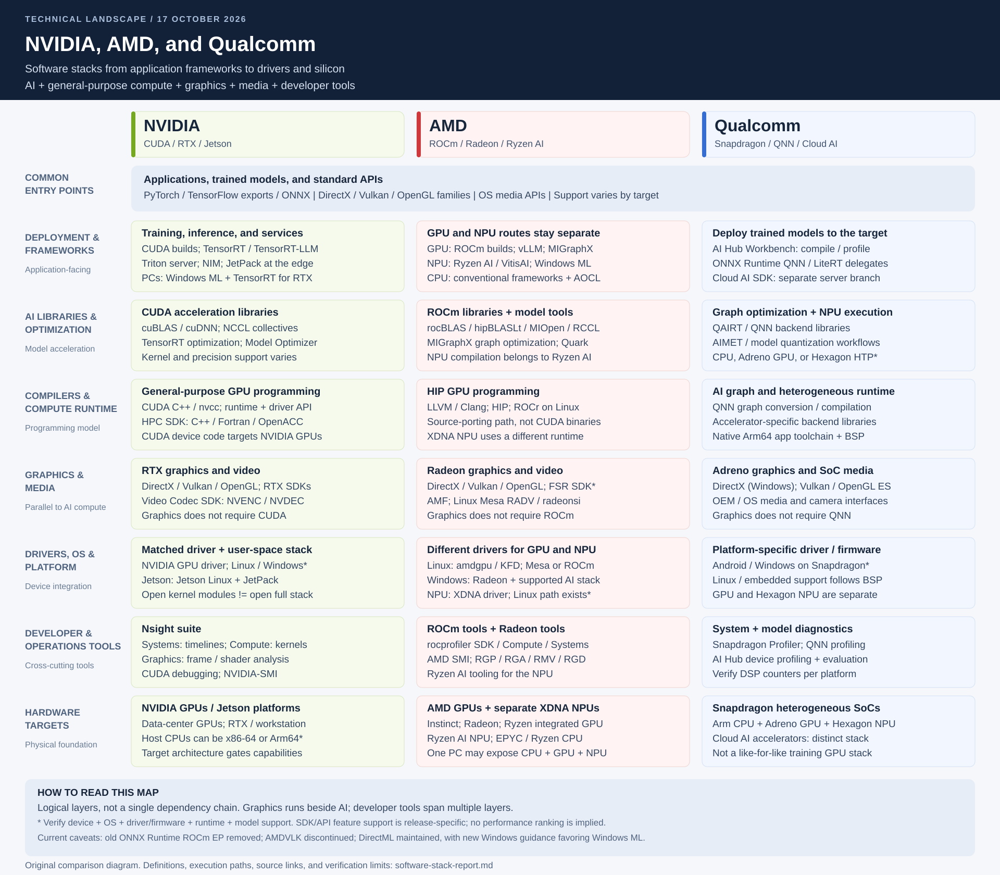

# NVIDIA, AMD, and Qualcomm: Software Stack Comparison

**Research date:** 17 October 2026  
**Scope:** AI training and inference, general-purpose compute, graphics, media, drivers, and developer tools across data centers, PCs, and edge devices.  
**Deliverables:** This technical report, the [scalable SVG diagram](./software-stack-diagram.svg), and a [PNG diagram for sharing](./software-stack-diagram.png).

This is an architectural comparison of representative stacks, not an exhaustive product catalog, installation guide, performance ranking, or hardware certification. Components shown together are not necessarily bundled together or supported on every device.

## 1. Executive summary

| Vendor | Main software families | Practical interpretation |
|---|---|---|
| **NVIDIA** | CUDA and accelerated libraries; TensorRT family; Triton Inference Server; RTX graphics; JetPack; Nsight | A GPU-compute path spanning training, inference, HPC, graphics, and supported edge platforms. RTX, data-center GPUs, and Jetson still have different deployment requirements. |
| **AMD** | ROCm/HIP for GPUs; Ryzen AI/VitisAI for NPUs; Radeon graphics/GPUOpen; AOCL for CPUs | Several distinct acceleration paths. **ROCm is not the Ryzen AI NPU runtime.** A Ryzen AI PC can expose CPU, integrated GPU, and NPU, each with different software requirements. |
| **Qualcomm** | Qualcomm AI Runtime/AI Engine Direct (QNN); AI Hub Workbench; Adreno graphics; Snapdragon Profiler; separate Cloud AI SDK | A heterogeneous, inference-oriented stack for Snapdragon CPU/GPU/NPU devices, with a separate data-center accelerator stack. **QNN is not a general-purpose CUDA equivalent.** |

**The useful comparison is workload-to-workload, not brand-to-brand:** compare NVIDIA and AMD GPU stacks for training/HPC, compare GPU and NPU paths separately for PC inference, and evaluate Snapdragon deployment against the exact SoC and operating-system image. Qualcomm's Cloud AI products should not be mistaken for the Snapdragon mobile stack. [N1] [N6] [A1] [A5] [Q1] [Q6]

## 2. Layered software-stack map



Read this as a **logical map**, not one mandatory dependency chain. Graphics and media are parallel to AI compute; profiling tools observe several layers. A graphics application does not need CUDA, ROCm, or QNN merely to draw frames.

| Layer | NVIDIA | AMD | Qualcomm |
|---|---|---|---|
| Applications | Training, inference, HPC, rendering, video, robotics | Training, inference, HPC, rendering, video, PC AI | On-device AI, mobile/PC graphics, embedded applications; separate cloud inference |
| Framework/model entry | CUDA-enabled framework builds; ONNX; Windows ML on supported PCs | ROCm-enabled framework builds; ONNX; Ryzen AI and Windows ML | Export trained models from frameworks; ONNX Runtime, LiteRT, AI Hub Workbench |
| AI libraries | cuBLAS, cuDNN, NCCL and other CUDA libraries | rocBLAS, hipBLAS/hipBLASLt, MIOpen, RCCL and other ROCm libraries | QNN accelerator-specific backend libraries; not a one-for-one BLAS/collectives substitute |
| Model optimization | TensorRT, TensorRT-LLM, TensorRT Model Optimizer | MIGraphX; AMD Quark; Ryzen AI compilation for supported NPU models | QNN conversion/compilation; AI Hub optimization and quantization workflows; AIMET-compatible inputs |
| Serving/deployment | Triton Inference Server, NIM, vLLM; JetPack for Jetson | vLLM and framework deployment on supported ROCm GPUs; application integration for Ryzen AI | Native application integration for Snapdragon; Cloud AI SDK and accelerator-specific serving integrations |
| Compute programming | CUDA C++/nvcc; CUDA runtime and driver APIs; HPC SDK | HIP C++; LLVM/Clang; HIP runtime; ROCr on Linux | QNN graph APIs and backend libraries; platform-native Arm64 application toolchains |
| Graphics | DirectX, Vulkan, OpenGL; RTX technologies | DirectX, Vulkan, OpenGL; AMD FSR SDK and GPUOpen | Adreno; DirectX on supported Windows devices; Vulkan/OpenGL ES on supported platforms |
| Media | Video Codec SDK, NVENC/NVDEC APIs | Advanced Media Framework (AMF); platform media paths | OS/OEM media and camera interfaces backed by SoC hardware |
| Driver/platform | NVIDIA GPU driver; Jetson Linux on Jetson | amdgpu/KFD and firmware on Linux; Windows GPU driver; separate XDNA NPU driver | OEM/BSP GPU and NPU drivers, firmware, and OS integration |
| Developer tools | Nsight Systems, Compute, Graphics; CUDA debugging tools | ROCm profiling tools; Radeon GPU Profiler/Analyzer/Memory Visualizer/GPU Detective | Snapdragon Profiler; QNN profiling; AI Hub device profiling/evaluation |
| CPU branch | Standard host toolchains; NVIDIA HPC SDK for supported CPU/GPU workloads | Standard toolchains; AOCL libraries for EPYC/Ryzen CPUs | Native Arm64 toolchains; CPU inference/runtime paths |

Framework, precision, accelerator, and operating-system support must be checked independently. For example, exporting a PyTorch model for QNN does not mean running arbitrary PyTorch training directly on a Hexagon NPU. [N1] [N3] [N5] [N9] [A1] [A2] [A3] [A4] [A6] [A13] [Q1] [Q3] [X4]

## 3. NVIDIA stack in detail

### Compute, training, and inference

- **CUDA Toolkit:** compiler, runtime, development tools, and supporting libraries for NVIDIA GPU applications. The toolkit and the installed GPU driver are distinct pieces.
- **Libraries:** cuBLAS accelerates linear algebra, cuDNN supplies deep-learning primitives, and NCCL supplies GPU communication collectives. Frameworks and serving engines compose these with their own kernels.
- **TensorRT:** optimizes and executes inference graphs. **TensorRT-LLM** addresses LLM inference; **TensorRT for RTX** is a PC-oriented deployment path with its own support and portability properties.
- **Serving:** Triton Inference Server handles model serving, scheduling, batching, and multiple backends. It is not the same project as the **Triton GPU programming language/compiler**. NIM is a packaged inference-service path, not a replacement name for CUDA.
- **HPC:** the NVIDIA HPC SDK adds C/C++/Fortran and directive/standard-parallel programming capabilities on supported platforms. [N1] [N2] [N3] [N4] [N9]

### Graphics, media, and edge

Graphics applications normally enter through DirectX, Vulkan, or OpenGL implementations in the graphics stack. RTX-specific capabilities sit alongside those standard APIs. Video Codec SDK exposes dedicated encode/decode hardware through NVENC/NVDEC interfaces; those engines are not CUDA cores.

For Jetson, **JetPack combines platform software with accelerated libraries**, including CUDA and TensorRT. Use the JetPack/Jetson Linux combination intended for the module rather than assuming a desktop installer is interchangeable. [N5] [N6] [N8]

### Drivers and diagnostics

The NVIDIA driver must be compatible with the application's CUDA requirements. Merely installing a toolkit does not prove a device can execute the application. Nsight Systems shows system-wide timelines, Nsight Compute analyzes CUDA kernels, and Nsight Graphics analyzes graphics workloads.

NVIDIA publishes Linux open GPU kernel modules, but they still require matching user-space driver components and firmware. **An open kernel module does not make the entire CUDA/graphics software stack open source.** [N2] [N5] [N7]

## 4. AMD stack in detail

### Branch A: ROCm GPU compute

ROCm is AMD's GPU-compute stack. HIP supplies a C++ programming interface and kernel language; the compiler/runtime path connects applications to supported GPUs. On Linux, this involves the HIP/ROCr stack and the amdgpu/KFD driver interfaces.

ROCm's libraries include rocBLAS, hipBLASLt, MIOpen, rocFFT, rocSOLVER, and RCCL. PyTorch and other framework integrations use ROCm-specific builds. vLLM also has a ROCm path, subject to its own hardware and package matrix.

**MIGraphX** is a graph optimization/inference engine and an ONNX Runtime execution-provider path. **Quark** is a model quantization toolkit, not a device driver or replacement runtime.

HIP can reduce source-porting work for CUDA-style code, but it does not establish CUDA binary compatibility or eliminate vendor-specific kernel/library tuning. Windows, WSL, and Linux availability must be evaluated separately; do not infer that every Linux ROCm component is supported identically elsewhere. [A1] [A2] [A3] [A4] [A6] [X4]

### Branch B: Ryzen AI NPU

Ryzen AI software targets AI inference on supported Ryzen AI systems. AMD's Windows ML examples use the **VitisAI execution provider** for the NPU. This is separate from using MIGraphX or ROCm on an AMD GPU.

Depending on the model and release, deployment can involve quantization, graph compilation, caching, and runtime/provider configuration. The supported precision and operator set are specific to that path.

Linux NPU support is not categorically absent: AMD maintains the **XDNA driver and XRT integration**. However, a Linux kernel driver existing does not establish parity with every Windows Ryzen AI model, tool, or API. [A5] [A7] [X2]

### Branch C: Radeon graphics and media

On Linux, **RADV is a Mesa user-space Vulkan driver**, while **amdgpu is the kernel driver**. They serve different roles. The Mesa OpenGL path is commonly associated with radeonsi. On Windows, AMD's display driver and graphics API implementations provide the corresponding graphics path.

The Radeon tool suite includes RGP for GPU profiling, RGA for shader analysis, RMV for memory analysis, and RGD for crash analysis. AMF provides media-processing interfaces. The AMD FSR SDK supplies graphics features, but its exact API and hardware support must be checked per release; it should not be assumed that every feature works on every vendor GPU.

**Current-source warning:** AMDVLK is marked discontinued. Do not use it as the default forward-looking Linux Vulkan recommendation. Also, the inspected FSR SDK README explicitly lists Vulkan as unsupported in that SDK release despite broader introductory wording. [A8] [A9] [A10] [A11] [A12]

### Branch D: CPU software

AOCL is the CPU-library family, separate from ROCm. For example, AMD's AOCL-BLAS implementation targets EPYC and Ryzen CPUs. Choosing CPU libraries does not require using either the Radeon GPU or XDNA NPU. [A13]

## 5. Qualcomm stack in detail

### Development workflow versus device runtime

These names describe different layers:

| Component | Role |
|---|---|
| **Qualcomm AI Runtime / QAIRT** | Runtime/SDK distribution terminology encountered in current downloads and version selection |
| **AI Engine Direct / QNN** | Lower-level graph APIs, tools, and accelerator-specific backend libraries |
| **AI Hub Workbench** | Developer service for compiling, profiling, and evaluating models on target devices |
| **AI Hub Models** | Model examples, export/evaluation workflows, and deployable assets |
| **ONNX Runtime QNN EP** | Connects ONNX Runtime graphs to supported QNN backends |
| **LiteRT delegate path** | Allows supported LiteRT models to use an accelerator through delegation |

AI Hub is not the on-device NPU driver. A hosted compile/profile workflow is also different from the deployed application making cloud inference requests. Proprietary models or datasets should only be submitted to hosted services after the appropriate organizational approval. No private model or workspace data was uploaded for this report. [Q1] [Q2] [Q3] [Q4]

### CPU, GPU, and NPU are separate targets

QNN provides accelerator-specific backends. The **HTP backend targets the Hexagon NPU**; Adreno GPU and CPU backends are separate choices. The ONNX Runtime documentation describes the QNN CPU backend as a reference implementation useful for integration testing, so it should not be treated as a tuned CPU baseline by default.

Graph partitioning, supported operations, tensor shapes, precision, and memory transfers determine how much work actually reaches the NPU. A successful run can include CPU fallback; output correctness alone does not prove NPU execution.

AI Hub distinguishes portable deployment representations from target-specific compiled artifacts. Its QNN context binaries target a specific SoC/NPU configuration; their documented OS portability does **not** imply portability to unrelated Snapdragon SoCs. A QNN DLC has different compatibility properties. Do not treat all Qualcomm model formats as interchangeable. [Q1] [Q2] [Q3]

### Graphics, tools, and platform integration

Adreno supplies the GPU graphics path. Graphics API availability depends on the operating system, driver, and device. Snapdragon Profiler can analyze system, graphics, and ML activity, but Qualcomm explicitly notes that DSP visibility is not available on all platforms.

Windows on Snapdragon, Android, and embedded Linux are different platform integrations. For production, use the supported OEM/BSP drivers and firmware. Mesa's Freedreno/Turnip ecosystem is a separate open-source graphics path; its existence is not a promise of feature parity with a commercial OEM image. [Q5] [Q7]

### Separate data-center branch

Qualcomm's Cloud AI SDK provides model onboarding, compilation/runtime examples, profiling, and serving integrations for Cloud AI accelerators. Its examples include accelerator-specific vLLM and Triton serving flows.

This is an **inference accelerator stack**, not the same deployment as QNN on a Snapdragon phone or PC, and not a like-for-like substitute for a general-purpose multi-GPU training stack. [Q6]

## 6. Representative execution paths

These are examples, not the only valid routes. Driver and firmware details vary by platform.

```text
NVIDIA GPU inference
Application / ONNX model
  -> TensorRT
  -> CUDA runtime + accelerated libraries
  -> compatible NVIDIA driver
  -> NVIDIA GPU

AMD GPU inference (Linux example)
Application / ONNX Runtime
  -> MIGraphX execution provider
  -> HIP / ROCm libraries and runtime
  -> amdgpu / KFD + firmware
  -> supported AMD GPU

AMD PC NPU inference (Windows example)
Application / Windows ML
  -> VitisAI execution provider
  -> Ryzen AI compilation / runtime
  -> XDNA NPU driver + firmware
  -> AMD NPU

Qualcomm NPU inference
Application / ONNX Runtime
  -> QNN execution provider
  -> QNN HTP backend
  -> platform NPU driver / firmware interfaces
  -> Qualcomm Hexagon NPU

Graphics, independently of the AI path
Game / renderer
  -> DirectX, Vulkan, or OpenGL-family API
  -> user-mode graphics driver / shader compiler
  -> kernel driver + firmware
  -> GPU
```

The GPU and NPU routes are alternatives, not stages through which every request must pass. Some applications intentionally partition work across several engines. [N2] [A4] [A5] [A9] [Q1] [Q2]

## 7. Platform and deployment boundaries

| Target environment | NVIDIA | AMD | Qualcomm |
|---|---|---|---|
| Linux training/HPC server | CUDA/framework stack on supported GPUs | ROCm/framework stack on supported GPUs | Do not assume a corresponding general-purpose training stack from QNN or Cloud AI inference support |
| Linux inference server | TensorRT, vLLM, Triton and other supported runtimes | ROCm-based vLLM/frameworks; MIGraphX where appropriate | Cloud AI SDK on matching accelerator hardware |
| Windows PC GPU | CUDA/RTX paths; Windows ML provider where supported | Supported GPU compute/inference paths; Windows ML MIGraphX; Radeon graphics | Adreno graphics and supported GPU inference APIs; verify the specific backend |
| Windows PC NPU | An NVIDIA discrete GPU is not the PC's NPU | Ryzen AI / VitisAI on supported XDNA devices | QNN on supported Hexagon NPU devices |
| Android/mobile | Do not substitute Jetson documentation for Android support | Desktop ROCm/Radeon support does not establish an Android stack | Snapdragon QNN/LiteRT/Adreno paths tied to device support |
| Embedded Linux/robotics | JetPack/Jetson Linux on supported Jetson platforms | Product-specific GPU/NPU/embedded software; verify separately | Product-specific Linux BSP, firmware, runtimes, and model support |

**Rule:** validate the tuple **device + OS + driver/firmware + runtime/provider + framework + model**. Vendor name or advertised accelerator TOPS alone is insufficient.

## 8. Windows ML: a common PC application layer

For a Windows application spanning these vendors, current Microsoft guidance makes **Windows ML**, powered by ONNX Runtime, an important shared application layer. Hardware-specific execution providers can be acquired and registered separately. [X1] [X2]

| Accelerator path | Windows ML provider name | Boundary to retain |
|---|---|---|
| NVIDIA RTX GPU | `NvTensorRtRtxExecutionProvider` | TensorRT-for-RTX provider; check its GPU/driver matrix rather than assuming all CUDA devices qualify |
| AMD GPU | `MIGraphXExecutionProvider` | Separate from the AMD NPU provider; current Microsoft documentation excludes GenAI scenarios for this particular Windows ML provider |
| AMD NPU | `VitisAIExecutionProvider` | Requires a supported Ryzen AI NPU and compatible NPU driver/provider combination |
| Qualcomm NPU | `QNNExecutionProvider` | Requires a supported Snapdragon NPU and compatible driver/provider combination |
| Broad supported Windows GPU path | DirectML provider | GPU API path, not a generic route to every vendor's NPU |

Microsoft's documentation requires **Windows 11 24H2, build 26100, or newer** for the on-demand hardware-optimized providers, plus device/driver compatibility. This condition is distinct from the broader OS support of the runtime itself.

Two migration points matter:

1. **DirectML is in sustained engineering.** It remains supported; current ONNX Runtime guidance points new Windows development toward Windows ML. This does not mean the DirectML provider has been removed. [X3]
2. **The old ONNX Runtime ROCm EP was removed in ONNX Runtime 1.23.** Its documentation directs applications toward MIGraphX; do not confuse the retired provider with retirement of ROCm itself. [A14]

An API that automatically chooses a provider does not guarantee every model will be accelerated, fit memory, or meet latency goals. Inspect provider assignment and measure actual execution.

## 9. Portability and selection guidance

### What can and cannot be shared

- **Application contracts and model intent:** often portable. Keep preprocessing, tokenization, tensor layouts, and output interpretation identical.
- **ONNX/model export:** useful interchange, not a universal performance or operator-support guarantee.
- **Quantized models:** calibration and supported precision can differ. Revalidate accuracy rather than blindly sharing one quantized artifact.
- **GPU kernels:** CUDA-to-HIP work is a source migration requiring build and performance validation; QNN generally expects graph/operator integration rather than arbitrary CUDA kernels.
- **Compiled engines/context caches:** portability depends on runtime, format, hardware, and build options. TensorRT variants and QNN DLC/context binaries have different rules.
- **Graphics APIs:** improve source portability, but shader extensions, feature levels, SDK features, and driver behavior still vary.
- **Containers:** can package user-space software, but do not remove host driver, firmware, kernel, device-access, or CPU-architecture requirements.

### Decision starting points

| Requirement | Sensible starting point |
|---|---|
| Existing application depends heavily on CUDA-specific kernels/libraries | Start with NVIDIA; estimate source-porting, library substitution, and validation work before selecting another stack |
| Training or serving on AMD Instinct / supported Radeon GPUs | Start with a validated ROCm framework/container combination, not the Ryzen AI NPU SDK |
| One Windows inference application for NVIDIA, AMD, and Qualcomm PCs | Evaluate Windows ML/ONNX Runtime with explicit provider qualification and observable fallback |
| Battery-sensitive Snapdragon inference | Evaluate QNN/HTP or an appropriate delegate using the actual device and model; measure sustained power and accuracy |
| Battery-sensitive AMD NPU inference | Evaluate Ryzen AI/VitisAI on the actual XDNA target; compare against the same PC's CPU/GPU paths |
| Jetson robotics or vision | Start with the module's supported JetPack/Jetson Linux release |
| Qualcomm data-center inference | Evaluate the Cloud AI SDK and supported serving integration, not mobile QNN assumptions |
| Cross-vendor game or visualization engine | Start with standard graphics APIs, then add optional vendor features with capability checks |

These are integration recommendations, **not measured claims about which vendor is fastest, cheapest, or most power-efficient**.

## 10. Evaluation and adoption checklist

Before choosing a production stack, require the following evidence:

1. **Reproducibility:** record exact device, CPU ISA, OS, driver, firmware, runtime/provider, framework, compiler, model, and container versions.
2. **Correctness:** compare outputs and task-level accuracy with a fixed reference dataset, including after quantization and graph optimization.
3. **Real acceleration:** capture operator placement, fallback, traces, and device utilization. Record unsupported operations and host/device copies.
4. **Latency:** distinguish cold initialization/compilation from steady state; measure p50/p95/p99 under the intended concurrency. For LLMs, distinguish time-to-first-token, prefill, and decode latency.
5. **Throughput:** measure at a fixed latency/quality target and realistic batch/context lengths, not only an unconstrained peak.
6. **Memory and power:** include model, activations, KV cache, shared/VRAM use, thermal behavior, and sustained system power.
7. **Scale:** for servers, test collectives, topology, scheduling, and multi-device behavior separately from a single-device microbenchmark.
8. **Graphics/media:** validate required API extensions, rendering correctness, frame pacing, codecs, encode quality, and SDK feature support.
9. **Deployment:** test clean installation, offline startup where required, provider acquisition, model-cache invalidation, update compatibility, and useful failure reporting.
10. **Commercial readiness:** review SDK redistribution, model licenses, firmware delivery, support lifecycle, telemetry, and hosted-service data handling.

Do not equate advertised TOPS, GPU FLOPS, or a profiler's utilization percentage with application performance.

## 11. Terminology

| Term | Meaning in this report |
|---|---|
| GPU | Programmable parallel processor used for graphics and/or general-purpose compute |
| NPU | Neural-network accelerator with a device-specific operator, precision, and runtime contract |
| EP | ONNX Runtime execution provider; maps supported graph work to a backend |
| HIP | AMD-led GPU programming API/kernel-language layer within the ROCm ecosystem |
| ROCr | ROCm's HSA-based runtime layer on the Linux GPU-compute path |
| QNN / QAIRT | Qualcomm graph/backend APIs and related AI runtime/SDK distribution terminology |
| HTP | QNN backend targeting the fused Hexagon NPU architecture |
| BSP | Board support package: product-specific OS, driver, firmware, and integration components |
| UMD / KMD | User-mode driver / kernel-mode driver |
| WinML | Windows ML; the current Windows-managed ONNX Runtime and provider deployment path discussed here |

## 12. Sources and verification limits

Sources below are vendor documentation, vendor-maintained repositories, or the upstream projects that define the relevant APIs. They were inspected on **17 October 2026**. Statements are paraphrased; vendor marketing performance claims were not used as comparative evidence.

**Verification limits:** some AMD-hosted documentation endpoints could not be retrieved in this environment. AMD-maintained GitHub sources, Microsoft/ONNX Runtime documentation, and Mesa documentation were used for the relevant architectural facts. The full release-by-release hardware matrices were not audited, and no accelerator benchmark or installation was performed. Repository default branches and documentation pages can include development or changing support information; pin releases and recheck the exact target before implementation.

### NVIDIA

- [N1] CUDA Toolkit: programming environment and scope.
- [N2] CUDA compatibility: toolkit, runtime, driver, and deployment relationships.
- [N3] TensorRT: inference products, optimization, serving integration, and RTX deployment.
- [N4] Triton Inference Server: serving responsibilities and supported backends.
- [N5] Nsight Systems: system profiling and related Nsight tools.
- [N6] JetPack: Jetson platform software and accelerated libraries.
- [N7] Open GPU kernel modules: matching user-space components and firmware.
- [N8] Video Codec SDK: encode/decode APIs and dedicated hardware.
- [N9] NVIDIA HPC SDK: CPU/GPU programming capabilities.

### AMD

- [A1] ROCm overview: scope, HIP, frameworks, and links to compatibility documentation.
- [A2] ROCm Libraries: library inventory and individual component licensing.
- [A3] ROCm Systems: HIP/runtime, communication, profiling, and management components.
- [A4] MIGraphX execution provider: AMD GPU graph-inference integration.
- [A5] Ryzen AI Windows ML tutorial: VitisAI NPU path and model workflows.
- [A6] AMD Quark: model quantization toolkit.
- [A7] AMD XDNA driver: Linux NPU driver and XRT integration.
- [A8] Radeon Developer Panel: integration with Radeon profiling, memory, ray-tracing, and crash tools.
- [A9] Mesa RADV: AMD Vulkan user-space driver and kernel-driver boundary.
- [A10] AMD FSR SDK: graphics SDK and release-specific limitations.
- [A11] AMF: media SDK and driver/API dependencies.
- [A12] AMDVLK: discontinuation notice.
- [A13] AOCL-BLAS: AMD CPU-optimized math libraries.
- [A14] ONNX Runtime ROCm EP: removal and migration notice.

### Qualcomm

- [Q1] AI Engine Direct: QNN graph/backend architecture and SDK distribution links.
- [Q2] ONNX Runtime QNN EP: backend selection and platform integration.
- [Q3] AI Hub Workbench compilation: source formats, delegates, DLC, and context binaries.
- [Q4] AI Hub Models: export, profiling, evaluation, and native application workflows.
- [Q5] Snapdragon Profiler: system/graphics profiling and platform limitations.
- [Q6] Cloud AI SDK: separate accelerator inference and serving workflows.
- [Q7] Mesa Freedreno: open-source Adreno graphics architecture.

### Shared frameworks and Windows integration

- [X1] Microsoft Windows ML overview: runtime, deployment, and hardware abstraction.
- [X2] Windows ML execution providers: provider identifiers, prerequisites, and limitations.
- [X3] ONNX Runtime DirectML EP: GPU scope and sustained-engineering status.
- [X4] vLLM stable GPU installation guide: distinct CUDA and ROCm builds/support requirements.

[N1]: https://developer.nvidia.com/cuda/toolkit
[N2]: https://docs.nvidia.com/deploy/cuda-compatibility/why-cuda-compatibility.html
[N3]: https://developer.nvidia.com/tensorrt
[N4]: https://github.com/triton-inference-server/server
[N5]: https://developer.nvidia.com/nsight-systems
[N6]: https://developer.nvidia.com/embedded/jetpack
[N7]: https://github.com/NVIDIA/open-gpu-kernel-modules
[N8]: https://developer.nvidia.com/video-codec-sdk
[N9]: https://developer.nvidia.com/hpc-sdk
[A1]: https://github.com/ROCm/legacy-rocm-build
[A2]: https://github.com/ROCm/rocm-libraries
[A3]: https://github.com/ROCm/rocm-systems
[A4]: https://onnxruntime.ai/docs/execution-providers/MIGraphX-ExecutionProvider.html
[A5]: https://github.com/amd/RyzenAI-SW/blob/main/WinML/README.md
[A6]: https://github.com/amd/Quark
[A7]: https://github.com/amd/xdna-driver
[A8]: https://github.com/GPUOpen-Tools/radeon_developer_panel
[A9]: https://docs.mesa3d.org/drivers/radv.html
[A10]: https://github.com/GPUOpen-LibrariesAndSDKs/FidelityFX-SDK
[A11]: https://github.com/GPUOpen-LibrariesAndSDKs/AMF
[A12]: https://github.com/GPUOpen-Drivers/AMDVLK
[A13]: https://github.com/amd/blis
[A14]: https://onnxruntime.ai/docs/execution-providers/ROCm-ExecutionProvider.html
[Q1]: https://www.qualcomm.com/developer/software/qualcomm-ai-engine-direct-sdk
[Q2]: https://onnxruntime.ai/docs/execution-providers/QNN-ExecutionProvider.html
[Q3]: https://workbench.aihub.qualcomm.com/docs/hub/compile_examples.html
[Q4]: https://github.com/qualcomm/ai-hub-models
[Q5]: https://www.qualcomm.com/developer/software/snapdragon-profiler
[Q6]: https://github.com/qualcomm/cloud-ai-sdk
[Q7]: https://docs.mesa3d.org/drivers/freedreno.html
[X1]: https://learn.microsoft.com/en-us/windows/ai/new-windows-ml/overview
[X2]: https://learn.microsoft.com/en-us/windows/ai/new-windows-ml/supported-execution-providers
[X3]: https://onnxruntime.ai/docs/execution-providers/DirectML-ExecutionProvider.html
[X4]: https://docs.vllm.ai/en/stable/getting_started/installation/gpu/
